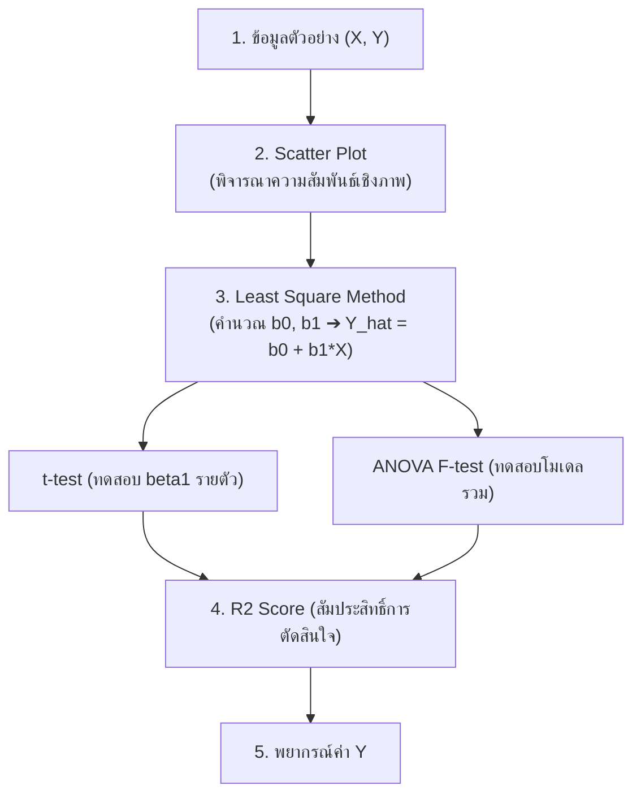

# DATA ANALYTICS - Week 06: Regression Analysis (Simple Linear)

> **วิชา:** DATA ANALYTICS AND PROGRAMMING | **สถาบัน:** คณะเทคโนโลยีสารสนเทศ
> **Source:** `Resources/Books/DATA ANALYTICS AND PROGRAMMING/Concept/data analysis6_69 st.pdf` (39 slides)

---

## Part 1: Macro Architecture & Overview

**Regression Analysis (การวิเคราะห์ความถดถอย)** คือเทคนิคทางสถิติที่ใช้ศึกษาความสัมพันธ์ระหว่างตัวแปรตั้งแต่ 2 ตัวขึ้นไป โดยมีวัตถุประสงค์หลักคือ **การพยากรณ์ (Forecasting)** ค่าของตัวแปรหนึ่ง (Y) จากตัวแปรอื่น (X) ที่ทราบล่วงหน้า เทคนิคนี้เป็นรากฐานของ Machine Learning แบบ Supervised Learning และใช้กว้างขวางในธุรกิจ วิทยาศาสตร์ และวิศวกรรม



### ตารางเปรียบเทียบประเภทการพยากรณ์

| ประเภท | หลักการ | ตัวอย่าง |
| :--- | :--- | :--- |
| **Time-Series Forecasting** | ใช้ข้อมูลในอดีตของตัวแปรเดิม | ยอดขายเดือนหน้า จากข้อมูลย้อนหลัง |
| **Causal Forecasting** | ใช้ปัจจัยที่สัมพันธ์กับตัวแปรที่ต้องการ | ยอดขายจากงบโฆษณา |

### ตารางเปรียบเทียบประเภท Regression

| ประเภท | จำนวน X | รูปสมการ |
| :--- | :--- | :--- |
| **Simple Linear Regression** | 1 ตัว | Yᵢ = β₀ + β₁Xᵢ + eᵢ |
| **Multiple Linear Regression** | k ตัว | Yᵢ = β₀ + β₁X₁ + ... + βₖXₖ + eᵢ |
| **Non-Linear Regression** | 1+ ตัว | ความสัมพันธ์ไม่เป็นเส้นตรง |

---

## Part 2: Module-by-Module Deep Dive

### 2.1 Simple Linear Regression — โครงสร้างสมการ

> 💡 **Intuition:** ลองจินตนาการว่าคุณต้องการทำนายค่าใด ๆ (เช่น หนึ่งตัวแปร Y) โดยอาศัยตัวแปรอื่นหนึ่งตัว (X) ที่คุณรู้ค่าแล้ว Simple Linear Regression เป็นวิธีที่หาความสัมพันธ์ "เป็นเส้นตรง" ระหว่าง X กับ Y ตัวอย่างเช่น "ยิ่งเรามีงบลงทุนสูงมากขึ้น ยอดขายก็ยิ่งสูงขึ้น" ความสัมพันธ์นี้มักแสดงเป็นเส้นตรง (Linear) ซึ่งจะสามารถใช้ทำนายค่า Y ได้เมื่อเรารู้ X
> [Source: generated — not verified against original document]

> **Simple Linear Regression** คือการวิเคราะห์ความสัมพันธ์ระหว่างตัวแปร 2 ตัว (X และ Y) โดยสมมติว่าความสัมพันธ์อยู่ในรูปเชิงเส้น (Linear)

**🧭 ทำความเข้าใจ** _[Source: generated — not verified against original document]_

**แตกวลีสำคัญ:**
- "ตัวแปรตาม (Y / Dependent Variable)" → ค่าที่เราต้องการคาดการณ์หรือทำนาย เช่น ยอดขาย ความพึงพอใจลูกค้า น้ำหนัก — มันขึ้นอยู่กับตัวแปรอื่น
- "ตัวแปรอิสระ (X / Independent Variable)" → ค่าที่เราใช้ในการทำนาย เช่น งบโฆษณา ระยะเวลา อายุ — เรากำหนดหรือเปลี่ยนแปลงมันได้
- "เชิงเส้น (Linear)" → ความสัมพันธ์แสดงเป็นเส้นตรง Y = a + b×X ไม่ใช่โค้ง

**ตัวอย่าง:**
- ✅ ศึกษาความสัมพันธ์ระหว่าง (จำนวนชั่วโมงในการเรียน) กับ (คะแนนสอบ) — ทั้งสองเป็นตัวแปรปริมาณ มีรูปแบบความสัมพันธ์เชิงเส้น → ใช้ Simple Linear Regression ได้
- ❌ ศึกษาความสัมพันธ์ระหว่าง (เพศ: ชาย/หญิง) กับ (ยอดขาย) — เพศเป็นตัวแปรประเภท (Categorical) ไม่ใช่ปริมาณ → ใช้ตรง ๆ แบบในบทนี้ไม่ได้ ต้องแปลงเป็น Dummy Variable (0/1) ก่อน หรือใช้ t-test เทียบค่าเฉลี่ย 2 กลุ่ม
- **ต่างกันตรง:** Simple (ง่าย) มี X เพียง 1 ตัว แต่ Multiple (หลาย) มี X หลายตัว ทำให้ซับซ้อนและต้องตรวจสอบมากขึ้น

**อย่าสับสน:** "Simple Linear Regression" ≠ "Linear Regression ง่าย ๆ" — Simple คือ "X มีแค่ 1 ตัว" Linear คือ "ความสัมพันธ์เป็นเส้นตรง" ทั้งสองเข้าด้วยกัน

**เช็คความเข้าใจ:** ถ้าต้องการศึกษาความสัมพันธ์ระหว่าง (งบโฆษณา, ราคา, ฤดูกาล) ทั้ง 3 ตัวกับยอดขาย ควรใช้ Simple Linear Regression หรือ Multiple Linear Regression เพราะเหตุใด
<details><summary>เฉลย</summary>

ควรใช้ **Multiple Linear Regression** เพราะว่า:
- ตัวแปรอิสระ (X) มี **3 ตัว**: งบโฆษณา, ราคา, ฤดูกาล
- Simple Linear Regression ใช้ได้เมื่อ X มี 1 ตัวเท่านั้น
- Multiple Linear Regression ใช้เมื่อ X มี 2 ตัวขึ้นไป
- สมการจะเป็น: Y = b₀ + b₁(งบโฆษณา) + b₂(ราคา) + b₃(ฤดูกาล)
</details>

#### ตัวแปรในสมการ

| สัญลักษณ์ | ชื่อ | ความหมาย |
| :--- | :--- | :--- |
| `Yᵢ` | Dependent Variable (ตัวแปรตาม) | ค่าที่ต้องการพยากรณ์ |
| `Xᵢ` | Independent Variable (ตัวแปรอิสระ) | ค่าที่ทราบหรือกำหนดไว้ล่วงหน้า |
| `β₀` | Y-intercept | ค่า Y เมื่อ X = 0 (ส่วนตัดแกน Y) |
| `β₁` | Slope / Regression Coefficient | อัตราการเปลี่ยนของ Y เมื่อ X เพิ่ม 1 หน่วย |
| `eᵢ` | Error Term (ความคลาดเคลื่อน) | ส่วนที่โมเดลอธิบายไม่ได้ |

**สมการถดถอยของประชากร:**
```
Yᵢ = β₀ + β₁Xᵢ + eᵢ    ; i = 1, 2, ..., N
```

**สมการถดถอยของตัวอย่าง (ค่าประมาณ):**
```
Ŷ = b₀ + b₁x
```

#### การตีความ β₁

> 💡 **Intuition:** ลองนึกว่า β₁ คือ "ค่าเกียร์" ที่บอกว่า Y จะขยับเท่าไรเมื่อ X ขยับ 1 หน่วย เครื่องหมายบอกทิศทาง (ขึ้นด้วยกันหรือสวนทาง) ส่วนขนาดบอกว่าขยับมากหรือน้อย จุดที่อุปมาจะพัง: เครื่องหมายและขนาดของ β₁ ต้องตีความในหน่วยของ X และ Y เสมอ ค่า β₁ ที่ "ใหญ่" ในหน่วยหนึ่งอาจเล็กในอีกหน่วยหนึ่ง
> [Source: generated — not verified against original document]

| เงื่อนไข | ความหมาย |
| :--- | :--- |
| β₁ > 0 | X และ Y สัมพันธ์ทิศทางเดียวกัน (X↑ → Y↑) |
| β₁ < 0 | X และ Y สัมพันธ์ทิศทางตรงข้าม (X↑ → Y↓) |
| β₁ ≈ 0 | X และ Y มีความสัมพันธ์น้อยมาก |
| β₁ = 0 | X และ Y ไม่มีความสัมพันธ์เลย |

**🧭 ทำความเข้าใจ** _[Source: generated — not verified against original document]_

**แตกวลีสำคัญ:**
- "X↑ → Y↑" → เมื่อ X เพิ่มขึ้น Y ก็มีแนวโน้มเพิ่มขึ้นด้วย (β₁ > 0)
- "หน่วย" → β₁ คือการเปลี่ยนแปลงของ Y ต่อ 1 หน่วยของ X ตามหน่วยที่ใช้จริงในข้อมูล

**ตัวอย่าง:**
- ✅ ถ้า β₁ > 0 ในข้อมูลงบโฆษณาและยอดขาย แปลว่างบที่เพิ่มขึ้นสัมพันธ์กับยอดขายที่เพิ่มขึ้น (ทิศทางเดียวกัน)
- ❌ ถ้า β₁ < 0 แล้วอ่านว่า "X เพิ่ม Y เพิ่ม" — ผิด เพราะเครื่องหมายลบหมายถึง X เพิ่ม Y ลด
- **ต่างกันตรง:** เครื่องหมายบอกทิศทาง ส่วนขนาดบอกปริมาณต่อหน่วย ต้องอ่านทั้งสองอย่างคู่กัน

**อย่าสับสน:** "β₁ ≈ 0" ไม่ได้หมายถึง "β₁ = 0 แน่นอน" แต่หมายถึงความชันที่น้อยมากในหน่วยของข้อมูล ส่วนการยืนยันว่าเป็นศูนย์หรือไม่ต้องใช้การทดสอบ t

**เช็คความเข้าใจ:** ถ้า β₁ = -2 หมายความว่าอย่างไร และถ้า X เพิ่มขึ้น 3 หน่วย Y จะเปลี่ยนเท่าไร (ภายใต้โมเดลเส้นตรง)

<details><summary>เฉลย</summary>

β₁ = -2 หมายความว่า X และ Y สัมพันธ์ทิศทางตรงข้าม คือ X เพิ่ม 1 หน่วย Y ลดลง 2 หน่วย เมื่อ X เพิ่ม 3 หน่วย Y จะเปลี่ยนไปประมาณ $-2 \times 3 = -6$ หน่วย (ลดลง 6 หน่วย)
</details>

#### สมมติฐาน (Assumptions)

> 💡 **Intuition:** ลองนึกว่าโมเดลเส้นตรงเป็นแบบจำลองที่ต้องอ่านบนสมมติว่า "ข้อผิดพลาดเป็นเพียงสัญญาณรบกวนที่สม่ำเสมอ" ข้อสมมติทั้งสามคือเงื่อนไขที่ทำให้สัญญาณรบกวนนั้นอ่านได้ ถ้าเงื่อนไขพัง ค่า t และ F ยังคำนวณได้ แต่ความหมายที่เราให้ไปจะเพี้ยน จุดที่อุปมาจะพัง: ข้อสมมติเป็นเรื่องของข้อผิดพลาด (eᵢ) ไม่ใช่ของตัวค่า Y ที่สังเกตได้โดยตรง
> [Source: generated — not verified against original document]

1. ค่า X ต้องกำหนดไว้ล่วงหน้า (Fixed)
2. eᵢ และ eⱼ เป็นอิสระต่อกัน (Independence)
3. eᵢ ~ N(0, σ²) — มีการแจกแจงปกติ ค่าเฉลี่ย = 0

**🧭 ทำความเข้าใจ** _[Source: generated — not verified against original document]_

**แตกวลีสำคัญ:**
- "Fixed" → ค่า X ถูกกำหนดหรือทราบก่อนการวิเคราะห์ ไม่ได้มาพร้อมความไม่แน่นอนที่ต้องจำลอง
- "Independence" → ความคลาดเคลื่อนแต่ละจุดไม่ขึ้นกับจุดอื่น
- "N(0, σ²)" → ความคลาดเคลื่อนรอบเส้นมีค่าเฉลี่ย 0 และมีการกระจาย (σ²) คงที่ทุกค่า X

**ตัวอย่าง:**
- ✅ ความคลาดเคลื่อนของการสังเกตทุกจุดกระจายใกล้เส้นในระดับเดียวกัน — ข้อสมมติเรื่องการกระจายคงที่น่าจะพอใช้ได้
- ❌ จุดที่ X สูงมีความคลาดเคลื่อนกระจายกว้างกว่าจุดที่ X ต่ำมาก — ค่าแปรปรวนไม่คงที่ ข้อ 3 ถูกละเมิด
- **ต่างกันตรง:** ข้อ 3 พูดถึงทั้ง "ค่าเฉลี่ย 0" และ "การกระจายคงที่" ดังนั้นต้องดูรูปแบบการกระจายของ eᵢ ด้วย ไม่ใช่ดูแค่ค่าเฉลี่ย

**อย่าสับสน:** "eᵢ" คือค่าคลาดเคลื่อนของแต่ละจุด (Y จริง − Y ที่โมเดลทำนาย) ไม่ใช่ค่าคลาดเคลื่อนมาตรฐานของ β (ที่คือ S_b)

**เช็คความเข้าใจ:** ถ้าความคลาดเคลื่อนกระจายกว้างขึ้นเรื่อย ๆ เมื่อ X เพิ่ม ข้อสมมติข้อไหนถูกละเมิด

<details><summary>เฉลย</summary>

ข้อ 3 เพราะข้อนี้กำหนดให้ eᵢ มีค่าแปรปรวน σ² คงที่ การกระจายที่เพิ่มขึ้นตาม X แปลว่าค่าแปรปรวนไม่คงที่ ซึ่งขัดกับข้อสมมตินี้
</details>

---

### 2.2 Least Square Method — การประมาณค่าพารามิเตอร์

> 💡 **Intuition:** ลองเล่นเกมหาเส้นตรงที่ "ผิดพลาดน้อยที่สุด" เมื่อคุณมีกลุ่มจุดกระจายอยู่บนแผนผัง Least Squares Method เป็นวิธีลากเส้นตรงผ่านกลุ่มจุดเหล่านี้ ในลักษณะที่ลดผลบวกของ (ระยะห่างจากจุด ยกกำลังสอง) ให้น้อยที่สุด ลักษณะการลดนี้ทำให้เส้นตรงที่ได้เป็นเส้นที่ "พอดี" หรือ "ลงตัว" ที่สุด จากทั้งกลุ่มข้อมูล
> [Source: generated — not verified against original document]

> **Least Square Method (วิธีกำลังสองน้อยที่สุด)** หาค่า b₀ และ b₁ ที่ทำให้ Σeᵢ² มีค่าต่ำสุด

**🧭 ทำความเข้าใจ** _[Source: generated — not verified against original document]_

**แตกวลีสำคัญ:**
- "Least Squares" → ลดผลบวกของ (ความผิดพลาด ยกกำลังสอง) ให้น้อยสุด = หาค่า b₀, b₁ ที่ดีที่สุดโดยคณิตศาสตร์
- "SSₓₓ (Sum of Squares of X)" → ผลบวกของ (X - ค่าเฉลี่ย X)² = วัดการกระจายของ X (ยังไม่หารด้วย n−1 จึงไม่ใช่ variance โดยตรง)
- "SSₓᵧ (Sum of Cross Products)" → ผลบวกของ (X - ค่าเฉลี่ย X) × (Y - ค่าเฉลี่ย Y) = บอกทิศทางที่ X และ Y แปรผันร่วมกัน (บวก = ไปทางเดียวกัน, ลบ = สวนทาง)

**ตัวอย่าง:**
- ✅ จากตัวอย่างยอดขายชื่อแชมพู: ด้วยการใช้สูตร Least Squares ได้ b₁ = 52.57 (= ความชัน) และ b₀ = 46.48 (= จุดตัดแกน Y) → สมการ Ŷ = 46.48 + 52.57X ให้ SSE ต่ำที่สุดสำหรับข้อมูลชุดนี้
- ❌ หากเราเลือกเส้นตรง Y = 0 + 60X แบบสุ่ม (ไม่ใช่ Least Squares) SSE (ผลบวกของส่วนต่างยกกำลังสอง) จะมากกว่าเส้น Least Squares
- **ต่างกันตรง:** Least Squares Method เป็นวิธีคณิตศาสตร์ที่รับประกันว่าจะเลือก b₀, b₁ ที่ดีที่สุด ไม่ใช่การลากเส้น "ประมาณ ๆ" แบบสายตา

**อย่าสับสน:** "Least Squares Method" ไม่ใช่ "วิธีหาเส้นง่าย ๆ" — มันเป็นเกณฑ์ทางคณิตศาสตร์ (minimize SSE) ที่มีสูตรปิด (closed-form) ให้ b₀, b₁ คำตอบเดียวสำหรับข้อมูลชุดหนึ่ง

**เช็คความเข้าใจ:** ในสูตร b₁ = SSₓᵧ / SSₓₓ ถ้า SSₓᵧ = 100 และ SSₓₓ = 50 ค่า b₁ เป็นเท่าไหร่ และหมายความว่าอะไร
<details><summary>เฉลย</summary>

b₁ = SSₓᵧ / SSₓₓ = 100 / 50 = **2**

**หมายความ:** ทุกครั้งที่ X เพิ่มขึ้น 1 หน่วย Y จะเพิ่มขึ้นโดยเฉลี่ย **2 หน่วย**

ตัวอย่างถ้า X คือ "ชั่วโมงเรียน" Y คือ "คะแนนสอบ":
- ถ้าเรียนเพิ่ม 1 ชั่วโมง คะแนนจะเพิ่มประมาณ 2 คะแนน
- ถ้าเรียนเพิ่ม 5 ชั่วโมง คะแนนจะเพิ่มประมาณ 10 คะแนน
</details>

**สูตรคำนวณ:**
```
SSₓₓ = Σxᵢ² - (Σxᵢ)²/n

SSₓᵧ = Σxᵢyᵢ - (Σxᵢ)(Σyᵢ)/n

b₁ = SSₓᵧ / SSₓₓ

b₀ = ȳ - b₁x̄
```

#### ตัวอย่าง: ยอดขาย Shampoo กับงบโฆษณาวิทยุ (10 เดือน)

| ตัวแปร | คำอธิบาย | หน่วย |
| :--- | :--- | :--- |
| Y | ยอดขาย | 10,000 บาท |
| X | ค่าโฆษณาวิทยุ | 10,000 บาท |

```
ผลรวม: Σx = 9.4,  Σy = 959,  Σxy = 924.8,  Σx² = 9.28,  n = 10

SSₓₓ = 9.28 - (9.4²/10) = 0.444
SSₓᵧ = 924.8 - (9.4 × 959/10) = 23.34

b₁ = 23.34 / 0.444 = 52.57 → ค่าโฆษณา 1 หมื่นบาท = ยอดขายเพิ่ม 52.57 หมื่นบาท
x̄ = 0.94,  ȳ = 95.9
b₀ = 95.9 - 52.57(0.94) = 46.48

∴ สมการถดถอย:  Y = 46.48 + 52.57x
```

**การตีความ:** เพิ่มงบโฆษณาวิทยุ 10,000 บาท → ยอดขายเพิ่มขึ้น **525,700 บาท**

---

### 2.3 การทดสอบสมมติฐาน

#### t-test สำหรับ β₁ (ทดสอบว่ามีความสัมพันธ์หรือไม่)

> 💡 **Intuition:** ลองนึกว่า b₁ คือสัญญาณที่เราเห็น และ Sb₁ คือความสั่นหรือความไม่แน่นอนของสัญญาณนั้น t คืออัตราส่วนระหว่างสองอย่างนี้ ถ้าสัญญาณแรงกว่าความสั่นมาก (|t| ใหญ่) เราจึงเชื่อว่าความชันไม่ได้เป็นศูนย์โดยบังเอิญ จุดที่อุปมาจะพัง: t ใหญ่ไม่ได้แปลว่า X อธิบาย Y ได้มาก มันบอกแค่ว่ามีหลักฐานว่าความชันไม่เป็นศูนย์ ความแรงของความสัมพันธ์ต้องดูจาก R²
> [Source: generated — not verified against original document]

```
H₀: β₁ = 0   (ไม่มีความสัมพันธ์เชิงเส้น)
H₁: β₁ ≠ 0

t_cal = b₁ / Sb₁

โดยที่  S² = (SSᵧᵧ - b₁·SSₓᵧ) / (n-2)
        Sb₁ = S / √SSₓₓ
```

**เขตปฏิเสธ:** ปฏิเสธ H₀ ถ้า |t_cal| > t(α/2, n-2) หรือ Sig < α

**ผลตัวอย่าง:**
```
SSᵧᵧ = 93569 - (959²/10) = 1600.9
S² = (1600.9 - 52.57×23.34) / 8 = 46.74  →  S = 6.84
t_cal = 52.57 / (6.84/√0.444) = 5.12

5.12 > t(0.025, 8) = 2.31  →  ปฏิเสธ H₀
∴ X และ Y สัมพันธ์กันเชิงเส้น ที่ระดับนัยสำคัญ 0.05
```

**🧭 ทำความเข้าใจ** _[Source: generated — not verified against original document]_

**แตกวลีสำคัญ:**
- "H₀: β₁ = 0" → สมมติฐานว่า X ไม่มีความสัมพันธ์เชิงเส้นกับ Y
- "Sb₁ = S / √SSₓₓ" → ค่าความไม่แน่นอนของความชัน b₁ (ยิ่งเล็กยิ่งมั่นใจค่า b₁ มาก)
- "|t_cal| > t(α/2, n-2)" → ถ้าค่าสัมบูรณ์ของ t เกินเกณฑ์ที่ df = n-2 ให้ปฏิเสธ H₀

**ตัวอย่าง:**
- ✅ ตัวอย่างนี้ t_cal = 5.12 > 2.31 → ปฏิเสธ H₀ แปลว่ามีหลักฐานว่าความชันไม่เป็นศูนย์
- ❌ ถ้า b₁ เล็กมากเมื่อเทียบกับ Sb₁ (ความไม่แน่นอนใหญ่กว่าตัวความชันเอง) → |t| จะเล็ก → ไม่ปฏิเสธ H₀ ไม่ได้แปลว่า β₁ เป็นศูนย์แน่นอน
- **ต่างกันตรง:** ดูที่ |t| เทียบกับเกณฑ์ ไม่ใช่ดูที่เครื่องหมายหรือขนาดของ b₁ เพียงอย่างเดียว

**อย่าสับสน:** "t-test ของ β₁" ตอบคำถาม "มีความสัมพันธ์หรือไม่" ไม่ได้ตอบ "ความสัมพันธ์แรงแค่ไหน" (อย่างหลังดูจาก R²)

**เช็คความเข้าใจ:** ถ้า t_cal ของ β₁ เป็น -5.12 แทน 5.12 การตัดสินใจเปลี่ยนไหม และผลสรุปเปลี่ยนอย่างไร

<details><summary>เฉลย</summary>

การตัดสินใจไม่เปลี่ยน เพราะเกณฑ์ใช้ |t| = 5.12 > 2.31 จึงยังปฏิเสธ H₀ สิ่งที่เปลี่ยนคือทิศทาง: เครื่องหมายลบแปลว่า β₁ < 0 คือ X กับ Y สัมพันธ์ทิศทางตรงข้ามกัน
</details>

#### ANOVA F-test สำหรับทั้งโมเดล

| แหล่งความผันแปร | DF | SS | MS | F |
| :--- | :--- | :--- | :--- | :--- |
| Regression | 1 | SSR = 1226.93 | MSR = 1226.93 | 26.24 |
| Error | n-2 = 8 | SSE = 373.97 | MSE = 46.75 | — |
| Total | n-1 = 9 | SST = 1600.90 | — | — |

```
F_cal = 26.24 > F(0.05; 1, 8) = 5.32  →  ปฏิเสธ H₀
∴ ผลเหมือนกับ t-test (F = t²)
```

#### t-test สำหรับ β₀

```
H₀: β₀ = 0  →  H₁: β₀ ≠ 0
t_cal = b₀ / Sb₀ = 46.48 / 9.88 = 4.70
4.70 > 2.31  →  ปฏิเสธ H₀  ∴ กราฟไม่ผ่านจุดกำเนิด
```

---

### 2.4 Coefficient of Determination (R²)

> 💡 **Intuition:** ลองนึกถึง R² ว่าเป็นการวัด "ความพอดี (Goodness of Fit)" ของโมเดล ถ้า R² = 0.9 หมายความว่า "90% ของความแปรปรวนในข้อมูล Y อธิบายได้ด้วย X ส่วนที่เหลือ 10% อาจจากปัจจัยอื่นหรือความผิดพลาดสุ่ม" R² สูง = โมเดลจับความสัมพันธ์ได้ดี R² ต่ำ = X อธิบาย Y ได้น้อย
> [Source: generated — not verified against original document]

> **R²** คือสัดส่วนที่ X อธิบายการเปลี่ยนแปลงของ Y ได้ (0 ≤ R² ≤ 1)

```
R² = SSR / SST = 1226.93 / 1600.9 = 0.766

∴ ค่าโฆษณาอธิบายยอดขายได้ 76.6%
```

**🧭 ทำความเข้าใจ** _[Source: generated — not verified against original document]_

**แตกวลีสำคัญ:**
- "SSR (Sum of Squares Regression)" → ความแปรปรวนที่ Model สามารถอธิบายได้ = ผลบวกของ (ค่าคาดการณ์ - ค่าเฉลี่ยจริง)²
- "SST (Sum of Squares Total)" → ความแปรปรวนรวมทั้งหมดของข้อมูล Y = ผลบวกของ (ค่าจริง - ค่าเฉลี่ยจริง)²
- "R² = SSR / SST" → สัดส่วน = ความแปรปรวนที่ Model อธิบาย ÷ ความแปรปรวนรวม

**ตัวอย่าง:**
- ✅ R² = 0.766 → 76.6% ของความแปรปรวนของยอดขายอธิบายได้ด้วยค่าโฆษณา อีก 23.4% มาจากปัจจัยอื่น → โมเดลค่อนข้างดี ใช้ทำนายได้
- ❌ R² = 0.1 → โมเดลอธิบายได้เพียง 10% → ส่วนใหญ่ของความแปรปรวนมาจากสิ่งอื่น ไม่ใช่ X → โมเดลไม่ดี ไม่ควรใช้ทำนาย
- **ต่างกันตรง:** R² สูง (เช่น 0.9) ไม่ได้หมายความว่า "ทำนายแม่นยำ 90%" แต่หมายถึง "อธิบายความแปรปรวนได้ 90%"

**อย่าสับสน:** "R² = 0.5" ≠ "โมเดลดี 50%" — R² = 0.5 หมายถึง "อธิบายความแปรปรวนได้ 50%" เกณฑ์ว่าสูงหรือต่ำขึ้นกับสาขาข้อมูล ไม่มีค่าตายตัว

**เช็คความเข้าใจ:** ถ้า R² = 0.25 ในโมเดล A และ R² = 0.81 ในโมเดล B โมเดลไหนดีกว่า แล้วความแตกต่างมีขนาดเท่าไหร่
<details><summary>เฉลย</summary>

โมเดล **B ดีกว่า** เพราะ R² = 0.81 > 0.25

- **โมเดล A:** R² = 0.25 = อธิบายความแปรปรวนได้ 25% (ต่ำ)
- **โมเดล B:** R² = 0.81 = อธิบายความแปรปรวนได้ 81% (สูง)

**ความแตกต่าง:** 0.81 - 0.25 = 0.56 = 56 เปอร์เซ็นต์พอยต์ → โมเดล B อธิบายได้ดีกว่า A ถึง 56 จุดเปอร์เซ็นต์
</details>

**ผลจาก SPSS:**

| R | R² | Adjusted R² | Std. Error |
| :--- | :--- | :--- | :--- |
| 0.875 | 0.766 | 0.737 | 6.837 |

**การพยากรณ์:** โฆษณา 7,000 บาท (X = 0.7):
```
Y = 46.48 + 52.57(0.7) = 83.28 หมื่นบาท = 832,800 บาท
```

---

### 2.5 ขั้นตอนสรุป

```text
1. ตรวจว่า X, Y เป็นตัวแปรเชิงปริมาณ
2. วาด Scatter Plot → ดูรูปแบบความสัมพันธ์
3. ตรวจสอบ Assumptions
4. คำนวณ b₀, b₁ (Least Square)
5. ทดสอบ β₁ และ β₀
6. คำนวณ R²
7. ใช้สมการพยากรณ์ Y จาก X
```

---

## Part 3: Quick Reference & Exam Cheat Sheet

### Checklist สรุปหัวใจสำคัญก่อนสอบ

* [ ] **ตัวแปร:** Y = Dependent, X = Independent — ต้องเป็น Quantitative ทั้งคู่
* [ ] **สมการ:** Ŷ = b₀ + b₁x (ตัวอย่าง), Yᵢ = β₀ + β₁Xᵢ + eᵢ (ประชากร)
* [ ] **b₁ = SSₓᵧ/SSₓₓ** → ค่าความชัน
* [ ] **b₀ = ȳ - b₁x̄** → จุดตัดแกน Y
* [ ] **t-test β₁:** H₀: β₁=0 → ปฏิเสธ = มีความสัมพันธ์เชิงเส้น
* [ ] **F-test ANOVA:** เทียบเท่า t-test สำหรับ β₁ (F = t²)
* [ ] **R² = SSR/SST:** ยิ่งใกล้ 1 ยิ่งดี

### สรุปสูตรสำคัญ

| สูตร | ความหมาย |
| :--- | :--- |
| `SSₓₓ = Σx² - (Σx)²/n` | Sum of Squares ของ X |
| `SSₓᵧ = Σxy - (Σx)(Σy)/n` | Sum of Cross Products |
| `b₁ = SSₓᵧ / SSₓₓ` | Slope |
| `b₀ = ȳ - b₁x̄` | Intercept |
| `S² = (SSᵧᵧ - b₁SSₓᵧ)/(n-2)` | MSE |
| `R² = SSR/SST` | Goodness of Fit |

### Concept Map

```text
Simple Linear Regression
├── สมการ: Ŷ = b₀ + b₁x
├── Least Square Method
│   ├── SSₓₓ, SSₓᵧ
│   ├── b₁ = SSₓᵧ/SSₓₓ
│   └── b₀ = ȳ - b₁x̄
├── Hypothesis Testing
│   ├── t-test (β₀, β₁)
│   └── ANOVA F-test
└── R² → Goodness of Fit
```

---

## ⚠️ Common Pitfalls & Exam Traps

* **β₁ = 0 ≠ ไม่มีความสัมพันธ์ใดๆ:** แค่ไม่มีความสัมพันธ์เชิงเส้น อาจมีแบบ Non-Linear ได้
* **R² สูง ≠ โมเดลดีเสมอ:** ต้องทดสอบ Significance ด้วย — R² ที่สูงแต่ไม่ Significant ไม่มีประโยชน์
* **หน่วยของ b₀ และ b₁:** ต้องมีหน่วยเดียวกับ Y เสมอ
* **Regression ≠ Causation:** ความสัมพันธ์ไม่ได้หมายความว่า X เป็นสาเหตุของ Y
* **DF ของ Error = n-2:** ต้องมีข้อมูลอย่างน้อย n > 2 จึงจะทดสอบได้
* **ตรวจ Scatter Plot ก่อนเสมอ:** ถ้าความสัมพันธ์ไม่เป็นเส้นตรง ไม่ควรใช้ Linear Regression

---

## เอกสารเชื่อมโยง (Wiki-Style Backlinks)

* **วิชาและหัวข้อที่เกี่ยวข้อง:**
  * [[Chapter 07 Multiple Regression Analysis]] (ต่อยอดจาก Simple → Multiple Regression)
  * [[Chapter 08 Discriminant Analysis]] (จำแนกกลุ่ม ใช้แนวคิดคล้าย Regression)
  * [[Chapter 10 Time Series and Forecasting]] (อีกแนวทางการพยากรณ์)

* **แหล่งข้อมูล:**
  * Source: `Resources/Books/DATA ANALYTICS AND PROGRAMMING/Concept/data analysis6_69 st.pdf` (39 slides, คณะเทคโนโลยีสารสนเทศ)
