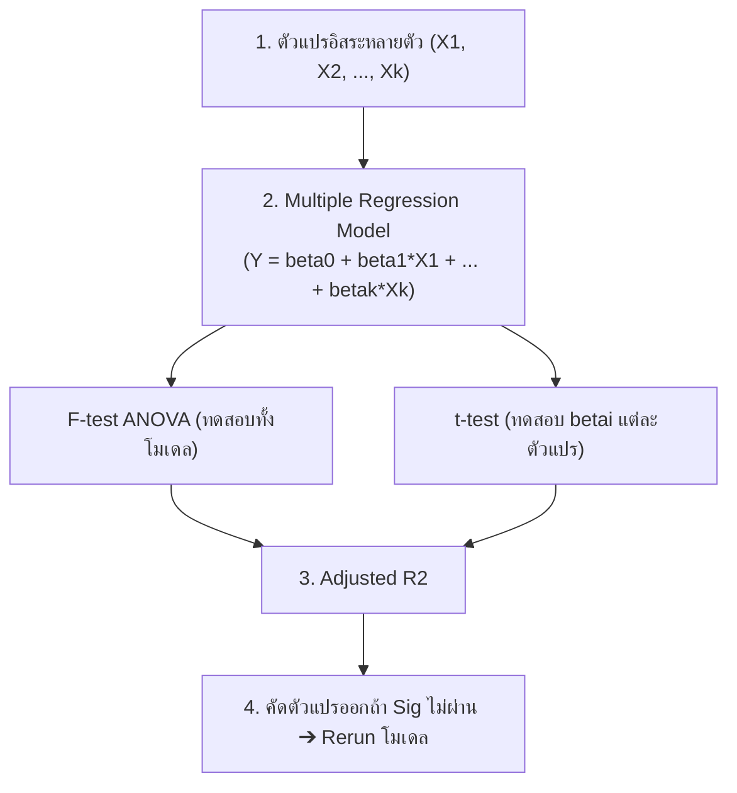

# DATA ANALYTICS - Week 07: Multiple Regression Analysis

> **วิชา:** DATA ANALYTICS AND PROGRAMMING | **สถาบัน:** คณะเทคโนโลยีสารสนเทศ
> **Source:** `Resources/Books/DATA ANALYTICS AND PROGRAMMING/Concept/data analysis7_69 st.pdf` (35 slides)

---

## Part 1: Macro Architecture & Overview

**Multiple Regression Analysis (การวิเคราะห์ความถดถอยเชิงซ้อน/เชิงพหุ)** คือส่วนขยายของ Simple Linear Regression ที่ใช้ตัวแปรอิสระ (X) หลายตัวพร้อมกันในการอธิบายและพยากรณ์ค่าตัวแปรตาม (Y) แนวคิดนี้สำคัญมากเพราะในความเป็นจริง ปรากฏการณ์ต่างๆ มักถูกกำหนดโดยหลายปัจจัยพร้อมกัน ไม่ใช่ปัจจัยเดียว เช่น ต้นทุนการผลิตขึ้นอยู่กับทั้งปริมาณวัตถุดิบ เวลาเครื่องจักร และต้นทุนคงที่



### ตารางเปรียบเทียบ Simple vs Multiple Regression

| Feature | Simple Linear | Multiple Linear |
| :--- | :--- | :--- |
| จำนวน X | 1 ตัว | k ตัว (k ≥ 2) |
| สมการ | Ŷ = b₀ + b₁x | Ŷ = b₀ + b₁x₁ + ... + bₖxₖ |
| การทดสอบ | t-test β₁ | F-test + t-test แต่ละ βᵢ |
| Goodness of Fit | R² | **Adjusted R²** (ใช้แทน R²) |
| DF Error | n-2 | n-k-1 |

---

## Part 2: Module-by-Module Deep Dive

### 2.1 สมการถดถอยเชิงซ้อน

> 💡 **Intuition:** ลองนึกว่าคุณต้องการทำนายราคาบ้าน แต่ราคาบ้านไม่ได้ขึ้นอยู่กับจำนวนห้องนอนแค่อย่างเดียว มันขึ้นอยู่กับหลายปัจจัยพร้อม ๆ กัน เช่น พื้นที่ ระยะห่างจาก BTS ปีที่สร้าง Multiple Regression เป็นวิธีการสร้างโมเดลที่พิจารณา **หลายตัวแปร X** ในคราวเดียว แทนที่จะพิจารณา X เพียงหนึ่งตัว เช่นเดิม โมเดลนี้ดีกว่า Simple Regression ในสถานการณ์จริง เพราะส่วนใหญ่ผลลัพธ์ (Y) มาจากหลายปัจจัยพร้อม ๆ กัน
> [Source: generated — not verified against original document]

> **Multiple Regression** คือ: Yᵢ = β₀ + β₁X₁ᵢ + β₂X₂ᵢ + ... + βₖXₖᵢ + eᵢ

**🧭 ทำความเข้าใจ** _[Source: generated — not verified against original document]_

**แตกวลีสำคัญ:**
- "Multiple" → หลายตัว = ตัวแปรอิสระ (X) มีมากกว่า 1 ตัว (เหมือนโรงอาหารที่มีเมนูหลากหลาย ไม่ใช่เมนูเดียว)
- "k" → จำนวนตัวแปร X (เช่น k=3 หมายความว่า มี X₁, X₂, X₃ สามตัว)
- "Partial Regression Coefficient (βᵢ)" → ค่าสัมประสิทธิ์ที่บอกผลของ Xᵢ ต่อ Y โดยให้ X ตัวอื่น คงที่ (คำว่า "Partial" = แยกผลเฉพาะของ Xᵢ ออกมา โดยควบคุม X ตัวอื่นไว้)

**ตัวอย่าง:**
- ✅ ศึกษาราคาบ้าน (Y) จากพื้นที่ (X₁), ระยะห่างจาก BTS (X₂), อายุบ้าน (X₃) → ใช้ Multiple Regression ได้ เพราะ X มี 3 ตัว
- ❌ ศึกษาราคาบ้าน จากพื้นที่เท่านั้น → ใช้ Simple Linear Regression (X เพียง 1 ตัว)
- **ต่างกันตรง:** Simple ใช้ 1 X, Multiple ใช้ 2+ X

**อย่าสับสน:** "Multiple Regression" ไม่ได้หมายถึง "ทำการวิเคราะห์หลายครั้ง" แต่หมายถึง "ใช้ตัวแปร X หลายตัวในโมเดลเดียว"

**เช็คความเข้าใจ:** ถ้าสมการ Y = 10 + 2X₁ + 3X₂ ค่า β₁ = 2 หมายความว่าอะไร และบอกได้ไหมว่า X₁ เพิ่ม 1 หน่วย Y จะเพิ่มเท่าไหร่
<details><summary>เฉลย</summary>

**β₁ = 2 หมายความว่า:** เมื่อ X₁ เพิ่มขึ้น 1 หน่วย (และ X₂ คงที่) Y จะเพิ่มขึ้นโดยเฉลี่ย **2 หน่วย**

**ตัวอย่าง:** ถ้า X₁ = พื้นที่บ้าน, X₂ = ระยะห่างจาก BTS, Y = ราคา
- ถ้าพื้นที่บ้านเพิ่ม 1 ตร.ม. (ระยะห่างจาก BTS เท่าเดิม) ราคาจะเพิ่มขึ้น 2 หน่วย (เช่น 2 แสนบาท)
- ถ้าพื้นที่เพิ่ม 10 ตร.ม. ราคาจะเพิ่ม 10 × 2 = 20 หน่วย (20 แสนบาท = 2 ล้านบาท)

**หมายเหตุ:** การตีความนี้ใช้เงื่อนไข "X₂ คงที่" ถ้า X₂ เปลี่ยนไปพร้อมกัน Y จะเปลี่ยนเพิ่มอีก 3 หน่วยต่อ X₂ ที่เพิ่ม 1 หน่วย
</details>

#### ความหมายของ βᵢ (Partial Regression Coefficient)

> 💡 **Intuition:** ลองนึกว่าเราอยากรู้ผลของรายได้ต่อการซื้อหนังสือ แต่อายุของคนก็เปลี่ยนไปด้วย ถ้าไม่ "คงอายุไว้" ตัวเลขจะปนกันว่ามาจากรายได้หรืออายุ βᵢ คือการแยกผลของ Xᵢ ออกมาโดยยึดตัวแปรอื่นไว้เหมือนเดิม จุดที่อุปมาจะพัง: ถ้าตัวแปรอิสระสัมพันธ์กันเองมาก การ "คงที่" ทำได้ยากในข้อมูลจริง (ดูข้อสมมติข้อ 4)
> [Source: generated — not verified against original document]

> **Partial Regression Coefficient (βᵢ)** คืออัตราการเปลี่ยนแปลงของ Y เมื่อ Xᵢ เพิ่ม 1 หน่วย **โดยที่ตัวแปร X ตัวอื่นๆ คงที่**

**ตัวอย่าง:**
```
ค่าใช้จ่าย = β₀ + β₁(รายได้) + β₂(อายุ) + e

ถ้า β₁ = 0.2:  รายได้เพิ่ม 1 บาท → ซื้อหนังสือเพิ่ม 0.2 บาท (อายุคงที่)
ถ้า β₂ = 10:  อายุเพิ่ม 1 ปี   → ซื้อหนังสือเพิ่ม 10 บาท (รายได้คงที่)
```

**🧭 ทำความเข้าใจ** _[Source: generated — not verified against original document]_

**แตกวลีสำคัญ:**
- "Partial" → ส่วนเฉพาะที่ Xᵢ อธิบาย Y ได้ หลังจากคุมตัวแปรอื่นให้คงที่
- "โดยที่ X ตัวอื่น ๆ คงที่" → เงื่อนไขที่ทำให้ βᵢ มีความหมาย อ่านผลของ Xᵢ ทีละ 1 หน่วยโดยไม่มีตัวแปรอื่นมาปน
- "β₁ = 0.2" → ทุกรายได้เพิ่ม 1 บาท ค่าใช้จ่ายเพิ่ม 0.2 บาท เมื่ออายุคงที่

**ตัวอย่าง:**
- ✅ อ่าน "β₂ = 10" ว่า "อายุเพิ่ม 1 ปี ซื้อหนังสือเพิ่ม 10 บาท เมื่อรายได้คงที่" — ครบเงื่อนไข
- ❌ อ่าน "β₂ = 10" ว่า "อายุเพิ่ม 1 ปี ทำให้ซื้อหนังสือเพิ่ม 10 บาท" โดยไม่บอกว่ารายได้คงที่ — ขาดเงื่อนไข ทำให้เข้าใจว่าเป็นผลรวมของทุกอย่าง
- **ต่างกันตรง:** ต้องมีวลี "X ตัวอื่นคงที่" กำกับ ถ้าไม่มี ค่าที่อ่านไม่ใช่ βᵢ

**อย่าสับสน:** "βᵢ (Partial)" ไม่ได้หมายถึงความสัมพันธ์รวมระหว่าง Xᵢ กับ Y ที่ได้จากการดูทีละตัวใน Simple Regression

**เช็คความเข้าใจ:** จากสมการ ค่าใช้จ่าย = β₀ + β₁(รายได้) + β₂(อายุ) โดย β₁ = 0.2 ถ้ารายได้เพิ่ม 100 บาท และอายุเท่าเดิม ค่าใช้จ่ายเพิ่มเท่าไร

<details><summary>เฉลย</summary>

0.2 × 100 = 20 บาท (อายุคงที่ จึงไม่มีผลจาก β₂)
</details>

#### สมมติฐาน (Assumptions)

> 💡 **Intuition:** ลองนึกว่าข้อสมมติเป็นกติกาของการ "ชั่งน้ำหนักหลายอย่างพร้อมกัน" ข้อ 1–3 คือเงื่อนไขให้ตาชั่งไม่เอียงและไม่แกว่งตามตำแหน่ง ส่วนข้อ 4 คือถ้าสิ่งที่วางบนตาชั่งลอกกันหมด ตาชั่งจะแยกไม่ออกว่าน้ำหนักมาจากตัวไหน จุดที่อุปมาจะพัง: ข้อ 4 เป็นปัญหาของ X ด้วยกันเอง ไม่ใช่ปัญหาของความคลาดเคลื่อน eᵢ
> [Source: generated — not verified against original document]

1. ความคลาดเคลื่อน eᵢ ~ N(0, σ²)
2. Variance ของ eᵢ คงที่ (Homoscedasticity)
3. eᵢ และ eⱼ เป็นอิสระต่อกัน
4. **X ตัวอิสระต้องไม่สัมพันธ์กันเอง** → ถ้าสัมพันธ์กัน เรียกว่า **Multicollinearity**

**🧭 ทำความเข้าใจ** _[Source: generated — not verified against original document]_

**แตกวลีสำคัญ:**
- "Homoscedasticity" → ค่าแปรปรวนของ eᵢ คงที่ทุกระดับของ X (ข้อ 2)
- "Multicollinearity" → ตัวแปรอิสระ X สัมพันธ์กันเอง ทำให้แยกผลของแต่ละตัวออกจากกันได้ยาก
- "X ด้วยกัน" ≠ "X กับ Y" → ข้อ 4 พูดถึงความสัมพันธ์ระหว่าง X ด้วยกันเท่านั้น ความสัมพันธ์ระหว่าง X กับ Y คือสิ่งที่โมเดลต้องการให้มี

**ตัวอย่าง:**
- ✅ X = รายได้ และ X = อายุ ที่แทบไม่เกี่ยวข้องกัน — ข้อ 4 น่าจะพอใช้ได้
- ❌ ใส่ "อุณหภูมิเป็นองศาเซลเซียส" และ "อุณหภูมิเป็นองศาฟาเรนไฮต์" ลงในโมเดลเดียวกัน — สองตัวนี้คำนวณซึ่งกันและกันได้ (F = 1.8C + 32) จึงเป็น Multicollinearity อย่างสมบูรณ์
- **ต่างกันตรง:** ดูว่า X สองตัวให้ข้อมูลซ้ำกันหรือไม่ ไม่ใช่ดูว่า X ตัวไหนสัมพันธ์กับ Y

**อย่าสับสน:** "Multicollinearity" ไม่ได้หมายถึง "X สัมพันธ์กับ Y" ซึ่งเป็นสิ่งที่โมเดลต้องการ แต่หมายถึง "X สัมพันธ์กับ X"

**เช็คความเข้าใจ:** ถ้าใส่ "อุณหภูมิ (°C)" และ "อุณหภูมิ (°F)" ลงโมเดลเดียวกัน ข้อสมมติข้อใดถูกละเมิดและเพราะอะไร

<details><summary>เฉลย</summary>

ข้อ 4 เพราะสองตัวนี้เป็นการแปลงหน่วยของกันและกัน (F = 1.8C + 32) จึงสัมพันธ์กันเชิงเส้นอย่างสมบูรณ์ ทำให้โมเดลแยกผลของแต่ละตัวไม่ได้
</details>

---

### 2.2 การประมาณค่าพารามิเตอร์ (Least Square Method)

ใช้วิธีเดียวกับ Simple Regression แต่ต้องแก้สมการเป็นระบบ Matrix → ในทางปฏิบัติใช้ **SPSS** คำนวณ

**สมการของตัวอย่าง:**
```
Ŷ = b₀ + b₁x₁ + b₂x₂ + ... + bₖxₖ
```

---

### 2.3 เทคนิคการเลือกตัวแปรอิสระเข้าสมการ (Variable Selection)

> 💡 **Intuition:** ลองนึกว่าเราคัดคนเข้าทีมจากผู้สมัครหลายคน แต่ละวิธีคือกติกาการคัดเลือก Enter คือรับทุกคนพร้อมกัน Forward คือเริ่มจากทีมว่างแล้วรับทีละคน Backward คือเริ่มจากทีมเต็มแล้วปล่อยทีละคน Stepwise คือผสมทั้งรับและปล่อยในแต่ละรอบ จุดที่อุปมาจะพัง: กติกาทางสถิติ (ดูค่า Sig/F) อาจไม่ตรงกับเหตุผลเชิงทฤษฎีเสมอไป
> [Source: generated — not verified against original document]

| เทคนิค | วิธีการ | เหมาะกับ |
| :--- | :--- | :--- |
| **Enter** | นำตัวแปรทั้งหมดที่กำหนดเข้าพร้อมกัน | ผู้วิจัยกำหนดตัวแปรได้ชัดเจน |
| **Forward** | เริ่มจากไม่มีตัวแปร → เพิ่มทีละตัว | ต้องการโมเดลประหยัด |
| **Backward** | เริ่มจากทุกตัวแปร → ตัดทีละตัว | มีตัวแปรจำนวนมาก |
| **Stepwise** | ผสม Forward + Backward | ทั่วไป (นิยมที่สุด) |
| **Remove** | ผู้วิจัยกำหนดตัวแปรที่จะเอาออก | ต้องการทดสอบ hypothesis เฉพาะ |

**🧭 ทำความเข้าใจ** _[Source: generated — not verified against original document]_

**แตกวลีสำคัญ:**
- "Forward" → เริ่มจากไม่มี X เลย แล้วเพิ่มตัวที่ช่วยอธิบายได้มากที่สุดทีละตัว
- "Backward" → เริ่มจากมี X ทุกตัว แล้วตัดตัวที่ไม่มีนัยสำคัญออกทีละตัว
- "Stepwise" → ทำทั้งการเพิ่มและการตัดในแต่ละรอบ
- "Remove" → ผู้วิจัยสั่งเอาตัวแปรที่กำหนดออกเอง ไม่ได้ให้โปรแกรมเลือกตามเกณฑ์

**ตัวอย่าง:**
- ✅ ผู้วิจัยมีทฤษฎีชัดว่าต้องใช้ตัวแปร 3 ตัวนี้ → ใช้ Enter
- ❌ มีตัวแปรจำนวนมากแล้วต้องการโมเดลที่ประหยัด แต่ใช้ Enter ทุกตัว → ได้โมเดลที่ใหญ่เกินจำเป็น ควรใช้ Forward, Backward หรือ Stepwise ตามตาราง
- **ต่างกันตรง:** คำถามคือ "ใครเป็นคนตัดสินว่าตัวแปรใดอยู่หรือไป" — ผู้วิจัยกำหนดเอง (Enter, Remove) หรือโปรแกรมคัดตามเกณฑ์สถิติ (Forward, Backward, Stepwise)

**อย่าสับสน:** "Remove" ไม่เหมือน "Backward" — Remove ผู้วิจัยสั่งเอง ส่วน Backward โปรแกรมตัดตามเกณฑ์สถิติ

**เช็คความเข้าใจ:** ต้องการทดสอบเฉพาะว่าตัวแปร X₃ ช่วยเพิ่มการอธิบายหรือไม่ โดยไม่ให้โปรแกรมเลือกตัวอื่น ควรใช้วิธีใด

<details><summary>เฉลย</summary>

ใช้ **Remove** เพราะผู้วิจัยกำหนดตัวแปรที่จะเอาออกเอง และตารางระบุว่าเหมาะกับการทดสอบ hypothesis เฉพาะ
</details>

---

### 2.4 ANOVA F-test — ทดสอบทั้งโมเดล

> 💡 **Intuition:** ลองจินตนาการว่า F-test คือการถามคำถาม "โมเดลของเรา (ที่มี X หลายตัว) มีประโยชน์ในการทำนาย Y จริง ๆ หรือแค่บังเอิญ?" ถ้า F-test บอกว่า "ปฏิเสธ H₀" หมายความว่า "อย่างน้อยตัวแปร X บางตัวมีความสัมพันธ์กับ Y จริง ๆ ไม่ใช่บังเอิญ" จากนั้น เราค่อย t-test แต่ละ X ว่า "ตัวไหนเป็นตัวสำคัญจริง ๆ"
> [Source: generated — not verified against original document]

```
H₀: β₁ = β₂ = ... = βₖ = 0  (ไม่มีตัวแปรใดสัมพันธ์กับ Y)
H₁: มี βᵢ อย่างน้อย 1 ตัวที่ ≠ 0
```

**🧭 ทำความเข้าใจ** _[Source: generated — not verified against original document]_

**แตกวลีสำคัญ:**
- "H₀: β₁ = β₂ = ... = βₖ = 0" → สมมติฐานว่าง = X ทุกตัวไม่มีความสัมพันธ์เชิงเส้นกับ Y = โมเดลไม่ช่วยอธิบาย Y
- "H₁: มี βᵢ อย่างน้อย 1 ตัว ≠ 0" → อย่างน้อยตัวแปร X ตัวหนึ่งมีความสัมพันธ์กับ Y = โมเดลใช้อธิบาย Y ได้
- "F-test" → เปรียบเทียบความแปรปรวนของการอธิบาย (MSR) กับความแปรปรวนของความผิดพลาด (MSE)

**ตัวอย่าง:**
- ✅ จากตัวอย่างต้นทุนกล่องกระดาษ: F = 11217.345, Sig = 0.000 < 0.05 → ปฏิเสธ H₀ → โมเดล (ที่มี X₁ ปริมาณกระดาษ และ X₂ เวลาเครื่องจักร) ดี สามารถทำนายต้นทุนได้
- ❌ หากได้ F = 0.5, Sig = 0.6 > 0.05 → ไม่ปฏิเสธ H₀ → โมเดลไม่ดี X ไม่มีความสัมพันธ์ที่มีนัยสำคัญ
- **ต่างกันตรง:** F-test เป็นการทดสอบ "ทั้งโมเดล" ไม่ใช่ "แต่ละตัวแปร" (แต่ละตัวต้อง t-test)

**อย่าสับสน:** "F-test ปฏิเสธ H₀" ≠ "X ทุกตัวมีความสัมพันธ์กับ Y" — เพียง "อย่างน้อยตัวแปร X ตัวหนึ่งมีความสัมพันธ์" ต้องตรวจสอบแต่ละตัวด้วย t-test

**เช็คความเข้าใจ:** ถ้า F-test ให้ผลว่า "ไม่ปฏิเสธ H₀" เราควรทำ t-test แต่ละตัวแปรต่อไปหรือไม่ เพราะเหตุใด
<details><summary>เฉลย</summary>

**ไม่ควร** ทำ t-test ต่อตามขั้นตอนปกติ เพราะว่า:
- F-test ไม่ปฏิเสธ H₀ = ไม่มีหลักฐานว่า X ตัวใดช่วยอธิบาย Y (ไม่ได้พิสูจน์ว่า β ทุกตัว = 0 แต่ข้อมูลไม่พอจะสรุปว่ามี)
- ขั้นตอนของบทนี้คือ F-test ผ่านก่อน จึงค่อย t-test ทีละตัว ถ้าไล่ t-test ทุกตัวทั้งที่ F ไม่ผ่าน โอกาสเจอ "นัยสำคัญปลอม" (Type I error) จะสูงขึ้น
- สิ่งที่ควรทำแทน: ทบทวนการเลือกตัวแปร X หรือเก็บข้อมูลเพิ่ม
</details>

| แหล่งแปรปรวน | DF | SS | MS | F |
| :--- | :--- | :--- | :--- | :--- |
| Regression | k | SSR | MSR = SSR/k | MSR/MSE |
| Error | n-k-1 | SSE | MSE = SSE/(n-k-1) | — |
| Total | n-1 | SST | — | — |

**เขตปฏิเสธ:** ปฏิเสธ H₀ ถ้า F_cal > F(α; k, n-k-1) หรือ **Sig < α**

---

### 2.5 t-test — ทดสอบ βᵢ รายตัว

> ทำหลัง F-test ถ้าปฏิเสธ H₀ → ต้องหาว่า βᵢ ตัวใดบ้างที่ ≠ 0

> 💡 **Intuition:** ลองนึกว่า F-test ตอบได้แค่ว่า "ในทีมนี้มีอย่างน้อยหนึ่งคนที่มีฝีมือ" ส่วน t-test ของ βᵢ ชี้ตัวรายคนว่าใครมีผลจริงเมื่อดูร่วมกับคนอื่น จุดที่อุปมาจะพัง: ผลของ Xᵢ ในโมเดลเต็ม (มีตัวแปรอื่น) อาจไม่เท่ากับผลเมื่อดูตัวเดียว เพราะตัวแปรอื่นอาจอธิบายสิ่งเดียวกันอยู่
> [Source: generated — not verified against original document]

```
H₀: βᵢ = 0    H₁: βᵢ ≠ 0
t_cal = bᵢ / Sbᵢ

เขตปฏิเสธ: |t_cal| > t(α/2, n-k-1)  หรือ  Sig < α
```

**กฎสำคัญ:** ถ้าตัวแปร X ตัวใดไม่ Significant → ต้องเอาออกและ **Run โมเดลใหม่**

**🧭 ทำความเข้าใจ** _[Source: generated — not verified against original document]_

**แตกวลีสำคัญ:**
- "$H_0: \beta_i = 0$" → สมมติฐานว่า Xᵢ ไม่มีผลต่อ Y เมื่อคุมตัวแปรอื่นไว้
- "Sig < α" → ค่า p น้อยกว่าระดับนัยสำคัญ จึงปฏิเสธ H₀ (ตัวแปรนั้นมีผล)
- "$n-k-1$" → องศาอิสระเมื่อมี k ตัวแปรอิสระ

**ตัวอย่าง:**
- ✅ X₁ มี Sig น้อยกว่า α → คงไว้ในโมเดลได้
- ❌ X₂ มี Sig มากกว่า α → ไม่ได้แปลว่า "ไม่มีผลในโลกจริงแน่นอน" แต่แปลว่า "ไม่มีหลักฐานพอในโมเดลนี้" ตามกฎต้องเอาออกแล้ว Run โมเดลใหม่
- **ต่างกันตรง:** ผล t ของตัวแปรหนึ่งขึ้นกับว่ามีตัวแปรอื่นอยู่ในโมเดลด้วยหรือไม่ เอาออกแล้วค่าอาจเปลี่ยน

**อย่าสับสน:** "ไม่ Significant" ≠ "βᵢ = 0 แน่นอน" (เป็นแค่ยังไม่มีหลักฐานพอ)

**เช็คความเข้าใจ:** F-test ปฏิเสธ H₀ แต่ t-test ของ X₂ ได้ผลไม่ Significant ควรทำอย่างไรต่อ และทำไมจึงไม่สรุปว่า X₂ ไม่มีประโยชน์เลยทุกกรณี

<details><summary>เฉลย</summary>

F-test บอกว่ามีตัวแปรอย่างน้อยหนึ่งตัวมีผล แต่ X₂ ไม่ผ่าน t-test จึงควรเอาออกจากโมเดลแล้ว Run โมเดลใหม่ตามกฎ จากนั้นดู t-test ของตัวที่เหลือใหม่ เพราะค่าอาจเปลี่ยนได้ ไม่ควรสรุปว่า X₂ ไร้ประโยชน์ในทุกกรณี เพราะผลขึ้นกับโมเดลที่ใช้
</details>

---

### 2.6 Adjusted R² — ค่าความเหมาะสมของโมเดล

> 💡 **Intuition:** ลองนึกว่า R² (ที่เรารู้จักในบทที่แล้ว) มีปัญหาการ "โกง" — ทุกครั้งที่เราเพิ่มตัวแปร X ใหม่เข้าไป R² จะเพิ่มขึ้นเสมอ (อย่างน้อยไม่ลดลง) แม้ X ตัวใหม่นั้นไม่มีประโยชน์จริง ๆ Adjusted R² คือการ "ปรับแต่ง" R² เพื่อลงโทษการเพิ่ม X ที่ไม่มีประโยชน์ ทำให้เราเห็นความจริงของโมเดลได้ชัดเจนขึ้น
> [Source: generated — not verified against original document]

> เนื่องจากการเพิ่มตัวแปร X จะทำให้ R² เพิ่มขึ้นเสมอ (แม้ X ตัวใหม่ไม่สัมพันธ์กับ Y) → ใช้ **Adjusted R²** แทน

```
Adjusted R² = 1 - (n-1)/(n-k-1) × (1 - R²)
```

**🧭 ทำความเข้าใจ** _[Source: generated — not verified against original document]_

**แตกวลีสำคัญ:**
- "R² เพิ่มขึ้นเสมอ" → R² = SSR / SST = (ความแปรปรวนที่อธิบายได้) / (ความแปรปรวนรวม) เมื่อเพิ่ม X ใหม่ SST เท่าเดิม แต่ SSR ไม่ลดลง (SSE ไม่เพิ่ม) R² จึงไม่ลดลง แม้ X นั้นไร้ประโยชน์
- "ปรับแต่ง (Adjust)" → คูณส่วนที่ยังอธิบายไม่ได้ (1 − R²) ด้วย (n−1)/(n−k−1) ซึ่งมากกว่า 1 และโตขึ้นเมื่อ k เพิ่ม = penalty ของการเพิ่ม X
- "(n-k-1)" → Degrees of Freedom ของ Error = n (ขนาดตัวอย่าง) ลบด้วย k (จำนวน X) ลบ 1

**ตัวอย่าง:**
- ✅ โมเดล A มี R² = 0.80, Adjusted R² = 0.78 (เพียง 2 X) → Adjusted ลดลง 2 จุด (สมเหตุ)
- ❌ โมเดล B มี R² = 0.85, Adjusted R² = 0.70 (มี 10 X) → Adjusted ลดลง 15 จุด (ลงโทษการเพิ่ม X หลายตัว) → โมเดล B อาจมี X ที่ไม่มีประโยชน์ต้องเอาออก
- **ต่างกันตรง:** R² กับ Adjusted R² ต่างกันเมื่อมี X เพิ่มขึ้น (Adjusted คิด "ต้นทุน" ของตัวแปรที่เพิ่มเข้ามา เทียบกับขนาดตัวอย่าง n)

**อย่าสับสน:** "Adjusted R² สูง" ≠ "โมเดลดี" — ต้องนำไปเปรียบเทียบกับโมเดลอื่น หรือตรวจสอบว่า p-value ของแต่ละ X ต่ำหรือไม่

**เช็คความเข้าใจ:** ถ้า Adjusted R² = 0.70 และ R² = 0.75 ผลต่างคือเท่าไหร่ และหมายความว่าอะไร
<details><summary>เฉลย</summary>

**ผลต่าง:** 0.75 - 0.70 = 0.05 = 5 เปอร์เซ็นต์พอยต์

**หมายความ:** 0.05 คือ penalty จากจำนวน X (k) เทียบกับขนาดตัวอย่าง (n) ตามสูตร $1 - \frac{n-1}{n-k-1}(1-R^2)$ ช่องว่างยิ่งกว้าง = ใช้ X มากเมื่อเทียบกับ n หรือมี X ที่ช่วยอธิบายได้น้อย

**แปล:** โมเดลนี้ใช้ Adjusted R² = 0.70 (≈ อธิบายความแปรปรวนได้ 70% หลังหัก penalty) ในการรายงานและเปรียบเทียบโมเดล เพราะ R² = 0.75 ดูดีเกินจริงจากการนับ X ที่เพิ่มเข้ามาทุกตัว
</details>

**กฎ:** Multiple Regression ใช้ **Adjusted R²** เสมอ (ไม่ใช้ R²)

---

### 2.7 ตัวอย่างสมบูรณ์: ต้นทุนผลิตกล่องกระดาษ

**ตัวแปร:**
- Y = ต้นทุนผลิตกล่อง (1,000 บาท)
- X₁ = ปริมาณกระดาษ (ตัน)
- X₂ = เวลาที่ใช้เครื่องจักร (ชั่วโมง)
- X₃ = ต้นทุนคงที่ (1,000 บาท)

**สมการเริ่มต้น (3 ตัวแปร):**
```
Y = 60.721 + 0.961x₁ + 2.068x₂ + 0.540x₃
Adjusted R² = 0.999 = 99.9%
```

**ผลการทดสอบ β₃ (ต้นทุนคงที่):**
```
t = 1.224,  Sig = 0.235 > 0.05  →  ยอมรับ H₀  →  β₃ = 0
∴ ต้นทุนคงที่ไม่สัมพันธ์กับต้นทุนผลิต → ต้องเอาออก
```

**สมการสุดท้าย (2 ตัวแปร หลัง Rerun):**
```
Y = 52.065 + 0.945x₁ + 2.415x₂
Adjusted R² = 0.999 = 99.9%

ผล F-test: F = 11217.345,  Sig = 0.000 < 0.05  →  ปฏิเสธ H₀
∴ ทั้ง X₁ และ X₂ สัมพันธ์กับต้นทุน
```

---

### 2.8 ขั้นตอนการวิเคราะห์ Multiple Regression

```text
1. กำหนดตัวแปร X และ Y
2. ตรวจสอบ Assumptions
3. สร้างสมการ Y = β₀ + β₁X₁ + ... + βₖXₖ + e
4. ประมาณค่า b₀, b₁, ..., bₖ ด้วย SPSS
5. ทดสอบ F-test (ทั้งโมเดล)
6. ทดสอบ β₀
7. ทดสอบ βᵢ แต่ละตัว → ถ้าไม่ Sig ให้เอาออกแล้ว Rerun
8. คำนวณ Adjusted R²
```

---

## Part 3: Quick Reference & Exam Cheat Sheet

### Checklist สรุปหัวใจสำคัญก่อนสอบ

* [ ] **สมการ:** Ŷ = b₀ + b₁x₁ + b₂x₂ + ... + bₖxₖ
* [ ] **βᵢ:** อัตราการเปลี่ยน Y เมื่อ Xᵢ +1 หน่วย **โดยที่ X ตัวอื่นคงที่**
* [ ] **F-test ก่อน:** H₀: β₁=β₂=...=βₖ=0 → ถ้าปฏิเสธ ค่อย t-test แต่ละตัว
* [ ] **Multicollinearity:** X สัมพันธ์กันเอง = ปัญหา ต้องตรวจสอบ
* [ ] **Adjusted R² ≠ R²:** Multiple ใช้ Adjusted เสมอ
* [ ] **ตัวแปรที่ไม่ Sig ต้องเอาออกแล้ว Rerun**

### สรุปสูตร/ค่าสำคัญ

| ค่า | DF | สูตร |
| :--- | :--- | :--- |
| MSR | — | SSR / k |
| MSE | n-k-1 | SSE / (n-k-1) |
| F_cal | — | MSR / MSE |
| t_cal (βᵢ) | n-k-1 | bᵢ / Sbᵢ |
| Adjusted R² | — | 1 - (n-1)/(n-k-1)×(1-R²) |

### Concept Map

```text
Multiple Regression
├── สมการ: Y = β₀ + β₁X₁ + ... + βₖXₖ + e
├── Parameter Estimation (SPSS)
├── Variable Selection
│   ├── Enter, Forward, Backward, Stepwise, Remove
├── F-test (ทั้งโมเดล) ← ทำก่อนเสมอ
├── t-test (ทีละ βᵢ)  ← ถ้า F-test ปฏิเสธ H₀
│   └── ถ้า βᵢ ไม่ Sig → เอาออก → Rerun
└── Adjusted R²     ← ไม่ใช้ R² ธรรมดา
```

---

## ⚠️ Common Pitfalls & Exam Traps

* **ห้ามดู R² ใน Multiple Regression:** ต้องใช้ **Adjusted R²** เสมอ เพราะ R² เพิ่มขึ้นทุกครั้งที่เพิ่ม X แม้ X นั้นไม่มีประโยชน์
* **Multicollinearity:** ถ้า X สัมพันธ์กันเอง ค่า b จะไม่เสถียร ทำให้ผลทดสอบคลาดเคลื่อน
* **ต้อง Rerun หลังเอา X ออก:** หลังจากตัดตัวแปรที่ไม่ Significant ออก ต้อง Run SPSS ใหม่เสมอ ไม่ใช่แก้แค่สมการ
* **F-test ก่อน t-test เสมอ:** ถ้า F-test ยอมรับ H₀ ไม่ต้องทำ t-test แต่ละตัวอีก
* **βᵢ ตีความ "เมื่อ X อื่นคงที่":** ห้ามตีความ βᵢ โดยไม่ระบุ Ceteris Paribus

---

## เอกสารเชื่อมโยง (Wiki-Style Backlinks)

* **วิชาและหัวข้อที่เกี่ยวข้อง:**
  * [[Chapter 06 Regression Analysis]] (ต้นทางของ Simple Linear Regression)
  * [[Chapter 08 Discriminant Analysis]] (จำแนกกลุ่ม — ใช้หลักคิดคล้าย Regression)

* **แหล่งข้อมูล:**
  * Source: `Resources/Books/DATA ANALYTICS AND PROGRAMMING/Concept/data analysis7_69 st.pdf` (35 slides, คณะเทคโนโลยีสารสนเทศ)
