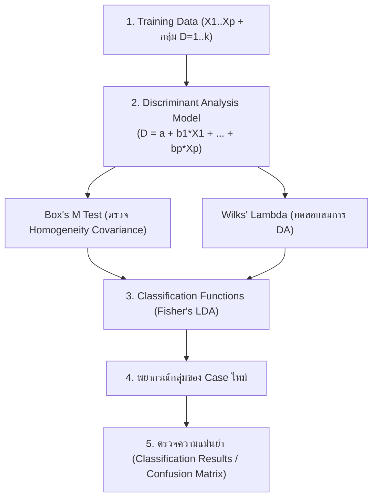

# DATA ANALYTICS - Week 08: Discriminant Analysis (DA)

> **วิชา:** DATA ANALYTICS AND PROGRAMMING | **สถาบัน:** คณะเทคโนโลยีสารสนเทศ
> **Source:** `Resources/Books/DATA ANALYTICS AND PROGRAMMING/Concept/data analysis8_69 st.pdf` (31 slides)

---

## Part 1: Macro Architecture & Overview

**Discriminant Analysis (การวิเคราะห์จำแนกกลุ่ม)** คือเทคนิคทางสถิติที่ใช้ในกรณีที่ตัวแปรตาม (Y) เป็น **ตัวแปรเชิงกลุ่ม (Categorical)** ซึ่งแตกต่างจาก Regression ที่ Y เป็นตัวแปรเชิงปริมาณ DA มีวัตถุประสงค์ 2 ด้านหลักคือ: (1) ศึกษาว่าตัวแปรใดมีบทบาทสำคัญในการแยกกลุ่ม และ (2) สร้างสมการเพื่อพยากรณ์กลุ่มของ Case ใหม่



### ตารางเปรียบเทียบ Regression vs Discriminant Analysis

| Feature | Regression | Discriminant Analysis |
| :--- | :--- | :--- |
| ตัวแปรตาม Y | Quantitative (เชิงปริมาณ) | Categorical (เชิงกลุ่ม) |
| วัตถุประสงค์ | พยากรณ์ค่า Y | จำแนกกลุ่ม / พยากรณ์กลุ่ม |
| สมการ | Ŷ = b₀ + b₁x₁ + ... | D = a + b₁x₁ + ... |
| การทดสอบ | F-test + t-test | Wilks' Lambda + t-test (Sig) |
| Output หลัก | ค่า Ŷ | Discriminant Score + กลุ่มที่พยากรณ์ |

---

## Part 2: Module-by-Module Deep Dive

### 2.1 ความรู้พื้นฐาน Discriminant Analysis

> 💡 **Intuition:** ลองนึกว่าคุณมีกลุ่มคนชอบฟุตบอลและกลุ่มคนชอบบาสเกตบอล และคุณต้องการหาวิธีแยกคนเหล่านี้โดยใช้ข้อมูลเช่น "ส่วนสูง" "น้ำหนัก" "ความเร็วในการวิ่ง" Discriminant Analysis เป็นวิธีการหาสมการที่ใช้ข้อมูลเหล่านี้ "แยกกลุ่ม" ได้ดีที่สุด ต่างจาก Regression ที่ใช้ทำนาย "ค่า" (เช่น ราคา) DA ใช้ทำนาย "กลุ่ม" (เช่น เป็นสมาชิกกลุ่มไหน) วิธีการ "แยก" นี้ทำให้เข้าใจว่าปัจจัยไหนสำคัญในการแยกกลุ่ม
> [Source: generated — not verified against original document]

#### ลักษณะตัวแปร

| ตัวแปร | ประเภท | คำอธิบาย |
| :--- | :--- | :--- |
| **D (หรือ Y)** | Categorical | กลุ่มที่ case อยู่ (เช่น 1=ไม่เสี่ยง, 2=เสี่ยง) |
| **X₁, ..., Xₚ** | Quantitative | ตัวแปรอิสระที่คาดว่าจะแยกกลุ่มได้ |

**🧭 ทำความเข้าใจ** _[Source: generated — not verified against original document]_

**แตกวลีสำคัญ:**
- "Categorical" → ตัวแปรที่แบ่งเป็นกลุ่มชัดเจน เช่น "ป่วย/ไม่ป่วย" "ยอมรับ/ปฏิเสธ" ไม่ใช่ค่าตัวเลขต่อเนื่อง
- "Case" → หน่วยสังเกตการณ์แต่ละคน เช่น "คนหนึ่ง" "ธนาคาร" "ลูกค้า"
- "Dummy Variable" → การแปลงตัวแปร Categorical (เช่น เพศ ชาย/หญิง) เป็นตัวเลข 0/1 เพื่อใช้ในสมการ

**ตัวอย่าง:**
- ✅ ต้องการแยกคนป่วยโรคหัวใจ ใช้ข้อมูล อายุ โคเลสเตอรอล ความดันโลหิต ← Y เป็น Categorical (ป่วย/ไม่ป่วย) X เป็น Quantitative → ใช้ DA ได้
- ❌ ต้องการทำนายราคาบ้านจากพื้นที่ สิ่งอำนวยความสะดวก → Y เป็น Quantitative (ราคา) → ใช้ Regression แทน
- **ต่างกันตรง:** Regression ทำนาย "ค่า" DA ทำนาย "กลุ่ม"

**อย่าสับสน:** "Categorical" ≠ "จำนวนน้อยมาก" — Categorical อาจมี 2 กลุ่ม (Binary) หรือ 3+ กลุ่ม (Multinomial) สำคัญคือมีการแบ่งชัดเจน

**เช็คความเข้าใจ:** ต้องการพยากรณ์ว่าเด็ก "จบ/ไม่จบ" มัธยมปลาย จากข้อมูล เกรดเฉลี่ย, รายได้พ่อแม่, ชั่วโมงเรียน ควรใช้ Regression หรือ Discriminant Analysis
<details><summary>เฉลย</summary>

ควรใช้ **Discriminant Analysis** เพราะว่า:
- ตัวแปรตาม D = "จบ/ไม่จบ" = **Categorical** (2 กลุ่ม)
- ตัวแปรอิสระ (เกรด, รายได้, ชั่วโมง) = **Quantitative** ✓
- วัตถุประสงค์ = จำแนก/พยากรณ์กลุ่ม

หาก D เป็น "ระดับชั้น (ม.4 / ม.5 / ม.6)" ยังใช้ DA ได้ เพราะเป็น Categorical แต่หาก D เป็น "เกรดเฉลี่ย (0-4)" ต้องใช้ Regression
</details>

**กฎสำคัญ:**
- แต่ละ case อยู่ได้กลุ่มเดียว
- ถ้า X เป็น Categorical ต้องแปลงเป็น **Dummy Variable** ก่อน
- การแบ่งกลุ่มต้องทำ **ก่อน** ที่จะใช้ DA

#### ตัวอย่างการใช้งาน

| สถานการณ์ | ตัวแปรตาม D | ตัวแปร X |
| :--- | :--- | :--- |
| จำแนกคนไข้โรคหัวใจ | 1=ไม่เป็น, 2=เป็น | อายุ, น้ำหนัก, Cholesterol |
| ประเมินพนักงานขาย | 1=ดีเยี่ยม, 2=ชมเชย, 3=ธรรมดา | ยอดขาย, อายุงาน, การศึกษา |
| คุณภาพลูกหนี้ธนาคาร | 1=ลูกหนี้ปกติ, 2=มีปัญหา | ปริมาณหนี้, รายได้, อาชีพ |

---

### 2.2 สมการจำแนกกลุ่ม (Discriminant Function)

> 💡 **Intuition:** ลองนึกว่า Discriminant Function คือการ "ผสมส่วนผสม" เพื่อสร้างค่า Score ที่แยกกลุ่มได้ดีที่สุด เช่น หากคุณอยากแยกฟุตบอลกับบาสเกตบอล โดยมีตัวแปร "ส่วนสูง" กับ "ความเร็ว" คุณอาจสร้าง Score = 0.3×ส่วนสูง + 0.7×ความเร็ว ค่า Score นี้อาจแยกสองกลุ่มออกจากกันได้ดีกว่าการดู "ส่วนสูง" อย่างเดียว Discriminant Function คือวิธีหาน้ำหนัก (b) ของ "ส่วนผสม" ที่แยกกลุ่มได้ดีที่สุดจากข้อมูลเอง
> [Source: generated — not verified against original document]

**สมการของประชากร:**
```
D = β₀ + β₁X₁ + β₂X₂ + ... + βₚXₚ + e    ......(1)
```

**สมการประมาณจากตัวอย่าง:**
```
D̂ = a + b₁x₁ + b₂x₂ + ... + bₚxₚ    ......(2)
```

ค่า D̂ ที่ได้เรียกว่า **Discriminant Score** — ใช้เปรียบเทียบเพื่อตัดสินว่า case ควรอยู่กลุ่มใด

> **เป้าหมายของการประมาณ:** ทำให้ความแตกต่างระหว่างกลุ่มมีมากที่สุด

**🧭 ทำความเข้าใจ** _[Source: generated — not verified against original document]_

**แตกวลีสำคัญ:**
- "Discriminant Score (D̂)" → ค่าที่คำนวณจากสมการ = ใช้ตัดสินว่า case ควรไปกลุ่มไหน (เทียบกับค่าคัตออฟ/Cutoff)
- "เปรียบเทียบ (Compare)" → นำ D̂ ของ case ใหม่เทียบกับค่าเฉลี่ย D̂ ของแต่ละกลุ่ม แล้วจัด case ไปกลุ่มที่ใกล้สุด
- "ความแตกต่างระหว่างกลุ่ม" → ค่า Discriminant Function พยายามให้กลุ่มที่ต่างกัน มี D̂ ต่างกันมากที่สุด

**ตัวอย่าง:**
- ✅ สมการ D̂ = -6.242 + 0.049·Size + 0.304·Revenue + 0.366·Years + 0.266·Product ← รวมหลายตัวแปรด้วยน้ำหนัก b ที่ DA คำนวณให้กลุ่มต่างกันมากที่สุด → ยืนยันว่าใช้ได้ด้วย Wilks' Lambda (Sig < 0.05)
- ❌ หากใช้สมการแค่ D̂ = Size เพียงตัวเดียว → อาจไม่แยกกลุ่มได้ดี เพราะ Size บางทีอาจไม่แตกต่างระหว่างกลุ่ม
- **ต่างกันตรง:** สมการการถดถอย Y = a + b₁X₁ + ... ใช้ทำนายค่า Y สมการ Discriminant ใช้ทำนายกลุ่ม แต่รูปแบบสมการเหมือนกัน

**อย่าสับสน:** "Discriminant Score สูง" ≠ "ผลดี" — Score สูง/ต่ำคือค่าที่ใช้ตัดสินกลุ่มเท่านั้น เทียบกับ Cutoff ระหว่างกลุ่ม หรือ Centroid (ค่าเฉลี่ย D̂) ของแต่ละกลุ่ม

**เช็คความเข้าใจ:** ถ้าค่าเฉลี่ย D̂ ของกลุ่มป่วย = 2.5 กลุ่มไม่ป่วย = 0.5 และ case ใหม่ได้ D̂ = 2.0 ควรจัด case นี้เป็นกลุ่มไหน
<details><summary>เฉลย</summary>

เปรียบเทียบระยะห่าง:
- ระยะห่างจากกลุ่มป่วย: |2.0 - 2.5| = 0.5
- ระยะห่างจากกลุ่มไม่ป่วย: |2.0 - 0.5| = 1.5

**จัด case นี้เป็นกลุ่มป่วย** เพราะ D̂ = 2.0 ใกล้กับค่าเฉลี่ยของกลุ่มป่วย (2.5) มากกว่า
</details>

---

### 2.3 เงื่อนไข (Assumptions)

> 💡 **Intuition:** ลองนึกว่าเรากำลังขีดเส้นแบ่งเขตระหว่างกลุ่มด้วยกฎเดียวกันทุกกลุ่ม ข้อสมมติ "Variance-Covariance Matrix เท่ากันทุกกลุ่ม" คือการบอกว่า "การกระจายของแต่ละกลุ่มมีรูปทรงเหมือนกัน" ซึ่งทำให้ขอบเขตเป็นเส้นตรงได้ ถ้ารูปทรงต่างกันมาก ขอบเขตที่เหมาะสมจะไม่ใช่เส้นตรง จุดที่อุปมาจะพัง: ข้อสมมติข้อ 2 เป็นเรื่องของ "การกระจาย" ไม่ใช่เรื่อง "ค่าเฉลี่ยของกลุ่มต่างกันหรือไม่"
> [Source: generated — not verified against original document]

1. ตัวแปรอิสระทุกตัวในแต่ละกลุ่ม → **Multivariate Normal Distribution**
2. **Variance-Covariance Matrix ของทุกกลุ่มต้องเท่ากัน:** Σ₁ = Σ₂ = ... = Σₖ
3. ตัวแปรอิสระแต่ละตัวต้องไม่สัมพันธ์กันเอง

**การตรวจเงื่อนไขข้อ 2 ด้วย Box's M Test:**
```
H₀: Σ₁ = Σ₂    H₁: Σ₁ ≠ Σ₂

ตัวอย่าง: Box's M = 36.49, Sig = 0.100
0.100 > 0.05  →  ไม่ปฏิเสธ H₀  →  ∑ เท่ากัน → เงื่อนไขผ่าน
```

**🧭 ทำความเข้าใจ** _[Source: generated — not verified against original document]_

**แตกวลีสำคัญ:**
- "Multivariate Normal Distribution" → ตัวแปรหลายตัวในแต่ละกลุ่มกระจายแบบปกติร่วมกัน ไม่ใช่แค่ทีละตัว
- "Variance-Covariance Matrix (Σ)" → ตารางที่บอกการกระจายของแต่ละตัวแปร และความสัมพันธ์ระหว่างตัวแปรในกลุ่มนั้น
- "Σ₁ = Σ₂ = ... = Σₖ" → ทุกกลุ่มต้องมีรูปแบบการกระจายเดียวกัน ตรวจด้วย Box's M Test
- "Sig > α" (Box's M) → ไม่ปฏิเสธ H₀ ว่า Σ เท่ากัน จึงถือว่าเงื่อนไขข้อ 2 ผ่าน

**ตัวอย่าง:**
- ✅ ตัวอย่างนี้ Box's M ได้ Sig = 0.100 > 0.05 → ไม่ปฏิเสธ H₀ → ผ่านเงื่อนไขข้อ 2
- ❌ ถ้า Sig น้อยกว่า 0.05 → ปฏิเสธ H₀ แปลว่า Σ ไม่เท่ากัน เงื่อนไขข้อ 2 ไม่ผ่าน ไม่ควรสรุปโดยไม่พิจารณาเพิ่ม
- **ต่างกันตรง:** ดูที่ค่า Sig ของ Box's M เทียบกับ α ไม่ใช่ดูที่ค่า Box's M เพียงอย่างเดียว

**อย่าสับสน:** "Box's M Test" ทดสอบว่า "Σ เท่ากันหรือไม่" ไม่ได้ทดสอบว่า "ค่าเฉลี่ยของกลุ่มต่างกันหรือไม่" (อันหลังคือ Tests of Equality of Group Means ในหัวข้อ 2.5)

**เช็คความเข้าใจ:** ถ้า Box's M Test ได้ Sig = 0.02 ข้อสมมติข้อใดไม่ผ่าน และโน้ตนี้ระบุทางเลือกไว้หรือไม่

<details><summary>เฉลย</summary>

Sig = 0.02 < 0.05 จึงปฏิเสธ H₀ ว่า Σ เท่ากัน ข้อสมมติข้อ 2 ไม่ผ่าน โน้ตนี้ยังไม่ได้ระบุวิธีทางเลือกเมื่อผ่านเงื่อนไขไม่ได้ จึงควรทบทวนผลก่อนสรุป และหาแหล่งเพิ่มเติมก่อนเลือกวิธีแก้
</details>

---

### 2.4 ขั้นตอนการจำแนก

```text
1. กำหนดกลุ่มประชากร (อย่างน้อย 2 กลุ่ม)
2. เลือกตัวแปรอิสระที่คาดว่าจะช่วยจำแนก
3. ตรวจสอบเงื่อนไข (Box's M Test)
4. วิเคราะห์ผล → หา Discriminant Function
5. ตรวจว่าตัวแปรใด Significant
6. สร้างสมการจำแนก
7. ทดสอบความเชื่อถือได้ (Classification Results)
```

---

### 2.5 การตรวจผลจาก SPSS

#### ตาราง Group Statistics
แสดงค่าเฉลี่ย และ SD ของแต่ละตัวแปรแยกตามกลุ่ม — ดูว่าค่าเฉลี่ยของแต่ละกลุ่มต่างกันมากไหม

#### ตาราง Tests of Equality of Group Means
```
H₀: µ(ตัวแปร, กลุ่ม 1) = µ(ตัวแปร, กลุ่ม 2)

ถ้า Sig < 0.05 → ตัวแปรนั้นช่วยแยกกลุ่มได้ → ควรเก็บไว้ในสมการ
```

#### ตาราง Wilks' Lambda
ทดสอบว่าสมการ DA ที่สร้างสามารถจำแนกความแตกต่างระหว่างกลุ่มได้หรือไม่
```
Sig < 0.05 → สมการ DA จำแนกกลุ่มได้ (ปฏิเสธ H₀)
```

#### ตาราง Canonical Discriminant Function Coefficients
ค่าสัมประสิทธิ์ a, b₁, b₂, ... สำหรับสมการ D̂ = a + b₁x₁ + ...

```
ตัวอย่าง: D̂ = -6.242 + 0.049·Size + 0.304·Revenue + 0.366·Years + 0.266·Product
```

#### ตาราง Standardized Canonical Discriminant Function Coefficients
ค่าสัมประสิทธิ์แบบมาตรฐาน → ใช้เปรียบเทียบว่า **ตัวแปรใดมีอิทธิพลต่อการจำแนกมากสุด**

#### ตาราง Classification Function Coefficients (Fisher's Linear DA)
แสดงสมการสำหรับแต่ละกลุ่ม → ใช้พยากรณ์ Case ใหม่

```
ตัวอย่าง:
D₁(Not Interest) = -18.373 + 0.307·Size - 0.372·Revenue + 3.79·Years + 1.493·Product
D₂(Interest)     = -41.397 + 0.474·Size + 0.673·Revenue + 5.049·Years + 2.407·Product
```

---

### 2.6 วิธีการพยากรณ์ Case ใหม่

> 💡 **Intuition:** ลองนึกว่ามีคนแปลกหน้าคนใหม่มาถึง และต้องตัดสินว่าเขาอยู่ทีมไหน ทำได้สามวิธี: (1) ดูว่าทีมไหนน่าจะเป็นมากที่สุด (Maximum Likelihood), (2) ดูว่าตัวเองอยู่ใกล้จุดศูนย์กลางทีมไหนที่สุด (Distance Function), (3) ให้คะแนนตามสูตรของแต่ละทีมแล้วเลือกคะแนนสูงสุด (Linear Classification) จุดที่อุปมาจะพัง: ผลของทั้งสามวิธีอาจต่างกันได้เมื่อ case อยู่ใกล้ขอบของกลุ่ม
> [Source: generated — not verified against original document]

| วิธี | หลักการ |
| :--- | :--- |
| **Maximum Likelihood** | คำนวณ Posterior Probability → เลือกกลุ่มที่ probability สูงสุด |
| **Distance Function** | คำนวณระยะห่างจาก Case ใหม่ถึง Centroid ของแต่ละกลุ่ม → เลือกกลุ่มที่ใกล้ที่สุด |
| **Linear Classification** | คำนวณ D Score จากสมการแต่ละกลุ่ม → เลือกกลุ่มที่ D Score สูงสุด |

**🧭 ทำความเข้าใจ** _[Source: generated — not verified against original document]_

**แตกวลีสำคัญ:**
- "Posterior Probability" → ความน่าจะเป็นว่า case นี้อยู่กลุ่มนั้น หลังจากเห็นค่าตัวแปรของ case แล้ว
- "Centroid" → จุดศูนย์กลางของกลุ่ม (ค่าเฉลี่ยของตัวแปรแต่ละตัวในกลุ่มนั้น)
- "D Score" → คะแนนจากสมการจำแนกของแต่ละกลุ่ม ค่าที่สูงกว่าแปลว่าเข้าข่ายกลุ่มนั้นมากกว่า ไม่ใช่ความน่าจะเป็น (ไม่ได้อยู่ในช่วง 0–1)

**ตัวอย่าง:**
- ✅ ตัวอย่าง Linear Classification ข้างบน D̂(Interest) = 32.3 > D̂(Not Interest) = 28.043 → จัดเป็นกลุ่ม Interest เพราะเลือกคะแนนสูงสุด
- ❌ เลือกกลุ่มที่ D Score ต่ำสุด → ผิดกติกา ตัวอย่างเดิมจะได้กลุ่ม Not Interest ซึ่งไม่ตรงกับวิธีนี้
- **ต่างกันตรง:** Linear ใช้คะแนนจากสมการ ส่วน Distance ใช้ระยะถึง Centroid ทั้งสองวิธีเลือกกลุ่มจาก "ค่าที่ดีที่สุด" แต่คนละมาตรวัด

**อย่าสับสน:** "D Score" ไม่ได้หมายถึงความน่าจะเป็น จึงเทียบกันได้เฉพาะระหว่างกลุ่มในรอบการคำนวณเดียวกัน

**เช็คความเข้าใจ:** ถ้าใช้ Distance Function แล้วพบว่า case ใหม่อยู่ใกล้ Centroid ของกลุ่ม Not Interest มากกว่า จะจัดเป็นกลุ่มไหนตามกติกา

<details><summary>เฉลย</summary>

จัดเป็นกลุ่ม **Not Interest** เพราะ Distance Function เลือกกลุ่มที่ระยะห่างจาก Centroid น้อยที่สุด
</details>

**ตัวอย่าง Linear Classification:**
```
Case ใหม่: Size=54, Revenue=5, Year=6, Product=6

D̂(Not Interest) = -18.373 + 0.307(54) - 0.372(5) + 3.79(6) + 1.493(6) = 28.043
D̂(Interest)     = -41.397 + 0.474(54) + 0.673(5) + 5.049(6) + 2.407(6) = 32.3

32.3 > 28.043  →  จัด case นี้เป็นกลุ่ม Interest
```

---

### 2.7 การประเมินความแม่นยำของสมการ

> 💡 **Intuition:** ลองนึกว่าเราติวนักเรียนด้วยโจทย์ชุดเดียวกับที่จะออกข้อสอบ คะแนนจะสูงเกินจริงเพราะจำคำตอบได้ ไม่ใช่เพราะเข้าใจจริง การประเมินความแม่นยำที่ดีจึงต้องทดสอบกับข้อมูลที่โมเดล "ไม่เคยเห็น" มาก่อน จุดที่อุปมาจะพัง: การประเมินบน Training Set ไม่ได้ผิดเสมอไป แต่ผลจะสูงเกินจริงถ้าไม่มีการทดสอบแยกต่างหาก
> [Source: generated — not verified against original document]

| วิธีประเมิน | คำอธิบาย |
| :--- | :--- |
| **ใช้ข้อมูลทั้งหมด** | สร้างสมการจากข้อมูลทั้งหมด แล้วพยากรณ์ข้อมูลเดิมนั้น |
| **Train/Test Split** | แบ่งข้อมูลเป็น Training และ Testing Set |
| **Leave-One-Out (n-1)** | ใช้ข้อมูล n-1 หน่วยสร้างสมการ → พยากรณ์หน่วยที่เหลือ ทำ n ครั้ง |

ดูผลใน **Classification Results Table** → ดูสัดส่วน Case ที่จำแนกได้ถูกต้อง

**🧭 ทำความเข้าใจ** _[Source: generated — not verified against original document]_

**แตกวลีสำคัญ:**
- "ใช้ข้อมูลทั้งหมด" → สร้างสมการจากข้อมูลทั้งหมด แล้วทดสอบกับข้อมูลชุดเดิม ผลมักดูดีเกินจริง เพราะโมเดลเคยเห็นคำตอบแล้ว
- "Train/Test Split" → แบ่งข้อมูลเป็นชุดสร้างสมการ (Training) และชุดทดสอบ (Testing) ที่ไม่ได้ใช้สร้างสมการ
- "Leave-One-Out (n-1)" → สร้างสมการจาก n-1 หน่วย แล้วทดสอบกับหน่วยที่เหลือ ทำซ้ำ n ครั้ง
- "Classification Results Table" → ตารางแสดงสัดส่วน case ที่จำแนกถูกกลุ่ม

**ตัวอย่าง:**
- ✅ แบ่งข้อมูลเป็น Training/Testing แล้วดูความแม่นยำบนชุด Testing → ทดสอบกับข้อมูลที่ไม่ได้ใช้สร้างสมการ
- ❌ สร้างสมการจากข้อมูลทั้งหมด แล้วพยากรณ์ข้อมูลชุดเดิมเพื่อรายงานความแม่นยำ → ผลอาจสูงเกินจริงเพราะเป็นการทดสอบกับข้อมูลที่ใช้สร้างสมการ
- **ต่างกันตรง:** ถามว่า "ข้อมูลที่ใช้ทดสอบเคยถูกใช้สร้างสมการหรือไม่" ถ้าเคย ผลจะสูงกว่าความเป็นจริงในการพยากรณ์ใหม่

**อย่าสับสน:** "Classification Results Table" บอกความแม่นยำเฉพาะชุดข้อมูลที่ใช้ประเมิน ไม่ได้การันตีว่าจะแม่นกับลูกค้าชุดใหม่เสมอไป

**เช็คความเข้าใจ:** ต้องการทราบว่าโมเดลจะจำแนกลูกค้าใหม่ได้ดีแค่ไหน ควรประเมินด้วยวิธีใดจากสามวิธีในตาราง และเพราะเหตุใดวิธี "ใช้ข้อมูลทั้งหมด" จึงไม่เหมาะ

<details><summary>เฉลย</summary>

ใช้ Train/Test Split หรือ Leave-One-Out เพราะทั้งสองทดสอบด้วยข้อมูลที่ไม่ได้ใช้สร้างสมการ ซึ่งใกล้เคียงกับการจำแนกลูกค้าใหม่มากกว่า ส่วน "ใช้ข้อมูลทั้งหมด" ทดสอบบนข้อมูลที่โมเดลเคยเห็นแล้ว จึงมักให้ผลดีเกินจริง
</details>

---

## Part 3: Quick Reference & Exam Cheat Sheet

### Checklist สรุปหัวใจสำคัญก่อนสอบ

* [ ] **DA ใช้เมื่อ:** ตัวแปรตาม D เป็น Categorical (กลุ่ม) ไม่ใช่ Quantitative
* [ ] **ตัวแปรอิสระ X:** ต้องเป็น Quantitative (Categorical → Dummy Variable)
* [ ] **Box's M Test:** ตรวจเงื่อนไข Σ₁ = Σ₂ (Sig > 0.05 = ผ่าน)
* [ ] **Wilks' Lambda:** ทดสอบว่าสมการ DA ใช้ได้ (Sig < 0.05 = ใช้ได้)
* [ ] **Discriminant Score D̂:** คำนวณแล้วเปรียบเทียบระหว่างกลุ่ม
* [ ] **Classification Results:** ดูความแม่นยำของการจำแนก

### สรุปขั้นตอนสำคัญ

| ขั้น | การดำเนินการ | ผลที่ตรวจ |
| :--- | :--- | :--- |
| 1 | ตรวจเงื่อนไข | Box's M Sig > 0.05 |
| 2 | Group Statistics | ค่าเฉลี่ยต่างกันหรือไม่ |
| 3 | Tests of Equality | Sig < 0.05 = ตัวแปรช่วยแยกได้ |
| 4 | Wilks' Lambda | Sig < 0.05 = สมการใช้ได้ |
| 5 | Discriminant Function | สมการ D̂ |
| 6 | Classification Function | สมการแต่ละกลุ่มสำหรับพยากรณ์ |
| 7 | Classification Results | ความแม่นยำ (%) |

### Concept Map

```text
Discriminant Analysis
├── ตัวแปรตาม D = Categorical
├── Assumptions
│   ├── Multivariate Normal
│   ├── Equal Covariance (Box's M)
│   └── X ไม่สัมพันธ์กันเอง
├── Discriminant Function: D̂ = a + b₁x₁ + ...
│   └── วัตถุประสงค์: maximize separation between groups
├── Testing
│   ├── Box's M (เงื่อนไข)
│   ├── Tests of Equality (ทีละตัวแปร)
│   └── Wilks' Lambda (ทั้งสมการ)
└── Classification
    ├── Maximum Likelihood
    ├── Distance Function
    └── Fisher's Linear Classification
```

---

## ⚠️ Common Pitfalls & Exam Traps

* **DA ≠ Regression:** DA ใช้เมื่อ Y เป็น Categorical ถ้า Y เป็น Quantitative → ใช้ Regression
* **Box's M ปฏิเสธ H₀:** ถ้า Sig < 0.05 → เงื่อนไขไม่ผ่าน ต้องระวังการแปลผล
* **Standardized Coefficient ≠ Unstandardized:** Standardized ใช้เปรียบเทียบความสำคัญ แต่ Unstandardized ใช้สร้างสมการ
* **Classification Results ≠ R²:** เป็นสัดส่วน Case ที่จำแนกถูก ไม่ใช่ค่า Goodness of Fit แบบ R²
* **กลุ่มต้องกำหนดก่อน:** DA ไม่สร้างกลุ่มเอง ต้องกำหนดกลุ่มมาก่อน (ต่างจาก Cluster Analysis)
* **Case อยู่ได้กลุ่มเดียว:** ถ้าต้องการจัด case ที่อยู่ได้หลายกลุ่ม ต้องใช้วิธีอื่น

---

## เอกสารเชื่อมโยง (Wiki-Style Backlinks)

* **วิชาและหัวข้อที่เกี่ยวข้อง:**
  * [[Chapter 06 Regression Analysis]] (Regression ใช้เมื่อ Y เป็น Quantitative)
  * [[Chapter 07 Multiple Regression Analysis]] (Multiple Regression — ใช้แนวคิดสมการคล้ายกัน)

* **แหล่งข้อมูล:**
  * Source: `Resources/Books/DATA ANALYTICS AND PROGRAMMING/Concept/data analysis8_69 st.pdf` (31 slides, คณะเทคโนโลยีสารสนเทศ)
