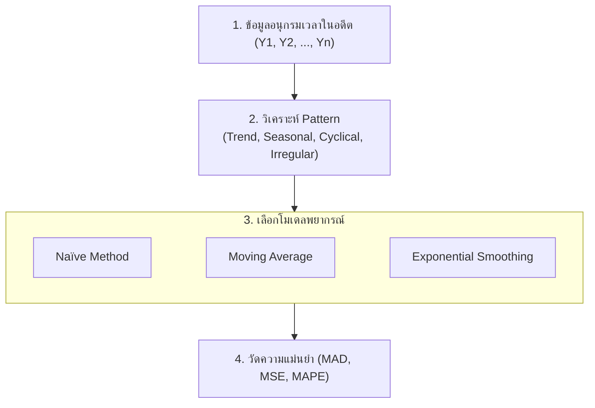

# DATA ANALYTICS - Week 10: Time Series & Forecasting

> **วิชา:** DATA ANALYTICS AND PROGRAMMING | **สถาบัน:** คณะเทคโนโลยีสารสนเทศ
> **Source:** `Resources/Books/DATA ANALYTICS AND PROGRAMMING/Concept/data analysis10_69 forecasting.pdf` (36 slides)

> [!NOTE]
> ไฟล์ Slide บทนี้เป็น Graphic-heavy ข้อความจาก PDF มีจำกัด เนื้อหานี้รวมข้อมูลจาก Slide และการขยายความเชิงทฤษฎี

---

## Part 1: Macro Architecture & Overview

**Time Series Forecasting (การพยากรณ์อนุกรมเวลา)** คือการใช้ข้อมูลในอดีตของตัวแปรที่สนใจ มาสร้างโมเดลเพื่อพยากรณ์ค่าในอนาคต โดยมีสมมติฐานว่ารูปแบบ (Pattern) ในอดีตจะยังคงดำเนินต่อไปในอนาคต เทคนิคนี้ใช้กว้างขวางในงานธุรกิจ เช่น การพยากรณ์ยอดขาย ราคาสินค้า อุณหภูมิ และดัชนีเศรษฐกิจ



### ตารางเปรียบเทียบวิธีการพยากรณ์

| วิธี | หลักการ | เหมาะกับ |
| :--- | :--- | :--- |
| **Naïve Method** | Fₜ₊₁ = Yₜ (ใช้ค่าล่าสุดพยากรณ์) | ข้อมูลไม่มี Trend ที่ชัดเจน |
| **Simple Average** | Fₜ₊₁ = ค่าเฉลี่ยของทุกข้อมูล | ข้อมูลมีค่าคงที่ (Stationary) |
| **Moving Average** | ค่าเฉลี่ยของ n ข้อมูลล่าสุด | ข้อมูลมี Trend ไม่แรง |
| **Exponential Smoothing** | ถ่วงน้ำหนักข้อมูลล่าสุดมากกว่า | ข้อมูลที่ข้อมูลใหม่สำคัญกว่า |
| **Regression/Trend Line** | Regression บนเวลา | ข้อมูลมี Linear Trend |

---

## Part 2: Module-by-Module Deep Dive

### 2.1 องค์ประกอบของ Time Series

| องค์ประกอบ | ชื่อ | คำอธิบาย | ตัวอย่าง |
| :--- | :--- | :--- | :--- |
| **T** | Trend | แนวโน้มระยะยาว (ขึ้น/ลง) | ยอดขายเพิ่มทุกปี |
| **S** | Seasonal | รูปแบบที่เกิดซ้ำตามฤดูกาล | ขายดีช่วงเทศกาล |
| **C** | Cyclical | วงจรขึ้น-ลงระยะยาว (>1 ปี) | วงจรเศรษฐกิจ |
| **I** | Irregular | ความผันผวนสุ่ม (random) | โควิด, ภัยธรรมชาติ |

> 💡 **Intuition:** ลองนึกว่ายอดขายที่เห็นเป็นเพลงที่ซ้อนกันหลายเสียง เสียงหนึ่งคือทิศทางยาว (T) เสียงหนึ่งคือจังหวะตามฤดูกาล (S) เสียงหนึ่งคือวงจรเศรษฐกิจที่ยาวและไม่ตายตัว (C) และเสียงสุ่มที่เกิดขึ้นครั้งเดียว (I) การแยกองค์ประกอบช่วยให้รู้ว่าการเปลี่ยนแปลงแต่ละช่วงมาจากอะไร จุดที่อุปมาจะพัง: ในข้อมูลจริงทั้งสี่ส่วนมักซ้อนกัน และไม่ได้แยกออกจากกันชัดเจนเสมอไป
> [Source: generated — not verified against original document]

**🧭 ทำความเข้าใจ** _[Source: generated — not verified against original document]_

**แตกวลีสำคัญ:**
- "Trend (T)" → ทิศทางระยะยาวของข้อมูล (ขึ้นหรือลง) ไม่ได้วนซ้ำ
- "Seasonal (S)" → รูปแบบที่ซ้ำตามช่วงเวลาที่รู้ล่วงหน้า (เช่น ทุกหน้าร้อน)
- "Cyclical (C)" → วงจรที่ยาวกว่า 1 ปี และจังหวะไม่ตายตัว เช่น วงจรเศรษฐกิจ
- "Irregular (I)" → ส่วนสุ่มที่เกิดเฉพาะกิจ ไม่วนซ้ำเป็นรูปแบบ

**ตัวอย่าง:**
- ✅ ยอดขายเพิ่มทุกหน้าร้อนของทุกปี → Seasonal เพราะซ้ำตามฤดูกาลที่รู้ล่วงหน้า
- ❌ ยอดขายลดลงจากโควิด → ไม่ใช่ Cyclical แต่เป็น Irregular เพราะเหตุการณ์สุ่มเกิดขึ้นครั้งเดียว ไม่ได้วนซ้ำเป็นวงจร
- **ต่างกันตรง:** ถามว่า "ซ้ำตามปฏิทินที่รู้ล่วงหน้าหรือไม่" (ใช่ = S) "วนซ้ำแต่จังหวะไม่แน่นอนและยาวกว่า 1 ปี" (= C) "เกิดแบบสุ่มไม่เป็นรูปแบบ" (= I)

**อย่าสับสน:** "Seasonal" ≠ "Cyclical" Seasonal ซ้ำตามฤดูกาลที่คงที่ ส่วน Cyclical เป็นวงจรยาวที่ความยาวไม่ตายตัว

**เช็คความเข้าใจ:** ยอดเครื่องดื่มร้อนเพิ่มทุกเดือนพฤศจิกายนของทุกปี แต่ปีนี้ยอดตกหนักจากน้ำท่วมฉับพลัน จงระบุองค์ประกอบของทั้งสองเหตุการณ์

<details><summary>เฉลย</summary>

การเพิ่มทุกพฤศจิกายนคือ **Seasonal (S)** เพราะซ้ำตามฤดูกาลที่รู้ล่วงหน้า ส่วนน้ำท่วมฉับพลันที่ทำให้ยอดตกในปีนี้คือ **Irregular (I)** เพราะเป็นเหตุการณ์สุ่มที่ไม่วนซ้ำ
</details>

---

### 2.2 ตัวชี้วัดความแม่นยำของการพยากรณ์

> 💡 **Intuition:** ลองนึกว่าคุณทำนายปริมาณน้ำฝน แต่ผลทำนายไม่เท่ากับจริง คุณต้องวัดว่าทำนายคลาดเคลื่อนเท่าไหร่ MAD, MSE, MAPE เป็นวิธีวัดความ "ผิด" ต่างกัน:
> - **MAD** = เฉลี่ยความผิดพลาดสัมบูรณ์ = เหมือนการเฉลี่ยค่าความผิด (สนใจเฉพาะขนาด ไม่สนใจทิศทาง)
> - **MSE** = ยกกำลังสองก่อนแล้วเฉลี่ย = โทษความผิดพลาดใหญ่มากกว่า (เพราะยกกำลังสอง)
> - **MAPE** = ผิดพลาดเป็นเปอร์เซ็นต์ = เห็นว่าผิดไปกี่เปอร์เซ็นต์เทียบกับค่าจริง (เข้าใจง่ายสำหรับคนทั่วไป)
> [Source: generated — not verified against original document]

> การเลือกวิธีพยากรณ์ที่ดีที่สุดทำโดยเปรียบเทียบค่า Error ต่อไปนี้ — ค่ายิ่งต่ำยิ่งดี

**🧭 ทำความเข้าใจ** _[Source: generated — not verified against original document]_

**แตกวลีสำคัญ:**
- "Mean Absolute Deviation (MAD)" → สัมบูรณ์ = ไม่สนใจเครื่องหมายบวก/ลบ = แค่ขนาดของความผิด เอาค่าเฉลี่ยของขนาดเหล่านั้น
- "Mean Square Error (MSE)" → ยกกำลังสองทำให้ error ใหญ่ถูกลงโทษมากกว่า = ถ้า error = 2 → 4 ถ้า error = 3 → 9
- "MAPE" → เปอร์เซ็นต์ = หารด้วยค่าจริง → ได้ความผิดพลาดสัมพัทธ์ → รู้ได้ง่ายว่า "ผิด 10%" หรือ "ผิด 50%"

**ตัวอย่าง:**
- ✅ MAD = 0.42 หมายความว่า โดยเฉลี่ย แต่ละการทำนายผิดไป 0.42 หน่วย (ตามตัวอย่างในตารางด้านล่าง ข้อมูลหน่วยเดียวกับ Yₜ)
- ❌ MAD = 100 แต่ MSE = 20,000 ← MSE สูงกว่า MAD² (= 10,000) มาก → error ไม่สม่ำเสมอ มีบางช่วงที่ทำนายผิดใหญ่มาก (MAD ซ่อนจุดนี้ไว้)
- **ต่างกันตรง:** MAD เป็นค่าสัมบูรณ์ MSE เป็นกำลังสอง → MSE ไวต่อ error ใหญ่มากกว่า

**อย่าสับสน:** "ME (Mean Error)" ≠ "MAD" — ME = Σ(ผิด)/n อาจ = 0 ถ้าบวก-ลบหักล้าง แต่ MAD = Σ|ผิด|/n ไม่หักล้าง

**เช็คความเข้าใจ:** ถ้าข้อมูลจริง = [10, 20, 30] และการทำนาย = [11, 19, 32] จงคำนวณ MAD
<details><summary>เฉลย</summary>

Error = |10-11| + |20-19| + |30-32| = 1 + 1 + 2 = 4

MAD = 4 / 3 = **1.33**

ความหมาย: โดยเฉลี่ย การทำนายผิดไป 1.33 หน่วย
</details>

| ตัวชี้วัด | สูตร | ความหมาย |
| :--- | :--- | :--- |
| **ME** | Σ(Yₜ - Fₜ)/n | Mean Error — ค่าเฉลี่ย Error (รวม + และ -) |
| **MAD** | Σ|Yₜ - Fₜ|/n | Mean Absolute Deviation — ค่าเบี่ยงเบนสัมบูรณ์เฉลี่ย |
| **MSE** | Σ(Yₜ - Fₜ)²/n | Mean Square Error — โทษ Error ขนาดใหญ่มากกว่า |
| **MAPE** | Σ(|Yₜ-Fₜ|/Yₜ)×100/n | Mean Absolute Percentage Error — ค่าเป็น % ของข้อมูลจริง |

```python
# ตัวอย่างการคำนวณ
# ถ้า Yₜ = [5.4, 5.3, 5.6, 6.9, 7.2] และ Fₜ = [5.3, 5.4, 5.3, 5.6, 6.9]
# Et = Yₜ - Fₜ = [0.1, -0.1, 0.3, 1.3, 0.3]
# MAD = (0.1+0.1+0.3+1.3+0.3)/5 = 0.42
# MSE = (0.01+0.01+0.09+1.69+0.09)/5 = 0.378
# MAPE = (|Et/Yt|×100) เฉลี่ย
```

---

### 2.3 Naïve Method

> 💡 **Intuition:** ลองนึกว่าคนฉลาดบอกว่า "หากไม่รู้อะไร ให้ใช้สิ่งที่เห็นล่าสุด" Naïve Method ทำเช่นนี้ — ใช้ค่าเมื่อวานมา (Yₜ) เป็นการทำนายของวันนี้ (Fₜ₊₁) ง่ายมากแต่บางครั้งได้ผลดี โดยเฉพาะเมื่อข้อมูลมีความสุ่ม (Random) ขึ้นลง ไม่มี Pattern ชัดเจน Naïve จึงเป็น Baseline ที่จำเป็นเพื่อเปรียบเทียบว่าวิธีอื่นดีกว่าจริงหรือไม่
> [Source: generated — not verified against original document]

> **Naïve Method** คือวิธีที่ง่ายที่สุด — ใช้ค่าล่าสุดเป็นค่าพยากรณ์ถัดไป

**🧭 ทำความเข้าใจ** _[Source: generated — not verified against original document]_

**แตกวลีสำคัญ:**
- "ใช้ค่าล่าสุด" → นำเอา Yₜ (ค่าวันนี้ เดือนนี้ หรือปีนี้) ไปเป็น Fₜ₊₁ (การทำนายวันหน้า เดือนหน้า ปีหน้า)
- "ไม่มี Pattern" → ข้อมูลขึ้นลงแบบสุ่ม ไม่มี Trend ชัดเจน ไม่มี Seasonal ชัดเจน

**ตัวอย่าง:**
- ✅ ข้อมูลยอดขายรายวัน = [5.4, 5.3, 5.6, 6.9, 7.2] Naïve ทำนาย = [?, 5.4, 5.3, 5.6, 6.9] → ใช้ 7.2 ทำนายวันถัดไป = 7.2
- ❌ ข้อมูลมี Trend ชัดเจน (เพิ่มขึ้นทุกเดือน) → Naïve ใช้ค่าเดือนก่อนเสมอ จึงตามหลังจริง 1 ช่วงเวลาและทำนายต่ำกว่าจริงทุกเดือน → ไม่จับ Trend
- **ต่างกันตรง:** Naïve ไม่คิด ไม่คำนวณ แค่คัดลอก ส่วน Moving Average คิดเป็นค่าเฉลี่ย

**อย่าสับสน:** "Naïve ทำนายง่าย" ≠ "Naïve ทำนายคลาดเคลื่อนมาก" — ถ้าข้อมูล Random ไม่มี Pattern Naïve อาจดีกว่า

**เช็คความเข้าใจ:** ข้อมูล = [100, 105, 110, 115, 120] Naïve ทำนายเดือน 6 เป็นเท่าไหร่
<details><summary>เฉลย</summary>

ใช้ค่าเดือน 5 (ล่าสุด) = 120

**Naïve ทำนายเดือน 6 = 120**

หมายเหตุ: ถ้าข้อมูลจริงเดือน 6 = 125 แล้ว Error = |125 - 120| = 5
</details>

```
Fₜ₊₁ = Yₜ

ตัวอย่าง:
Period | Data (Yₜ) | Forecast (Fₜ) | Error (Eₜ)
2002 Q1 | 5.4 |      -     |    -
2002 Q2 | 5.3 |    5.4     |  -0.1
2002 Q3 | 5.6 |    5.3     |   0.3
2003 Q1 | 6.9 |    5.6     |   1.3
2003 Q2 | 7.2 |    6.9     |   0.3

ME = 0.30,  MAD = 0.33,  MSE = 0.31,  MAPE = 5%
```

---

### 2.4 Simple Average Method

> 💡 **Intuition:** ลองนึกว่าเราถามใครสักคนว่าครั้งหน้าจะทำคะแนนได้เท่าไร แล้วเขาเอาคะแนนทุกครั้งที่ผ่านมามาเฉลี่ยโดยให้ทุกครั้งมีน้ำหนักเท่ากัน ถ้าเรื่องนั้นคงที่ วิธีนี้ให้ค่าที่เสถียร จุดที่อุปมาจะพัง: ถ้าข้อมูลมีแนวโน้มขึ้นหรือลง ค่าเฉลี่ยจะตามหลังความจริงเสมอ เพราะค่าเก่าที่ต่ำยังถ่วงเท่ากับค่าใหม่
> [Source: generated — not verified against original document]

> ใช้ค่าเฉลี่ยของทุกข้อมูลที่มีมาพยากรณ์ค่าต่อไป

```
Fₜ₊₁ = (Y₁ + Y₂ + ... + Yₜ) / t

ตัวอย่าง: F₂ = 5.4, F₃ = (5.4+5.3)/2 = 5.35, F₄ = (5.4+5.3+5.6)/3 = 5.43, ...
```

**ข้อจำกัด:** ข้อมูลเก่าและใหม่มีน้ำหนักเท่ากัน — ไม่ดีถ้าข้อมูลมี Trend

**🧭 ทำความเข้าใจ** _[Source: generated — not verified against original document]_

**แตกวลีสำคัญ:**
- "Fₜ₊₁" → ค่าพยากรณ์สำหรับช่วงถัดไป (t+1)
- "(Y₁ + Y₂ + ... + Yₜ) / t" → เฉลี่ยข้อมูลทุกตัวที่มีจนถึงเวลา t โดยให้น้ำหนักเท่ากันทุกตัว
- "น้ำหนักเท่ากัน" → ข้อมูลที่เก่ามากและใหม่มากมีผลต่อการพยากรณ์เท่ากัน

**ตัวอย่าง:**
- ✅ F₄ = (5.4 + 5.3 + 5.6) / 3 ≈ 5.43 — ข้อมูลในตัวอย่างไม่ได้มี Trend ชัด วิธีนี้พอใช้ได้
- ❌ ข้อมูลที่เพิ่มขึ้นต่อเนื่องทุกช่วง แล้วใช้ Simple Average → ค่าที่ได้จะต่ำกว่าค่าล่าสุดเสมอ เพราะค่าเก่าถ่วงน้ำหนักเท่ากับค่าใหม่
- **ต่างกันตรง:** ดูว่าข้อมูลมี Trend หรือไม่ ถ้ามี Simple Average จะตามหลังความจริง

**อย่าสับสน:** "Simple Average" ≠ "Moving Average" Simple ใช้ข้อมูลทุกตัวตั้งแต่ต้น ส่วน Moving Average ใช้เฉพาะช่วงล่าสุดที่กำหนด (ดูหัวข้อ 2.5)

**เช็คความเข้าใจ:** จากข้อมูล Y₁ = 5.4, Y₂ = 5.3, Y₃ = 5.6 ค่า F₄ ที่ได้จาก Simple Average ต่ำกว่า Y₃ หรือไม่ และสะท้อนอะไร

<details><summary>เฉลย</summary>

F₄ = 5.43 ต่ำกว่า Y₃ = 5.6 เพราะ Y₁ = 5.4 และ Y₂ = 5.3 ซึ่งเป็นค่าเก่ากว่าถูกถ่วงน้ำหนักเท่ากับ Y₃ ทำให้ค่าพยากรณ์ตามหลังค่าล่าสุดเล็กน้อย
</details>

---

### 2.5 Moving Average Method

> 💡 **Intuition:** ลองนึกว่า Moving Average เหมือนการมองข้อมูลผ่านหน้าต่าง (Window) เล็ก ๆ ที่เลื่อนไปเรื่อย ๆ รอบแรกคุณมองชุด (1,2,3) รอบถัดไปมองชุด (2,3,4) เป็นต้น ทุกครั้งที่เลื่อน คุณเอาค่าเฉลี่ยของหน้าต่างนั้น ข้อดี: เรียบขึ้น (smooth) ไม่ขึ้นลงกระโดด ข้อเสีย: มีความล่าช้า (Lag) = ตาม Trend ที่เพิ่มขึ้นเร็วไม่ทัน
> [Source: generated — not verified against original document]

> ใช้ค่าเฉลี่ยของ n ข้อมูลล่าสุด (window ขนาด n)

**🧭 ทำความเข้าใจ** _[Source: generated — not verified against original document]_

**แตกวลีสำคัญ:**
- "window ขนาด n" → เลือก n ข้อมูลล่าสุดมาเฉลี่ยเพื่อทำนาย ไม่นำข้อมูลที่เก่ากว่านั้นมาคิด
- "n เล็ก" → Window เล็ก → ตอบสนองเร็ว แต่ผันผวนมากกว่า | "n ใหญ่" → Window ใหญ่ → เรียบ แต่ล่าช้ามากกว่า

**ตัวอย่าง:**
- ✅ ข้อมูล = [5.4, 5.3, 5.6, 6.9, 7.2] n=3: F₄ = (5.4+5.3+5.6)/3 = 5.43, F₅ = (5.3+5.6+6.9)/3 = 5.93 → เรียบขึ้น
- ❌ n=1 ← กลายเป็น Naïve (ไม่เรียบ) | n=5 ← ข้อมูลชุดนี้มีแค่ 5 ค่า จึงเท่ากับ Simple Average ของทั้งชุด (เรียบมากแต่ล่าช้า)
- **ต่างกันตรง:** Moving Average n=3 เลือกแค่ 3 ล่าสุด Simple Average ใช้ทั้งหมด

**อย่าสับสน:** "Moving Average" ≠ "ทำนายได้ไกลหลายช่วง" — สูตรในบทนี้ทำนายเพียง 1 ช่วงข้างหน้า (Fₜ₊₁) ถ้าใช้ทำนายหลายช่วงจะได้ค่าเดิมซ้ำ (เส้นแบน) ไม่ตาม Trend

**เช็คความเข้าใจ:** ข้อมูล [10, 12, 15, 18] Moving Average n=2 ทำนายเดือน 5 เป็นเท่าไหร่
<details><summary>เฉลย</summary>

F₅ = (Y₃ + Y₄) / 2 = (15 + 18) / 2 = **16.5**

หมายเหตุ: เลือกแค่ 2 ข้อมูลล่าสุด (15 และ 18) แล้วเฉลี่ยเอา
</details>

```
Fₜ₊₁ = (Yₜ + Yₜ₋₁ + ... + Yₜ₋ₙ₊₁) / n

ตัวอย่าง n=3:
F₄ = (Y₁+Y₂+Y₃)/3 = (5.4+5.3+5.6)/3 = 5.43
F₅ = (Y₂+Y₃+Y₄)/3 = (5.3+5.6+6.9)/3 = 5.93
```

**การเลือก n:** n เล็ก = ตอบสนองเร็ว แต่ผันผวน | n ใหญ่ = เรียบขึ้น แต่ช้าตอบสนอง

---

### 2.6 Exponential Smoothing

> 💡 **Intuition:** ลองนึกว่า Exponential Smoothing เป็นการผสมสองส่วน: ข้อมูลใหม่ (Yₜ) กับการทำนายเก่า (Fₜ) ตามอัตราส่วน α (เช่น α=0.3 หมายถึง "ให้น้ำหนัก 30% กับข้อมูลใหม่, 70% กับการทำนายเก่า") ถ้า α ต่ำ คุณ "เชื่อ" ค่าพยากรณ์เดิม (ซึ่งสะสมข้อมูลอดีต) มากกว่า ทำให้ predict เรียบ ถ้า α สูง คุณ "เชื่อ" ข้อมูลใหม่มากกว่า ทำให้ predict ตอบสนองเร็ว คำว่า "Exponential" ใช้เพราะว่าน้ำหนักลดแบบเลขชี้กำลังตามความเก่า
> [Source: generated — not verified against original document]

> ถ่วงน้ำหนักข้อมูลล่าสุดมากกว่า โดยน้ำหนักลดลงแบบ Exponential ตามความเก่าของข้อมูล

```
Fₜ₊₁ = α·Yₜ + (1-α)·Fₜ

โดยที่ α = Smoothing Constant (0 < α < 1)
- α ใกล้ 1 → ให้น้ำหนักข้อมูลใหม่มาก (ตอบสนองเร็ว)
- α ใกล้ 0 → ให้น้ำหนักข้อมูลเก่ามาก (เรียบ, ตอบสนองช้า)
```

**🧭 ทำความเข้าใจ** _[Source: generated — not verified against original document]_

**แตกวลีสำคัญ:**
- "α·Yₜ + (1-α)·Fₜ" → ผสม = α คูณข้อมูลใหม่ + (1-α) คูณการทำนายเก่า เช่น α=0.3 → 0.3×ใหม่ + 0.7×เก่า
- "Smoothing Constant α" → ค่าที่ผู้วิเคราะห์กำหนดเอง (0 < α < 1 ไม่มีค่าที่ "ถูกต้อง" ตายตัว) → ลองหลายค่าแล้วเลือกค่าที่ให้ MSE/MAD ต่ำสุด
- "ตอบสนองเร็ว" → เมื่อข้อมูลเปลี่ยนอย่างรวดเร็ว การทำนายก็เปลี่ยนไปตาม

**ตัวอย่าง:**
- ✅ Yₜ = [5.4, 5.3, 5.6, ...] เริ่มต้น F₂ = Y₁ = 5.4, α=0.7 → F₃ = 0.7×Y₂ + 0.3×F₂ = 0.7(5.3) + 0.3(5.4) = 3.71 + 1.62 = 5.33 ← ขยับเข้าหาค่าใหม่ 5.3 เร็ว เพราะ α สูง
- ❌ ข้อมูลเดียวกัน α=0.1 → F₃ = 0.1×5.3 + 0.9×5.4 = 0.53 + 4.86 = 5.39 ← ตอบสนองช้า เพราะ α ต่ำ (ให้น้ำหนักค่าพยากรณ์เดิม 90%)
- **ต่างกันตรง:** Moving Average ใช้ n ข้อมูลล่าสุด น้ำหนักเท่ากัน ส่วน Exponential Smoothing ใช้ข้อมูลอดีตทั้งหมด ถ่วงน้ำหนักลดลงตามความเก่า ไม่มี window ตายตัว

**อย่าสับสน:** "α ใกล้ 1" ≠ "เรียบมาก" — α ใกล้ 1 = ตอบสนองเร็ว = ผันผวนมากกว่า (ตรงกันข้าม)

**เช็คความเข้าใจ:** α=0.4 Y₅=7.2 F₅ (prediction ของเดือน 5 ก่อนสังเกต)=6.9 จงคำนวณ F₆
<details><summary>เฉลย</summary>

F₆ = α·Y₅ + (1-α)·F₅ = 0.4×7.2 + (1-0.4)×6.9 = 0.4×7.2 + 0.6×6.9 = 2.88 + 4.14 = **7.02**
</details>

---

### 2.7 ข้อมูลตัวอย่าง Trend จาก Slide (1960-1978)

| ปี | ค่าข้อมูล | ปี | ค่าข้อมูล |
| :--- | :--- | :--- | :--- |
| 1960 | 5.86 | 1970 | 9.08 |
| 1961 | 6.38 | 1971 | 9.22 |
| 1962 | 6.46 | 1972 | 9.54 |
| 1963 | 6.78 | 1973 | 10.20 |
| 1964 | 7.52 | 1974 | 10.49 |
| 1965 | 8.31 | 1975 | 10.41 |
| 1966 | 8.80 | 1976 | 10.54 |
| 1967 | 8.89 | 1977 | 10.58 |
| 1968 | 8.92 | 1978 | 10.84 |
| 1969 | 9.07 | | |

ข้อมูลนี้แสดง **Upward Trend** อย่างชัดเจน → เหมาะกับ Trend Line Regression

---

## Part 3: Quick Reference & Exam Cheat Sheet

### Checklist สรุปหัวใจสำคัญก่อนสอบ

* [ ] **องค์ประกอบ Time Series:** Trend (T), Seasonal (S), Cyclical (C), Irregular (I)
* [ ] **Naïve:** Fₜ₊₁ = Yₜ — ง่ายที่สุด ใช้เป็น Baseline
* [ ] **Simple Average:** ค่าเฉลี่ยสะสม — ข้อมูลทุกจุดน้ำหนักเท่ากัน
* [ ] **Moving Average:** ค่าเฉลี่ย n จุดล่าสุด — n กำหนดความเรียบ
* [ ] **Exponential Smoothing:** Fₜ₊₁ = αYₜ + (1-α)Fₜ — α กำหนดน้ำหนัก
* [ ] **ตัวชี้วัด:** MAD, MSE, MAPE — ยิ่งต่ำยิ่งดี

### สรุปสูตรสำคัญ

| สูตร | ชื่อ |
| :--- | :--- |
| `MAD = Σ\|Yₜ-Fₜ\|/n` | Mean Absolute Deviation |
| `MSE = Σ(Yₜ-Fₜ)²/n` | Mean Square Error |
| `MAPE = Σ(\|Yₜ-Fₜ\|/Yₜ)×100/n` | Mean Absolute % Error |
| `Fₜ₊₁ = Yₜ` | Naïve |
| `Fₜ₊₁ = ΣYᵢ/t` | Simple Average |
| `Fₜ₊₁ = (Yₜ+...+Yₜ₋ₙ₊₁)/n` | Moving Average |
| `Fₜ₊₁ = αYₜ + (1-α)Fₜ` | Exponential Smoothing |

### Concept Map

```text
Time Series Forecasting
├── องค์ประกอบ: Trend, Seasonal, Cyclical, Irregular
├── วิธีพยากรณ์
│   ├── Naïve Method (baseline)
│   ├── Simple Average
│   ├── Moving Average (เลือก n)
│   └── Exponential Smoothing (เลือก α)
└── วัดความแม่นยำ
    ├── MAD (ค่าเบี่ยงเบนสัมบูรณ์เฉลี่ย)
    ├── MSE (โทษ Error ใหญ่มากกว่า)
    └── MAPE (แสดงผลเป็น %)
```

---

## ⚠️ Common Pitfalls & Exam Traps

* **Naïve ≠ โมเดลแย่เสมอ:** สำหรับข้อมูลที่ไม่มี Pattern ชัดเจน Naïve อาจดีกว่าวิธีซับซ้อน
* **Moving Average ไม่ได้พยากรณ์ค่าอนาคต > 1 ก้าว:** โดยตรงทำได้แค่ 1 ก้าวข้างหน้า
* **α ใน Exponential Smoothing:** ไม่มีค่าที่ "ถูก" ต้อง optimize จากข้อมูล (ใช้ MSE/MAD เปรียบเทียบ)
* **MAPE ใช้ไม่ได้เมื่อ Yₜ = 0:** เพราะหารด้วยศูนย์
* **ME ≠ MAD:** ME อาจเป็น 0 แม้ Error จริงๆ สูง (บวก-ลบหักล้างกัน) ต้องดู MAD และ MSE ด้วย

---

## เอกสารเชื่อมโยง (Wiki-Style Backlinks)

* **วิชาและหัวข้อที่เกี่ยวข้อง:**
  * [[Chapter 06 Regression Analysis]] (Causal Forecasting ใช้ Regression)
  * [[Chapter 07 Multiple Regression Analysis]] (Regression บน Time Series)

* **แหล่งข้อมูล:**
  * Source: `Resources/Books/DATA ANALYTICS AND PROGRAMMING/Concept/data analysis10_69 forecasting.pdf` (36 slides, คณะเทคโนโลยีสารสนเทศ)
