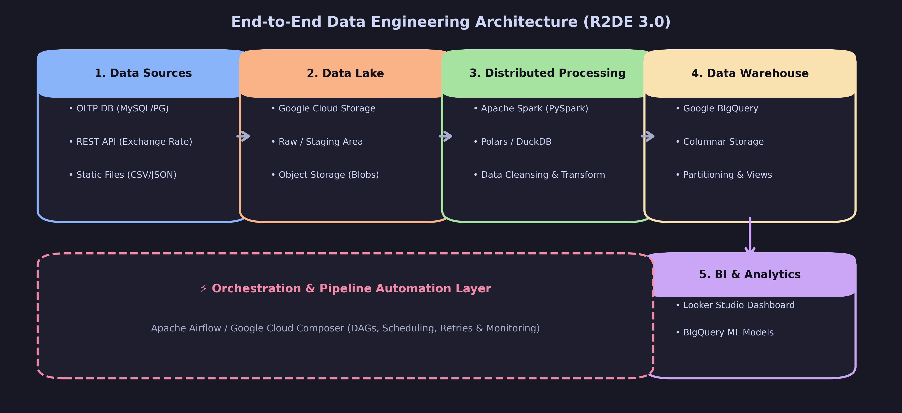
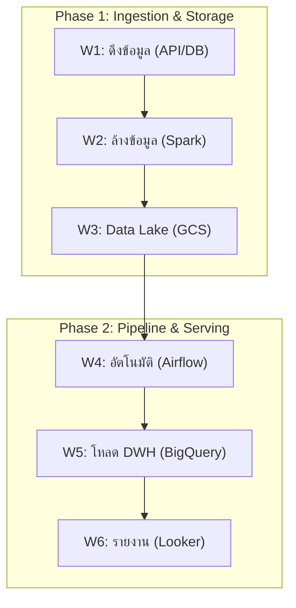

# Data Engineer - Chapter 00: Intro to Data Engineering

> **วิชา:** Road to Data Engineer 3.0 (R2DE 3.0) | **ผู้สอน:** DataTH
> **Source:** `Resources/Books/DataEngineer/0_Intro_to_Data_Engineering.pdf` (85 slides)
> **หมายเหตุ:** ส่วนที่ติดป้าย `[เสริมนอกสไลด์]` คือความรู้ที่ผู้เขียนโน้ตเพิ่มเอง ไม่ได้อยู่ในสไลด์ต้นฉบับ

---

## Part 1: Macro Architecture & Overview

ลองนึกภาพ **ร้านอาหารขนาดใหญ่**: มีครัวที่ทำอาหารตลอดเวลา (ระบบ Application), มีห้องเย็นเก็บวัตถุดิบ (Data Storage), มีพนักงานคอยขนวัตถุดิบเข้าครัวตามเวลา (Data Pipeline) และมีเมนูสรุปยอดขายให้เจ้าของร้านดู (Dashboard) **Data Engineer (DE)** คือคนที่ออกแบบและดูแล "ระบบท่อ + ห้องเก็บของ" ทั้งหมดนี้ เพื่อให้ Data Scientist และ Analyst เปิดมาใช้ข้อมูลที่สะอาดและเชื่อถือได้ทันที

Chapter 0 ตอบ 3 คำถามพื้นฐาน: (1) DE คืออาชีพอะไร ต่างจากสายอื่นอย่างไร (2) Big Data คืออะไร ทำไมต้องมีระบบพิเศษ (3) ข้อมูลมีกี่ประเภท และควรเก็บไว้ที่ไหน



### ตารางเปรียบเทียบ Database vs Data Warehouse vs Data Lake

| Feature | Database | Data Warehouse | Data Lake |
| :--- | :--- | :--- | :--- |
| **จุดประสงค์หลัก** | รันระบบ App (เขียน/อ่านเร็ว) | วิเคราะห์ข้อมูลในอดีต | เก็บไฟล์ทุกรูปแบบแบบดิบ |
| **ประเภทข้อมูล** | Structured (+ Semi ใน NoSQL) | Structured | ทุกประเภท (ไฟล์) |
| **Workload** | OLTP | OLAP | ขึ้นกับเครื่องมือที่มาอ่าน |
| **ตัวอย่าง** | MySQL, PostgreSQL, MongoDB | BigQuery, Redshift, Snowflake | Google Cloud Storage, S3, MinIO |
| **Schema** | กำหนดก่อนเขียน | กำหนดก่อนเขียน | ตีความตอนอ่าน (schema-on-read) `[เสริมนอกสไลด์]` |

---

## Part 2: Module-by-Module Deep Dive

### 2.1 ข้อมูลสำคัญก่อนเริ่มเรียน และ Mission ของคอร์ส

คอร์สเรียน 9 สัปดาห์ + เบรก 1 สัปดาห์ (ช่วง 18 พ.ค. - 20 ก.ค. 2024) เรียนวันเสาร์ผ่าน BigMarker มีวิดีโอย้อนหลังใน school.datath.com ข้อสอบ Final ก่อนจบเพื่อรับ Course Certificate

> **จุดที่ควรจำ:** คอร์สนี้เล่าเป็นเรื่องราวต่อเนื่อง ผู้เรียน "ได้รับเข้าทำงานเป็น Data Engineer" และได้ **Mission แรก** คือทำ Data Pipeline ให้ทีม Sales กับ Marketing ที่ต้องการขยายไลน์ธุรกิจ ทุก Workshop (1-6) จึงต่อกันเป็นท่อเดียวตั้งแต่ต้นจนจบ



**คำแนะนำการเรียน `[เสริมนอกสไลด์]`:** อย่าท่องคำสั่ง ให้จำ "ทำไมต้องมีขั้นตอนนี้" แล้วลองเขียน Pipeline ซ้ำด้วยข้อมูลของตัวเอง เช่น ข้อมูลรายจ่ายส่วนตัวหรือ Dataset จาก Kaggle

---

### 2.2 Data Engineer คือใคร

> 💡 **Intuition:** ลองนึกภาพ Data Engineer เป็น "พนักงานลำเลียง" ในร้านอาหาร — ทำให้วัตถุดิบ (ข้อมูล) ไหลจากห้องเย็นไปยังครัว แล้วไปยังลูกค้าทั้งหมดได้ถูกต้องทันเวลา ส่วน Data Scientist คือ "หัวหน้าครัว" ที่คิดสูตรอาหารใหม่ และ Software Engineer คือ "ช่างสร้าง" ที่สร้างร้านอาหารเอง ทั้งสามอาชีพต่างกัน แต่ต้องทำงานร่วมกัน
> [Source: generated — not verified against original document]

> **Data Engineer** = ผู้ออกแบบ สร้าง และดูแลระบบที่ทำให้ข้อมูลไหลจากแหล่งต้นทางไปสู่ผู้ใช้งานได้อย่างถูกต้อง ครบถ้วน และตรงเวลา

#### 2.2.1 สิ่งที่ DE ต้องรู้ (ตามสไลด์ 4 กลุ่ม)

| กลุ่มความรู้ | ตัวอย่างเครื่องมือ | เรียนใน Chapter |
| :--- | :--- | :--- |
| **Big Data Platform** (On-premise & Cloud) | Hadoop, GCP, AWS, Azure | CH2, CH3 |
| **Data Pipeline** (ท่อส่งข้อมูล) | Airflow, Azure Data Factory | CH1, CH4 |
| **Programming** | Python, SQL, Bash, Java/Scala | ตลอดคอร์ส |
| **Software Engineering & Automation** | Git, Docker, Kubernetes | CH7 |

#### 2.2.2 เปรียบเทียบสายงานข้อมูล

| ประเด็น | Data Engineer | Data Scientist | Software Engineer |
| :--- | :--- | :--- | :--- |
| **งานหลัก** | สร้างระบบข้อมูล/Pipeline | วิเคราะห์ + สร้าง Model | สร้างซอฟต์แวร์/ระบบ App |
| **Output** | ข้อมูลที่พร้อมใช้ | Insight / Model | Product / Feature |
| **เครื่องมือเด่น** | Spark, Airflow, Warehouse | Pandas, scikit-learn | Framework, API |

**ตัวอย่างสถานการณ์:** ทีม DS อยากสร้าง Model ทำนายลูกค้าเลิกใช้บริการ แต่ข้อมูลกระจายอยู่ใน 5 ระบบ มีค่าว่างเต็มไปหมด → DE ต้องรวมและทำความสะอาดก่อน DS ถึงเริ่มงานได้ นี่คือเหตุผลที่สไลด์บอกว่า DE เป็น "อาชีพที่ขาดไม่ได้ในองค์กรที่ต้องการทำ Data Science"

**ชื่อตำแหน่งใกล้เคียง (จากสไลด์):** Cloud Engineer, DevOps Engineer, Data Architect, System Engineer ขอบเขตงานของ DE แต่ละบริษัทอาจไม่เหมือนกัน ขึ้นกับขนาดองค์กรและจำนวนทีม

**🧭 ทำความเข้าใจ** _[Source: generated — not verified against original document]_

**แตกวลีสำคัญ:**
- "ออกแบบ สร้าง และดูแล" → DE ทำหลัก 3 สิ่ง: วางแผนให้ดี (ออกแบบ), สร้างระบบให้ทำงาน (สร้าง), และเฝ้าดูให้ทำงานตลอดเวลา (ดูแล)
- "ระบบที่ทำให้ข้อมูลไหล" → ไม่ใช่เพิ่มข้อมูลใหม่ แต่เป็นการสร้างท่อให้ข้อมูลที่มีอยู่เคลื่อนไหว

**ตัวอย่าง:**
- ✅ "รวมข้อมูลขายจากทุกสาขาเข้าคลังข้อมูลเพื่อให้ Manager ดูได้ตลอด" — นี่คือ DE ออกแบบ pipeline เพื่อให้ข้อมูลไหล
- ❌ "สร้าง Model ทำนายยอดขายเดือนหน้า" — นี่คือ Data Scientist ทำ ไม่ใช่ DE
- **ต่างกันตรง:** DE เตรียม "วัตถุดิบ" (ข้อมูลที่พร้อมใช้) ให้ DS ส่วน DS เป็นคนลงมือ "ปรุง" (สร้าง Model)

**อย่าสับสน:** "Data Engineer" ≠ "Data Analyst" — Analyst คือคนที่วิเคราะห์ข้อมูลเพื่อตอบคำถามธุรกิจ ส่วน DE คือคนสร้างระบบที่เตรียมข้อมูลให้พร้อมใช้

**เช็คความเข้าใจ:** ในโปรเจกต์ใหม่ DS อยากสร้าง Model แต่ข้อมูล Log อยู่ใน 3 Database ต่างกัน ใครควรทำอะไรให้ก่อน?
<details><summary>เฉลย</summary>

**Data Engineer** ต้องเป็นคนแรก เพราะ DE ต้อง:
1. ดึง (Extract) ข้อมูล Log จาก 3 Database
2. รวม (Merge) เข้าด้วยกัน
3. ทำความสะอาด (Transform) — เช่น ลบค่าว่าง, เปลี่ยนรูปแบบ
4. บันทึก (Load) เข้าแหล่งเดียว

หลังจากนั้น DS จึงสามารถเอาไปสร้าง Model ได้

</details>

---

### 2.3 Big Data

#### 2.3.1 Big Data คืออะไร และหลัก 4Vs (IBM)

> 💡 **Intuition:** ลองนึกภาพ Big Data เป็น "โรงแรมขนาดใหญ่" ที่มีแขกหลายคนเข้าออกตลอดเวลา ท่อนำน้ำทั่วไปอาจไม่พอ ต้องมีระบบท่อที่ใหญ่กว่า ระบบปั้มน้ำแรงกว่า และมี "ทิศทาง" ที่วางแผนมากขึ้น 4Vs คือ "มุมมอง" ที่ใช้ดูว่าข้อมูลท้าทายระดับ Big หรือไม่ — ไม่ใช่ดูแค่ปริมาณ แต่ดูทั้ง เยอะ (Volume) + เร็ว (Velocity) + หลากหลาย (Variety) + ความน่าเชื่อถือที่ไม่แน่นอน (Veracity)
> [Source: generated — not verified against original document]

| V | ความหมาย | ตัวอย่าง |
| :--- | :--- | :--- |
| **Volume** | ปริมาณข้อมูลมหาศาล | Log ของแอปที่มีผู้ใช้ล้านคน |
| **Velocity** | ข้อมูลเกิดและไหลเร็ว | ข้อมูล IoT Sensor ทุกวินาที |
| **Variety** | หลากหลายรูปแบบ | ตาราง + JSON + ภาพ + วิดีโอ |
| **Veracity** | ความน่าเชื่อถือของข้อมูล | ข้อมูลที่พิมพ์ผิดหรือขัดแย้งกัน |

> **ทำไมต้องมีระบบพิเศษ:** เมื่อข้อมูลใหญ่เกินกว่าเครื่องเดียวจะรับไหว (RAM, Disk, CPU) ต้องกระจายงานไปหลายเครื่อง

**🧭 ทำความเข้าใจ** _[Source: generated — not verified against original document]_

**แตกวลีสำคัญ:**
- "ปริมาณข้อมูลมหาศาล" → ไม่ใช่แค่ "ตัวเลขเยอะ" แต่เยอะจนเครื่องเดียวจัดการไม่ได้ (ปกติจะเริ่มตั้งแต่ TB ขึ้นไป)
- "ความน่าเชื่อถือของข้อมูล" → ข้อมูลตรงกับความเป็นจริงแค่ไหน — Big Data มักมีค่าพิมพ์ผิด ซ้ำ หรือขัดแย้งกัน จึงต้องตรวจสอบก่อนใช้
- "หลากหลายรูปแบบ" → ไม่ใช่เพียงแค่ตาราง SQL แต่รวมไฟล์หลากหลายชนิด

**ตัวอย่าง:**
- ✅ "Google ประมวลผลข้อมูลระดับ 20 petabytes ต่อวัน จากการค้นหา, โฆษณา, แผนที่" — ครบ 4Vs (เยอะ + ไว + หลากหลาย + ต้องจัดการความน่าเชื่อถือ)
- ❌ "ร้านหนังสือขนาดเล็กเก็บข้อมูลหนังสือ 10,000 เล่มในคลังเดียว" — นี่คือข้อมูลทั่วไปที่เครื่องเดียวจัดการได้ ไม่ใช่ Big Data
- **ต่างกันตรง:** Big Data คือชุดข้อมูลที่เยอะมากหรือเร็วมาก หรือซับซ้อนหรือเชื่อถือได้ยาก ไม่ใช่แค่ "เยอะ"

**อย่าสับสน:** "Big" ในที่นี้หมายถึง **ข้อมูลที่มักต้องใช้ระบบประมวลผลแบบกระจาย (หลายเครื่อง)** ไม่ได้หมายถึง "ไฟล์ขนาดใหญ่เพียงอย่างเดียว"

**เช็คความเข้าใจ:** ข้อมูลแบบไหนที่เข้า 4Vs ของ Big Data — (ก) บัญชีรายรับรายจ่าย 2 สัปดาห์ของร้านกาแฟแห่งหนึ่ง (ข) ข้อมูลจำนวนคนที่ผ่านสัญญาณไฟจราจรในกรุงเทพฯ ทุกวินาที (ค) เซลฟี่ของโปรแกรมเมอร์ 100 คน
<details><summary>เฉลย</summary>

**ตอบ: (ข)** ข้อมูลจำนวนคนผ่านสัญญาณไฟจราจร

**เหตุผล:**
- **(ก) ไม่ใช่** — ข้อมูลจำนวน 2 สัปดาห์ปกติของร้านกาแฟเล็กๆ ไม่เยอะพอ (Volume ไม่พอ)
- **(ข) ใช่** — ข้อมูลเข้ามาทุกวินาที (Velocity สูง) จากทุกทางแยกทั่วกรุงเทพฯ สะสมเป็นปริมาณมหาศาล (Volume สูง) และ Sensor อาจส่งค่าผิดพลาด (Veracity)
- **(ค) ไม่ใช่** — แม้รูปภาพเป็น Unstructured แต่ 100 รูปมี Volume ต่ำมากและไม่ได้ไหลเข้าต่อเนื่อง เครื่องเดียวก็จัดการได้

</details>

**Brief History (สไลด์ P.50):** ยุค Database (เริ่มราว 1983) → Data Warehouse → Big Data / Hadoop → Cloud `[รายละเอียดแต่ละยุคเสริมนอกสไลด์]`

#### 2.3.2 Big Data Platform สองแบบ

> 💡 **Intuition:** เหมือน **"ซื้อรถเองกับเช่ารถ"** — ซื้อของเรา: ต้องจ่ายล่วงหน้าแพง, ต้องดูแลซ่อมเอง, แต่ไปไหนได้อย่างอิสระ vs เช่ารถ: จ่ายเมื่อใช้เท่านั้น, บริษัทผู้ให้เช่าดูแลซ่อม, เพิ่มจำนวนคันได้เร็ว แต่ปรับแต่งได้จำกัด — On-Premise = ซื้อ, Cloud = เช่า
> [Source: generated — not verified against original document]

| ประเด็น | On-Premise (เช่น Hadoop) | Cloud Computing |
| :--- | :--- | :--- |
| **การลงทุน** | ซื้อเครื่องล่วงหน้า (ต้นทุนสูง) | จ่ายตามการใช้งาน |
| **การดูแล** | ทีมเราดูแลฮาร์ดแวร์เอง | Provider ดูแลให้ |
| **การขยาย** | ต้องสั่งซื้อ/ติดตั้งเพิ่ม | ปรับขนาดได้เร็ว |
| **ตัวอย่าง** | Hadoop Ecosystem | GCP, AWS, Azure (3 ผู้ให้บริการ Public Cloud ใหญ่สุด) |

**🧭 ทำความเข้าใจ** _[Source: generated — not verified against original document]_

**แตกวลีสำคัญ:**
- "ซื้อเครื่องล่วงหน้า" → ต้องจ่ายเงินก้อนโต ก่อนใช้งาน แม้ว่าจะใช้ไม่เต็มที่
- "จ่ายตามการใช้งาน" → Pay-as-you-go: ใช้มากจ่ายมาก, ใช้น้อยจ่ายน้อย
- "ปรับขนาดได้เร็ว" → Elasticity: ภายในไม่กี่นาทีสามารถเพิ่มเครื่องจาก 10 เป็น 1000 ได้

**ตัวอย่าง:**
- ✅ **On-Premise** — บริษัทขนาดใหญ่ที่ซื้อ Server ไว้ตั้งแต่ปี 2018 และยังรัน Hadoop cluster ใน Data Center ของตัวเอง ดูแลเอง
- ✅ **Cloud** — Startup ที่อยากลองใช้ BigQuery ก่อนตัดสินใจลงทุนก้อนใหญ่ → ใช้ Cloud จ่ายตามใช้ และขยายได้เร็วถ้าธุรกิจโต
- **ต่างกันตรง:** On-Premise = ลงทุนก้อนแรกสูง แต่ต้นทุนต่อหน่วยลดลงเมื่อใช้เต็มที่และนาน, Cloud = ต้นทุนผันแปรตามการใช้งาน

**อย่าสับสน:** "Cloud ถูกกว่า On-Premise เสมอ" **ไม่ใช่** — ถ้าใช้ระบบตลอดเวลา On-Premise อาจถูกกว่า แต่ Cloud มีความยืดหยุ่นสูง

**เช็คความเข้าใจ:** สตาร์ทอัพเพิ่งขึ้นมา ยังไม่รู้ว่าโปรแกรมจะใช้กี่ TB ควรเลือก On-Premise หรือ Cloud? และเพราะเหตุใด?
<details><summary>เฉลย</summary>

**ตอบ: Cloud**

**เหตุผล:**
1. **ต้นทุนเริ่มต้นต่ำ** — ไม่ต้องจ่ายเงินก้อนโตซื้อเครื่องที่ยังไม่รู้จะใช้เท่าไหร่
2. **ยืดหยุ่น** — ถ้าต้องการเพิ่ม 1 TB เป็น 100 TB ในขั้นตอนต่อไป ทำได้ในนาทีเดียว ไม่ต้องรอการสั่งซื้อเครื่องใหม่
3. **ไม่ต้องดูแล Hardware เอง** — ทีมเล็กๆ ไม่มีคนดูแลฮาร์ดแวร์

หลังจากเวลาผ่านไปหลายปี และข้อมูลเสถียร อาจพิจารณาย้ายบางส่วนไป On-Premise เพื่อลดต้นทุน

</details>

รายละเอียด Cloud อยู่ใน [[Chapter 03 - Cloud Computing and Bash]]

---

### 2.4 ประเภทของข้อมูล (Types of Data)

> 💡 **Intuition:** ลองนึกภาพ 3 ประเภทเป็น **"การจัดเรียงกระดาษในสำนักงาน"** — Structured คือแบบฟอร์มที่มีช่องกรอกตำแหน่งเดิมทุกใบ (คงที่), Semi-Structured คือจดหมายที่มีหัวข้อ ผู้ส่ง ผู้รับ แต่เนื้อหาและความยาวไม่เท่ากัน (ยืดหยุ่นได้), Unstructured คือกองเศษกระดาษ สมุดบันทึก ภาพถ่ายปนกัน ไม่มีแบบแผน
> [Source: generated — not verified against original document]

| ประเภท | คำอธิบาย | ตัวอย่าง |
| :--- | :--- | :--- |
| **Structured** | โครงสร้างแน่นอน แสดงเป็นตาราง แถว-คอลัมน์ได้ | ตารางสั่งซื้อใน MySQL, ไฟล์ CSV |
| **Semi-Structured** | โครงสร้างยืดหยุ่น ขยายได้ในอนาคต | JSON, XML, Log |
| **Unstructured** | ไม่มีโครงสร้างตายตัว | รูปภาพ, วิดีโอ, เสียง, เอกสาร PDF |

```json
// ตัวอย่าง Semi-Structured: JSON แต่ละ record มี field ไม่เท่ากันได้
{"order_id": 1, "customer": "A", "coupon": "NEW10"}
{"order_id": 2, "customer": "B"}
```

> **พัฒนาการการเก็บข้อมูล (สไลด์ P.57):** กระดาษ → ตาราง → ... → Big Data เกิดข้อมูลหลายรูปแบบจนต้องมีที่เก็บหลายประเภท

**🧭 ทำความเข้าใจ** _[Source: generated — not verified against original document]_

**แตกวลีสำคัญ:**
- "โครงสร้างแน่นอน" → มี Schema ที่กำหนดไว้เสมอ (คอลัมน์ ชนิดข้อมูล ตำแหน่ง)
- "โครงสร้างยืดหยุ่น" → มีโครงสร้างพื้นฐาน แต่สามารถเพิ่มฟิลด์ใหม่ได้โดยไม่ต้องเปลี่ยนทั้งระบบ
- "ไม่มีโครงสร้างตายตัว" → ไม่มี "คอลัมน์" หรือ "ฟิลด์" ที่นิยาม แต่ละไฟล์มีรูปแบบของตัวเอง

**ตัวอย่าง:**
- ✅ **Structured** — ตาราง Product: (product_id, name, price, stock) ทุกแถวมี 4 คอลัมน์เหมือนกัน
- ✅ **Semi-Structured** — API Log: {"user_id": 123, "action": "login"} vs {"user_id": 456, "action": "buy", "item": "ABC"} — มี key ไม่เท่ากัน
- ✅ **Unstructured** — Video ไลฟ์สด + ใบรับรองที่สแกนเป็น PDF ขนาดต่างกัน รูปแบบต่างกัน
- **ต่างกันตรง:** Structured เหมือนตาราง Excel ที่ทุกแถวมีคอลัมน์ครบเท่ากัน, Semi-Structured เหมือน JSON array ที่แต่ละ object มี properties ต่างกันได้, Unstructured เหมือนลิ้นชักรกๆ ไม่มีระเบียบ

**อย่าสับสน:** "Semi-Structured" **ไม่ใช่** "Structured พอสมควร" แต่เป็น "มีกรอบ แต่ข้างในยืดหยุ่น"

**เช็คความเข้าใจ:** ข้อมูลแบบไหน?
- (ก) ไฟล์ CSV ของ 10,000 ลูกค้า (ชื่อ, เบอร์, ที่อยู่)
- (ข) Facebook Log: {"timestamp": "2024-01-01", "user": "123", "action": "like"} บางรายมี "post_id" บางรายมี "page_id"
- (ค) โฟลเดอร์ที่มี 500 ไฟล์ PDF ของใบแจ้งหนี้
<details><summary>เฉลย</summary>

**(ก) Structured** — CSV มีคอลัมน์ที่แน่นอน (ชื่อ, เบอร์, ที่อยู่) ทุกแถว

**(ข) Semi-Structured** — JSON ปกติ แต่ field หลัก (timestamp, user, action) มีเสมอ ส่วนเพิ่มเติมยืดหยุ่น (post_id หรือ page_id ขึ้นกับ action type)

**(ค) Unstructured** — ไฟล์ PDF แต่ละไฟล์อาจมีหน้าต่างกัน เลย์เอาต์ต่างกัน ไม่มีคอลัมน์ที่นิยาม

</details>

---

### 2.5 ที่เก็บข้อมูล (Data Storage)

#### 2.5.1 Database

เหมาะกับข้อมูลที่ต้องเขียนและอ่านเร็ว เช่น Website, Mobile App

| ชนิด | ใช้กับ | ตัวอย่าง | ภาษา |
| :--- | :--- | :--- | :--- |
| **SQL (RDBMS)** | Structured | MySQL, PostgreSQL | SQL |
| **NoSQL** ("Not Only SQL") | Semi-Structured | MongoDB, Cassandra, Redis `[ตัวอย่างเสริมนอกสไลด์]` | เฉพาะตัว/บางตัวอ่าน SQL ได้ |

สไลด์ระบุว่า Database Model ยังมีอีกมาก (Relational, Document, Key-value, Graph ฯลฯ) ดูอันดับได้ที่ db-engines.com/en/ranking

> 💡 **Intuition:** Database เหมือน **"สมุดบัญชีประจำวันของร้านค้า"** — ทุกออเดอร์ต้องบันทึกทันทีและถูกต้อง ลูกค้าสองคนกดซื้อพร้อมกันก็ต้องเห็นสต็อกคงเหลือล่าสุด งานแบบ "เพิ่ม/แก้/อ่านทีละรายการอย่างรวดเร็ว" นี้คือเหตุผลที่แอปทุกตัวต้องมี Database (จุดที่ analogy ไม่ตรง: สมุดบัญชีไม่เหมาะกับการนั่งรวมยอดข้ามห้าปี งานนั้นเป็นของ Data Warehouse)
> [Source: generated — not verified against original document]

**🧭 ทำความเข้าใจ** _[Source: generated — not verified against original document]_

**แตกวลีสำคัญ:**
- "Structured" → ข้อมูลที่มี schema ตายตัว เป็นตาราง แถว คอลัมน์ (เช่น MySQL, PostgreSQL)
- "Semi-Structured" → ข้อมูลที่มีโครงสร้างยืดหยุ่น เช่น JSON ที่แต่ละ document มี field ไม่เท่ากันได้
- "NoSQL (Not Only SQL)" → กลุ่มฐานข้อมูลที่ไม่บังคับให้เก็บเป็นตารางเสมอไป (เช่น MongoDB, Cassandra, Redis)
- "Transaction" → การเปลี่ยนแปลงหลายขั้นที่ต้องสำเร็จทั้งหมดหรือไม่เกิดเลย (เช่น ตัดสต็อกกับสร้างออเดอร์)

**ตัวอย่าง:**
- ✅ ระบบสั่งซื้อที่ต้องตัดสต็อกและสร้างออเดอร์พร้อมกัน — Database แบบ SQL เหมาะ เพราะรองรับ transaction
- ✅ เก็บ profile ผู้ใช้ที่ฟิลด์เปลี่ยนไปบ่อยตามแต่ละคน — NoSQL แบบ document เหมาะกว่า
- ❌ รันรายงานยอดขายรายปีจาก 5 ปีย้อนหลังบน Database ของแอปทุกครั้ง — query ก้อนใหญ่จะกินทรัพยากรและกระทบผู้ใช้แอป ควรย้ายไป Data Warehouse
- **ต่างกันตรง:** แอปต้องการเขียน/อ่านรายแถวทันที (Database) หรือวิเคราะห์ก้อนใหญ่ย้อนหลัง (Data Warehouse)

**อย่าสับสน:** "NoSQL = ไม่ใช้ SQL เลย" — ไม่ใช่ ชื่อย่อมาจาก "Not Only SQL" บางตัวรองรับ SQL-like query ได้ ส่วนบางตัวไม่รองรับ (ดูตารางในสไลด์)

**เช็คความเข้าใจ:** ระบบ "ตะกร้าสินค้าของลูกค้า" กับ "รายงานยอดขายรายไตรมาส" ควรเก็บที่ไหนแต่ละอย่าง และเพราะอะไร?
<details><summary>เฉลย</summary>

1. **ตะกร้าสินค้า** → Database: ลูกค้าเพิ่ม/ลบของบ่อยและต้องเห็นผลทันที (งาน OLTP)
2. **รายงานยอดขายรายไตรมาส** → Data Warehouse: ต้องรวมข้อมูลย้อนหลังก้อนใหญ่เพื่อวิเคราะห์ (งาน OLAP) ข้อมูลจาก Database สามารถโหลดเข้า DW ได้

</details>

#### 2.5.2 Data Warehouse

เก็บข้อมูล Structured ขนาดใหญ่ มักเป็น **historical data** ที่ไม่เปลี่ยนแปลง เพื่อใช้วิเคราะห์ ตัวอย่างในสไลด์: Google BigQuery, Amazon Redshift (ดู [[Chapter 05 - Data Warehouse with BigQuery]])

> 💡 **Intuition:** Data Warehouse เหมือน **"ห้องสมุดกลาง"** ที่รวมหนังสือ (ข้อมูล) จากทุกสาขามาจัดเป็นหมวดเดียวกัน เก็บประวัติย้อนหลังให้ค้นและเทียบกันได้ ห้องสมุดไม่ได้ออกแบบมาให้ยืมคืนทุกนาทีเหมือนเคาน์เตอร์ยืมหนังสือ (จุดที่ analogy ไม่ตรง: ข้อมูลส่วนใหญ่เข้า DW เป็นชุดตามรอบ ไม่ได้อัปเดตทุกวินาทีเหมือน Database)
> [Source: generated — not verified against original document]

**🧭 ทำความเข้าใจ** _[Source: generated — not verified against original document]_

**แตกวลีสำคัญ:**
- "Historical data" → ข้อมูลในอดีตที่เก็บไว้ดูแนวโน้มและเทียบช่วงเวลา
- "Structured" → ข้อมูลที่มีโครงสร้างชัดเจน (คอลัมน์และชนิดข้อมูลกำหนดไว้แล้ว)
- "Analytics (OLAP)" → การ query ก้อนใหญ่ที่รวมและคำนวณจากหลายล้านแถว

**ตัวอย่าง:**
- ✅ ยอดขายรายวันย้อนหลัง 5 ปี รวมตามภูมิภาค — เหมาะกับ Data Warehouse
- ✅ รวมข้อมูลจาก POS และ CRM มาไว้ที่เดียวเพื่อดูภาพรวมธุรกิจ — เหมาะกับ Data Warehouse
- ❌ เก็บ log การกดปุ่มของผู้ใช้แอปเพื่อตอบสนองการกดทันที — ไม่ใช่งานของ Data Warehouse เป็นงานของ Database ฝั่งแอป
- **ต่างกันตรง:** เขียน/อ่านรายแถวทันที (Database) หรือวิเคราะห์ประวัติก้อนใหญ่ (Data Warehouse)

**อย่าสับสน:** "Data Warehouse = Database ที่ใหญ่กว่า" — ไม่ใช่ ต่างกันที่เป้าหมายการใช้งานและรูปแบบการ query ไม่ได้ต่างกันแค่ขนาด

**เช็คความเข้าใจ:** ต้องการเก็บคำสั่งซื้อที่ลูกค้ากดอยู่ตอนนี้ และทำรายงานยอดขายรวมปี 2020–2024 ควรเลือกที่เก็บอะไรแต่ละงาน?
<details><summary>เฉลย</summary>

1. **คำสั่งซื้อปัจจุบัน** → Database (ต้องบันทึกและอ่านทันที)
2. **รายงานยอดรวม 2020–2024** → Data Warehouse (วิเคราะห์ข้อมูลย้อนหลังก้อนใหญ่)

</details>

#### 2.5.3 OLTP vs OLAP

> 💡 **Intuition:** ลองนึกภาพ OLTP vs OLAP เป็น **"แคชเชียร์ที่เคาน์เตอร์ vs Manager ที่สำนักงาน"** — OLTP = แคชเชียร์ต้องเช็ค "ลูกค้า X มีเงินพอจ่ายรายการนี้ไหม" แล้วบันทึกการขายทันที (ตอบเร็ว, ข้อมูลปัจจุบัน, คำถามเฉพาะเรื่อง) vs OLAP = Manager ต้องดู "ยอดขายไตรมาสนี้เทียบกับปีที่แล้วจากทุกสาขา" (ตอบช้าได้ แต่ต้องดูข้อมูลมหาศาล)
> [Source: generated — not verified against original document]

| ประเด็น | OLTP (Online Transaction Processing) | OLAP (Online Analytical Processing) |
| :--- | :--- | :--- |
| **ใช้ทำอะไร** | บันทึกธุรกรรมทีละรายการ | วิเคราะห์/สรุปข้อมูลก้อนใหญ่ |
| **ที่เก็บ** | Database | Data Warehouse |
| **ตัวอย่างคำถาม** | "ตะกร้าของลูกค้า A มีอะไรบ้าง" | "ยอดขายรายเดือนของแต่ละภูมิภาคปีนี้" |
| **รูปแบบ Query** | แถวเดียว/น้อยแถว | สแกนหลายล้านแถว แต่ใช้ไม่กี่คอลัมน์ |

**🧭 ทำความเข้าใจ** _[Source: generated — not verified against original document]_

**แตกวลีสำคัญ:**
- **OLTP** = "Online Transaction Processing" → ต้องบันทึก transaction ทีละหนึ่ง ต้องเร็ว เพราะลูกค้านั่งรอ
- **OLAP** = "Online Analytical Processing" → ต้องตอบคำถามวิเคราะห์ที่อาจต้องสแกนข้อมูลหลายล้านแถว ใช้เวลานานกว่าได้
- "สแกนหลายล้านแถว แต่ใช้ไม่กี่คอลัมน์" → OLAP สนใจเพียง 2-3 คอลัมน์ (เช่น วันที่ กับ ยอดขาย) แต่ต้องสแกน 10 ล้านแถว

**ตัวอย่าง:**
- ✅ **OLTP** — ต้องตอบ "ลูกค้า ID 12345 ซื้ออะไรบ้างเดือนนี้?" (1 ลูกค้า) — ใช้เวลา < 1 วินาที
- ✅ **OLAP** — ต้องตอบ "ยอดขายรวมของแต่ละประเภท (มีหลายพันประเภท) เพื่อสร้าง Dashboard" — อาจใช้เวลา 1 นาที ไม่เป็นไร
- **ต่างกันตรง:** OLTP = "ทีละรายการ" + "ต้องเร็ว", OLAP = "สแกนมหาศาล" + "สรุปภาพรวม"

**อย่าสับสน:** "ใช้ OLTP Database (เช่น MySQL) ทำ OLAP ได้หรือเปล่า?" — **ได้ แต่ช้าและรบกวนระบบหน้าร้าน** เพราะ OLTP Database ออกแบบมาสำหรับอ่าน/เขียนทีละไม่กี่แถว OLAP ต้องการ Data Warehouse ที่ optimize สำหรับการอ่านมหาศาล

**เช็คความเข้าใจ:** งานไหนใช้ OLTP และงานไหนใช้ OLAP?
- (ก) "จำนวน ATM withdrawal ของลูกค้าแต่ละคนในสัปดาห์นี้"
- (ข) "ทำการเบิกจ่ายเงินให้ลูกค้า ID 777"
- (ค) "ยอดถอนเงินทั้งปีแบ่งตามเพศ อายุ ภูมิภาค"
<details><summary>เฉลย</summary>

**(ก) OLAP** — ต้องดู aggregate (รวม) และ summary เป็น report สำหรับลูกค้าหลายคน

**(ข) OLTP** — ต้องบันทึก transaction ทีละหนึ่ง ต้องตอบเร็ว (ลูกค้านั่งรอ)

**(ค) OLAP** — วิเคราะห์เพื่อ reporting และ dashboard

**สรุป:** OLTP = ปัจจุบัน + เร็ว + ทีละรายการ, OLAP = historical + ช้าได้ + มหาศาล

</details>

#### 2.5.4 Data Lake

> 💡 **Intuition:** Data Lake เหมือน **"ห้องเก็บของใหญ่ของบ้าน"** — โยนของได้ทุกชนิด (เสื้อผ้า, กล่องหนังสือ, คอมพิวเตอร์เก่า, รูปเก่า) โดยยังไม่ต้องจัดให้เป็น Table — ส่วน Data Warehouse คือ "ห้องที่จัดชั้นวางแยกหมวดหมู่เรียบร้อยแล้ว หยิบใช้ได้ทันที"
> [Source: generated — not verified against original document]

ที่เก็บไฟล์ขนาดใหญ่รองรับ **ทุกรูปแบบ** เหมือน Harddrive ขององค์กรแต่มีระบบป้องกันข้อมูลสูญหายที่ดีกว่า (เช่น GCS, S3, MinIO)

**🧭 ทำความเข้าใจ** _[Source: generated — not verified against original document]_

**แตกวลีสำคัญ:**
- "รองรับทุกรูปแบบ" → ไม่ต้องจัดตั้ง Schema ก่อน โยนไฟล์ได้เลย (CSV, JSON, PDF, รูป, วิดีโอ)
- "เหมือน Harddrive" → เก็บไฟล์ดิบ ไม่จำเป็นต้องประมวลผลเพื่อเก็บ
- "ตีความตอนอ่าน (schema-on-read)" → ไม่ต้องนิยาม schema ตอนเก็บ ค่อยกำหนดตอนอ่านข้อมูลมาใช้

**ตัวอย่าง:**
- ✅ **Data Lake** — เก็บ Log ดิบ 100GB, ไฟล์ CSV ของขายของ, รูปภาพลูกค้า, PDF ของใบแจ้งหนี้ ทั้งหมดในที่เดียว
- ❌ "ต้องแปลงข้อมูลเป็นตารางตาม Schema ก่อน ถึงจะเก็บลง Data Lake ได้" — ผิด นั่นคือวิธีของ Data Warehouse (schema-on-write) ส่วน Data Lake เก็บไฟล์ดิบได้เลยแม้ยังไม่รู้ว่าจะใช้ทำอะไร
- **ต่างกันตรง:** Data Warehouse = จัดระเบียบก่อนเก็บ, Schema ตายตัว, Query เร็ว; Data Lake = เก็บดิบ, ยืดหยุ่น, ราคาถูก แต่ต้องจัดการโครงสร้างเองตอนอ่าน

**อย่าสับสน:** "Data Lake เหมือน Data Warehouse ที่ใหญ่กว่า" — **ไม่ใช่** เป็นคนละประเภทเลย Lake = ไม่จัดโครงสร้าง, Warehouse = จัดเรียบร้อย

**เช็คความเข้าใจ:** ควรเก็บข้อมูลไหนใน Data Lake?
- (ก) CSV ของระบบแบบจำลองพยากรณ์อากาศ (ยังไม่รู้ว่าจะใช้อะไร)
- (ข) ตาราง Customer ที่ต้องเข้า Dashboard ทุกวัน และต้อง Query บ่อยและเร็ว
- (ค) ข้อมูล Sensor จากโรงงาน (ข้อมูลเยอะ รูปแบบหลากหลาย)
<details><summary>เฉลย</summary>

**(ก) ✅ Data Lake** — ยังไม่รู้ว่าจะใช้ทำอะไร จึงเก็บแบบดิบไว้ก่อน "ดีกว่าทิ้ง"

**(ข) ❌ ไม่ใช่ Data Lake → ควรอยู่ Data Warehouse** — ต้องสืบค้นบ่อยและ Query ต้องเร็ว ซึ่ง Data Lake ทำได้ช้ากว่า

**(ค) ✅ Data Lake** — Sensor ส่ง data เยอะ มีหลายประเภท (อุณหภูมิ ความชื้น ความดัน) → เหมาะกับ Lake

</details>

#### 2.5.5 เลือกที่เก็บอย่างไร

| ถ้างานคือ... | เลือก |
| :--- | :--- |
| ระบบ App ที่ข้อมูลเปลี่ยนตลอดเวลา | Database |
| รวมข้อมูลเก่ามาวิเคราะห์/ทำรายงาน | Data Warehouse |
| เก็บไฟล์ดิบ รูป วิดีโอ หรือยังไม่รู้ว่าจะใช้ทำอะไร | Data Lake |

**Pattern พื้นฐานบน Big Data (สไลด์ P.73):** ข้อมูลจาก Database / ไฟล์ → ลง Data Lake → ประมวลผล → โหลดเข้า Data Warehouse → ใช้งาน `[รายละเอียดลำดับเป็นการสรุปของผู้เขียนโน้ต ให้เทียบกับสไลด์ P.73]`

#### 💡 เสริม: เลือกที่เก็บข้อมูล (Database / Data Warehouse / Data Lake)

> 💡 **Intuition:** การเลือกที่เก็บเหมือน **"การจัดของเข้าตู้"** — ของที่ใช้ทุกวันวางบนโต๊ะทำงาน (Database) ของที่ต้องหยิบมาเทียบย้อนหลังเก็บในตู้เอกสาร (Data Warehouse) และของดิบที่ยังไม่รู้จะใช้ทำอะไรเก็บในโกดังรวม (Data Lake) (จุดที่ analogy ไม่ตรง: ระบบจริงมักใช้ทั้งสามพร้อมกันตาม Pattern ไม่ได้เลือกอันเดียวจบ)
> [Source: generated — not verified against original document]

**🧭 ทำความเข้าใจ** _[Source: generated — not verified against original document]_

**แตกวลีสำคัญ:**
- "Database" → ที่เก็บข้อมูลสำหรับแอปที่เขียน/อ่านรายแถวทันที
- "Data Warehouse" → ที่เก็บข้อมูลที่จัดโครงสร้างแล้ว เพื่อวิเคราะห์และทำรายงาน
- "Data Lake" → ที่เก็บไฟล์ดิบทุกรูปแบบในราคาที่ถูกกว่า โดยยังไม่ต้องกำหนดโครงสร้างล่วงหน้า
- "Pattern พื้นฐาน" → ลำดับการไหลของข้อมูล: ต้นทาง → Data Lake → ประมวลผล → Data Warehouse

**ตัวอย่าง:**
- ✅ แอปขายของที่ต้องอัปเดตยอดคงเหลือทุกวินาที — Database
- ✅ ไฟล์ log ดิบขนาด 2 TB ที่ยังไม่รู้ว่าจะวิเคราะห์อะไร — Data Lake
- ❌ "เก็บทุกอย่างลง Data Lake แล้วจบ ไม่ต้องมี Data Warehouse" — ไม่เสมอไป ถ้าทีมต้องการรายงานที่ query เร็วและโครงสร้างชัด การมี DW (หรือ Lakehouse) ช่วยได้มาก
- **ต่างกันตรง:** ข้อมูลที่ผู้ใช้แอปเปลี่ยนตลอดเวลา (Database) / ข้อมูลโครงสร้างชัดที่วิเคราะห์ย้อนหลัง (DW) / ข้อมูลดิบที่ยังไม่รู้จะใช้ทำอะไร (Data Lake)

**อย่าสับสน:** "Data Lake = ที่ทิ้งข้อมูล" — ไม่ใช่ Data Lake คือที่เก็บข้อมูลดิบโดยตั้งใจเพื่อใช้ในอนาคต ถ้าไม่มีการจัดการ metadata ที่ดี มันจะกลายเป็น "Data Swamp" ที่ใช้งานยาก

**เช็คความเข้าใจ:** ไฟล์รูปสินค้า 1 ล้านไฟล์ กับยอดคงเหลือสินค้าที่ต้องอัปเดตทุกวินาที ควรเก็บที่ไหนแต่ละอย่าง?
<details><summary>เฉลย</summary>

1. **ไฟล์รูปสินค้า** → Data Lake (ไฟล์ดิบ/unstructured ไม่ต้องมี schema)
2. **ยอดคงเหลือที่อัปเดตทุกวินาที** → Database (เขียน/อ่านรายแถวทันที)

</details>

---

### 2.6 Data Pipeline, Tools และ Tech Landscape

> **Data Pipeline:** ชุดขั้นตอนอัตโนมัติที่ลำเลียงข้อมูลจากต้นทางไปปลายทาง ตัวอย่างระบบจัดการ Pipeline: Airflow, Azure Data Factory ([[Chapter 04 - Data Pipeline Orchestration with Airflow]])

**กลุ่มเครื่องมือของ DE (สรุปสไลด์ P.79):** Data Lake, Data Processing, Orchestration, Data Warehouse, Visualization และ Programming (Python, SQL, Bash) + Software Engineering (Git, Docker, K8s)

**Data & AI Landscape 2024:** แผนที่เครื่องมือจาก mattturck.com/mad2024 ใช้ดูภาพรวมว่ามีเครื่องมือกี่หมวด **อย่าพยายามรู้จักทุกตัว** ให้เข้าใจ "หมวด" ก่อน เช่น ตัวนี้เป็น Warehouse ตัวนี้เป็น Orchestrator

---

## Part 3: Quick Reference & Exam Cheat Sheet

### Checklist สรุปหัวใจสำคัญ
* [ ] **Data Engineer:** สร้างและดูแลระบบข้อมูล/Pipeline ไม่ใช่คนวิเคราะห์ผลหรือสร้าง Model เป็นหลัก
* [ ] **4Vs:** Volume, Velocity, Variety, Veracity
* [ ] **3 ประเภทข้อมูล:** Structured / Semi-Structured / Unstructured พร้อมยกตัวอย่างได้
* [ ] **OLTP vs OLAP:** ธุรกรรมรายแถวเทียบกับวิเคราะห์ก้อนใหญ่ → Database เทียบกับ Data Warehouse
* [ ] **Data Lake:** เก็บไฟล์ทุกรูปแบบ ราคาถูก
* [ ] **On-premise vs Cloud:** เครื่องของเราเองเทียบกับเช่า Data Center

### Decision Rules

```text
ข้อมูลเปลี่ยนบ่อย + App ต้องการเร็ว     → Database (OLTP)
วิเคราะห์ข้อมูลในอดีต ปริมาณมาก         → Data Warehouse (OLAP)
ไฟล์ดิบ/รูป/ยังไม่รู้จะใช้อะไร            → Data Lake
```

### Concept Map

```text
Data Engineering
├── Role: DE vs DS vs SWE
├── Big Data: 4Vs
├── Platform: On-premise (Hadoop) / Cloud
├── Data Types: Structured / Semi / Unstructured
├── Storage: Database / Warehouse / Lake
└── Pipeline + Tools: Orchestration, Processing, Git, Docker
```

---

## ⚠️ Common Pitfalls & Exam Traps

* **"DE กับ DS ทำงานเหมือนกัน":** ไม่ใช่ DE สร้างโครงสร้างและ Pipeline ให้ข้อมูลพร้อมใช้ ส่วน DS วิเคราะห์และสร้าง Model บนข้อมูลนั้น
* **"NoSQL แปลว่าไม่ใช้ SQL เลย":** สไลด์ระบุว่า NoSQL = **Not Only SQL** บางตัวอ่าน SQL ได้
* **"เก็บทุกอย่างใน Database เดียวพอ":** Database ออกแบบมาเพื่อ OLTP การวิเคราะห์ก้อนใหญ่ใน Database ที่รัน App อยู่อาจทำให้ระบบหลักช้าลง `[ข้อสังเกตเสริมนอกสไลด์]`
* **"Data Lake คือ Data Warehouse ที่ใหญ่กว่า":** Lake เก็บไฟล์ดิบทุกรูปแบบ Warehouse เก็บข้อมูลที่จัดโครงสร้างไว้เพื่อ Query วิเคราะห์
* **"Big Data = ข้อมูลเยอะเท่านั้น":** ต้องพิจารณาครบ 4Vs ไม่ใช่แค่ Volume

---

## เอกสารเชื่อมโยง (Wiki-Style Backlinks)
* **วิชาและหัวข้อที่เกี่ยวข้อง:**
  * [[Chapter 01 - Data Collection]] (บทถัดไป — เริ่มสร้าง Pipeline ด้วย ETL/ELT)
  * [[Chapter 03 - Cloud Computing and Bash]] (ขยายความ Big Data Platform แบบ Cloud)
  * [[Chapter 05 - Data Warehouse with BigQuery]] (ขยายความ Data Warehouse และ OLAP)
  * [[Chapter 01 Introduction to Database System & Relational Model]] (พื้นฐาน RDBMS ของวิชา Database)
  * [[Me]] (เป้าหมายสาย Data & AI Engineer)

* **แหล่งข้อมูล:**
  * Source: `Resources/Books/DataEngineer/0_Intro_to_Data_Engineering.pdf` (85 slides, DataTH)
  * Reference: Reis & Housley (2022) — *Fundamentals of Data Engineering* `[เสริมนอกสไลด์]`
