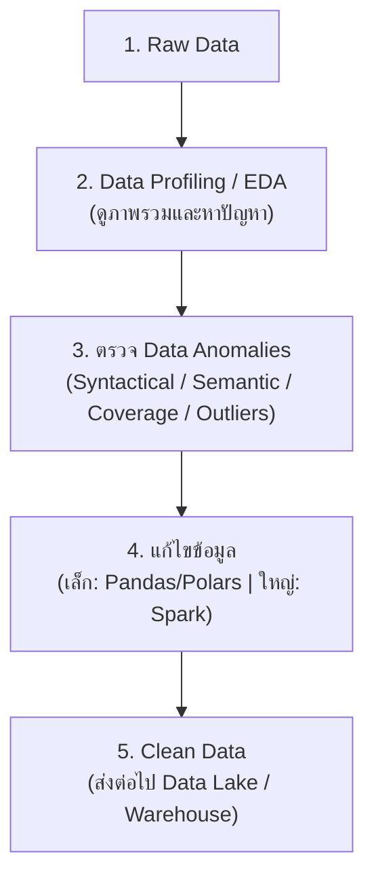
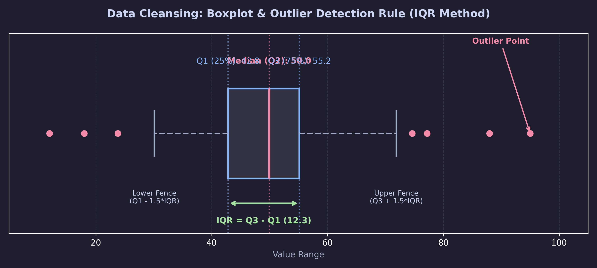
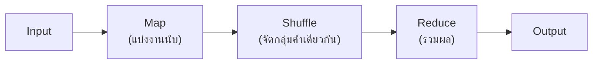

# Data Engineer - Chapter 02: Data Cleansing with Spark

> **วิชา:** Road to Data Engineer 3.0 (R2DE 3.0) | **ผู้สอน:** DataTH
> **Source:** `Resources/Books/DataEngineer/2_Data_Cleansing_with_Spark.pdf` (61 slides)
> **หมายเหตุ:** ส่วนที่ติดป้าย `[เสริมนอกสไลด์]` คือความรู้ที่ผู้เขียนโน้ตเพิ่มเอง

---

## Part 1: Macro Architecture & Overview

ลองนึกถึง **การล้างผัก** ก่อนทำอาหาร: ถ้าผักมีดินติดอยู่ ต่อให้เชฟเก่งแค่ไหนอาหารก็ไม่อร่อย ข้อมูลก็เช่นกัน ถ้าเข้าไปในระบบทั้งที่ผิดพลาด ผลวิเคราะห์ทุกอย่างจะผิดตาม (**Garbage In, Garbage Out**) Chapter 2 แบ่งเป็น 2 ท่อน: (1) **ทฤษฎีคุณภาพข้อมูลและวิธีหาความผิดปกติ** (2) **เครื่องมือประมวลผลข้อมูลขนาดใหญ่แบบกระจาย: Apache Spark**



### ตารางเปรียบเทียบเครื่องมือตามขนาดข้อมูล

| ขนาดข้อมูล | เครื่องมือที่เหมาะ | เหตุผล |
| :--- | :--- | :--- |
| เล็ก (ไม่กี่ MB) | Pandas, Polars | เครื่องเดียวเพียงพอ ง่ายและเร็ว |
| ใหญ่ (เกินหน่วยความจำเครื่องเดียว) | Apache Spark | กระจายงานไปหลายเครื่อง |

---

## Part 2: Module-by-Module Deep Dive

### 2.1 Data Cleansing & Data Quality

> 💡 **Intuition:** Data Cleansing เหมือน **"การสอบเทียบเครื่องชั่งก่อนเปิดร้าน"** — ถ้าเครื่องชั่งเพี้ยน ทุกสูตรจะผิดไม่ว่าแม่ครัวจะเก่งแค่ไหน ข้อมูลก็เช่นเดียว "Garbage In, Garbage Out" — ถ้าข้อมูลลงมาไม่สะอาด ทุกการวิเคราะห์จะสูญเปล่า
> [Source: generated — not verified against original document]

> **Data Cleansing** = การพัฒนาคุณภาพข้อมูลโดยค้นหาและแก้ไขความผิดพลาดในข้อมูล

**ทำไมสำคัญ (ตามสไลด์):**
* Data Scientist ส่วนใหญ่ใช้เวลาไปกับการทำความสะอาดข้อมูล (อ้างผลสำรวจ Forbes)
* ข้อมูลที่ไม่สะอาดมีราคาแพง (สไลด์ยกตัวอย่างความเสียหายของเศรษฐกิจอเมริกาปี 2016)
* ตัวอย่างต้นเหตุ: ข้อมูลจากแบบสำรวจกระดาษ → คนพิมพ์เข้าระบบผิด

**ทำไม Data Cleaning ถึงยาก:** เป็นกระบวนการที่ **ไม่มีวันจบสิ้น** ข้อมูลใหม่เข้ามาตลอดจึงต้องมีวงจร Data Auditing → Workflow → ตรวจซ้ำ

#### Data Quality: คุณภาพข้อมูลที่ดีคืออะไร

สไลด์เริ่มที่ **Completeness** (ข้อมูลครบ ไม่มีค่าว่าง) `[เสริมนอกสไลด์: มิติอื่นที่นิยมใช้ ได้แก่ Accuracy, Consistency, Validity, Timeliness, Uniqueness]`

| มิติ | ถามว่า | ตัวอย่างข้อมูลที่ไม่ผ่าน |
| :--- | :--- | :--- |
| **Completeness** | ครบไหม | อีเมลลูกค้าเป็นค่าว่าง |
| **Accuracy** `[เสริม]` | ตรงความจริงไหม | อายุ 200 ปี |
| **Consistency** `[เสริม]` | ตรงกันทุกระบบไหม | เบอร์โทรต่างกันในสองระบบ |
| **Validity** `[เสริม]` | ตามรูปแบบที่กำหนดไหม | อีเมลไม่มี `@` |
| **Uniqueness** `[เสริม]` | ซ้ำไหม | ลูกค้าคนเดียวมี 2 record |

#### เครื่องมือกำกับดูแลข้อมูล 3 ตัว

| เครื่องมือ | คืออะไร (ตามสไลด์) | ใช้ทำอะไร |
| :--- | :--- | :--- |
| **Data Dictionary** | ไฟล์รวบรวมรายละเอียดของทุกคอลัมน์ในตาราง | ให้ทุกคนในองค์กรเข้าใจคอลัมน์ตรงกัน |
| **Data Catalog** | แหล่งรวมข้อมูลและ metadata ทั้งหมด | ให้ฝั่ง Business และ Tech ค้นหาข้อมูลได้ |
| **Data Lineage** | การเดินทางของข้อมูลตั้งแต่ต้นจนจบ | ตรวจสอบย้อนหลังว่าตัวเลขมาจากไหน |

**ตัวอย่าง Data Dictionary `[เสริมนอกสไลด์]`:**

| Column | Type | ความหมาย | ค่าที่ยอมรับ |
| :--- | :--- | :--- | :--- |
| `gender` | string | เพศลูกค้า | `male`, `female`, `other` |
| `thb_amount` | float | ยอดซื้อเป็นบาท | >= 0 |

**🧭 ทำความเข้าใจ** _[Source: generated — not verified against original document]_

**แตกวลีสำคัญ:**
- "ค้นหาและแก้ไข" → ไม่ใช่แค่ลบทิ้ง แต่หาสาเหตุแล้วแก้
- "ความผิดพลาดในข้อมูล" → ผิดพลาดหมายถึง ไม่ตรงความจริง ไม่เป็นไปตามกฎ ไม่สมบูรณ์
- "ไม่มีวันจบสิ้น" → ข้อมูลใหม่เข้ามาเรื่อยๆ ต้องตรวจสม่ำเสมอ
- **Data Dictionary** = คู่มือบอกว่า Column ไหนคืออะไร, ค่าใดอนุญาต
- **Data Lineage** = หา "ต้นน้ำ" ของตัวเลข ถ้าผิด สาเหตุจากไหน

**ตัวอย่าง:**
- ✅ **Data Cleansing** — พบ `age` = -5 (ผิดพลาด) → ตรวจสอบต้นฉบับ → พบพิมพ์ผิด → แก้เป็น 5
- ❌ ลบแถวทิ้งทันทีโดยไม่ตรวจสาเหตุ — อาจมีข้อมูลดีอื่น (ชื่อ, ที่อยู่) ที่สามารถเก็บหรือแก้ไขได้
- **ต่างกันตรง:** Cleansing ที่ดี = หาสาเหตุก่อน แล้วเลือกแก้/เติม/ลบ, ไม่ใช่ลบทิ้งทันที

**อย่าสับสน:** "Data Cleansing" และ "Data Quality Check" — Cleansing = ทำความสะอาด, Quality Check = วัดว่าสะอาดแค่ไหน

**เช็คความเข้าใจ:** ทำไมจึงต้องทำ Data Cleansing ก่อน Data Scientist ใช้ข้อมูลสร้าง Model?
<details><summary>เฉลย</summary>

**หลักคิด: "Garbage In, Garbage Out"**

ถ้าข้อมูลเข้า Model ที่ผิดพลาด:
1. **Model เรียนรู้รูปแบบผิด** — หาความสัมพันธ์ตั้งอยู่บนข้อมูลลวง
2. **Prediction ผิด** — ทำนายได้ไม่ถูกต้องสำหรับโลกจริง
3. **Decision ผิด** — ลูกค้า/ผู้บริหาร ตัดสินใจผิดตามผล

ตัวอย่าง: ถ้า age ติดลบ Model จะเรียนรู้ว่า "คนอายุติดลบมีพฤติกรรมอะไร" (ไม่มีจริง)

</details>

---

### 2.2 EDA & Data Profiling

> 💡 **Intuition:** Data Profiling และ EDA เหมือน **"การวินิจฉัยเบื้องต้นของหมอ"** — ก่อนให้ยา หมอต้องซักประวัติ (ค่าเฉลี่ย, สูงสุด, ต่ำสุด), ถาม "ปวดตรงไหน?", พยายามหาว่า "มีปัญหาอะไรมั่ง?" EDA คือดูกราฟ, Profiling คือดูตัวเลข — ทั้งคู่เป็นขั้นตอน "รู้จัก" ข้อมูลก่อนใช้
> [Source: generated — not verified against original document]

> **Data Profiling** = การดูภาพรวมของข้อมูลเพื่อหาว่ามีปัญหาอะไรกับข้อมูลหรือไม่ (ตัวอย่างในสไลด์ใช้ข้อมูล Hotel Booking)

> **Exploratory Data Analysis (EDA)** = การวิเคราะห์ข้อมูลเชิงสำรวจ ใช้เทคนิคและกราฟเพื่อทำความรู้จักข้อมูล

**🧭 ทำความเข้าใจ** _[Source: generated — not verified against original document]_

**แตกวลีสำคัญ:**
- **Data Profiling** = วัดด้วยตัวเลข (count, mean, null count)
- **EDA** = สำรวจด้วยกราฟ (boxplot, histogram)
- "ภาพรวม" → ยังไม่ลึก แต่เห็นแนวโน้ม
- "Descriptive Statistics" → บรรยาย (ไม่ได้ predict)

**ตัวอย่าง:**
- ✅ **Data Profiling** — "พบว่า customer_id มีค่า NULL 100 แถว จาก 10,000 แถว (1%)"
- ✅ **EDA** — "ดูกราฟ Boxplot ของ `price` พบว่ามี Outlier สูงผิดปกติ"
- ❌ "ทำ Profiling แล้วตรวจสอบจบ ไม่ต้องดูกราฟ" — พลาดรูปแบบที่ตัวเลขไม่เห็น
- **ต่างกันตรง:** EDA ใช้ทั้งสถิติและกราฟ แต่เน้นสำรวจหา pattern; Profiling เน้นวัดคุณภาพ/โครงสร้างด้วยตัวเลข

**อย่าสับสน:** "EDA" กับ "Data Analysis" — EDA = สำรวจรู้จัก (ยังไม่มีสมมติฐาน), Analysis = วิเคราะห์ (มีคำถามที่ต้องตอบ)

**เช็คความเข้าใจ:** ข้อไหนเป็นขั้น Profiling, ข้อไหนเป็นขั้น EDA?
- (ก) นับว่าลูกค้าจาก "USA" มีกี่คน
- (ข) วาด Scatter plot เพื่อดูความสัมพันธ์ระหว่าง age กับ spending
- (ค) ตรวจสอบว่า `transaction_date` อยู่ในช่วง 2024 หรือไม่
<details><summary>เฉลย</summary>

**(ก) Profiling** — นับ (counting) เป็นตัวเลขพื้นฐาน ส่วนของ Profiling

**(ข) EDA** — วาด Scatter plot เพื่อหา pattern (ความสัมพันธ์)

**(ค) Profiling** — ตรวจสอบช่วงค่า (range check) เป็นขั้น validate พื้นฐาน

**หลักคิด:** Profiling = มองภาพรวม, EDA = ดูกราฟ + ลงลึก

</details>

#### ประเภทของ EDA (2 คำถามแบ่งหมวด)

| | ตัวเลข | กราฟิก |
| :--- | :--- | :--- |
| **ตัวอย่าง** | Descriptive Statistics (ค่าเฉลี่ย สูงสุด ต่ำสุด) | Histogram, **Boxplot**, **Scatterplot** |

* **Boxplot:** แสดงการกระจายตัวและค่าที่เกินปกติมาก (Outliers)
* **Scatterplot:** ใช้หาความสัมพันธ์ระหว่าง 2 ตัวแปร

```python
# [เสริมนอกสไลด์] Data Profiling เบื้องต้นด้วย Pandas
import pandas as pd

df = pd.read_csv("hotel_bookings.csv")
print(df.shape)                    # จำนวนแถว/คอลัมน์
print(df.dtypes)                   # ชนิดข้อมูลแต่ละคอลัมน์
print(df.isna().sum())             # นับค่าว่างต่อคอลัมน์
print(df.describe())               # สถิติพื้นฐาน (mean, min, max, quartile)
```

---

### 2.3 Data Anomalies (ความผิดปกติของข้อมูล)

> 💡 **Intuition:** Data Anomalies เหมือน **"พัสดุที่มีปัญหาในคลัง"** — Syntactical = label ผิดรูปแบบ (รหัสไปรษณีย์มีตัวอักษร), Semantic = รูปแบบถูกแต่ผิดกฎ (วันส่งอยู่ในอนาคต), Coverage = กล่องหรือช่องหาย, Outliers = กล่องหนักผิดปกติเมื่อเทียบกับกล่องอื่น
> [Source: generated — not verified against original document]

| ประเภท | สาเหตุ | ตัวอย่าง | วิธีจัดการ |
| :--- | :--- | :--- | :--- |
| **Syntactical** | ผิดพลาดตอนกรอก (สะกดผิด รูปแบบผิด) | `Bangkk`, ` Bangkok ` | Regex, trim, standardize |
| **Semantic** | ค่าไม่ตรงเงื่อนไขธุรกิจ (Integrity Constraints) | อายุติดลบ, วันเช็คเอาต์ก่อนเช็คอิน | ตรวจกฎธุรกิจ แล้วแก้/ตัดทิ้ง |
| **Coverage (Missing)** | ข้อมูลหาย | `NULL` | ลบ/เติมค่า ตามประเภทการหาย |
| **Outliers** | ค่าห่างจากส่วนใหญ่มาก | ราคาห้อง 1,000,000 บาท | ตรวจด้วยสถิติ/กราฟ แล้วตัดสินใจ |

**🧭 ทำความเข้าใจ Syntactical vs Semantic** _[Source: generated — not verified against original document]_

**แตกวลีสำคัญ:**
- **Syntactical** = "เนื้อหารูปแบบ" → หมายถึง "การสะกด รูปแบบ spacing" ไม่มีอักษร/ช่องว่างพิเศษ
- **Semantic** = "ความหมายเชิงธุรกิจ" → หมายถึง "กฎ" ของธุรกิจ (ราคาต้องบวก, วันต้องสมเหตุสมผล)
- "Integrity Constraints" = กฎที่องค์กรตั้งไว้

**ตัวอย่าง:**
- ✅ **Syntactical** — `Bangkok ` (มีช่องว่างต่อท้าย) → ใช้ `trim()` แก้
- ✅ **Semantic** — `age = -5` (อายุติดลบ) → ตรวจกฎ "age >= 0" แล้วแก้หรือลบ
- **ต่างกันตรง:** Syntactical = "ตรวจได้จากรูปแบบค่าเอง ไม่ต้องรู้บริบทธุรกิจ", Semantic = "ต้องรู้กฎธุรกิจเสียก่อน"

**อย่าสับสน:** "Syntactical Error" **ไม่ใช่** "Semantic Error" — Syntactical = แบบ/รูป, Semantic = ความหมายตามกฎ

**เช็คความเข้าใจ:** ข้อไหนเป็น Syntactical, ข้อไหนเป็น Semantic?
- (ก) Email `john@domain.com ` (มีช่องว่างต่อท้าย)
- (ข) Birth date = "2099-01-01" (คนยังไม่เกิด)
- (ค) Phone = "089A234567" (มีตัวหนังสือ A)
<details><summary>เฉลย</summary>

**(ก) Syntactical** — ช่องว่างพิเศษ ใช้ `trim()`

**(ข) Semantic** — วันเกิดต้องอยู่ในอดีต ตรวจกฎ "birth_date <= today()" แล้วแก้

**(ค) Syntactical** — เบอร์โทรไทยต้องเป็นตัวเลข ใช้ Regex ตรวจ

</details>

#### Regular Expression (Regex)

> **Regex** = pattern สำหรับค้นหาตัวหนังสือ เป็นเครื่องมือหลักตรวจ Syntactical/Semantic Anomalies

```python
# [เสริมนอกสไลด์] ตรวจรูปแบบอีเมลและเบอร์โทรด้วย Regex
import re
email_ok = re.fullmatch(r"[\w.+-]+@[\w-]+\.[\w.]+", "test@example.com")  # ผ่านถ้าไม่ใช่ None
phone_ok = re.fullmatch(r"0\d{9}", "0812345678")                         # เบอร์ไทย 10 หลักขึ้นต้น 0
```

> 💡 **Intuition:** Regex เหมือน **"ช่องกรอกแบบฟอร์มที่บังคับรูปแบบ"** — อีเมลต้องมี `@` และโดเมน เบอร์โทรไทยต้องมี 10 หลักขึ้นต้น 0 ระบบตรวจ "รูปแบบ" ได้เร็วทั้งชุดข้อมูลโดยไม่ต้องเข้าใจความหมายของแต่ละค่า (จุดที่ analogy ไม่ตรง: Regex ตรวจได้แค่ว่ารูปแบบถูกหรือไม่ ตรวจไม่ได้ว่าค่านั้นเป็นความจริง เช่น อีเมลรูปแบบถูกแต่ไม่มีอยู่จริง)
> [Source: generated — not verified against original document]

**🧭 ทำความเข้าใจ** _[Source: generated — not verified against original document]_

**แตกวลีสำคัญ:**
- "pattern" → กฎของรูปแบบตัวอักษร เช่น "ต้องเป็นตัวเลข 10 ตัว ขึ้นต้นด้วย 0"
- `\d` → ตัวเลข 0–9 หนึ่งตัว
- `{9}` → ตัวก่อนหน้า (`\d`) ต้องมี 9 ตัวติดกัน
- `fullmatch` → ทั้งสตริงต้องตรงกับ pattern ไม่ใช่แค่บางส่วนของสตริง

**ตัวอย่าง:**
- ✅ `"0812345678"` กับ `0\d{9}` ด้วย `fullmatch` — ผ่าน (รูปแบบเบอร์ไทย 10 หลัก)
- ❌ `"081-234-5678"` — ไม่ผ่าน เพราะมีขีดคั่น ถ้าต้องการรับรูปแบบนี้ต้อง normalize ก่อนหรือแก้ pattern
- ✅ `"0812345678"` ผ่านรูปแบบ แต่ยังต้องตรวจต่อว่าเป็นเบอร์ของลูกค้าจริงหรือไม่ — Regex ตรวจรูปแบบเท่านั้น
- **ต่างกันตรง:** ตรวจ "รูปแบบ (format)" ได้ แต่ตรวจ "ความถูกต้องของค่า (ความจริง)" ไม่ได้

**อย่าสับสน:** "Regex = ล้างข้อมูลอัตโนมัติ" — ไม่ใช่ Regex หาและตรวจรูปแบบเป็นหลัก การแก้ไข (เช่น `re.sub`) ต้องเขียนกฎเพิ่มเองโดยรู้ก่อนว่าจะแก้เป็นอะไร

**เช็คความเข้าใจ:** pattern `0\d{9}` แบบ `fullmatch` กับค่า (ก) `0812345678` (ข) `812345678` (ค) `0812345678x` ค่าไหนผ่าน?
<details><summary>เฉลย</summary>

1. **(ก) ผ่าน** — ขึ้นต้น 0 และมีตัวเลข 9 ตัวตามหลัง รวม 10 หลัก
2. **(ข) ไม่ผ่าน** — ไม่ขึ้นต้นด้วย 0 และมีตัวเลขแค่ 9 หลัก
3. **(ค) ไม่ผ่าน** — มีตัวอักษร `x` เกินมา `fullmatch` ต้องตรงทั้งสตริง

</details>

#### Missing Values: MAR vs MNAR

> 💡 **Intuition:** รูปแบบข้อมูลสูญหาย (Missing Data) แบ่งตามสาเหตุ: **MCAR (Missing Completely at Random)** = หายโดยสุ่มล้วน เช่น Server ล่ม หรือสัญญาณเน็ตหลุด; **MAR (Missing at Random)** = การหายขึ้นกับตัวแปรอื่นที่สังเกตได้ เช่น ผู้ชายมีแนวโน้มข้ามคำถามสุขภาพมากกว่าผู้หญิง (เมื่อรู้เพศ อัตราการหายอธิบายได้); **MNAR (Missing Not at Random)** = การหายขึ้นกับตัวแปรที่หายเองโดยตรง เช่น คนที่มีรายได้สูงมากมักไม่ยอมตอบช่องรายได้ ทำให้เกิด Bias สูงสุด
> [Source: generated — not verified against original document]

| แบบ | ชื่อเต็ม | ความหมาย | ตัวอย่าง `[เสริมนอกสไลด์]` |
| :--- | :--- | :--- | :--- |
| **MCAR** `[เสริมนอกสไลด์]` | Missing Completely At Random | หายโดยสุ่มล้วน (ไม่ขึ้นกับตัวแปรใด) | เครื่องส่งข้อมูลขัดข้องชั่วคราว, สัญญาณเน็ตหลุด |
| **MAR** | Missing At Random | หายโดยขึ้นกับตัวแปรอื่นที่สังเกตได้ | ผู้ชายตอบคำถามสุขภาพน้อยกว่าผู้หญิง |
| **MNAR** | Missing Not At Random | หายอย่างมีสาเหตุ (ขึ้นกับค่าที่หายเอง) | คนรายได้สูงไม่ยอมกรอกรายได้ |

> **ทำไมต้องแยก:** ถ้าหายอย่างมีสาเหตุ การเติมค่าเฉลี่ยจะทำให้ผลวิเคราะห์เอนเอียง ควรเข้าใจสาเหตุก่อนตัดสินใจ

**🧭 ทำความเข้าใจ** _[Source: generated — not verified against original document]_

**แตกวลีสำคัญ:**
- **MAR** = "Missing At Random" → หายโดยสุ่ม ไม่เกี่ยวกับค่าของตัวแปรนั้นเอง แต่ขึ้นกับตัวแปรอื่นที่สังเกตได้
- **MNAR** = "Missing Not At Random" → หายเพราะตัวแปรเอง (selective response)
- "Imputation" (เติมค่า) → วิธีจัดการค่าว่าง อาจเติมเฉลี่ย หรือ Median

**ตัวอย่าง:**
- ✅ **MAR** — แบบสำรวจสุขภาพ พบว่าผู้ชายตอบคำถามความเครียดน้อยกว่าผู้หญิง (การหายขึ้นกับเพศ ไม่ได้ขึ้นกับระดับความเครียดเอง)
- ✅ **MNAR** — สำรวจ "รายได้" ของลูกค้า พบว่าลูกค้าที่รายได้สูงไม่ยอมตอบ (Missing เพราะตัวแปรเอง)
- **ต่างกันตรง:** MAR = ขึ้นกับตัวแปรอื่นที่มีข้อมูล, MNAR = ขึ้นกับค่าที่หายเอง (เกิด Bias ร้ายแรง)

**อย่าสับสน:** "Missing" และ "NULL" — Missing = ไม่มีค่า (ว่างจริง), NULL = การแทนค่าว่าง ใน Database

**เช็คความเข้าใจ:** ข้อไหนเป็น MCAR, MAR, MNAR?
- (ก) สอบวิชา Math บางคนไม่มาสอบ (ไม่ทราบเหตุ)
- (ข) คนที่มีหนี้สินสูงมากไม่ยอมกรอกยอดหนี้ในแบบสอบถามสินเชื่อ
- (ค) เก็บข้อมูล Sales ผ่าน Google Form ลิงก์หลุดไปบ้าง (บางคนไม่ถึงฟอร์ม)
- (ง) ผู้ชายข้ามคำถามระดับความเครียดมากกว่าผู้หญิง
<details><summary>เฉลย</summary>

**(ก) MCAR** — ไม่มาสอบโดยบังเอิญ สุ่มล้วน ไม่ทราบเหตุและไม่เกี่ยวกับคะแนนหรือตัวแปรอื่น

**(ข) MNAR** — ไม่ยอมกรอกยอดหนี้เพราะค่าหนี้สูงเองโดยตรง (Missing ขึ้นกับค่าตัวแปรนั้นเอง)

**(ค) MCAR** — ลิงก์หลุดเพราะระบบขัดข้องทางเทคนิค (server down) สุ่มล้วน ไม่เกี่ยวกับยอด Sales หรือตัวแปรใด

**(ง) MAR** — การไม่ตอบขึ้นกับตัวแปรเพศที่มีการสังเกต/บันทึกไว้ ไม่ได้ขึ้นกับระดับความเครียดโดยตรง

**หลักคิด:** MCAR = สุ่มล้วน, MAR = ขึ้นกับตัวแปรอื่นที่เห็น, MNAR = ขึ้นกับค่าที่หายเอง (Bias สูงสุด)

</details>

#### Outliers

ค่าที่ห่างจากส่วนใหญ่มาก อาจเกิดจากข้อมูลผิด **หรือ** ค่าจริงที่หายากก็ได้ `[เสริมนอกสไลด์: เทคนิคทั่วไป เช่น กฎ IQR]`

$$IQR = Q3 - Q1,\quad \text{Outlier ถ้า } x < Q1 - 1.5\,IQR \ \text{หรือ}\ x > Q3 + 1.5\,IQR$$



> 💡 **Intuition:** Outlier เหมือน **"นักเรียนที่ได้คะแนนสูงลิ่วกว่าทั้งห้อง"** — ก่อนตัดสินต้องตรวจก่อนว่าเป็นอัจฉริยะจริงหรือกรอกคะแนนผิด (เช่น พิมพ์ 90 เป็น 900) ไม่ควรลบทิ้งทันที เพราะ outlier จริงก็มีคุณค่า (จุดที่ analogy ไม่ตรง: ข้อมูลไม่มีห้องเรียนให้เทียบ การตัดสินจึงต้องดูบริบทเพิ่มเติม)
> [Source: generated — not verified against original document]

**🧭 ทำความเข้าใจ** _[Source: generated — not verified against original document]_

**แตกวลีสำคัญ:**
- "IQR (Interquartile Range)" → ช่วงกลาง 50% ของข้อมูล = Q3 − Q1
- "Q1 / Q3" → ค่าควอไทล์ที่ 25% และ 75% ของข้อมูลเรียงลำดับ
- "1.5 × IQR" → ระยะ "รั้ว" ที่ใช้ตัดสินว่าค่าไกลผิดปกติ (ค่าต่ำกว่า Q1 − 1.5 IQR หรือสูงกว่า Q3 + 1.5 IQR)
- "Boxplot" → กราฟที่แสดงควอไทล์และจุด outlier แยกออกมา

**ตัวอย่าง:** ข้อมูล `[10, 12, 13, 14, 15, 90]`
- Q1 = 12, Q3 = 15 → IQR = 3 → รั้วบน = 15 + 4.5 = 19.5
- ✅ `90` เกินรั้วบน → เป็น outlier ควรตรวจว่าพิมพ์ผิดหรือไม่
- ❌ `10` ไม่ใช่ outlier เพราะอยู่ในช่วง 7.5 ถึง 19.5
- ❌ "ตัด outlier ทุกค่าที่ห่างจากค่าเฉลี่ยทันที" — ค่าเฉลี่ยถูกดึงด้วย outlier เอง และอาจตัดค่าจริงทิ้ง
- **ต่างกันตรง:** outlier ตาม IQR คือค่าที่อยู่นอกรั้ว; "ผิดหรือไม่" ต้องตรวจบริบทเพิ่ม

**หมายเหตุ:** ค่า Q1/Q3 ขึ้นกับวิธีคำนวณควอไทล์ของซอฟต์แวร์แต่ละตัว ผลลัพธ์อาจต่างกันเล็กน้อย

**อย่าสับสน:** "Outlier = ข้อมูลผิดเสมอ" — ไม่ใช่ outlier อาจเป็นค่าจริงที่หายาก

**เช็คความเข้าใจ:** ข้อมูลอายุ `[20, 22, 23, 24, 25, 26, 120]` — 120 เป็น outlier ตาม IQR หรือไม่ และควรทำอย่างไรต่อ?
<details><summary>เฉลย</summary>

1. Q1 = 22, Q3 = 26 → IQR = 4 → รั้วบน = 26 + 6 = 32
2. 120 > 32 → **เป็น outlier ตาม IQR**
3. ควรทำต่อ: อายุ 120 ปีเป็นไปไม่ได้ในทางปฏิบัติ จึงน่าจะเป็นข้อมูลผิด ให้ตรวจแหล่งที่มา แล้วแก้ไข ลบ หรือ flag ตามกฎที่ตกลง

</details>

---

### 2.4 Distributed Data Processing

> 💡 **Intuition:** Distributed Data Processing เหมือน **"การแบ่งซักผ้า 1000 ชิ้นให้คนหลายคน"** — คนเดียวใช้เวลานาน แต่ 10 คนแบ่งกันทำ จะเสร็จเร็วขึ้นมาก (บวกเวลาแบ่งและรวมงาน) Distributed ช่วยเมื่อข้อมูลเกินขีดจำกัดของเครื่องเดียว
> [Source: generated — not verified against original document]

> **Distributed Data Processing** = กระจายงานประมวลผลไปหลายเครื่องทำงานพร้อมกัน

**เปรียบเทียบตามสไลด์ (Word Count):** นับคำในหนังสือเล่มหนึ่ง ถ้าใช้ผู้เชี่ยวชาญคนเดียวนับทั้งเล่มจะช้า แต่ถ้าแบ่งหนังสือเป็นหลายส่วนให้หลายคนนับพร้อมกัน แล้วเอาผลมารวม จะเสร็จเร็วกว่ามาก

**🧭 ทำความเข้าใจ** _[Source: generated — not verified against original document]_

**แตกวลีสำคัญ:**
- "กระจายงาน" → Split งาน ให้หลายเครื่อง
- "ทำงานพร้อมกัน" → Parallel execution = ประหยัดเวลา
- "MapReduce" = Divide & Conquer pattern
- **Map** = ประมวลผลแต่ละส่วนย่อยเป็นคู่ key-value พร้อมกันหลายเครื่อง, **Shuffle** = จัดกลุ่ม, **Reduce** = รวมผล

**ตัวอย่าง:**
- ✅ **Distributed** — Dataset 1 TB, แบ่งเป็น 100 ไฟล์ จัดให้ 100 เครื่อง ประมวลพร้อมกัน
- ❌ "ใช้ 1 เครื่องแรง (256 GB RAM) แทน" — ถ้าใหญ่กว่า 256 GB ก็ไม่พอ และ Scale-up มีเพดาน ส่วน Distributed ขยายแบบ Scale-out ได้
- **ต่างกันตรง:** Single-machine = ใช้ CPU/Memory 1 เครื่องเท่านั้น, Distributed = ใช้หลายเครื่อง

**อย่าสับสน:** "Distributed Data Processing" กับ "Parallel Processing" — Distributed เป็นรูปแบบหนึ่งของ Parallel Processing: Parallel อาจทำงานในเครื่องเดียวหลาย core แต่ Distributed คือการประมวลผลแบบขนานที่กระจายหลายเครื่องผ่าน Network

**เช็คความเข้าใจ:** ข้อไหนต้องใช้ Distributed, ข้อไหนใช้ Single-machine ได้?
- (ก) ประมวลผล 5 MB CSV: count, sum, filter
- (ข) ประมวลผล 500 GB Log files: aggregate, join กับตารางต่างกัน
- (ค) ประมวลผล 1 GB ข้อมูลลูกค้า: clean, deduplicate
<details><summary>เฉลย</summary>

**(ก) Single-machine** — 5 MB เล็กมาก Pandas/Polars อยู่ได้ ไม่ถึงวินาที

**(ข) Distributed** — 500 GB เกิน RAM เครื่องเดียวทั่วไป ต้องแบ่ง

**(ค) Single-machine** — 1 GB ยังโอเค Pandas/Polars ใช้เวลาไม่นาน (แต่ถ้ามี 100 ไฟล์ 1 GB = 100 GB → Distributed)

**เลือกเกณฑ์:** Dataset > RAM เครื่องเดียว → Distributed

</details>

#### Hadoop MapReduce

ส่วนหนึ่งของ Hadoop เป็นวิธี Distributed Processing ที่ได้รับความนิยมมากในช่วงก่อนหน้า



> **ข้อจำกัด `[เสริมนอกสไลด์]`:** MapReduce มักเขียนผลกลางลงดิสก์ระหว่างขั้นตอน จึงช้ากว่าแนวทางประมวลผลในหน่วยความจำอย่าง Spark

> 💡 **Intuition:** MapReduce เหมือน **"ทีมนับคะแนนสอบทั้งประเทศ"** — **Map** ให้แต่ละคนนับกระดาษของตัวเอง (แบ่งงานไปหลายเครื่อง), **Shuffle** จัดกระดาษที่เป็นวิชาเดียวกันไปกองเดียวกัน, **Reduce** รวมยอดของแต่ละกอง ทำให้งานใหญ่เกินเครื่องเดียวสำเร็จได้ (จุดที่ analogy ไม่ตรง: ในระบบจริงทุกขั้นเขียนผลกลางลงดิสก์ จึงช้ากว่าที่ analogy แสดงให้เห็น)
> [Source: generated — not verified against original document]

**🧭 ทำความเข้าใจ** _[Source: generated — not verified against original document]_

**แตกวลีสำคัญ:**
- "Map" → แปลงแต่ละ record ให้เป็นคู่ key-value เช่น `(คำ, 1)`
- "Shuffle" → ย้ายคู่ key-value ที่ key เดียวกันไปรวมกันที่เครื่องเดียวกัน (จัดกลุ่มตาม key ไม่ใช่การสุ่มสลับ)
- "Reduce" → รวม value ของแต่ละ key ให้เป็นผลลัพธ์สุดท้าย

**ตัวอย่าง:** นับคำในข้อความ `"data data pipeline"`
- Map: `(data,1)`, `(data,1)`, `(pipeline,1)`
- Shuffle: `data → [1,1]`, `pipeline → [1]`
- Reduce: `data = 2`, `pipeline = 1`
- ✅ งานนับและรวมแบบครั้งเดียวจบ — MapReduce ทำได้
- ❌ "MapReduce เหมาะกับงานวนซ้ำหลายรอบ (iterative) พอ ๆ กับ Spark" — ไม่จริง เพราะทุกรอบต้องเขียนผลกลางลงดิสก์ จึงช้า
- **ต่างกันตรง:** Map/Reduce คือการแบ่งงานและรวมผล; Shuffle คือขั้นที่ย้ายข้อมูลข้ามเครื่องตาม key

**อย่าสับสน:** "Shuffle ใน MapReduce = สุ่มสลับข้อมูล" — ไม่ใช่ Shuffle คือการจัดกลุ่มข้อมูลให้ key เดียวกันอยู่ที่เดียวกัน

**เช็คความเข้าใจ:** ในสามขั้นตอน Map, Shuffle, Reduce ขั้นไหนต้องย้ายข้อมูลข้ามเครื่องมากที่สุด และเพราะอะไร?
<details><summary>เฉลย</summary>

**ตอบ: Shuffle**

**เหตุผล:** ต้องส่งคู่ key-value ที่มี key เดียวกันจากหลายเครื่องไปรวมกันที่เครื่องเดียว ซึ่งเป็นการส่งข้อมูลผ่านเครือข่ายจำนวนมาก

</details>

---

### 2.5 Apache Spark

> 💡 **Intuition:** Apache Spark เป็น Engine ที่มาแทน MapReduce (ยังใช้ร่วมกับ HDFS/YARN ได้) — MapReduce มักเขียนผลกลางลงดิสก์ (ช้า), ส่วน Spark ทำงานหลัก ๆ ในหน่วยความจำ (RAM เร็วกว่าได้มาก โดย Spark อ้างถึง ~100 เท่าในงาน iterative บางประเภท) + มี API ยืดหยุ่นทำให้เขียนโค้ดง่าย (ไม่ต้องเขียน Map-Reduce เองทุกครั้ง)
> [Source: generated — not verified against original document]

> **Apache Spark** = เทคโนโลยี Distributed Data Processing สำหรับข้อมูลขนาดใหญ่ คิดค้นโดย University of California (ตามสไลด์: ปี 2014)

**🧭 ทำความเข้าใจ** _[Source: generated — not verified against original document]_

**แตกวลีสำคัญ:**
- **Distributed Data Processing engine** = Engine ประมวลผล ที่กระจายงาน
- **In-memory computation** = คำนวณใน RAM (เร็ว), ลดการเขียนผลกลางลงดิสก์
- **RDD** (Resilient Distributed Dataset) = โครงสร้างข้อมูลพื้นฐานรุ่นแรก กระจายเป็น partition ในหลายเครื่อง
- **DataFrame** = API ระดับสูง มี Schema เหมือนตาราง Pandas แต่กระจายหลายเครื่อง
- **Module** = Spark SQL (ใช้ SQL ได้), Streaming, MLlib (Machine Learning)

**ตัวอย่าง:**
- ✅ **Spark for Cleansing** — โหลด 100 GB Log → filter null, dedup, standardize → เสร็จใน ชั่วโมง (ไม่ใช่วัน)
- ❌ "ใช้ Pandas กับ 100 GB" — Pandas ต้องโหลดทั้งหมดเข้า RAM (RAM เครื่องเดียวไม่พอ)
- **ต่างกันตรง:** Spark = Hadoop ที่เร็วกว่า + API สำหรับมนุษย์

**อย่าสับสน:** "RDD" และ "DataFrame" — RDD = API ระดับล่าง ไม่มี Schema ไม่ผ่าน Catalyst optimizer; DataFrame มี Schema ผ่าน optimizer (ใช้มากกว่า)

**เช็คความเข้าใจ:** ทำไม Spark ถึงเร็วกว่า Hadoop?
<details><summary>เฉลย</summary>

**สาเหตุ 3 ข้อ:**

1. **In-Memory** — Spark คำนวณใน RAM, Hadoop คำนวณ แล้วเขียนดิสก์ระหว่างขั้น (Shuffle) = ช้า
2. **DAG Optimization** — Spark ใช้ lazy evaluation สร้าง DAG ทั้งงานก่อน แล้ว optimize; MapReduce รันทีละ Map→Reduce job
3. **API ที่พัฒนา** — Spark SQL, DataFrame มี optimize แล้ว, Hadoop ต้องเขียน Map-Reduce เอง (ต้องเขียนเองยาวและยาก)

**สรุป:** Spark มักเร็วกว่า MapReduce มาก โดยเฉพาะงาน iterative

</details>

**Module ที่มากับ Spark:** Spark SQL (เขียน SQL), และอื่นๆ ที่สไลด์ P.43 แสดง `[เช่น Streaming, MLlib, GraphX — เสริมนอกสไลด์]`

#### ประเภทข้อมูลใน Spark

| ประเภท | ลักษณะ | การใช้งาน |
| :--- | :--- | :--- |
| **RDD** (Resilient Distributed Datasets) | วิธีเก็บข้อมูลพื้นฐานของ Spark | ใช้ค่อนข้างยาก |
| **DataFrame** | เก็บเป็นตาราง คล้าย Pandas/R | ใช้ง่าย ใช้มากที่สุดในงาน DE |
| **Dataset** (Java/Scala) | DataFrame ที่มี type | ภาษา Java/Scala เท่านั้น |

**Transformation vs Action (RDD):**

| | Transformation | Action |
| :--- | :--- | :--- |
| **ทำอะไร** | กำหนดว่าจะแปลงข้อมูลอย่างไร | สั่งให้คำนวณและคืนผล |
| **ตัวอย่าง** | `filter`, `map` | `count`, `collect` |
| **พฤติกรรม `[เสริมนอกสไลด์]`** | Lazy: ยังไม่คำนวณทันที | Eager: ทำให้งานรันจริง |

> สไลด์ยังระบุว่า Spark เพิ่มคำสั่งแบบ Pandas ให้ใช้ เช่น `.read_csv()`, `.sort_values()`, `drop()` (Pandas API on Spark)

#### Spark SQL

ใช้ SQL ดึงข้อมูลจาก Spark DataFrame ได้โดยตรง เหมาะถ้าคุ้นกับ SQL ([[LAB 8 - SQL GROUP BY and Aggregate Functions]])

```python
# [เสริมนอกสไลด์] ตัวอย่าง PySpark: โหลด ล้าง และสรุปข้อมูล
from pyspark.sql import SparkSession, functions as F

spark = SparkSession.builder.appName("cleansing").getOrCreate()

df = spark.read.csv("transactions.csv", header=True, inferSchema=True)   # โหลดเป็น DataFrame

clean = (
    df.dropDuplicates()                                  # ตัดแถวซ้ำ
      .filter(F.col("amount") >= 0)                      # ตัดค่าติดลบ (Semantic Anomaly)
      .withColumn("city", F.trim(F.initcap("city")))     # ทำตัวสะกดให้เป็นรูปแบบเดียวกัน
      .fillna({"coupon": "NONE"})                        # เติมค่าว่าง
)

clean.createOrReplaceTempView("t")
spark.sql("SELECT city, SUM(amount) FROM t GROUP BY city").show()   # Action: สั่งคำนวณจริง
```

#### วิธีใช้งาน Spark 3 แบบ

| วิธี | ข้อดี | ข้อเสีย |
| :--- | :--- | :--- |
| ติดตั้งบนคอมพิวเตอร์เอง | ควบคุมเอง | ติดตั้ง/ดูแลเยอะ ระบบแต่ละเครื่องต่างกัน |
| ใช้ Cloud (เช่น Google Dataproc, **Databricks**) | ติดตั้งง่าย | พึ่ง Cloud (ดู [[Chapter 03 - Cloud Computing and Bash]]) |
| `[วิธีที่ 3 ดูสไลด์ P.50-51]` | | |

**Databricks:** Data Platform ออนไลน์ที่สร้างโดยทีมผู้พัฒนา Spark

#### เลือกเครื่องมืออย่างไร (สไลด์ P.54)

* คอมพิวเตอร์เครื่องเดียว + ข้อมูลน้อย → Pandas / Polars
* ข้อมูลใหญ่เกินเครื่องเดียว → Spark

---

### 2.6 Workshop 2: Data Cleansing with Spark

* **แหล่งเรียนรู้ & โน้ตบุ๊กปฏิบัติการ:** [Google Colab - Workshop 2 (กด File > Save a copy in Drive)](https://colab.research.google.com/drive/18lqcIn47PfOXcFQSghlfW_9sSwXfMin2)
* **บริบทธุรกิจ (Business Context):** บริษัท Chic & Cozy มีข้อมูลธุรกรรมการค้าปลีกปริมาณมหาศาลจาก Workshop 1 แต่พบปัญหาข้อมูลผิดรูป สะกดผิด และค่าสูญหาย Data Engineer จึงต้องทำความสะอาดด้วย Apache Spark เพื่อเตรียมข้อมูลให้พร้อมก่อนส่งต่อไปยัง Cloud Storage และ BigQuery Data Warehouse ใน [[Chapter 03 - Cloud Computing and Bash]] และ [[Chapter 05 - Data Warehouse with BigQuery]]

---

#### 2.6.1 การติดตั้งและสร้าง SparkSession (Spark 4.x / PySpark)

```python
# 1. ติดตั้ง Java 17 (สำหรับ Spark 4.x) และ PySpark บน Google Colab
!apt-get update -qq
!apt-get install openjdk-17-jdk-headless -qq > /dev/null

import os
os.environ["JAVA_HOME"] = "/usr/lib/jvm/java-17-openjdk-amd64"

!pip uninstall -y -q pyspark py4j 2>/dev/null || true
!pip install -q pyspark==4.1.2

# 2. เริ่มต้นสร้าง SparkSession แบบ Local Multi-Core
from pyspark.sql import SparkSession
from pyspark.sql import functions as f
from pyspark.sql.functions import col, sum, when

spark = SparkSession.builder \
    .master("local[*]") \
    .appName("Road to Data Engineer 3.0 - Workshop 2") \
    .getOrCreate()

# 3. ดาวน์โหลดไฟล์ข้อมูล Parquet จาก Workshop 1 ที่มี Anomaly จำลอง
!wget https://file.designil.com/f/6BamyF+ -O w2_input.parquet
dt = spark.read.parquet('w2_input.parquet')
print(f"Total Rows: {dt.count()}, Total Columns: {len(dt.columns)}")
```

---

#### 2.6.2 การทำ Data Profiling (สำรวจสถิติและตรวจหา Missing Values)

การทำความเข้าใจภาพรวมข้อมูลเพื่อวางแผนจุดที่ต้องตรวจสอบ:
```python
# 1. ตรวจสอบ Schema และ Data Types
dt.printSchema()

# 2. สรุปข้อมูลสถิติเบื้องต้น (Count, Mean, Stddev, Min, Max, Percentiles)
dt.summary().show()

# 3. ตรวจสอบหา Missing Value (Exercise 1)
# พบว่า customer_id มีจำนวนแถวไม่ครบเท่าคอลัมน์อื่น
dt.summary("count").show()

# กรองดูแถวที่เป็น Null
dt.where(dt.customer_id.isNull()).show(5)
```

> 💡 **Bonus Tool (ydata-profiling):**
> สามารถสร้างรายงาน EDA อัตโนมัติในคลิกเดียวด้วย:
> ```python
> !pip install ydata-profiling==4.18.4
> from ydata_profiling import ProfileReport
> profile = ProfileReport(dt.toPandas(), title="Profiling Report")
> profile
> ```

---

#### 2.6.3 การทำ Exploratory Data Analysis (EDA)

##### 1. Non-Graphical EDA (ใช้ Spark Filter/Where)
```python
# ค้นหาธุรกรรมราคาสูง
dt.where(dt.price >= 100).show(5)

# นับธุรกรรมตามเงื่อนไขเวลา (Exercise 2)
may_count = dt.where(dt.date.startswith("2024-05")).count()
june_count = dt.where(dt.date.startswith("2024-06")).count()
print(f"May 2024: {may_count}, June 2024: {june_count}")
```

##### 2. Graphical EDA (แปลงเป็น Pandas เพื่อ Plot ด้วย Seaborn & Matplotlib)
```python
import seaborn as sns
import matplotlib.pyplot as plt

dt_pd = dt.toPandas()

# Plot 1: Boxplot ดูการกระจายตัวของราคา
sns.boxplot(x=dt_pd['price'])

# Plot 2: Histogram ซูมดูช่วงราคาต่ำกว่า 40 ปอนด์ (Exercise 3)
sns.histplot(dt_pd[dt_pd['price'] < 40]['price'], bins=10)

# Plot 3: Scatterplot ดูความสัมพันธ์ระหว่าง Quantity และ Price
sns.scatterplot(x=dt_pd.quantity, y=dt_pd.price)
```

---

#### 2.6.4 ขั้นตอนการล้างข้อมูลตาม 5 ความผิดปกติ (Data Cleansing Deep Dive)

##### ปัญหาที่ 1: Data Type ไม่ถูกต้อง (String → Timestamp)
คอลัมน์ `date` ถูกอ่านเป็น String ต้องแปลงเป็น Timestamp มาตรฐาน:
```python
# แปลงคอลัมน์ date เป็น timestamp
dt_clean = dt.withColumn("date", f.to_timestamp(dt.date, 'yyyy-MM-dd'))

# ตรวจสอบช่วงวันที่ของข้อมูลด้วย Min และ Max
dt_clean.select(f.min(dt_clean.date), f.max(dt_clean.date)).show()

# ประโยชน์: สามารถใช้ Date functions เช่น f.dayofmonth, f.month, f.year ในการ Filter ได้ทันที
first_half_jan = dt_clean.where(
    (f.dayofmonth(dt_clean.date) <= 15) & (f.month(dt_clean.date) == 1) & (f.year(dt_clean.date) == 2024)
).count()
```

##### ปัญหาที่ 2: Syntactical Anomalies (Lexical Errors - คำสะกดผิด)
ตรวจสอบรายชื่อประเทศใน `customer_country` พบคำว่า `'Japane'`:
```python
# สำรวจชื่อประเทศทั้งหมดแบบเรียงลำดับ
dt_clean.select("customer_country").distinct().sort("customer_country").show(40)

# แก้ไขคำสะกดผิดด้วย when...otherwise (Exercise 4)
dt_clean_country = dt_clean.withColumn(
    "customer_country_update",
    when(dt_clean['customer_country'] == 'Japane', 'Japan').otherwise(dt_clean['customer_country'])
)

# ลบคอลัมน์เก่าและเปลี่ยนชื่อคอลัมน์ใหม่ให้เหมือนเดิม
dt_clean_v2 = dt_clean_country.drop("customer_country").withColumnRenamed('customer_country_update', 'customer_country')
```

##### ปัญหาที่ 3: Semantic Anomalies (Integrity Constraints - รหัสสินค้าเกินมาตรฐาน)
รหัส `product_id` มาตรฐานต้องยาว 5 ตัวอักษร แต่พบว่ามีรหัสยาวเกิน 5 ตัว (เช่น `15044A`, `15044C` มีตัวอักษรระบุสีหรือ Variation ต่อท้าย):
```python
# 1. ตรวจสอบสัดส่วนรหัสที่ถูกต้องตาม Regular Expression ^.{5}$ (Exercise 5)
valid_ratio = dt_clean_v2.where(dt_clean_v2["product_id"].rlike("^.{5}$")).count() / dt_clean_v2.count()
print("Valid Product ID Ratio:", valid_ratio)  # พบผิดปกติประมาณ 10%

# 2. ค้นหาแถวที่ผิดปกติด้วย .subtract()
dt_correct = dt_clean_v2.filter(dt_clean_v2["product_id"].rlike("^.{5}$"))
dt_incorrect = dt_clean_v2.subtract(dt_correct)
dt_incorrect.select("product_id", "product_name").show(5, truncate=False)

# 3. ตัดให้เหลือเฉพาะรหัสสินค้า 5 ตัวแรกด้วย f.substring
dt_clean_v3 = dt_clean_v2.withColumn('product_id', f.substring('product_id', 1, 5))
```

##### ปัญหาที่ 4: Missing Values (จัดการค่าว่าง NULL)
ตรวจพบ `customer_id` เป็นค่าว่าง:
```python
# 1. นับจำนวน Null ในทุกคอลัมน์ด้วย List Comprehension
dt_nulllist = dt_clean_v3.select([
    sum(col(c).isNull().cast("int")).alias(c) for c in dt_clean_v3.columns
])
dt_nulllist.show()

# 2. แทนค่า NULL ของ customer_id ด้วย '00000' ตามข้อกำหนดของทีม Data Analyst (Exercise 6)
dt_clean_v4 = dt_clean_v3.withColumn(
    "customer_id",
    when(dt_clean_v3['customer_id'].isNull(), '00000').otherwise(dt_clean_v3['customer_id'])
)
```

##### ปัญหาที่ 5: Outliers (ค่าสุดโต่ง)
จากการพล็อต Boxplot พบสินค้าที่ `price > 600`:
```python
# ตรวจสอบสินค้าที่ราคาสูงเกิน 600 ปอนด์
dt_clean_v4.where(dt_clean_v4.price > 600).select("product_id", "product_name", "price").distinct().show(truncate=False)
```
> 🔍 **การตัดสินใจทางธุรกิจ (Business Decision):**
> สินค้าดังกล่าวคือ "ตู้เก็บของโบราณสไตล์วินเทจ (Vintage Storage Cabinet)" ซึ่งเป็นเฟอร์นิเจอร์ชิ้นใหญ่และมีมูลค่าสูงตามธรรมชาติ **จึงเป็น Outlier แท้จริงที่ไม่ใช่ข้อมูลผิดพลาด และไม่ต้องลบหรือแก้ไขใดๆ**

---

#### 2.6.5 ทางเลือกเสริม: การทำ Data Cleansing ด้วย Spark SQL

สามารถสร้าง `TempView` แล้วเขียน SQL ที่คุ้นเคยเพื่อ Clean ข้อมูลได้เช่นกัน:
```python
# สร้าง View ในหน่วยความจำ Spark
dt.createOrReplaceTempView("data")

# แก้ไขคำสะกดผิดและตัดรหัสสินค้าด้วย Spark SQL
dt_sql_cleaned = spark.sql("""
SELECT
    transaction_id,
    to_timestamp(date, 'yyyy-MM-dd') AS date,
    CASE
        WHEN length(product_id) > 5 THEN substr(product_id, 1, 5)
        ELSE product_id
    END AS product_id,
    price,
    quantity,
    COALESCE(customer_id, '00000') AS customer_id,
    product_name,
    CASE WHEN customer_country = 'Japane' THEN 'Japan' ELSE customer_country END AS customer_country,
    customer_name,
    total_amount,
    thb_amount
FROM data
""")

# ตรวจสอบว่าไม่มี product_id ผิดรูปแบบหลงเหลืออยู่ (Exercise 7)
dt_sql_cleaned.filter(~dt_sql_cleaned["product_id"].rlike("^.{5}$")).show()
```

---

#### 2.6.6 การส่งออกข้อมูลที่สะอาดแล้ว (Data Export)

```python
# 1. ส่งออกเป็น Parquet (แนะนำมากที่สุดสำหรับ Data Lake/Warehouse)
# ตั้ง mode("overwrite") ป้องกัน Error PATH_ALREADY_EXISTS
dt_clean_v4.write.mode("overwrite").parquet("cleaned_data_output.parquet")

# ทดสอบอ่านไฟล์ Parquet กลับมาเช็คความสมบูรณ์
dt_verified = spark.read.parquet("cleaned_data_output.parquet")
print("Verified Rows:", dt_verified.count())

# 2. ส่งออกเป็น CSV (กรณีต้องส่งต่อให้ทีมอื่น)
dt_clean_v4.write.mode("overwrite").csv('cleaned_data.csv', header=True)

# 3. ส่งออกเป็น Excel (ใช้ toPandas เหมาะสำหรับข้อมูลสรุปขนาดเล็ก)
# dt_clean_v4.limit(1000).toPandas().to_excel("sample_output.xlsx", index=False)
```

---

## Part 3: Quick Reference & Exam Cheat Sheet

### Checklist สรุปหัวใจสำคัญ
* [ ] **Garbage In, Garbage Out:** ข้อมูลไม่สะอาด = ผลวิเคราะห์ผิด
* [ ] **Data Dictionary / Catalog / Lineage:** นิยามคอลัมน์ / ที่ค้นหาข้อมูล / เส้นทางข้อมูล
* [ ] **Data Profiling vs EDA:** ดูภาพรวมหาปัญหา vs สำรวจเชิงลึก
* [ ] **4 Anomalies:** Syntactical, Semantic, Coverage (Missing), Outliers
* [ ] **MAR vs MNAR:** หายบังเอิญ vs หายมีสาเหตุ
* [ ] **Spark:** กระจายงานหลายเครื่อง; RDD/DataFrame/Spark SQL
* [ ] **Transformation vs Action**

### Decision Rules

```text
ข้อมูลเล็ก เครื่องเดียวพอ         → Pandas / Polars
ข้อมูลใหญ่เกินเครื่องเดียว         → Spark
ตัวสะกด/รูปแบบผิด                  → Regex + Standardize
ค่าผิดเงื่อนไขธุรกิจ              → ตรวจ Integrity Constraints
ค่าหาย                            → ถามก่อน: MAR หรือ MNAR?
```

### Concept Map

```text
Data Cleansing
├── Data Quality (Completeness, ...)
│   └── Dictionary / Catalog / Lineage
├── Profiling & EDA (ตัวเลข / กราฟิก)
├── Anomalies (Syntactical, Semantic, Missing, Outliers)
└── Processing
    ├── Small → Pandas / Polars
    └── Big → Distributed: MapReduce → Spark (RDD, DataFrame, SQL)
```

---

## ⚠️ Common Pitfalls & Exam Traps

* **"Missing Values ลบทิ้งหมดก็จบ":** ถ้าเป็น MNAR การลบหรือเติมค่ามั่วทำให้ผลเอนเอียง ต้องเข้าใจสาเหตุก่อน
* **"Outlier คือข้อมูลผิดเสมอ":** อาจเป็นค่าจริงที่หายาก (เช่น ลูกค้าซื้อเยอะผิดปกติ) ต้องดูบริบทธุรกิจ
* **"Transformation สั่งแล้วคำนวณทันที":** Transformation เป็น Lazy ต้องมี Action ถึงจะประมวลผลจริง `[เสริมนอกสไลด์]`
* **"Spark เร็วกว่า Pandas เสมอ":** กับข้อมูลเล็ก Spark มี overhead จึงอาจช้ากว่า เลือกให้เหมาะกับขนาดข้อมูล
* **"Syntactical กับ Semantic Anomaly คืออย่างเดียวกัน":** Syntactical = รูปแบบ/สะกดผิด; Semantic = ค่าไม่สมเหตุสมผลตามกฎธุรกิจ
* **"Data Dictionary = Data Catalog":** Dictionary อธิบายคอลัมน์ในตาราง Catalog รวม metadata ทั้งองค์กรไว้ค้นหา

---

## เอกสารเชื่อมโยง (Wiki-Style Backlinks)
* **วิชาและหัวข้อที่เกี่ยวข้อง:**
  * [[Chapter 01 - Data Collection]] (ขั้นก่อนหน้า: ข้อมูลที่ดึงมาเป็นอินพุตของบทนี้)
  * [[Chapter 03 - Cloud Computing and Bash]] (ใช้ Cloud รัน Spark เช่น Dataproc/Databricks)
  * [[Chapter 05 - Data Warehouse with BigQuery]] (ปลายทางของข้อมูลที่ล้างแล้ว)
  * [[LAB 8 - SQL GROUP BY and Aggregate Functions]] (พื้นฐาน SQL ที่ใช้ใน Spark SQL)

* **แหล่งข้อมูล:**
  * Source: `Resources/Books/DataEngineer/2_Data_Cleansing_with_Spark.pdf` (61 slides, DataTH)
  * Reference: Zaharia et al. — *Apache Spark* (spark.apache.org/docs) `[เสริมนอกสไลด์]`
