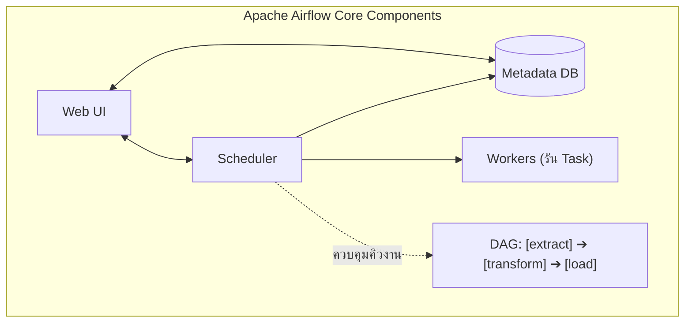
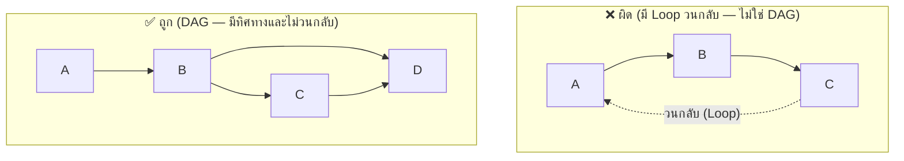
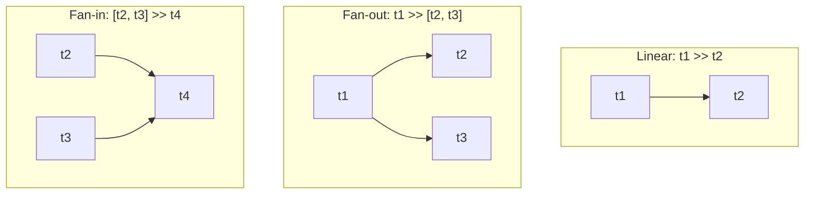
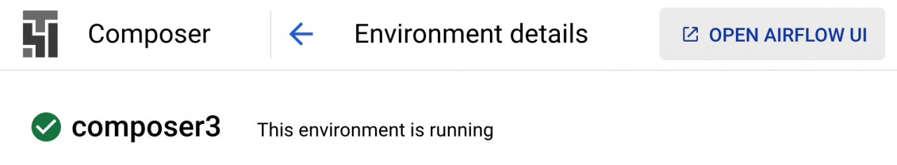
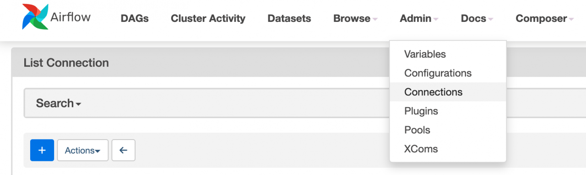
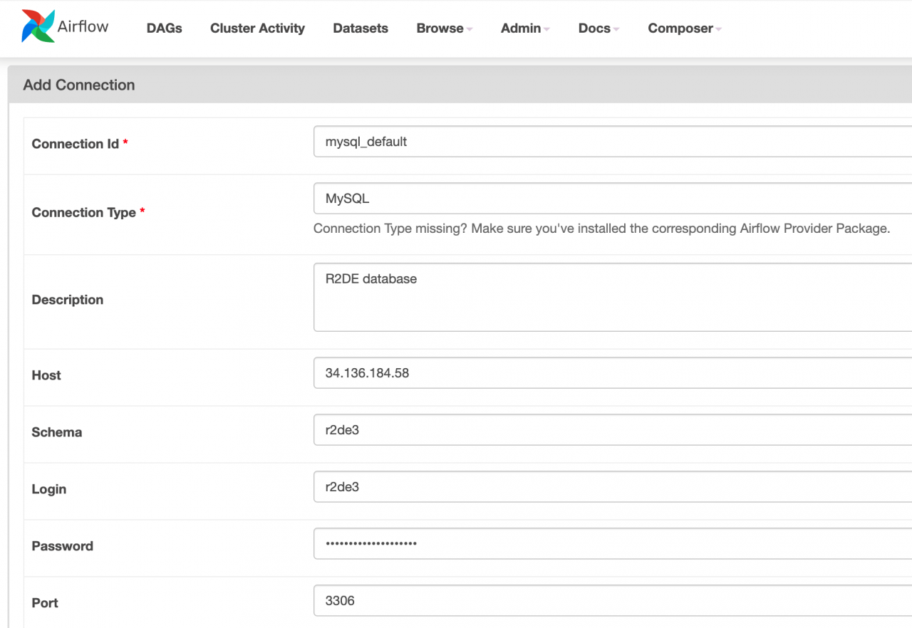

# Data Engineer - Chapter 04: Data Pipeline Orchestration with Airflow

> **วิชา:** Road to Data Engineer 3.0 (R2DE 3.0) | **ผู้สอน:** DataTH
> **Source:** `Resources/Books/DataEngineer/4Airflow.pdf` (79 slides)
> **หมายเหตุ:** ส่วนที่ติดป้าย `[เสริมนอกสไลด์]` คือความรู้ที่ผู้เขียนโน้ตเพิ่มเอง

---

## Part 1: Macro Architecture & Overview

ลองนึกถึง **ผู้จัดการวงออร์เคสตรา**: นักดนตรีแต่ละคน (Task) เก่งของตัวเอง แต่ต้องมีคนบอกว่าใครเริ่มเมื่อไร ใครรอใคร และถ้าใครเล่นผิดจะทำอย่างไร Chapter 4 คือการสร้าง "ผู้จัดการ" ให้ Pipeline ด้วย **Apache Airflow** (รันบน **Google Cloud Composer**) เพื่อให้ Pipeline ทำงานอัตโนมัติ ตรวจสอบสถานะได้ และจัดการ Dependency ระหว่างงาน


> **Google Cloud Composer** = Airflow ที่ Google ติดตั้งและดูแลให้แบบ Fully Managed (ใช้ GCS เก็บไฟล์ DAG)

### ตารางเปรียบเทียบเครื่องมือ Orchestration

| Feature | Cron | Apache Airflow |
| :--- | :--- | :--- |
| **แนวคิด** | ตั้งเวลารันคำสั่งง่ายๆ (มากับ Linux) | จัดการ Pipeline ทั้งชุดเป็นกราฟ |
| **Dependency ระหว่างงาน** | ไม่มีในตัว | มี (กำหนดด้วย DAG) |
| **UI ตรวจสอบสถานะ** | ไม่มี | มี Web UI |
| **เหมาะกับ** | งานเดี่ยวๆ ง่ายๆ | Pipeline หลายขั้นที่ต้องเชื่อมกัน |

---

## Part 2: Module-by-Module Deep Dive

### 2.1 สร้าง Cloud Composer Cluster (ก่อนเริ่มเรียน)

สไลด์ให้สร้าง Composer Environment ไว้ก่อนเพราะใช้เวลานาน ขั้นตอนหลัก: Enable Cloud Composer API (ครั้งแรก) → Create Environment (Composer 2 ต้อง Grant permission ผ่านหน้า IAM) → รอสร้างเสร็จ

> **คำเตือน `[เสริมนอกสไลด์]`:** Composer เป็นบริการที่คิดเงินตามเวลาที่เปิดอยู่ เมื่อจบ Workshop ควรลบ Environment และดูค่าใช้จ่ายใน Billing

---

### 2.2 Data Pipeline Orchestration คืออะไร

**Automation** ทำให้ Pipeline ทำงานเองอัตโนมัติ แต่เมื่อข้อมูลหลากหลายขึ้น Pipeline ก็เพิ่มขึ้นและมี **Dependency** (การพึ่งพา) ระหว่างกัน เช่น "ต้องรอ Pipeline A เสร็จก่อน B ถึงเริ่มได้" จึงต้องมีตัวจัดการ

> **Orchestration** = การจัดตาราง ควบคุมลำดับ ติดตามสถานะ และจัดการข้อผิดพลาดของ Data Pipeline หลายตัวให้ทำงานประสานกัน

**แบบเก่า: Cron** เครื่องมือตั้งเวลาที่มากับ Linux ใช้ง่ายแต่จัดการ Dependency ไม่ได้

**เครื่องมือสมัยใหม่ในสไลด์:** Azkaban (เริ่มโดย LinkedIn เหมาะกับ Hadoop), Airflow และอื่นๆ `[ตัวอย่างอื่นเสริมนอกสไลด์: Luigi, Prefect, Dagster]`

#### 💡 เสริม: Orchestration vs Cron

> 💡 **Intuition:** Orchestration เหมือน **"ผู้จัดการกองถ่ายหนัง"** — ไม่ได้ถ่ายฉากเอง แต่รู้ว่าฉากไหนต้องรอฉากไหนก่อน ถ้าฉากพังก็สั่งถ่ายใหม่ได้ ส่วน Cron เหมือน **"นาฬิกาปลุก"** ที่ดังตามเวลาอย่างเดียว ไม่รู้ว่าฉากก่อนหน้าเสร็จหรือยัง (จุดที่ analogy ไม่ตรง: Orchestrator ไม่ได้ประมวลผลข้อมูลเอง มันแค่สั่งงานและติดตามสถานะ)
> [Source: generated — not verified against original document]

**🧭 ทำความเข้าใจ** _[Source: generated — not verified against original document]_

**แตกวลีสำคัญ:**
- "Automation" → ทำงานเองโดยไม่ต้องกดมือทุกครั้ง
- "Dependency" → งานหนึ่งต้องรออีกงานให้เสร็จก่อนจึงเริ่มได้
- "Cron" → ตัวตั้งเวลาพื้นฐานของ Linux ที่รันตามรูปแบบเวลาที่กำหนด แต่ไม่รู้สถานะของงานอื่น
- "Orchestration" → การจัดตาราง ควบคุมลำดับ ติดตามสถานะ และจัดการความผิดพลาดของหลาย Pipeline

**ตัวอย่าง:**
- ✅ "ทุกวันตี 2 รันสคริปต์ดึงข้อมูลหนึ่งตัว" — Cron เพียงพอ เพราะมีงานเดียวและไม่มี dependency
- ✅ "รอ A และ B เสร็จ แล้วค่อยรัน C และถ้า C ล้มให้ retry 3 ครั้ง" — ต้องใช้ Orchestrator เช่น Airflow
- ❌ "Cron จัดการ dependency ให้เองถ้าตั้งเวลาของงานต่อกันไว้" — ไม่จริง การตั้งเวลาไม่รับประกันว่างานก่อนหน้าเสร็จจริง
- **ต่างกันตรง:** งานเดียวตามเวลา (Cron) หรือหลายงานที่พึ่งพากันพร้อมติดตามสถานะ (Orchestrator)

**อย่าสับสน:** "Orchestrator = ตัวที่ประมวลผลข้อมูล" — ไม่ใช่ Orchestrator สั่งและติดตามงาน ส่วนงานจริง (เช่น Spark, BigQuery) ทำที่ระบบอื่น

**เช็คความเข้าใจ:** ต้องรัน Pipeline A (ดึงข้อมูล) → B (แปลง) → C (โหลด) ทุกคืน และถ้า A ล้ม ห้ามรัน B กับ C ควรใช้ Cron หรือ Orchestrator เพราะอะไร?
<details><summary>เฉลย</summary>

**ตอบ: Orchestrator (เช่น Airflow)**

**เหตุผล:**
1. มี dependency ต่อกันเป็นลำดับ (A → B → C)
2. ต้องหยุดงานปลายน้ำเมื่องานต้นน้ำล้ม ซึ่ง Cron ทำไม่ได้ เพราะ Cron รันตามเวลาโดยไม่รู้สถานะงานก่อนหน้า

</details>

---

### 2.3 Apache Airflow

> **Apache Airflow** = เครื่องมือที่ Airbnb สร้างปี 2015 เพื่อทำ Data Pipeline Orchestration (Open-source ใช้ได้ทั้งบนเครื่องตัวเอง on-premise และ Cloud ตามที่สไลด์ CH5 ย้ำ)

**Airbnb ใช้ Airflow ทำอะไร (ตามสไลด์):** Data Cleansing, ตรวจคุณภาพข้อมูล และงานอื่นๆ ที่เป็น Pipeline

**Community:** มีผู้กดดาวบน GitHub มากกว่า 35,000+ (ตัวเลข ณ เวลาที่ทำสไลด์) และมีงานประจำปี **Airflow Summit**

#### 2.3.1 ส่วนประกอบของ Airflow

| ส่วนประกอบ | หน้าที่ `[คำอธิบายเสริมนอกสไลด์]` |
| :--- | :--- |
| **Web UI** | ดู/ควบคุม DAG เปิด-ปิด ดู Schedule และผลการรันในอดีต |
| **Scheduler** | ตัดสินว่า Task ไหนถึงเวลารัน |
| **Workers** | ทำงานจริงของแต่ละ Task |
| **Metadata Database** | เก็บสถานะการรันและการตั้งค่า |
| **CLI** | สั่งงาน Pipeline ผ่านคำสั่ง |
| **Providers** | ตัวเชื่อมต่อกับระบบอื่นๆ มากมาย (GCP, AWS, MySQL ฯลฯ) |

> 💡 **Intuition:** Airflow เหมือน **"ร้านอาหารที่มีหลายตำแหน่ง"** — Web UI คือ "กระดานดูออเดอร์" ให้ดูและสั่งเปิด/หยุด, Scheduler คือ "ผู้คุมคิว" ที่รู้ว่าออเดอร์ไหนถึงเวลาทำ, Workers คือ "พ่อครัว" ที่ลงมือทำจริง, Metadata Database คือ "สมุดบันทึก" ว่าแต่ละออเดอร์อยู่สถานะไหน (จุดที่ analogy ไม่ตรง: ในระบบจริง Scheduler กับ Worker มักแยกกันอยู่คนละเครื่อง และ Executor เป็นตัวกำหนดวิธีส่งงานให้ Worker)
> [Source: generated — not verified against original document]

**🧭 ทำความเข้าใจ** _[Source: generated — not verified against original document]_

**แตกวลีสำคัญ:**
- "Scheduler" → ตัดสินว่า Task ไหนพร้อมรันแล้ว
- "Worker" → ทำงานจริงของแต่ละ Task
- "Metadata Database" → เก็บสถานะการรัน (สำเร็จ/ล้ม) และการตั้งค่าของ Airflow เอง
- "Providers" → ชุดตัวเชื่อมต่อกับระบบภายนอก เช่น GCP, MySQL

**ตัวอย่าง:**
- ✅ DAG ตั้งให้รันทุกวันตี 5 — Scheduler เป็นคนตัดสินว่าถึงเวลาและส่ง Task ให้ Worker ทำ
- ✅ เปิด Web UI ดูแล้วเห็น Task `load` เป็นสีแดง — สถานะนี้มาจาก Metadata Database
- ❌ "ถ้าปิด Web UI แล้ว DAG จะหยุดรันทั้งหมด" — ไม่จริง Scheduler และ Worker ทำงานแยกจาก UI หน้าเว็บเป็นเพียงหน้าดูและควบคุม

**ต่างกันตรง:** ตัดสินใจว่าจะรันอะไร (Scheduler) / ลงมือทำจริง (Worker) / จำสถานะ (Metadata Database)

**อย่าสับสน:** "Metadata Database = ฐานข้อมูลธุรกิจที่ Pipeline ใช้" — ไม่ใช่ ฐานนี้เก็บข้อมูลของ Airflow เอง เช่น สถานะงาน ไม่ใช่ข้อมูลยอดขายที่ Pipeline ประมวลผล

**เช็คความเข้าใจ:** (ก) Task ไม่เริ่มทั้งที่ถึงเวลาแล้ว ควรดู component ไหนก่อน (ข) อยากรู้ว่า Task ไหนล้มเมื่อวาน ดูจากที่ไหน?
<details><summary>เฉลย</summary>

1. **(ก)** ดู **Scheduler** ว่ายังทำงานและส่ง Task เข้าคิวหรือไม่ และดู **Worker** ว่ามีตัวว่างรับงานหรือไม่
2. **(ข)** ดูจาก **Web UI** ซึ่งอ่านสถานะการรันที่เก็บใน **Metadata Database**

</details>

#### 2.3.2 DAG: หัวใจของ Airflow

> **DAG (Directed Acyclic Graph)** = กราฟที่มีทิศทางและ **ไม่วนกลับ** (วิ่งทางเดียว) 1 Data Pipeline ใน Airflow = 1 DAG

> 💡 **Intuition:** DAG เหมือน **"ใบสั่งงานในโรงงาน"** — ขั้นตอนต่างๆ (Task) ต้องทำตามลำดับ (Extract → Transform → Load) ไม่ได้เพราะ Load ขึ้นมาก่อน Transform, ไม่ได้วนกลับ (ทำ Load แล้วกลับไป Extract อีกรอบ) นี่คือ DAG — มีลำดับที่ชัดเจน ไม่วนลูป Scheduler (ตัวจัดการ) ใช้กราฟนี้ตัดสิน Task ไหนต้องรัน เมื่อไร
> [Source: generated — not verified against original document]



**🧭 ทำความเข้าใจ** _[Source: generated — not verified against original document]_

**แตกวลีสำคัญ:**
- **Directed** = มีลูกศร (ทิศทาง) ไป A→B ไม่ใช่ B→A
- **Acyclic** = "ไม่วนกลับ" (ไม่มี cycle/loop)
- **Graph** = แสดงเป็นรูป: Node = Task, Edge = ลำดับ (dependency)
- **Dependency** = "ต้องรอใคร" เช่น Transform ต้องรอ Extract เสร็จก่อน

**ตัวอย่าง:**
- ✅ **DAG ถูก** — Extract → Transform → Load (ลำดับ, ไม่วน)
- ✅ **DAG ถูก** — Parallel: Extract → [Transform_A, Transform_B] → Load (กระจาย task)
- ❌ "Load → Extract → Transform" — ยังคงเป็น DAG (ไม่มี cycle) แต่ dependency ผิดตรรกะทางธุรกิจ
- ❌ "Transform → Transform (ตัวเดียวเพราะรอตัวเองเสร็จ)" — ไม่ใช่ DAG (Loop)
- **ต่างกันตรง:** ต้องแสดง dependency ให้ชัดเจน Task ไหนต้องรอใคร

**อย่าสับสน:** "DAG = Task ลำดับที่ยาว" — ไม่ใช่ DAG อาจมี parallel (กิ่งแยก) ตราบใดไม่วนกลับ

**เช็คความเข้าใจ:** Extract มี 2 source (MySQL, API), แต่ละ extract ต่อเป็น Merge task ตัวเดียว ก่อน Load. นี่เป็น DAG หรือไม่?
<details><summary>เฉลย</summary>

**ตอบ: ใช่ เป็น DAG**

**เหตุผล:**
1. **มีทิศทาง** — ExtractMySQL → Merge, ExtractAPI → Merge, Merge → Load
2. **ไม่วนกลับ** — ไม่มีวน ข้อมูลไหลทางเดียว
3. **Fan-in pattern** — [ExtractMySQL, ExtractAPI] → Merge (รอทั้งคู่เสร็จ) → Load

ถ้าไม่กำหนดให้ Merge รอทั้งสอง Extract ให้เสร็จก่อน Merge อาจรันก่อนข้อมูลพร้อม — โครงสร้างยังคงเป็น DAG แต่ dependency ไม่ครบถ้วนตามตรรกะงาน

</details>

#### Task และ Operator

> 💡 **Intuition:** Task เหมือน **"คำสั่งงานในโรงงาน"** และ Operator เหมือน **"เครื่องจักรที่ทำคำสั่งนั้น"** — คำสั่ง "บดแป้ง" เป็น Task, เครื่องโม่แป้ง (BashOperator, PythonOperator) เป็น Operator ที่รับคำสั่งไป execute ทำให้ Airflow มี Operator หลายแบบ คุณเลือกเครื่องจักรที่เหมาะกับงาน
> [Source: generated — not verified against original document]

**🧭 ทำความเข้าใจ** _[Source: generated — not verified against original document]_

**แตกวลีสำคัญ:**
- **Task** = งานย่อยในกราฟ (node) มีชื่อ และสถานะ (scheduled, queued, running, success, failed)
- **Operator** = เครื่องจักรที่ Task ใช้ (BashOperator, PythonOperator, EmptyOperator เป็นต้น)
- **Instantiate** = การสร้าง Task จาก Operator เช่น `t1 = BashOperator(task_id="say_hello", ...)`
- **Task Status** = สถานะการทำงานของ Task ในแต่ละรอบ
- **Task Dependency** = ความสัมพันธ์ลำดับก่อนหลัง (upstream/downstream)

**ตัวอย่าง:**
- ✅ **BashOperator** — `bash_command="echo Hello"` รันคำสั่ง shell
- ✅ **PythonOperator** — `python_callable=my_function` รันฟังก์ชัน Python
- ❌ "สร้าง Task โดยไม่บอก Operator" — ต้องระบุ Operator ให้ Task รู้ว่าทำยังไง
- **ต่างกันตรง:** Task = "สิ่งที่ต้องทำ", Operator = "วิธีที่ทำ"

**อย่าสับสน:** "Operator = Task" — ไม่ใช่ Task คือ "อินสแตนซ์" ของ Operator (Task = instance, Operator = class)

**เช็คความเข้าใจ:** เขียน Task ที่ดึงข้อมูล MySQL แล้วส่งผลลัพธ์ให้ Task ตัวถัดไป ควรใช้ Operator ชนิดไหน?
<details><summary>เฉลย</summary>

**ตอบ: PythonOperator + return value (หรือ XCom)**

**เหตุผล:**
1. **SQL query ต้องเขียนเพิ่มเติม** → PythonOperator ให้ควบคุมได้
2. **ส่งข้อมูลต่อ** → ใช้ `return` ลงใน XCom หรือเขียนลง temporary table
3. **BashOperator เพียงอย่างเดียว** → ก็ได้แต่ต้องบันทึก stdout เพื่อให้ Task ถัดไปอ่าน (ยุ่งมากกว่า)

ตัวอย่างที่ถูก: PythonOperator (ใช้ MySqlHook) เขียนผลลง GCS หรือ Temporary Table แล้วส่งแค่ path/ชื่อตารางผ่าน XCom (return ค่าตรงๆ ได้เฉพาะผลลัพธ์เล็กมาก เช่น จำนวนแถว)

</details>

* **Task:** หน่วยงานย่อยใน DAG
* **Task Status:** แต่ละ Task มีสถานะกำกับ (เช่น สำเร็จ ล้มเหลว กำลังรัน) ดูได้ใน UI
* **Task หลัก 2 แบบ (สไลด์):** **Operator** (ทำงาน) และ **Sensor** (รอเงื่อนไข)
* **Graph View:** ดูโครงสร้าง DAG ว่าแต่ละ Task ต่อกันอย่างไร
* **TaskGroup:** รวม Task ที่เกี่ยวข้องเป็นกลุ่มย่อยเพื่อให้ DAG อ่านง่าย

**ตัวอย่าง ETL DAG (สไลด์ P.28):** E (Extract) → T (Transform) → L (Load) แต่ละขั้นเป็น 1 Task

#### 2.3.3 Airflow แบบ Managed

| บริการ | ผู้ให้ | จุดเด่น |
| :--- | :--- | :--- |
| **Cloud Composer** | Google Cloud | ติดตั้งดูแลให้ ใช้ร่วมกับ GCS/BigQuery ง่าย |
| **Astro** | Astronomer | สำหรับคนไม่อยากติด Vendor Lock-in กับ Google |
| **Amazon MWAA** | AWS | Airflow บน AWS |

**โบนัส:** ใน Extra Chapter มีสอน Airflow on Docker ติดตั้งบนเครื่องตัวเอง

---

### 2.4 สร้าง Airflow DAG

#### 2.4.1 โครงสร้างไฟล์ DAG (5 ขั้นตอนตามสไลด์)

| ขั้น | ทำอะไร |
| :--- | :--- |
| 1. **Importing Modules** | import DAG และ Operator ที่ต้องใช้ |
| 2. **Default Arguments** | config กลางที่ใช้กับทุก Task ถ้าไม่ได้เขียนทับ |
| 3. **Instantiate a DAG** | สร้าง DAG object (ตั้ง schedule, ชื่อ ฯลฯ) |
| 4. **Tasks** | สร้าง Operator โดยมี `task_id` ไม่ซ้ำกัน |
| 5. **Setting up Dependencies** | กำหนดลำดับ Task |

```python
# ตัวอย่าง DAG ง่ายๆ (อิงโครงสร้างตามสไลด์: import → default_args → DAG → tasks → dependencies)
from datetime import datetime, timedelta
from airflow import DAG
from airflow.operators.bash import BashOperator   # สไลด์ใช้ BashOperator เป็นตัวอย่าง

default_args = {                       # config กลางใช้ร่วมกันทุก Task
    "owner": "me",
    "retries": 1,                      # ล้มเหลวแล้วลองใหม่ 1 ครั้ง [ค่าตัวอย่าง]
    "retry_delay": timedelta(minutes=5),
}

with DAG(
    dag_id="hello_pipeline",           # ชื่อ DAG ต้องไม่ซ้ำ
    default_args=default_args,
    start_date=datetime(2024, 5, 1),
    schedule_interval="@daily",        # ใช้ Preset หรือ Cron ได้ (เช่น "0 6 * * *")
    catchup=False,                     # ไม่รันย้อนหลังทุกวันที่ผ่านมา [เสริมนอกสไลด์]
) as dag:
    t1 = BashOperator(task_id="say_hello", bash_command="echo 'Hello World'")
    t2 = BashOperator(task_id="say_bye", bash_command="echo 'Bye'")

    t1 >> t2                           # t1 ต้องเสร็จก่อน t2 เริ่ม
```

> **หมายเหตุ `[เสริมนอกสไลด์]`:** ชื่อพารามิเตอร์ schedule ใน Airflow รุ่นใหม่เปลี่ยนเป็น `schedule` ถ้าเวอร์ชันของ Composer ที่ใช้ต่างกัน ให้ตรวจเอกสารตามเวอร์ชัน (สไลด์มีหน้า Cloud Composer แต่ละ version ต่างกันอย่างไร)

#### 2.4.2 Schedule Interval และแนวคิด ETL ของ Airflow

> 💡 **Intuition:** เหมือน **"ใบแจ้งหนี้รายเดือน"** — บิลของเดือนมกราคมออกได้ก็ต่อเมื่อสิ้นเดือนมกราคมแล้ว เพราะต้องรอให้ยอดใช้จ่ายครบก่อน Airflow ทำแบบเดียวกัน: รันงานของช่วงเวลาหนึ่งหลังช่วงนั้นจบ ส่วน `start_date` คือวันเริ่มนับรอบแรก และ `catchup` คือการตัดสินใจว่าจะ "ออกบิลย้อนหลัง" ให้ทุกรอบที่ผ่านมาแล้วหรือไม่ จุดที่ analogy ไม่ตรง: บิลจริงมีวันออกที่คนกำหนด แต่ Airflow สร้างรอบให้อัตโนมัติจาก `start_date` + `schedule_interval`
> [Source: generated — not verified against original document]

* ใช้ **Preset** หรือ **Cron expression** ได้ (สไลด์แนะนำ crontab.guru ช่วยสร้าง Cron)
* Airflow ออกแบบตามแนวคิดว่า ETL ของช่วงเวลาหนึ่ง จะรัน **เมื่อช่วงเวลานั้นสิ้นสุดแล้ว** (เช่น ETL ของวันนี้ต้องรอข้อมูลครบทั้งวัน ก่อนรัน)

**🧭 ทำความเข้าใจ** _[Source: generated — not verified against original document]_

**แตกวลีสำคัญ:**
- **schedule_interval** = "ความถี่การรัน" เช่น `@daily` (ทุกวัน), `@hourly` (ทุกชั่วโมง), หรือ cron `"0 6 * * *"` (เวลา 6 โมงเช้า)
- **start_date** = "วันเริ่มนับ" ไม่มี DAG run ของช่วงก่อนวันนี้
- **execution_date** = "วันอ้างอิง" ของ DAG run นั้น (Airflow 2.2+ เรียก logical_date) ไม่ใช่วันรันจริง (รันเมื่อช่วงเวลาสิ้นสุด)
- **catchup** = `True` ให้ "รันทุกวันย้อนหลัง" ตั้งแต่ start_date, `False` ให้รันเฉพาะช่วงล่าสุด

**ตัวอย่าง:**
- ✅ **Airflow ออกแบบดี** — `start_date=2024-01-01`, `schedule_interval=@daily`, `catchup=False` → รันวันแรก = 2024-01-02 เวลากำหนด (execution_date = 2024-01-01)
- ✅ **ต้องการรันย้อนหลัง** — set `catchup=True` → Airflow สร้าง run ย้อนหลังทุกช่วงที่จบแล้ว ตั้งแต่ 2024-01-02, 03, 04, ... ถึงปัจจุบัน
- ❌ "รันงานทันทีที่สั่งเปิด DAG" — Airflow ไม่ทำทันที รอให้รอบเวลานั้นสิ้นสุดก่อน
- **ต่างกันตรง:** execution_date ≠ run_date; Airflow รัน "ข้างหลัง" เวลาหนึ่งช่วง

**อย่าสับสน:** "run ของวัน X รันตอน 00:00 ของวัน X" — ไม่ถูก run ของวัน X (logical_date = X) เริ่มรันตอน 00:00 (UTC ค่าเริ่มต้น) ของวัน X+1 หลังช่วงของวัน X จบ

**เช็คความเข้าใจ:** ตั้ง `start_date=2024-06-01`, `schedule_interval=@daily`, `catchup=False`. วันนี้ = 2024-06-10. DAG ตัวแรกจะรันเมื่อไหร่?
<details><summary>เฉลย</summary>

**ตอบ: รันทันที 1 รอบ สำหรับช่วงเวลาล่าสุดที่สิ้นสุดแล้ว**

**เหตุผล:**
1. เมื่อเปิด DAG ระหว่างวัน 2024-06-10 ด้วย `catchup=False` Airflow จะสร้าง DAG Run ทันที 1 รอบ สำหรับช่วงเวลาล่าสุดที่สมบูรณ์แล้ว คือ logical_date = 2024-06-09 (ช่วง 2024-06-09 ถึง 2024-06-10)
2. Run ถัดไปจะเกิดขึ้นที่เวลา 00:00 ของ 2024-06-11 (สำหรับ logical_date = 2024-06-10)
3. `catchup=False` ข้าม logical_date 2024-06-01 ถึง 2024-06-08

ถ้า `catchup=True` Airflow จะสร้างรันย้อนหลัง logical_date 2024-06-01 ถึง 2024-06-09 (ครบ 9 runs) ทันที

</details>

#### 2.4.3 Operator ที่พบบ่อย

| Operator | ใช้ทำอะไร |
| :--- | :--- |
| `BashOperator` | รันคำสั่ง Bash (`bash_command`) |
| `PythonOperator` / TaskFlow `[เสริม]` | รันฟังก์ชัน Python |
| `EmptyOperator` / `DummyOperator` | ไม่ทำอะไร ใช้เป็นจุดรวม/แยกใน DAG |

#### 2.4.4 Dependencies

```python
t1 >> t2            # t1 ก่อน t2 (เรียงลำดับ)
t1 >> [t2, t3]      # Fan-out: t1 เสร็จแล้ว t2 และ t3 รันพร้อมกัน
[t2, t3] >> t4      # Fan-in:  t2 และ t3 เสร็จทั้งคู่ถึงรัน t4
```



> 💡 **Intuition:** Dependency เหมือน **"ลำดับขั้นตอนทำอาหาร"** — ต้องหั่นผักก่อนผัด และต้องผัดเสร็จก่อนตักเสิร์ฟ ไม่ว่าครัวจะมีกี่คน ขั้นที่ยังไม่เสร็จก็ไม่ควรเริ่มขั้นถัดไป (จุดที่ analogy ไม่ตรง: งานที่ไม่มีลูกศรต่อถึงกันสามารถรันขนานกันได้ ไม่จำเป็นต้องเรียงทีละขั้น)
> [Source: generated — not verified against original document]

**🧭 ทำความเข้าใจ** _[Source: generated — not verified against original document]_

**แตกวลีสำคัญ:**
- `t1 >> t2` → t1 ต้องเสร็จก่อน t2 จึงเริ่มได้ (upstream → downstream)
- **Fan-out** (`t1 >> [t2, t3]`) → งานเดียวแตกเป็นหลายงานที่รันขนานกันหลังจาก t1 เสร็จ
- **Fan-in** (`[t2, t3] >> t4`) → หลายงานรวมเข้าจุดเดียว และ t4 รอให้ทั้ง t2 และ t3 เสร็จก่อน

**ตัวอย่าง:**
- ✅ `extract >> transform >> load` — เรียงลำดับทีละขั้น
- ✅ `extract >> [clean_a, clean_b] >> report` — clean_a และ clean_b รันขนานกันหลัง extract และ report รอทั้งคู่
- ❌ คิดว่า `[clean_a, clean_b] >> report` หมายความว่า report เริ่มทันทีที่ clean_a เสร็จ — ไม่จริง report ต้องรอทั้งสองตัวเสร็จก่อน
- **ต่างกันตรง:** `t1 >> [t2, t3]` = แตกออกจากจุดเดียว, `[t2, t3] >> t4` = รวมเข้าจุดเดียวและรอทุกตัว

**อย่าสับสน:** "`>>` = รันพร้อมกัน" — ไม่ใช่ `>>` หมายถึง "ต้องเสร็จก่อน" ส่วนงานที่ไม่มีลูกศรเชื่อมถึงกันต่างหากที่รันพร้อมกันได้

**เช็คความเข้าใจ:** ต้องการให้ `load_sales` รอทั้ง `clean_sales` และ `clean_stock` และ `clean_sales` ต้องรอ `extract_sales` เขียน dependency อย่างไร?
<details><summary>เฉลย</summary>

```python
extract_sales >> clean_sales
[clean_sales, clean_stock] >> load_sales
```

**เหตุผล:** บรรทัดแรกบอกว่า `clean_sales` รอ `extract_sales` บรรทัดที่สองเป็น Fan-in ให้ `load_sales` รอทั้งสองงาน

</details>

#### 💡 เสริม: XCom (Cross-communication between Tasks)

> 💡 **Intuition:** XCom เหมือน **"โน้ต (เมโม) ที่ติดบอร์ด"** — Task ที่จบลงก็เขียนข้อความลงบอร์ด Task ตัวถัดไปเข้ามาอ่านได้ ข้อมูลชั่วคราวบอร์ด (ไม่ต้องจดจำในหัว) แต่ไม่ใหญ่มากเท่า Database ถ้าข้อมูลใหญ่ให้ เก็บลง GCS/Database แล้วใช้ XCom เก็บแค่ path
> [Source: generated — not verified against original document]

**🧭 ทำความเข้าใจ** _[Source: generated — not verified against original document]_

**แตกวลีสำคัญ:**
- **XCom** = กลไกส่งค่าเล็กๆ ระหว่าง Task เก็บใน Metadata Database ของ Airflow
- **push** = Task ส่งข้อมูล XCom (ส่วนมากผ่าน return value)
- **pull** = Task ดึงข้อมูลจาก XCom ของ Task อื่น
- **key** = ชื่อข้อมูล เช่น "sql_result", "file_path"

**ตัวอย่าง:**
- ✅ **PythonOperator push** — return จำนวนแถว หรือ path ไฟล์ → XCom บันทึกเป็น metadata
- ✅ **Task ถัดไป pull** — `ti.xcom_pull(task_ids="previous_task")` → อ่านจาก XCom
- ❌ "เก็บไฟล์ 1GB ใน XCom" — ขนาดจำกัดขึ้นกับ Metadata DB (เช่น MySQL ~64KB, PostgreSQL ~1GB) แต่ไม่ว่าเท่าไหร่ XCom ไม่ได้ออกแบบมาสำหรับข้อมูลใหญ่ ต้องเก็บลง Storage แล้วส่ง path แทน
- **ต่างกันตรง:** XCom = ข้อมูลเล็ก (metadata, path, count), Storage (GCS/Table) = ข้อมูลใหญ่ (actual data)

**อย่าสับสน:** "XCom = ตัวแปรร่วม global" — ไม่ใช่ XCom isolated ต่อ DAG run; วันพรุ่งนี้ DAG รันใหม่ XCom ใหม่

**เช็คความเข้าใจ:** Task A query MySQL ได้ 100K rows, Task B ต้องใช้ข้อมูลนี้ ควรทำไหน?
<details><summary>เฉลย</summary>

**ตอบ: เก็บลง Temporary Table/GCS แล้วใช้ XCom เก็บ path**

**เหตุผล:**
1. **XCom limit** = ขนาดจำกัดตาม Metadata DB (เช่น MySQL ~64KB, PostgreSQL ~1GB) แต่ 100K rows เป็น JSON ขนาดใหญ่เกินกว่าจะเก็บใน Metadata DB
2. **วิธีที่ดี:**
   - Task A: เขียน Parquet ลง GCS ที่ path มี logical date (ให้ idempotent) → return GCS path
   - Task B: pull XCom → อ่าน parquet จาก GCS path
3. **Task B เข้าถึง** → `ti.xcom_pull(task_ids="task_a")` ได้ path แล้วอ่านไฟล์

</details>

#### 2.4.5 Bonus: Atomic & Idempotent

| หลักการ | ความหมาย `[คำอธิบายขยายนอกสไลด์]` | ตัวอย่าง |
| :--- | :--- | :--- |
| **Atomic** | Task ทำสำเร็จทั้งหมดหรือไม่ทำเลย | ไม่โหลดข้อมูลแค่ครึ่งเดียว |
| **Idempotent** | รันซ้ำกี่ครั้งผลลัพธ์ก็เหมือนเดิม | โหลดข้อมูลของวันที่ X ด้วยการ "แทนที่" ไม่ใช่ "เพิ่มต่อท้าย" |

> 💡 **Intuition:** Atomic & Idempotent เหมือน **"ร้านค้ารับการสั่งซื้อ"** — Atomic = ร้านไม่ทำการชำระเงินครั้งเดียวแต่ให้สินค้า (ทั้งหมดหรือไม่เลย ไม่มี "เศษ") Idempotent = ถ้าลูกค้าโทรสั่งซื้อซ้ำ ร้านก็ส่งซ้ำหรือ update สินค้า (ไม่เพิ่มอีก) ผลลัพธ์เท่าเดิม ทั้งสองนี้สำคัญเพราะ Pipeline บนจริงล้มบ่อย ต้องรันใหม่โดยไม่พัง
> [Source: generated — not verified against original document]

**🧭 ทำความเข้าใจ** _[Source: generated — not verified against original document]_

**แตกวลีสำคัญ:**
- **Atomic** = "ทั้งหมดหรือไม่เลย" → Transaction ทำเสร็จดี ๆ หรือล้มเสร็จดี ๆ ไม่มีสถานะกลาง
- **Idempotent** = "ผลเท่าเดิม" → รัน 1 ครั้ง 2 ครั้ง 100 ครั้งผลลัพธ์เดียวกัน
- **Race Condition** = เมื่อหลาย task เข้าถึง resource เดียวกันได้ปัญหา

**ตัวอย่าง:**
- ✅ **Atomic** — Write file: เขียน 0 byte หรือ 1000 byte ทั้งหมด ไม่ใช่ 500 byte (หมดน้ำหมึก)
- ✅ **Idempotent** — Load ข้อมูล: `WRITE_TRUNCATE` (เขียนทับ) เมื่อรัน 2 ครั้ง ยังเป็น 1000 row (ไม่เพิ่มเป็น 2000)
- ❌ "Load ข้อมูลด้วย `INSERT` (เพิ่มต่อท้าย)" — ถ้า rerun ก็ได้ 2000 row (ไม่ idempotent)
- ❌ "Task แค่เขียน 500 จาก 1000 bytes แล้วหยุด" — ไม่ atomic (incomplete write)
- **ต่างกันตรง:** Atomic = ความสมบูรณ์ต่อการ execute; Idempotent = ความสม่ำเสมอต่อการ rerun

**อย่าสับสน:** "Atomic = ไม่ล้มเลย" — ไม่ใช่ Atomic = ถ้าล้ม ล้มเสร็จสิ้น (ไม่ incomplete). Idempotent = ล้มได้ rerun ได้โดยไม่พัง

**เช็คความเข้าใจ:** Task ล้มตรงกลางการเขียนไฟล์ 100GB (เขียนไป 50GB แล้วหยุด) สั่ง rerun ได้ไหม?
<details><summary>เฉลย</summary>

**ตอบ: ได้ แต่ต้อง Atomic + Idempotent**

**เหตุผล:**
1. **ไม่ Atomic** — ยังเหลือ 50GB ที่เขียนค้างไว้ (incomplete)
2. **Fix:** ใช้ Temporary file: เขียนไป `file.tmp`, เสร็จแล้วค่อย rename เป็น `file.parquet` (Atomic)
3. **Fix Idempotent:** เช็ค file ที่จำเป็นก่อน รันใหม่ดูว่า complete หรือไม่ (ถ้า complete skip)

ตัวอย่างจริง: GCS `generation_match_precondition=0` (สไลด์ CH3) ช่วยป้องกันการเขียนทับไฟล์ที่มีอยู่ (concurrency) แต่ต้องจัดการ skip เมื่อไฟล์มีแล้วจึงจะ idempotent

</details>

> **ทำไมสำคัญ:** Pipeline ล้มกลางทางเป็นเรื่องปกติ ถ้า Idempotent เราสั่ง rerun ได้อย่างมั่นใจโดยข้อมูลไม่ซ้ำ

---

### 2.5 Workshop 4: Automated Data Pipeline with Airflow

* **เป้าหมาย:** นำ Pipeline ที่เขียนไว้ใน Workshop 1 มาเปลี่ยนให้เป็นระบบอัตโนมัติบน Apache Airflow (Cloud Composer) ดึงข้อมูลจาก MySQL และ Currency API นำมาผสาน (Merge) คำนวณยอดขาย และบันทึกเป็น Parquet ส่งเข้า Data Lake (GCS)

---

#### 2.5.1 การเตรียมสภาพแวดล้อมและโค้ดผ่าน Cloud Shell

1. จัดการ Composer environment และติดตั้ง **Python packages** (ใช้เวลาราว 7-10 นาที)
2. **Clone โค้ดเริ่มต้นผ่าน Git บน Cloud Shell:**
   ```bash
   git clone https://github.com/DataTH-Team/r2de3-workshops.git
   cd r2de3-workshops/dags
   ```
3. เปิดแก้ไขโค้ดด้วย Cloud Shell Editor
4. **Deploy DAG ขึ้น Cloud Composer:**
   เมื่อแก้ไขไฟล์เสร็จแล้ว ให้คัดลอกไฟล์ขึ้นโฟลเดอร์ `dags` ใน GCS Bucket ของ Composer:
   ```bash
   gsutil cp file.py gs://<CLOUD-COMPOSER-BUCKET>/dags
   ```
   > 💡 **โครงสร้าง GCS Mount ใน Composer:**
   > - โฟลเดอร์ DAGs: `/home/airflow/gcs/dags/` ตรงกับ `gs://<CLOUD-COMPOSER-BUCKET>/dags/`
   > - โฟลเดอร์ Data: `/home/airflow/gcs/data/` ตรงกับ `gs://<CLOUD-COMPOSER-BUCKET>/data/`

---

#### 2.5.2 การสร้าง MySQL Connection บน Airflow UI

1. กดปุ่ม **OPEN AIRFLOW UI** จาก Cloud Composer Console
   
   

2. ไปที่เมนู **Admin > Connections** แล้วกดปุ่ม **+** (Add a new record)
   
   

3. กรอกข้อมูลการเชื่อมต่อฐานข้อมูลตามตาราง และกด **Save**:

   | ฟิลด์ | ค่าที่ต้องกรอก |
   | :--- | :--- |
   | **Connection Id \*** | `mysql_default` |
   | **Connection Type \*** | `MySQL` |
   | **Description** | `R2DE database` |
   | **Host** | `34.136.184.58` |
   | **Schema** | `r2de3` |
   | **Login** | `r2de3` |
   | **Password** | `Roady-to-DE-star-3.0` |
   | **Port** | `3306` |

   

> 🔒 **Connection Security:** การใช้ Airflow Connection ช่วยแยก Credentials ออกจากโค้ด DAG เพื่อความปลอดภัยและเป็นไปตามหลัก Twelve-Factor App ห้าม Hardcode Password ในโค้ด Python

---

#### 2.5.3 แบบฝึกหัดปูพื้นฐาน (Exercise 1 - 3)

##### Exercise 1: TaskFlow API (Airflow 2.0+)
โค้ดแบบ TaskFlow ใช้ Decorator `@dag` และ `@task` ทำให้อ่านง่ายและรองรับ XCom ส่งค่าง่ายขึ้น:

```python
import datetime
from airflow.decorators import dag, task
from airflow.utils.dates import days_ago

default_args = {'owner': 'datath'}

@task()
def print_hello():
    print("Hello World!")

@task()
def print_date():
    print(datetime.datetime.now())

@dag(default_args=default_args, schedule_interval="@once", start_date=days_ago(1), tags=['exercise'])
def exercise1_taskflow_dag():
    t1 = print_hello()
    t2 = print_date()
    t1 >> t2

exercise1_dag = exercise1_taskflow_dag()
```

##### Exercise 2: Fan-out Pipeline (การแตกสายงานแบบ Parallel)
กระจายงานให้ทำงานพร้อมกัน โดยผสมผสาน TaskFlow เข้ากับ Standard Operator (เช่น `BashOperator`):

```python
import datetime
from airflow.decorators import dag, task
from airflow.operators.bash import BashOperator
from airflow.utils.dates import days_ago

default_args = {'owner': 'datath'}

@task()
def print_hello():
    print("Hello World!")

@task()
def print_date():
    print(datetime.datetime.now())

@dag(default_args=default_args, schedule_interval="@once", start_date=days_ago(1), tags=['exercise'])
def exercise2_taskflow_dag():
    t1 = print_hello()
    t2 = print_date()
    t3 = BashOperator(task_id="list_file_gcs", bash_command="gsutil ls")

    # Fan-out: เมื่อ t1 จบ ให้รัน t2 และ t3 แบบคู่ขนาน
    t1 >> [t2, t3]

exercise2_dag = exercise2_taskflow_dag()
```

##### Exercise 3: Fan-in Pipeline (การรวมสายงาน)
การรวมงานหลายตัวเข้าสู่จุดเดียว และการใช้ Loop สร้าง Tasks แบบกระชับ:

```python
from airflow.models import DAG
from airflow.operators.dummy import DummyOperator
from airflow.utils.dates import days_ago

with DAG("exercise3_fan_in_dag_w_loop", start_date=days_ago(1), schedule_interval="@once", tags=["exercise"], owner="datath") as dag:
    dag.doc_md = """
    # Exercise 3: Fan-in Pipeline แบบใช้ loop
    สร้าง task จำลองด้วย DummyOperator เพื่อกำหนด Dependency ซับซ้อน
    """
    t = [DummyOperator(task_id=f"task_{i}") for i in range(7)]

    # Fan-in: t0, t1, t2 ทำงานเสร็จ จึงเริ่ม t4
    [t[0], t[1], t[2]] >> t[4]
    # รวมผลลัพธ์ t3, t4, t5 เข้าสู่ขั้นตอนสุดท้าย t6
    [t[3], t[4], t[5]] >> t[6]
```

---

#### 2.5.4 โค้ด Production Pipeline ฉบับสมบูรณ์ (`workshop4.py`)

โค้ดรวมทั้ง Pipeline: ดึง MySQL ด้วย `MySqlHook`, ดึง API ด้วย `requests`, Transform รวมข้อมูลด้วย `pandas`, และบันทึกเป็น Parquet ขึ้น GCS mount:

```python
from airflow.models import DAG
from airflow.decorators import dag, task
from airflow.providers.mysql.hooks.mysql import MySqlHook
from airflow.utils.dates import days_ago
import pandas as pd
import requests

MYSQL_CONNECTION = "mysql_default"
CONVERSION_RATE_URL = "https://r2de3-currency-api-vmftiryt6q-as.a.run.app/gbp_thb"

# กำหนดเส้นทางไฟล์ใน GCS mount ของ Cloud Composer
mysql_output_path = "/home/airflow/gcs/data/transaction_data_merged.parquet"
conversion_rate_output_path = "/home/airflow/gcs/data/conversion_rate.parquet"
final_output_path = "/home/airflow/gcs/data/workshop4_output.parquet"

default_args = {'owner': 'datath'}

@dag(default_args=default_args, schedule_interval="@once", start_date=days_ago(1), tags=["workshop"])
def workshop4_pipeline():
    """
    # Workshop 4: Final Pipeline
    นำโค้ดจาก Workshop 1 มาจัดวางเป็น Automated Pipeline บน Airflow
    """

    @task()
    def get_data_from_mysql(output_path):
        # เชื่อมต่อ MySQL ด้วย MySqlHook ผ่าน connection ที่สร้างไว้
        mysqlserver = MySqlHook(MYSQL_CONNECTION)
        product = mysqlserver.get_pandas_df(sql="SELECT * FROM r2de3.product")
        customer = mysqlserver.get_pandas_df(sql="SELECT * FROM r2de3.customer")
        transaction = mysqlserver.get_pandas_df(sql="SELECT * FROM r2de3.transaction")

        # Merge 3 ตารางเข้าด้วยกัน
        merged_transaction = transaction.merge(
            product, how="left", left_on="ProductNo", right_on="ProductNo"
        ).merge(
            customer, how="left", left_on="CustomerNo", right_on="CustomerNo"
        )
        
        # เซฟเป็น Parquet ไปที่ GCS Mount
        merged_transaction.to_parquet(output_path, index=False)
        print(f"Output to {output_path}")

    @task()
    def get_conversion_rate(output_path):
        # เรียก REST API ดึงอัตราแลกเปลี่ยน
        r = requests.get(CONVERSION_RATE_URL)
        result_conversion_rate = r.json()
        df = pd.DataFrame(result_conversion_rate).drop(columns=['id'])

        # แปลงเป็น date format แล้วเซฟ Parquet
        df['date'] = pd.to_datetime(df['date'])
        df.to_parquet(output_path, index=False)
        print(f"Output to {output_path}")

    @task()
    def merge_data(transaction_path, conversion_rate_path, output_path):
        transaction = pd.read_parquet(transaction_path)
        conversion_rate = pd.read_parquet(conversion_rate_path)

        # Merge ข้อมูลธุรกรรมเข้ากับอัตราแลกเปลี่ยนตามวันที่
        final_df = transaction.merge(conversion_rate, how="left", left_on="Date", right_on="date")
        
        # คำนวณยอดขายรวม (GBP) และแปลงเป็นเงินบาท (THB)
        final_df["total_amount"] = final_df["Price"] * final_df["Quantity"]
        final_df["thb_amount"] = final_df["total_amount"] * final_df["gbp_thb"]

        # คลีนคอลัมน์และกำหนด Schema มาตรฐาน
        final_df = final_df.drop(["date", "gbp_thb"], axis=1)
        final_df.columns = [
            'transaction_id', 'date', 'product_id', 'price', 'quantity', 'customer_id',
            'product_name', 'customer_country', 'customer_name', 'total_amount', 'thb_amount'
        ]

        # บันทึกไฟล์ Parquet ขั้นสุดท้าย
        final_df.to_parquet(output_path, index=False)
        print(f"Output to {output_path}")
        print("== End of Workshop 4 ʕ•́ᴥ•̀ʔっ♡ ==")

    # กำหนด Tasks
    t1 = get_data_from_mysql(output_path=mysql_output_path)
    t2 = get_conversion_rate(output_path=conversion_rate_output_path)
    t3 = merge_data(
        transaction_path=mysql_output_path,
        conversion_rate_path=conversion_rate_output_path,
        output_path=final_output_path
    )

    # Dependency: t1 และ t2 ทำงานคู่ขนานกัน แล้วส่งต่อให้ t3
    [t1, t2] >> t3

workshop4_pipeline()
```

---

## Part 3: Quick Reference & Exam Cheat Sheet

### Checklist สรุปหัวใจสำคัญ
* [ ] **Orchestration:** จัดตาราง ลำดับ สถานะ ของหลาย Pipeline
* [ ] **Cron vs Airflow:** Cron ไม่มี Dependency/UI
* [ ] **DAG:** กราฟทิศทางเดียว ไม่วนกลับ = 1 Pipeline
* [ ] **Task / Operator / Sensor**
* [ ] **Managed Airflow:** Composer (GCP), Astro, MWAA (AWS)
* [ ] **5 ขั้นเขียน DAG:** Import → Default Args → DAG → Tasks → Dependencies
* [ ] **Schedule:** Preset / Cron
* [ ] **Fan-out / Fan-in**
* [ ] **Atomic & Idempotent**

### สรุป Syntax สำคัญ

| Syntax | ความหมาย |
| :--- | :--- |
| `t1 >> t2` | t1 ก่อน t2 |
| `t1 >> [t2, t3]` | Fan-out |
| `[t2, t3] >> t4` | Fan-in |
| `/home/airflow/gcs/dags/` | โฟลเดอร์วางไฟล์ DAG ใน Composer |

### If you see X → think Y

```text
ต้องรัน Pipeline ทุกวันอัตโนมัติ + ต้องรอ Task ก่อนหน้า → Airflow DAG
รันซ้ำแล้วข้อมูลซ้ำ                                        → Pipeline ไม่ Idempotent
ต้องรอไฟล์มาก่อนเริ่ม                                       → Sensor
```

### Concept Map

```text
Orchestration
├── Cron (ง่าย ไม่มี Dependency)
└── Airflow
    ├── Components: Web UI, Scheduler, Workers, Metadata DB, Providers
    ├── DAG ──► Tasks (Operator / Sensor) ──► Dependencies
    ├── Managed: Composer / Astro / MWAA
    └── Best Practice: Atomic, Idempotent
```

---

## ⚠️ Common Pitfalls & Exam Traps

* **"DAG คือ Task ตัวหนึ่ง":** DAG คือ "Pipeline ทั้งชุด" ส่วน Task เป็นหน่วยย่อยใน DAG
* **"DAG วนซ้ำได้ถ้าจำเป็น":** ต้อง **Acyclic** เสมอ ถ้าต้องการรันซ้ำ ให้ใช้ Schedule ไม่ใช่วงวนใน DAG
* **"Airflow ประมวลผลข้อมูลเอง":** Airflow เป็นตัวสั่งงานและติดตามสถานะ งานประมวลผลหนักควรทำโดยเครื่องมืออื่น (Spark, BigQuery) `[เสริมนอกสไลด์]`
* **"ไฟล์ DAG อยู่ที่ไหนก็ได้":** ใน Composer ต้อง Upload ไปที่โฟลเดอร์ `dags` ของ GCS Bucket ที่ผูกกับ Environment
* **"รันซ้ำไม่มีผลเสีย":** ถ้า Task ไม่ Idempotent เช่น `INSERT` ต่อท้าย รันซ้ำจะทำให้ข้อมูลซ้ำ
* **"ตั้ง schedule แล้วรันตอนถึงเวลาเริ่ม":** Airflow รันเมื่อ **ช่วงเวลานั้นสิ้นสุด** ไม่ใช่ตอนเริ่ม

---

## เอกสารเชื่อมโยง (Wiki-Style Backlinks)
* **วิชาและหัวข้อที่เกี่ยวข้อง:**
  * [[Chapter 01 - Data Collection]] (แนวคิด Pipeline และ ETL ที่ Airflow ทำให้อัตโนมัติ)
  * [[Chapter 03 - Cloud Computing and Bash]] (GCS, Cloud Shell, Bash ที่ใช้ใน Workshop)
  * [[Chapter 05 - Data Warehouse with BigQuery]] (ต่อยอด DAG ให้โหลดข้อมูลเข้า BigQuery)
  * [[Chapter 07 - Advanced Data Engineering]] (Git, Docker, Kubernetes ที่เกี่ยวกับการ Deploy Airflow)

* **แหล่งข้อมูล:**
  * Source: `Resources/Books/DataEngineer/4Airflow.pdf` (79 slides, DataTH)
  * Reference: Apache Airflow Documentation (airflow.apache.org) `[เสริมนอกสไลด์]`
