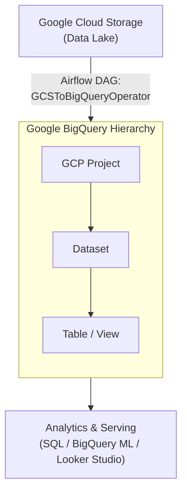

# Data Engineer - Chapter 05: Data Warehouse with BigQuery

> **วิชา:** Road to Data Engineer 3.0 (R2DE 3.0) | **ผู้สอน:** DataTH
> **Source:** `Resources/Books/DataEngineer/5BigQuery.pdf` (88 slides)
> **หมายเหตุ:** ส่วนที่ติดป้าย `[เสริมนอกสไลด์]` คือความรู้ที่ผู้เขียนโน้ตเพิ่มเอง

---

## Part 1: Macro Architecture & Overview

ถ้า **Data Lake** คือโกดังที่กองของทุกอย่างไว้ **Data Warehouse** ก็คือ "ห้องสมุดที่จัดชั้นเรียบร้อย" พร้อมให้ค้นหาและวิเคราะห์ได้เร็ว Chapter 5 สอนแนวคิดของ Data Warehouse (Normalization/Denormalization, Columnar Storage, View, Partition) แล้วพาไปใช้ **Google BigQuery** ซึ่งเป็น **Serverless Data Warehouse** และปิดด้วยการต่อ Airflow ให้โหลดข้อมูลจาก GCS เข้า BigQuery อัตโนมัติ



### ตารางเปรียบเทียบ Normalize vs Denormalize

| Feature | Normalize | Denormalize |
| :--- | :--- | :--- |
| **แนวคิด** | แบ่งข้อมูลเป็นหลายตาราง ไม่เก็บซ้ำ | เก็บทุกอย่างในตารางเดียว |
| **พื้นที่เก็บ** | ประหยัด | สิ้นเปลืองกว่า (เว้นแต่ใช้ Columnar) |
| **การดึงข้อมูล** | ต้อง `JOIN` (ช้าเมื่อข้อมูลใหญ่) | ไม่ต้อง JOIN เร็ว |
| **เหมาะกับ** | ระบบ OLTP | Data Warehouse (OLAP) |

---

## Part 2: Module-by-Module Deep Dive

### 2.1 Recap: ทบทวนก่อนเข้าเรื่อง

| หัวข้อทบทวน | สรุป |
| :--- | :--- |
| **OLTP vs OLAP** | OLTP → Database; OLAP → Data Warehouse |
| **Data Warehouse** | เก็บ Structured ขนาดใหญ่ ส่วนมาก historical data ไม่เปลี่ยนแปลง |
| **เครื่องมือสร้าง Pipeline** | Pre-built connectors vs เขียนเอง |
| **Airflow** | Open-source ใช้ได้ทั้ง local, on-premise และ Cloud (Composer) |

---

### 2.2 Concept ของ Data Warehouse

#### 2.2.1 Normalization vs Denormalization

> **Normalization** = เทคนิคแบ่งข้อมูลเป็นหลายตาราง เพื่อไม่ให้เก็บข้อมูลซ้ำซ้อน ประหยัดพื้นที่ แลกกับต้อง **JOIN** ตอนดึงข้อมูล (ยิ่งตารางใหญ่ยิ่งช้า)

> **Denormalization** = เก็บข้อมูลทุกอย่างไว้ในตารางเดียว

> 💡 **Intuition:** Normalization vs Denormalization เหมือน **"จัดระเบียบห้องนอน vs ห้องพอใจ"** — Normalization = เก็บเสื้อ/กางเกง/ถุงเท้าคนละตู้ (ไม่ซ้ำ ประหยัดที่) แต่แต่งตัวครบชุดต้องเปิดหลายตู้ (JOIN), Denormalization = แขวนชุดสำเร็จรวมไว้ หยิบเร็ว แต่บางชิ้นซ้ำหลายชุด
> [Source: generated — not verified against original document]

**ตัวอย่าง `[เสริมนอกสไลด์]`:**

```text
Normalized:                         Denormalized:
 orders(order_id, customer_id)       sales(order_id, customer_name, city, product, amount)
 customers(customer_id, name, city)
 products(product_id, ...)
→ ต้อง JOIN 3 ตาราง                 → อ่านตารางเดียวจบ
```

**🧭 ทำความเข้าใจ** _[Source: generated — not verified against original document]_

**แตกวลีสำคัญ:**
- **Normalization** = "แยกตาราง" ไม่เก็บซ้ำ (ลูกค้าอยู่ `customers`, order อยู่ `orders`)
- **Denormalization** = "รวมตาราง" เก็บ customer info แต่ละ order (ซ้ำแต่ในตารางเดียว)
- **Redundancy** (ซ้ำ) = ข้อมูลซ้ำหลาย record (ชื่อลูกค้าเดียวกัน 100 ครั้ง)
- **JOIN** = ความสัมพันธ์หลายตาราง — ยิ่ง JOIN หลายตารางยิ่งช้า

**ตัวอย่าง:**
- ✅ **Normalized** — ลูกค้า 1 million คน → `customers` table หนึ่งตาราง ไม่เก็บชื่อซ้ำ
- ✅ **Denormalized** — Orders 1 million แถว → เก็บชื่อลูกค้าแต่ละแถว (ลูกค้าที่สั่ง 10 ครั้ง ชื่อถูกเก็บซ้ำ 10 ครั้ง)
- **ต่างกันตรง:** Normalization → Query ช้า (JOIN); Denormalization → Query เร็ว (ไม่ต้อง JOIN) แต่ storage เยอะ (จนกว่า Columnar)
- ❌ 'Denormalize แล้วความสัมพันธ์หายไป' — ไม่ใช่ ความสัมพันธ์ยังอยู่ แค่เก็บซ้ำ

**อย่าสับสน:** "Normalization ดีกว่า Denormalization" — ขึ้นกับโจทย์: OLTP (Insert/Update บ่อย) ใช้ Normalized; OLAP (Query บ่อย) ใช้ Denormalized + Columnar

**เช็คความเข้าใจ:** ถ้า Query `SELECT customer_name, SUM(amount) FROM orders GROUP BY customer_name` Normalized ต้อง JOIN หรือไม่?
<details><summary>เฉลย</summary>

**ตอบ: ต้อง JOIN ถ้า customer_name อยู่ในตาราง `customers` ไม่ใช่ `orders`**

**เหตุผล:**
1. **Normalized:** `orders` มี `customer_id`, `customers` มี `customer_id, name` ต้อง JOIN
2. **Denormalized:** `orders` มี `customer_id, customer_name` ดึงตรงจากตาราง เดียว ไม่ต้อง JOIN
3. **Performance:** Denormalized เร็วกว่า แต่เสี่ยง update anomaly (อัพเดท customer_name ต้องอัพเดท 100K row)

ในกรณี Data Warehouse (read-heavy) Denormalized ดีกว่า

</details>

**แล้วทำไม Denormalize แล้วยังประหยัดพื้นที่ได้?** คำตอบคือ **Columnar Storage**

#### 2.2.2 Row-based vs Columnar Storage

| | Row-based (ฐานข้อมูลทั่วไป) | Columnar (BigQuery, Redshift, Snowflake) |
| :--- | :--- | :--- |
| **เก็บอย่างไร** | เก็บเป็นแถวต่อกัน | เก็บแยกตามคอลัมน์ |
| **เหมาะกับ** | อ่าน/เขียนทีละ record | วิเคราะห์ (สรุปคอลัมน์เดียวทั้งตาราง) |
| **ข้อดี** | OLTP เร็ว | อ่านเฉพาะคอลัมน์ที่ต้องใช้ ค่าซ้ำในคอลัมน์บีบอัดได้ดี `[เสริมนอกสไลด์]` |

```text
ข้อมูล:  (1,A,100) (2,A,200) (3,B,300)

Row-based :  [1 A 100][2 A 200][3 B 300]
Columnar  :  [1 2 3] [A A B] [100 200 300]    ← "A A" บีบอัดได้
```

> **ตัวอย่าง:** คำสั่ง `SELECT SUM(amount) FROM sales` Columnar อ่านเฉพาะคอลัมน์ `amount` ไม่ต้องอ่านคอลัมน์อื่น

> 💡 **Intuition:** Columnar เหมือน **"ห้องเรียนที่จัดแยกตามวิชา"** — Row-based ต้องอ่าน "แฟ้มนักเรียน" ทั้งหมด (ชื่อ + คณิต + วิทยา + ภาษา) แล้วค่อยหาเพียงคะแนนคณิตศาสตร์; Columnar ต้องมา "ชั้นคณิตศาสตร์" ดึงคะแนนคนที่ต้องการได้เลย เร็วกว่า และ "เด็กที่ได้ A เหมือนกันหลายคน" บีบอัดได้ (ไม่ต้องเก็บ A ซ้ำๆ)
> [Source: generated — not verified against original document]

**🧭 ทำความเข้าใจ** _[Source: generated — not verified against original document]_

**แตกวลีสำคัญ:**
- **Row-based** = ข้อมูลเก็บตามแถว (record-oriented)
- **Columnar** = ข้อมูลเก็บตามคอลัมน์ (column-oriented)
- **Compression** = ค่าซ้ำในคอลัมน์บีบอัดได้ เช่น [A A A B B] → [A×3, B×2]
- **I/O** = input/output อ่านค่า query ที่ต้องใช้เท่านั้น

**ตัวอย่าง:**
- ✅ **Columnar ดี** — Query `SELECT SUM(price) FROM 1M rows` → อ่านเฉพาะ price column (เร็ว)
- ✅ **Row-based ดี** — Insert/Update ทุก column (`INSERT INTO sales VALUES (...)`) → Row-based บันทึก ครั้งเดียวเสร็จ
- ❌ "Columnar ดีกว่าเสมอ" — ไม่ใช่ Insert/Update ทีละแถว ต้องเขียนกระจายหลายไฟล์คอลัมน์ (ช้า)
- **ต่างกันตรง:** Row-based = ดี Insert/Update; Columnar = ดี SELECT aggregate

**อย่าสับสน:** "Columnar ใช้พื้นที่น้อยเสมอ" — ไม่ใช่ ขึ้นกับ compression ratio; ถ้าค่าไม่ซ้ำ Row-based อาจเท่าหรือเล็กกว่า

**เช็คความเข้าใจ:** Table `transactions` มี 100M rows, 50 columns; query `SELECT customer_id, SUM(amount) FROM transactions GROUP BY customer_id` (ดึง 2 columns); ต้องอ่านกี่ bytes?
<details><summary>เฉลย</summary>

**ตอบ: Columnar อ่าน 2 columns เท่านั้น (~2/50 = 4% ของทั้งตาราง)**

**เหตุผล:**
1. **Row-based** → ต้องอ่าน 50 columns ทั้งหมด = 100% bytes
2. **Columnar** → ดึง `customer_id` + `amount` เท่านั้น = 2/50 = 4% (ถ้าทุกคอลัมน์ขนาดเท่ากัน; จริงขึ้นกับชนิดข้อมูล)
3. **Cost ใน BigQuery** = คิดจาก bytes scanned; ค่า query on-demand ลด ~25 เท่าเทียบกับ SELECT *!

นี่คือเหตุผลที่ Data Warehouse ใช้ Columnar

</details>

#### 2.2.3 Data Warehouse vs Data Mart

> **Data Mart** = ส่วนย่อยของ Warehouse ที่จัดให้เหมาะกับฝ่ายใดฝ่ายหนึ่ง เช่น Sales Mart

> 💡 **Intuition:** Data Warehouse เหมือน **"ห้างค้าส่งขนาดใหญ่"** ส่วน Data Mart คือ **"ชั้นวางของที่จัดตามความต้องการของลูกค้ากลุ่มหนึ่ง"** เช่น ชั้นของฝ่ายขาย — ของทั้งหมดยังมาจากคลังเดียวกัน แต่หยิบได้เร็วและตรงกับงานของกลุ่มนั้น (จุดที่ analogy ไม่ตรง: Data Mart ไม่ได้แยกออกไปเป็นระบบใหม่เสมอไป บางทีเป็นเพียงชุดตารางหรือ View ที่สร้างจาก Warehouse เดียวกัน)
> [Source: generated — not verified against original document]

**🧭 ทำความเข้าใจ** _[Source: generated — not verified against original document]_

**แตกวลีสำคัญ:**
- "Data Warehouse" → คลังข้อมูลรวมขององค์กร ครอบคลุมทุกฝ่าย
- "Data Mart" → ชุดย่อยของ Warehouse ที่ออกแบบให้ตรงกับงานของฝ่ายใดฝ่ายหนึ่ง
- "Sales Mart" → ตัวอย่างของ Data Mart ที่รวมตารางยอดขาย ลูกค้า และเป้าหมายที่ทีมขายใช้บ่อย

**ตัวอย่าง:**
- ✅ ทีมขายต้องการยอดขาย ลูกค้า และเป้าหมายที่ใช้บ่อย — สร้าง Sales Mart จาก Warehouse
- ✅ ผู้บริหารต้องการภาพรวมทุกฝ่ายพร้อมกัน — ดึงจาก Warehouse โดยตรง
- ❌ "Data Mart ต้องเป็นฐานข้อมูลแยกต่างเซิร์ฟเวอร์เสมอ" — ไม่จริง เป็นชุดข้อมูลที่แยกตามผู้ใช้ จะอยู่ใน Dataset เดียวกันก็ได้
- **ต่างกันตรง:** Data Warehouse รวมทุกฝ่าย (ภาพรวมองค์กร) ส่วน Data Mart จำกัดขอบเขตเฉพาะฝ่าย

**อย่าสับสน:** "Data Mart = Data Lake" — ไม่ใช่ Data Lake เก็บข้อมูลดิบหลายรูปแบบ ส่วน Data Mart เก็บข้อมูลที่จัดโครงสร้างแล้วสำหรับการวิเคราะห์ของฝ่ายนั้น

**เช็คความเข้าใจ:** ทีมบัญชีต้องการแค่ยอดรายเดือนของฝ่ายตน ส่วนผู้บริหารต้องการภาพรวมทุกฝ่าย ควรเลือกอะไรให้แต่ละกลุ่ม?
<details><summary>เฉลย</summary>

1. **ทีมบัญชี** → Data Mart (Finance) ที่มีเฉพาะข้อมูลที่ฝ่ายบัญชีใช้
2. **ผู้บริหาร** → Data Warehouse ที่รวมข้อมูลทุกฝ่ายไว้ภาพรวมเดียว

</details>

#### 2.2.4 Table vs View vs Materialized View

| | Table | View | Materialized View |
| :--- | :--- | :--- | :--- |
| **คืออะไร** | ตารางเก็บข้อมูลจริง | การเขียน SQL บันทึกไว้เป็นชื่อเรียกใช้ง่าย | View ที่เก็บผลลัพธ์ไว้ล่วงหน้า |
| **เขียนข้อมูลใส่** | ได้ | **ไม่ได้ (SELECT อย่างเดียว)** | ไม่ได้ |
| **ข้อมูล** | จริง | สดใหม่อัตโนมัติ ข้อมูลใหญ่คำนวณนาน | เร็วกว่า |

```sql
-- สร้าง View แล้วเรียกใช้เหมือน Table (ตัวอย่างตามสไลด์)
CREATE VIEW vw_customer_purchase AS
SELECT customer_id, SUM(amount) AS total_amount   -- [คอลัมน์ตัวอย่าง]
FROM transaction
GROUP BY customer_id;

SELECT * FROM vw_customer_purchase;               -- เรียกใช้เหมือน Table
```

> 💡 **Intuition:** Table เหมือน **"สมุดบันทึกที่มีข้อมูลจริงอยู่ในเล่ม"** — ค้นได้ตรงจุดแต่ต้องจดไว้ก่อน ส่วน View เหมือน **"ใบสั่งค้นหาที่จดสูตรไว้"** ทุกครั้งที่เปิดดูระบบค้นจากสมุดให้ใหม่ ข้อมูลจึงสดเสมอแต่คำนวณทุกครั้ง และ Materialized View เหมือน **"สรุปยอดที่จดไว้ล่วงหน้า"** เปิดดูเร็วขึ้นเพราะไม่ต้องคำนวณใหม่ทุกครั้ง (จุดที่ analogy ไม่ตรง: Materialized View ถูกรีเฟรชโดยระบบ ผลที่เก็บไว้จึงอาจไม่สดเท่า View เสมอไป)
> [Source: generated — not verified against original document]

**🧭 ทำความเข้าใจ** _[Source: generated — not verified against original document]_

**แตกวลีสำคัญ:**
- "Table" → ตารางที่เก็บข้อมูลจริง เขียนและเพิ่มข้อมูลได้
- "View" → การบันทึก SQL ไว้เป็นชื่อ ไม่มีข้อมูลของตัวเอง คำนวณใหม่ทุกครั้งที่ถูกเรียก
- "Materialized View" → View ที่เก็บผลลัพธ์ที่คำนวณไว้แล้ว และถูกรีเฟรชโดยระบบ
- "ข้อมูลสด" → ผลลัพธ์ตรงกับข้อมูลต้นทางล่าสุดในทันที

**ตัวอย่าง:**
- ✅ `vw_customer_purchase` ที่ใช้ดูยอดรวมต่อลูกค้าแบบข้อมูลสด — View
- ✅ Dashboard ที่โหลดทุกนาทีจากตารางหลายพันล้านแถว — Materialized View ช่วยให้เร็วขึ้น
- ❌ `INSERT INTO vw_customer_purchase VALUES (...)` — ทำไม่ได้ เพราะ View เขียนข้อมูลเพิ่มไม่ได้ (SELECT อย่างเดียว)
- **ต่างกันตรง:** Table เก็บข้อมูลจริง / View ไม่เก็บ คำนวณทุกครั้ง / Materialized View เก็บผลที่คำนวณแล้ว

**อย่าสับสน:** "View = ตารางสำรอง" — ไม่ใช่ View ไม่มีข้อมูลของตัวเอง ถ้าตารางต้นทางเปลี่ยน ผลของ View ก็เปลี่ยนตาม

**เช็คความเข้าใจ:** ต้องการยอดรวมต่อลูกค้า ตารางต้นทางมี 5 พันล้านแถว และ Dashboard โหลดทุกนาที ควรเลือก View หรือ Materialized View และ trade-off คืออะไร?
<details><summary>เฉลย</summary>

**ตอบ: Materialized View** (ถ้ายอมรับความสดของข้อมูลได้เล็กน้อย)

**เหตุผล:**
1. Dashboard โหลดบ่อย และตารางใหญ่ — View ต้องคำนวณใหม่ทุกครั้ง ทำให้ช้าและเสียค่า query
2. MV เก็บผลไว้แล้ว ทำให้เร็วและประหยัดกว่า
3. **Trade-off:** ความเร็วกับความสดของข้อมูล — ถ้าต้องการข้อมูลสดจริงต้องเลือก View แล้วยอมรับต้นทุนการคำนวณ

</details>

#### 2.2.5 Index & Partitioning (Recap)

* **Partition:** แบ่งข้อมูลเป็นกลุ่มย่อย เช่น ตามวันที่ ข้อมูลวันเดียวกันอยู่ด้วยกัน
* **Index:** จดจำว่าแถวไหนอยู่ตรงไหน เพื่อเข้าถึงเร็วขึ้น

```sql
-- [เสริมนอกสไลด์] Query ที่ใช้ Partition ช่วย: ระบุเงื่อนไขวันที่ให้อ่านเฉพาะ partition ที่จำเป็น
SELECT * FROM scores WHERE exam_date = '2024-06-01';
```

> 💡 **Intuition:** Partition vs Clustering เหมือน **"จัดห้องสมุด"** — Partition = "แยกห้องตามปี" (ปี 2020 ห้องหนึ่ง ปี 2021 ห้องหนึ่ง) ค้นหา "หนังสือปี 2020" ข้ามห้องอื่นได้เลย; Clustering = "จัดเรียงในห้องตามหัวข้อ" (ประวัติศาสตร์ ด้านซ้าย วิทยาศาสตร์ ด้านขวา) ทั้งคู่ช่วยค้นหาเร็ว ทั้งสองช่วยเรื่องนี้ แต่ Partition เหมาะเมื่อ filter ตรงกับการแบ่งห้อง; Clustering ช่วยหาในห้องใหญ่ให้เร็วขึ้น
> [Source: generated — not verified against original document]

**🧭 ทำความเข้าใจ** _[Source: generated — not verified against original document]_

**แตกวลีสำคัญ:**
- **Partition** = "แบ่งเป็นไฟล์/กลุ่มคนละที่" (กายภาพแยก)
- **Clustering** = จัดเรียงข้อมูลภายในแต่ละ partition เป็น block ตามค่าคอลัมน์ (block pruning)
- **Pruning** = ข้ามส่วนข้อมูลที่ไม่ต้องอ่าน (ช่วยให้ query เร็ว)
- **Cardinality** = จำนวน value ที่แตกต่างกัน (วันที่ใน 1 ปีมี 365 ค่า, เพศมี 2-3 ค่า)

**ตัวอย่าง:**
- ✅ **Partition ดี** — `WHERE date = '2024-06-01'` → ข้ามวันอื่น ทั้งหมด (เร็วมาก)
- ✅ **Clustering ดี** — `WHERE customer_id IN (100, 101, 102)` → ข้อมูลเหล่านี้กระจุก (ประหยัด I/O)
- ❌ "Partition หลายคอลัมน์" → BigQuery Partition ได้ 1 คอลัมน์เท่านั้น (date/timestamp, ingestion time, integer range) และจำกัด 10,000 partitions/ตาราง; Clustering ได้สูงสุด 4 คอลัมน์
- **ต่างกันตรง:** Partition = แบ่งข้อมูลแยกไฟล์/ก้อนคนละที่ตามค่าคอลัมน์ (ระดับตาราง), Clustering = จัดเรียงข้อมูลภายในแต่ละ partition เป็น block ย่อย (ระดับบล็อก)

**อย่าสับสน:** "Partition ดีกว่า Clustering เสมอ" — ไม่จริง ผลขึ้นกับ query: WHERE date = X (partition ดี), WHERE customer_id IN (...) (clustering ดี)

**เช็คความเข้าใจ:** BigQuery table `transactions` มี 1 billion rows, column: date ครอบคลุม 1 ปี (365 ค่า), customer_id (100K unique), amount. ควร partition/cluster ตามอะไร?
<details><summary>เฉลย</summary>

**ตอบ: Partition by date, Cluster by customer_id**

**เหตุผล:**
1. **Partition by date** = วันที่ common filter → query `WHERE date = CURRENT_DATE()` อ่านแค่ ~1/365 ของตาราง
2. **Cluster by customer_id** = ข้อมูล customer เดียวกันกระจุก → query `SELECT customer_id, amount FROM transactions WHERE customer_id = X` scan น้อยข้อมูล
3. **ทำไมไม่ใช้ Partition กับทั้งสองคอลัมน์** = BigQuery กำหนดให้ Partition ได้เพียง 1 คอลัมน์เท่านั้น และ customer_id มี 100K ค่า ซึ่งเกินขีดจำกัด 10,000 partitions ต่อตาราง จึงต้องใช้ Clustering แทน (Clustering กำหนดได้สูงสุด 4 คอลัมน์)

</details>

หนังสือแนะนำเรื่องออกแบบ Data Warehouse ดูสไลด์ P.27

---

### 2.3 Google BigQuery

> **BigQuery** = Serverless Data Warehouse ของ Google Cloud Platform รองรับข้อมูลมหาศาล เขียน SQL Query ได้ทันที เริ่มต้นง่าย

**ข้อดี-ข้อเสีย:** สไลด์มีตารางสรุปที่ P.30 `[ข้อดีโดยทั่วไป: ไม่ต้องดูแล Server, ขยายอัตโนมัติ; ข้อเสียที่ควรระวัง: ค่าใช้จ่ายขึ้นกับการ Query — เสริมนอกสไลด์]`

#### 2.3.1 โครงสร้างการเข้าถึง

```text
Project  >  Dataset  >  Table
```

* **Project:** ระดับบนสุด (ผูกกับ Billing)
* **Dataset:** กลุ่มของตาราง (กำหนด Data Location)
* **Table:** ตารางข้อมูล

**ชนิดข้อมูลที่ใช้บ่อย:** ตัวเลข ข้อความ วันที่/เวลา ฯลฯ (สไลด์ P.32)

> 💡 **Intuition:** Project > Dataset > Table เหมือน **"บริษัท > แผนก > ตู้เอกสาร"** — Project คือก้อนใหญ่ที่ผูกกับค่าใช้จ่าย (Billing), Dataset คือแผนกที่กำหนดว่าข้อมูลอยู่ตำแหน่งไหน (Location), Table คือตู้เอกสารจริงที่เก็บข้อมูลไว้ (จุดที่ analogy ไม่ตรง: สิทธิ์การเข้าถึงบางอย่างกำหนดได้ที่ระดับ Project หรือ Dataset โดยไม่ต้องไปตั้งทีละตู้)
> [Source: generated — not verified against original document]

**🧭 ทำความเข้าใจ** _[Source: generated — not verified against original document]_

**แตกวลีสำคัญ:**
- "Project" → หน่วยสูงสุดที่ผูกกับ Billing และการตั้งค่าของ Cloud
- "Dataset" → กลุ่มของตาราง กำหนดตำแหน่งที่เก็บข้อมูล (Data Location)
- "Table" → ตารางข้อมูลที่เราใช้ query จริง
- `project.dataset.table` → รูปแบบการอ้างชื่อตารางแบบเต็ม

**ตัวอย่าง:**
- ✅ `my-proj.workshop.transaction` — อ้างตารางครบทั้งสามระดับ ใช้ได้จากทุกที่
- ✅ แยกค่าใช้จ่ายของทีมหนึ่งออกไปโดยสร้าง Project ใหม่ — ทำได้เพราะ Project ผูกกับ Billing
- ❌ "Dataset ไม่มีผลต่อตำแหน่งข้อมูล ตั้งที่ไหนก็เหมือนกัน" — ไม่จริง Dataset กำหนด Location ของข้อมูล

**ต่างกันตรง:** Project = บิลและการจัดการทั้งก้อน, Dataset = กลุ่มตารางและตำแหน่งข้อมูล, Table = ข้อมูลจริง

**อย่าสับสน:** "Dataset = ชุดข้อมูลสำหรับงาน ML" — ไม่ใช่ ในบริบท BigQuery Dataset คือคอนเทนเนอร์ที่ใส่ตารางไว้ ไม่ใช่ไฟล์ชุดข้อมูลเฉพาะงาน

**เช็คความเข้าใจ:** ต้องการอ้างตาราง `transaction` ที่อยู่ใน Dataset `workshop` ของ Project `my-proj` ต้องเขียนชื่อแบบเต็มว่าอย่างไร?
<details><summary>เฉลย</summary>

**ตอบ:** `my-proj.workshop.transaction`

**เหตุผล:** เรียงจาก Project → Dataset → Table คั่นด้วยจุด

</details>

#### 2.3.2 ที่เก็บข้อมูลของ Table

| ประเภท | คำอธิบาย |
| :--- | :--- |
| **Native table** | เก็บข้อมูลภายใน BigQuery ประสิทธิภาพและอ่านเร็วสุด |
| **External query** | ใช้ `EXTERNAL_QUERY` ไป Query SQL database อื่นใน Google Cloud (เช่น Cloud SQL) โดยไม่ต้องย้ายข้อมูลเข้ามา |

> 💡 **Intuition:** Native table เหมือน **"ของที่ซื้อมาเก็บในตู้ของเราเอง"** — หยิบได้เร็วแต่ต้องขนเข้าตู้ก่อน ส่วน External query เหมือน **"โทรสั่งของจากร้านข้างบ้าน"** — ไม่ต้องขนของเข้าบ้าน แต่ทุกครั้งที่ต้องการต้องรอร้านส่งกลับมา จึงช้ากว่า (จุดที่ analogy ไม่ตรง: `EXTERNAL_QUERY` ไม่ได้ย้ายข้อมูลจริง ความเร็วขึ้นกับระบบต้นทางทุกครั้ง)
> [Source: generated — not verified against original document]

**🧭 ทำความเข้าใจ** _[Source: generated — not verified against original document]_

**แตกวลีสำคัญ:**
- "Native table" → ตารางที่ BigQuery เก็บและจัดการเอง
- "External query" → ส่งคำสั่ง SQL ไปยังฐานข้อมูลอื่นนอกตาราง BigQuery (เช่น Cloud SQL) แล้วรับผลกลับมา
- `EXTERNAL_QUERY(...)` → ฟังก์ชันที่ใช้เรียกการ query แบบนี้
- "ไม่ต้องย้ายข้อมูลเข้ามา" → ข้อมูลยังอยู่ที่ต้นทางเดิม ไม่ได้ถูกคัดลอกมาที่ BigQuery

**ตัวอย่าง:**
- ✅ ตารางยอดขายที่ query ทุกวัน — Native table
- ✅ ตารางลูกค้าที่อยู่ใน Cloud SQL และยังไม่ต้องการย้าย — ใช้ `EXTERNAL_QUERY` ดึงมา JOIN กับตารางยอดขายได้
- ❌ "EXTERNAL_QUERY เร็วเท่า Native เพราะอยู่ใน Google Cloud เหมือนกัน" — ไม่จริง ทุกครั้งต้องวิ่งไปยังระบบต้นทาง

**ต่างกันตรง:** ข้อมูลถูกเก็บใน BigQuery (Native) หรือยังอยู่ที่เดิมแล้วเรียกผ่าน SQL (External)

**อย่าสับสน:** "External = ข้อมูลจากอินเทอร์เน็ต" — ไม่ใช่ ในที่นี้หมายถึงฐานข้อมูลอื่นที่อยู่นอกตาราง BigQuery แม้จะอยู่บน Google Cloud เดียวกัน

**เช็คความเข้าใจ:** ข้อมูลลูกค้าอยู่ใน Cloud SQL และต้อง JOIN กับตารางยอดขายใน BigQuery ที่ query บ่อยทุกวัน จะทำอย่างไร?
<details><summary>เฉลย</summary>

1. ใช้ `EXTERNAL_QUERY` ดึงข้อมูลลูกค้าจาก Cloud SQL มา JOIN กับตารางยอดขาย ทำให้ไม่ต้องย้ายข้อมูลก่อน
2. ถ้า query แบบนี้หนักและรันบ่อย ให้พิจารณาย้ายตารางลูกค้าเข้าเป็น Native table เพื่อความเร็วและลดการพึ่งพาระบบต้นทาง

</details>

#### 2.3.3 การคิดเงินของ BigQuery

| ส่วน | รายละเอียด (ตามสไลด์) |
| :--- | :--- |
| **On-demand: ค่า Query (Analysis)** | คิดตามข้อมูลที่ Query อ่าน |
| **On-demand: ค่า Storage** | คิดตามพื้นที่เก็บ |
| **ค่าโหลดข้อมูล (Ingestion)** | Batch Insert (โหลดทีละก้อน) vs แบบอื่นที่คิดเงินต่างกัน (P.36) |
| **Workload Management / Editions** | วิธีคิดเงินขั้นสูง สลับระหว่าง 2 วิธีได้ตอนใช้จริง |

> **ราคาจริงเปลี่ยนได้ ให้ดูหน้า Pricing ทางการของ Google Cloud** (ไม่ระบุตัวเลขในโน้ต)

**เทคนิคลดค่าใช้จ่าย:**
1. ใช้ **Preview tab** เมื่อต้องการดู data เพราะฟรี (ตามสไลด์)
2. BigQuery มี **Cache** ไม่เสียเงินถ้า Query เดิมซ้ำภายใน 24 ชั่วโมง (BigQuery ไม่การันตีเรื่องเวลา)
3. `[เสริมนอกสไลด์]` เลือกเฉพาะคอลัมน์ที่ต้องใช้ แทน `SELECT *` เพราะเป็น Columnar จึงคิดตามคอลัมน์ที่อ่าน
4. `[เสริมนอกสไลด์]` ใช้เงื่อนไข Partition ใน `WHERE`

```sql
-- ไม่ดี: อ่านทุกคอลัมน์ (ค่าใช้จ่ายสูง)
SELECT * FROM workshop.transaction;

-- ดีกว่า: อ่านเฉพาะคอลัมน์ที่ต้องใช้
SELECT date, thb_amount FROM workshop.transaction;
```

> 💡 **Intuition:** ค่า Query แบบ On-demand เหมือน **"ค่าน้ำที่คิดตามปริมาณที่ไหลผ่านมิเตอร์"** — คิดตามข้อมูลที่ query อ่านจริง ไม่ใช่ตามเวลาที่รอ ดังนั้น `SELECT *` ที่อ่านทุกคอลัมน์จึงแพงกว่าการเลือกเฉพาะคอลัมน์ที่ใช้ (จุดที่ analogy ไม่ตรง: ค่าใช้จ่ายจริงมีหลายส่วนแยกกัน ทั้ง Query, Storage และ Ingestion และราคาเปลี่ยนได้ ต้องดูหน้า Pricing ทางการเสมอ)
> [Source: generated — not verified against original document]

**🧭 ทำความเข้าใจ** _[Source: generated — not verified against original document]_

**แตกวลีสำคัญ:**
- "On-demand" → จ่ายตามปริมาณข้อมูลที่ query อ่าน
- "Storage" → ค่าพื้นที่ที่ใช้เก็บข้อมูล คิดแยกจากค่า query
- "Ingestion" → ค่าการโหลดข้อมูลเข้า BigQuery ซึ่งขึ้นกับวิธีโหลด
- "Cache" → ถ้า query เดิมซ้ำและผลยังอยู่ในแคช จะไม่คิดค่า query ซ้ำ (ตามที่โน้ตระบุ ~24 ชั่วโมง แต่ BigQuery ไม่การันตีเรื่องเวลา)
- "Preview" → ดูข้อมูลตัวอย่างโดยไม่รัน query ตามสไลด์ระบุว่าฟรี

**ตัวอย่าง:**
- ✅ `SELECT date, thb_amount FROM workshop.transaction` — อ่าน 2 คอลัมน์ ข้อมูลที่ประมวลผลน้อย ค่า query ต่ำ
- ❌ `SELECT * FROM workshop.transaction` เพื่อดูแค่ยอดรวม — อ่านทุกคอลัมน์โดยไม่จำเป็น ค่า query สูง
- ✅ เปิด Preview tab เพื่อดูตัวอย่างข้อมูล — ฟรีตามสไลด์
- ❌ "รัน query เดิมซ้ำ 5 ครั้งใน 1 ชั่วโมง ค่าใช้จ่ายเป็น 5 เท่าเสมอ" — ไม่จริงเสมอไป ถ้าเข้าเงื่อนไข Cache การรันซ้ำจะไม่คิดค่า query
- **ต่างกันตรง:** ดูตัวอย่าง (Preview) ไม่คิด query, รัน query เต็มคิดตามข้อมูลที่อ่าน

**อย่าสับสน:** "Storage กับ Query คิดเงินรวมกัน" — ไม่ใช่ คิดแยกกัน Storage คิดตามพื้นที่ที่เก็บ ส่วน Query คิดตามข้อมูลที่อ่านตอนรัน

**เช็คความเข้าใจ:** ต้องการดูตัวอย่าง 10 แถวของตาราง 2 TB กับต้องการรายงานยอดรวมรายวัน ควรทำอย่างไรให้ประหยัดที่สุด?
<details><summary>เฉลย</summary>

1. **ดูตัวอย่าง 10 แถว** → ใช้ **Preview tab** (ฟรี ไม่ต้องรัน query เต็ม)
2. **รายงานยอดรวมรายวัน** → เลือกเฉพาะคอลัมน์ที่ใช้ (เช่น `date`, `thb_amount`) และกรองด้วยเงื่อนไข Partition ใน `WHERE` เพื่อลดข้อมูลที่อ่าน

</details>

#### 2.3.4 การแชร์และสิทธิ์

แชร์ได้ทั้งระดับ Project, Dataset, Table หรือ View โดยอ้างอิง Google Account (เช่น Gmail)

#### 2.3.5 BigQuery ML

สร้าง Machine Learning model ด้วย **SQL** ลดขั้นตอนให้ง่ายขึ้น (รองรับโมเดลหลายประเภท ตัวอย่างดู P.43)

```sql
-- [เสริมนอกสไลด์] แนวคิดการสร้างโมเดลด้วย SQL ใน BigQuery ML
CREATE OR REPLACE MODEL `my_dataset.sales_model`
OPTIONS (model_type = 'linear_reg', input_label_cols = ['thb_amount']) AS
SELECT quantity, unit_price, thb_amount FROM `my_dataset.transaction`;
```

---

### 2.4 3 วิธี Load Data เข้า BigQuery

| # | วิธี | ลักษณะ |
| :--- | :--- | :--- |
| 1 | **Console (Web UI)** | Manual, ทำครั้งเดียว/ทดลอง |
| 2 | **`bq load`** ใน BashOperator | Automatic ผ่านคำสั่ง CLI |
| 3 | **`GCSToBigQueryOperator`** | Automatic ผ่าน Airflow Provider (ทางที่ Workshop เน้น) |

```python
# ตัวอย่างโหลดไฟล์จาก GCS เข้า BigQuery ด้วย Airflow Operator (ชื่อ import ตามสไลด์)
from airflow.providers.google.cloud.transfers.gcs_to_bigquery import GCSToBigQueryOperator

load_to_bq = GCSToBigQueryOperator(
    task_id="load_to_bq",
    bucket="<BUCKET_NAME>",                          # ใส่ชื่อ bucket ของคุณ
    source_objects=["data/transaction.parquet"],     # [path ตัวอย่าง]
    destination_project_dataset_table="workshop.transaction",
    source_format="PARQUET",
    write_disposition="WRITE_TRUNCATE",              # [เสริม] เขียนทับ ช่วยให้ rerun แล้วไม่ซ้ำ (Idempotent)
)
```

> **สังเกต:** `WRITE_TRUNCATE` ทำให้รันซ้ำแล้วผลเท่าเดิม เชื่อมกับหลัก Idempotent ใน [[Chapter 04 - Data Pipeline Orchestration with Airflow]]

---

### 2.5 Workshop 5: Data Warehouse with BigQuery

* **โจทย์:** จาก Workshop 4 ที่ได้ไฟล์ Parquet บน GCS Data Lake แล้ว จะนำข้อมูลเข้าสู่ BigQuery Data Warehouse โดยอัตโนมัติได้อย่างไร
* **การจัดการโค้ดบน Cloud Shell:**
  ```bash
  # Clone โค้ดลงในโฟลเดอร์ใหม่ workshop5
  git clone https://github.com/DataTH-Team/r2de3-workshops.git workshop5
  cd workshop5/dags

  # สำหรับกรณีใช้โปรเจกต์เดิมแล้วติด conflict จากไฟล์ที่แก้ไข:
  git stash        # เก็บการเปลี่ยนแปลงไว้ชั่วคราว
  git pull         # อัปเดตโค้ดล่าสุดจากรีโป
  git stash pop    # นำการเปลี่ยนแปลงกลับคืนมา
  ```

---

#### 2.5.1 ภาพรวมลำดับการทำงาน (Workflow Progression)

| ขั้น | วิธีการ | รายละเอียด |
| :--- | :--- | :--- |
| **1** | สร้าง **Dataset** ใน BigQuery | ตั้งชื่อ Dataset เช่น `workshop` (เลือก Data location ให้ตรงกับ Bucket) |
| **2.1** | Manual Ingestion | ทดลอง Load ไฟล์ Parquet ผ่าน BigQuery Console ด้วยตนเอง เพื่อตรวจสอบ Schema |
| **3** | ทดสอบ Query เบื้องต้น | `SELECT count(distinct date) FROM workshop.transaction;` |
| **2.2** | Automatic: CLI ผ่าน `BashOperator` | ใช้คำสั่ง `bq load` โหลดไฟล์จาก GCS เข้า BigQuery Table |
| **2.3** | Automatic: Native Provider | ใช้ `GCSToBigQueryOperator` ของ Airflow จัดการแบบ Declarative |

> 💡 **ทำไมต้อง Manual ก่อน Automatic:**
> การทำมือ (Manual) ช่วยให้เห็น Data Types, ตรวจสอบ Schema Mismatch และมั่นใจในผลลัพธ์ที่ถูกต้องก่อน เมื่อนำไปทำเป็น Automation ใน DAG จึงมี Baseline ในการตรวจสอบว่า Task ทำงานถูกต้อง

---

#### 2.5.2 แนวทางที่ 1: โหลดข้อมูลด้วย `BashOperator` + `bq load` (`workshop5_bq_load.py`)

ใช้ CLI `bq load` สั่งการ BigQuery โดยตรงผ่าน `BashOperator`:

```python
from airflow.models import DAG
from airflow.decorators import dag, task
from airflow.operators.bash import BashOperator
from airflow.providers.mysql.hooks.mysql import MySqlHook
from airflow.utils.dates import days_ago
import pandas as pd
import requests

MYSQL_CONNECTION = "mysql_default"
CONVERSION_RATE_URL = "https://r2de3-currency-api-vmftiryt6q-as.a.run.app/gbp_thb"

mysql_output_path = "/home/airflow/gcs/data/transaction_data_merged.parquet"
conversion_rate_output_path = "/home/airflow/gcs/data/conversion_rate.parquet"
final_output_path = "/home/airflow/gcs/data/workshop4_output.parquet"

default_args = {'owner': 'datath'}

@task()
def get_data_from_mysql(output_path):
    mysqlserver = MySqlHook(MYSQL_CONNECTION)
    product = mysqlserver.get_pandas_df(sql="SELECT * FROM r2de3.product")
    customer = mysqlserver.get_pandas_df(sql="SELECT * FROM r2de3.customer")
    transaction = mysqlserver.get_pandas_df(sql="SELECT * FROM r2de3.transaction")

    merged = transaction.merge(product, how="left", on="ProductNo").merge(customer, how="left", on="CustomerNo")
    merged.to_parquet(output_path, index=False)

@task()
def get_conversion_rate(output_path):
    r = requests.get(CONVERSION_RATE_URL)
    df = pd.DataFrame(r.json()).drop(columns=['id'])
    df['date'] = pd.to_datetime(df['date'])
    df.to_parquet(output_path, index=False)

@task()
def merge_data(transaction_path, conversion_rate_path, output_path):
    transaction = pd.read_parquet(transaction_path)
    conversion_rate = pd.read_parquet(conversion_rate_path)

    final_df = transaction.merge(conversion_rate, how="left", left_on="Date", right_on="date")
    final_df["total_amount"] = final_df["Price"] * final_df["Quantity"]
    final_df["thb_amount"] = final_df["total_amount"] * final_df["gbp_thb"]
    final_df = final_df.drop(["date", "gbp_thb"], axis=1)
    final_df.columns = [
        'transaction_id', 'date', 'product_id', 'price', 'quantity', 'customer_id',
        'product_name', 'customer_country', 'customer_name', 'total_amount', 'thb_amount'
    ]
    final_df.to_parquet(output_path, index=False)

@dag(default_args=default_args, schedule_interval="@once", start_date=days_ago(1), tags=["workshop"])
def workshop5_bash():
    """โหลดข้อมูลเข้า BigQuery ด้วย bq load ผ่าน BashOperator"""
    t1 = get_data_from_mysql(output_path=mysql_output_path)
    t2 = get_conversion_rate(output_path=conversion_rate_output_path)
    t3 = merge_data(
        transaction_path=mysql_output_path,
        conversion_rate_path=conversion_rate_output_path,
        output_path=final_output_path
    )

    # Task 4: เรียกคำสั่ง bq load ใน bash
    t4 = BashOperator(
        task_id="bq_load",
        bash_command="bq load --source_format=PARQUET workshop.transaction1 gs://<CLOUD-COMPOSER-BUCKET>/data/workshop4_output.parquet"
    )

    [t1, t2] >> t3 >> t4

workshop5_bash()
```

---

#### 2.5.3 แนวทางที่ 2: โหลดข้อมูลด้วย Native Provider (`workshop5_gcs_to_bq.py`)

ใช้ `GCSToBigQueryOperator` ซึ่งเป็น Best Practice บน Airflow มี Error Handling และ State Management ที่รัดกุมกว่า:

```python
from airflow.decorators import dag, task
from airflow.providers.google.cloud.transfers.gcs_to_bigquery import GCSToBigQueryOperator
from airflow.providers.mysql.hooks.mysql import MySqlHook
from airflow.utils.dates import days_ago
import pandas as pd
import requests

MYSQL_CONNECTION = "mysql_default"
CONVERSION_RATE_URL = "https://r2de3-currency-api-vmftiryt6q-as.a.run.app/gbp_thb"

mysql_output_path = "/home/airflow/gcs/data/transaction_data_merged.parquet"
conversion_rate_output_path = "/home/airflow/gcs/data/conversion_rate.parquet"
final_output_path = "/home/airflow/gcs/data/workshop4_output.parquet"

default_args = {'owner': 'datath'}

# Tasks: get_data_from_mysql, get_conversion_rate, merge_data (เหมือนในหัวข้อ 2.5.2)

@dag(default_args=default_args, schedule_interval="@once", start_date=days_ago(1), tags=["workshop"])
def workshop5():
    """โหลดข้อมูลเข้า BigQuery ผ่าน GCSToBigQueryOperator"""
    t1 = get_data_from_mysql(output_path=mysql_output_path)
    t2 = get_conversion_rate(output_path=conversion_rate_output_path)
    t3 = merge_data(
        transaction_path=mysql_output_path,
        conversion_rate_path=conversion_rate_output_path,
        output_path=final_output_path
    )

    # Task 4: Native Operator สำหรับ GCS -> BigQuery
    t4 = GCSToBigQueryOperator(
        task_id="gcs_to_bigquery",
        bucket="<CLOUD-COMPOSER-BUCKET>",
        source_objects=["data/workshop4_output.parquet"],
        source_format="PARQUET",
        destination_project_dataset_table="workshop.transaction",
        write_disposition="WRITE_TRUNCATE"  # เขียนทับทุกครั้งเพื่อรองรับ Idempotency
    )

    [t1, t2] >> t3 >> t4

workshop5()
```

---

#### 2.5.4 การตรวจสอบความถูกต้องใน BigQuery (Data Verification)

หลังจาก DAG รันสำเร็จ สามารถเปิด BigQuery Studio และรัน SQL เพื่อตรวจสอบความสมบูรณ์ของข้อมูล:

```sql
-- 1. ตรวจสอบจำนวนวันทั้งหมดที่มีธุรกรรม
SELECT count(distinct date) AS total_dates FROM `workshop.transaction`;

-- 2. ตรวจสอบยอดขายรวมสกุลเงินบาท
SELECT SUM(thb_amount) AS total_revenue_thb FROM `workshop.transaction`;
```

**Bonus Tools:** `bigframes` ไลบรารี Python เขียน DataFrame แบบ Pandas แต่รัน Job บน BigQuery

---

### 2.6 Bonus: Google's Data Cloud

#### 2.6.1 Data Lakehouse & BigLake

> **Data Lakehouse** = สถาปัตยกรรมที่ผสมจุดเด่นของ Data Lake และ Data Warehouse เพื่อจัดการและวิเคราะห์ข้อมูลได้ยืดหยุ่นขึ้น

| | Data Lake | Data Warehouse | Lakehouse |
| :--- | :--- | :--- | :--- |
| **จุดเด่น** | เก็บไฟล์ทุกรูปแบบ ราคาถูก | Query เร็ว มีโครงสร้าง | รวมทั้งสองอย่าง |

> **BigLake** = Storage Engine ที่สร้าง connection ให้ใช้ความสามารถ storage ของ BigQuery ได้ แม้ข้อมูลอยู่ที่ Cloud Storage

* **BigLake Table:** ระบบเก็บไฟล์ที่เชื่อมกับ BigQuery โดยตรง อ่านไฟล์ด้วย BigQuery ได้
* **Main Features (ตามสไลด์):** Fine-grain security (ระดับ Column ฯลฯ), รองรับหลาย data formats และหลาย Data Source
* **Apache Iceberg:** สไลด์แสดงตัวอย่างสร้างตาราง Iceberg ด้วย Dataproc Spark

#### 2.6.2 Dataplex & Analytics Hub

| บริการ | ใช้ทำอะไร (ตามสไลด์) |
| :--- | :--- |
| **Dataplex** | รวมศูนย์ Data ทั้งหมดบน Google (Data Mesh / Data Fabric) รวมข้อมูลจากหลายที่ทั้ง On-premise และ Cloud |
| **Analytics Hub** | แชร์ข้อมูล |

---

## Part 3: Quick Reference & Exam Cheat Sheet

### Checklist สรุปหัวใจสำคัญ
* [ ] **OLTP vs OLAP** → Database vs Data Warehouse
* [ ] **Normalize vs Denormalize:** JOIN เยอะ vs ตารางเดียว
* [ ] **Columnar Storage:** ทำให้ Denormalize แล้วยังประหยัดและเร็ว
* [ ] **Data Warehouse vs Data Mart**
* [ ] **Table / View / Materialized View**
* [ ] **Partition / Index**
* [ ] **BigQuery:** Serverless, `Project > Dataset > Table`
* [ ] **Native vs External (`EXTERNAL_QUERY`)**
* [ ] **ราคา:** Query + Storage + Ingestion, Cache 24 ชม., Preview ฟรี
* [ ] **BigQuery ML:** สร้างโมเดลด้วย SQL
* [ ] **3 วิธี Load:** Console / `bq load` / `GCSToBigQueryOperator`
* [ ] **Lakehouse / BigLake / Dataplex / Analytics Hub**

### Decision Rules

```text
อยากเห็น data ตัวอย่างโดยไม่เสียเงิน     → Preview tab
Query ซ้ำเดิมภายใน 24 ชม.                 → Cache (ไม่คิดเงิน)
View ช้าเพราะข้อมูลใหญ่                    → Materialized View
ต้อง Query ข้อมูลบน GCS ด้วยพลัง BigQuery → BigLake
```

### Concept Map

```text
Data Warehouse
├── แนวคิด: Normalize/Denormalize, Columnar, Mart, View, Partition/Index
├── BigQuery: Project>Dataset>Table, Native/External, Pricing, Share, BQML
├── Load: Console / bq load / GCSToBigQueryOperator
└── Lakehouse Ecosystem: BigLake, Iceberg, Dataplex, Analytics Hub
```

---

## ⚠️ Common Pitfalls & Exam Traps

* **"Denormalize เปลืองพื้นที่เสมอ":** กับ Columnar Storage ค่าซ้ำในคอลัมน์บีบอัดได้ดี จึงเปลืองน้อยกว่าที่คิด
* **"View เก็บข้อมูลไว้เอง":** View เป็นแค่ SQL ที่บันทึกชื่อไว้ คำนวณสดทุกครั้ง ส่วนที่เก็บผลไว้คือ Materialized View
* **"`SELECT *` กับ `LIMIT` ทำให้ถูกลง":** BigQuery คิดตามข้อมูลที่อ่าน `LIMIT` ไม่ลดค่า scan `[เสริมนอกสไลด์]` ให้เลือกคอลัมน์ที่จำเป็นและใช้ Preview แทน
* **"BigQuery ไม่ต้องดูแลอะไรเลย":** ยังต้องออกแบบ Dataset/Location/สิทธิ์ และคุมค่าใช้จ่ายเอง
* **"Dataset คนละ Location Query ข้ามกันได้ง่าย":** สไลด์เตือนว่า Data location สำคัญ ต้องสอดคล้องกัน (ระหว่าง Dataset และข้อมูลต้นทาง)
* **"BigQuery เหมาะกับงาน OLTP ของ App":** BigQuery คือ OLAP ใช้วิเคราะห์ ไม่ใช่แทน Database ของ App `[เสริมนอกสไลด์]`

---

## เอกสารเชื่อมโยง (Wiki-Style Backlinks)
* **วิชาและหัวข้อที่เกี่ยวข้อง:**
  * [[Chapter 04 - Data Pipeline Orchestration with Airflow]] (DAG ที่ใช้โหลดข้อมูลเข้า BigQuery)
  * [[Chapter 06 - Report & Dashboard with Looker Studio]] (ใช้ BigQuery table/view เป็น Data Source)
  * [[Chapter 03 - Cloud Computing and Bash]] (GCS ต้นทางข้อมูล)
  * [[Chapter 01 Introduction to Database System & Relational Model]] (ทฤษฎี Relational / Normalization)
  * [[LAB 8 - SQL GROUP BY and Aggregate Functions]] (SQL ที่ใช้ Query ใน BigQuery)

* **แหล่งข้อมูล:**
  * Source: `Resources/Books/DataEngineer/5BigQuery.pdf` (88 slides, DataTH)
  * Reference: Google Cloud Documentation — BigQuery (cloud.google.com/bigquery/docs) `[เสริมนอกสไลด์]`
