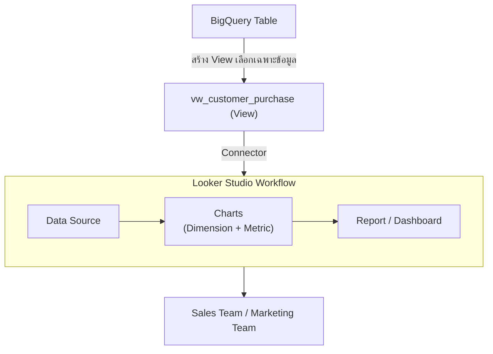
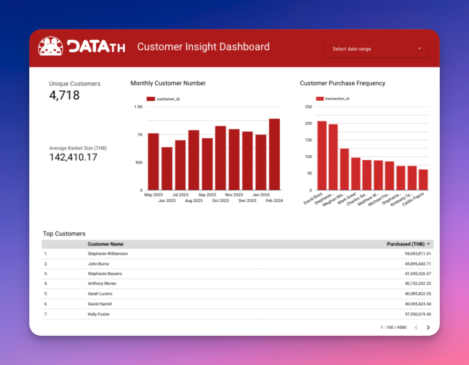
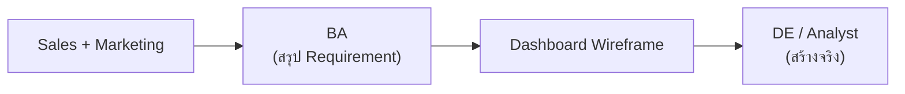

# Data Engineer - Chapter 06: Report & Dashboard with Looker Studio

> **วิชา:** Road to Data Engineer 3.0 (R2DE 3.0) | **ผู้สอน:** DataTH
> **Source:** `Resources/Books/DataEngineer/6LookerStudio.pdf` (71 slides)
> **หมายเหตุ:** ส่วนที่ติดป้าย `[เสริมนอกสไลด์]` คือความรู้ที่ผู้เขียนโน้ตเพิ่มเอง

---

## Part 1: Macro Architecture & Overview

ข้อมูลที่ดีที่สุดก็ไร้ค่า ถ้าคนตัดสินใจ "มองไม่เห็น" Chapter 6 คือ **ขั้นสุดท้ายของท่อ**: เปลี่ยนข้อมูลใน BigQuery ให้เป็นกราฟและ Dashboard ที่ฝ่ายธุรกิจเปิดดูเองได้ ด้วย **Looker Studio** (เครื่องมือ Data Visualisation ออนไลน์ฟรีจาก Google) และจบด้วยการทำ Mission แรกให้สำเร็จ



### ตารางเปรียบเทียบ Report vs Dashboard

| Feature | Report | Dashboard |
| :--- | :--- | :--- |
| **ลักษณะ** | นำข้อมูลมาวิเคราะห์ ใส่ทั้งตัวหนังสือและกราฟ | ดึงข้อมูลสำคัญมาใส่หน้าจอเดียว |
| **ตอบคำถามแบบ** | ครั้งเดียว (Ad-hoc) | คำถามสำคัญต่อธุรกิจ (Operation) ที่ต้องตอบบ่อย |
| **ผู้ใช้** | ผู้ขอวิเคราะห์ | ดูคำตอบได้เองรวดเร็ว |

---

## Part 2: Module-by-Module Deep Dive

### 2.1 Basic Data Visualisation สำหรับ Data Engineer

> **Data Visualisation** = การแปลงข้อมูลให้เป็นกราฟเพื่อให้เข้าใจง่ายขึ้น ถือเป็นขั้นสุดท้ายของงาน Data Science (สไลด์ระบุว่า "Visualization" เป็นการเขียนแบบอเมริกัน)

**ประโยชน์ทางธุรกิจ (ตามสไลด์):** ช่วยให้เข้าใจข้อมูลเร็ว และ **ช่วยค้นหาความผิดปกติของข้อมูล** `[ข้อสังเกตเสริมนอกสไลด์: DE ใช้กราฟตรวจ Pipeline ว่าข้อมูลหายหรือเพี้ยนได้ด้วย]`

**ทำไมต้องนำเสนอข้อมูล:** ผู้ใช้ปลายทางไม่ได้เขียน SQL ต้องมีหน้าจอที่ดูง่าย

#### ประเภทเครื่องมือ Data Visualisation

| ประเภท | ตัวอย่าง | เหมาะกับ |
| :--- | :--- | :--- |
| **1) Spreadsheet Tool** | Google Sheets, Excel | Visualisation เบื้องต้น ข้อมูลเล็ก |
| **2) BI Tool** (Business Intelligence) | Looker Studio, Power BI | ข้อมูลใหญ่/ซับซ้อน ออกแบบมาเพื่อ Visualisation โดยเฉพาะ |
| **3) เขียนโปรแกรมเอง** | Python (matplotlib) ฯลฯ | ควบคุมได้เต็มที่ ต้องเขียนโค้ด |

**หน้าที่ของ DE ด้าน Visualisation:** DE มักไม่ใช่คนออกแบบกราฟเอง แต่ต้องเตรียมข้อมูลให้พร้อมและเชื่อมต่อ `[รายละเอียดดูสไลด์ P.18]`

> **Tip จากสไลด์ (Bonus):** Startup ใหม่ใช้ Spreadsheet Tool พล็อตกราฟก็เพียงพอ ไม่จำเป็นต้องซื้อ BI Tool ราคาแพงตั้งแต่ต้น

> 💡 **Intuition:** เลือกเครื่องมือ Visualisation เหมือน **"เลือกเครื่องครัว"** — กระทะแก๊สในบ้าน (Spreadsheet) ทำอาหารจานเดียวได้ดี, ครัวอุตสาหกรรม (BI Tool) ออกแบบมาให้ทำอาหารจำนวนมากส่งหลายสาขาพร้อมกัน, ส่วนการทำเครื่องครัวเอง (เขียนโค้ด) ควบคุมได้ทุกอย่างแต่ต้องดูแลเองทั้งหมด ไม่มีตัวไหนดีกว่าเสมอ ขึ้นกับปริมาณข้อมูลและจำนวนคนที่ต้องดู
> [Source: generated — not verified against original document]

**🧭 ทำความเข้าใจ** _[Source: generated — not verified against original document]_

**แตกวลีสำคัญ:**
- "Spreadsheet Tool" → เครื่องมือตารางคำนวณ พล็อตกราฟจากชีตที่มีอยู่ ทำได้เร็วแต่รองรับข้อมูลขนาดเล็กถึงกลาง
- "BI Tool (Business Intelligence)" → เครื่องมือที่เชื่อมฐานข้อมูลโดยตรงและแชร์ Dashboard ให้ทีมได้
- "เขียนโปรแกรมเอง" → เช่น Python `matplotlib` ควบคุมรูปแบบได้เต็มที่ แต่ต้องเขียนและดูแลโค้ดเอง

**ตัวอย่าง:**
- ✅ ข้อมูลยอดขาย 300 แถว อยากดูกราฟแท่งครั้งเดียว — Spreadsheet Tool เพียงพอ ไม่ต้องตั้งระบบ
- ✅ ข้อมูลอยู่ใน BigQuery ต้องอัปเดตทุกวันและแชร์ให้ทีม 20 คน — BI Tool (Looker Studio) เชื่อมต่อและแชร์ได้โดยตรง
- ❌ ดึงข้อมูลหลักล้านแถวทุกชั่วโมงแล้ว copy-paste ลงชีต — ไม่เหมาะ เพราะชีตไม่ได้ออกแบบมารองรับปริมาณและการทำงานอัตโนมัติ
- **ต่างกันตรง:** ปริมาณข้อมูล และว่าต้องเชื่อมต่อ/อัปเดต/แชร์อัตโนมัติหรือไม่

**อย่าสับสน:** "BI Tool = ที่เก็บข้อมูล" — ไม่ใช่ BI Tool ทำหน้าที่ "แสดงผล" เท่านั้น ข้อมูลยังต้องเก็บใน Data Warehouse (เช่น BigQuery) อยู่ดี

**เช็คความเข้าใจ:** ข้อมูล 300 แถวให้หัวหน้าดูครั้งเดียว กับข้อมูลใน BigQuery ที่ต้องอัปเดตทุกวันให้ทีม 20 คน ควรเลือกเครื่องมืออะไรแต่ละกรณี?
<details><summary>เฉลย</summary>

1. ข้อมูล 300 แถว ดูครั้งเดียว → **Spreadsheet Tool** (ข้อมูลเล็ก ไม่ต้องตั้งระบบ)
2. ข้อมูลใน BigQuery อัปเดตทุกวัน แชร์ทีม → **BI Tool เช่น Looker Studio** (เชื่อม BigQuery ได้โดยตรง และแชร์ลิงก์ได้)

</details>

---

### 2.2 Looker Studio

#### 2.2.1 สถาปัตยกรรมและองค์ประกอบ

| ส่วนประกอบ | คืออะไร |
| :--- | :--- |
| **Connector** | โปรแกรมดึงข้อมูลเข้า Looker Studio มีทั้งแบบมาตรฐานและบริการเสริม (เช่น Supermetrics ที่ดึง Marketing Data) |
| **Data Set** | ข้อมูลตัวจริง เช่น BigQuery, Google Analytics, MySQL |
| **Data Source** | ตัวกลางที่ Looker Studio ใช้อ้างอิงข้อมูล `[ความต่างอธิบายขยายนอกสไลด์: Data Source เก็บการตั้งค่า field/type ที่ผูกกับ Data Set]` |
| **Report & Pages** | Report = รายงานออนไลน์ ตั้งแต่แบบไม่อัปเดตจนเป็น Interactive Dashboard; 1 Page = 1 Dashboard |
| **Chart** | เลือกเพิ่มได้จากเมนู Insert มีให้เลือกมากมาย |

> 💡 **Intuition:** Data Source เหมือน **"ใบสเปกวัตถุดิบระหว่างโกดัง (BigQuery/Sheets) กับสายการผลิต (Chart)"** — กำหนด field type/หน่วย; แก้ที่ Data Source ครั้งเดียว Chart ที่ใช้มันเปลี่ยนตามหมด
> [Source: generated — not verified against original document]

**🧭 ทำความเข้าใจ** _[Source: generated — not verified against original document]_

**แตกวลีสำคัญ:**
- **Connector** = "ตัวเชื่อมต่อ" BigQuery, Google Sheets, MySQL ฯลฯ
- **Data Set** = "ข้อมูลต้นทาง (ตาราง/ชีต)" ตารางจริงใน BigQuery หรือ Sheet
- **Data Source** = ชั้นกลางที่เชื่อม Data Set และกำหนด field type/aggregation/format
- **Field** = คอลัมน์ที่ทำหน้าที่เป็น Dimension หรือ Metric (date, amount, customer_name)

**ตัวอย่าง:**
- ✅ **Data Source ดี** — 1 Data Source → 5 Charts (อัปเดตครั้งเดียว ทั้ง 5 อัปเดต)
- ✅ **Field ตั้งค่าหน่วย** — amount field → Currency (USD) → Chart แสดง "\$1,000" อัตโนมัติ
- ❌ "สร้าง Chart ได้โดยไม่มี Data Source" — ไม่ได้ ถ้าเพิ่มข้อมูลจากหน้า Report ระบบจะสร้าง Embedded Data Source ให้ (ใช้ข้าม Report ไม่ได้ field type อาจไม่ตรง)
- **ต่างกันตรง:** Data Set = ตารางข้อมูลต้นทาง, Data Source = ชั้นกลางที่กำหนด field type/aggregation

**อย่าสับสน:** "Data Source = Table" — ไม่ใช่ Data Source เชื่อม 1 ตาราง/View/Custom Query (JOIN ได้ผ่าน Custom Query หรือ View) + Calculated fields; หากรวมหลาย Data Source ใน Report จะใช้ Blending

**เช็คความเข้าใจ:** สร้าง Chart ใหม่ "ยอดขายตามลูกค้า" ต้องเรียงลำดับของอะไรก่อน?
<details><summary>เฉลย</summary>

**ตอบ: สร้าง Data Source ก่อน แล้วค่อยสร้าง Chart**

**เหตุผล:**
1. **Data Source** ต้องชี้ BigQuery View (ws6_view) และตั้งค่า field types
2. **Chart เลือก** Data Source → เลือก Dimension (customer_name) + Metric (SUM(amount))
3. **ดีกว่า** = Chart 1, 2, 3, ... ต่างก็ใช้ Data Source เดียว

ถ้าแต่ละ Chart สร้าง Data Source แยก maintenance จะยุ่ง

</details>

#### 2.2.2 Dimension & Metric

| | Dimension | Metric |
| :--- | :--- | :--- |
| **ความหมาย** | ค่าสำหรับ **จัดกลุ่ม** ข้อมูล (ตัวหนังสือ ตัวเลข วันที่ ฯลฯ) | ค่าตัวเลขที่ **วัด/คำนวณ** |
| **ตัวอย่าง** | วันที่, หมวดสินค้า, ประเทศ | ยอดขายรวม `SUM(thb_amount)`, จำนวนการซื้อ |
| **ใน Chart** | แกน X / การแบ่งกลุ่ม | แกน Y / ค่าที่แสดง |

```text
ตัวอย่าง: กราฟแท่ง "ยอดขายรายเดือน"
Dimension = เดือน  (แกน X)
Metric    = SUM(thb_amount) (แกน Y)
```

> **วิธีจำ:** Dimension = "ตามอะไร" (by month, by country); Metric = "วัดอะไร" (revenue, count)

> 💡 **Intuition:** Dimension เหมือน **"กล่องใส่สินค้า"** (มีป้ายกำกับ: ประเทศ, เดือน) Metric เหมือน **"เครื่องชั่งน้ำหนัก"** (วัดยอดขาย, นับลูกค้า) Dashboard ต้องมีทั้ง "กล่อง" และ "เครื่องชั่ง": ไม่มี Dimension → ไม่รู้จัดกลุ่มอย่างไร, ไม่มี Metric → ไม่มีตัวเลขให้ดู
> [Source: generated — not verified against original document]

**🧭 ทำความเข้าใจ** _[Source: generated — not verified against original document]_

**แตกวลีสำคัญ:**
- **Dimension** = ข้อมูลหมวดหมู่ (Categorical/Qualitative): ประเทศ, เดือน, ประเภทสินค้า, ชื่อลูกค้า
- **Metric** = ข้อมูลตัวเลข (Quantitative): SUM, COUNT, AVERAGE, %, rate
- **Aggregation** = การรวมข้อมูล ตามกลุ่ม Dimension (SUM ทีละเดือน)
- **Bucketing** = แบ่ง Metric เป็นช่วง (เช่น ยอดขาย: 0-100K, 100K-500K, 500K+) ผลที่ได้จะกลายเป็น Dimension

**ตัวอย่าง:**
- ✅ **Dashboard ดี** — Dimension (วันที่, ประเทศ) + Metric (ยอดขายรวม, จำนวนลูกค้า)
- ✅ **Metric ที่ดี (Scorecard)** — `COUNT(DISTINCT customer_id)` ส่วน Dimension ว่าง → บอก "มีลูกค้าทั้งหมด 5000 คน"
- ❌ "เอา Dimension ไปใช้เป็น Metric ไม่ได้เลย" — ไม่จริง แม้ฟิลด์ข้อความ/วันที่นำไป SUM ตรงๆ ไม่ได้ แต่สามารถนำไปใช้เป็น Metric ในรูป COUNT หรือ COUNT DISTINCT ได้
- **ต่างกันตรง:** Dimension = "ใคร/ที่ไหน/เมื่อไหร่", Metric = "เท่าไหร่/กี่ตัว"

**อย่าสับสน:** "Dimension = Text, Metric = Number" — ไม่ใช่ Dimension อาจเป็นตัวเลข เช่น "year = 2024" (แต่ใช้เป็นกลุ่ม ไม่ใช่ avg/sum)

**เช็คความเข้าใจ:** สร้าง Chart แสดง "ยอดขายรวมตามหมวดสินค้าและเดือน" ต้องกำหนด Dimension และ Metric อะไร?
<details><summary>เฉลย</summary>

**ตอบ:**
- **Dimensions:** Product Category (หมวดสินค้า), Month (เดือน)
- **Metrics:** SUM(amount) (ยอดขายรวม)
- **Chart:** Time Series หรือ Stacked Bar Chart: Month เป็นแกน X (Time), Product Category เป็น Breakdown dimension (สี/series)

**เหตุผล:**
- "ยอดขายรวม" = Metric (ต้องมี aggregation เช่น SUM(amount))
- "ตามเดือน" = Primary Dimension (แกน X แสดงลำดับเวลา)
- "ตามหมวดสินค้า" = Breakdown Dimension (จำแนกสี/แท่งย่อย)

</details>

#### 2.2.3 ฟีเจอร์ที่น่าสนใจ

| ฟีเจอร์ | ทำอะไร |
| :--- | :--- |
| **Calculated Field** | เขียนสมการจากข้อมูลที่มี สร้างคอลัมน์ใหม่ที่ต้องการ |
| **Parameter** | สร้างตัวแปรให้ผู้ใช้กรอกค่าเอง |
| **Make Report Level** | ทำให้บางส่วนของ Page ปรากฏทุกหน้า (เช่น โลโก้/ตัวกรอง) |
| **Section / Header / Divider** | จัดหลายหน้าให้เป็นระเบียบใน 1 Report |
| **Template & Community Visualisations** | ใช้แม่แบบ/กราฟที่ชุมชนทำ (lookerstudio.google.com/gallery) |

```text
-- ตัวอย่าง Calculated Field (สูตรตามแนวสไลด์)
SUM(thb_amount)                       -- ยอดขายรวม
```

**Bonus ในสไลด์:** Gemini in Looker (สร้าง Dashboard ด้วยการพิมพ์บอก), Looker Studio Pro (คิดเงินต่อคน/โปรเจกต์ เพิ่มฟีเจอร์สำหรับองค์กร)

---

### 2.3 Workshop 6: Data Visualisation with Looker Studio

#### 2.3.1 Input / Output
* **Input:** ข้อมูลใน BigQuery (Table จาก Workshop 5 หรือใช้ไฟล์ Parquet สำรอง `workshop4_output.parquet` อัปโหลดสร้าง Table ใหม่)
* **Output:** Report และ Interactive Dashboard ออนไลน์บน Looker Studio
* **แดชบอร์ดตัวอย่างที่สร้างเสร็จสมบูรณ์:** [คลิกเปิดดู Live Dashboard บน Looker Studio](https://lookerstudio.google.com/reporting/097af711-c110-4512-84f4-c80422a46a50)



#### 2.3.2 การเชื่อมกับฝั่งธุรกิจ (Recap Mission)

สไลด์แนะนำตัวละคร **Business Analyst (BA)** คือคนที่คุยกับฝั่ง Business ว่าต้องการอะไร ทำไม แล้วถ่ายทอดมายังทีมข้อมูล



**Dashboard Wireframe จาก BA:**
1. **Sales Performance Dashboard:** ข้อมูลการขาย (ยอดขายรวม, แนวโน้มรายวัน, สินค้าขายดี)
2. **Customer Insights Dashboard:** ข้อมูลลูกค้า (ประเทศของลูกค้า, ความถี่ในการซื้อ)

> **หลักคิด:** เริ่มจาก Requirement ทางธุรกิจ → Wireframe → Data → Dashboard ไม่ใช่เริ่มจากกราฟสวยๆ

#### 2.3.3 ขั้นตอนการปฏิบัติการจริง

| ขั้น | ทำอะไร | หมายเหตุ |
| :--- | :--- | :--- |
| **1** | เตรียม Table ใน BigQuery | ข้ามได้ถ้าทำ Workshop 5 เสร็จแล้ว (หรือใช้ไฟล์ `workshop4_output.parquet`) |
| **2** | **สร้าง View** ให้ Data Analyst | กรองข้อมูลและแปลง Data Types ให้อยู่ในฟอร์แมตที่ Looker Studio อ่านได้ทันที |
| **3** | เชื่อมต่อ Looker Studio กับ View | สร้าง Data Source ใหม่โดยเลือก Connector เป็น BigQuery |
| **4** | สร้าง **Dashboard 1: Sales Performance** | รวม Scorecard, Time Series Chart, และ Bar Chart สินค้าขายดี |
| **5** | สร้าง **Dashboard 2: Customer Insights** | เจาะลึกรายประเทศและพฤติกรรมลูกค้า |
| **6** | Bonus: Parameter + Calculated Field | เพิ่มตัวกรอง (Filter Controls) และ Calculated Fields เช่น อัตราการเติบโต |

```sql
-- โค้ดสร้าง View สำหรับ Workshop 6 (BigQuery SQL)
CREATE OR REPLACE VIEW `road-to-data-engineer-sql-db.r2de3_mock.ws6_view`
AS
SELECT
  -- แปลง Microseconds จาก Parquet ให้กลายเป็น TIMESTAMP มาตรฐาน
  TIMESTAMP_MICROS(CAST(date / 1000 AS INT64)) AS date_converted
  ,thb_amount
  ,transaction_id
  ,product_id
  ,product_name
  ,quantity
  ,customer_id
  ,customer_name
  ,customer_country
FROM `road-to-data-engineer-sql-db.r2de3_mock.ws4_output`
WHERE total_amount > 0;  -- กรองตัดรายการคืนเงินหรือยอดขายติดลบออก
```

> 💡 **ทำไมต้องแปลง `TIMESTAMP_MICROS` และสร้าง View ก่อน:**
> 1. **Timestamp Conversion:** ไฟล์ Parquet มักเก็บ Timestamp ในรูปแบบ Unix Integer (Microseconds) การใช้ `TIMESTAMP_MICROS(CAST(date / 1000 AS INT64))` ทำให้ Looker Studio รู้จักว่าเป็น Date/Time และพล็อตแกนเวลาได้ถูกต้องอัตโนมัติ
> 2. **Business Rule Isolation:** การใส่ `WHERE total_amount > 0` ไว้ที่ View ทำให้ Dashboard ทุกหน้าได้ตัวเลขยอดขายที่สะอาดตรงกัน โดยไม่ต้องไปเขียน Filter ซ้ำในแต่ละกราฟ
> 3. **Data Governance & Security:** ซ่อนโครงสร้างตารางหลัก ให้ Business / BI เห็นเฉพาะฟิลด์ที่ได้รับอนุญาต

#### 2.3.4 การคำนวณใน Dashboard (ตามสไลด์ P.59)

1. คำนวณผลรวมยอดขาย: `SUM(thb_amount)`
2. คำนวณจำนวนการซื้อ (Transaction Count): `COUNT(DISTINCT transaction_id)`
3. คำนวณจำนวนลูกค้า (Customer Count): `COUNT(DISTINCT customer_id)`

---

### 2.4 หลังจบ Workshop

* **สิ่งที่ได้เรียน:** ตั้งแต่ Collect → Cleanse → Cloud → Pipeline → Warehouse → Dashboard = โปรเจกต์ DE แรกสำเร็จ
* **[สำคัญ] ลบ Project ใน Google Cloud:** ถ้าต้องการมั่นใจว่าบัตรไม่โดนตัดเงิน ให้ลบ Project ออก (สไลด์แนะนำให้ก็อปโค้ดที่ใช้เก็บไว้ก่อน)
* **Data Visualisation Tips:** ดูแนวทางสร้าง visualisation ที่ดีได้ที่แหล่งอ้างอิงในสไลด์ (github.com/cxli233/FriendsDontLetFriends)

#### 💡 เสริม: Report vs Dashboard

> 💡 **Intuition:** Report เหมือน **"ผลสอบรายวิชาครั้งเดียว"** — ทำขึ้นเพื่อตอบคำถามเฉพาะครั้ง เช่น "ทำไมยอดขายไตรมาสนี้ตก" ส่วน Dashboard เหมือน **"หน้าปัดรถยนต์"** — ดูซ้ำทุกวันเพื่อรู้สถานะปัจจุบันทันที สิ่งที่แยกสองอย่างนี้คือ "วิธีใช้งานและความถี่ในการดู" ไม่ใช่ความสวยของหน้าจอ (จุดที่ analogy ไม่ตรง: ใน Looker Studio ทั้งสองอย่างคือ Report ทางเทคนิคเหมือนกัน)
> [Source: generated — not verified against original document]

**🧭 ทำความเข้าใจ** _[Source: generated — not verified against original document]_

**แตกวลีสำคัญ:**
- "Ad-hoc" → ทำตามคำถามที่เกิดขึ้นครั้งคราว ทำเสร็จแล้วจบ
- "ติดตามสม่ำเสมอ" → ดูซ้ำตามรอบ (รายวัน/รายสัปดาห์) เพื่อเฝ้าสถานะ
- "Operation" (ใน Concept Map) → ใช้ในงานประจำวัน ให้เห็นว่าระบบหรือธุรกิจปกติไหม

**ตัวอย่าง:**
- ✅ รายงานวิเคราะห์ "ทำไมยอดขายไตรมาสที่แล้วตก" — ตอบคำถามครั้งเดียว → Report (Ad-hoc)
- ✅ Dashboard ยอดขายวันนี้เทียบเป้า อัปเดตทุกเช้า — ต้องเปิดดูซ้ำ → Dashboard (Operation)
- ❌ สร้าง Dashboard 20 หน้าเพื่อตอบคำถามครั้งเดียว — เปลืองเวลาและดูแลยาก ควรทำ Report สั้นๆ
- **ต่างกันตรง:** ถามครั้งเดียวจบ = Report, ต้องดูซ้ำตามรอบ = Dashboard

**อย่าสับสน:** "Dashboard = หน้าที่สวยกว่า" — ไม่ใช่ จุดต่างคือความถี่และวัตถุประสงค์การใช้งาน ไม่ได้วัดจากความสวย

**เช็คความเข้าใจ:** ทีมขายต้องการดูยอดขายเทียบเป้าทุกเช้า และผู้บริหารขอให้วิเคราะห์ว่าทำไมยอดลดในไตรมาสนี้ — แต่ละงานควรเป็น Report หรือ Dashboard?
<details><summary>เฉลย</summary>

1. ดูยอดเทียบเป้าทุกเช้า → **Dashboard** (ติดตามสม่ำเสมอ, อัปเดตตามรอบ)
2. วิเคราะห์สาเหตุยอดลดครั้งนี้ → **Report** (Ad-hoc, ตอบคำถามเฉพาะครั้ง)

</details>

#### 💡 เสริม: Calculated Field

> 💡 **Intuition:** Calculated Field เหมือน **"เครื่องคิดเลขที่ติดอยู่กับตาราง"** — ถ้าข้อมูลไม่มีคอลัมน์ที่ต้องการ (เช่น ยอดรวมภาษี 7%) เราเขียนสูตรให้ระบบคำนวณเป็นคอลัมน์ใหม่ได้เลย ไม่ต้องกลับไปแก้ตารางต้นทาง ทำให้ Chart ใช้ตัวเลขที่คำนวณแล้วได้ทันที ข้อจำกัดคือสูตรนี้คำนวณใหม่ทุกครั้งที่ดู และไม่ได้เขียนผลลัพธ์กลับลงตาราง ถ้าสูตรซับซ้อนหรือข้อมูลใหญ่ ควรคำนวณใน BigQuery View ตั้งแต่ต้น
> [Source: generated — not verified against original document]

**🧭 ทำความเข้าใจ** _[Source: generated — not verified against original document]_

**แตกวลีสำคัญ:**
- "Calculated Field" → คอลัมน์ใหม่ที่สร้างจากสูตรบนฟิลด์เดิม
- "ระดับแถว (row-level)" → สูตรที่คิดค่าแยกทีละแถว เช่น `amount * 1.07`
- "ฟังก์ชันรวม (aggregation)" เช่น `SUM()`, `COUNT()` → รวมหลายแถวเป็นค่าเดียวตามกลุ่ม

**ตัวอย่าง:**
- ✅ `amount * 1.07` — คำนวณรายการละ 7% ใช้ได้กับทุก Chart ที่อ้าง Data Source นี้
- ✅ `SUM(profit) / SUM(revenue)` — อัตรากำไรรวม ถูกต้องเพราะรวมตัวตั้งและตัวหารก่อนแล้วจึงหาร
- ❌ `AVG(profit_pct)` เพื่อหาอัตรากำไรรวม — ค่าเฉลี่ยของเปอร์เซ็นต์รายแถวไม่เท่ากับกำไรรวมหารยอดรวม ถ้าขนาดออเดอร์ต่างกัน
- **ต่างกันตรง:** ไม่ใส่ฟังก์ชันรวม = ค่าต่อแถว (ชาร์ตจะรวมตามค่า aggregation ที่ตั้งไว้), ใส่ `SUM/COUNT` = ค่าระดับกลุ่มเลย

**อย่าสับสน:** "Calculated Field = Parameter" — ไม่ใช่ Calculated Field คำนวณจากข้อมูลในตาราง ส่วน Parameter คือค่าที่คนดูกรอกเองได้ (ดูหัวข้อถัดไป)

**เช็คความเข้าใจ:** ต้องการ "อัตรากำไรรวมของทั้งเดือน" จาก `profit` และ `revenue` ควรเขียนสูตรแบบไหน และทำไมไม่ใช้ `AVG` ของเปอร์เซ็นต์?
<details><summary>เฉลย</summary>

**ตอบ:** เขียน `SUM(profit) / SUM(revenue)`

**เหตุผล:**
1. `SUM` รวมกำไรและยอดขายทั้งเดือนก่อน แล้วจึงหาร → ได้อัตรากำไรที่ถ่วงตามขนาดของแต่ละรายการ
2. `AVG(profit_pct)` เฉลี่ยเปอร์เซ็นต์ของแต่ละแถวเท่ากันทุกแถว ทำให้รายการเล็กมีน้ำหนักเท่ากับรายการใหญ่ ซึ่งผิดจากความหมาย "กำไรรวมต่อยอดขายรวม"

</details>

#### 💡 เสริม: Parameter

> 💡 **Intuition:** Parameter เหมือน **"ปุ่มหมุนปรับระดับ" ที่คนดูเป็นคนหมุนเอง** — เช่น ปุ่มเลือกเป้ายอดขาย ค่าเป้าไม่ได้มาจากตาราง แต่คนดูปรับได้บน Dashboard เอง ทำให้ตอบคำถามหลายแบบด้วยหน้าเดียว ไม่ต้องสร้างหลายหน้า ข้อจำกัดคือ Parameter ไม่ได้กรองแถวให้เองอัตโนมัติ ต้องนำไปใช้ใน Calculated Field หรือ Filter ก่อนถึงจะมีผล และไม่ได้เปลี่ยนข้อมูลในตาราง
> [Source: generated — not verified against original document]

**🧭 ทำความเข้าใจ** _[Source: generated — not verified against original document]_

**แตกวลีสำคัญ:**
- "Parameter" → ตัวแปรที่มีค่าเดียวต่อรายงาน และกำหนดโดยผู้ใช้ ไม่ได้มาจากแถวข้อมูล
- "Calculated Field ที่อ้าง Parameter" → สูตรที่ผลลัพธ์เปลี่ยนตามค่าที่ผู้ดูเลือก
- "Control" → องค์ประกอบบนหน้ารายงานที่ให้ผู้ดูเปลี่ยนค่า Parameter ได้

**ตัวอย่าง:**
- ✅ Parameter "เป้ายอดขาย" + Calculated Field "เกินเป้าไหม" — ผู้ดูเปลี่ยนเป้าแล้วสถานะเปลี่ยนตาม
- ❌ ใช้ Parameter แทนคอลัมน์ `amount` ของแต่ละออเดอร์ — `amount` มีหลายค่าต่อแถว แต่ Parameter มีค่าเดียวต่อรายงาน
- **ต่างกันตรง:** ค่ามาจากคนดู (Parameter) หรือมาจากแถวในตาราง (Field)

**อย่าสับสน:** "Parameter = Filter" — Filter ตัดแถวออกจากการคำนวณ ส่วน Parameter เป็นแค่ค่าที่สูตรเอาไปใช้ ต้องผูกเองให้สูตรอ้างถึง

**เช็คความเข้าใจ:** อยากให้ผู้ดูกรอก "ราคาขั้นต่ำ" แล้วนับจำนวนออเดอร์ที่ `amount` ≥ ราคานั้น ต้องสร้างอะไรบ้าง?
<details><summary>เฉลย</summary>

1. สร้าง **Parameter** ชื่อ `min_price` (ค่า Number)
2. สร้าง **Calculated Field** ที่อ้าง Parameter:

```sql
SUM(CASE WHEN amount >= min_price THEN 1 ELSE 0 END)
```

3. วาง **control** บนหน้ารายงานให้ผู้ดูกรอกค่า `min_price` ได้

</details>

#### 💡 เสริม: Make Report Level

> 💡 **Intuition:** Make report level เหมือน **"ป้ายโลโก้บริษัทที่ติดหน้าประตูทุกห้อง"** — ติดครั้งเดียว ทุกห้องเห็นเหมือนกัน แก้ที่เดียวแล้วเปลี่ยนทุกหน้า แต่ป้ายนั้นไม่ได้ทำให้ห้องทุกห้องมีข้อมูลเดียวกัน ข้อมูลในแต่ละ Chart ยังมาจาก Data Source ของมันเอง (จุดที่ analogy ไม่ตรง: ของที่ถูกทำให้เป็น report level แค่ "ปรากฏซ้ำ" ทุกหน้า)
> [Source: generated — not verified against original document]

**🧭 ทำความเข้าใจ** _[Source: generated — not verified against original document]_

**แตกวลีสำคัญ:**
- "Make report level" → ทำให้องค์ประกอบที่เลือกปรากฏในทุกหน้าของ Report
- "Page" → หน้าของ Report 1 หน้า ซึ่งมี Chart ของตัวเอง
- "องค์ประกอบร่วม" → องค์ประกอบที่ตั้งใจให้ซ้ำทุกหน้า เช่น โลโก้ ปุ่มนำทาง ตัวกรอง

**ตัวอย่าง:**
- ✅ วางโลโก้บริษัทและแถบเมนูนำทาง แล้วทำ report level — ทุกหน้าเห็นเหมือนกัน แก้ที่เดียว
- ❌ ทำ Chart "Top 10 สินค้า" ของหน้า Sales เป็น report level — Chart จะโผล่ทุกหน้า แม้หน้าอื่นไม่เกี่ยวข้อง ทำให้รก
- **ต่างกันตรง:** องค์ประกอบนั้นต้องการแสดงซ้ำทุกหน้าหรือไม่

**อย่าสับสน:** "Report level = ข้อมูลกลางที่แชร์ทุกหน้า" — ไม่ใช่ การทำ report level ไม่ได้เปลี่ยน Data Source หรือสูตรของ Chart แค่ทำให้องค์ประกอบแสดงซ้ำ

**เช็คความเข้าใจ:** ถ้าวาง Chart "Top 10 สินค้า" ไว้เป็น report level จะเกิดอะไรขึ้น และควรทำอย่างไรแทน?
<details><summary>เฉลย</summary>

**ผลที่เกิด:** Chart นั้นจะปรากฏทุกหน้าของ Report ทั้งที่หน้าอื่นไม่เกี่ยวกับสินค้า

**ควรทำ:** วาง Chart ไว้เฉพาะหน้าที่ต้องการ และใช้ report level กับเฉพาะองค์ประกอบที่ตั้งใจให้ซ้ำทุกหน้า เช่น โลโก้หรือแถบเมนู

</details>

---

## Part 3: Quick Reference & Exam Cheat Sheet

### Checklist สรุปหัวใจสำคัญ
* [ ] **Visualisation:** ขั้นสุดท้ายแปลงข้อมูลเป็นกราฟ
* [ ] **Report vs Dashboard:** Ad-hoc vs ติดตามสม่ำเสมอ
* [ ] **3 ประเภทเครื่องมือ:** Spreadsheet / BI / เขียนโค้ด
* [ ] **Looker Studio:** Connector, Data Set, Data Source, Report, Page
* [ ] **Dimension vs Metric**
* [ ] **Calculated Field / Parameter / Report-level / Section**
* [ ] **BA:** ถ่ายทอด Requirement เป็น Wireframe
* [ ] **สร้าง View ก่อนทำ Dashboard**
* [ ] **ลบ Project หลังจบ** กันโดนตัดเงิน

### สรุปแนวคิด

| คำ | ความหมาย |
| :--- | :--- |
| Dimension | ใช้ "จัดกลุ่ม" |
| Metric | ใช้ "วัด/คำนวณ" |
| `SUM(thb_amount)` | ยอดขายรวม |

### Concept Map

```text
Data Visualisation
├── Report (Ad-hoc)  /  Dashboard (Operation)
├── Tools: Spreadsheet / BI (Looker Studio, Power BI) / Code
└── Looker Studio
    ├── Connector → Data Set/Source → Report/Page → Chart
    ├── Dimension + Metric
    └── Calculated Field, Parameter, Report-level, Section
Workshop 6: BigQuery → View → Dashboard 1 (Sales) + Dashboard 2 (Customer)
```

---

## ⚠️ Common Pitfalls & Exam Traps

* **"Report กับ Dashboard เหมือนกัน":** Report ตอบคำถามเฉพาะครั้ง; Dashboard ตอบคำถามสำคัญที่ต้องดูบ่อยบนหน้าจอเดียว
* **"Dimension กับ Metric สลับกันได้":** ถ้าเอาตัวเลขไปจัดกลุ่มหรือเอาข้อความไปรวมค่า กราฟจะผิด ต้องแยกบทบาทให้ถูก
* **"ต่อ Looker Studio เข้า Table ดิบโดยตรงก็พอ":** ควรสร้าง View เพื่อจำกัดข้อมูลและรวมตรรกะไว้ที่เดียว `[เสริมนอกสไลด์]`
* **"จบ Workshop แล้วไม่ต้องทำอะไร":** ต้องลบ/ปิด Resource บน Google Cloud มิฉะนั้นอาจถูกคิดเงิน
* **"ต้องซื้อ BI Tool แพงๆ เสมอ":** ธุรกิจเริ่มต้นใช้ Spreadsheet พล็อตกราฟได้ ตามที่สไลด์แนะนำ
* **"สร้างกราฟก่อน ค่อยถามว่าต้องการอะไร":** เริ่มจาก Business Requirement/Wireframe จาก BA เสมอ

---

## เอกสารเชื่อมโยง (Wiki-Style Backlinks)
* **วิชาและหัวข้อที่เกี่ยวข้อง:**
  * [[Chapter 05 - Data Warehouse with BigQuery]] (แหล่งข้อมูลและ View ที่ Dashboard ใช้)
  * [[Chapter 00 - Intro to Data Engineering]] (Mission แรกที่ Workshop ทั้งหมดต่อกัน)
  * [[Chapter 07 - Advanced Data Engineering]] (บทต่อไป: หัวข้อขั้นสูง และ Career Path)
  * [[Chapter 02 - Data Cleansing with Spark]] (EDA และกราฟ Boxplot/Scatterplot ที่เกี่ยวข้องกับ Visualisation)

* **แหล่งข้อมูล:**
  * Source: `Resources/Books/DataEngineer/6LookerStudio.pdf` (71 slides, DataTH)
  * Reference: Looker Studio Help (support.google.com/looker-studio) `[เสริมนอกสไลด์]`
