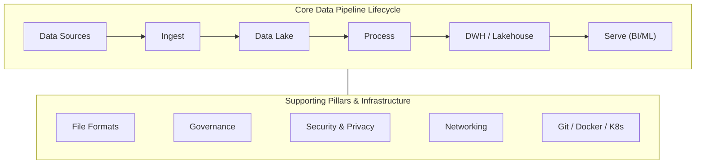

# Data Engineer - Chapter 07: Advanced Data Engineering

> **วิชา:** Road to Data Engineer 3.0 (R2DE 3.0) | **ผู้สอน:** DataTH
> **Source:** `Resources/Books/DataEngineer/7AdvancedTopics.pdf` (132 slides)
> **หมายเหตุ:** ส่วนที่ติดป้าย `[เสริมนอกสไลด์]` คือความรู้ที่ผู้เขียนโน้ตเพิ่มเอง

---

## Part 1: Macro Architecture & Overview

Chapter 1-6 คือการสร้าง "ท่อแรก" ที่ทำงานได้ Chapter 7 ขยายมุมมองสู่ **โลกจริง**: องค์กรจริงออกแบบ Data Architecture อย่างไร ไฟล์ข้อมูลควรเก็บเป็นรูปแบบไหน ข้อมูลส่วนบุคคลต้องปกป้องอย่างไร Data Warehouse ยุคใหม่เป็นอย่างไร DE ต้องรู้เรื่อง Git/Docker/ML แค่ไหน และสุดท้าย **จะวางเส้นทางอาชีพ ทำ Resume Portfolio และเตรียมสัมภาษณ์อย่างไร**



### ตารางเปรียบเทียบ File Format

| Format | ลักษณะ | จุดเด่น | เหมาะกับ |
| :--- | :--- | :--- | :--- |
| **CSV** | Text, คั่นด้วยจุลภาค | เรียบง่าย เปิดได้ทุกที่ (Excel/Sheets) | แลกเปลี่ยนข้อมูลเล็กๆ |
| **Parquet** | Columnar | เก็บข้อมูลได้เล็ก ใช้พื้นที่น้อย | งานวิเคราะห์ |
| **ORC** | Row Columnar (Optimized) | ขนาดเล็ก เข้าถึงเร็ว | ระบบ Hadoop/Hive `[เสริมนอกสไลด์]` |
| **Avro** | เขียนเร็ว มี schema ในไฟล์เสมอ | Schema ฝังในไฟล์ | การเขียน/ส่งข้อมูลต่อเนื่อง |

> **คำแนะนำเบื้องต้นในสไลด์:** "อันไหนก็ได้ที่ไม่ใช่ CSV"

---

## Part 2: Module-by-Module Deep Dive

### 2.1 งาน End-to-end และ Technology Stack

สไลด์ย้อนภาพรวมการทำงานกับข้อมูลตั้งแต่ **Data Sources → Destination** และ Technology Stack ทุกชั้น (Data Lake, Data Processing, Orchestration, Warehouse, Visualisation) แล้วชี้ **Data & AI Landscape 2024** เป็นแผนที่เครื่องมือ

**Case Study ระบบ Data ของบริษัทต่างๆ:**

| บริษัท | ปีที่อ้างอิง | สิ่งที่น่าศึกษา |
| :--- | :--- | :--- |
| **NocNoc** | 2023 | Data Lakehouse บน AWS (บทความเต็มตามลิงก์ในสไลด์) |
| **LINE MAN Wongnai** | 2022 | Data Stack ของบริษัท |
| **Meta** | - | Data Engineering ระดับใหญ่ |

> **วิธีใช้ Case Study:** ไม่ต้องจำชื่อเครื่องมือ ให้ดูว่า **ปัญหาอะไร → เลือกชั้นไหน → ทำไม** แล้วเทียบกับ Tech Stack ใน Chapter 0-6

---

### 2.2 Efficient Data Files

| Format | รายละเอียดตามสไลด์ | อธิบายเสริม `[เสริมนอกสไลด์]` |
| :--- | :--- | :--- |
| **Spreadsheet (Excel/Sheets)** | การเก็บข้อมูลเริ่มต้นของทุกองค์กร ส่งลิงก์/ไฟล์กันได้ | ไม่เหมาะกับข้อมูลใหญ่ |
| **CSV** | นามสกุลยอดนิยมเพราะเรียบง่าย save ออกจาก Excel/Sheets ได้ | ไม่เก็บ type ในไฟล์ ต้องเดาจากข้อความ |
| **Parquet** | Columnar Storage ใช้พื้นที่น้อย | อ่านเฉพาะคอลัมน์ที่ต้องใช้ได้ |
| **ORC** | row columnar จัดเก็บให้เล็กและเข้าถึงเร็วที่สุด | |
| **Avro** | เขียนได้รวดเร็ว เก็บ schema ไว้ในไฟล์เสมอ | ใช้บ่อยกับข้อมูล Streaming |
| **Apache Arrow** | library กลางแปลงข้อมูลหลายรูปแบบเป็น format กลาง | In-memory columnar ส่งข้อมูลข้ามเครื่องมือได้เร็ว |

```python
# [เสริมนอกสไลด์] แปลง CSV เป็น Parquet ด้วย Polars ลดขนาดและเก็บ type
import polars as pl

df = pl.read_csv("transactions.csv")          # อ่าน CSV
df.write_parquet("transactions.parquet")      # เขียนเป็น Parquet (Columnar, บีบอัด)

# อ่านเฉพาะคอลัมน์ที่ต้องการ (เร็วกว่าและใช้หน่วยความจำน้อยกว่า CSV)
small = pl.read_parquet("transactions.parquet", columns=["date", "thb_amount"])
```

เชื่อมโยง: Parquet คือรูปแบบไฟล์ที่ใช้ใน Workshop 6 ([[Chapter 06 - Report & Dashboard with Looker Studio]]) และเชื่อมกับแนวคิด Columnar ใน [[Chapter 05 - Data Warehouse with BigQuery]]

#### 💡 เสริม: Row-based vs Columnar File Format

> 💡 **Intuition:** ลองนึกถึง **"ตู้เอกสาร"** สองแบบ — แบบ Row-based เก็บเอกสารทั้งใบ (ทุกช่องของลูกค้าหนึ่งคน) ไว้ด้วยกันในซอง ส่วนแบบ Columnar เก็บแยกเป็น **"ลิ้นชักตามหมวด"** (ลิ้นชักชื่อ, ลิ้นชักยอดเงิน) ถ้าต้องการแค่ "ยอดเงินรวม" ก็เปิดลิ้นชักยอดเงินลิ้นเดียวพอ ไม่ต้องรื้อทุกซอง จึงเป็นเหตุผลที่ Parquet/ORC เร็วกับงานวิเคราะห์ (จุดที่ analogy ไม่ตรง: ถ้าต้องการดึงทั้งแถวหรือเขียนทีละแถวบ่อย ๆ การเปิดหลายลิ้นชักกลับช้ากว่าการหยิบซองเดียว)
> [Source: generated — not verified against original document]

**🧭 ทำความเข้าใจ** _[Source: generated — not verified against original document]_

**แตกวลีสำคัญ:**
- "Row-based" → เก็บทั้งแถวติดกัน เหมาะกับการอ่าน/เขียนทีละ record (CSV, Avro)
- "Columnar" → เก็บค่าของแต่ละคอลัมน์ติดกัน ทำให้ query อ่านเฉพาะคอลัมน์ที่ใช้ได้ (Parquet, ORC)
- "Schema ในไฟล์" → ไฟล์บอกชนิดข้อมูลของแต่ละคอลัมน์ไว้เอง (Avro, Parquet, ORC) ต่างจาก CSV ที่ต้องเดาจากข้อความ

**ตัวอย่าง:**
- ✅ ตาราง 50 คอลัมน์ 100 ล้านแถว แต่ report ใช้แค่ `date` กับ `thb_amount` — เก็บแบบ Columnar (Parquet) อ่านเฉพาะ 2 คอลัมน์ได้ ลดปริมาณข้อมูลที่อ่านจากดิสก์
- ✅ Streaming ที่ส่งเหตุการณ์ทีละ record ไปเรื่อย ๆ — Avro (Row-based, มี schema ติดไฟล์) เหมาะกว่า
- ❌ "Parquet ดีกว่า CSV ในทุกงาน" — ไม่จริง ถ้าต้องส่งไฟล์ให้คนที่เปิดด้วย Excel หรือต้องการอ่านด้วยสายตา CSV สะดวกกว่า
- **ต่างกันตรง:** งานของคุณอ่าน "บางคอลัมน์จากหลายแถว" (Columnar) หรือ "ทั้งแถวทีละ record" (Row-based)

**อย่าสับสน:** "Columnar = ต้องอยู่ในฐานข้อมูลเท่านั้น" — ไม่ใช่ Parquet/ORC บนไฟล์ใน Data Lake ก็เป็น Columnar ได้ "Columnar" หมายถึงวิธีจัดเรียงข้อมูลในไฟล์ ไม่ใช่ชนิดของระบบ

**เช็คความเข้าใจ:** ตารางมี 50 คอลัมน์ 100 ล้านแถว แต่ทุก report ใช้แค่ 3 คอลัมน์ ควรเก็บเป็น Row-based หรือ Columnar และเพราะอะไร?
<details><summary>เฉลย</summary>

**ตอบ: Columnar (เช่น Parquet)**

**เหตุผล:**
1. Query อ่านเฉพาะ 3 คอลัมน์ที่ใช้ → Columnar ข้ามคอลัมน์ที่ไม่ได้ใช้ทั้งหมด (I/O น้อยลง)
2. Row-based ต้องอ่านทั้ง 50 คอลัมน์ทุกแถว แม้ report จะใช้แค่ 3 คอลัมน์

</details>

---

### 2.3 Networking, Data Governance, Security & Privacy

#### 2.3.1 Networking Design

ออกแบบการทำงานร่วมกันระหว่างแต่ละระบบ (หรือในระบบเดียวกัน) ให้เสถียร `[แนวคิดเสริมนอกสไลด์: ควบคุมว่าระบบใดคุยกับระบบใดได้ ผ่านเครือข่ายส่วนตัว/ไฟร์วอลล์ แทนการเปิดสาธารณะ]`

#### 2.3.2 Data Governance

> **Data Governance** = การจัดการข้อมูลตั้งแต่ต้นจนจบ ตั้งแต่นำเข้าถึงจัดเก็บและนำไปใช้ เพื่อให้ธุรกิจใช้ประโยชน์ได้สูงสุด

* **เครื่องมือแนะนำในสไลด์:** Apache Atlas (เครื่องมือจัดการ metadata)
* เชื่อมโยงกับ Data Dictionary/Catalog/Lineage ใน [[Chapter 02 - Data Cleansing with Spark]] และ Dataplex ใน [[Chapter 05 - Data Warehouse with BigQuery]]

> 💡 **Intuition:** Data Governance เหมือน **"ระบบดูแลอาคาร"** — ต้องรู้ว่า "ใครเป็นเจ้าของห้องไหน?" "ห้องไหนให้เข้าเก็บอะไร?" "ข้อมูลแต่ละตัวมาจากไหน (Lineage)?" ถ้าเกิดปัญหาจะตามรอยไปห้องไหน? องค์กรใหญ่ที่ไม่มีกฎ ข้อมูลจะเละและเชื่อถือไม่ได้ Governance จึงเหมือนกฎอาคาร
> [Source: generated — not verified against original document]

**🧭 ทำความเข้าใจ** _[Source: generated — not verified against original document]_

**แตกวลีสำคัญ:**
- **Metadata** = "ข้อมูลเกี่ยวกับข้อมูล" (ตัวอย่าง: ชื่อ column, ประเภท, ownership)
- **Data Lineage** = ที่มา/เส้นทางของข้อมูล (ข้อมูลนี้มาจากไหน ผ่านขั้นไหนบ้าง)
- **Data Catalog** = "สารบัญข้อมูล" (บันทึกว่าระบบมีตารางอะไรบ้าง)
- **Data Quality** = "คุณภาพข้อมูล" (ถูกต้อง ครบถ้วน สม่ำเสมอ ทันเวลา ตามกฎที่ตกลง)

**ตัวอย่าง:**
- ✅ **Governance ดี** — ทุกตารางมี owner, description, schema ชัดเจน ใครต้องการข้อมูล search ได้เลย
- ✅ **Lineage ชัด** — Sales table = Extract GCS → Clean → Load; ถ้า GCS มีปัญหา รู้ว่าส่วนไหนต้องแก้
- ❌ "ปล่อยให้ DE สร้าง table เพิ่มเติมโดยไม่บันทึก" → คนต่อไปหา table ไม่เจอหรือเข้าใจผิด
- **ต่างกันตรง:** Quality = ผลลัพธ์, Governance = กฎ บทบาท กระบวนการที่ทำให้ได้ Quality ต่อเนื่อง; Quality เป็นส่วนหนึ่งของ Governance

**อย่าสับสน:** "Data Governance = การเข้ารหัส/ปกปิด" — ไม่ใช่ นั่นเป็น "Data Security" (ส่วนหนึ่งของ Governance แต่ไม่ใช่ทั้งหมด)

**เช็คความเข้าใจ:** ธุรกิจขาดทุนเพราะใช้ยอดขาย "wrong number" ต่อเนื่อง 6 เดือน โจทย์: ควรตั้ง Governance อย่างไร ป้องกัน?
<details><summary>เฉลย</summary>

**ตอบ: ตั้ง Data Catalog + Lineage + Quality Check**

**ขั้นตอน:**
1. **Data Catalog** — บันทึก นิยาม sales = revenue ก่อน/หลังหัก refund และระบุ Data Owner ทุกคนอ้างอิงนิยามเดียว
2. **Data Lineage** — ตาม "revenue table = Extract Point-of-Sale → Clean (remove refund) → Load" เมื่อ PoS ผิด รู้เลยว่า step ไหนต้องแก้
3. **Quality Check** — test: "SUM(revenue) > 0 AND revenue < 1M per transaction" → alert ถ้า rule break

ปัญหา: ไม่มี Governance → "ใครสร้าง? ทำไมต่างกับ month ที่แล้ว?" ไม่มีใครตอบได้

</details>

#### 2.3.3 Data Security & Privacy

* **Data Breach** = ข้อมูลรั่วไหล สไลด์ระบุว่ากรณีใหญ่ๆ มาจากองค์กรใหญ่ เช่น Facebook
* **PII (Personally Identifiable Information)** = ข้อมูลที่ระบุตัวบุคคลได้

| กฎหมาย | ขอบเขต | หมายเหตุ |
| :--- | :--- | :--- |
| **GDPR** | ยุโรป | |
| **PDPA** | ประเทศไทย | เริ่มใช้งาน 1 มิถุนายน พ.ศ. 2565 (ตามสไลด์) |

**แนวทางปฏิบัติ `[เสริมนอกสไลด์]`:**

| หลักการ | ตัวอย่าง |
| :--- | :--- |
| ให้สิทธิ์เท่าที่จำเป็น (Least Privilege) | Analyst เห็นเฉพาะ View ที่ไม่มี PII |
| ปกปิด/แฮชข้อมูลละเอียดอ่อน | แฮช `email` ก่อนเข้า Warehouse |
| เข้ารหัสข้อมูล | เปิด Encryption at rest/in transit |
| ไม่เขียนรหัสผ่านลงโค้ด | ใช้ Secret Manager / Airflow Connection |

> สไลด์อ้างอิง **Data Protection Guideline** จากหน่วยงานของสิงคโปร์ (Data Protection by Design) เป็นแหล่งศึกษาเพิ่ม

#### 💡 เสริม: PII (Personally Identifiable Information)

> 💡 **Intuition:** PII เหมือน **"ชื่อที่เขียนติดบนซองจดหมาย"** — เห็นแล้วรู้ทันทีว่าเป็นของใคร เช่น อีเมล เบอร์โทร เลขบัตรประชาชน ข้อมูลพวกนี้ต้องระวังมากกว่าข้อมูลทั่วไป เพราะรั่วไหลแล้วกระทบตัวบุคคลโดยตรง สิ่งที่คนมักพลาดคือ "ไม่มีชื่อ ≠ ไม่ใช่ PII": ข้อมูลหลายอย่างที่แยกดูเฉย ๆ ไม่ชี้ตัวคน แต่พอรวมกันแล้วระบุตัวได้ (จุดที่ analogy ไม่ตรง: PII ไม่ได้มีแค่ "ชื่อบนซอง" แต่ขึ้นกับการรวมข้อมูลด้วย)
> [Source: generated — not verified against original document]

**🧭 ทำความเข้าใจ** _[Source: generated — not verified against original document]_

**แตกวลีสำคัญ:**
- "Personally Identifiable Information" → ข้อมูลที่ใช้ระบุตัวบุคคลได้ ทั้งโดยตรง (เช่น อีเมล) และเมื่อรวมกับข้อมูลอื่น
- "GDPR" → กฎหมายคุ้มครองข้อมูลส่วนบุคคลของสหภาพยุโรป
- "PDPA" → กฎหมายคุ้มครองข้อมูลส่วนบุคคลของไทย (เริ่มใช้งาน 1 มิถุนายน พ.ศ. 2565 ตามสไลด์)

**ตัวอย่าง:**
- ✅ คอลัมน์ `email` และ `phone` ของลูกค้า — เป็น PII โดยตรง ต้องจำกัดสิทธิ์หรือแฮชก่อนเข้า Warehouse
- ✅ `birth_date` + `zip_code` + `gender` ที่รวมกันแล้วเหลือคนไม่กี่คน — ระบุตัวได้ จึงต้องพิจารณาเป็น PII ทั้งชุด
- ❌ "ตารางไม่มีชื่อคน จึงไม่ใช่ PII" — ไม่จริง เพราะการรวมข้อมูลอาจระบุตัวได้
- **ต่างกันตรง:** ข้อมูลชี้ตัวบุคคลได้โดยตรง หรือต้องอาศัยการรวมกับข้อมูลอื่นจึงชี้ได้

**อย่าสับสน:** "PDPA = GDPR ฉบับไทย ใช้เหมือนกันทุกประการ" — ไม่ใช่ PDPA เป็นกฎหมายไทยที่อ้างอิงแนวทางคล้าย GDPR แต่ขอบเขตและรายละเอียดไม่เหมือนกัน ต้องอ่านข้อกำหนดของแต่ละฉบับ

**เช็คความเข้าใจ:** ทีมต้องให้ Analyst เข้าถึง Warehouse เพื่อวิเคราะห์พฤติกรรมการซื้อ แต่ตารางมีคอลัมน์ `email` และ `phone` ควรจัดการอย่างไร?
<details><summary>เฉลย</summary>

**ตอบ:** ไม่ให้ Analyst เห็น `email` และ `phone` ตรง ๆ

**ขั้นตอน:**
1. ให้สิทธิ์เฉพาะ **View** ที่ตัดคอลัมน์ PII ออก หรือแฮชค่า `email` ก่อนเข้า Warehouse (Least Privilege)
2. ถ้าต้องใช้ข้อมูลระดับบุคคลจริง ให้ตรวจสอบฐานทางกฎหมายตาม PDPA/GDPR ก่อนเปิดสิทธิ์

</details>

---

### 2.4 Modern Data Warehouse

| รุ่น | ลักษณะ | ตัวอย่าง |
| :--- | :--- | :--- |
| **แบบดั้งเดิม** | Storage และ Compute อยู่บนเครื่องเดียวกัน | SQL Server, Oracle, Teradata |
| **แบบใหม่ (Cloud)** | สร้างมาสำหรับ Cloud แยก Storage กับ Compute | **Snowflake** (เข้าตลาดหุ้นปี 2020), BigQuery |

**Snowflake (ตามสไลด์):** แยก Storage กับ Compute, Near-zero Management (แทบไม่ต้องดูแลเอง)

**MotherDuck:** Serverless Data Analytics Platform ที่ใช้ **DuckDB** เป็น Engine หลัก เน้นใช้งานง่ายและ collaborate ได้ (เชื่อมกับ DuckDB ใน [[Chapter 01 - Data Collection]])

> **ทำไมต้องแยก Storage กับ Compute `[เสริมนอกสไลด์]`:** ปรับขนาดทั้งสองส่วนแยกกัน เก็บข้อมูลมากไม่ต้องจ่ายค่า Compute เพิ่ม และเพิ่ม Compute ชั่วคราวเมื่อต้อง Query หนักได้

#### New Architecture: Data Lakehouse และ Open Table Format

แนวคิดดึงข้อมูลโดยตรงจาก Data Lake (เทียบกับ BigLake ใน CH5)

| เทคโนโลยี | คำอธิบายตามสไลด์ |
| :--- | :--- |
| **Delta Lake** | Open-source storage layer โดย Databricks ดูข้อมูลในอดีตได้ (**Time Travel**) ใช้ร่วมกับ Spark/Databricks |
| **Apache Hudi** | (Hadoop Upserts Deletes and Incrementals) สไลด์ยกข่าว Notion ย้ายจาก Snowflake + Fivetran ไป Hudi ลดค่าใช้จ่ายได้มาก |
| **Apache Iceberg** | ทำให้หลายระบบ เช่น Spark, Snowflake ทำงานบนข้อมูลชุดเดียวกันได้ |

> 💡 **Intuition:** Data Lakehouse = **"Lake ที่ติดระบบทะเบียน (Table Format)"** — Data Lake = "market" (ทุกคนปล่อยข้อมูลดิบไว้), Data Warehouse = "ห้องเก็บที่จัดเรียบร้อย" (โครงสร้างเข้มงวด แต่ช้าจัดแถวใหม่). Lakehouse = เก็บดิบได้ถูกและยืดหยุ่น แต่รู้ว่าไฟล์ไหนเป็นเวอร์ชันล่าสุด แก้ไขได้ปลอดภัย (ACID) และ Query แบบ Warehouse
> [Source: generated — not verified against original document]

**🧭 ทำความเข้าใจ** _[Source: generated — not verified against original document]_

**แตกวลีสำคัญ:**
- **Data Lake** = "เก็บข้อมูลดิบ" ยืดหยุ่น ข้อมูลจำนวนมาก คิดค่าเก็บถูก (storage only)
- **Data Warehouse** = "เก็บข้อมูลสะอาด" โครงสร้างชัดเจน Query เร็ว (storage + compute)
- **Data Lakehouse** = "Lake + Warehouse" เก็บดิบเหมือน Lake แต่Query โครงสร้างเหมือน Warehouse
- **Table Format** = ชั้น Metadata/Transaction log บนไฟล์ Parquet ที่บอกว่าไฟล์ไหนประกอบเป็นตาราง version ล่าสุด (Delta/Hudi/Iceberg)
- **Time Travel** = "ดูข้อมูลวันที่แล้ว" ทำได้ดีเพราะ versioning

**ตัวอย่าง:**
- ✅ **Lakehouse ดี** — Spark query GCS Parquet ตรง (ต้นทุน storage แบบ Lake) + ACID transaction (Warehouse quality) ผ่าน Delta Lake
- ✅ **Time Travel** — `SELECT * FROM sales TIMESTAMP AS OF '2024-06-01'` → ดู data ของวันนั้น (debugging/audit)
- ❌ "ต้องเลือกใช้ Warehouse เสมอเพราะ Lakehouse ยังใหม่" — ไม่ใช่ ขึ้นกับ workload: ข้อมูลหลากหลาย/ใหญ่/ใช้ ML ร่วม BI → Lakehouse; BI SQL บนข้อมูลโครงสร้างชัด → Warehouse ก็พอ
- **ต่างกันตรง:** Lake = flexible/ถูก, Warehouse = organized/query fast, Lakehouse = ทั้งสอง

**อย่าสับสน:** "Lakehouse = Lake + query engine" — ไม่ใช่ Lakehouse = Lake storage + Table Format (ACID, schema enforcement, Time Travel) + query engine; แค่ query engine อย่างเดียวไม่พอ

**เช็คความเข้าใจ:** Data streaming ต่อเนื่อง เขียนทุกวินาที ต้องแก้ไขย้อนหลัง (update/delete record เก่า) ควรใช้ Lakehouse หรือ Warehouse?
<details><summary>เฉลย</summary>

**ตอบ: Lakehouse (Delta Lake / Apache Hudi)**

**เหตุผล:**
1. **Streaming write บ่อย** → Warehouse รับ streaming ได้ แต่การ update/delete ถี่ปริมาณมากมีต้นทุนและข้อจำกัด DML สูง
2. **ต้อง update/delete ย้อนหลัง** → Apache Hudi ออกแบบมาสำหรับงานนี้โดยตรง (ย่อมาจาก Hadoop Upserts Deletes and Incrementals)
3. **Cost** → แยก storage ราคาประหยัดบน Cloud Storage จาก compute ที่เปิดใช้งานเฉพาะเมื่อต้องการ
4. **Query performance** → Open Table Format มี Metadata ช่วยทำ file pruning/data skipping ทำให้ query รวดเร็วขึ้น

ตัวอย่างจริง: Notion ย้ายจาก Snowflake + Fivetran ไปใช้ Hudi บน Data Lake (S3) ลดค่าใช้จ่ายได้มหาศาล (ตามสไลด์)

</details>

**เครื่องมือดึงข้อมูลอัตโนมัติแบบไม่ต้องเขียนโค้ด:** **Fivetran**, **Airbyte** (ตรงกับ "Pre-built connectors" ใน CH1)

#### 💡 เสริม: Managed Connector (Fivetran / Airbyte)

> 💡 **Intuition:** Fivetran / Airbyte เหมือน **"ปลั๊กแปลงไฟสำเร็จรูป"** — เสียบต้นทาง (SaaS หรือ Database) เข้าปลายทาง (Warehouse) ได้เลยโดยไม่ต้องเขียนโค้ดดึงข้อมูลเอง แต่ปลั๊กมีรูปร่างตายตัวตามที่ผู้ผลิตทำไว้ ถ้าแหล่งข้อมูลไม่มีปลั๊กสำเร็จรูป หรือต้องการควบคุมการดึงละเอียดมาก ก็ยังต้องเขียนเอง (จุดที่ analogy ไม่ตรง: เครื่องมือเหล่านี้ดึงข้อมูลให้ แต่ไม่ได้แทนการออกแบบ Transform หรือ Data Quality)
> [Source: generated — not verified against original document]

**🧭 ทำความเข้าใจ** _[Source: generated — not verified against original document]_

**แตกวลีสำคัญ:**
- "Connector" → โมดูลสำเร็จรูปที่รู้วิธีดึงข้อมูลจากแหล่งเฉพาะ (เช่น Salesforce, Database)
- "Pre-built" → มีผู้ทำไว้แล้ว ผู้ใช้แค่ตั้งค่า (connection, schedule, ปลายทาง) ไม่ต้องเขียนโค้ด
- "Managed" → ผู้ให้บริการดูแลการทำงานของ connector ให้ (เช่น จัดการการเชื่อมต่อใหม่เมื่อ API เปลี่ยน ตามเอกสารของผู้ให้บริการ)
- "Pipeline ในแนว ELT" → ดึงข้อมูลดิบเข้า Warehouse ก่อน แล้วค่อยแปลงทีหลัง (อ้างอิง Chapter 00 และ Chapter 02)

**ตัวอย่าง:**
- ✅ ดึงข้อมูลจาก SaaS ที่มี connector สำเร็จรูปเข้า BigQuery ตามรอบ โดยไม่ต้องเขียนโค้ด
- ✅ API ภายในบริษัทที่ไม่มี connector → เขียน extraction script เองแล้วใช้ Airflow สั่งงาน
- ❌ "ใช้ Fivetran แล้วไม่ต้องทำ data quality หรือ transform อีก" — ไม่จริง ข้อมูลดิบที่ดึงมายังต้องตรวจสอบและแปลงให้ใช้งานได้
- **ต่างกันตรง:** แหล่งข้อมูลมี connector สำเร็จรูปหรือไม่ และต้องการควบคุม logic การดึงมากแค่ไหน

**อย่าสับสน:** "Fivetran = Orchestrator เต็มรูปแบบ" — ไม่ใช่ Fivetran ดึงข้อมูลเป็นหลัก ส่วนการจัดลำดับ DAG ที่ซับซ้อนหลายขั้นตอนเป็นหน้าที่ของ Orchestrator เช่น Airflow

**เช็คความเข้าใจ:** ต้องดึงข้อมูลจาก API ภายในที่ไม่มี connector สำเร็จรูป และต้องจัดลำดับ 3 งาน (ดึง → ตรวจ → โหลด) ให้รันตามลำดับ ควรใช้อะไร?
<details><summary>เฉลย</summary>

1. ไม่มี connector สำเร็จรูป → เขียน **extraction script** ดึงจาก API เอง
2. จัดลำดับ 3 งานที่ต้องรันตามลำดับ → ใช้ **Airflow** สร้าง DAG กำหนด dependency (ดึง → ตรวจ → โหลด)

</details>

---

### 2.5 Software Engineering (and Container)

DE ต้องทำงานร่วมกับ Software Engineer จึงควรเข้าใจเครื่องมือพื้นฐานของสายนั้น

| เครื่องมือ | ทำอะไร | ตัวอย่างการใช้ใน DE `[เสริมนอกสไลด์]` |
| :--- | :--- | :--- |
| **Git** (Version Control) | เก็บประวัติแก้ไขโค้ด ทำงานร่วมกันเป็นทีม (Git Flow) | เก็บไฟล์ DAG ใน Repository แทนก็อปไฟล์ไปมา |
| **Docker / Container** | แพ็กโปรแกรมพร้อม environment ไปรันที่ไหนก็เหมือนเดิม (ต่างจาก VM แบบดั้งเดิม) | ติดตั้ง Airflow บนเครื่องตัวเอง |
| **Kubernetes** | **Container Orchestration** จัดการ Container จำนวนมาก | ที่อยู่เบื้องหลัง Composer ในหลายกรณี |

```bash
# [เสริมนอกสไลด์] ลำดับคำสั่ง Git พื้นฐานที่ DE ใช้ทุกวัน
git clone https://github.com/<user>/<repo>.git   # ดึงโปรเจกต์มา (เหมือน Workshop 4)
git checkout -b feature/new-dag                  # แตก branch ทำงานใหม่
git add dags/new_dag.py                          # เตรียมไฟล์
git commit -m "Add daily sales DAG"              # บันทึกการเปลี่ยนแปลง
git push origin feature/new-dag                  # ส่งขึ้น remote เพื่อ review
```

สไลด์ชี้ Extra Chapter: Advanced Git + CI/CD

#### 💡 เสริม: Container (Docker) vs Virtual Machine

> 💡 **Intuition:** Container เหมือน **"กล่องอาหารสำเร็จรูปที่มีวัตถุดิบและวิธีทำครบ"** — ไม่ว่าจะเปิดในครัวไหน รสชาติก็เหมือนเดิม ส่วน Virtual Machine (VM) เหมือน **"สร้างบ้านหลังเล็กทั้งหลังไว้ในบ้านใหญ่"** — มีระบบปฏิบัติการ (OS) ของตัวเองครบชุด จึงแยกตัวได้แข็งแรงแต่หนักและช้ากว่า ทำให้ DE ย้าย Airflow ไปเครื่องอื่นได้โดย environment ไม่เพี้ยน (จุดที่ analogy ไม่ตรง: Container ใช้ kernel ของเครื่องโฮสต์ร่วมกัน ไม่ได้แยกตัวแข็งแรงเท่า VM)
> [Source: generated — not verified against original document]

**🧭 ทำความเข้าใจ** _[Source: generated — not verified against original document]_

**แตกวลีสำคัญ:**
- "Container" → ชุดโปรแกรม + ไลบรารี + ค่า config ที่รันแยกจากกัน โดยใช้ kernel ของเครื่องโฮสต์ร่วมกัน
- "Image" → แม่แบบ (blueprint) ที่ใช้สร้าง container ตัวใหม่ได้เหมือนกันทุกครั้ง
- "Virtual Machine (VM)" → จำลองเครื่องทั้งเครื่องพร้อม OS เต็มชุด
- "Kubernetes" → ระบบจัดการ container จำนวนมาก ให้รัน กระจายงาน และเปิดใหม่เมื่อตัวใดล้ม

**ตัวอย่าง:**
- ✅ ติดตั้ง Airflow ใน Docker image เดียวกัน นักพัฒนา 3 คนได้ environment เหมือนกันทุกเครื่อง
- ✅ ระบบมี container 50 ตัวที่ต้องทำงานพร้อมกันและกู้ตัวเองเมื่อล้ม — ใช้ Kubernetes จัดการ
- ❌ "ข้อมูลใน Docker container จะถูกเก็บถาวรไว้ในตัวมันเสมอ" — ไม่จริง เมื่อลบ container ข้อมูลภายในอาจหายไปด้วย ต้องใช้ volume แยกเก็บข้อมูล
- **ต่างกันตรง:** VM แยก OS เต็มชุด, Container แชร์ kernel แต่เบาและเริ่มเร็วกว่า

**อย่าสับสน:** "Kubernetes = Docker" — ไม่ใช่ Docker สร้างและรัน container ส่วน Kubernetes จัดการ container จำนวนมากให้ทำงานร่วมกันข้ามหลายเครื่อง

**เช็คความเข้าใจ:** ต้องการรัน Airflow เวอร์ชันเดียวกันบนเครื่องนักพัฒนา 3 คน ให้ environment เหมือนกัน ควรใช้อะไร? และถ้าต้องรัน 50 container ใน production ที่ต้องกู้ตัวเอง ควรใช้อะไรเพิ่ม?
<details><summary>เฉลย</summary>

1. ใช้ **Docker** สร้าง image เดียวกันแล้วรันบนทุกเครื่อง
2. รัน 50 container ใน production → ใช้ **Kubernetes** จัดการการรัน กระจายงาน และเปิดใหม่เมื่อล้ม

</details>

---

### 2.6 Machine Learning Model & Data Engineer

> **Machine Learning (ML)** = การที่คอมพิวเตอร์ "เรียนรู้" จากข้อมูลผ่าน algorithm ต่างๆ

| คำ | ความหมาย |
| :--- | :--- |
| **AI** | Artificial Intelligence (ภาพรวมกว้างสุด) |
| **ML** | Machine Learning (ส่วนหนึ่งของ AI) |
| **DL** | Deep Learning (ส่วนหนึ่งของ ML) `[ลำดับขอบเขตเป็นความรู้ทั่วไป — เสริมนอกสไลด์]` |

* **Model Development Life Cycle (MDLC):** วงจรพัฒนาโมเดล มีผู้เกี่ยวข้อง เช่น Research Scientist
* **ตำแหน่งของ DE:** เตรียมข้อมูลและสร้าง Pipeline ให้ Model ใช้งานได้
* **AutoML:** บริการ ML + Data Engineering แบบตัวเดียวจบ สร้างโมเดลง่ายๆ (สไลด์ตัวอย่าง Google Vision AutoML)
* **ต่อยอด:** สไลด์โปรโมตคอร์ส **Road to Machine Learning Engineer (R2MLE)** ของ DataTH `[เป็นเนื้อหาโฆษณาคอร์ส ไม่ใช่เนื้อหาวิชาการ]`

#### 💡 เสริม: AI > ML > DL

> 💡 **Intuition:** ลองนึกถึง **"ตุ๊กตารัสเซียซ้อนกัน"** — AI เป็นตุ๊กตาใหญ่สุดคือ "ทำให้เครื่องดูฉลาด" ซึ่งรวมวิธีที่เขียนกฎด้วยมือไว้ด้วย ML เป็นตุ๊กตาชั้นในที่ "ให้เครื่องเรียนรูปแบบจากข้อมูลแทนการเขียนกฎเอง" และ DL เป็นชั้นในสุดที่ใช้ neural network หลายชั้น ทำให้ DE รู้ว่าตัวเองต้องเตรียมข้อมูลให้ทั้ง ML และ DL ได้ (จุดที่ analogy ไม่ตรง: การซ้อนกันบอกเรื่องขอบเขต ไม่ได้บอกว่า AI ต้องมี DL เสมอ)
> [Source: generated — not verified against original document]

**🧭 ทำความเข้าใจ** _[Source: generated — not verified against original document]_

**แตกวลีสำคัญ:**
- "AI (Artificial Intelligence)" → ระบบที่แสดงพฤติกรรมฉลาด ไม่ว่าจะด้วยกฎที่เขียนไว้หรือการเรียนรู้จากข้อมูล
- "ML (Machine Learning)" → อัลกอริทึมที่เรียนรูปแบบจากข้อมูลแล้วใช้ทำนายหรือจัดกลุ่ม
- "DL (Deep Learning)" → ML ที่ใช้ neural network หลายชั้นเรียนรู้ฟีเจอร์เอง

**ตัวอย่าง:**
- ✅ ระบบ "ถ้ายอดคืนสินค้าเกิน 3 ครั้ง ให้ flag" ที่คนเขียนกฎเอง — อยู่ในกลุ่ม AI (rule-based) แต่ไม่ใช่ ML เพราะไม่ได้เรียนจากข้อมูล
- ✅ โมเดลที่เรียนจากยอดขายย้อนหลังแล้วทำนายยอดเดือนหน้า — เป็น ML
- ❌ "Deep Learning ไม่ใช่ ML เพราะซับซ้อนกว่า" — ไม่จริง DL เป็นส่วนหนึ่งของ ML เพียงแต่ใช้ neural network หลายชั้น
- **ต่างกันตรง:** คนเขียนกฎเอง (AI แบบ rule-based) หรือให้เครื่องเรียนจากข้อมูล (ML/DL)

**อย่าสับสน:** "AI = ChatGPT" — ไม่ใช่ ChatGPT เป็นตัวอย่างหนึ่งของระบบที่ใช้ DL ซึ่งอยู่ภายใต้ AI โดยรวม AI มีขอบเขตกว้างกว่ามาก

**เช็คความเข้าใจ:** ระบบให้ส่วนลด 10% เมื่อลูกค้าซื้อครบ 3 ครั้ง โดยคนกำหนดเงื่อนไขเอง จัดอยู่ในกลุ่มไหน และเพราะอะไร?
<details><summary>เฉลย</summary>

**ตอบ:** อยู่ในกลุ่ม **AI (แบบ rule-based)** แต่ **ไม่ใช่ ML**

**เหตุผล:**
1. เงื่อนไข "ซื้อครบ 3 ครั้ง → ลด 10%" คนเขียนเองทั้งหมด
2. ML ต้องเรียนรูปแบบจากข้อมูลเพื่อหาเงื่อนไขเอง ระบบนี้ไม่ได้เรียนจากข้อมูล

</details>

---

### 2.7 Data Engineer Career Path

#### 2.7.1 ตัวอย่าง Job Description

สไลด์แสดง JD จากบริษัท Consulting (ไทย) และ Product Company (Mobile App ยอดนิยมของไทย) ให้เห็นว่าความคาดหวังต่างกันตามประเภทบริษัท

#### 2.7.2 DE ไปทำอะไรต่อได้

| เส้นทาง | สิ่งที่เปลี่ยนไป |
| :--- | :--- |
| **ETL Engineer / ETL Developer** | เน้น Stored Procedures และ End-to-end Data Pipeline |
| **Analytics Engineer** | ใกล้ชิดงาน Data Analyst และการวิเคราะห์ข้อมูล |
| **Machine Learning Engineer** | เน้นการนำ Model ไปใช้งาน |
| **Data Architect** (คนออกแบบ) / **Data Platform Engineer** (คนทำ) | ออกแบบ/สร้างแพลตฟอร์มข้อมูลระดับองค์กร |

**Certificates:** Cloud (AWS, GCP, Azure) และ Hadoop Certificates

---

### 2.8 Prepare for Resume & Interview

#### 2.8.1 Resume

* ควรเรียงหัวข้อตามที่สไลด์ระบุ และ **จบใน 1 หน้า ไม่ต้องมีรูปหรือการตกแต่ง**
* `[เสริมนอกสไลด์]` เขียนผลงานให้เห็นผลลัพธ์ เช่น "ลดเวลาโหลดข้อมูลจาก 2 ชม. เหลือ 20 นาที" แทนการบอกแค่ "ใช้ Airflow"

#### 2.8.2 Interview

| ประเภท | หมายเหตุ |
| :--- | :--- |
| **Pre-screening / Phone interview** | คัดกรองเบื้องต้น |
| ประเภทอื่นๆ | ดูสไลด์ P.79 |

**เตรียมอะไรจาก R2DE:** ฝึกอธิบายการออกแบบ Flow ข้อมูลตั้งแต่ต้นจนจบ (ตรงกับ Mission ที่ทำ) และทบทวนด้วย **Workbook** ท้ายแต่ละบท

**เทคนิคตอบ: STAR Method `[รายละเอียดเสริมนอกสไลด์]`**

| ตัวอักษร | ความหมาย | ตัวอย่างสั้น |
| :--- | :--- | :--- |
| **S** | Situation | Pipeline รายวันล้มเหลวบ่อย |
| **T** | Task | ต้องทำให้รันเสร็จก่อน 8 โมง |
| **A** | Action | เพิ่ม Retry, ปรับ Idempotent, ใส่ Monitoring |
| **R** | Result | ความสำเร็จเพิ่มจาก 85% เป็น 99% (ตัวเลขตัวอย่าง) |

#### 2.8.3 Portfolio

สร้างเว็บ/Blog เพื่อปล่อยงาน เลือกโจทย์จากชีวิตประจำวัน หา Public Dataset จาก Kaggle เป็นต้น

---

### 2.9 Skill Sets 2024 และ Next Step

* **Data Engineering Lifecycle** (ภาพจากหนังสือ *Fundamentals of Data Engineering*)
* **ทักษะพื้นฐาน:** Python & SQL และ Command-line (Bash) `[ลำดับทักษะอื่นดูสไลด์ P.88]`
* **องค์กรที่ควรรู้จัก:** Apache Software Foundation, CNCF (Cloud Native Computing Foundation), Linux Foundation (AI & Data)
* **เรียนต่อ:** หนังสือ/เว็บ (เช่น Fundamentals of Data Engineering), YouTube, O'Reilly, Community "Data Engineer Thailand", GitHub

> เนื้อหาท้ายบทมี Career Journey ของทีมสอน และโปรโมชันคอร์สต่อยอด ซึ่งไม่ใช่เนื้อหาวิชา จึงไม่สรุปในโน้ตนี้

---

## Part 3: Quick Reference & Exam Cheat Sheet

### Checklist สรุปหัวใจสำคัญ
* [ ] **File Formats:** CSV (ง่ายแต่ไม่เก็บ type), Parquet/ORC (Columnar), Avro (มี schema ในไฟล์), Arrow (format กลางใน memory)
* [ ] **Data Governance** และเครื่องมืออย่าง Apache Atlas
* [ ] **PII** และกฎหมาย **GDPR** / **PDPA**
* [ ] **Modern DWH:** แยก Storage/Compute (Snowflake), MotherDuck/DuckDB
* [ ] **Lakehouse:** Delta Lake, Hudi, Iceberg
* [ ] **Fivetran / Airbyte:** ดึงข้อมูลแบบไม่เขียนโค้ด
* [ ] **Git / Docker / Kubernetes**
* [ ] **AI > ML > DL** และบทบาท DE กับ ML
* [ ] **Career:** ETL Engineer, Analytics Eng., ML Eng., Data Architect/Platform Eng.
* [ ] **Resume 1 หน้า**, STAR method, Portfolio

### If you see X → think Y

```text
ไฟล์ข้อมูลใหญ่ ใช้วิเคราะห์                 → Parquet (ไม่ใช่ CSV)
ต้องส่งข้อมูลแบบมี schema ติดไปกับไฟล์     → Avro
อยากย้อนดูข้อมูลในอดีตบน Data Lake         → Delta Lake (Time Travel)
ข้อมูลมีชื่อ/เลขบัตร                        → PII → GDPR/PDPA, จำกัดสิทธิ์
```

### Concept Map

```text
Advanced DE
├── Architecture: Case Study, Modern DWH, Lakehouse (Delta/Hudi/Iceberg)
├── Data: File Formats, Governance, Security & Privacy (PII, GDPR, PDPA)
├── Engineering: Git, Docker, Kubernetes, Fivetran/Airbyte
├── ML: AI > ML > DL, MDLC, AutoML
└── Career: Path, Resume, STAR, Portfolio, Community
```

---

## ⚠️ Common Pitfalls & Exam Traps

* **"CSV เก็บข้อมูลได้ดีที่สุดเพราะเปิดง่าย":** ง่ายแต่ไม่มี type ในไฟล์ ขนาดใหญ่ และไม่ใช่ Columnar สไลด์แนะนำให้ใช้อย่างอื่นนอกจาก CSV
* **"Parquet กับ Avro เหมือนกัน":** Parquet = Columnar เหมาะวิเคราะห์; Avro = เขียนเร็ว มี schema ในไฟล์ (Row-based `[เสริมนอกสไลด์]`)
* **"Data Lakehouse คือชื่อเรียก Data Warehouse ใหม่":** คือสถาปัตยกรรมที่ใช้ข้อมูลบน Data Lake โดยเพิ่มความสามารถแบบ Warehouse ผ่าน Open Table Format
* **"PII คือเฉพาะเลขบัตรประชาชน":** PII คือข้อมูลที่ **ระบุตัวบุคคลได้** ทุกประเภท `[ตัวอย่างเพิ่มเติมดูสไลด์ P.32]`
* **"PDPA เหมือน GDPR ทุกประการ":** เป็นคนละกฎหมาย (ไทย vs ยุโรป) แม้มีหลักการคล้ายกัน `[เสริมนอกสไลด์]`
* **"DE ไม่ต้องรู้ Git/Docker":** งาน DE ต้องทำงานเป็นทีมและ deploy ระบบ เครื่องมือเหล่านี้จึงเป็นพื้นฐาน
* **"Resume ยิ่งยาวยิ่งดี":** สไลด์แนะนำ 1 หน้า ไม่ต้องมีรูปหรือตกแต่ง

---

## เอกสารเชื่อมโยง (Wiki-Style Backlinks)
* **วิชาและหัวข้อที่เกี่ยวข้อง:**
  * [[Chapter 00 - Intro to Data Engineering]] (ภาพรวมบทบาท DE และ Tech Stack ที่บทนี้ขยายต่อ)
  * [[Chapter 02 - Data Cleansing with Spark]] (Data Catalog/Lineage ที่เชื่อมกับ Governance)
  * [[Chapter 04 - Data Pipeline Orchestration with Airflow]] (Git/Docker กับการ deploy Airflow)
  * [[Chapter 05 - Data Warehouse with BigQuery]] (Lakehouse, BigLake, Iceberg, Dataplex)
  * [[Chapter 06 - Report & Dashboard with Looker Studio]] (ใช้ไฟล์ Parquet และ Mission ที่สำเร็จแล้ว)
  * [[Data & AI Engineer Skill Matrix]] (ติดตามทักษะที่ต้องฝึกเพื่อเส้นทางอาชีพ)

* **แหล่งข้อมูล:**
  * Source: `Resources/Books/DataEngineer/7AdvancedTopics.pdf` (132 slides, DataTH)
  * Reference: Reis & Housley (2022) — *Fundamentals of Data Engineering* (O'Reilly) `[อ้างอิงในสไลด์]`
