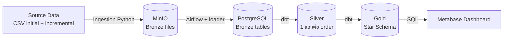
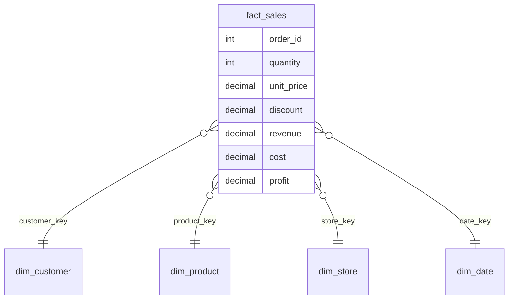
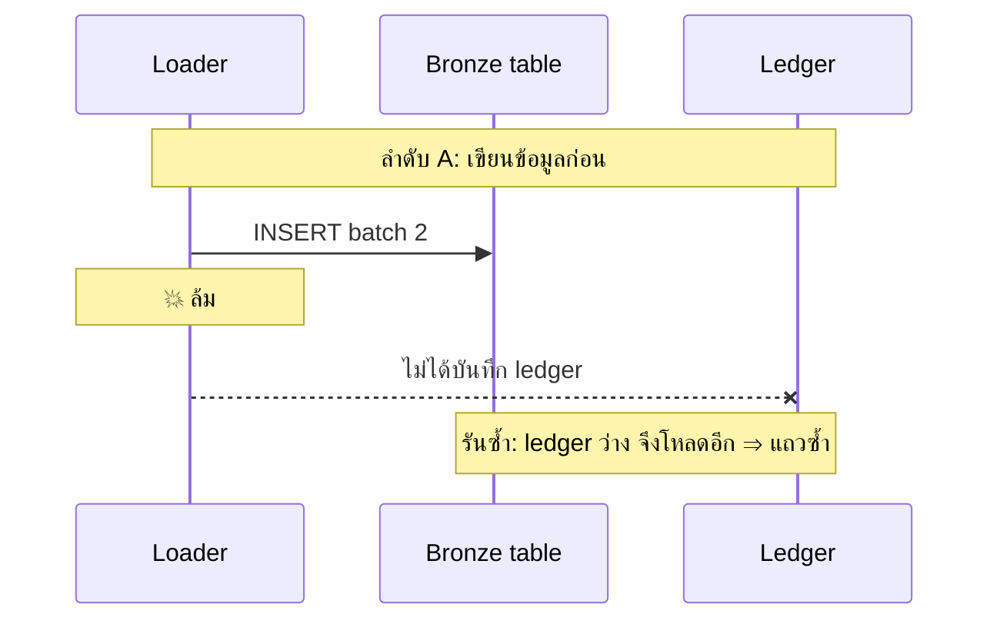
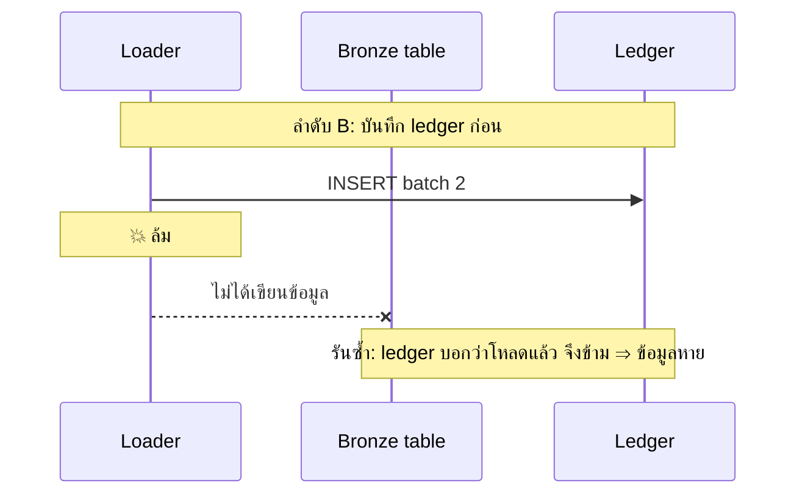
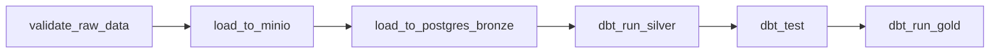
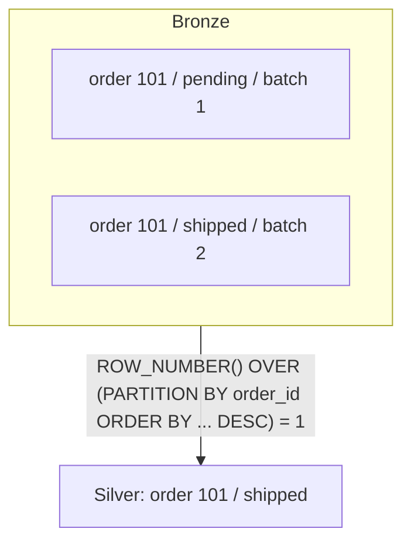
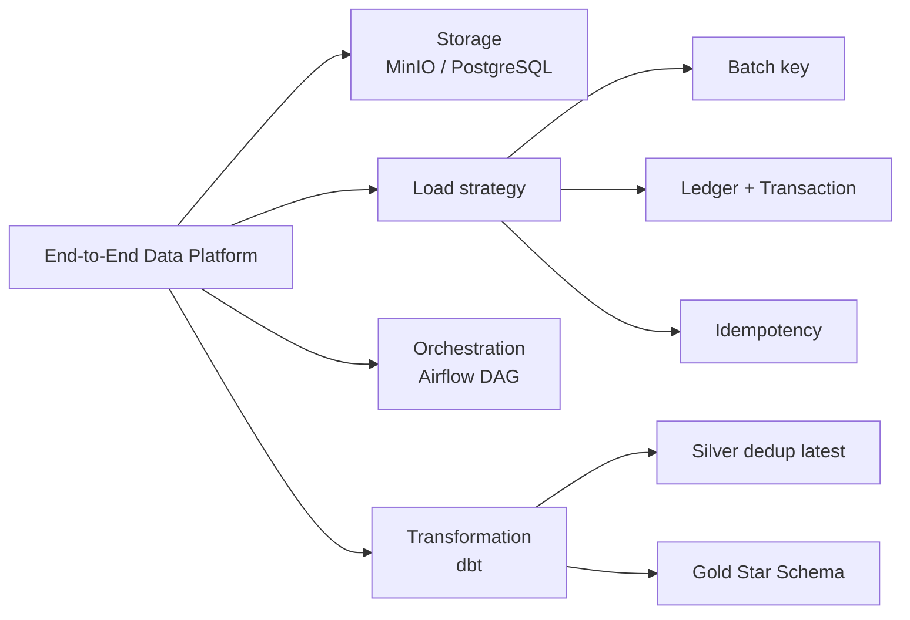

# Database - Project 1: End-to-End Data Platform (E-commerce)

> **วิชา:** 06066300 Database System Concept | **สถาบัน:** (ระบุสถาบันของคุณ)
> **Source:** `AIOS/03 Projects/Data Projects/01-end-to-end-data-platform/.vibe-wise/` (3 ไฟล์: `profile.md`, `progress.md`, `project-map.md`)

---

## Part 1: Macro Architecture & Overview

โปรเจกต์นี้คือ **Data Platform** สำหรับ e-commerce ที่ใช้ **Medallion Architecture** แบ่งข้อมูลเป็น 3 ชั้น คือ Bronze (ข้อมูลดิบ เก็บประวัติครบ), Silver (ข้อมูลที่ทำความสะอาดแล้ว) และ Gold (Star Schema พร้อมให้ BI ใช้) โดยมี **Apache Airflow** เป็นตัวสั่งงาน, **dbt** แปลงข้อมูลด้วย SQL, **MinIO** เป็นที่เก็บไฟล์แบบ S3 และ **Metabase** แสดง Dashboard ทั้งหมดรันบน Docker Compose ตอนนี้ฝั่ง Ingestion (Bronze) เริ่มมีโค้ดแล้ว ส่วน Airflow, dbt, data quality และ Metabase ยังไม่เริ่ม

### 1.1 Pipeline ภาพรวม



### 1.2 Star Schema (Gold layer)



### ตารางเปรียบเทียบ Medallion Layers

| Layer | เก็บอะไร | รูปแบบ | ใช้ทำอะไร |
| :--- | :--- | :--- | :--- |
| **Bronze** | ข้อมูลดิบทุก batch ไม่แก้ไข | ไฟล์ใน MinIO + ตาราง Postgres (append) | ต้นทางความจริง ย้อนตรวจสอบได้ |
| **Silver** | ข้อมูลสะอาด 1 แถวต่อ order | ตาราง dbt model | ฐานให้ชั้น Gold |
| **Gold** | Fact + Dimension | Star Schema | Query จาก BI เร็ว |

### ตารางเทคโนโลยีและสถานะ

| ส่วน | เทคโนโลยี | สถานะ |
| :--- | :--- | :--- |
| Container | Docker Compose | ✅ ตั้งแล้ว |
| Storage | MinIO, PostgreSQL | ✅ ตั้งแล้ว |
| Ingestion | Python (Bronze loader) | 🔄 มีโค้ด ยังไม่ยืนยันด้วยการรัน |
| Orchestration | Airflow | ❌ ยังไม่เริ่ม |
| Transformation | dbt (Silver/Gold) | ❌ ยังไม่เริ่ม |
| Data quality / BI / CI-CD | dbt tests, Metabase | ❌ ยังไม่เริ่ม |

---

## Part 2: Module-by-Module Deep Dive

### 2.1 สิ่งที่เข้าใจแล้ว

* **Container vs Volume:** container คือกล่องที่รัน (running process) ส่วน **volume** คือที่เก็บข้อมูล `docker compose down` ไม่ลบ volume แต่ `down -v` ลบ
* **Object storage:** ไม่มีโฟลเดอร์จริง key ที่มี `/` เป็นแค่ชื่อ `**Obj Storage คืออะไร`
* **Airflow:** เป็น **Orchestrator** ไม่ประมวลผลข้อมูลเอง **DAG** คือกราฟของ task และ dependency `**orchestrator คืออะไร ` 
* **เหตุผลแยก task:** รู้จุดล้มเหลว รันซ้ำเฉพาะขั้นนั้นได้ ขั้นนั้นต้องรันซ้ำได้อย่างปลอดภัย
	* **Replace vs Ledger:** replace รันซ้ำปลอดภัยแต่ไม่เก็บประวัติ ซึ่งขัดกับเป้าหมาย Bronze ส่วน **ledger** ใช้กันโหลดซ้ำได้ `**ledger คืออะไร`

| เคยคิด                                   | ความจริง                                             |
| :--------------------------------------- | :--------------------------------------------------- |
| `up -d` หลัง `down -v` โหลดข้อมูลกลับเอง | สร้างแค่ container + volume ว่าง ต้องรัน loader ใหม่ |
| มี CSV แล้วไม่ต้องรัน loader             | CSV เป็นข้อมูลนำเข้า ไม่ใช่ตัวทำงาน                  |
| PROJECT_INSTRUCTION มีโค้ดครบแล้ว        | `validate_raw_data` ยังไม่มีโค้ด                     |

**Decisions ที่ตัดสินแล้ว:** ADR 008 Regenerate over Backup (ข้อมูลสร้างซ้ำได้ จึงไม่ backup ออกนอกเครื่อง, ยังไม่ commit), Bronze เปลี่ยนจาก replace เป็นแบบเก็บประวัติ, Idempotency ด้วย ledger `**loaderคืออะไร` `**idempotencyคืออะไร`

---

### 2.2 Open #1: Batch key แยก `orders.csv` initial กับ incremental `**incremental คือ`

> ไฟล์ชื่อเหมือนกัน ledger จึงใช้ชื่อไฟล์เป็นกุญแจไม่ได้ ไม่งั้น incremental จะถูกมองว่า "เคยโหลดแล้ว" แล้วถูกข้าม
`**leadgerทำงานอย่างไร`
**แนวคิด:** batch key ต้องเป็น "ค่าที่ต่างกันจริงระหว่างสองชุด" ตัวเลือก: `**batch key คืออะไร`

| ตัวเลือก | ตัวอย่าง | จุดอ่อน |
| :--- | :--- | :--- |
| Prefix/โฟลเดอร์ใน MinIO | `batch_date=2026-10-16/orders.csv` | ต้องวางไฟล์ให้ถูกที่เอง |
| ช่วงเวลาข้อมูล | min/max `order_date` | batch ซ้อนช่วงกันได้ |
| Hash ของเนื้อไฟล์ | `sha256(file)` | ไฟล์เดียวกันแก้นิดเดียว hash เปลี่ยน |
| Run id / logical date ของ Airflow | `ds` | ผูกกับ scheduler |
`Hash คืออะไร และ run id / logical date ของ airflow คือ
```sql
-- ตัวอย่าง ledger: batch_key ต้องไม่ซ้ำ (กันโหลดซ้ำด้วย constraint)
CREATE TABLE bronze.load_ledger (
    batch_key   TEXT PRIMARY KEY,   -- ค่าที่แยก batch ได้จริง
    source_file TEXT NOT NULL,
    row_count   INT  NOT NULL,
    loaded_at   TIMESTAMP DEFAULT now()
);
```

**ลองตอบ:** เปิด `orders.csv` ทั้งสองชุด เทียบ min/max `order_date` และจำนวนแถว แล้วเลือก 1 ตัวพร้อมบอกว่ากรณีไหนที่ตัวเลือกนั้นพัง

---

### 2.3 Open #2: ลำดับเขียนข้อมูลกับ ledger เมื่อล้มกลางทาง

> ต้องเขียน 2 อย่าง (ข้อมูล + ledger) ถ้าล้มระหว่างกลาง สถานะจะไม่ตรงกัน





**ทางออก:**
* **Transaction (atomicity):** ทำสองอย่างใน transaction เดียวของ PostgreSQL ล้มแล้ว rollback ทั้งคู่ (เชื่อม Chapter 07)
* ledger มีสถานะ `started` / `completed` แล้วรันซ้ำล้าง batch ที่ค้าง `started` ก่อน
* โหลดลง staging แล้ว insert + บันทึก ledger ใน transaction เดียว

```sql
-- ข้อมูลกับ ledger อยู่ใน Postgres เดียวกัน จึงทำ atomic ได้
BEGIN;
  INSERT INTO bronze.orders SELECT * FROM staging.orders;   -- เขียนข้อมูล
  INSERT INTO bronze.load_ledger (batch_key, source_file, row_count)
  VALUES ('2026-10-16', 'orders.csv', 1000);                -- บันทึก ledger
COMMIT;  -- ล้มกลางทาง = ROLLBACK ทั้งสองอย่าง
```

**ลองตอบ:** ถ้าข้อมูลอยู่ใน MinIO แต่ ledger อยู่ใน Postgres ทำไมถึงทำ atomic ยากกว่า?

---

### 2.4 Open #3: จุดแบ่ง Airflow task

> เลือกแล้วว่าแยก task แต่ยังไม่ระบุจุดแบ่ง


*(ข้อเสนอเริ่มต้น ไม่ใช่คำตอบตายตัว)*

**หลักตัดสินจุดแบ่ง:** (1) task รันซ้ำได้ผลเดิม (idempotent) (2) ล้มแล้วรู้ชัดว่าที่ไหน (3) แยกตามระบบภายนอกที่ถูกเปลี่ยน (MinIO กับ Postgres)

```python
# ตัวอย่าง DAG แบบย่อ: แต่ละ task ทำสิ่งเดียวและรันซ้ำได้
with DAG("bronze_to_gold", schedule="@daily") as dag:
    validate = PythonOperator(task_id="validate_raw_data", python_callable=validate_raw_data)
    to_minio = PythonOperator(task_id="load_to_minio", python_callable=load_to_minio)
    to_pg    = PythonOperator(task_id="load_to_postgres_bronze", python_callable=load_bronze)
    validate >> to_minio >> to_pg   # >> คือ dependency (ต้องจบก่อนถึงเริ่ม)
```

**`validate_raw_data` ควรตรวจอะไร (ระบุให้เจาะจง):** จำนวนแถว, คอลัมน์ที่ต้องมีครบ, key ซ้ำ, ค่าว่างในคอลัมน์สำคัญ

**ลองตอบ:** ถ้า `load_to_postgres_bronze` ล้ม แล้ว retry ทำไมไม่ควรไปโหลด MinIO ซ้ำ?

---

### 2.5 Open #4: Silver เลือกค่าล่าสุดของ order ที่มีหลายแถว

> Bronze เก็บประวัติ order เดียวจึงมีหลายแถว Silver ต้องเหลือ 1 แถวต่อ order



```sql
-- เลือกแถวล่าสุดต่อ order_id (dedup)
SELECT * FROM (
  SELECT *,
         ROW_NUMBER() OVER (
           PARTITION BY order_id        -- กลุ่มเดียวกัน = order เดียวกัน
           ORDER BY loaded_at DESC      -- หรือ updated_at: เลือกให้ตรงเจตนา
         ) AS rn
  FROM bronze.orders
) t
WHERE rn = 1;
```

**ข้อควรระวัง:** `loaded_at` (เวลาโหลด) กับ `updated_at` (เวลาแก้จริงจากต้นทาง) ให้ผลต่างกันเมื่อข้อมูลมา **out-of-order / late-arriving** และถ้า timestamp เท่ากันต้องมี tie-breaker ใน dbt ใช้ incremental model + `unique_key` (upsert/merge) ได้

**ลองตอบ:** batch 2 โหลดทีหลังแต่มี `updated_at` เก่ากว่า batch 1 จะเลือกแถวไหน เพราะอะไร

---

### 2.6 ศัพท์ที่ต้องรู้ต่อ (Terminology)

| หัวข้อ | Term | ความหมาย |
| :--- | :--- | :--- |
| Pipeline | **Idempotency** | รันกี่ครั้งผลก็เหมือนรันครั้งเดียว |
| Pipeline | **Watermark** | ค่าที่จำว่าประมวลผลถึงไหนแล้ว (เช่น max `updated_at`) |
| Pipeline | **Upsert/Merge** | มีแล้วอัปเดต ไม่มีก็เพิ่ม |
| Pipeline | **Backfill** | รัน pipeline ย้อนหลังตามช่วงเวลา |
| Pipeline | **Late-arriving data** | ข้อมูลอดีตที่มาถึงช้า |
| Modeling | **Grain** | 1 แถวของตารางหมายถึงอะไร |
| Modeling | **Surrogate key** | key ที่ระบบสร้างเอง (ต่างจาก natural key ของธุรกิจ) |
| Modeling | **Fact / Dimension** | ตัวเลขที่วัด vs บริบทที่ใช้ slice |
| Quality | **Quality gate** | เกณฑ์ที่ต้องผ่านก่อนไปชั้นถัดไป |
| Quality | **dbt tests** | unique, not_null, accepted_values, relationships |
| Ops | **Regenerate vs Restore** | สร้างใหม่จาก seed vs กู้จาก backup |

**เชื่อมกับบทเรียนที่มี:** Chapter 07 (Transaction → ข้อ 2.3), Chapter 08 (DW/Star Schema → Gold), LAB 8-9 และ LAB 6-7 (SQL สำหรับ Silver/Gold), Les03 (ฟังก์ชันทำความสะอาดข้อมูล)

---

## Part 3: Quick Reference & Exam Cheat Sheet

### Checklist สรุปหัวใจสำคัญ
* [ ] **Medallion:** Bronze เก็บดิบ+ประวัติ, Silver สะอาด 1 แถวต่อ order, Gold Star Schema
* [ ] **Batch key:** ต้องเป็นค่าที่ต่างกันจริงระหว่าง batch ไม่ใช่ชื่อไฟล์
* [ ] **Ledger + ข้อมูล:** ต้อง atomic (transaction) ไม่งั้นเสี่ยงซ้ำหรือหาย
* [ ] **Airflow task:** แยกตามระบบที่เปลี่ยนสถานะ และแต่ละ task idempotent
* [ ] **Silver dedup:** `ROW_NUMBER() ... = 1` เลือก timestamp ให้ตรงเจตนา
* [ ] **Grain ของ `fact_sales`:** ตอบเป็นประโยคเดียวได้
* [ ] **`down -v`:** ลบ volume แล้วต้องรัน loader ใหม่

### ลำดับงานก่อนโค้ดขั้นต่อไป
* [ ] commit ADR 008
* [ ] ตัดสิน batch key และเขียนใน ADR
* [ ] ตัดสินลำดับ ledger / transaction
* [ ] ระบุจุดแบ่ง Airflow task ครบ
* [ ] ตัดสินกติกา dedup ของ Silver
* [ ] รัน Bronze loader จริงและบันทึกผล

### สรุป Notation / SQL สำคัญ

| Pattern | ความหมาย |
| :--- | :--- |
| `ROW_NUMBER() OVER (PARTITION BY k ORDER BY t DESC) = 1` | เลือกแถวล่าสุดต่อ key |
| `BEGIN; ... COMMIT;` | ทำหลายคำสั่งแบบ atomic |
| `a >> b` (Airflow) | b รันหลัง a สำเร็จ |

### Concept Map



---

## ⚠️ Common Pitfalls & Exam Traps

* **"`up -d` หลัง `down -v` ข้อมูลจะกลับมาเอง":** ผิด สร้างแค่ container และ volume ว่าง ต้องรัน loader โหลดใหม่
* **"ใช้ชื่อไฟล์เป็น batch key":** ผิดเมื่อ initial กับ incremental ชื่อเหมือนกัน ledger จะข้าม incremental
* **"เขียน ledger ก่อนข้อมูลแล้วปลอดภัย":** ไม่ปลอดภัย ล้มกลางทางแล้ว ledger บอกว่าโหลดแล้วทั้งที่ข้อมูลไม่มา (ข้อมูลหาย) ต้องใช้ transaction
* **"Replace ดีเพราะรันซ้ำปลอดภัย":** รันซ้ำปลอดภัยจริง แต่ทับประวัติ ขัดเป้าหมาย Bronze
* **"Airflow ประมวลผลข้อมูลเอง":** ผิด Airflow เป็น orchestrator สั่งงานเท่านั้น
* **"`loaded_at` กับ `updated_at` ใช้แทนกันได้":** ไม่ได้เมื่อข้อมูลมาช้า/สลับลำดับ เลือกผิดจะได้ค่า "ล่าสุด" ผิดตัว
* **"ตอบว่า 'ตรวจความสมบูรณ์' ก็พอ":** กว้างเกินไป ต้องระบุว่าตรวจอะไร (จำนวนแถว คอลัมน์ key ซ้ำ ค่าว่าง)

---

## เอกสารเชื่อมโยง (Wiki-Style Backlinks)
* **วิชาและหัวข้อที่เกี่ยวข้อง:**
  * [[Chapter 07 Introduction to Transaction and Recovery]] (atomicity, rollback ใช้ตอบลำดับ ledger กับข้อมูลในข้อ 2.3)
  * [[Chapter 08 Introduction to Business Intelligence and Data Warehouse]] (Star Schema, Fact/Dimension, ETL ของชั้น Gold)
  * [[LAB 8 - SQL GROUP BY and Aggregate Functions]] (aggregate สำหรับ query ใน Gold/Metabase)
  * [[LAB 9 - SQL Subqueries]] (subquery ที่ใช้ในการ dedup Silver)
  * [[LAB 6 - SQL JOIN (Inner, Cross, Natural, Self)]] (join fact กับ dimension)
  * [[Les03 Single-Row Functions]] (ฟังก์ชันทำความสะอาดข้อมูลใน Silver)

* **แหล่งข้อมูล:**
  * Source: `AIOS/03 Projects/Data Projects/01-end-to-end-data-platform/.vibe-wise/` (3 ไฟล์)
