# Database - Chapter 06: Database System Architecture

> **วิชา:** 06066300 Database System Concept | **สถาบัน:** KMITL, Faculty of Information Technology
> **Source:** `Resources/Books/Database/Database_Concept_06.pdf` (77 slides) — สไลด์ดัดแปลงจาก Asst.Prof. Srinual Nalintippayawong [p.1]
> **ป้ายแหล่งที่มา:** เนื้อหาที่ไม่มีป้ายพิเศษมาจากสไลด์ `[Source: extracted]` | เนื้อหาที่ผู้เขียนเพิ่มอยู่ใน blockquote ขึ้นต้นด้วย 💡 และติดป้าย `[Source: generated — not verified against original document]` | การอ้างอิง `[p.N]` = เลขสไลด์ใน PDF

> **สไลด์ที่ไม่มีเนื้อหาให้สรุป:** p.21 และ p.43 (หัวข้อคั่น "Architectures for DBMSs (implementation)" และ "Oracle Architectural Component"), p.77 (รูป "QUESTIONS")

---

## Part 1: Macro Architecture & Overview

บทที่ 6 อธิบาย **สถาปัตยกรรมของระบบฐานข้อมูล** ใน 2 มุมมอง คือ (1) มุมมองเชิงแนวคิด ได้แก่ Three-Schema Architecture, Data Independence, ภาษาฐานข้อมูล, องค์ประกอบและฟังก์ชันของ DBMS และ (2) มุมมองเชิงการ implement ได้แก่ Centralized, Client/Server (Two-Tier, Three-Tier/n-Tier) ปิดท้ายด้วยกรณีศึกษา **Oracle Architecture** (Instance, Database, Memory, Process) (การแบ่งโครงสร้างนี้เป็นการสรุปของผู้เขียนโน้ต อ้างอิงจากหัวข้อสไลด์ p.3, 10, 11, 18, 21, 33, 43)

Learning Objectives ตามสไลด์ [p.2]:
- สถาปัตยกรรมของระบบฐานข้อมูล (Database System Architecture)
- ภาษาสำหรับฐานข้อมูล (Database Languages)
- องค์ประกอบของ DBMS (DBMS Component Modules)
- ฟังก์ชันของ DBMS
- สถาปัตยกรรมสำหรับ DBMS (Architectures for DBMSs)

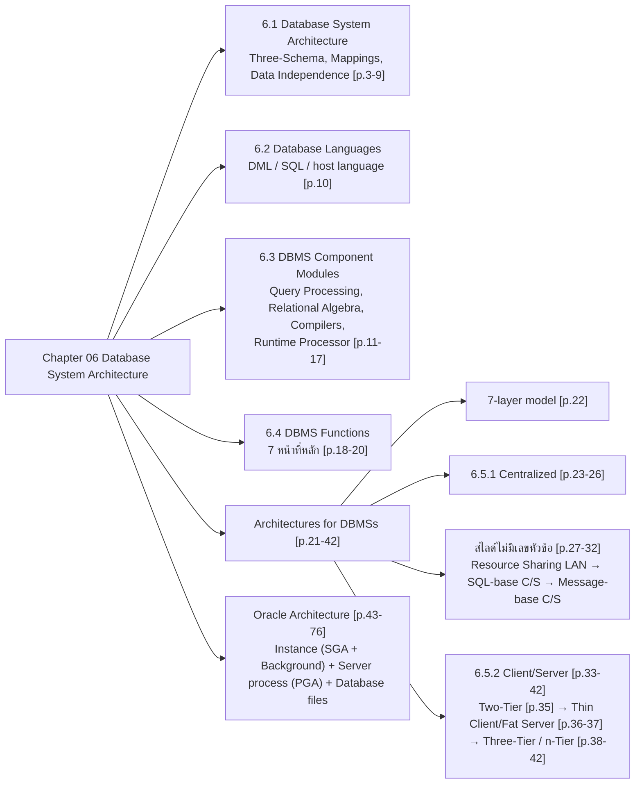

### ตารางเปรียบเทียบ Architectures for DBMSs (สรุปจาก p.22-42)

| Architecture | ข้อดีหลักตามสไลด์ | ข้อเสียหลักตามสไลด์ | สไลด์ |
| :--- | :--- | :--- | :--- |
| **Centralized DBMS** | App กับ DBMS อยู่ใน main memory เครื่องเดียว (IPC ดีที่สุด), traffic I/O terminal-host ต่ำ, maintain ง่ายที่ host | Performance ขึ้นกับ H/W host, UI ไม่สวย, ระบบค่อนข้างปิด, ราคาสูง | p.25-26 |
| **Resource Sharing LAN** | ใช้ PC-based application ได้, GUI สวย, ราคาถูก, end user computing ง่าย | Data management ไม่เก่ง (search/sort/lock ทำที่ workstation), traffic ขึ้นกับขนาด data, ไม่เหมาะกับ WAN, จำกัดด้วยความสามารถ PC | p.27-28 |
| **SQL-base Client/Server (1st/2nd Gen)** | Data management ดีขึ้น (DBMS ดูแล concurrency/recovery), develop ง่าย, ประหยัด, open system ผ่าน ODBC | Maintenance ยาก (program อยู่บนทุก WS), tool ไม่เป็นมาตรฐาน, traffic ยังสูง | p.29-30 |
| **Message-base Client/Server** | Maintain ง่าย (ทำฝั่ง host), traffic น้อย (ส่ง parameter ผ่าน function call), เหมาะกับ WAN | ผูกติดกับ product (stored procedure + front-end), H/W server ต้องแรง (Thin Client/Fat Server) | p.31-32 |
| **Two-Tier C/S** และสไลด์ **Thin Client/Fat Server** (p.36-37) | program ใหญ่กว่า PC ได้เพราะรันที่ host, UI เป็น GUI, upgrade ที่ server | Terminal/Unix WS ราคาสูง, ต้องการ network พิเศษ (เช่น ATM), ใช้เป็น PC ไม่ได้หรือได้ยาก | p.35-37 |
| **Three-Tier / n-Tier** | ต่อ DB Server ได้หลายชุด, เพิ่ม Application Server แทนการเพิ่ม DBMS license, Reliability สูง (No single point of failure), Web-based บน WS, ปลอดภัยกว่า | Reliability/performance ขึ้นกับ network, ราคาสูง (รวม network), technology ซับซ้อนต้องมี vendor support ดี | p.38-42 |

---

## Part 2: Module-by-Module Deep Dive

### 2.1 Database System Architecture (หัวข้อ 6.1) — `[Source: extracted]` p.3-9

#### Three-Schema Architecture

> 💡 **Intuition:** ลองนึกถึงห้องสมุดใหญ่ที่มองได้ 3 ระดับ — (1) External: ผู้ใช้แต่ละกลุ่มเห็นเฉพาะส่วนที่เกี่ยวกับตน (นักเรียนเห็นหมวด "วิทยาศาสตร์", นักธุรกิจเห็นหมวด "บริหารธุรกิจ") แต่เป็นคอลเลกชันเดียวกัน, (2) Conceptual: บัญชีรายการหนังสือทั้งหมดที่บรรณารักษ์ออกแบบ (มีหนังสืออะไร อยู่หมวดไหน กฎการยืมเป็นอย่างไร) ครอบคลุมทั้งห้องสมุด, (3) Internal: ตำแหน่งวางจริงบนชั้น A1-A3, B1-B5 — บรรณารักษ์ย้ายชั้นวางได้โดยผู้ใช้ไม่ต้องเปลี่ยนวิธีค้นหา เพราะผู้ใช้เห็นแค่ view ของตนเอง
> [Source: generated — not verified against original document]

> สถาปัตยกรรมระบบฐานข้อมูลแบ่ง **สกีมา (schema)** เป็น 3 ระดับ เพื่อ **แยกโปรแกรมของผู้ใช้งานออกจากข้อมูล (program-data independence)** และ **สนับสนุนมุมมองข้อมูลที่หลากหลาย (multi-view of data)** ตามความต้องการใช้งาน [p.3]

| ระดับ Schema          | หน้าที่                                                                           | ได้มาจาก                                                                |
| :-------------------- | :-------------------------------------------------------------------------------- | :---------------------------------------------------------------------- |
| **Internal schema**   | อธิบาย **โครงสร้างเชิงกายภาพ** ของฐานข้อมูล                                       | ผลลัพธ์จาก Physical data model [p.4]                                    |
| **Conceptual schema** | อธิบาย **โครงสร้างฐานข้อมูลและเงื่อนไขบังคับ (constraints)** สำหรับกลุ่มผู้ใช้งาน | การออกแบบด้วย Conceptual data model และ Implementation data model [p.4] |
| **External schema**   | อธิบายฐานข้อมูลใน **มุมมอง (View)** ต่าง ๆ ตามกลุ่มผู้ใช้งาน                      | ใช้แบบจำลองข้อมูลเดียวกับ Conceptual schema [p.4]                       |

**🧭 ทำความเข้าใจ** _[Source: generated — not verified against original document]_

**แตกวลีสำคัญ:**
- "External schema" → "มุมมองจากภายนอก" (ผู้ใช้งานคนหนึ่งเห็นตาราง/ข้อมูลไหนเท่านั้น ไม่เห็นทั้งหมด)
- "Conceptual schema" → "นิยามตรงกลาง" (อธิบายโครงสร้างของทั้งฐานข้อมูลสำหรับผู้ใช้ทุกกลุ่ม: Relation, Attribute, ความสัมพันธ์ และ Constraint โดยซ่อนรายละเอียดการจัดเก็บ)
- "Internal schema" → "รูปแบบเก็บจริง" (ระดับไฟล์ index page block ซึ่ง user และ analyst ไม่จำเป็นต้องรู้)
- "Mapping" → "แปลงคำร้องขอและข้อมูลระหว่างระดับ" (query บน View → query บน Conceptual schema → การอ่าน record/page จากไฟล์)

**ตัวอย่าง:**
- ✅ External: นักเรียน (view1) เห็น "Student(ID, Name, GPA)"; ฝ่ายทะเบียน (view2) เห็น "Student(ID, Name, GPA, Major)" ส่วน Address ถูกซ่อนจากทั้งสอง view
- ✅ Conceptual: DBA ออกแบบ "STUDENT(ID, Name, GPA, Major, Address)" 1 Relation เดียว
- ✅ Internal: STUDENT เก็บเป็น record ในไฟล์ students.dat บนดิสก์ จัดเป็น page/block และมี index บน ID
- **ต่างกันตรง:** ทั้ง 3 ระดับอธิบายข้อมูลเดียวกัน แต่ "เห็น/เข้าใจ/จัดเก็บ" ต่างกัน

**อย่าสับสน:** "External schema" หมายถึง (View ที่ผู้ใช้แต่ละกลุ่มเห็นต่างกัน) ไม่ได้หมายถึง (ฐานข้อมูลภายนอก/remote database)

**เช็คความเข้าใจ:** ถ้า DBA เพิ่ม Attribute ใหม่ "Department" ใน Conceptual schema ของ STUDENT แต่ไม่สร้าง External schema ใหม่ให้นักเรียน นักเรียนจะเห็น Department หรือไม่?
<details><summary>เฉลย</summary>

นักเรียน **ไม่เห็น** Department:
1. External schema (View) ของนักเรียนนิยามไว้แค่ "Student(ID, Name, GPA)" — View แสดงเฉพาะ Attribute ที่นิยามไว้
2. สิ่งที่ถูกปรับคือ External/Conceptual Mapping (View definition) ให้ View เดิมยังชี้ไปยัง ID, Name, GPA ใน Conceptual schema ใหม่ได้ถูกต้อง (ตามสไลด์ ระบบปรับ View definition และ Mapping ให้)
3. โปรแกรมและ query ที่นักเรียนใช้บน View เดิมจึงทำงานได้ตามปกติ ไม่ต้องแก้
4. ถ้าต้องการให้นักเรียนเห็น Department ต้องแก้ External schema ของนักเรียนเพิ่มเอง

นี่คือ **Logical Data Independence** — Conceptual เปลี่ยน แต่ External ไม่ต้องเปลี่ยน (ระบบแก้ Mapping)

</details>

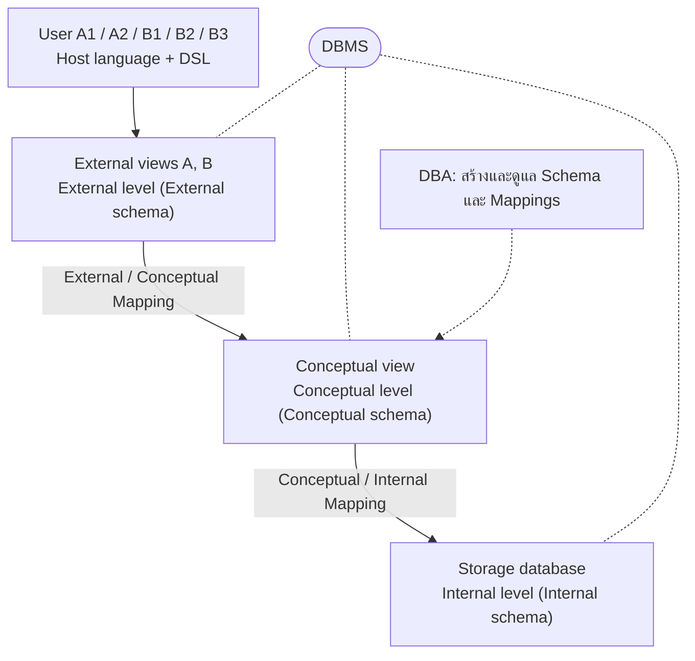
_ต้นฉบับ: รูป "Detailed system architecture" [p.6]_

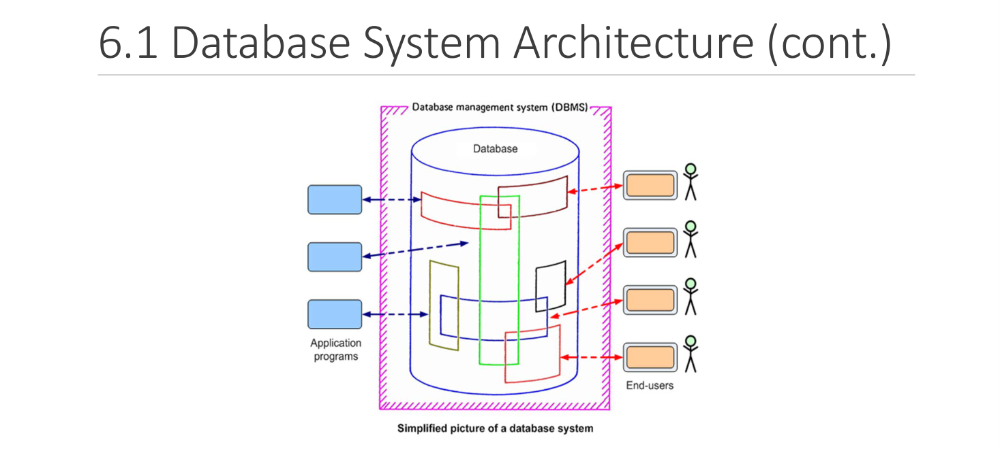

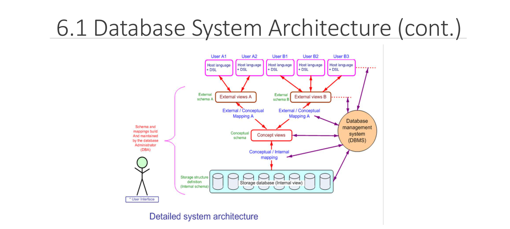

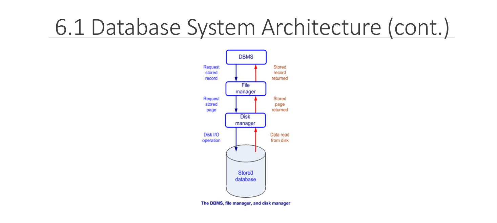

รูปที่แนบในสไลด์:
- **Simplified picture of a database system** — DBMS ครอบ Database, ฝั่งซ้ายเป็น Application programs, ฝั่งขวาเป็น End-users [p.5]
- **Detailed system architecture** — ผู้ใช้ A1, A2, B1, B2, B3 (Host language + DSL) → External views → Conceptual view → Storage database (Internal view), มี DBA และ "Schema and mappings build and maintained by the DBA" [p.6]
- **The DBMS, file manager, and disk manager** — DBMS ส่ง "Request stored record" ให้ File manager → "Request stored page" ให้ Disk manager → Disk I/O operation กับ Stored database; ขาขึ้นคือ "Data read from disk" → "Stored page returned" → "Stored record returned" [p.9]

#### Mappings และ Data Independence

- สกีมา 3 ระดับ **ใช้อธิบายข้อมูลเท่านั้น** ข้อมูลที่เก็บจริงอยู่ที่ **ระดับกายภาพ (physical level)** [p.7]
- การเข้าถึงข้อมูลในแต่ละระดับผ่านกระบวนการ **"Mappings"** เพื่อแปลง (transform) คำร้องขอและข้อมูลระหว่างระดับ ทำให้เกิด **Data Independence**: เมื่อเปลี่ยนสกีมาระดับล่าง **ไม่จำเป็นต้องเปลี่ยนสกีมาระดับบน** [p.7]

| ชนิด | นิยามตามสไลด์ | ตัวอย่างในสไลด์ |
| :--- | :--- | :--- |
| **Logical data independence** | เปลี่ยน Conceptual schema ได้โดยไม่ต้องเปลี่ยน External schema เพราะระบบปรับ View definition และ Mapping ให้ โปรแกรมที่อ้างถึง External schema จึงทำงานได้ตามปกติ | เพิ่มเอนทิตี [p.8] |
| **Physical data independence** | เปลี่ยน Internal schema ได้โดยไม่ต้องแก้ Conceptual schema (จึงไม่ต้องแก้ External schema ด้วย) | เปลี่ยนโครงสร้างของข้อมูล [p.8] |

> 💡 **ขยายความ** `[Source: generated — not verified against original document]`: ทิศการพึ่งพากลับกับทิศของการเปลี่ยนแปลง — ระดับบนพึ่งระดับล่างผ่าน mapping การเปลี่ยนที่ Internal level (เช่น เพิ่ม index) จึงแก้ได้ที่ Conceptual/Internal mapping โดยไม่กระทบ query ที่ผู้ใช้เขียนบน view

---

### 2.2 Database Languages (หัวข้อ 6.2) — `[Source: extracted]` p.10

- การจัดการข้อมูล เช่น เข้าถึง เพิ่ม ลบ แก้ไข ใช้ชุดดำเนินการ (operators) หรือภาษา **Data Manipulation Language (DML)** [p.10]
- สำหรับ **RDBMS** ใช้ภาษา **SQL** (สไลด์สะกด "Structural Query Language") ซึ่งเป็นภาษาระดับสูง ใช้ง่าย (**non-procedural language**) และเป็น **ภาษามาตรฐานของ DDL, VDL และ DML** [p.10]
- คำสั่ง DML **เขียนฝังในแอปพลิเคชันโปรแกรม (host language)** ได้ เช่น C++, Java [p.10]

---

### 2.3 DBMS Component Modules (หัวข้อ 6.3) — `[Source: extracted]` p.11-17

#### Basic Concept of Relational Database Language [p.12]

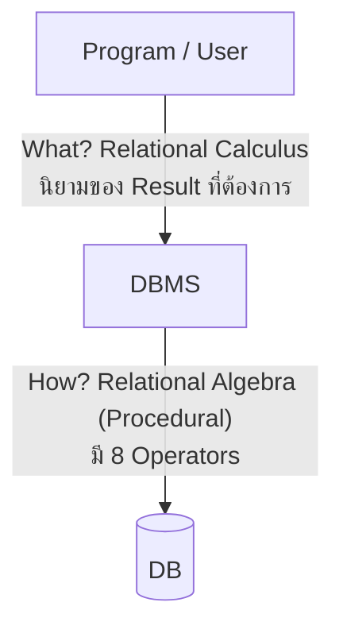
_ต้นฉบับ: รูป Basic Concept of Relational Database Language [p.12]_

#### Basic Steps in Query Processing [p.13-14]

ลำดับขั้น: **1. Parsing and translation → 2. Optimization → 3. Evaluation**

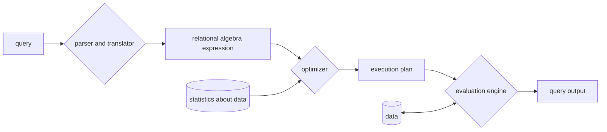
_ต้นฉบับ: รูป Basic Steps in Query Processing [p.13]_

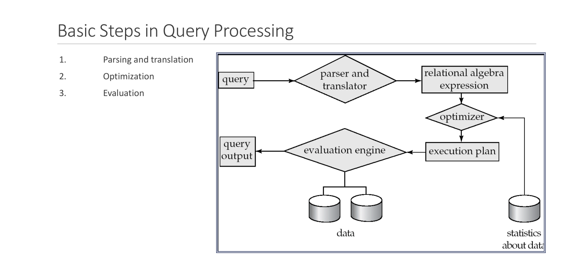

| องค์ประกอบ                    | ความหมายตามสไลด์ [p.14]                                                              |
| :---------------------------- | :----------------------------------------------------------------------------------- |
| Query                         | = SQL                                                                                |
| Parser and translator         | = Process (Syntax and Variable)                                                      |
| Relational-algebra expression | = input/output (เส้นทางสำหรับเข้าถึงข้อมูล)                                          |
| Optimizer                     | เลือกเส้นทางที่ดีที่สุดเพื่อเข้าถึงข้อมูล                                            |
| Execution plan                | algebra expression ที่ถูกเลือกแล้ว ใช้เข้าถึงข้อมูลระดับกายภาพ (แผนงาน + รายละเอียด) |
| Evaluation engine             | รับแผนที่เลือกมาปฏิบัติ                                                              |
| Query output                  | = output                                                                             |

#### Relational Algebra Operators (8 ตัว) [p.15]

| กลุ่ม | Operators |
| :--- | :--- |
| **Essential Subset** | Select (restrict), Project, Join (natural join) |
| **Set Operator** | Union, Intersection, Difference |
| **Special Operator** | Multiply (Product), Division |

> หมายเหตุการจัดกลุ่ม: ในสไลด์ เครื่องหมายวงเล็บกลุ่มกำกับ Essential Subset ไว้ที่ Select, Project, Join; Set Operator ที่ Union, Intersection, Difference; Special Operator ที่ Multiply (Product) และ Division (อ่านจากรูป p.15)

#### ผู้ใช้และโมดูลของ DBMS [p.16-17]

ข้อความ p.16-17 อ้างถึง "ภาพด้านบน" และ "ภาพด้านล่าง" แต่สไลด์ p.16 และ p.17 **ไม่มีภาพประกอบ** (ภาพที่ใกล้เคียงคือ p.11 แต่ป้ายในภาพไม่ตรงกับศัพท์ใน p.16-17 เช่น ไม่มี Precompiler, DDL Compiler, Runtime Database Processor, DBMS Catalog) ผู้เขียนโน้ตจึงแยกคำอธิบายรูป p.11 ออกต่างหาก

**รูป p.11 (6.3 DBMS Component Modules):** ผู้ใช้ naive users (tellers, agents, web-users), application programmers, sophisticated users (analysts), database administrator → application interfaces / application programs / query tools / administration tools → compiler and linker, DML queries, DDL interpreter, application program object code, DML compiler and organizer, query evaluation engine (กลุ่ม **query processor**) → buffer manager, file manager, authorization and integrity manager, transaction manager (กลุ่ม **storage manager**) → disk storage: data, indices, data dictionary, statistical data

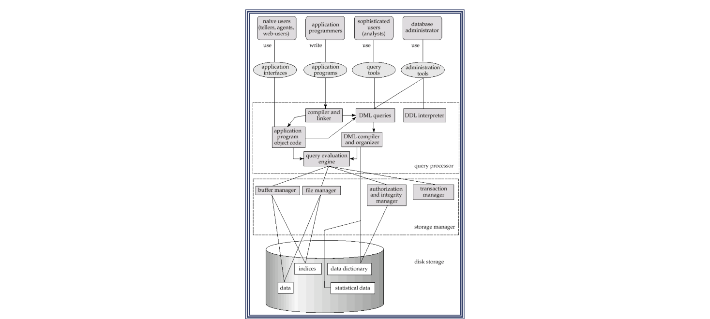

รายละเอียดตาม **ข้อความ** ของ p.16-17:

| ผู้ใช้ (p.16) | บทบาท |
| :--- | :--- |
| **DBA** | กำหนดโครงสร้างฐานข้อมูลด้วย DDL และกำหนดสิทธิ์ (Privileged Commands) |
| **Casual Users** | ผู้ใช้ฐานข้อมูลเป็นบางโอกาส ใช้ภาษาคิวรีโดยตรง |
| **Programmers** | พัฒนาโปรแกรมประยุกต์ เขียน DML ใช้ฐานข้อมูลผ่าน host language (Java, C, COBOL ฯลฯ); **Precompiler** ดึงคำสั่ง DML ออกจากโปรแกรมส่งให้ **DML Compiler** แปลงเป็น Object Code เพื่อเข้าถึงฐานข้อมูล |
| **Parametric Users** | ผู้ใช้งานทั่วไปที่ใช้ฐานข้อมูลผ่านโปรแกรมประยุกต์ |

| โมดูล (p.17) | หน้าที่ |
| :--- | :--- |
| **DDL Compiler** | ประมวลผล Schema definition ที่กำหนดด้วย DDL และเก็บคำอธิบายสกีมา (meta-data) ไว้ใน **DBMS Catalog** |
| **Query Compiler** | ประมวลผลคำสั่งคิวรีแล้วส่งต่อให้ **Query Optimizer** วิเคราะห์และกำหนดขั้นตอนปฏิบัติการอย่างมีประสิทธิภาพ โดยใช้ข้อมูลใน **System Catalog** (สไลด์ใช้ชื่อ "DBMS Catalog" ใน DDL Compiler และ "System Catalog" ใน Query Compiler ในหน้าเดียวกัน) |
| **Runtime Database Processor** | ประมวลผลตามคำสั่งการกำหนดสิทธิ์ ปฏิบัติการตามแผนคิวรี และประมวลผลทรานแซกชัน |
| **Stored Data Manager** | ควบคุมการเข้าถึงข้อมูลใน Stored Database; ข้อมูลผู้ใช้และ DBMS Catalog เก็บในดิสก์ การเข้าถึงดิสก์ควบคุมโดย OS (I/O) |

---

### 2.4 DBMS Functions (หัวข้อ 6.4) — `[Source: extracted]` p.18-20

| # | Function | รายละเอียดตามสไลด์ |
| :--- | :--- | :--- |
| 1 | **Data dictionary management** | เก็บรายละเอียดข้อมูลและความสัมพันธ์ (meta-data) ไว้ใน Data dictionary; DBMS ใช้ดูโครงสร้าง; เมื่อโครงสร้างเปลี่ยนจะบันทึกใน Data dictionary อัตโนมัติ จึง **ไม่ต้องแก้โปรแกรม** → เกิด **Data abstraction** [p.18] |
| 2 | **Data storage management** | สร้างและจัดการโครงสร้างจัดเก็บที่ซับซ้อน สำคัญต่อ **performance tuning**; ผู้ใช้เห็นเป็นฐานข้อมูลเดียว แต่ DBMS เก็บในหลายไฟล์ [p.18] |
| 3 | **Data transformation and presentation** | แปลงข้อมูลกายภาพ (physical data) เป็นข้อมูลเชิงตรรกะ (logical data) ตามที่ผู้ใช้ต้องการ [p.19] |
| 4 | **Security management** | ระบบ data security และ data privacy กำหนดระดับการเข้าถึงต่างกันตามผู้ใช้ [p.19] |
| 5 | **Multi-user access control** | กลไกควบคุมเมื่อมีผู้ใช้พร้อมกันหลายคน (transaction management and concurrency control) เพื่อให้ข้อมูลถูกต้อง มี integrity และสอดคล้องกัน [p.19] |
| 6 | **Backup and recovery** | ให้ DBA สำรองข้อมูลทั้งแบบประจำและตามต้องการ; มีกระบวนการ Recovery ให้ transaction ที่ประมวลผลสมบูรณ์แล้วถูกบันทึก แม้เกิด system failure [p.20] |
| 7 | **Data integrity management** | ใช้ความสัมพันธ์ใน Data dictionary ตรวจและรักษา **Integrity rules** เพื่อลดความซ้ำซ้อนและทำให้ข้อมูลสอดคล้องมากที่สุด [p.20] |

---

### 2.5 Architectures for DBMSs — Implementation (สไลด์ p.21 ไม่มีเลขหัวข้อ; เลข 6.5.1 ปรากฏที่ p.23-26) — `[Source: extracted]` p.21-32

#### 7-Layer Model ของระบบฐานข้อมูล [p.22]

สไลด์ใช้ **แบบจำลอง 7 ชั้น** เป็นเกณฑ์อธิบาย architecture ทุกแบบ (ตัวเลขในรูปของสไลด์ p.25-41 ที่ตามมาอ้างถึงชั้นเหล่านี้)

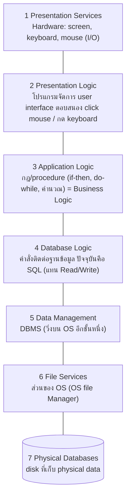
_ต้นฉบับ: รูป p.22 (หมายเลข 1-7 ซ้อนบน GUI / Procedure / SQL / DBMS / OS file Manager / Disk)_

#### 6.5.1 Centralized DBMS Architecture [p.23-26]

> 💡 **Intuition:** ลองนึกถึงร้านกาแฟที่มีบาริสต้าคนเดียวทำทุกอย่าง ทั้งรับเงิน ชงกาแฟ จดออร์เดอร์ — ช่องบริการหน้าร้านแต่ละช่อง (Terminal) เป็นแค่จุดรับ-ส่ง ทำอะไรเองไม่ได้ เพราะงานทั้งหมดอยู่ที่คนเดียว การประสานงานจึงเร็ว (เทียบ IPC ใน main memory เครื่องเดียว) และแก้ไขที่จุดเดียว (maintain ง่าย) แต่ถ้าบาริสต้าทำงานช้า (H/W host ต่ำ) ทุกช่องต้องรอ และถ้าคนนี้หยุด ทั้งร้านหยุด
> [Source: generated — not verified against original document]

- แต่เดิมใช้ **mainframe** เป็นส่วนประมวลผลกลางของทุกฟังก์ชัน (รวมแอปพลิเคชันและส่วนประสานผู้ใช้) ผู้ใช้ใช้ผ่าน **terminal** ที่ไม่มีหน่วยประมวลผล เรียกว่า **"Centralized DBMS" (แบบรวมศูนย์)**; เมื่อฮาร์ดแวร์ถูกลง ก็ใช้ workstation/PC แทน terminal ในช่วงแรก ซึ่งยังเป็นลักษณะเดิม [p.23]
- รูป p.24: Terminals (Display monitor หลายตัว) → SOFTWARE (Application Programs, Terminal display control, Text editors, DBMS, Compilers) → OPERATING SYSTEM → HARDWARE/FIRMWARE (CPU, Controller, Memory, Disk, I/O devices)

| ข้อดี [p.25] | ข้อเสีย [p.26] |
| :--- | :--- |
| SQL กับ result ของ application และ DBMS สื่อสารกันใน main memory เครื่องเดียวกัน → **Interprocess Communication ดีที่สุดที่เป็นไปได้** (เช่น Browser ติดต่อฐานข้อมูลที่ server เรียกว่า Enterprise Server / Application Server) | ถ้า H/W Host ความสามารถต่ำ → performance ไม่ดี |
| Traffic ระหว่าง I/O terminal กับ host ต่ำ | User Interface ไม่สวย (แต่ใช้งานได้ดี) |
| Maintain ง่าย เพราะ application อยู่ที่ host แก้ที่ host | ถ้า screen เป็น GUI keyboard จะไม่ user friendly เป็นภาระให้ host ติดตามทุก cursor movement (และการ map keyboard) |
| | ระบบค่อนข้างปิด; ถ้าเป็น proprietary system ต้องมี user training เฉพาะเครื่อง ไม่มีโอกาสทำ end user computing (user เขียนโปรแกรมเองไม่ได้) |
| | ราคาสูง |

#### Resource Sharing LAN [p.27-28]

ข้อดี: แต่ละ workstation ใช้ **PC-based application** ได้; ได้ GUI สวยและ keyboard user friendly; ราคาถูก; **end user computing** ทำได้สบายเพราะมีโปรแกรมมากและเขียนง่าย [p.27]

ข้อเสีย [p.28]:
- **Data Management ไม่เก่ง** — disk (ชั้น 6-7) ตามข้อความสไลด์: "Disk ตัว [xxxxx — ต้นฉบับขาดหาย] จะอยู่ไกลออกไป" แต่การควบคุม search และ sort มาจาก front-end (workstation) และ concurrency control (lock) ก็ทำจาก workstation
- **Traffic ใน network ขึ้นกับขนาดของ data** (1 read : 1 record) — ถ้า high volume ต้องใช้ media ความเร็วสูง จึงไม่เหมาะกับระบบ **WAN**
- ขนาดโปรแกรมติดที่ความสามารถของ PC ไม่ใช่ว่าโปรแกรมใดก็ลงที่ PC ได้ถ้า PC ไม่ดี

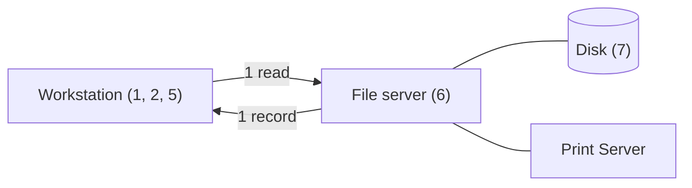
_ต้นฉบับ: รูป Resource Sharing LAN [p.27]_

#### SQL-base Client/Server (1st Generation) [p.29]

ข้อดี:
- **Data Management ดีขึ้นมาก** ตามความสามารถของ DBMS
- **Develop Application ง่าย** — ยกภาระ system (concurrency control, recovery control) ให้ DBMS; ฝั่ง application ส่ง **SQL statement** ไปยัง Database Server
- ประหยัดค่าใช้จ่าย ไม่ต้องมี Development Machine (พัฒนาบน PC ได้เลย)
- เป็น **open system** — WS กับ DB Server ติดต่อกันด้วย SQL ผ่าน **ODBC Driver** WS อาจเป็นผลิตภัณฑ์ต่างจาก DBMS
- End user computing (ชั้น 6 ตามเลขในรูป) คือ PC-based application
- ราคาไม่แพงมากเมื่อเทียบกับแบบที่ 1

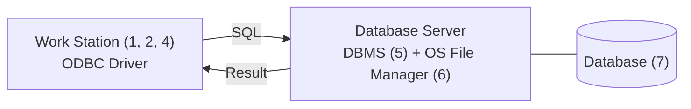
_ต้นฉบับ: รูป p.29_

#### SQL-base Client/Server — ข้อเสีย (สไลด์หัวเรื่อง "2nd Generation Client/Server") [p.30]

- **Maintenance ยาก** — program ติดตั้งอยู่บนทุก WS ต้องตามไป maintain ทุกเครื่อง
- **Stored Procedure** — เอา application logic บางส่วนกับ database logic บางส่วนไว้ที่ server
- Application development tool เป็น object-oriented programming language ออกแบบยาก ใช้วิธี structured programming module ไม่ได้
- Tool ไม่มีมาตรฐาน maintain ยาก
- Traffic ใน network ยังสูงเมื่อเทียบกับบาง architecture

#### Message-base Client/Server [p.31-32]

กล่องข้อความในรูป: **ใส่ Stored Procedure กับ application logic บางส่วน และ database logic บางส่วนไว้ที่ server**

ข้อดี [p.31]:
- Maintenance ง่ายขึ้น ทำได้ที่ฝั่ง host
- Traffic น้อย เพราะส่ง **parameter ผ่าน function call**
- ฝั่ง server ต้องมี integrity rule ที่อ้างข้อมูลบน database ส่วนฝั่ง client (user interface) มีเฉพาะ integrity rule ที่ไม่อ้าง DB ซึ่ง fix ไว้เลย เช่น ช่วงอายุคน ตรวจที่ front-end — แต่ทำแบบนี้เมื่อแก้ไขต้องเสียค่า maintenance บางคนยอมเอา integrity rule ทั้งหมดไว้ที่ [xxxx — ต้นฉบับขาดหาย] (**response time กับ maintenance จะสวนทางกัน**)
- Traffic น้อย → เหมาะกับระบบ **WAN**

ข้อเสีย [p.32]:
- การเรียก stored procedure อาจต้องทำ product front-end ที่กำหนด จึงมัก **ไม่ open**
- H/W Server ต้องมีขีดความสามารถสูง user จะถึง limit เร็วขึ้น เรียกว่า **Thin Client Fat Server** (สไลด์ระบุว่า "ปัจจุบันไม่เรียกแล้ว"; หมายเหตุ: คำเดียวกันนี้เป็นชื่อสไลด์ p.36-37 ซึ่งเป็นอีกแบบหนึ่ง ดู Pitfalls) ถ้าใช้ feature นี้ต้องผูกกับ product เพราะต้องใช้ stored procedure และ front-end ของแต่ละ product (Java, Visual .NET ฯลฯ)

---

### 2.6 Client/Server Architecture (หัวข้อ 6.5.2) — `[Source: extracted]` p.33-42

> 💡 **Intuition:** ลองนึกถึงร้านอาหารที่สั่งผ่านแอป — ลูกค้า (Client) มีหน้าจอสั่งอาหาร (UI) แต่ไม่มีครัว; ครัวกลาง (Server) ทำอาหารให้ลูกค้าหลายคนโดยรับ order ผ่านเครือข่าย ลูกค้าไม่ต้องรู้ว่าครัวทำอย่างไร แค่ส่ง order แล้วรอผล (Result)
> [Source: generated — not verified against original document]

> สถาปัตยกรรมแบบ **แม่ข่าย-ลูกข่าย (Client/Server)** พัฒนาขึ้นเพื่อรองรับสภาพแวดล้อมที่มี PC, workstation, file server, print server, database server, web server และอุปกรณ์อื่นเชื่อมผ่านเครือข่าย โดย **Server** มีฟังก์ชันเฉพาะ (file server, print server, web server, email server) และ **Client** เข้าถึงทรัพยากรที่ไม่มีในเครื่องตนเองจาก server [p.33]

**🧭 ทำความเข้าใจ** _[Source: generated — not verified against original document]_

**แตกวลีสำคัญ:**
- "Client" → เครื่องคนใช้ (PC, Workstation) ที่ขอบริการ
- "Server" → เครื่องให้บริการเฉพาะด้าน (Database Server, Web Server)
- "Network" → เส้นทางสื่อสารระหว่าง Client และ Server
- "Two-tier" → Client ต่อกับ Database Server โดยตรงผ่าน ODBC/JDBC (ไม่มี Application Server คั่นกลาง)
- "Three-tier" → มี Application Server คั่นกลาง

**ตัวอย่าง:**
- ✅ Two-Tier: Workstation (Client) → ส่ง SQL → Database Server → ตอบกลับ Result
- ✅ Three-Tier: Browser (Client) → ส่ง HTTP request → Web Server (Application logic) → ส่ง SQL → DB Server
- ✅ Message-base C/S: Client เรียก stored procedure ที่ฝั่ง Server แล้วส่งแค่ parameter ไป → traffic ในเครือข่ายน้อย เพราะ logic และการประมวลผล SQL อยู่ที่ Server
- ❌ Terminal ที่ไม่มีหน่วยประมวลผล ส่งแค่การกดแป้นไปให้ mainframe ซึ่งทำทั้ง Application และ DBMS → นี่คือ Centralized ไม่ใช่ Client/Server
- **ต่างกันตรง:** Two-tier: application อยู่ฝั่ง client แล้วคุยกับ DB Server โดยตรง; Three-tier: ย้าย business rules ไปไว้ที่ middle tier (Application Server / Web Server) ระหว่าง client กับ DB Server

**อย่าสับสน:** "Client/Server" หมายถึง (Architecture ที่แบ่ง Client / Server แล้วเข้าถึงผ่านเครือข่าย) ไม่ได้หมายถึง (แค่มีเครื่องหลายเครื่องต่อ LAN — ใน Resource Sharing LAN ที่มี File server ตัว workstation ยังทำ search/sort/lock เอง ต่างจาก SQL-base C/S ที่ DBMS ฝั่ง server จัดการข้อมูลให้)

**เช็คความเข้าใจ:** โปรแกรมฝั่ง Client ใช้ ODBC ส่ง SQL ไปยัง Database Server ได้โดยตรง นี่คือ Two-tier หรือ Three-tier?
<details><summary>เฉลย</summary>

**Two-tier**:
- Client (Workstation) → ODBC Driver → SQL → Database Server → Result
- ไม่มี Application Server คั่นกลาง

ถ้ามี Application Server (เช่น Java Application Server, .NET Server) คั่นกลาง → Three-tier:
- Client (Browser) → HTTP → Application Server → SQL → Database Server

</details>

| รูปแบบ [p.34] | ตัวอย่างตามสไลด์ |
| :--- | :--- |
| **Two-tier architecture** | client program ใช้ **ODBC/JDBC** สื่อสารกับ database |
| **Three-tier architecture** | web-based applications และ application ที่สร้างด้วย **"middleware"** |

#### 6.5.2.1 Two-Tier Client/Server [p.35]

GUI และโปรแกรมประยุกต์อยู่ฝั่ง client; เมื่อต้องการเข้าถึง DBMS (ฝั่ง server) ใช้ API มาตรฐาน **ODBC** (Open Database Connectivity) หรือ **JDBC** สำหรับ Java

#### Thin Client/Fat Server [p.36-37] (สไลด์ไม่มีเลขหัวข้อ ต่อจาก 6.5.2.1)

ข้อดี [p.36]: program ใหญ่เกินกว่า PC รับได้ แต่รันที่ host ซึ่งสมรรถนะสูง; user interface สวยเป็น GUI; ตัวอย่างคือ **NC** (browser สำเร็จรูป) ฝั่ง server เป็น Database Server อุปกรณ์ปลายทางไม่ซับซ้อน คล้ายเครื่องรับอย่างเดียว (เช่น โทรศัพท์ โทรทัศน์) ไม่ต้อง upgrade ที่เครื่องรับ ให้ upgrade ที่ server (รูป: X window / X Server, X client, (Unix) Multitasking)

ข้อเสีย [p.37]: terminal หรือ Unix-based WS ราคาสูง; ต้องการ network พิเศษ เช่น **ATM** (ราคาแพง); ใช้งานเป็น PC ไม่ได้หรือได้ยาก; กรณี WS เป็น PC ก็ใช้ PC application ได้

#### 6.5.2.2 Three-Tier and n-Tier Architecture for Web Applications [p.38-42]

- เว็บและ web application ทำให้เกิดสถาปัตยกรรม **3 ระดับ** โดยเพิ่ม **middle tier** (Application server หรือ Web server) ระหว่าง server กับ client ทำหน้าที่เก็บ **business rules** ที่ database server ใช้เข้าถึงข้อมูล: รับ request จาก client ประมวลผล แล้วส่งคำสั่งไปยัง database server → **ปลอดภัยมากขึ้น** [p.38]

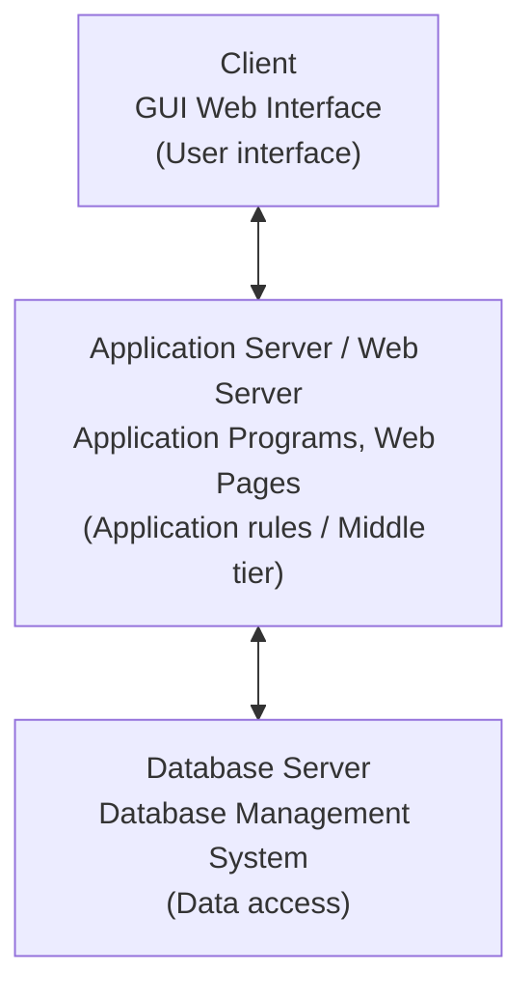
_ต้นฉบับ: รูป p.39; รูป p.40 แสดงเลเยอร์ 3-4 และ 5-6 ที่ต่อ Server SQL → Result → Disk (7) ได้หลายชุด_

รูป Application Architectures ใน p.34 (a. two-tier: user → application ฝั่ง client, database system ฝั่ง server; b. three-tier: user → application client, application server, database system):

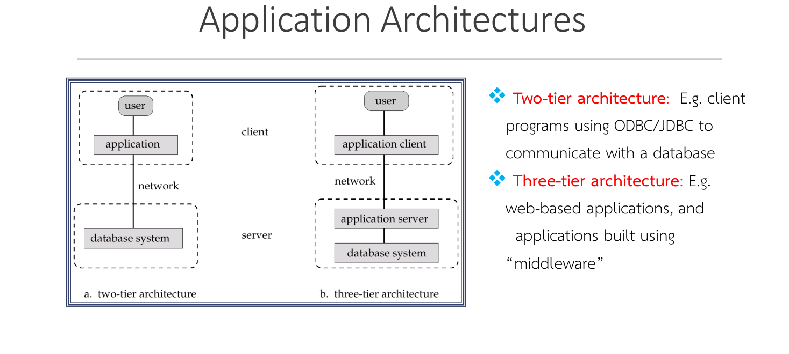

ข้อดี [p.41]:
- **Open System** — Application ต่อกับ DB Server ได้หลายชุด
- Application Server มีได้หลายชุด เพิ่ม user ได้โดยเพิ่ม application server; ในแบบที่ 5 การเพิ่ม user ต้อง upgrade **DBMS Server License** (แพง) แต่แบบที่ 6 เพิ่ม application server ซึ่งถูกกว่า
- **Reliability สูง — "No single point of failure"** เพราะต่อ application และ DBMS ได้หลายชุด server หนึ่ง down อีกตัวทำแทนได้
- Web-based application บน WS

ข้อเสีย [p.42]: Reliability และ performance ขึ้นกับ network; ราคาสูง (รวม network); complex technology ต้องการ vendor ที่ support ได้สูง

> หมายเหตุ: สไลด์ใช้เลข "แบบที่ 1/5/6" เพื่ออ้างสถาปัตยกรรมก่อนหน้าในลำดับ แต่ไม่ได้ระบุว่าแบบไหนคือเลขอะไรชัดเจนในข้อความ

---

### 2.7 Oracle Architecture (กรณีศึกษา) — `[Source: extracted]` p.43-76

#### ภาพรวม [p.44-48]

รูป **Overview of Primary Components** [p.44]:

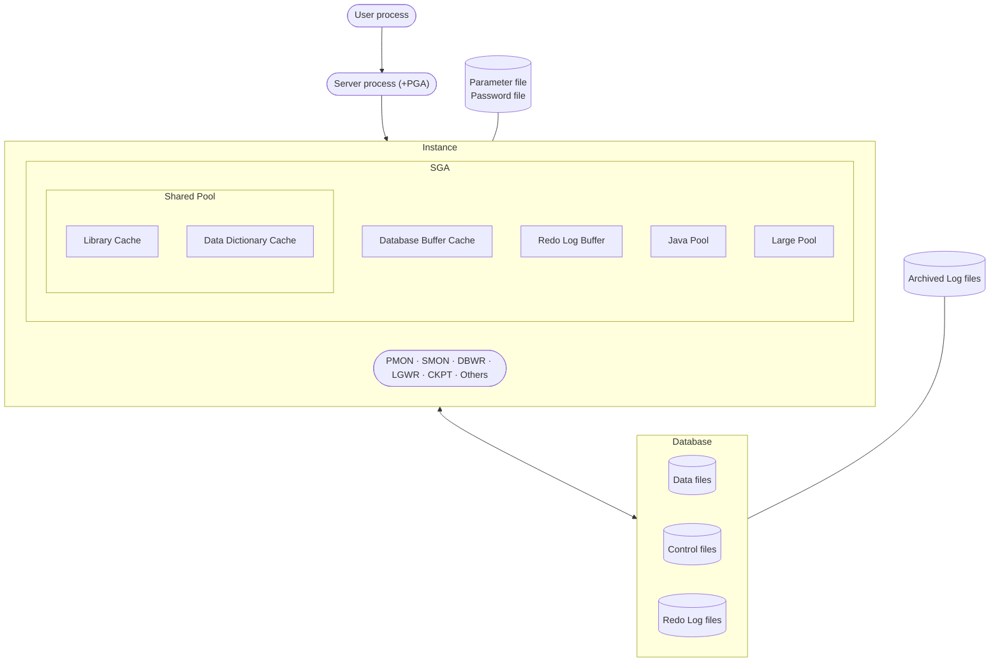
_ต้นฉบับ: รูป Overview of Primary Components [p.44]_

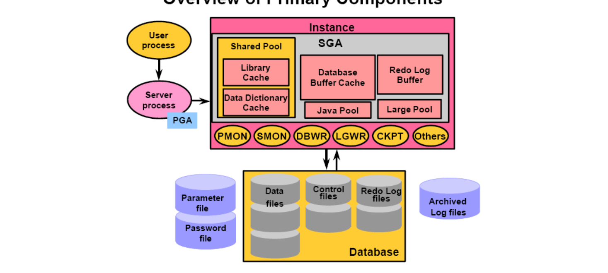

ภาพ p.46: Instance = Memory structures (SGA: Shared Pool, Library Cache, Data Dictionary Cache, Database Buffer Cache, Redo Log Buffer, Java Pool, Large Pool) + Background process structures (PMON, SMON, DBWR, LGWR, CKPT, Others); ภาพ p.47 และ p.68 แสดง Database user → User process → "Connection established" → Server process → "Session created" → Oracle server

| องค์ประกอบ | รายละเอียดตามสไลด์ |
| :--- | :--- |
| **Oracle server** | ฐานข้อมูลสำหรับรวบรวมข้อมูลตามกระบวนการจัดการฐานข้อมูล ประกอบด้วย **Oracle Instance** และ **Oracle Database** [p.45] |
| **Oracle Instance** | ตัวกลางติดต่อระหว่าง Oracle Database กับผู้ใช้; **1 instance ต่อ 1 ฐานข้อมูล**; ประกอบด้วยหน่วยความจำและโครงสร้าง background process [p.46] |
| **Session** | ผู้ใช้ login ผ่าน application/เครื่องมือของ Oracle = **User Process**; เมื่อ login ถูกต้อง Oracle สร้าง **Server Process** รอรับคำสั่งจาก User Process ประมวลผล และส่งผลลัพธ์กลับ ทำงานร่วมกับ Instance และ Database [p.47] |
| **Oracle Database** | ข้อมูลที่เก็บในไฟล์ของระบบปฏิบัติการ ทั้งข้อมูลจริงที่ผู้ใช้ป้อนและข้อมูลที่ระบบสร้าง (โครงสร้างข้อมูล รายละเอียดผู้ใช้ สิทธิ์ ฯลฯ) ประกอบด้วยไฟล์ 3 ลักษณะ: **Data files, Control files, Redo log files** [p.48] |

#### Database Files [p.49-52]

| ประเภท | ไฟล์ |
| :--- | :--- |
| **Mandatory files** | Data files, Control files, Redo log files, Parameter files [p.49] |
| **Optional files** | Password file, Archive log file [p.49] |

| ไฟล์ | หน้าที่ตามสไลด์ |
| :--- | :--- |
| **Data files** | เก็บข้อมูลที่ใช้ในฐานข้อมูล สัมพันธ์กับ **tablespace** [p.52]; (p.50) "เก็บมุมมองที่เป็น logical view เช่น user, view, table, index, sequence เป็นต้น (oracle tools)"; รูป p.52 ระบุ "Data files (includes Data Dictionary)" |
| **Control files** | เก็บข้อมูลที่ต้องใช้ดูแลและตรวจสอบความถูกต้องของฐานข้อมูล เช่น ชื่อฐานข้อมูล เวลาที่สร้าง ชื่อและ directory ของ data files และ redo log files [p.52]; (p.50) "เก็บมุมมองที่เป็น Physical view" |
| **Redo log files** | บันทึกรายการเปลี่ยนแปลงของข้อมูล (เก็บ redo log entry) [p.51-52]; ตามสไลด์ทุกฐานข้อมูลมี redo log **2 กรุ๊ป กรุ๊ปละอย่างน้อย 2 ไฟล์** [p.52] |
| **Parameter file** | ไฟล์ที่ใช้เปิดฐานข้อมูล เก็บขนาดของ SGA [p.51] |
| **Password file** | เก็บรายละเอียดของ sys และจำนวน database user ที่ต้อง grant สิทธิ์ **sysdba** และ **sysoper** [p.51] |
| **Archive log file** | มีเมื่อ Database อยู่ใน **Archive log mode** (ค่า default คือ no archive log mode); เก็บเหมือน redo log file [p.51] |

> **p.50 ข้อความระหว่างบรรทัด Data files กับ Control files (ตามต้นฉบับ):** "Logical view เก็บรายละเอียดของชื่อไฟล์ เช่น control file, datafile, redo log files พร้อมกับสถานที่เก็บไฟล์ (locations) และเก็บชื่อ database เก็บรายละเอียดของการเข้าจังหวะกันของ database files"
>
> ⚠️ **ข้อสังเกตต่อต้นฉบับ:** บรรทัดนี้ขึ้นต้นด้วย "Logical view" แต่เนื้อหา (ชื่อไฟล์ ตำแหน่ง ชื่อ database การ synchronize) ตรงกับสิ่งที่ p.52 ระบุให้ **Control files** ในเรื่องชื่อไฟล์ ตำแหน่งไฟล์ และชื่อ database (ส่วน "การเข้าจังหวะกัน" ตรงกับหน้าที่ของ CKPT ใน p.72) และ p.50 บรรทัดถัดมาเรียก Control files ว่า "Physical view" — ป้ายกำกับในสไลด์จึงไม่สอดคล้องกัน ไม่ได้แก้ในโน้ต
> ⚠️ **p.52:** ตามสไลด์ redo log มี 2 กรุ๊ป กรุ๊ปละอย่างน้อย 2 ไฟล์ (ดูหมายเหตุขยายความด้านล่าง)
> 💡 **ขยายความ** `[Source: generated — not verified against original document]`: เอกสาร Oracle ทั่วไประบุว่า redo log ต้องมี **อย่างน้อย 2 กรุ๊ป** และแต่ละกรุ๊ปมี **อย่างน้อย 1 สมาชิก (member)**; การมีสมาชิกซ้ำ (multiplexing) หลายไฟล์ต่อกรุ๊ปเป็นแนวปฏิบัติที่แนะนำ ควรตรวจกับเอกสาร Oracle ของเวอร์ชันที่ใช้ก่อนอ้างในข้อสอบ

#### Memory Structure [p.53-65]

Oracle แบ่งหน่วยความจำเป็น 2 ส่วน [p.53]:
- **System Global Area (SGA)** — จัดสรรเมื่อสร้าง Oracle instance เป็นส่วนที่โปรเซสของ instance ใช้ร่วมกัน (เรียกอีกอย่างว่า "Share Global Area" ตามสไลด์)
- **Program Global Area (PGA)** — จัดสรรเมื่อ server process เริ่มทำงาน

**SGA** [p.54-55]:
- ประกอบด้วย **Shared Pool, Database Buffer Cache, Redo Log Buffer** และโครงสร้างอื่น ๆ เช่น lock, statistical data
- เพิ่มเติมได้: **Java Pool** (optional, พารามิเตอร์ `JAVA_POOL_SIZE = 0`) และ **Large Pool** (optional, `LARGE_POOL_SIZE = 0`)
- เป็น **Dynamic** ขยายได้ด้วย `SGA_MAX_SIZE`
- การจัดสรรและการขยายในส่วนของ SGA: สามารถจัดสรรหน่วยความจำเสมือนได้อย่างต่อเนื่อง (ต้นฉบับพิมพ์ "หน่วยความเสมือน"); ขนาด SGA ไม่เกิน `SGA_MAX_SIZE` ที่กำหนดไว้ตั้งแต่ต้น [p.55]
- ตรวจค่า: `SQL> show parameter SGA_MAX` หรือ `SQL> Select value from V$parameter where name = 'sga_max_size';` [p.55]

```sql
-- ตรวจขนาด SGA สูงสุด (จากสไลด์ p.55)
SHOW PARAMETER SGA_MAX;
SELECT value FROM V$parameter WHERE name = 'sga_max_size';
```

| โครงสร้างใน SGA | หน้าที่ / รายละเอียดตามสไลด์ | พารามิเตอร์ |
| :--- | :--- | :--- |
| **Shared Pool** [p.56] | เก็บคำสั่ง SQL ที่ประมวลผลแล้ว และข้อมูลที่แสดงผลล่าสุด; แบ่งเป็น Library Cache + Data Dictionary Cache | `SHARED_POOL_SIZE` |
| **Library Cache** [p.57] | เก็บ SQL และ PL/SQL ที่ส่งเข้า DB ตั้งแต่เปิดจนปัจจุบัน (เฉพาะที่ประมวลผลแล้ว); **ใช้ร่วมกับผู้ใช้อื่นได้** (คำสั่งเหมือนกัน เช่น `select * from employee`); จัดการด้วย **LRU (Least Recently Used)**; แบ่งเป็น Share SQL area และ Share PL/SQL area; ขนาดขึ้นกับ Shared Pool | — |
| **Data Dictionary Cache** [p.58] | เก็บโครงสร้างฐานข้อมูลที่ถูกใช้: database files, tables, indexes, columns, user, privileges และ object อื่น; ระหว่างประมวลผล server process ตรวจชื่อ object และสิทธิ์ใน data dictionary; มีผลต่อผลลัพธ์ query/DML; ขนาดขึ้นกับ Shared Pool | — |
| **Database Buffer Cache** [p.59-61] | เก็บข้อมูลที่อ่านจากตารางใน datafiles (เช่น select) และเก็บค่าเก่า/ค่าใหม่ระหว่างทรานแซกชัน (insert, update, delete) | `DB_CACHE_SIZE`, `DB_KEEP_CACHE_SIZE`, `DB_RECYCLE_CACHE_SIZE`, `DB_CACHE_ADVICE`, `DB_BLOCK_SIZE` |
| **Redo Log Buffer** [p.62] | เก็บการเปลี่ยนแปลงทั้งหมด (redo log entry): ค่าเก่า, ค่าใหม่, คำสั่ง (instruction), timestamp, user id | `LOG_BUFFER` |
| **Large Pool** (optional) [p.63] | ใช้เมื่อกำหนดเป็น Shared server configuration (multi-threaded server ver8) หรือใช้ Recovery Manager (RMAN) | `LARGE_POOL_SIZE` |
| **Java Pool** (optional) [p.64] | ใช้เมื่อมีแอปที่สร้างด้วย Java ประมวลผลในฐานข้อมูล เก็บ Java command, variable, class files | `JAVA_POOL_SIZE` |

```sql
-- ตัวอย่างในกล่องข้อความของสไลด์ p.56: กำหนดขนาด Shared Pool
ALTER SYSTEM SET SHARED_POOL_SIZE = 64M;
```

**Database Buffer Cache — 3 ประเภทพื้นที่** [p.60]

| ประเภท | พฤติกรรม | พารามิเตอร์ |
| :--- | :--- | :--- |
| **Keep** | block ที่เก็บในส่วนนี้คงค้างในบัฟเฟอร์แคชหลังใช้งาน | `DB_KEEP_CACHE_SIZE` |
| **Recycle** | block ถูกนำมาใช้ใหม่ทันทีที่ไม่ถูกใช้งาน | `DB_RECYCLE_CACHE_SIZE` |
| **Default** | ค่าเริ่มต้น ใช้อัลกอริทึม **LRU** ควบคุมการนำ block กลับมาใช้ใหม่ | `DB_CACHE_SIZE` |

```sql
-- เปลี่ยนขนาดบัฟเฟอร์แคช (รูปแบบจากสไลด์ p.60)
ALTER SYSTEM SET DB_CACHE_SIZE = <ขนาดของเนื้อที่บัฟเฟอร์แคช>;
```

- เปลี่ยนขนาดบัฟเฟอร์แคชได้แต่ **ต้องไม่เกิน `SGA_MAX_SIZE`** (ตัวอย่างในสไลด์: ต้องการเปลี่ยนเป็น 96M ต้องดูพารามิเตอร์ SGA ด้วย) [p.61]
- เลือกขนาดที่เหมาะสมจากสถิติการใช้งาน ดูจาก view **`V$DB_CACHE_ADVICE`**; ต้องปรับ `DB_CACHE_ADVICE [OFF|ON|READY]`; `DB_BLOCK_SIZE = 2k` ไม่สามารถเปลี่ยนขนาดได้ (ตามสไลด์) [p.61]
- `LOG_BUFFER`: ถ้าเปลี่ยนค่าในไฟล์พารามิเตอร์ **ต้อง shutdown database** และค่าต้องไม่เกิน `SGA_MAX_SIZE` [p.62]

**Database Configuration ที่เกี่ยวกับ Large Pool** [p.63]

| รูปแบบ | ความสัมพันธ์ user process : server process |
| :--- | :--- |
| **Dedicated server configuration** (default) | 1 user process : 1 server process |
| **Shared server configuration** | 1 user process > 1 dispatcher |

วิธีดู: `SQL> select * from V$dispatcher;` — สไลด์บันทึกว่า `=> NO Rows = 1` (ข้อความไม่ชัด — ดู Pitfalls)

**PGA** [p.65]: อยู่ฝั่ง server process และ **ไม่ใช่ shared memory**; สร้างเมื่อติดต่อกับ Oracle server แบบ 1 ต่อ 1; ลบทิ้งเมื่อเลิกติดต่อ; เก็บรายละเอียดของ user process ที่ server process จับคู่ (User id, User process, Server process, Oracle server)

#### Process Structure [p.66-75]

| Process | ลักษณะตามสไลด์ |
| :--- | :--- |
| **User process** [p.66-67] | ทำงานเมื่อ database user (โปรแกรม) ต้องการติดต่อ Oracle server; ติดต่อเพียงครั้งเดียว; **ไม่ติดต่อโดยตรง** แต่ผ่าน server process |
| **Server process** [p.66, 68] | ติดต่อกับ Oracle instance เพื่อ user เมื่อเริ่มใช้งาน; เป็นตัวเชื่อมระหว่าง user process กับ Oracle server; นำผลลัพธ์ที่ประมวลผลแล้วส่งให้ user process; **1 server process : 1 user process** |
| **Background process** [p.66, 69] | ทำงานเมื่อ instance เริ่มทำงาน เพื่อสนับสนุนการทำงานของ SGA |

**Background processes** [p.69]
- **Mandatory:** DBWn, PMON, CKPT, LGWR, SMON
- **Optional:** ARCn, LNDN (ตามที่พิมพ์ในสไลด์), RECO, CJQ0, LMON, Snnn, Dnnn, Pnnn, LCKn, QMNn

| Process | หน้าที่ | ทำงานเมื่อ |
| :--- | :--- | :--- |
| **DBWn** Database Writer [p.70] | เขียนข้อมูลในบัฟเฟอร์ลง **Data file** | เกิด Checkpoint • buffer ถูกใช้ 1/3 ของพื้นที่แล้วเกิด Checkpoint • buffer เต็ม • ถึงเวลาตามพารามิเตอร์ (`log checkpoint timeout = 1000 sec` หรือ `log checkpoint interval = 1k`) • Tablespace OFFLINE / Read Only / Truncate / Begin Backup • เกิด log switch |
| **LGWR** Log Writer [p.71] | บันทึกค่าเก่า/ค่าใหม่ลง **log file** | **Commit** • ใช้ไป 1/3 ของพื้นที่ • ไฟล์ขนาด 1 MB • ทุก 3 วินาที • **ทำงานก่อน DBWn** |
| **CKPT** Checkpoint [p.72] | ประทับตราที่หัวไฟล์ Oracle Database Files ให้ **เข้าจังหวะกัน** (Data files, Control files, Redo log files) | เมื่อ LGWR ทำงาน |
| **SMON** System Monitor [p.73] | กู้คืนฐานข้อมูลเมื่อ **Instance Failure**: **Rolls forward** = นำข้อมูลจาก Redo log file มาคืนให้ตารางใน Data file; **Rolls back** = นำข้อมูลจาก Undo Segments (Rollback Segments) ใน Data file มาคืนให้ตาราง | Instance failure |
| **PMON** Process Monitor [p.74] | กู้คืนเมื่อ **user failure** (database ไม่ล้ม) เช่น ออกจากโปรแกรมผิดปกติ DBA ลบโปรเซส; ทำ **Rolls Back** | User failure |
| **ARCn** Archiver (optional) [p.75] | สำรองข้อมูลจาก redo logs อัตโนมัติเมื่อฐานข้อมูลเป็น **ARCHIVELOG MODE**; บันทึกข้อมูล **ทุกเรคอร์ดที่อยู่ในฐานข้อมูล** ลง Archive Files (ตามข้อความสไลด์ — ซึ่งต่างจากความเข้าใจทั่วไปว่า ARCn คัดลอก redo log ที่เต็มแล้ว ควรตรวจกับเอกสาร Oracle `[Source: generated — not verified against original document]`) | โหมด ARCHIVELOG |

> 💡 **ขยายความ** `[Source: generated — not verified against original document]`: ลำดับ "LGWR ก่อน DBWn" คือหลักการ **write-ahead logging** — ต้องเขียน redo ลง disk ก่อนที่จะเขียน data block ที่เปลี่ยนแล้ว เพื่อให้ SMON ทำ roll forward ได้เมื่อ instance ล้ม

#### Logical vs Physical Structure [p.76]

- มองฐานข้อมูลได้ 2 ลักษณะ: **Logical** และ **Physical**
- **Logical** เรียงตามลำดับชั้น: **database → tablespaces → segments → extents → blocks** (สไลด์พิมพ์ "extens")
- **Physical**: **Data files** ที่ติดต่อกับ tablespaces และ **OS Block** ที่ติดต่อกับ blocks

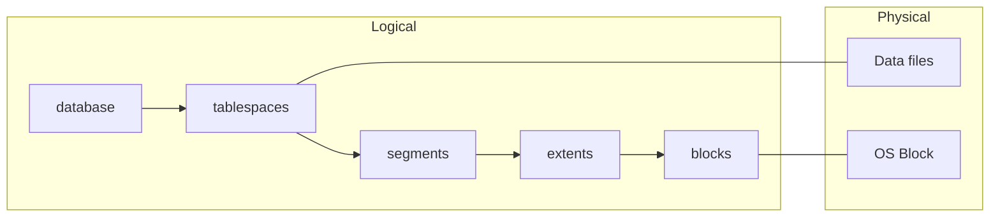
_ต้นฉบับ: ความสัมพันธ์จับคู่ตามข้อความและรูปใน p.76_

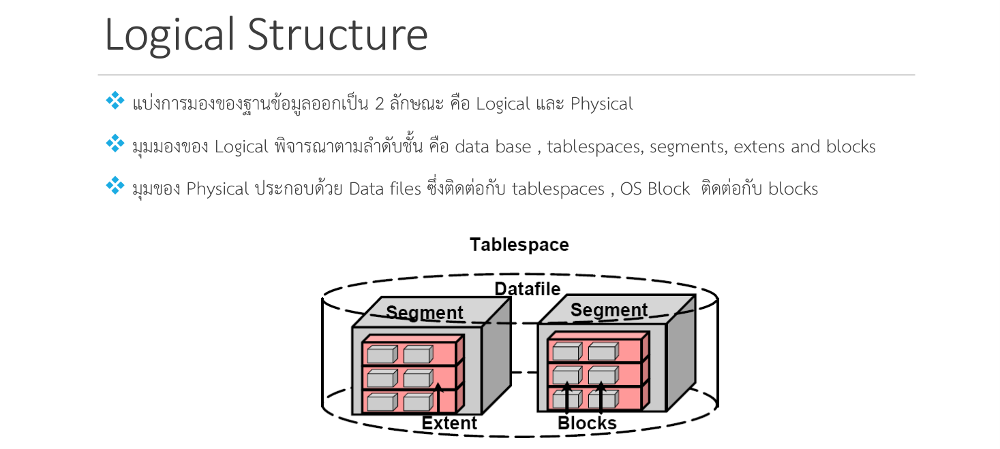

---

## Part 3: Quick Reference & Exam Cheat Sheet

### Checklist สรุปหัวใจสำคัญก่อนสอบ

* [ ] **Three-Schema:** Internal / Conceptual / External ใช้ "อธิบาย" ข้อมูล ข้อมูลจริงอยู่ระดับกายภาพ; เชื่อมกันด้วย Mappings [p.3-7]
* [ ] **Data Independence:** Logical (เปลี่ยน Conceptual ไม่กระทบ External) vs Physical (เปลี่ยน Internal ไม่กระทบ Conceptual) [p.8]
* [ ] **Database Languages:** DML ใช้ SQL (non-procedural), ฝังใน host language ได้ [p.10]
* [ ] **Query Processing 3 ขั้น:** Parsing & translation → Optimization → Evaluation [p.13]
* [ ] **Relational Algebra 8 ตัว:** Select, Project, Join | Union, Intersection, Difference | Multiply, Division [p.15]
* [ ] **Component Modules:** DDL Compiler (→ DBMS Catalog), Query Compiler/Optimizer, Runtime Database Processor, Stored Data Manager [p.17]
* [ ] **DBMS Functions 7 ข้อ:** Data dictionary, Data storage, Data transformation & presentation, Security, Multi-user access control, Backup & recovery, Data integrity [p.18-20]
* [ ] **7-Layer Model:** Presentation Services → Presentation Logic → Application Logic → Database Logic → Data Management → File Services → Physical Databases [p.22]
* [ ] **ลำดับ architecture:** Centralized → Resource Sharing LAN → SQL-base C/S → Message-base C/S → Two-Tier → Three-Tier/n-Tier [p.23-42]
* [ ] **Three-Tier:** Client / Application-Web Server (middle tier = business rules) / Database Server; เพิ่ม app server แทนเพิ่ม DBMS license; No single point of failure [p.38-41]
* [ ] **Oracle:** Server = Instance + Database; Instance = memory structures (SGA ตามรูป p.46) + background processes (PGA อยู่ฝั่ง server process [p.65]); Database files 3 ประเภทหลัก [p.45-48]
* [ ] **SGA:** Shared Pool (Library Cache + Data Dictionary Cache), Database Buffer Cache (Keep/Recycle/Default), Redo Log Buffer, + Java Pool/Large Pool (optional) [p.54-64]
* [ ] **Background processes:** DBWn, LGWR, CKPT, SMON, PMON (mandatory); ARCn (optional) [p.69-75]
* [ ] **Logical hierarchy:** database → tablespaces → segments → extents → blocks [p.76]

### สรุปพารามิเตอร์ / คำสั่งที่ปรากฏในสไลด์

| Parameter / Command | ความหมาย | สไลด์ |
| :--- | :--- | :--- |
| `SGA_MAX_SIZE` | ขนาดสูงสุดที่ SGA ขยายได้ | p.55 |
| `SHARED_POOL_SIZE` | ขนาด Shared Pool (ตัวอย่าง `ALTER SYSTEM SET SHARED_POOL_SIZE = 64M;`) | p.56 |
| `DB_CACHE_SIZE` / `DB_KEEP_CACHE_SIZE` / `DB_RECYCLE_CACHE_SIZE` | ขนาด buffer cache (Default / Keep / Recycle) | p.60 |
| `DB_CACHE_ADVICE` (OFF, ON หรือ READY), `V$DB_CACHE_ADVICE` | ช่วยเลือกขนาด buffer cache | p.61 |
| `LOG_BUFFER` | ขนาด Redo Log Buffer (เปลี่ยนใน parameter file ต้อง shutdown) | p.62 |
| `LARGE_POOL_SIZE`, `JAVA_POOL_SIZE` | ขนาด Large Pool / Java Pool | p.54, 63, 64 |
| `V$dispatcher` | ดู shared server (dispatcher) | p.63 |
| `ALTER SYSTEM SET DB_CACHE_SIZE = ...` | ปรับขนาด buffer cache | p.60 |

### Concept Map

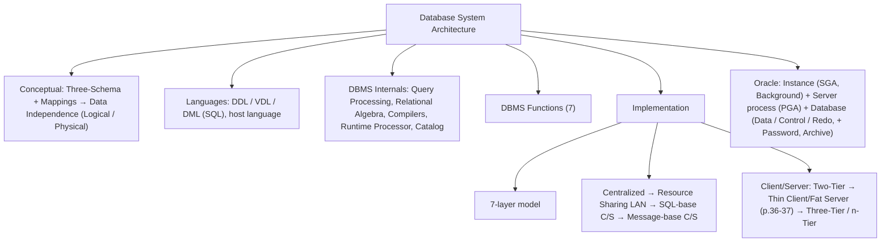

---

## ⚠️ Common Pitfalls & Exam Traps

* **คิดว่า 3 schema เก็บข้อมูลจริงคนละที่:** สกีมาใช้ "อธิบาย" ข้อมูลเท่านั้น ข้อมูลจริงอยู่ที่ระดับกายภาพ [p.7]
* **สลับ Logical กับ Physical data independence:** Logical = เปลี่ยน Conceptual (เช่น เพิ่มเอนทิตี) ไม่แก้ External; Physical = เปลี่ยน Internal (เช่น เปลี่ยนโครงสร้างข้อมูล) ไม่แก้ Conceptual [p.8]
* **คิดว่า SQL เป็น procedural:** สไลด์ระบุ SQL เป็น non-procedural; ส่วน Relational Algebra คือฝั่ง "How? (Procedural)" และ Relational Calculus คือฝั่ง "What?" [p.10, 12]
* **เลขหัวข้อในสไลด์ไม่สม่ำเสมอ:** p.24 หัวข้อ "6.4.2 Centralized DBMS Architecture (cont.)" แต่ p.23, 25, 26 ใช้ "6.5.1" — ใช้ 6.5.1 เป็นเลขจริง (6.4 คือ DBMS Functions) ต้นฉบับพิมพ์ผิด [p.23-26]
* **สับสนชื่อรุ่นของ SQL-base C/S:** p.29 หัวข้อ "1st Generation" ส่วน p.30 (ข้อเสีย) หัวข้อ "2nd Generation" แต่เนื้อหา p.30 อ้าง Stored Procedure ซึ่ง p.31 จัดเป็น Message-base — อย่าตัดสินรุ่นจากหัวสไลด์อย่างเดียว ตรวจกับอาจารย์หากออกสอบ [p.29-31]
* **คิดว่า Three-Tier ลดความซับซ้อน:** สไลด์ระบุ ข้อเสียคือ technology ซับซ้อน ต้องมี vendor ที่ support ดี และราคาสูงเมื่อรวม network [p.42]
* **ลำดับ LGWR กับ DBWn:** LGWR ทำงาน **ก่อน** DBWn [p.71]
* **SMON vs PMON:** SMON = Instance failure (roll forward + roll back); PMON = user failure ที่ฐานข้อมูลไม่ล้ม (roll back) [p.73-74]
* **Dedicated vs Shared server:** Dedicated = 1 user process : 1 server process (default); `V$dispatcher` ไม่มีแถว = ไม่ได้ใช้ shared server (สไลด์เขียน "NO Rows = 1" ไม่ชัด — ตีความตามบริบท `[Source: generated — not verified against original document]`) [p.63]
* **ตัวอักษรผิดในสไลด์ที่แก้ให้ตอนเขียนโน้ต:** "Procederal"→Procedural [p.12], "font end"→front-end [p.28, 31, 32], "ทั้นที"→ทันที [p.60], "extens"→extents [p.76], "Mata-data"→meta-data [p.17-18]; และที่แก้เงียบ ๆ เพื่อให้อ่านง่าย: "ไม่ส่วย"→ไม่สวย [p.26], "mounse"→mouse และ "do whie"→do while [p.22], "Tex editors"→Text editors [p.24], "structure programming module"→structured [p.30], "ARcn"→ARCn [p.69], "Physical Databasess"→Physical Databases [p.22], "sever"→server [p.63, 65], objective ข้อ 5 ใน p.2 ย่อเป็น "สำหรับ DBMS", "เนื้อถูกใช้ 1/3 ของพื้นที่" [p.71] ตีความว่าพื้นที่บัฟเฟอร์ถูกใช้ 1/3; ชื่อ Background process "LNDN" [p.69] คงไว้ตามต้นฉบับเพราะยังไม่ยืนยันชื่อที่ถูกต้อง
* **คำว่า Thin Client/Fat Server ใช้กับสองเรื่อง:** p.32 ใช้เรียก Message-base C/S (server แรง ผูก product, "ปัจจุบันไม่เรียกแล้ว") ส่วน p.36-37 เป็นสไลด์ชุดของตัวเองต่อจาก Two-Tier (X window/NC) — อย่าเหมาเป็นแบบเดียวกัน [p.32, 36-37]
* **ข้อความอ้างภาพที่ไม่มีในสไลด์:** p.16 ("ภาพด้านบน") และ p.17 ("ภาพด้านล่าง") อ้างภาพที่ไม่ได้อยู่ในสองสไลด์นั้น [p.16-17]
* **ป้ายซ้ำใน p.6:** รูป Detailed system architecture มีป้าย "External / Conceptual Mapping A" สองจุด จุดที่สองอยู่ใต้ External views B (น่าจะเป็น B ที่พิมพ์ผิด) ไม่ได้แก้; โน้ตเขียน A,B ในแผนภาพ ASCII เพื่ออ่านง่าย และรูปมีกล่อง "* User Interface" ข้าง DBA [p.6]
* **เลขกำกับชั้นใน p.29:** ข้อความ "End user computing หมายเลข 6 คือ PC base application" แต่ในรูปหมายเลข 6 อยู่ที่ OS File Manager ไม่ใช่ฝั่ง workstation — ข้อความสไลด์ไม่สอดคล้องกับรูป [p.29]
* **ตำแหน่งที่สไลด์มีช่องว่าง "xxxxx":** p.28 ("Disk ตัว xxxxx") และ p.31 ("ไว้ที่ xxxx") ข้อความในต้นฉบับขาดหาย ไม่ได้เติมให้ (โน้ตแสดงเป็น [xxxx — ต้นฉบับขาดหาย])

---

## เอกสารเชื่อมโยง (Wiki-Style Backlinks)

* **วิชาและหัวข้อที่เกี่ยวข้อง:**
  * [[Chapter 01 Introduction to Database System & Relational Model]] (นิยาม DBMS, Database System Environment, Data Models, Database Languages และ DBMS Functions เบื้องต้นที่บทนี้ขยายต่อ)

* **แหล่งข้อมูล:**
  * Source: `Resources/Books/Database/Database_Concept_06.pdf` (77 slides, KMITL Faculty of Information Technology; สไลด์ดัดแปลงจาก Asst.Prof. Srinual Nalintippayawong)
