# Database - Chapter 07: Introduction to Transaction and Recovery

> **วิชา:** 06066300 Database System Concept | **สถาบัน:** KMITL, Faculty of Information Technology
> **Source:** `Resources/Books/Database/Database_Concept_07(2).pdf` (52 slides) — ชื่อบทตามสไลด์: "CHAPTER 7 INTRODUCTION TO TRANSACTION AND RECOVERY" [p.1]
> **ป้ายแหล่งที่มา:** เนื้อหาที่ไม่มีป้ายพิเศษมาจากสไลด์ `[Source: extracted]` | เนื้อหาที่ผู้เขียนเพิ่มอยู่ใน blockquote ขึ้นต้นด้วย 💡 และติดป้าย `[Source: generated — not verified against original document]` | การอ้างอิง `[p.N]` = เลขสไลด์ใน PDF (ลำดับหน้า ไม่ใช่เลขท้ายสไลด์ ซึ่งกระโดดตั้งแต่ p.40 ดู Pitfalls)

> **สไลด์ที่ไม่มีเนื้อหาให้สรุป:** p.1 (หน้าปก), p.52 (รูป "QUESTIONS") — p.3, p.45 เป็นรูปล้วน สรุปไว้ในหัวข้อที่เกี่ยวข้อง

---

## Part 1: Macro Architecture & Overview

บทที่ 7 แนะนำ **Transaction Management** และ **Recovery Management** [p.2] เริ่มจากนิยามของ transaction, ตัวอย่างโอนเงิน, คุณสมบัติ **ACID**, สถานะของ transaction, ต่อด้วย **Concurrency Control** (ปัญหาเมื่อ transaction ทำงานสลับกัน, Schedule, Serializability, Recoverable/Cascadeless, ระดับ Isolation ของ SQL-92) และปิดด้วย **Recovery** (ชนิดของความล้มเหลว, Storage, Backup แบบ Volume/Incremental, Roll Forward, Shadow Paging) (การจัดกลุ่มหัวข้อนี้เป็นของผู้เขียนโน้ต อ้างอิงลำดับสไลด์ p.4-51)

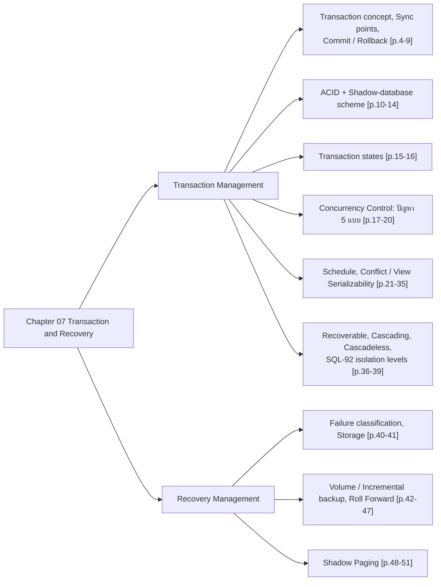

### ตารางสรุป ACID (สรุปจาก p.10-12)

| Property | ความหมายตามสไลด์ | ใครรับผิดชอบ | สไลด์ |
| :--- | :--- | :--- | :--- |
| **Atomicity** | ทุก operation ของ transaction ถูกสะท้อนลงฐานข้อมูลครบ หรือไม่สะท้อนเลย (เป็นหน่วยเดียว แบ่งย่อยไม่ได้) | DBMS | p.10, 11 |
| **Consistency** | การรัน transaction แบบ isolation ต้องรักษาความถูกต้องของฐานข้อมูล (ตาม integrity rule / ขอบเขต transaction ที่ programmer กำหนดถูกต้อง) | Programmer | p.10, 11 |
| **Isolation** | transaction ที่รันพร้อมกันต้องไม่รู้เรื่องของกันและกัน ผลระหว่างทางต้องถูกซ่อน | (สไลด์ไม่ระบุผู้รับผิดชอบ) | p.10, 12 |
| **Durability** | เมื่อ transaction สำเร็จ (commit) ข้อมูลที่บันทึกต้องอยู่ถาวรบน disk แม้ระบบล้ม | DBMS (ตามข้อความ "DBMS รับประกัน") | p.10, 12 |

---

## Part 2: Module-by-Module Deep Dive

### 2.1 แนวคิดรายการเปลี่ยนแปลง (Transaction Concept) — `[Source: extracted]` p.3-9

> 💡 **Intuition:** ลองเหมือนตู้ ATM — เมื่อโอนเงินจาก "บัญชี A" ไป "บัญชี B" จะต้องเกิด 2 ขั้นตอน (ถอนจาก A + ฝากเข้า B) ถ้าเกิดเพียงขั้นตอนเดียว (ถอนแล้วไม่ฝาก) เงินหายไป ดังนั้น Transaction ต้องเป็น "หน่วยเดียว" — สำเร็จทั้งหมดหรือไม่เกิดผลเลย ไม่มีกรณี "สำเร็จบางส่วน"
> [Source: generated — not verified against original document]

#### ตำแหน่งของ Transaction Manager ใน DBMS [p.3]

สไลด์ "DBMS Component Modules" แสดงแผนภาพโมดูลของ DBMS และ **ล้อมกรอบประสีแดง** ที่ **transaction manager** ในส่วน storage manager เป็นการชี้ว่าบทนี้โฟกัสโมดูลนี้ [p.3]

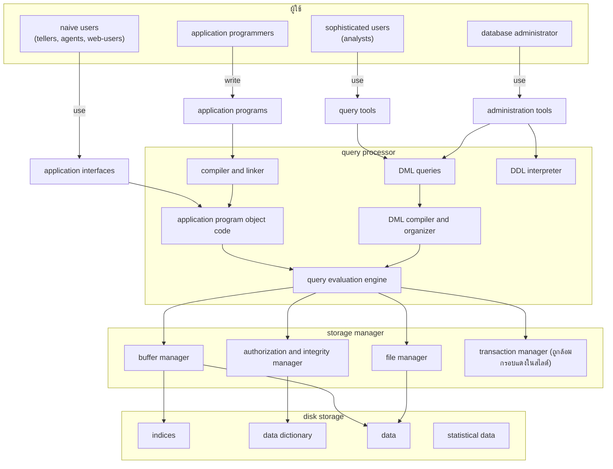
_ต้นฉบับ: รูป DBMS Component Modules [p.3] — เส้นเชื่อมในรูปจริงมีจำนวนมาก แผนภาพนี้วาดเส้นหลักเท่าที่อ่านได้จากรูป ไม่ครบทุกเส้น (เช่น เส้นรอบ object code และเส้นจาก storage manager ไปยัง disk storage บางเส้น)_

#### รายการเปลี่ยนแปลง (Transaction) คืออะไร [p.4-5]

- หัวข้อ "รายการเปลี่ยนแปลง คืออะไร" มี 3 ข้อย่อยตามสไลด์ [p.4]: (1) "แฟ้มที่เก็บรายการการเปลี่ยนแปลง" (2) "กิจกรรมแต่ละกิจกรรมที่ถูกดำเนินการ" (3) "กลุ่มของคำสั่งที่กระทำกับข้อมูล เช่น การเข้าถึงข้อมูล หรือ การปรับปรุงข้อมูล"
- สไลด์ไม่ได้อธิบายข้อ (1) เพิ่มเติม [p.4]
- **Sync Points** คือจุดเริ่มต้นและสุดท้ายของ transaction [p.5]
- ตัวอย่างในสไลด์ [p.5]:

```text
begin Transaction
  insert เด็กเกิดใหม่
  insert จังหวัด
end Transaction
```

#### Transaction Concept (English) [p.6]

- A transaction is a unit of program execution that accesses and possibly updates various data items. [p.6]
- A transaction must see a consistent database. [p.6]
- During transaction execution the database may be inconsistent. [p.6]
- When the transaction is committed, the database must be consistent. [p.6]
- สองประเด็นหลักที่ต้องจัดการ: (1) **Failures** หลายชนิด เช่น hardware failures และ system crashes (2) **Concurrent execution** ของหลาย transaction [p.6]

#### ตัวอย่างโอนเงิน (Fund Transfer) [p.7]

โอน $50 จากบัญชี A ไปบัญชี B [p.7]:

| ขั้น | คำสั่ง |
| :--- | :--- |
| 1 | `read(A)` |
| 2 | `A := A – 50` |
| 3 | `write(A)` |
| 4 | `read(B)` |
| 5 | `B := B + 50` |
| 6 | `write(B)` |

- **Consistency requirement** — ผลรวมของ A และ B ต้องไม่เปลี่ยนจากการรัน transaction [p.7]
- **Atomicity requirement** — ถ้า transaction ล้มเหลวหลังขั้น 3 และก่อนขั้น 6 ระบบต้องทำให้การปรับปรุงเหล่านั้น **ไม่ถูกสะท้อนในฐานข้อมูล** มิฉะนั้นจะเกิดความไม่สอดคล้อง [p.7]

#### Syncpoint ใน SQL environment [p.8]

| คำสั่ง / แนวคิด | ความหมายตามสไลด์ |
| :--- | :--- |
| **Commit** | ยืนยันการเปลี่ยนแปลงที่เกิดขึ้นตั้งแต่ Syncpoint ล่าสุดถึงจุด commit — อาจจะยังอยู่ใน buffer ไม่ต้องลง disk |
| **Rollback** | ยกเลิกการเปลี่ยนแปลงตั้งแต่ rollback ไปจนถึง sync point ล่าสุดจากจุดที่ rollback |
| **Set autocommit on** | DBMS ปฏิบัติคำสั่ง 1 คำสั่งเสร็จแล้ว commit อัตโนมัติ |
| **Set autocommit off** | (ตรงข้ามกับ on) DBMS จะยังไม่ commit จนกว่าจะมีคำสั่ง commit — สไลด์ต่อท้ายประโยคนี้ด้วยคำว่า "สมัยก่อน" ซึ่งความหมายไม่ชัด |

#### การทำงานของรายการเปลี่ยนแปลง: Buffer และ Disk [p.9]

รูป (ลูกศร INPUT/OUTPUT) แสดงใน **MAIN MEMORY** มี Program A, Program B และ **DB Buffer** ส่วน **DataBase** อยู่นอก memory [p.9]

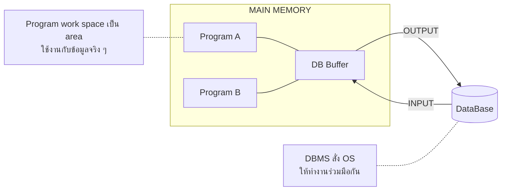
_ต้นฉบับ: รูปบน p.9 มีข้อความเสริม "รับ-ส่ง data หรือ นำข้อมูล buffer ไปยัง buffre space" (สะกดตามต้นฉบับ) ตำแหน่งลูกศรในรูปต้นฉบับอ่านจากภาพ อาจไม่ตรงทุกเส้น_

---

### 2.2 คุณสมบัติ ACID และการ implement Atomicity/Durability — `[Source: extracted]` p.10-14

#### ACID Properties [p.10-12]

ต้นฉบับภาษาอังกฤษ [p.10]: "To preserve integrity of data, the database system must ensure:"

1. **Atomicity** — Either all operations of the transaction are properly reflected in the database or none are. [p.10]
2. **Consistency** — Execution of a transaction in isolation preserves the consistency of the database. [p.10]
3. **Isolation** — Although multiple transactions may execute concurrently, each transaction must be unaware of other concurrently executing transactions. Intermediate transaction results must be hidden from other concurrently executed transactions. คือ สำหรับทุกคู่ Ti, Tj ต้องดูเหมือนกับ Ti ว่า Tj เสร็จก่อน Ti เริ่ม หรือ Tj เริ่มหลัง Ti เสร็จ [p.10]
4. **Durability** — After a transaction completes successfully, the changes it has made to the database persist, even if there are system failures. [p.10]

ข้อความภาษาไทยในสไลด์ [p.11-12]:

- **Atomicity** — เป็นหน่วยเดียวแบ่งย่อยต่อไปอีกไม่ได้; operation ถ้า fail ต้อง fail หมด ถ้าสำเร็จต้องสำเร็จหมด (**DBMS รับผิดชอบ**) ตัวอย่าง: ถอน A อย่างเดียวไม่ได้ ถ้า fail ที่ช่วงหลังถอน A ก็ต้อง fail หมด; "ฝาก B" ที่ยังไม่ทำ ถือว่าไม่สำเร็จทั้งหมดที่ทำมา [p.11]
- **Consistency (รักษาความถูกต้อง)** — การวิ่ง transaction ใน isolation ต้องรักษาข้อมูลให้ถูกต้องตาม integrity rule หรือ ถ้า programmer กำหนด scope ของ transaction ให้ถูกต้อง เช่น programmer ไม่ใส่ commit มั่ว (**programmer รับผิดชอบ**) [p.11]
- **Isolation** — transaction แต่ละตัวที่วิ่งต้องวิ่งเป็นอิสระและไม่เห็นกิจกรรมที่ทำโดย transaction อื่นเลย ถ้ามี Ti และ Tj วิ่ง overlap กัน (concurrency) จะมี 2 กรณี: Ti สำเร็จก่อน Tj ค่อยเกิด หรือ Tj เสร็จก่อน Ti ค่อยเกิด [p.12]
- **Durability** — หลัง transaction ทำงานเสร็จ ข้อมูลที่ถูกบันทึกลงฐานข้อมูลต้องอยู่ถาวร ถ้า transaction commit เรียบร้อย ไม่ว่าจะเกิดอะไรขึ้น DBMS รับประกันว่าข้อมูลต้องอยู่บน disk ถาวร [p.12]

**🧭 ทำความเข้าใจ** _[Source: generated — not verified against original document]_

**แตกวลีสำคัญ:**
- "Atomicity" → "หน่วยเดียว" ทำครบทุกขั้นหรือไม่เกิดผลเลย ไม่มีการค้างแค่บางขั้น (ผู้รับผิดชอบ: recovery subsystem ของ DBMS ซึ่ง undo งานที่ไม่ครบ)
- "Consistency" → "ถูกต้อง" ก่อนและหลัง transaction ข้อมูลยังตรงตาม integrity rule เช่น A+B คงเดิม (ผู้รับผิดชอบ: programmer ที่เขียน transaction ถูก ร่วมกับ DBMS ที่บังคับ integrity constraint)
- "Isolation" → "แยกอิสระ" transaction หนึ่งไม่เห็นผลระหว่างทางของ transaction อื่น (ผู้รับผิดชอบ: concurrency control ของ DBMS)
- "Durability" → "ถาวร" เมื่อ commit แล้วผลต้องไม่หายแม้ระบบล่ม แม้ขณะ commit ข้อมูลอาจยังอยู่ใน buffer (ผู้รับผิดชอบ: recovery subsystem ของ DBMS)

**ตัวอย่าง:**
- ✅ A = 100, B = 200 โอน 50: BEGIN → (A = 50, B = 200) → (A = 50, B = 250) → COMMIT → ทุกคนเห็น A = 50, B = 250 (A+B = 300 เท่าเดิม)
- ❌ ระบบล่มหลัง write(A) แต่ก่อน write(B) แล้วหลัง restart ฐานข้อมูลค้างที่ A = 50, B = 200 (เงินหาย 50 บาท) → Atomicity เสีย
- ❌ โอนแล้ว Commit แต่ Power Off ข้อมูลกลับไป 100, 200 → Durability เสีย
- ❌ T2 reads A=50 while T1's transfer is not finished (B still 200), so T2 sees the intermediate result → Isolation violated.
- **ต่างกันตรง:** Atomicity = "ทั้งหมดหรือไม่เลย" (ดูแลกรณีล่ม**ก่อน** commit); Durability = "commit แล้วต้องไม่หาย" (ดูแลกรณีล่ม**หลัง** commit)

**อย่าสับสน:** "Consistency" ใน ACID หมายถึง (ข้อมูลยังเป็นไปตามกฎ/integrity constraint เช่น A+B = 300 ทั้งก่อนและหลังโอน) ไม่ได้หมายถึง (สำเนาข้อมูลหลายชุดตรงกัน เช่น replica สองเครื่องเหมือนกัน ซึ่งเป็นอีกความหมายในระบบกระจาย)

**เช็คความเข้าใจ:** ถ้าไฟดับขณะ transaction โอนเงินกำลังทำงาน (ยังไม่ Commit) หลังเปิดระบบใหม่ transaction นั้นจะเป็นอย่างไร?
<details><summary>เฉลย</summary>

Transaction **ยังไม่ Commit** ดังนั้น:
1. Atomicity → ตอน restart, recovery subsystem จะ undo (rollback) การเปลี่ยนแปลงที่ transaction นี้ทำไปแล้ว เช่น write(A)
2. Durability ไม่เกี่ยวกับกรณีนี้ เพราะยังไม่ commit จึงไม่มีผลใดที่ต้องรับประกันให้คงอยู่
3. ผลลัพธ์: ฐานข้อมูลกลับไปเหมือนก่อน transaction เริ่ม (A = 100, B = 200)

ถ้า Power Off หลัง Commit (แต่ก่อนเขียน disk):
- Durability: recovery subsystem ใช้ log ทำ redo การเปลี่ยนแปลงที่ commit แล้วแต่ยังไม่ลง disk (ใน Oracle คือ redo log และ SMON ทำ instance recovery ดู [[Chapter 06 Database System Architecture]])

</details>

รูปใน p.12: เส้นเวลา T1, T2, T3 วิ่งซ้อนกัน (**Serializable Concurrent Schedule**) ต้องให้ผลลัพธ์เหมือน (same result) **Serial Schedule** ที่ T1, T2, T3 รันเรียงต่อกัน [p.12]

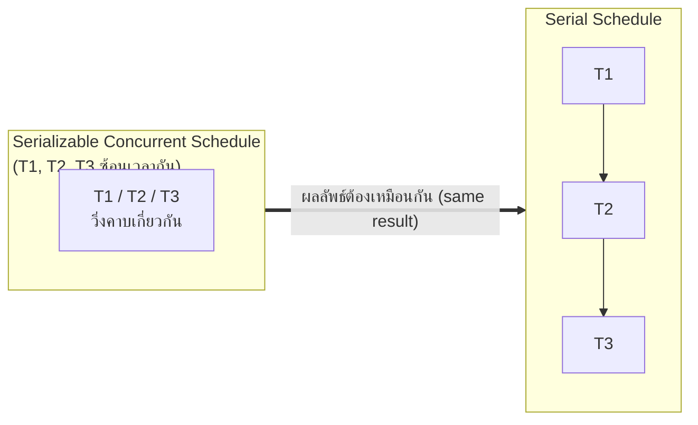
_ต้นฉบับ: รูปใน p.12_

> 💡 **ขยายความ** `[Source: generated — not verified against original document]`: ในตำราทั่วไป Consistency ไม่ได้ผลักไปที่ programmer ทั้งหมด เพราะ DBMS ก็บังคับ integrity constraint (เช่น PK/FK/CHECK) ให้ด้วย สไลด์เน้นฝั่ง programmer ที่กำหนดขอบเขต commit ได้ถูกต้อง ควรอ่านควบคู่กับคำอธิบายของอาจารย์

#### Implementation of Atomicity and Durability: Shadow-database scheme [p.13-14]

- ส่วน **recovery-management** ของระบบฐานข้อมูลเป็นส่วนที่ implement การรองรับ atomicity และ durability [p.13]
- ตัวอย่าง **shadow-database scheme** [p.13]:
  - ทุกการ update ทำบน **shadow copy** ของฐานข้อมูล
  - **db_pointer** ถูกทำให้ชี้ไปยัง shadow copy ที่ update แล้ว หลังจาก transaction ถึง **partial commit** และ **ทุก page ที่ update ถูก flush ลง disk** แล้ว
- รูป [p.13]: (a) Before update — db-pointer ชี้ "old copy of database"; (b) After update — db-pointer ชี้ "new copy of database" ส่วน "old copy of database (to be deleted)"

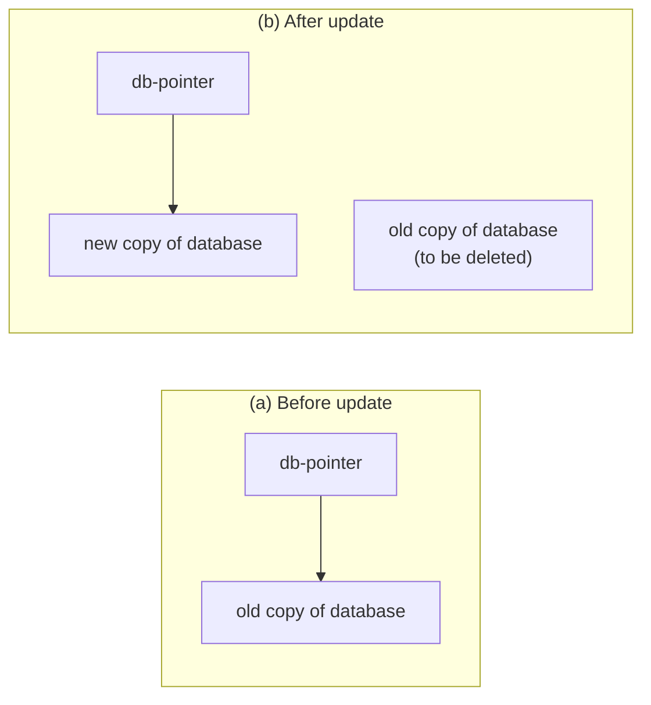
_ต้นฉบับ: รูป "db-pointer" [p.13]_

- **db_pointer** ชี้ไปยังสำเนาฐานข้อมูลที่ consistent ปัจจุบันเสมอ [p.14]
- ถ้า transaction fail ใช้สำเนาเก่าที่ db_pointer ชี้ได้ และลบ shadow copy ทิ้งได้ [p.14]
- ข้อจำกัดของ shadow-database scheme [p.14]:
  - สมมติว่ามี **transaction เดียว active ในเวลาหนึ่ง**
  - สมมติว่า **disk ไม่เสีย**
  - ใช้ได้กับ text editor แต่ **ไม่มีประสิทธิภาพอย่างยิ่งสำหรับฐานข้อมูลขนาดใหญ่ (why?)** — สไลด์ทิ้งคำถาม "why?" ไว้ไม่เฉลย
  - รูปแปรที่เรียก **shadow paging** ลดการ copy ข้อมูล แต่ยังไม่ practical สำหรับฐานข้อมูลใหญ่
  - **ไม่รองรับ concurrent transactions**

> 💡 **ตอบคำถาม "why?"** `[Source: generated — not verified against original document]`: เพราะต้องคัดลอกฐานข้อมูลทั้งชุดทุกครั้งที่รัน transaction (สอดคล้องกับที่สไลด์บอกว่า shadow paging "ลดการ copy ข้อมูล")

---

### 2.3 สถานะของรายการเปลี่ยนแปลง (Transaction State) — `[Source: extracted]` p.15-16

| สถานะ | ความหมายตามสไลด์ [p.15] |
| :--- | :--- |
| **Active** | สถานะเริ่มต้น; transaction อยู่ในสถานะนี้ขณะที่กำลังทำงาน |
| **Partially committed** | หลังจากคำสั่งสุดท้ายถูกปฏิบัติแล้ว |
| **Failed** | หลังค้นพบว่าการทำงานปกติดำเนินต่อไปไม่ได้ |
| **Aborted** | หลัง transaction ถูก rolled back และฐานข้อมูลถูกคืนสู่สถานะก่อน transaction เริ่ม; หลัง aborted มี 2 ทางเลือก: (1) **restart** transaction — เฉพาะเมื่อไม่มี internal logical error (2) **kill** transaction |
| **Committed** | หลังทำงานสำเร็จ |

แผนภาพภาษาไทย [p.16]:

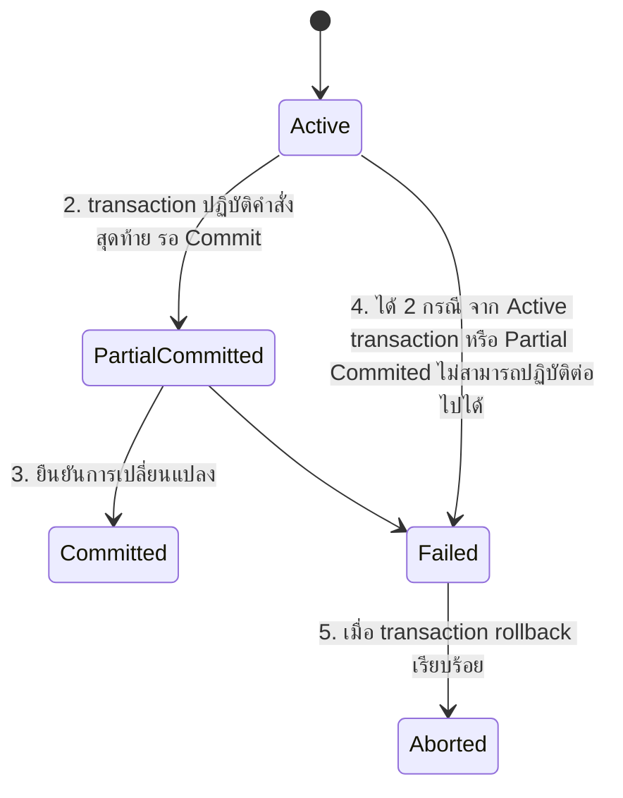
_ต้นฉบับ: รูป "สถานะของรายการเปลี่ยนแปลง" [p.16] ป้าย "1. ระหว่างที่ transaction ปฏิบัติคำสั่งอยู่ เช่น Update, Insert, ..." อยู่ข้าง Active; ชื่อสถานะ "Partial Commited" ในรูปสะกดผิด ในแผนภาพ Mermaid ใช้ชื่อ PartialCommitted (แก้การสะกด)_

---

### 2.4 Concurrency Control (การควบคุมสภาวะพร้อมกัน) — `[Source: extracted]` p.17-20

#### ทำไมต้องมี Concurrency Control [p.17-18]

- ใน **multiuser DBMS** ผู้ใช้หลายคนเข้าถึงฐานข้อมูลในเวลาเดียวกันได้ จึงมีการประมวลผล transaction มากกว่าหนึ่งตัวในเวลาเดียวกันแบบ **interleaving** คือการสลับกันทำงาน [p.17] (สไลด์ยกตัวอย่าง "Schedule C สลับการทำงานระหว่าง T1 และ T2 โดยเริ่มทำ T1 ก่อน" แต่ไม่มีรูป Schedule C ในสไลด์นี้)
- เหตุผลของ interleaving: CPU เร็วกว่าอุปกรณ์ input/output มาก จะสวิตช์ไปมาระหว่าง transaction; interleaving ช่วยป้องกันการประมวลผลที่ต้องใช้เวลานานจากความล่าช้าของ transaction อื่น [p.17]
- ถ้าไม่ควบคุมการใช้งานพร้อมกัน interleaving processing อาจก่อปัญหาหลายกรณี [p.18]

#### ปัญหา 5 แบบ [p.18-20]

> 💡 **Intuition:** ลองนึกถึงพนักงานสองคนที่ใช้สมุดยอดเงินเล่มเดียวกันโดยไม่มีการล็อก — ถ้าทั้งคู่อ่านยอด 1,000 พร้อมกัน แล้วต่างคนต่างเขียนยอดใหม่ทับ ยอดของคนแรกจะหายไป (Lost Update); ถ้าคนหนึ่งแก้ยอดแล้วยกเลิกทีหลัง อีกคนที่อ่านยอดไปแล้วก็ใช้ค่าที่ไม่มีจริง (Dirty Read) นี่คือปัญหาของ multiuser DBMS เมื่อ transaction ทำงานสลับกัน (interleaving)
> [Source: generated — not verified against original document]

| # | ปัญหา | คำอธิบายตามสไลด์ | สไลด์ |
| :-: | :--- | :--- | :--- |
| 1 | **Lost Update Problem** (ปัญหาการสูญเสียการแก้ไข) | การปรับปรุงค่าข้อมูลไม่เป็นไปตามที่ต้องการ เกิดจากสอง transaction ใช้ข้อมูลเดียวกันพร้อมกันในฐานข้อมูล | p.19 |
| 2 | **Temporary Update / Dirty Read / Uncommitted dependency Problem** | T1 ปรับปรุง X (เท่ากับ X−N) แล้ว T2 อ่าน X ไปใช้ ต่อมา T1 ล้มเหลว (transaction fail) จึงปรับค่า X กลับเป็นค่าเริ่มต้น (rollback) ทำให้ T2 ใช้ค่า X−N ที่ปรับไปแล้ว ซึ่งไม่สอดคล้องกับค่า X เมื่อ T1 ล้มเหลว | p.19 |
| 3 | **Incorrect Summary / Consistency Control Problem** | transaction หนึ่งหาค่าสรุปรวม (aggregate summary) แล้วอีก transaction เข้าไปปรับปรุงบางข้อมูลเหล่านั้น ทำให้ค่าสรุปรวมไม่สอดคล้องกับความเป็นจริง | p.19 |
| 4 | **Unrepeatable read** | transaction หนึ่งอ่านข้อมูล X สองครั้ง ระหว่างครั้งที่หนึ่งและสองมีอีก transaction ปรับปรุงค่า X ทำให้อ่านได้ค่าไม่เหมือนกัน | p.19 |
| 5 | **Phantom Phenomenon** | T1 กำลังนับจำนวนบัญชีในตาราง แต่ application เพิ่มบัญชีใหม่เข้าตาราง ทำให้การนับรวมบัญชีใหม่เข้าไปด้วย ผลลัพธ์ผิดพลาด สิ่งที่ถูกต้องคือต้องไม่นำมาคิดรวมในการนับ | p.20 |

**🧭 ทำความเข้าใจ** _[Source: generated — not verified against original document]_

**แตกวลีสำคัญ:**
- "Lost Update" → อัปเดตของ transaction หนึ่งถูกอีก transaction เขียนทับ เหมือนไม่เคยเกิดขึ้น
- "Dirty Read" → อ่านค่าที่ T1 เขียนแต่ยังไม่ commit ซึ่งอาจถูก rollback ภายหลัง
- "Incorrect Summary" → ค่าสรุปรวมผิด เพราะอีก transaction แก้ข้อมูลบางตัวระหว่างที่กำลังรวม
- "Unrepeatable Read" → อ่านข้อมูล 2 ครั้ง ได้ค่าต่างกัน
- "Phantom" → แถวใหม่ขึ้นมา ไม่เหมือน Unrepeatable (Unrepeatable = ค่าของแถวเดิมเปลี่ยน, Phantom = จำนวนแถวเปลี่ยน)

**ตัวอย่าง:**
- ✅ Lost Update: T1 read(X)=100, X:=100-50=50; T2 read(X)=100, X:=100+20=120; T1 write(X)=50; T2 write(X)=120 → 120 ทับ 50 การหัก 50 ของ T1 หายไป (ค่าที่ถูกตาม serial คือ 70)
- ✅ Dirty Read: T1 UPDATE X=50; T2 read(X)=50; T1 ROLLBACK X กลับไป 100 → T2 ใช้ 50 ที่ไม่มีจริง
- ✅ Phantom: T1 COUNT(*) = 100 rows; T2 INSERT 1 row; T1 COUNT(*) ซ้ำ = 101 rows → query เงื่อนไขเดิมได้จำนวนแถวต่างกัน เพราะมีแถวใหม่โผล่
- ✅ Incorrect Summary: A=100, B=200 (รวม 300). T1 อ่าน A=100 → T2 โอน 50 จาก A ไป B (A=50, B=250) แล้ว commit → T1 อ่าน B=250 → SUM = 100 + 250 = 350 (ผิดเกิน 50; ค่าที่ถูกคือ 300)
- ✅ Unrepeatable read: T1 read(X)=100 → T2 write(X)=80 แล้ว commit → T1 read(X) อีกครั้ง = 80 → อ่านแถวเดิม 2 ครั้งได้ค่าต่างกัน (100 vs 80)
- **ต่างกันตรง:** Lost Update = write ทับ; Dirty Read = อ่านค่าที่ยังไม่ commit; Phantom = จำนวน row ที่เข้าเงื่อนไขเปลี่ยน

**อย่าสับสน:** "Dirty Read" หมายถึง (อ่านค่าที่ transaction อื่นเขียนแต่ยังไม่ commit ซึ่งอาจถูก ROLLBACK) ไม่ได้หมายถึง (ข้อมูลสกปรก/ผิดรูปแบบที่ต้องทำ Data Cleansing)

**เช็คความเข้าใจ:** T1 SELECT SUM(salary) FROM employee, T2 INSERT new employee ในระหว่าง T1 กำลังรวมอยู่ เป็นปัญหาแบบไหน?
<details><summary>เฉลย</summary>

**Phantom Phenomenon** (ตรงกับตัวอย่าง Sum(Account) ในสไลด์ p.20):
1. T1 เริ่มรวม salary ของ employee ทุกคน (เช่น 50 แถว)
2. ระหว่างนั้น T2 INSERT employee ใหม่ 1 แถว
3. ผลรวมของ T1 อาจนับแถวใหม่เข้าไปด้วย (51 แถว) ซึ่งตามสไลด์ไม่ควรนับ → ผลผิด

ไม่ใช่ Unrepeatable read (ค่าของแถวเดิมเปลี่ยน) และไม่ใช่ Incorrect Summary แบบที่อีก transaction *แก้ค่า* ของแถวที่มีอยู่แล้ว — ที่นี่เป็นแถวใหม่โผล่ขึ้นมา

</details>

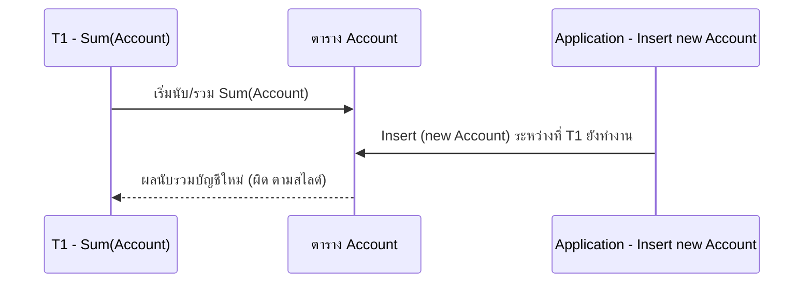
_ต้นฉบับ: รูป Phantom Phenomenon [p.20] เป็นเส้นเวลา 2 เส้นซ้อนกัน: Sum(Account) ยาว และ Insert (new Account) สั้นอยู่ภายใน_

> 💡 **ขยายความ** `[Source: generated — not verified against original document]`: Dirty read เกี่ยวกับการอ่านค่าที่ยังไม่ commit; Unrepeatable read คือแถวเดิมเปลี่ยนค่า; Phantom คือจำนวนแถวที่เข้าเงื่อนไขเปลี่ยน (แถวใหม่โผล่) — ใช้แยก 3 อย่างนี้ตอนสอบ

---

### 2.5 Schedule และ Serializability — `[Source: extracted]` p.21-35

#### นิยาม (สไลด์หัวข้อ "Concurrent Executions") [p.21]

> 💡 **Intuition:** ลองนึกถึงแคชเชียร์คนเดียวที่ดูแลลูกค้า 3 คน (T1, T2, T3) สลับกันทีละนิด — สแกนของ T1 นิดหนึ่ง ไปรับเงิน T2 แล้วกลับมาทำของ T1 ต่อ — ไม่เป็นไรตราบใดที่ **ผลลัพธ์สุดท้ายเหมือน** การบริการทีละคนจนจบในลำดับใดลำดับหนึ่ง (เช่น T1 → T2 → T3) นี่คือ Serializable ไม่จำเป็นต้องทำทีละคนจริงๆ
> [Source: generated — not verified against original document]

- **Schedule** คือ ลำดับการจัดคำสั่งใน Tx ว่าคำสั่งไหนของ Tx ไหนทำก่อน คำสั่งไหนของ Tx ไหนทำตามหลัง [p.21]
- **Concurrent serializable schedule** ทำงานร่วมกันในช่วงเวลาเดียวกัน (รูป T1, T2, T3 ซ้อนเวลา → "ผลลัพธ์ต้องเหมือนกัน" → Serializable Schedule ที่ T1, T2, T3 เรียงต่อกัน) [p.21]
- **Serial Schedule** คือคำสั่งของ transaction เดียวกันถูกปฏิบัติอย่างต่อเนื่องตั้งแต่ต้นจนจบ [p.22]

**🧭 ทำความเข้าใจ** _[Source: generated — not verified against original document]_

**แตกวลีสำคัญ:**
- "Schedule" → ลำดับการสลับคำสั่งของ transaction
- "Serial schedule" → T1 ทั้งหมด → T2 ทั้งหมด → T3 ทั้งหมด (ไม่สลับ)
- "Serializable schedule" → ซ้อนกันแต่ผลเหมือน serial schedule ตัวใดตัวหนึ่ง
- "Concurrent" → ทำงานพร้อมกัน/สลับ
- "Equivalent" → ผลลัพธ์เหมือนกัน

**ตัวอย่าง:**
- ✅ Serial: T1 read(A)→write(A) → T2 read(B)→write(B) (ทั้งหมดต่อเนื่อง)
- ✅ Serializable: T1 read(A), T2 read(B), T1 write(A), T2 write(B) → T1 ใช้แค่ A, T2 ใช้แค่ B จึงไม่มีคู่ conflict เลย ผลเหมือน T1 ต่อ T2 (และ T2 ต่อ T1)
- ❌ Not Serializable: T1 read(A), T2 write(A), T1 write(A), T2 read(A) → precedence graph มี T1→T2 (T1 read(A) ก่อน T2 write(A)) และ T2→T1 (T2 write(A) ก่อน T1 write(A)) เกิด cycle จึงเทียบกับ serial ลำดับใดไม่ได้
- **ต่างกันตรง:** Serial = ต่อเนื่อง; Serializable = ซ้อนได้แต่ผลเหมือน serial

**อย่าสับสน:** "Serializable" หมายถึง (ผลลัพธ์เหมือน serial order ตัวใดตัวหนึ่ง ไม่ใช่ว่า schedule เป็น serial) ไม่ได้หมายถึง (transaction ต้องทำทีละตัว)

**เช็คความเข้าใจ:** Schedule ที่มี T1 read(X), T2 write(X), T1 write(X) เป็น Serializable กับ T1→T2 ตามลำดับ หรือไม่?
<details><summary>เฉลย</summary>

**ไม่ serializable ทั้งกับ T1→T2 และ T2→T1** (เป็นตัวอย่างเดียวกับ T3/T4 ในสไลด์ p.29):
1. หาคู่ conflict ตามลำดับเวลา: T1 read(X) ก่อน T2 write(X) → เส้น T1→T2; T2 write(X) ก่อน T1 write(X) → เส้น T2→T1
2. Precedence graph มี cycle T1→T2→T1 → **ไม่ conflict serializable** (สลับคำสั่งให้เป็น serial ไม่ได้)
3. เช็ค view เพิ่ม: ใน schedule นี้ T1 อ่านค่าเริ่มต้นของ X และ T1 เป็นผู้ write(X) ตัวสุดท้าย
   - serial T1→T2: ผู้ write ตัวสุดท้ายคือ T2 → ไม่ตรง
   - serial T2→T1: T1 อ่านค่าที่ T2 เขียน ไม่ใช่ค่าเริ่มต้น → ไม่ตรง
4. ผลจริงคือ write(X) ของ T2 ถูก T1 เขียนทับ (lost update)

ตอบ: **ไม่ serializable** กับ serial order ใดเลย

</details>

#### Schedule 1, 2, 3 (ตัวอย่างโอนเงิน) [p.22-24]

โจทย์: T1 โอน $50 จาก A ไป B; T2 หัก 10% ของยอดคงเหลือ โดยหักจาก A ไป B [p.22]

**Schedule 1 — serial: T1 แล้ว T2** [p.22]

| ลำดับ | T1 | T2 |
| :-: | :--- | :--- |
| 1 | `read(A)` | |
| 2 | `A := A – 50` | |
| 3 | `write(A)` | |
| 4 | `read(B)` | |
| 5 | `B := B + 50` | |
| 6 | `write(B)` | |
| 7 | | `read(A)` |
| 8 | | `temp := A * 0.1` |
| 9 | | `A := A – temp` |
| 10 | | `write(A)` |
| 11 | | `read(B)` |
| 12 | | `B := B + temp` |
| 13 | | `write(B)` |

**Schedule 2 — serial: T2 แล้ว T1** [p.23] (คำสั่งชุดเดียวกัน แต่ T2 ทั้งชุดมาก่อน T1 ทั้งชุด)

| ลำดับ | T1 | T2 |
| :-: | :--- | :--- |
| 1 | | `read(A)` |
| 2 | | `temp := A * 0.1` |
| 3 | | `A := A – temp` |
| 4 | | `write(A)` |
| 5 | | `read(B)` |
| 6 | | `B := B + temp` |
| 7 | | `write(B)` |
| 8 | `read(A)` | |
| 9 | `A := A – 50` | |
| 10 | `write(A)` | |
| 11 | `read(B)` | |
| 12 | `B := B + 50` | |
| 13 | `write(B)` | |

**Schedule 3 — ไม่ serial แต่ผลเท่า Schedule 1** [p.24]: สไลด์ระบุว่า T1 และ T2 ประมวลผลแยกกันโดย transaction ไม่ทำตามลำดับ แต่ผลลัพธ์มีค่าเท่ากับ (equivalent) การทำงานตามลำดับ ซึ่งมีผลเหมือน Schedule 1

| ลำดับ | T1 | T2 |
| :-: | :--- | :--- |
| 1 | `read(A)` | |
| 2 | `A := A – 50` | |
| 3 | `write(A)` | |
| 4 | | `read(A)` |
| 5 | | `temp := A * 0.1` |
| 6 | | `A := A – temp` |
| 7 | | `write(A)` |
| 8 | `read(B)` | |
| 9 | `B := B + 50` | |
| 10 | `write(B)` | |
| 11 | | `read(B)` |
| 12 | | `B := B + temp` |
| 13 | | `write(B)` |

- ใน Schedule 1, 2 และ 3 ผลรวม **A + B ถูกรักษาไว้** (In Schedules 1, 2 and 3, the sum A + B is preserved.) [p.24]

**Schedule 4 — ผลไม่เท่ากับ T1 แล้ว T2** [p.26]: สไลด์ระบุว่า T1 และ T2 ประมวลผลพร้อมกัน แต่ผลลัพธ์ที่ได้ไม่เท่ากับ T1 นำ T2 ตาม

| ลำดับ | T1 | T2 |
| :-: | :--- | :--- |
| 1 | `read(A)` | |
| 2 | `A := A – 50` | |
| 3 | | `read(A)` |
| 4 | | `temp := A * 0.1` |
| 5 | | `A := A – temp` |
| 6 | | `write(A)` |
| 7 | | `read(B)` |
| 8 | `write(A)` | |
| 9 | `read(B)` | |
| 10 | `B := B + 50` | |
| 11 | `write(B)` | |
| 12 | | `B := B + temp` |
| 13 | | `write(B)` |

> 💡 **ขยายความ** `[Source: generated — not verified against original document]`: ใน Schedule 4 T2 อ่าน A (แถว 3) ก่อนที่ T1 จะ write(A) (แถว 8) ดังนั้น `write(A)` ของ T1 ทับค่าที่ T2 เขียนไว้ในแถว 6 (การปรับปรุง A ของ T2 หายไป) และ `write(B)` ของ T2 (แถว 13) ทับ `B + 50` ที่ T1 เขียนในแถว 11 (การปรับปรุง B ของ T1 หายไป) จึงเป็นลักษณะ lost update และผลรวม A+B ไม่คงเดิม

#### Conflict Serializability [p.25-29]

- คำสั่ง li และ lj ใน transaction Ti และ Tj ที่ทำกับ **ข้อมูลชุดเดียวกัน (data item)** ทำให้ข้อมูลนั้นขัดแย้ง (**conflict**) ในแต่ละรายการควรมีคำสั่งเขียนข้อมูลอย่างน้อย 1 คำสั่ง [p.25]

| li | lj | Conflict? | สไลด์ |
| :--- | :--- | :-: | :-: |
| `read(Q)` | `read(Q)` | ไม่ conflict | p.27 |
| `read(Q)` | `write(Q)` | Conflict | p.27 |
| `write(Q)` | `read(Q)` | Conflict | p.27 |
| `write(Q)` | `write(Q)` | Conflict | p.27 |

- จาก Schedule 3 สามารถแปลงไปเป็น Schedule 6 โดยสลับการทำงานกันโดยไม่ขัดแย้งกัน [p.28] (รูปใน p.28 ใช้เฉพาะ read/write ไม่มีสูตรคำนวณ: Schedule 3 = T1 `read(A) write(A)`, T2 `read(A) write(A)`, T1 `read(B) write(B)`, T2 `read(B) write(B)`; Schedule 6 = T1 ทั้งชุดแล้ว T2 ทั้งชุด)

| ลำดับ | Schedule 3 (p.28) | Schedule 6 (p.28) |
| :-: | :--- | :--- |
| 1 | T1 `read(A)` | T1 `read(A)` |
| 2 | T1 `write(A)` | T1 `write(A)` |
| 3 | T2 `read(A)` | T1 `read(B)` |
| 4 | T2 `write(A)` | T1 `write(B)` |
| 5 | T1 `read(B)` | T2 `read(A)` |
| 6 | T1 `write(B)` | T2 `write(A)` |
| 7 | T2 `read(B)` | T2 `read(B)` |
| 8 | T2 `write(B)` | T2 `write(B)` |

- **ตัวอย่าง schedule ที่ไม่ conflict serializable** [p.29]: T3 `read(Q)`, T4 `write(Q)`, T3 `write(Q)` (ตามลำดับเวลา) — "We are unable to swap instructions in the above schedule to obtain either the serial schedule < T3, T4 >, or the serial schedule < T4, T3 >."

#### View Serializability [p.30-35]

นิยาม **view equivalent** [p.30]: ให้ S และ S´ เป็น schedule สองอันที่มีชุด transaction เดียวกัน S และ S´ เป็น view equivalent ถ้าเข้าเงื่อนไข 3 ข้อต่อไปนี้ สำหรับทุก data item Q:

1. ถ้าใน S transaction Ti อ่านค่าเริ่มต้นของ Q ใน S´ Ti ก็ต้องอ่านค่าเริ่มต้นของ Q
2. ถ้าใน S Ti execute `read(Q)` และค่านั้นถูกผลิตโดย Tj (ถ้ามี) ใน S´ Ti ก็ต้องอ่านค่า Q ที่ผลิตโดย `write(Q)` เดียวกันของ Tj
3. transaction (ถ้ามี) ที่ทำ `write(Q)` ตัวสุดท้ายใน S ต้องเป็นตัวทำ `write(Q)` ตัวสุดท้ายใน S´ ด้วย

"As can be seen, view equivalence is also based purely on reads and writes alone." [p.30]

**Other Notions of Serializability** [p.31]: schedule ที่สไลด์แสดง ให้ผลเหมือน serial schedule < T1, T5 > แต่ **ไม่ใช่ conflict equivalent หรือ view equivalent** กับมัน การตัดสินความ equivalent แบบนี้ต้องวิเคราะห์ operation อื่นนอกจาก read และ write

| ลำดับ | T1 | T5 |
| :-: | :--- | :--- |
| 1 | `read(A)` | |
| 2 | `A := A – 50` | |
| 3 | `write(A)` | |
| 4 | | `read(B)` |
| 5 | | `B := B – 10` |
| 6 | | `write(B)` |
| 7 | `read(B)` | |
| 8 | `B := B + 50` | |
| 9 | `write(B)` | |
| 10 | | `read(A)` |
| 11 | | `A := A + 10` |
| 12 | | `write(A)` |

**รูปในหัวข้อ "Non-View Serializability" และ "View Serializability" [p.32-34]**: สไลด์แสดงตารางโดยไม่มีคำอธิบายข้อความ (ยกเว้น p.35) ถอดเป็นตารางตามลำดับแถวในรูป (ชื่อ Schedule ตามป้ายใต้รูปของแต่ละสไลด์):

**p.32 Schedule 1** (T1 ทั้งชุด แล้ว T2 ทั้งชุด) และ **Schedule 2** (T2 ทั้งชุด แล้ว T1 ทั้งชุด) — ลำดับ/คำสั่งเหมือนตาราง Schedule 1 [p.22] และ Schedule 2 [p.23] ข้างบนทุกแถว [p.32]

**p.33 Schedule 1** (เหมือน p.32 Schedule 1) และ **Schedule 3** (ลำดับเหมือน Schedule 3 ของ p.24) [p.33]

**p.34 Schedule 5 และ Schedule 6** [p.34]:

| ลำดับ | Schedule 5: T1 | T2 | Schedule 6: T1 | T2 |
| :-: | :--- | :--- | :--- | :--- |
| 1 | `read(A)` | | `read(A)` | |
| 2 | `write(A)` | | `write(A)` | |
| 3 | | `read(A)` | `read(B)` | |
| 4 | `read(B)` | | `write(B)` | |
| 5 | | `write(A)` | | `read(A)` |
| 6 | `write(B)` | | | `write(A)` |
| 7 | | `read(B)` | | `read(B)` |
| 8 | | `write(B)` | | `write(B)` |

(ตารางสองฝั่งอยู่แถวเดียวกันเพื่อเทียบ ไม่ได้หมายความว่าสองชุดทำงานพร้อมกัน)

> 💡 **ขยายความ** `[Source: generated — not verified against original document]`: สไลด์ p.32-34 ไม่มีข้อความอธิบายว่าแต่ละคู่ต้องการสื่ออะไร (ใช้ชื่อ Schedule 1, 3, 5, 6 ซ้ำกับชุดก่อนหน้าแต่เนื้อหาต่าง ดู Pitfalls) ตีความตามนิยามใน p.30 เท่านั้น ถ้าสอบต้องเทียบกับที่อาจารย์เฉลยในห้อง

**Blind write** [p.35]: ตัวอย่างสองชุด (ลำดับตามรูป):

**ชุดบน (T3, T4, T6)**

| ลำดับ | T3 | T4 | T6 |
| :-: | :--- | :--- | :--- |
| 1 | `read(Q)` | | |
| 2 | | `write(Q)` | |
| 3 | `write(Q)` | | |
| 4 | | | `write(Q)` |

**ชุดล่าง (T3, T4, T7)**

| ลำดับ | T3 | T4 | T7 |
| :-: | :--- | :--- | :--- |
| 1 | `read(Q)` | | |
| 2 | | `write(Q)` | |
| 3 | | | `read(Q)` |
| 4 | `write(Q)` | | |
| 5 | | | `write(Q)` |

- สไลด์: การ write ของ T4 ไม่มี read เรียกว่า **blind write**; สำหรับ T6 write ผลลัพธ์เหมือนกันถูกต้อง เป็น **Serializable** แต่ **Conflict** กัน (T3, T4) [p.35]

---

### 2.6 Recoverable, Cascading Rollback, Cascadeless, Isolation Levels — `[Source: extracted]` p.36-39

> 💡 **Intuition:** ลองนึกถึงงานทีม — ถ้า B หยิบงานร่างของ A (ที่ยังไม่ commit) ไปใช้ แล้ว A ล้มเหลวต้องยกเลิกงาน B ก็ต้องยกเลิกงานที่อิงงานร่างนั้นด้วย (Cascading rollback) แต่ถ้า B ส่งงาน (commit) ไปก่อนแล้ว จะดึงกลับไม่ได้ ระบบจึงกู้คืนไม่ได้ — กฎของ "Recoverable" คือ B ต้อง commit หลัง A commit; ถ้าอยากเลี่ยงการยกเลิกลูกโซ่ด้วย B ต้องอ่านเฉพาะงานที่ A commit แล้ว (Cascadeless)
> [Source: generated — not verified against original document]

- **Recoverable schedule** — ถ้า transaction Tj อ่านข้อมูลที่ Ti เขียนไว้ก่อน แล้ว **commit ของ Ti ต้องมาก่อน commit ของ Tj** [p.36]

**🧭 ทำความเข้าใจ** _[Source: generated — not verified against original document]_

**แตกวลีสำคัญ:**
- "Recoverable" → ไม่มี transaction ใด commit ก่อน transaction ที่ตนอ่านข้อมูลมา จึง rollback ได้เสมอโดยไม่ต้องยกเลิกสิ่งที่ commit ไปแล้ว
- "Cascading rollback" → undo ลูกโซ่ (T1 fail → undo T2 → undo T3)
- "Cascadeless" → ไม่มีทางเกิด cascading rollback เพราะทุก transaction อ่านเฉพาะข้อมูลที่ commit แล้ว
- "Commit ก่อน" → ต้องลำดับให้ producer commit ก่อน consumer commit

**ตัวอย่าง:**
- ✅ Recoverable: T1 write(X), T2 read(X), T1 commit, T2 commit → T1 commit ก่อน T2 commit จึง recoverable (ถ้า T1 fail ก่อน commit ก็ rollback T1 และ T2 ได้เพราะ T2 ยังไม่ commit แต่ไม่ cascadeless เพราะ T2 อ่านก่อน T1 commit)
- ✅ Cascadeless: T1 write(X), T1 commit, T2 read(X), T2 commit → ไม่มี cascade เพราะ T2 อ่านหลัง T1 commit แล้ว
- ❌ Not Recoverable: T1 write(X), T2 read(X), T2 commit, T1 rollback → T2 commit ไปแล้วโดยใช้ค่าที่ T1 ยกเลิก ย้อนกลับไม่ได้
- **ต่างกันตรง:** Recoverable = Tj ที่อ่านค่าของ Ti ต้อง commit หลัง Ti commit; Cascadeless = Tj อ่านค่าของ Ti ได้ต่อเมื่อ Ti commit แล้ว (เข้มกว่า และ cascadeless ทุกตัวเป็น recoverable)

**อย่าสับสน:** "Cascading Rollback" หมายถึง (undo ลูกโซ่เพราะ dependency) ไม่ได้หมายถึง (ON DELETE CASCADE ของ Foreign Key)

**เช็คความเข้าใจ:** ถ้า T1 write(X), T2 read(X), T1 rollback, T2 ยังไม่ commit - schedule นี้ recoverable ได้หรือไม่?
<details><summary>เฉลย</summary>

**Recoverable ได้**:
- T2 อ่านข้อมูลจาก T1 ที่ยังไม่ commit
- เมื่อ T1 fail/rollback, T2 ยังไม่ commit ดังนั้นเรา undo T2 ได้
- ลำดับ: T2 rollback (undo) → T1 rollback (undo) → กู้คืนได้
- แต่ schedule นี้ **ไม่ cascadeless**: T1 rollback ทำให้ T2 ต้อง rollback ตาม (cascading rollback)

**ถ้า T2 commit ก่อน T1 rollback → not recoverable** (เพราะ T2 commit ค่าที่ T1 ยกเลิกไปแล้ว ย้อนไม่ได้)

</details>

- Schedule 11 (T8: `read(A)`, `write(A)` … `read(B)`; T9: `read(A)` คั่นหลัง write(A) ของ T8) **ไม่ recoverable ถ้า T9 commit ทันทีหลัง read**; ถ้า T8 abort T9 จะอ่าน (และอาจแสดงให้ผู้ใช้เห็น) สถานะฐานข้อมูลที่ไม่สอดคล้อง จึงต้องให้ฐานข้อมูลมั่นใจว่า schedule เป็น recoverable [p.36]
- **Cascading rollback** — transaction เดียวล้มเหลวแล้วทำให้เกิด rollback ต่อเนื่องเป็นลูกโซ่ ตัวอย่าง: T10 (`read(A)`, `read(B)`, `write(A)`), T11 (`read(A)`, `write(A)`), T12 (`read(A)`) ยังไม่มีใคร commit (schedule จึง recoverable) ถ้า T10 fail ต้อง rollback T11 และ T12 ด้วย และอาจต้องย้อนงานจำนวนมาก [p.37]
- **Cascadeless schedule** — rollback ลูกโซ่ไม่เกิด: สำหรับทุกคู่ Ti, Tj ที่ Tj อ่านข้อมูลที่ Ti เขียน **commit ของ Ti ต้องมาก่อน read ของ Tj**; ทุก cascadeless schedule เป็น recoverable ด้วย; พึงต้องการจำกัด schedule ให้เป็น cascadeless [p.38]

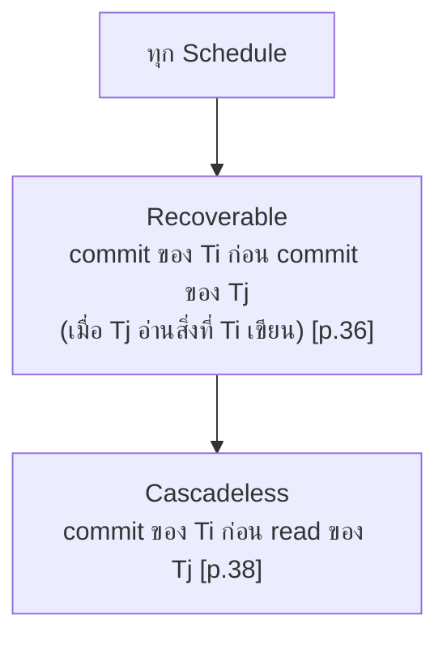
_ต้นฉบับ: "Every cascadeless schedule is also recoverable" [p.38] วงใน-นอกเป็นการตีความของผู้เขียนโน้ต_

#### ระดับความสอดคล้องใน SQL-92 [p.39]

| ระดับ | ความหมายตามสไลด์ |
| :--- | :--- |
| **Serializable** | default — รับประกัน conflict หรือ view serializable, cascadeless และไม่เกิดปัญหา Phantom Phenomenon |
| **Repeatable read** | รับประกันความถูกต้อง ผลลัพธ์เกือบเหมือน serializable ขณะที่มีการแสดงผลลัพธ์ทีละหลายแถว หากย้อนกลับไปดูค่าเดิมภายในแถวทำได้ค่าเดิมเสมอ (**ไม่รับประกัน phantom phenomenon**) |
| **Read committed** | ไม่รับประกันความถูกต้องใด ๆ รับประกันเพียง **cascadeless** เท่านั้น ผลทำให้การทำงานเร็ว ผิดหรือถูกไม่มีใครรู้ บางยี่ห้อเรียกว่า **"Cursor Stability"** |
| **Read uncommitted** | ไม่รับประกันใด ๆ เลย สามารถอ่านได้ขณะยังไม่ commit |

> 💡 **ขยายความ** `[Source: generated — not verified against original document]`: ตามมาตรฐาน SQL ระดับ Read committed ป้องกัน dirty read แต่ยังเกิด unrepeatable read ได้ ซึ่งสอดคล้องกับ "ไม่รับประกันความถูกต้อง" ในสไลด์; ค่า default ของ DBMS จริงแต่ละยี่ห้อต่างกัน (เช่น หลายยี่ห้อ default เป็น Read committed) ไม่ได้ยืนยันกับเอกสารของผู้ผลิต

---

### 2.7 Recovery: Failure, Storage, Backup — `[Source: extracted]` p.40-47

#### Failure Classification [p.40]

| ชนิด | ความหมายตามสไลด์ |
| :--- | :--- |
| **Transaction fail** | Tx ปฏิบัติงานต่อไปไม่ได้ — มี 2 แบบย่อย: **Logical error** (error จาก application เช่น code program ผิดปกติ) และ **System error** (system software เช่น OS, DBMS เข้าสู่สถานะผิดปกติ เช่น deadlock) |
| **System crash** | อาจเกิดจาก SW, HW เช่น HW มีปัญหา (ยกเว้น disk) หรือ bug ของ system software (เช่น DBMS) |
| **Disk failure** | "กรณีที่สามารถกู้คืนระบบได้นั้นคือกรณีของ Transaction fail / System crash เท่านั้น" (ข้อความนี้อยู่ใต้หัวข้อ Disk failure ในสไลด์) |

#### Storage Structure [p.41]

- **Volatile** = ไฟดับแล้วข้อมูลหาย
- **Non-Volatile** = ไฟดับแล้วข้อมูลไม่หาย
- **Stable Storage** = storage ที่สมมติว่าไม่มีวันเสียหาย

#### Database Backup/Recovery Concepts [p.42]

การสำรองข้อมูลมี 2 ประเภท (ระบบทั่วไป หรือ ระบบฐานข้อมูล) [p.42]:

| ประเภท | ความหมายตามสไลด์ | ข้อดี / ข้อเสีย |
| :--- | :--- | :--- |
| **Volume backup** | สำรองข้อมูลทุกประเภท รวมทั้งค่าเก่าและค่าใหม่ | ข้อเสีย: ใช้เวลามาก |
| **Incremental backup** | สำรองเฉพาะสิ่งที่มีการเปลี่ยนแปลง (**AIJ**) | ข้อดี: ใช้เวลาน้อยในการสำรองข้อมูล |

- หมายเหตุท้ายสไลด์: "\*\*\*volume ต่างกับ export กับ import เพราะใช้เวลานาน และวิธีการทำการสำรองข้อมูลต่างกัน" [p.42]

> 💡 **ขยายความ** `[Source: generated — not verified against original document]`: AIJ น่าจะย่อมาจาก After-Image Journal (log ของค่าหลังการเปลี่ยนแปลง) สไลด์ไม่ได้ขยายคำย่อ และไม่ได้อธิบายต่อว่ามีข้อมูลอะไรใน AIJ

#### Incremental Backup Using Archive Logs [p.43]

รูปแสดง **log file (AIJ)** เป็นกลุ่ม log ที่วนซ้ำ (ลูกศรย้อนกลับด้านบน) แต่ละไฟล์ส่งออกไปยัง **Archive Logs** [p.43]

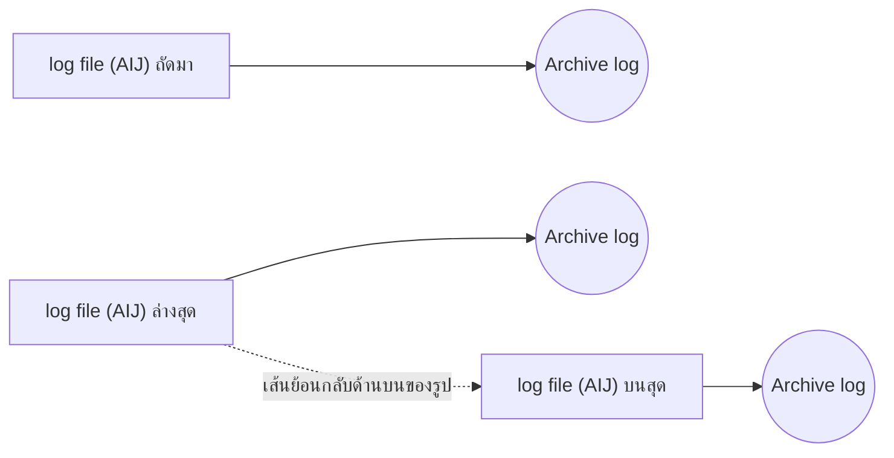
_ต้นฉบับ: รูป "Incremental Backup Using Archive Logs" [p.43]_

#### Volume Backup and Incremental Backup [p.44]

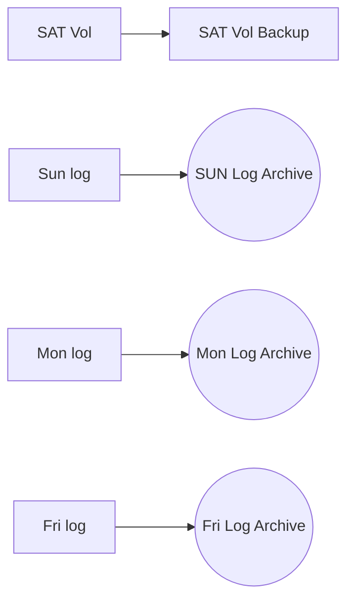
_ต้นฉบับ: รูป [p.44] มีจุดไข่ปลา (…) ระหว่าง Mon และ Fri แสดงว่ามีวันอื่นคั่นอยู่_

#### ตัวอย่าง: DB crashed วัน Wed 11:00 am — Rollforward Activity [p.45-47]

- p.45: รูปฐานข้อมูลระเบิดป้าย "DB crashed — Wed 11:00 am" [p.45]
- p.46 (Rollforward Activity): เริ่มจาก **SAT Vol Backup** กู้เป็น **2nd Vol Backup** แล้วเล่น log archive ต่อเนื่อง: **SUN Log Archive** → **Mon Morning**, **Mon Log Archive** → **Tue Morning**, **Tue Log Archive** → **Wed Morning**, **Wed Log up to 11:00 am** → **Wed 11:00 am** [p.46]

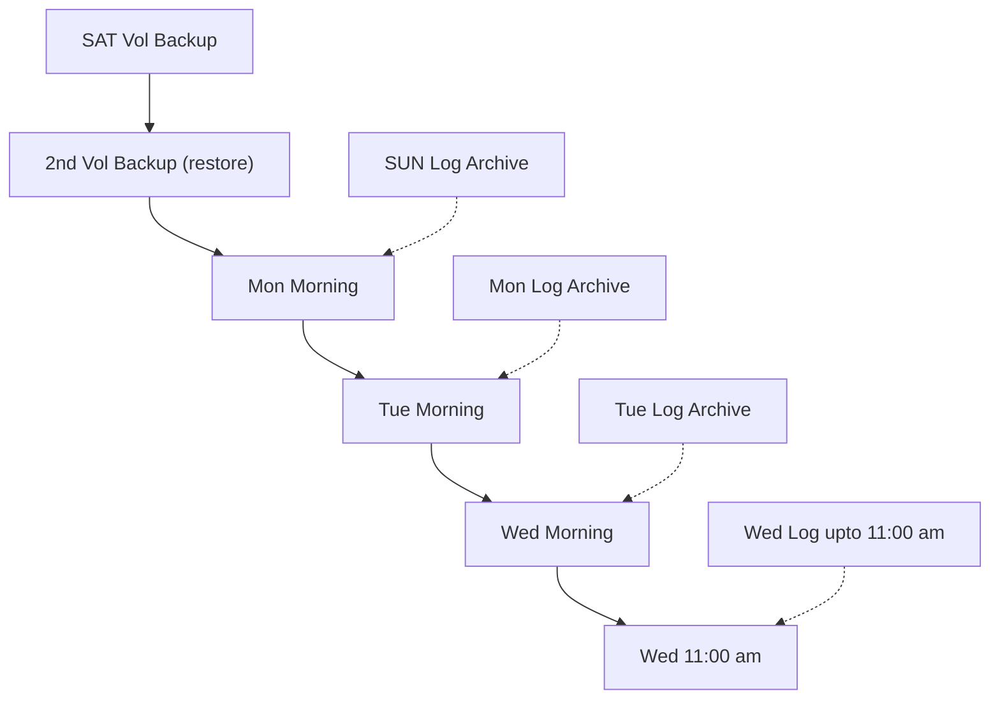
_ต้นฉบับ: รูป Rollforward Activity [p.46] — การจับคู่ log archive กับสถานะ "Morning" ตามตำแหน่งลูกศรในรูป (log ขวาของแต่ละวันชี้ไปสถานะวันถัดไป) เป็นการอ่านภาพของผู้เขียนโน้ต_

- **Recovery Applied** [p.47]: หาก DBA ทำ Backup Data **ทุกสัปดาห์** และทำ Incremental Backup **ทุกวัน** เมื่อระบบล่ม DBA ควรนำ **Volume Backup มาใช้ร่วมกับ Incremental Backup** มากู้คืนระบบ วิธีนี้เรียกว่า **"Roll Forward"**

---

### 2.8 Shadow Paging — `[Source: extracted]` p.48-51

- **เหตุผล** [p.48]: การทำ log-based recovery ต้องใช้เวลา recovery มาก โดยไม่สามารถมองเห็น logfile ครั้งสุดท้ายได้ทันที จึงใช้วิธี **Shadow paging**; Shadow paging ใช้สำหรับระบบบนเครื่อง **PC ซึ่งไม่มี logfile**
- **รูป p.49**: **shadow page table** (Page 1) ชี้ไปที่ page on disk ที่เป็น **Old**; **current page table** (Page 1) ชี้ไปที่ page on disk ที่เป็น **Update** [p.49]

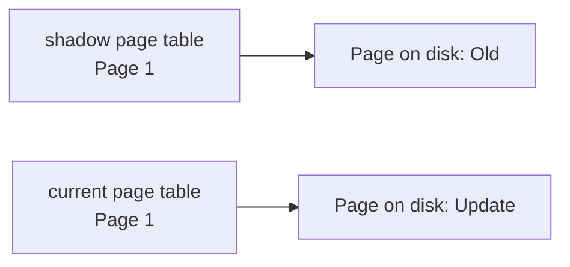
_ต้นฉบับ: รูป Shadow Paging [p.49]_

- **Concept** [p.50]:
  - เมื่อ Tx เริ่มต้น ระบบสร้าง **current page table** คู่กับ shadow paging
  - เมื่อมีการเปลี่ยนแปลง: หา page on disk ว่าง ๆ มาใส่ข้อมูลที่เปลี่ยนแปลง; current page ชี้ตัวใหม่แทน
  - ถ้า **fail**: ลบ current page table อันใหม่ทิ้ง ใช้อันเก่าได้เลย เรียกว่า **"instance roll back"**
  - ถ้า **commit**: save current page table แล้วลบของเก่าทิ้ง
- **ข้อเสีย** [p.51]:
  - data fragment เยอะ (ต้องแทรกอันใหม่ตลอด)
  - commit ช้าหน่อย (ต้อง save ลง dbspace จริง)
  - ไม่มี log file เอามาทำ incremental backup (ทุกครั้งต้อง Volume Backup)

---

## Part 3: Quick Reference & Exam Cheat Sheet

### Checklist สรุปหัวใจสำคัญก่อนสอบ

* [ ] **Transaction** = กลุ่มคำสั่งที่เข้าถึง/ปรับปรุงข้อมูล; ระหว่างทำ DB อาจ inconsistent แต่ตอน commit ต้อง consistent [p.4, 6]
* [ ] **Sync point:** commit ยืนยัน, rollback ยกเลิกถึง sync point ล่าสุด; autocommit on = commit ทุกคำสั่ง [p.5, 8]
* [ ] **ACID:** Atomicity (DBMS) / Consistency (programmer) / Isolation / Durability [p.10-12]
* [ ] **Shadow-database:** db_pointer ชี้สำเนาที่ consistent; ข้อจำกัด: transaction เดียว, disk ไม่เสีย, ไม่ efficient กับ DB ใหญ่, ไม่รองรับ concurrent [p.13-14]
* [ ] **สถานะ 5 อย่าง:** Active → Partially committed → Committed | Active/Partially committed → Failed → Aborted (restart ถ้าไม่มี internal logical error หรือ kill) [p.15-16]
* [ ] **ปัญหา concurrency 5:** Lost Update, Dirty Read, Incorrect Summary, Unrepeatable read, Phantom [p.18-20]
* [ ] **Schedule / Serial Schedule / Serializable:** serial = Tx หนึ่งรันต่อเนื่องจบ; serializable = ซ้อนกันแต่ผลเท่า serial [p.21-24]
* [ ] **Conflict:** คู่คำสั่งบน item เดียวกันที่มี write อย่างน้อยหนึ่ง (read-read ไม่ conflict) [p.25, 27]
* [ ] **View equivalent:** 3 เงื่อนไข (initial read, read-from เดียวกัน, final write เดียวกัน) [p.30]
* [ ] **Blind write:** write ที่ไม่มี read ก่อน [p.35]
* [ ] **Recoverable / Cascading / Cascadeless** [p.36-38]
* [ ] **SQL-92 4 ระดับ:** Serializable (default) / Repeatable read / Read committed (Cursor Stability) / Read uncommitted [p.39]
* [ ] **Failure 3 ชนิด:** Transaction fail, System crash, Disk failure [p.40]
* [ ] **Storage:** Volatile / Non-volatile / Stable [p.41]
* [ ] **Backup:** Volume (ช้า) vs Incremental/AIJ (เร็ว); **Roll Forward** = Volume backup + log archives [p.42-47]
* [ ] **Shadow paging:** ไม่มี log, PC; fail = ทิ้ง current page table ("instance roll back"); ข้อเสีย fragment, commit ช้า, ไม่มี incremental backup [p.48-51]

### สรุป Schedule ที่ปรากฏในสไลด์

| Schedule | ลักษณะตามสไลด์ | สไลด์ |
| :--- | :--- | :-: |
| Schedule 1 | serial T1 → T2 | p.22 |
| Schedule 2 | serial T2 → T1 | p.23 |
| Schedule 3 (โอนเงิน) | แทรกกันแต่ผลเท่า serial (A+B คงที่) | p.24 |
| Schedule 4 | แทรกกันแต่ผลไม่เท่า serial | p.26 |
| Schedule 3 / 6 (ชุด Conflict Serializability) | สลับคำสั่งไม่ขัดแย้งได้ 3 → 6 | p.28 |
| (T3, T4) | ไม่ conflict serializable | p.29 |
| (T1, T5) | ผลเท่า < T1, T5 > แต่ไม่ conflict/view equivalent | p.31 |
| Schedule 11 (T8, T9) | ไม่ recoverable ถ้า T9 commit ทันที | p.36 |
| (T10, T11, T12) | recoverable แต่เกิด cascading rollback | p.37 |

### Concept Map

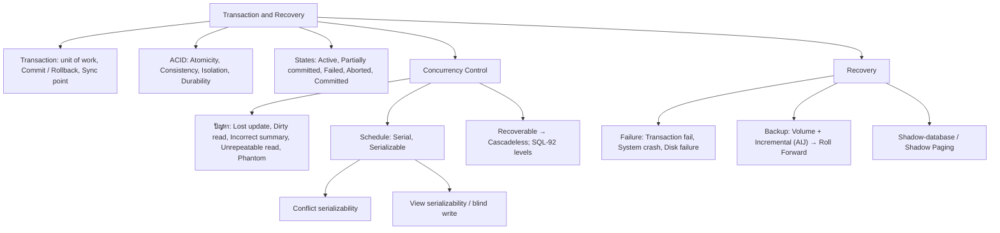

---

## ⚠️ Common Pitfalls & Exam Traps

* **เลขท้ายสไลด์ไม่ตรงลำดับหน้า PDF:** เลขท้ายสไลด์ (footer) เท่ากับเลขหน้า PDF ถึง p.39 แต่ p.40-51 ใช้เลข 42-53 (p.40→42 … p.51→53) และ p.52 ใช้เลข 64 — เลขข้ามไปแสดงว่าสไลด์บางส่วนของชุดเดิมไม่อยู่ในไฟล์นี้ (ข้อสันนิษฐานของผู้เขียนโน้ต ไม่ได้ยืนยัน) และ p.48 พูดถึง log-based recovery ซึ่งไม่มีสไลด์อธิบายในไฟล์นี้ ทั้งที่ Learning Objective ระบุ "Recovery Management Concepts" [p.2, 40-52]
* **หัวข้อ "Non-View Serializability" (p.32):** รูปที่แสดงคือ serial schedule สองแบบ (T1→T2 และ T2→T1) สไลด์ไม่ได้บอกเหตุผลของชื่อหัวข้อ ไม่ได้เติมเอง [p.32]
* **ชื่อ Schedule ซ้ำกันแต่เนื้อหาต่างกัน:** "Schedule 1/2/3" ใน p.22-24 (โอนเงินพร้อมสูตร) ไม่ตรงกับ "Schedule 1/2" ใน p.32 และ "Schedule 1/3" ใน p.33; "Schedule 3" ใน p.28 (ใช้เฉพาะ read/write) ก็ไม่เหมือน Schedule 3 ใน p.24; "Schedule 6" ใน p.28 กับ p.34 หน้าตาเหมือนกัน — ต้องดูเลขสไลด์กำกับทุกครั้ง [p.22-24, 28, 32-34]
* **ศัพท์ไม่สม่ำเสมอ:** p.12 ป้ายเส้นล่างคือ "Serial Schedule" แต่ p.21 ป้ายรูปทรงเดียวกันคือ "Serializable Schedule"; p.36 เรียก "Schedule 11" ทั้งที่ไม่มี Schedule 7-10 ในไฟล์ [p.12, 21, 36]
* **ภาพ Schedule C ที่ไม่มีในสไลด์:** p.17 อ้าง "ภาพ Schedule C" แต่สไลด์นั้นไม่มีรูป [p.17]
* **Isolation ไม่มีผู้รับผิดชอบระบุ:** สไลด์ระบุว่า Atomicity = DBMS รับผิดชอบ, Consistency = programmer รับผิดชอบ [p.11] แต่ไม่ระบุสำหรับ Isolation และ Durability (Durability มีข้อความ "DBMS รับประกัน" [p.12]) ช่อง Isolation ในตารางจึงเป็น "ไม่ระบุ"
* **Disk failure ในสไลด์:** ข้อความใต้ "Disk failure" บอกว่ากู้คืนได้เฉพาะ Transaction fail / System crash ซึ่งไม่ได้อธิบาย disk failure เอง [p.40]
* **"autocommit … สมัยก่อน":** ประโยคสุดท้ายของ p.8 ลงท้าย "สมัยก่อน" ความหมายไม่ชัด คงไว้ตามต้นฉบับ [p.8]
* **ตัวอักษรผิดในสไลด์ที่แก้ให้ตอนเขียนโน้ต:** "Automicity"→Atomicity [p.11], "Commited"→Committed [p.16 ทั้งในรูปและป้าย; ชื่อสถานะใน Mermaid แก้เป็น PartialCommitted, ข้อความป้าย 4 คงตามต้นฉบับ], "buffre"→buffer [p.9 (คงไว้ตามต้นฉบับในข้อความอ้างรูป)], "เรียกกว่า"→เรียกว่า [p.47], ข้อความ "รายการเปลี่ยนแปลง 3 / 6" [p.28] เขียนเป็น "Schedule 3 / 6" ตามป้ายใต้รูป; และที่เรียบเรียงใหม่ให้อ่านง่ายจากข้อความที่สระ/วรรณยุกต์เพี้ยนใน text layer: "กว้า"→กว่า, "ก้อน"→ก่อน, "อินเทอร้ลิฟวิ่ง"→อินเทอร์ลิฟวิ่ง, "ระหว้าง"→ระหว่าง, "อุปกรณ้"→อุปกรณ์, "เอ้าพุท"→เอาต์พุต, "ช้วย"→ช่วย, "ใช้าน"→ใช้งาน, "สอดคลอง"→สอดคล้อง [p.17-19] (ทั้ง text layer และภาพสไลด์ p.17, p.19 แสดงวรรณยุกต์/สระเพี้ยนหรือหาย จึงเป็นการสร้างตัวสะกดคืนโดยผู้เขียนโน้ตจากบริบท ไม่ใช่การคัดลอกจากต้นฉบับ); สระ "ำ" ที่ text layer แยกเป็นช่องว่าง (เช่น "ด าเนินการ") ฟื้นเป็น "ดำเนินการ" ทุกที่ [p.4-12, 16-52]
* **สัญลักษณ์ในข้อความ:** อักขระพิเศษ 1 ตัว (U+F097) หน้า "ทำไมต้อง Concurrency Control" ใน p.18 เป็นสัญลักษณ์ bullet ของฟอนต์ ไม่ใช่ตัวอักษร จึงตัดทิ้ง
* **Serializable default ใน p.39:** เป็นการอ้างตามสไลด์ (SQL-92) ในทางปฏิบัติ DBMS แต่ละยี่ห้อ default ต่างกัน — ดูหมายเหตุ 💡 ใน 2.6
* **ข้อย่อย "แฟ้มที่เก็บรายการการเปลี่ยนแปลง" (p.4):** สไลด์ไม่อธิบายเพิ่ม ไม่ได้เติมเนื้อหาและไม่ได้ตีความว่าเป็นหัวข้อแยก

---

## เอกสารเชื่อมโยง (Wiki-Style Backlinks)

* **วิชาและหัวข้อที่เกี่ยวข้อง:**
  * [[Chapter 06 Database System Architecture]] (DBMS Component Modules และ DBMS Functions ที่บทนี้ขยายต่อ; Oracle redo/undo และ background process ที่เกี่ยวกับ recovery)
  * [[Chapter 01 Introduction to Database System & Relational Model]] (พื้นฐาน DBMS และ Relational Model ที่บทนี้ใช้ต่อ)

* **แบบฝึกหัด:**
  * [[HW-Database-02]]

* **แหล่งข้อมูล:**
  * Source: `Resources/Books/Database/Database_Concept_07(2).pdf` (52 slides, KMITL Faculty of Information Technology)
