# Database - Chapter 08: Introduction to Business Intelligence and Data Warehouse

> **วิชา:** 06066300 Database System Concepts | **สถาบัน:** KMITL, Faculty of Information Technology
> **Source:** `Resources/Books/Database/Database_Concept_08(1).pdf` (54 slides) — ชื่อบทตามสไลด์: "CHAPTER 8 INTRODUCTION TO BUSINESS INTELLIGENCE AND DATA WAREHOUSE" [p.1]
> **ป้ายแหล่งที่มา:** เนื้อหาที่ไม่มีป้ายพิเศษมาจากสไลด์ `[Source: extracted]` | เนื้อหาที่ผู้เขียนเพิ่มอยู่ใน blockquote ขึ้นต้นด้วย 💡 และติดป้าย `[Source: generated — not verified against original document]` | การอ้างอิง `[p.N]` = ลำดับหน้าใน PDF (เลขท้ายสไลด์ไม่ตรงตั้งแต่ p.43 ดู Pitfalls)
> **หมายเหตุเรื่องภาษาไทย:** สไลด์ p.6-25 มีวรรณยุกต์/สระบนล่างหายหรือเลื่อนตำแหน่งทั้งใน text layer และในภาพ โน้ตนี้ **สร้างตัวสะกดคืนจากบริบท** เทียบกับภาพสไลด์ (ดู Pitfalls)

> **สไลด์ที่ไม่มีเนื้อหาให้สรุป:** p.1 (หน้าปก), p.54 (รูป "QUESTIONS") — p.39 เป็นรูปล้วนไม่มีข้อความ สรุปไว้ในหัวข้อที่เกี่ยวข้อง

---

## Part 1: Macro Architecture & Overview

บทที่ 8 มี 2 ส่วนใหญ่ คือ **Business Intelligence (BI) และ Data Warehouse** (8.1-8.6: BI, องค์ประกอบของ BI, คลังข้อมูล, เครื่องมือพัฒนา (ETL), การออกแบบ (Star / Snowflake), การวิเคราะห์ด้วย OLAP) และ **NoSQL Concept** (8.7: SQL, NoSQL, ลักษณะ, ชนิด, เปรียบเทียบ SQL vs NoSQL, เครื่องมือ) [p.2, 3, 6, 10, 14, 16, 22, 26]

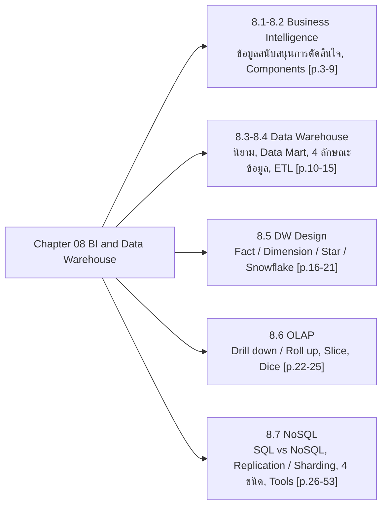

### ตารางเปรียบเทียบ Star Schema กับ Snowflake Schema (สรุปจาก p.19-21)

| หัวข้อ | Star Schema [p.19-20] | Snowflake Schema [p.21] |
| :--- | :--- | :--- |
| โครงสร้าง | 1 Fact Table + Dimension Table **ตารางเดียวต่อมิติ** | 1 Fact Table + Dimension Tables ของบางมิติมี **มากกว่า 1 ตาราง** |
| Normalization | Fact อยู่ใน 3NF; Dimension ถูกลดระดับ (Denormalized) ให้อยู่ใน 2NF ยอมให้ข้อมูลซ้ำซ้อน เพื่อความเร็ว | เกิดจากการทำ normalization ให้ Dimension Tables เมื่อมีแอตทริบิวต์จำนวนมากเป็นสัดส่วนที่มีนัยสำคัญ |
| Join | Join จาก Fact ไป Dimension **ระดับเดียว** คิวรีไม่ซับซ้อน | (สไลด์ไม่ระบุ) |
| ตัวอย่างในสไลด์ | ProductDimension มี Category และ SubCategory ในตารางเดียว | ProductDim แตกตาราง Category ออกมา |

### ตารางเปรียบเทียบ SQL กับ NoSQL (สรุปจาก p.33-35)

| | SQL | NoSQL |
| :--- | :--- | :--- |
| ข้อดี | เหมาะกับข้อมูลมีโครงสร้างและงาน transactional ประสิทธิภาพสูง; ผลิตภัณฑ์พิสูจน์แล้ว มีเครื่องมือหลากหลาย | เหมาะกับข้อมูลแบบ non-relational; schema-less แก้ไขโครงสร้างบ่อยและเพิ่มข้อมูลหลายแบบได้ง่าย; scale ง่ายบน distributed system (cloud) |
| ข้อเสีย | scale ยาก; schema คงที่ (fixed schema) | เครื่องมือและการติดตั้งยังไม่สุก; response time อาจช้ากว่า; (ไทย) non-transactional, ต้นทุนการอ่านสูงกว่า, ไม่มีมาตรฐานกลาง, ผู้เชี่ยวชาญยังน้อย |
| ตัวอย่าง | MySQL, PostGreSQL, SQL Server, Oracle | Amazon DynamoDB, MongoDB, Couchbase, Riak |

---

## Part 2: Module-by-Module Deep Dive

### 2.1 Business Intelligence: BI (หัวข้อ 8.1) — `[Source: extracted]` p.2-5

- **Learning Objective** [p.2]: (1) ระบบธุรกิจอัจฉริยะ (BI) (2) องค์ประกอบของ BI (3) ระบบคลังข้อมูล (Data Warehouse) (4) เครื่องมือพัฒนาระบบคลังข้อมูล (DW Development tools) (5) ออกแบบระบบคลังข้อมูล (DW Design) (6) การวิเคราะห์ข้อมูลด้วย OLAP (7) NoSQL Concept
- **ระบบธุรกิจอัจฉริยะ** คือ ระบบสารสนเทศสนับสนุนการตัดสินใจ (Decision Support Data) ของผู้บริหารในระดับ **เชิงกลยุทธ์ (Strategic Decision)** เพื่อให้ธุรกิจได้เปรียบเชิงการแข่งขัน (**Competitive Advantage**) [p.3]
- BI ประกอบด้วยเทคโนโลยีรวบรวมและจัดเก็บข้อมูล และเทคโนโลยีวิเคราะห์และเข้าถึงข้อมูลแบบ **หลายมิติ (Multidimensional Model)** ช่วยให้ผู้บริหารตัดสินใจทางธุรกิจดียิ่งขึ้น [p.3]

#### ข้อมูลสนับสนุนการตัดสินใจต่างจากข้อมูลระบบปฏิบัติงาน (Operational Data) 3 ประการ [p.4]

| ประการ | คำอธิบายตามสไลด์ |
| :--- | :--- |
| **Time Span** | จัดเก็บตามกาลเวลา ตั้งแต่อดีตถึงปัจจุบัน วิเคราะห์ข้อมูลในแต่ละช่วงเวลาได้ |
| **Level of Aggregation** | จัดเก็บเป็นการสรุปรวม (Aggregation) หลายระดับ เช่น ยอดขายแต่ละเดือน ไตรมาส ปี เข้าถึงได้อย่างรวดเร็ว |
| **Dimensionality** | จัดเก็บหลายมิติ หรือแบบลูกบาศก์ (Cube Data) วิเคราะห์ตามมิติที่ต้องการ เช่น มิติผลิตภัณฑ์ (Product), สถานที่ (Region), เวลา (Time) |

- **ข้อมูลแบบหลายมิติ (Cube Data)** [p.5]: รูป "Sales Revenues" แกน **Products** (White Wine, Red Wine, Vodka, Rum), **Regions** (North, South, East, West), **Time** (Q1-09, Q2-09, Q3-09, Q4-09, Q1-10, Q2-10, Q3-10, Q4-10) ลูกบาศก์หนึ่งก้อนถูกล้อมกรอบสีแดง; ที่มา: John Wiley & Sons, Inc. [p.5]

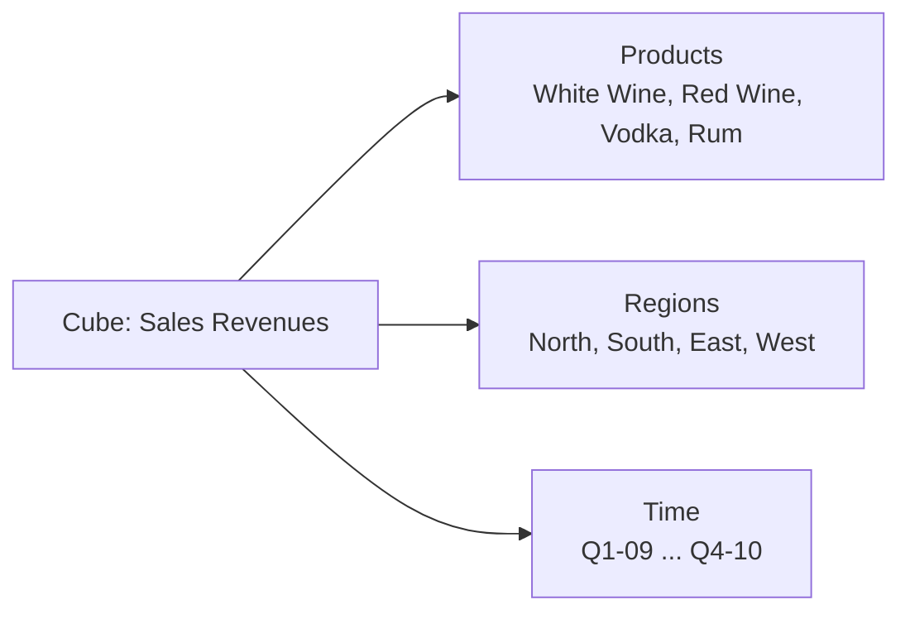
_ต้นฉบับ: รูปลูกบาศก์ [p.5]_

---

### 2.2 Business Intelligence Components (หัวข้อ 8.2) — `[Source: extracted]` p.6-9

- การตัดสินใจระดับกลยุทธ์ต้องใช้ข้อมูลแบบ **บูรณาการ** ข้อมูลนำเข้าจึงมาจากแหล่ง **ภายใน** (ระบบสารสนเทศระดับปฏิบัติการ (Operational System), ระบบวางแผนทรัพยากรองค์กร (ERP)) และ **ภายนอก** (เช่น ระบบโซ่อุปทาน (SCM)) [p.6]
- ข้อมูลนำเข้ามีหลายรูปแบบ อาจมาจาก DBMS ต่างชนิด/ต่างยี่ห้อ (Vendors) หรือไฟล์ข้อมูล (Flat Files) ต้องมีกระบวนการและเครื่องมือจัดการ เพื่อให้ข้อมูลถูกต้อง สอดคล้อง และอยู่ในรูปแบบมาตรฐาน กระบวนการคือ **Extract** (ดึงข้อมูล) → **Transform** (แปลงให้ตรงความต้องการ) → **Load** (นำเข้าคลังข้อมูล) โดยใช้เครื่องมือ **ETL** [p.7]
- ลักษณะการใช้ข้อมูล: วิเคราะห์ตามสมมติฐาน เจาะลึกตามความต้องการ (**On Demand**) หรือหาแนวโน้ม (**Trend**) ผู้วิเคราะห์ต้องการคำตอบทันที จึงต้องมีเครื่องมือประสิทธิภาพสูงที่ประมวลผลแบบโต้ตอบ (**Interactive**) เครื่องมือสำคัญคือ **OLAP (Online Analytical Processing)** [p.8]
- BI ยังครอบคลุมการค้นหารูปแบบ (Pattern) หรือความสัมพันธ์ที่ซ่อนอยู่ในข้อมูลปริมาณมากโดยอัตโนมัติ เรียกว่า **การทำเหมืองข้อมูล (Data Mining)** และมีแบบจำลองการวิเคราะห์ข้อมูลทางธุรกิจ (**Business Data Analysis Model**) กับเครื่องมือจัดรูปแบบการแสดงข้อมูล (**Data Visualization**) [p.8]

#### แผนภาพองค์ประกอบของ BI [p.9]

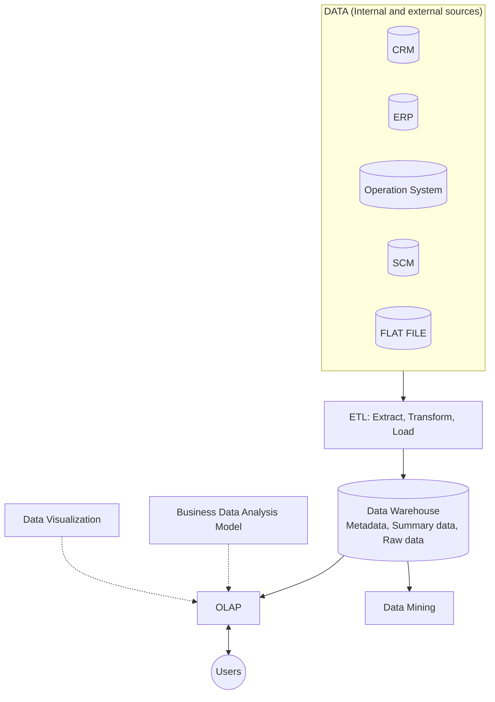
_ต้นฉบับ: รูปบน p.9 — ทิศลูกศรอ่านจากภาพ: Data Warehouse → OLAP และ → Data Mining (ทางเดียว), OLAP ↔ Users (สองทาง), Business Data Analysis Model และ Data Visualization ชี้เข้า OLAP; Data Mining ไม่มีลูกศรไป Users ในรูป_

---

### 2.3 Data Warehouse (หัวข้อ 8.3) — `[Source: extracted]` p.10-13

- การออกแบบฐานข้อมูลขึ้นอยู่กับลักษณะและวัตถุประสงค์การใช้งาน; ความต้องการข้อมูลแบบ **บูรณาการ (Integrated data)** และลักษณะการใช้ข้อมูลของ BI ทำให้ใช้ระบบฐานข้อมูลธรรมดาแบบ **TPS (Transaction Process System)** ไม่ได้ แต่ต้องเป็น **Data Warehouse Database** ที่จัดเก็บข้อมูลสนับสนุนการตัดสินใจตามลักษณะที่กำหนด [p.10]
- **คลังข้อมูล (Data Warehouse)** = ฐานข้อมูลขนาดใหญ่ขององค์กร รองรับข้อมูลปริมาณมากจากหลายแหล่ง ตั้งแต่อดีตถึงปัจจุบัน เป็นฐานข้อมูลแบบ **อ่านได้อย่างเดียว (Read-only)** ใช้วิเคราะห์และประมวลผลคิวรีที่ซับซ้อน [p.11]
- **Data Mart** = คลังข้อมูลขนาดเล็กที่ใช้เฉพาะส่วนงาน เช่น คลังข้อมูลฝ่ายการตลาด [p.11]
- **DBMS สำหรับคลังข้อมูล** ต้องมีคุณลักษณะพิเศษเพื่อรองรับการประมวลผลที่รวดเร็ว [p.12]:

| คุณลักษณะ | ความหมายตามสไลด์ |
| :--- | :--- |
| **Database Schema** | โครงสร้างฐานข้อมูลหรือพจนานุกรมข้อมูล (Data Dictionary) นิยามข้อมูล ต้องแสดงข้อมูลที่ซับซ้อน ข้อมูลรวม (Aggregated Data) และข้อมูลสรุป (Summarized Data) และคิวรีตามมิติเวลา ณ เวลาต่าง ๆ ได้ (**Time Slices**) |
| **Data Extraction and Loading (ETL function)** | ฟังก์ชันบูรณาการข้อมูลจากแหล่งต่าง ๆ (ระบบฐานข้อมูล/ไฟล์) รวมทั้งตรวจสอบความไม่สอดคล้องของข้อมูล (**Data Cleaning**) แล้วนำข้อมูลเข้าคลัง |
| **End-user Analytical Interface (OLAP GUI)** | ส่วนต่อประสานผู้ใช้สำหรับวิเคราะห์ เข้าถึงข้อมูลได้ง่ายและรวดเร็ว เพื่อการตัดสินใจที่รวดเร็ว |
| **Size large Database** | ต้องสนับสนุนฐานข้อมูลที่มีขนาดใหญ่ |

- **ETL (p.13)**: รูปแสดง **ETL = EXTRACT, TRANSFORM, LOAD** แตกเป็น 6 ไอคอนเรียงตามตำแหน่งในรูป: EXTRACTION, STAGING AREA, TRANSFORM, LOAD, DATA WAREHOUSE, ANALYTICS [p.13]

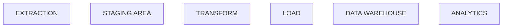
_ต้นฉบับ: รูป ETL [p.13] — ไอคอน 6 อันเรียงซ้ายไปขวาใต้เส้นประเดียวกัน ไม่มีลูกศรระหว่างกัน (ลำดับเป็นตามตำแหน่งในรูป); สไลด์ไม่มีข้อความอธิบายเพิ่ม_

---

### 2.4 Data Warehouse Development tools (หัวข้อ 8.4) — `[Source: extracted]` p.14-15

#### ลักษณะข้อมูลในคลังข้อมูล 4 ประการ [p.14]

| # | ลักษณะ | ความหมายตามสไลด์ | ป้ายกำกับในรูป p.14 (ตามตำแหน่ง) |
| :-: | :--- | :--- | :--- |
| 1 | **Integrated Data** | บูรณาการจากหลายแหล่ง ทั้งภายในและภายนอกองค์กร ต้องสอดคล้องกัน | `!= Mini World` |
| 2 | **Subject-Oriented** | จัดเก็บตามหัวข้อ/เรื่องที่สนใจ หรือตามมิติ (Dimension) ที่ต้องการวิเคราะห์ เช่น ยอดขายตามมิติสินค้า มิติเวลา | `!= Operation` |
| 3 | **Time-Variant** | จัดเก็บตามช่วงเวลา ตรวจสอบย้อนหลังดูการเปลี่ยนแปลงตามกาลเวลาได้ (ช่วงเลา) [sic] | `!= Transaction` |
| 4 | **Nonvolatile** | ไม่มีการบันทึกเปลี่ยนแปลงแก้ไข (Over-written) หรือลบออก คงเดิม (Static data) อ่านอย่างเดียว (Read-only) เพื่อวิเคราะห์และทำรายงาน | `!= Update` |

- รูปใน p.14 มีกล่องคำกำกับ `!= Mini World`, `!= Operation`, `!= Transaction`, `!= Update` และรูปทรงกระบอก "Data Warehouse: Integrated, Subject-oriented, Time-variant, Nonvolatile" การจับคู่กล่องกับข้อ 1-4 ในตารางอ่านจากตำแหน่งในรูป (สไลด์ไม่มีข้อความอธิบายเครื่องหมาย `!=`) [p.14]

> 💡 **ขยายความ** `[Source: generated — not verified against original document]`: เครื่องหมาย `!=` น่าจะสื่อว่า "คลังข้อมูลไม่เหมือนกับ..." ฐานข้อมูลปฏิบัติการ (mini world ของระบบงาน, operation, transaction, update) สไลด์ไม่ได้ขยายความ จึงเป็นการตีความของผู้เขียนโน้ต

#### ETL functions [p.15]

การพัฒนาคลังข้อมูลต้องมีเครื่องมือสำคัญคือ **ETL** ฟังก์ชันได้แก่: ดึงข้อมูล (**Extract**), กรองข้อมูลที่ต้องการ (**Filter**), แปลงตามรูปแบบที่ถูกต้อง (**Transform**), บูรณาข้อมูลเข้าด้วยกัน (**Integrate**), จำแนกข้อมูล (**Classify**), รวมค่ากลุ่มข้อมูล (**Aggregate**) และสรุปข้อมูล (**Summary**) [p.15]

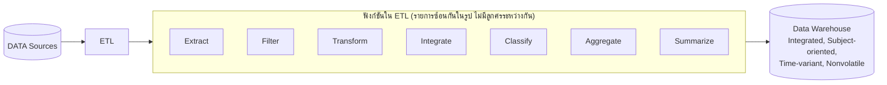
_ต้นฉบับ: รูป ETL [p.15] — ข้อความสไลด์เขียนฟังก์ชันสุดท้ายว่า "Summary" แต่กล่องในรูปเขียน "Summarize"_

---

### 2.5 Data Warehouse Design (หัวข้อ 8.5) — `[Source: extracted]` p.16-21

- ข้อมูลแบบหลายมิติ (Multidimensional Data) ใช้ **แบบจำลองข้อมูลเชิงสัมพันธ์ (Relational Model)** สร้างสกีมาสำหรับฐานข้อมูลหลายมิติ (Multidimensional Database Schema) [p.16]
- องค์ประกอบของแบบจำลองคลังข้อมูล: **Fact Table (Measurement)**, **Dimension Tables**, **Attributes**, **Attribute Hierarchies** [p.16]

#### องค์ประกอบ 4 อย่าง [p.17-18]

| # | องค์ประกอบ | ความหมายตามสไลด์ |
| :-: | :--- | :--- |
| 1 | **Fact Table** | ตารางเก็บข้อมูลตัวเลขของกิจกรรม/ธุรกิจ (Fact) ที่ต้องการวัดหรือวิเคราะห์ (Numeric Measurements) เช่น ยอดขาย จำนวนหน่วยขาย จำนวนลูกค้า [p.17] |
| 2 | **Dimension Tables** | ตารางเก็บมิติต่าง ๆ ที่ใช้ศึกษา Fact เช่น ศึกษายอดขายตามมิติลูกค้าหรือมิติเวลา [p.17] |
| 3 | **Attributes** | ใน Fact Table: คุณลักษณะที่ใช้สืบค้น กรอง และจำแนกข้อมูลของ Fact; ใน Dimension Table: คุณลักษณะของมิติที่ใช้เป็นเงื่อนไขวิเคราะห์ เช่น มิติเวลามี วัน เดือน ไตรมาส ปี ตัวอย่างเงื่อนไข: วิเคราะห์ยอดขายรายไตรมาส [p.17] |
| 4 | **Attribute Hierarchies** | ลำดับของแอตทริบิวต์ใน Dimension Table เช่น มิติเวลา: วัน -> เดือน -> ไตรมาส -> ปี; มิติสินค้า: กลุ่มย่อยสินค้า (Sub-Category) -> ประเภทสินค้า (Category) [p.18] |

- ลำดับของแอตทริบิวต์เป็นสกีมาที่เก็บใน **Data Dictionary** เพื่อใช้ประมวลผลรวมของข้อมูล (**Data Aggregation**) และวิเคราะห์แบบ **Drill down / Roll up** โดยใช้ลำดับนี้ในการเข้าถึงและแสดงข้อมูล [p.18]

#### แบบจำลองสกีมา 2 แบบ [p.19-21]

สไลด์ระบุว่ามี 2 แบบจำลอง คือ **Star Schema** และ **Snowflake Schema** [p.19]

**1) Star Schema** [p.19-20]
- ประกอบด้วย **1 Fact Table** (เก็บข้อมูลวัดหรือ Metrics) ซึ่งอยู่ในขั้น **3NF** และมี **Dimension Table ตารางเดียวต่อแต่ละมิติ** โดยยอมให้ Dimension Table มีความซ้ำซ้อนของข้อมูลหรือลดระดับนอร์มัลไลเซชัน (**Denormalized**) ให้อยู่ในขั้น **2NF** เพื่อความรวดเร็วในการเข้าถึงข้อมูล [p.19]
- ใน Product Dimension ยังมี Functional Dependency (FD) คือความสัมพันธ์ระหว่างแอตทริบิวต์ Sub-category กับ Category (**ไม่ผ่าน 3NF** เนื่องจาก Non-key -> Non-key) แต่เนื่องจากระบบนี้เข้าถึงแบบ **Read-only** จึงไม่มีปัญหาการปรับปรุงข้อมูล (**Update Anomaly**) [p.19]
- **Primary key**: Dimension Table เป็นคีย์หลักปกติ (**Surrogate key**); Fact Table เป็น **Composite key** ที่ประกอบด้วย **Foreign keys จากทุก Dimension Tables** [p.20]
- Star Schema ทำให้ประมวลผลวิเคราะห์ตามมิติได้เร็ว เพราะคิวรีไม่ซับซ้อน Join จาก Fact ไป Dimension **ระดับเดียว** [p.20]
- **Cardinality: One-to-Many** [p.20]

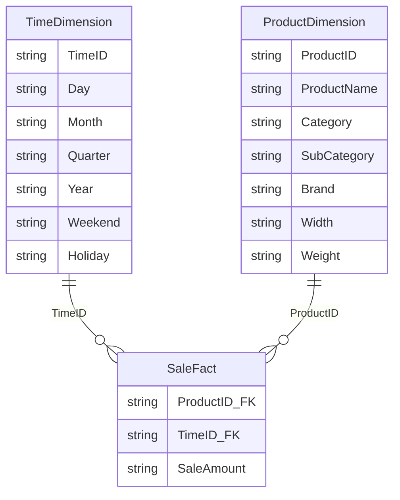
_ต้นฉบับ: รูป Star Schema [p.16, 19, 20] — SaleAmount มีกล่องกำกับ "Measurement" ในรูป_

**2) Snowflake Schema** [p.21]
- แนวคิดหลักเดียวกับ Star Schema: **1 Fact Table** ซึ่งมีคีย์หลักมาจาก FK ของ Dimension Table ต่าง ๆ
- Dimension Tables ของบางมิติมี **มากกว่า 1 ตาราง** ซึ่งเกิดจากการทำ **นอร์มัลไลเซชัน** Dimension Tables ในกรณีที่มีแอตทริบิวต์จำนวนมากที่เป็นสัดส่วนที่มีนัยสำคัญของฐานข้อมูล เช่น **ProductDim ได้แตกตาราง Category ออกมา**

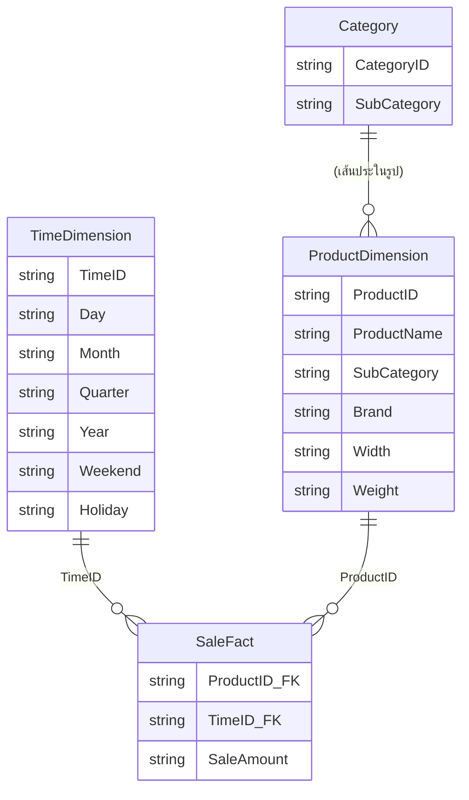
_ต้นฉบับ: รูป Snowflake [p.21] — เส้นเชื่อม ProductDimension กับ Category เป็นเส้นประ ในแผนภาพนี้วาดเป็นความสัมพันธ์ one-to-many ซึ่งเป็นการตีความของผู้เขียนโน้ต; ในรูปตาราง Category มีแอตทริบิวต์ CategoryID และ SubCategory (ดู Pitfalls)_

---

### 2.6 Data Analysis using OLAP (หัวข้อ 8.6) — `[Source: extracted]` p.22-25

#### 1. Drill down และ Roll up [p.22-23]

- **Drill Down** = เข้าถึงข้อมูลแบบเจาะลึกลงในระดับรายละเอียด; **Roll Up** = ดูข้อมูลในระดับสรุปรวมขึ้นไปทีละระดับ [p.22]
- ตัวอย่าง Drill Down ในสไลด์: ขณะดูยอดขายสินค้าแต่ละประเภท พบว่าสินค้าเครื่องใช้ไฟฟ้ายอดขายสูงที่สุด ผู้วิเคราะห์สนใจดูว่าเป็นเครื่องใช้ไฟฟ้ากลุ่มไหนมียอดขายเท่าไร จึง Drill Down เพื่อดูรายละเอียด ระบบสรุปยอดรวมสินค้าในกลุ่มย่อยที่อยู่ในประเภทนั้น [p.22]
- **Roll Up ตรงกันข้าม**: ขณะดูในระดับกลุ่มสินค้า ก็ Roll Up ขึ้นไปดูสรุปยอดรวมของแต่ละประเภทสินค้า [p.22]
- การ Drill down / Roll up ประมวลผลตามลำดับของแอตทริบิวต์ (Attribute Hierarchies) ตัวอย่าง: **Region -> Product Type -> Shop** [p.22]

ตัวอย่างตัวเลขใน p.23 (ลูกศร Roll up ขึ้น / Drill Down ลง):

| ระดับ | ตาราง | ข้อมูล [p.23] |
| :--- | :--- | :--- |
| 1 | **Region** (Region, Sum) | North 61,000 / South 41,500 |
| 2 | **Region-Product Type** (Glossary, Misc.) | North: 55,000, 6,000 / South: 31,000, 10,500 |
| 3 | **Region-Shop-Product Type** (Glossary, Misc.) | North ABC: 30,000, (ว่าง) / North Platter: 25,000, 6,000 / South Five Mart: 31,000, 10,500 |

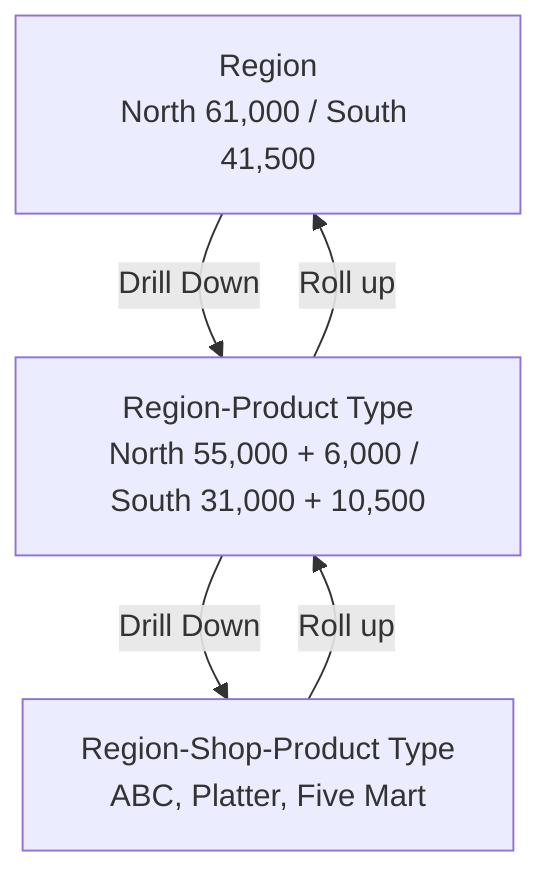
_ต้นฉบับ: รูป p.23_

> 💡 **ตรวจตัวเลข** `[Source: generated — not verified against original document]`: 55,000 + 6,000 = 61,000 และ 31,000 + 10,500 = 41,500 สอดคล้องกับระดับ Region; ABC 30,000 + Platter 25,000 = 55,000

#### 2. Slice [p.24]

เป็นการแบ่งชิ้นข้อมูลหลายมิติหรือกรองข้อมูลเพื่อวิเคราะห์ตามความต้องการ เช่น ในรูปกรองเพื่อดูยอดขายเฉพาะสินค้าที่เป็น **Glossary** ได้แก่ Fish, Meat, Pork [p.24]

Source Cube ใน p.24 (แกนแถว North→South: ABC, Platter, Five Mart; แกนคอลัมน์: Glossary = Fish, Meat, Pork | Misc. = Med., Pencil):

| ร้าน | Fish | Meat | Pork | Med. | Pencil |
| :--- | :-: | :-: | :-: | :-: | :-: |
| ABC (North) | 10,000 | 20,000 | | | |
| Platter | | | 25,000 | 6,000 | |
| Five Mart (South) | 8,000 | | 23,000 | 10,000 | 500 |

รูป "Slice" ด้านล่างของสไลด์แสดงลูกบาศก์แยกเป็น 2 ก้อน: ก้อน Fish/Meat/Pork และก้อน Med./Pencil [p.24]

#### 3. Dice [p.25]

เป็นการวิเคราะห์โดย **เปลี่ยนมิติของข้อมูล** (หมุนแกนหรือเปลี่ยนหน้าของข้อมูลลูกบาศก์) เช่น รูปบนวิเคราะห์ยอดขายของแต่ละ Product Type ตามมิติ **Shop** ส่วนรูปล่างวิเคราะห์ยอดขายของแต่ละ Product Type ตามมิติ **Date** คือเปลี่ยนมิติจาก Shop เป็น Date [p.25]

| Shop-Product Type (รูปบน) | Glossary | Misc. |
| :--- | :-: | :-: |
| ABC | 30,000 | |
| Platter | 25,000 | 6,000 |
| Five Mart | 31,000 | 10,500 |

| Date-Product Type (รูปล่าง) | Glossary | Misc. |
| :--- | :-: | :-: |
| 6/07/2004 | 43,000 | 10,000 |
| 7/07/2004 | 43,000 | 6,500 |

> 💡 **ขยายความ** `[Source: generated — not verified against original document]`: ตัวเลขสองตารางสอดคล้องกัน (Glossary รวม 86,000 = 43,000 × 2; Misc. รวม 16,500 = 10,000 + 6,500) แสดงว่าเป็นก้อนข้อมูลเดียวกันที่ถูกจัดแกนใหม่

---

### 2.7 NoSQL Concept (หัวข้อ 8.7) — `[Source: extracted]` p.26-53

โครงหัวข้อตามสไลด์ [p.26]: SQL Concepts → NoSQL Concepts (NoSQL Characteristics, Types of NoSQL) → SQL vs NoSQL → NoSQL Tools

#### SQL Concepts [p.27-31]

| หัวข้อ | เนื้อหาตามสไลด์ |
| :--- | :--- |
| **SQL Characteristics** [p.27] | Data stored in columns and tables; Relationships represented by data; Data Manipulation Language; Data Definition Language; Transactions; Abstraction from physical layer |
| **Physical Layer Abstraction** [p.28] | Applications specify what, not how; Query optimization engine; Physical layer can change without modifying applications; Create indexes to support queries; In Memory databases |
| **DML** [p.29] | Data manipulated with Select, Insert, Update, & Delete; Data Aggregation; Compound statements; Functions and Procedures; Explicit transaction control |
| **DDL** [p.30] | Schema defined at the start; Create Table (Column1 Datatype1, Column2 Datatype 2, …); Constraints to define and enforce relationships (Primary Key, Foreign Key, and etc.); Triggers to respond to Insert, Update, & Delete; Stored Modules; Alter …; Drop …; Security and Access Control |
| **ACID** [p.31] | Atomic: All of the work in a transaction completes (commit) or none of it completes. Consistent: transforms the database from one consistent state to another; consistency is defined in terms of constraints. Isolated: results of changes during a transaction are not visible until the transaction has committed. Durable: results of a committed transaction survive failures |

ตัวอย่างคิวรีใน p.29:

```sql
Select T1.Column1, T2.Column2 …
From Table1, Table2 …
Where T1.Column1 = T2.Column1 …
```

#### NoSQL คืออะไร [p.32]

- NoSQL ย่อมาจาก **"Not Only Structure Query Language"** (ตามที่สไลด์เขียน) [p.32]
- ตามที่สไลด์เขียน: "Unstructured ของ Database แบบ SQL มันเป็นแนวทางการแก้ไขปัญหาของ Database ที่มีข้อมูลขนาดใหญ่และไม่มีรูปแบบที่ชัดเจน โดยไม่จำเป็นต้องเก็บข้อมูลแบบ Table เดียวที่มี ต้องข้อมูลเหมือนกันทั้งหมดในหนึ่ง Table แต่สามารถจัดเก็บข้อมูลแบบได้หลายรูปแบบ" (คงข้อความตามต้นฉบับ รวมถึงคำเกิน "ต้อง" และ "แบบได้") — ความหมายโดยรวม: เป็นแนวทางแก้ปัญหากับข้อมูลขนาดใหญ่ไม่มีรูปแบบชัดเจน ไม่ต้องเก็บเป็น Table เดียวที่ทุกแถวมีข้อมูลเหมือนกัน แต่เก็บได้หลายรูปแบบ [p.32]

> 💡 **ขยายความ** `[Source: generated — not verified against original document]`: ในตำราทั่วไป NoSQL มักอ่านว่า "Not Only SQL" (ไม่ใช่ "Structure Query Language" ตามที่สไลด์สะกด) — ยังไม่ได้ยืนยันกับเอกสารภายนอก

#### ข้อดี/ข้อเสีย [p.33-35]

- **SQL vs NoSQL (p.33):** ดูตารางเปรียบเทียบใน Part 1
- **Pros: NoSQL (ไทย) [p.34]:**
  - มักออกแบบให้ **Availability สูงมาก** และ **Scale** รองรับผู้ใช้จำนวนมากได้ง่าย แม้ทำงานร่วมกันข้าม Data Center
  - หลายระบบออกแบบมาสำหรับ **Unstructured Data** เช่น ประมวลผล Log, XML, JSON และเอกสารต่าง ๆ ทำให้ยืดหยุ่นกับงานเฉพาะทาง
- **Cons: NoSQL (ไทย) [p.35]:**
  - ทำงานแบบ **Non-transactional** ถ้าข้อมูลละเอียดสูงและผิดพลาดไม่ได้เลย หลายระบบอาจไม่เหมาะ
  - ต้นทุนการเรียกข้อมูลสูงกว่า SQL เพราะไม่สามารถเลือกเจาะจงเฉพาะส่วนที่สนใจได้ ยกเว้นงานเฉพาะทางบางอย่างที่ดีกว่า SQL อย่างชัดเจน (ขึ้นกับงานและเทคโนโลยี) แต่การบันทึกข้อมูลส่วนใหญ่ง่ายกว่า SQL
  - เทคโนโลยีส่วนใหญ่ไม่มีมาตรฐานกลาง การเปรียบเทียบทำได้ยาก ผู้ใช้ต้องเชี่ยวชาญการจัดการซอฟต์แวร์
  - ผู้เชี่ยวชาญที่สนับสนุนในระดับองค์กรมีไม่มาก แต่ NoSQL มีความจำเป็นมากที่องค์กรจะสร้างความแตกต่างเชิงเทคโนโลยีจากคู่แข่ง

#### คุณสมบัติของ NoSQL [p.36]

**Dynamic Schema** (Schema เพิ่มเติมได้), **Auto-Sharding** (แบ่งข้อมูลเก็บเป็นส่วน ๆ), **Integrated Caching** [p.36]

#### Replication และ Sharding [p.37-40]

- **Replication** copies the entire database across all nodes in the distributed system. [p.37]
- **Sharding** divides the data inside the database and partitions pieces of it to different nodes. Databases can be sharded **horizontally (by rows)** or **vertically (by columns)**. [p.38]
- รูป p.39 (ไม่มีข้อความ): Application → Driver → Query Router (หลายตัว) → Shard 1, Shard 2, Shard 3, … Shard N แต่ละ Shard มี 1 **Primary** และ 2 **Secondary** [p.39]

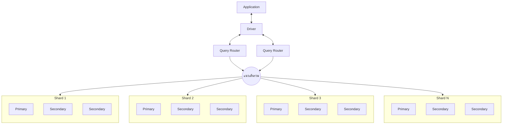
_ต้นฉบับ: รูป p.39 — Driver ต่อสองทางกับ Query Router สองตัว (มี … คั่นระหว่างกัน) ทั้งสองลงเส้นแนวนอนร่วมแล้วมีลูกศรลงไปยัง Shard 1, 2, 3 และ N; กล่อง Primary/Secondary เรียงซ้อนกันไม่มีเส้นเชื่อม (โหนด "แนวเส้นร่วม" ผู้เขียนโน้ตเพิ่มเพื่อแทนเส้นแนวนอน)_

**Pros / Cons of Each** [p.40]

| | Sharding | Replication |
| :--- | :--- | :--- |
| **Pros** | Fast data writing / reading. Low memory overhead. | Fast data reading. High data reliability. |
| **Cons** | Potential data loss | High network overhead. High memory overhead. |

#### NoSQL datatypes (4 ชนิด) [p.41-42]

| ชนิด | ลักษณะตามสไลด์ |
| :--- | :--- |
| **Key-Value Store** | เก็บโดยระบุ Key และ Value ดึงข้อมูลโดยระบุ Key แล้วฐานข้อมูลค้น Value คืน; เหมาะกับข้อมูลไม่ซับซ้อนและต้องการความเร็วสูง เช่น Session ของ Web app |
| **Wide Column Store** | เพิ่ม Column ได้; เหมาะกับระบบฐานข้อมูลที่ต้องการนำเสนอแบบกระจายและขนาดใหญ่ |
| **Document Store** | เพิ่มดัชนี (Index) เพื่อค้นหาข้อมูลได้ เป็นคุณสมบัติเพิ่มเติมจาก Key-Value Store; เหมาะกับการเก็บข้อมูลทั่วไป |
| **Graph Store** | ระบุความสัมพันธ์ที่ซับซ้อนได้มากกว่า Relational database; ตัวอย่าง: Social network |

p.42 แสดงไอคอนสี่แบบ: Key/Value Store, Column-Family Store, Document Store, Graph Databases [p.42]

#### ตัวอย่างโครงสร้างของแต่ละชนิด [p.43-47]

- **Document Store (p.43):** ตัวอย่างเอกสารแบบ JSON-like [p.43]:

```text
{
  first_name: 'Paul',
  surname: 'Miller',
  cell: 447557505611,
  city: 'London',
  location: [45.123, 47.232],
  Profession: ['banking', 'finance', 'trader'],
  cars: [
    { model: 'Bentley', year: 1973, value: 100000, … },
    { model: 'Rolls Royce', year: 1965, value: 330000, … }
  ]
}
```
  ป้ายกำกับในรูป: Fields; Typed field values (String, Number, Geo-Coordinates); Fields can contain arrays; Fields can contain an array of sub-documents [p.43]
- **Column Family (p.44):** Row (row key) มี Column keys (col_a, col_b, col_c, col_d) แต่ละตัวชี้ Column values (v_a ... v_d) หรือ cells [p.44]
- **Column Family (p.45):** "Column family (Table)" มี partition key 101 (email ab@c.to, name otto, tel 12345), 103 (email karl@a.b, name karl, tel 6789, tel2 12233), 104 (name linda) — แต่ละแถวมีคอลัมน์ไม่เท่ากัน; ภาพขวา "Table with single-row partitions" ตัวอย่าง performer/born/country/died/founded/style/type (John Lennon, Paul McCartney, The Beatles) แล้วเทียบกับ "Column family view" [p.45]
- **Key-Value Store (p.46):** 6515551234 → "Jon Doe, Pre-Paid, 40.00"; AAA999 → "Mazda, Black, 626"; 321-651A → "Random Data" [p.46]
- **Graph Database (p.47):** โหนด `815 Alice` เชื่อมกับโหนดความสัมพันธ์ 815→111, 815→119, 815→181 ซึ่งชี้ไปยัง `111 4FUTURE`, `119 P0815`, `181 A42` [p.47]

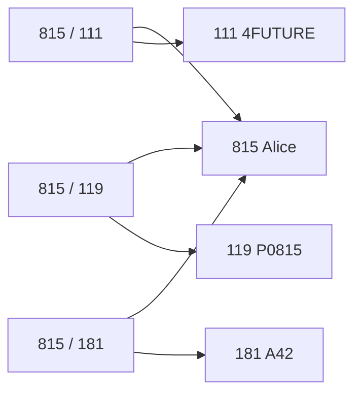
_ต้นฉบับ: รูป Graph Database [p.47] — ทิศลูกศรอ่านจากภาพ (กล่องกลาง 3 กล่องชี้ไป Alice ด้านซ้ายและชี้ไปกล่องขวา)_

- p.37 รูป: ฐานข้อมูลหนึ่งก้อนลูกศรไปเป็นสำเนาเต็มสองก้อน; p.38 รูป: ฐานข้อมูลหนึ่งก้อนลูกศรไปเป็นสามชิ้นแยกกัน (สไลด์ไม่มีข้อความเพิ่มนอกจากหัวข้อ) [p.37-38]
- รูป p.42 มีป้ายกำกับ: Key/Value Store, Column-Family Store, Document Store, Graph Databases [p.42]

#### RDBMS vs MongoDB [p.48]

| RDBMS | MongoDB |
| :--- | :--- |
| Server | Server |
| Databases | Databases |
| Tables | **Collections** (Tables ถูกขีดฆ่าในรูป) |
| Rows | **Documents** (Rows ถูกขีดฆ่าในรูป) |
| Schema | (Schema ถูกขีดฆ่า) |
| Joins | (Joins ถูกขีดฆ่า) |

#### Popular Software [p.49-51]

| ชนิด | ผลิตภัณฑ์ (จำนวนรีวิวในวงเล็บตามรูป) | คำอธิบายในสไลด์ |
| :--- | :--- | :--- |
| **Key-Value Stores** [p.49] | Redis (70), Hbase (39), ArangoDB (28), Couchbase (27), Aerospike (25), Riak (21) | stores data in couplets of name and value associated together with a key |
| **Document Databases** [p.50] | MongoDB (169), Redis (70), CouchDB (42), OrientDB (32), ArangoDB (28), Couchbase (27) | store, retrieve, and manage document-oriented data; relies on document metadata to organize the database |
| **Graph Databases** [p.51] | Redis (70), OrientDB (32), Neo4j (30), ArangoDB (28), Redis Enterprise (10), Titan (10) | represent data in a graphical structure with nodes, edges, and properties |

#### What's tools you need? [p.52]

p.52 เป็นแผนภาพ flowchart ลายมือ (การ์ตูน ©2011 Eric Redmond, CRUDCOMIC.COM) ช่วยเลือกเครื่องมือ อ่านได้ดังนี้:

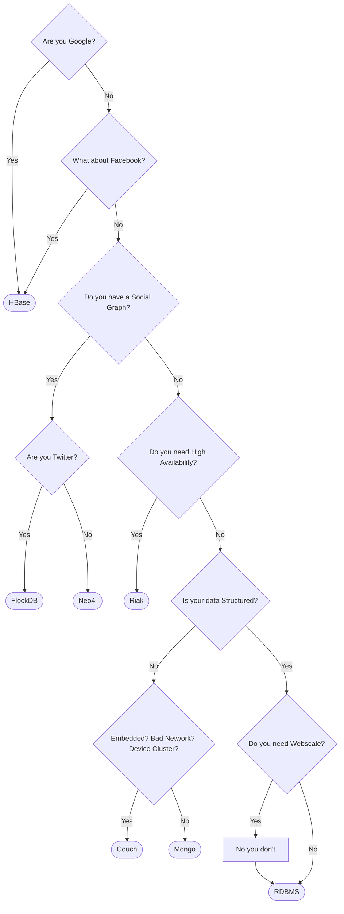
_ต้นฉบับ: รูป p.52 (ลายมือ) — ลูกศรจากกล่อง "What about Facebook?" ไป HBase มีป้ายที่ถูกขีดฆ่าและเขียนทับเป็น "Yes"; ตำแหน่งลูกศรบางเส้นอ่านจากภาพ_

**NoSQL tools specification** [p.53]:
- **DynamoDB, Riak และ Cassandra** เน้นให้ฐานข้อมูลทนทาน บันทึกและเรียกอ่านได้ตลอดเวลา แม้ข้อมูลที่อ่านจะไม่ใช่ข้อมูลล่าสุด
- **MongoDB และ CouchDB** เพิ่มความยืดหยุ่นในการบันทึก โดยใช้ JSON ต่อยอดจาก Key-Value พร้อมระบบ Sub-key และ Sub-Value ภายใน กับการทำ Sharding ทำให้รองรับข้อมูลจำนวนมากด้วยความเร็วสูง
- **Redis** ออกแบบรองรับ Key-Value จัดการข้อมูลได้รวดเร็วและดีขึ้น นิยมสร้างข้อมูลที่มีการเรียงลำดับหลายชุด เหมาะกับ Ranking และ Leaderboard และมีความสามารถจัดเรียงและประมวลผลสถิติที่ซับซ้อน เพื่อนำไปประยุกต์สำหรับ Application เฉพาะทางบางอย่างได้ดี
- **Neo4j** เป็นฐานข้อมูลสำหรับประมวลผลข้อมูลแบบ Graph
- **Elasticsearch** เป็นระบบฐานข้อมูลสำหรับค้นหาข้อมูลแบบ Text

---

## Part 3: Quick Reference & Exam Cheat Sheet

### Checklist สรุปหัวใจสำคัญก่อนสอบ

* [ ] **BI** = ระบบสารสนเทศสนับสนุนการตัดสินใจระดับกลยุทธ์ เพื่อ Competitive Advantage [p.3]
* [ ] **ข้อมูล BI ต่างจาก Operational 3 ข้อ:** Time Span, Level of Aggregation, Dimensionality (Cube) [p.4]
* [ ] **ETL:** Extract → Transform → Load; ฟังก์ชันใน ETL: Extract, Filter, Transform, Integrate, Classify, Aggregate, Summary [p.7, 15]
* [ ] **BI Components:** แหล่งข้อมูลภายใน/ภายนอก → ETL → Data Warehouse → OLAP (ติดต่อกับ Users) และ Data Mining; มี Business Data Analysis Model และ Data Visualization [p.6-9]
* [ ] **Data Warehouse:** ฐานข้อมูลใหญ่ Read-only ข้อมูลหลายแหล่ง อดีต-ปัจจุบัน; **Data Mart** = คลังเฉพาะส่วนงาน [p.11]
* [ ] **คุณลักษณะ DBMS ของ DW 4 ข้อ:** Database Schema (Data Dictionary, Time Slices), ETL function (Data Cleaning), OLAP GUI, Size large Database [p.12]
* [ ] **4 ลักษณะข้อมูลใน DW:** Integrated, Subject-Oriented, Time-Variant, Nonvolatile [p.14]
* [ ] **องค์ประกอบแบบจำลอง DW 4 อย่าง:** Fact Table, Dimension Tables, Attributes, Attribute Hierarchies [p.16-18]
* [ ] **Star:** Fact (3NF) + Dimension ตารางเดียวต่อมิติ (Denormalized 2NF), Fact key = composite FK ทุกมิติ, join ระดับเดียว, 1:M [p.19-20]
* [ ] **Snowflake:** Dimension บางมิติ normalize แตกเป็นหลายตาราง (เช่น Category) [p.21]
* [ ] **OLAP:** Drill down / Roll up (ตาม Attribute Hierarchy), **Slice** (กรองมิติ), **Dice** (เปลี่ยนมิติ/หมุนแกน) [p.22-25]
* [ ] **SQL ACID:** Atomic, Consistent, Isolated, Durable [p.31]
* [ ] **NoSQL:** Dynamic Schema, Auto-Sharding, Integrated Caching [p.36]
* [ ] **Replication** (copy ทั้ง DB ทุก node) vs **Sharding** (แบ่งข้อมูลไปคนละ node: horizontal = rows, vertical = columns) [p.37-38]
* [ ] **4 ชนิด NoSQL:** Key-Value, Wide Column, Document, Graph [p.41]
* [ ] **เครื่องมือ:** MongoDB / CouchDB (JSON ต่อยอด Key-Value; ถูกจัดเป็น Document Databases ที่ p.50), Redis (Key-Value, Ranking), Neo4j (Graph), Elasticsearch (Text search), DynamoDB / Riak / Cassandra (ทนทาน, available) [p.50, 53]

### เทียบศัพท์ RDBMS กับ MongoDB (p.48)

| RDBMS | MongoDB |
| :--- | :--- |
| Table | Collection |
| Row | Document |
| Schema, Joins | ถูกขีดฆ่าในรูปฝั่ง MongoDB (สไลด์ไม่อธิบายความหมาย) |

### Concept Map

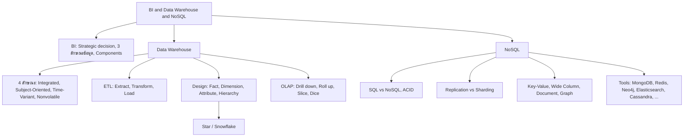

---

## ⚠️ Common Pitfalls & Exam Traps

* **ภาษาไทยหน้า p.6-25 เพี้ยน:** วรรณยุกต์และสระบน/ล่างหายหรือเลื่อนตำแหน่งทั้งใน text layer และในภาพสไลด์ (เช่น "ขอมูล", "ผูบริหาร", "โซอุปทาน") โน้ตนี้สร้างตัวสะกดคืนจากบริบทและเทียบภาพ ไม่ใช่การคัดลอกตรง คำที่ตีความอาจคลาดเคลื่อน ควรเทียบสไลด์ต้นฉบับ
* **ตัวอักษรผิดในสไลด์ที่แก้ให้ตอนเขียนโน้ต:** "การการตัดใจ"→การตัดสินใจ [p.4], "ลักษณะ ... Dat a Dictionary"→Data Dictionary [p.18], "Glossary" (p.22-25) คงไว้ตามสไลด์ (น่าจะหมายถึง Grocery แต่สไลด์ไม่ยืนยัน), "(ช่วงเลา)" [p.14] คงไว้พร้อม [sic] ในตาราง, "ProductDim ได้แตกตาราง" [p.21] คงไว้
* **หัวข้อ "NoSQL ย่อมาจาก Not Only Structure Query Language" [p.32]:** คงตามสไลด์ ดู 💡 ในหัวข้อ NoSQL คืออะไร
* **คำอธิบายใน p.32 อ่านติด:** ประโยค "ไม่จำเป็นต้องเก็บข้อมูลแบบ Table เดียวที่มีต้องข้อมูลเหมือนกันทั้งหมด" มีคำเกินหรือผิดลำดับ ("ที่มีต้องข้อมูล") คงไว้ตามต้นฉบับในเนื้อหา พร้อมสรุปความหมายแยกต่างหาก [p.32]
* **Star Schema ใน p.19 พูดถึงระดับ normalization 2 ระดับในประโยคเดียว:** Fact Table อยู่ 3NF, Dimension Table ลดเหลือ 2NF และ Product Dimension "ไม่ผ่าน 3NF" เพราะ Sub-category -> Category (Non-key -> Non-key) — ข้อความเหล่านี้อยู่ในย่อหน้าเดียวกันของสไลด์ (ผู้เขียนโน้ตอ่านว่าไม่ขัดแย้ง ไม่ได้ตรวจกับตำรา) [p.19]
* **Snowflake รูป p.21:** ตาราง Category ในรูปมีแอตทริบิวต์ `CategoryID` และ `SubCategory` ส่วน ProductDimension มี `SubCategory` ด้วย ทั้งที่ข้อความบอกว่าแตกตาราง "Category" ออกมา — ไม่ได้ปรับรูปให้ตรงกับข้อความ [p.21]
* **ตัวอย่าง Drill down ใน p.22 กับรูป p.23:** ข้อความใช้ตัวอย่างสินค้าเครื่องใช้ไฟฟ้า/ประเภท/กลุ่มย่อย แต่ลำดับและรูปใช้ Region -> Product Type -> Shop คนละตัวอย่างกัน [p.22-23]
* **ค่าใน Misc. ของ Slice:** ตัวเลข Misc. (Med., Pencil) อยู่ในสไลด์แต่คำอธิบายพูดถึง Glossary (Fish, Meat, Pork) เท่านั้น ส่วนที่เหลือเป็นการอ่านจากภาพ [p.24]
* **Replication vs Sharding:** Sharding = **แบ่ง** ข้อมูลไปแต่ละ node (เสี่ยง "Potential data loss"); Replication = **คัดลอกทั้งหมด** ไปทุก node (อ่านเร็ว ความน่าเชื่อถือสูง แต่ network/memory overhead สูง) [p.37-38, 40]
* **เลขท้ายสไลด์ไม่ตรงลำดับหน้า PDF:** เลขท้ายสไลด์ตรงกับลำดับหน้าถึง p.41 แต่หลังจากนั้นเลขข้ามไป (p.43→44, p.44→45, p.45→46, p.46→48, p.47→49, p.48→50, p.49→51, p.50→52, p.51→53, p.52→54, p.53→55, p.54→57) และบางหน้าไม่มีเลข (p.37-38, p.40) แสดงว่าสไลด์บางส่วนของชุดเดิมไม่อยู่ในไฟล์นี้ (ข้อสันนิษฐานของผู้เขียนโน้ต)
* **ศัพท์ใน p.15:** ข้อความเขียน "Summary" ส่วนกล่องในรูปเขียน "Summarize" [p.15]
* **p.39 ไม่มีหัวข้อ:** สไลด์เป็นรูปล้วน (Application / Driver / Query Router / Shard) ไม่มีคำอธิบาย คำบรรยายในโน้ตมาจากการอ่านภาพ [p.39]
* **p.14 `!=`:** สไลด์มีกล่อง `!= Mini World`, `!= Operation`, `!= Transaction`, `!= Update` โดยไม่อธิบาย การจับคู่กับข้อ 1-4 อ่านจากตำแหน่งในรูป [p.14]

---

## เอกสารเชื่อมโยง (Wiki-Style Backlinks)

* **วิชาและหัวข้อที่เกี่ยวข้อง:**
  * [[Chapter 07 Introduction to Transaction and Recovery]] (ACID และ Transaction ที่ p.31 ของบทนี้ทบทวน)
  * [[Chapter 01 Introduction to Database System & Relational Model]] (Relational Model ที่ใช้ออกแบบสกีมาหลายมิติ)

* **แบบฝึกหัด:**
  * [[HW-Database-03]]

* **แหล่งข้อมูล:**
  * Source: `Resources/Books/Database/Database_Concept_08(1).pdf` (54 slides, KMITL Faculty of Information Technology)
