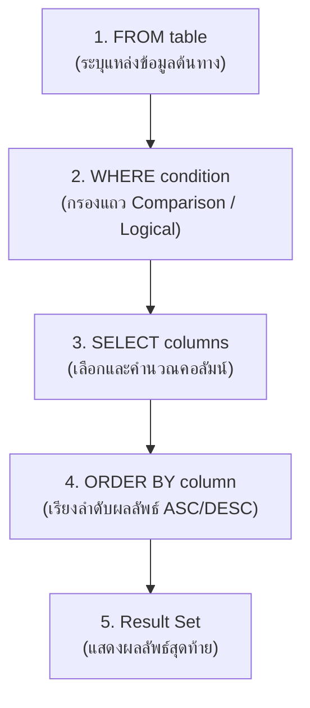

# Database - LAB 5: SQL SELECT with Conditions

> **วิชา:** 06066300 Database System Concept | **สถาบัน:** มหาวิทยาลัย
> **Source:** `Resources/Books/Database/lab DB/DB66-LAB 5-SQL-Select conditions (1).pdf`
> ⚠️ **[Source: generated — not verified against original document]**
> *PDF extraction failed (Docling timeout). เนื้อหาสร้างจาก SQL standard curriculum knowledge.*

---

## Part 1: Macro Architecture & Overview

LAB 5 ต่อยอดจาก LAB 4 (SELECT พื้นฐาน) โดยเพิ่ม **เงื่อนไข (Conditions)** ในการกรองและเรียงลำดับข้อมูล ซึ่งเป็นหัวใจของ SQL ในการดึงข้อมูลเฉพาะที่ต้องการจากตารางขนาดใหญ่



### ตารางเปรียบเทียบ Operator ที่ใช้ใน WHERE

| กลุ่ม          | Operator                        | ตัวอย่าง                         |
| :------------- | :------------------------------ | :------------------------------- |
| **Comparison** | `=`, `!=`, `<`, `>`, `<=`, `>=` | `salary > 5000`                  |
| **Range**      | `BETWEEN ... AND ...`           | `salary BETWEEN 3000 AND 8000`   |
| **List**       | `IN (...)`, `NOT IN (...)`      | `dept_id IN (10, 20, 30)`        |
| **Pattern**    | `LIKE`, `NOT LIKE`              | `last_name LIKE 'S%'`            |
| **NULL check** | `IS NULL`, `IS NOT NULL`        | `manager_id IS NULL`             |
| **Logical**    | `AND`, `OR`, `NOT`              | `salary > 5000 AND dept_id = 10` |

---

## Part 2: Module-by-Module Deep Dive

### 2.1 WHERE Clause และ Comparison Operators

> 💡 **Intuition:** ลองนึกถึง WHERE ว่าเป็น **ตัวกรองสินค้าบนเว็บช้อปปิ้ง** — ตัวกรองจะตัดสินใจว่าแต่ละชิ้นควรแสดงหรือซ่อน โดยดูว่าแต่ละแถวข้อมูลตรงตามเงื่อนไขที่ตั้งไว้หรือไม่ SQL เช็ค WHERE ไปทีละแถว (row-by-row)
> [Source: generated — not verified against original document]

> **WHERE** คือ clause ที่ใช้กรองแถวข้อมูล — SQL จะ evaluate เงื่อนไข WHERE สำหรับทุกแถว แถวที่เงื่อนไข `TRUE` จะปรากฏในผลลัพธ์

```sql
-- Syntax
SELECT column1, column2
FROM table
WHERE condition;
```

**Comparison Operators:**

| Operator | ความหมาย | ตัวอย่าง |
| :--- | :--- | :--- |
| `=` | เท่ากับ | `WHERE department_id = 10` |
| `!=` หรือ `<>` | ไม่เท่ากับ | `WHERE salary != 5000` |
| `>` | มากกว่า | `WHERE salary > 8000` |
| `<` | น้อยกว่า | `WHERE salary < 3000` |
| `>=` | มากกว่าหรือเท่ากับ | `WHERE salary >= 5000` |
| `<=` | น้อยกว่าหรือเท่ากับ | `WHERE salary <= 10000` |

```sql
-- ตัวอย่าง: พนักงานที่เงินเดือน > 10,000
SELECT first_name, last_name, salary
FROM employees
WHERE salary > 10000;

-- ตัวอย่าง: พนักงานที่ไม่อยู่แผนก 50
SELECT first_name, department_id
FROM employees
WHERE department_id <> 50;

-- เปรียบเทียบข้อความ (case-sensitive ใน Oracle)
SELECT first_name, job_id
FROM employees
WHERE job_id = 'IT_PROG';
```

**🧭 ทำความเข้าใจ** _[Source: generated — not verified against original document]_

**แตกวลีสำคัญ:**
- "evaluate เงื่อนไข WHERE สำหรับทุกแถว" → SQL ดูแต่ละแถวทีละแถว ไม่ว่าจะมีแถวกี่แถวก็ตาม
- "เงื่อนไข TRUE" → แถวจะขึ้นเฉพาะเมื่อผลการเปรียบเทียบเป็น TRUE เท่านั้น ถ้าเป็น FALSE หรือ UNKNOWN (เช่นเทียบกับ NULL) แถวจะถูกตัดทิ้ง
- "Comparison Operators" → ตัวดำเนินการที่ใช้เปรียบเทียบค่า (`=`, `<`, `>` ฯลฯ)

**ตัวอย่าง:**
- ✅ `WHERE salary > 10000` — return พนักงานที่เงินเดือน > 10,000 เท่านั้น
- ❌ `WHERE salary = NULL` — return 0 แถวเสมอ (NULL ไม่ใช่ค่าปกติ ต้องใช้ IS NULL)
- **ต่างกันตรง:** `=` ใช้เปรียบเทียบค่าปกติ แต่ NULL ต้องใช้ `IS NULL`

**อย่าสับสน:** "Comparison" ไม่ได้หมายถึง "การเลือก" แต่หมายถึง "การเปรียบเทียบค่า" — WHERE จะ **กรอง** แถวตามผลของการเปรียบเทียบ

**เช็คความเข้าใจ:** ถ้า employees table มี 10 แถว แล้วเขียน `WHERE department_id = 50` จะเห็นกี่แถว?
<details><summary>เฉลย</summary>

ตอบตายตัวไม่ได้ — ได้ 0 ถึง 10 แถว ขึ้นกับว่ามีกี่แถวที่ department_id = 50 จริง WHERE เช็คทีละแถวแล้วเก็บเฉพาะแถวที่ได้ TRUE แถวที่ department_id เป็น NULL จะไม่ขึ้น เพราะ `NULL = 50` ได้ UNKNOWN
</details>

---

### 2.2 BETWEEN ... AND ...

> 💡 **Intuition:** ลองนึกถึง BETWEEN ว่าเป็น **เครื่องหมายวัดระยะ** — ถ้าเงินเดือน BETWEEN 5000 AND 10000 ก็เหมือนว่า "ตั้งแต่เลข 5000 ขึ้นไปจนถึง 10000" โดยรวมเลข 5000 และ 10000 ด้วย (เช่นเดียวกับการวัดความสูงตั้งแต่ 150 ซม. ถึง 180 ซม. รวมทั้งสอง) ถ้าเงินเดือน 5000 พอดี ก็ยังนับด้วย
> [Source: generated — not verified against original document]

> **BETWEEN** ใช้กรองค่าในช่วงที่กำหนด — **inclusive** ทั้งสองขอบ (รวมค่าต่ำสุดและสูงสุดด้วย)

```sql
-- Syntax
WHERE column BETWEEN low_value AND high_value
-- เทียบเท่ากับ: WHERE column >= low_value AND column <= high_value

-- ตัวอย่าง: พนักงานที่เงินเดือนอยู่ในช่วง 5,000 - 10,000
SELECT first_name, last_name, salary
FROM employees
WHERE salary BETWEEN 5000 AND 10000;

-- ใช้กับวันที่
SELECT first_name, hire_date
FROM employees
WHERE hire_date BETWEEN '01-JAN-2000' AND '31-DEC-2005';

-- NOT BETWEEN: นอกช่วง
SELECT first_name, salary
FROM employees
WHERE salary NOT BETWEEN 5000 AND 10000;
```

**🧭 ทำความเข้าใจ** _[Source: generated — not verified against original document]_

**แตกวลีสำคัญ:**
- "inclusive ทั้งสองขอบ" → รวมค่า 5000 และ 10000 ด้วย (ไม่ใช่ "ระหว่าง" ในแง่ของ "ไม่รวมขอบ")
- "BETWEEN low_value AND high_value" → low_value ต้องน้อยกว่าหรือเท่ากับ high_value ถึงจะได้ผล

**ตัวอย่าง:**
- ✅ `salary BETWEEN 5000 AND 10000` → ได้พนักงาน salary 5000, 7500, 10000 ทั้งหมด
- ❌ `salary BETWEEN 10000 AND 5000` → ไม่ error แต่ได้ 0 แถว เพราะแปลเป็น `salary >= 10000 AND salary <= 5000` ซึ่งไม่มีค่าใดเป็นจริง
- **ต่างกันตรง:** BETWEEN ต้องเขียนตัวน้อยก่อน ตัวมากทีหลัง

**อย่าสับสน:** "BETWEEN 5000 AND 10000" ไม่ได้หมายถึง "ระหว่าง 5000 และ 10000" ในแง่ "ไม่รวมขอบ" — มันรวมขอบแล้ว ถ้าต้องการ "ไม่รวม" ต้องเขียน `salary > 5000 AND salary < 10000` แยก

**เช็คความเข้าใจ:** ถ้าเขียน `WHERE hire_date BETWEEN '01-JAN-2000' AND '31-DEC-2005'` พนักงานที่ hire_date = '01-JAN-2000' พอดี ขึ้นแสดงไหม?
<details><summary>เฉลย</summary>

ใช่ ขึ้นแสดง เพราะ BETWEEN inclusive ทั้งสองขอบ — '01-JAN-2000' รวมอยู่ในช่วงแล้ว
</details>

---

### 2.3 IN และ NOT IN

> 💡 **Intuition:** ลองนึกถึง IN ว่าเป็น **การเลือกจากรายชื่อ** — เช่น "ต้องการพนักงานจากแผนก 10, 20, หรือ 30 เท่านั้น" ก็เหมือนว่า "เลือกจากรายชื่อ 3 แผนก" แทนที่จะเขียน "แผนก 10 หรือ 20 หรือ 30" หลาย ๆ ครั้ง
> [Source: generated — not verified against original document]

> **IN** ใช้ตรวจสอบว่าค่าอยู่ใน list ที่กำหนดหรือไม่ — เทียบเท่าการใช้ `OR` หลายตัว

```sql
-- Syntax
WHERE column IN (value1, value2, value3, ...)

-- ตัวอย่าง: พนักงานที่อยู่ในแผนก 10, 20 หรือ 30
SELECT first_name, last_name, department_id
FROM employees
WHERE department_id IN (10, 20, 30);
-- เทียบเท่า: WHERE department_id = 10 OR department_id = 20 OR department_id = 30

-- NOT IN: ไม่อยู่ใน list
SELECT first_name, job_id
FROM employees
WHERE job_id NOT IN ('IT_PROG', 'AD_VP', 'ST_CLERK');

-- ใช้กับข้อความ
SELECT first_name, last_name
FROM employees
WHERE last_name IN ('King', 'Abel', 'Taylor');
```

**🧭 ทำความเข้าใจ** _[Source: generated — not verified against original document]_

**แตกวลีสำคัญ:**
- "IN (value1, value2, ...)" → list ต้องเขียนในวงเล็บ และค่าต่างๆ แยกด้วย comma
- "เทียบเท่า OR หลายตัว" → `col IN (a, b, c)` = `col = a OR col = b OR col = c`

**ตัวอย่าง:**
- ✅ `department_id IN (10, 20, 30)` — ได้พนักงานจากแผนก 10, 20, หรือ 30
- ❌ `department_id IN 10, 20, 30` — syntax error ต้องมีวงเล็บ
- **ต่างกันตรง:** IN ต้องมีวงเล็บ ค่าต่างๆ ต้องแยกด้วย comma

**อย่าสับสน:** "IN (10, 20, 30)" ไม่ได้หมายถึง "ตั้งแต่ 10 ถึง 30" — มันขึ้นอยู่กับว่าค่าตรงกับ 10, 20, หรือ 30 เท่านั้น ถ้าต้องการเป็น "ตั้งแต่ 10 ถึง 30" ใช้ BETWEEN

**เช็คความเข้าใจ:** `WHERE job_id IN ('IT_PROG', 'ST_CLERK')` จะได้พนักงาน job_id ไหนบ้าง?
<details><summary>เฉลย</summary>

ได้เฉพาะพนักงานที่ job_id = 'IT_PROG' หรือ job_id = 'ST_CLERK' เท่านั้น — ไม่ใช่ job_id ทุกตัวที่อยู่ระหว่าง 'IT_PROG' ถึง 'ST_CLERK' ตามลำดับตัวอักษร (IN เทียบค่าตรงตัว ถ้าต้องการช่วงต้องใช้ BETWEEN)
</details>

---

### 2.4 LIKE และ Pattern Matching

> 💡 **Intuition:** ลองนึกถึง LIKE ว่าเป็น **การค้นหาด้วยตัวอักษรตัวแทน** (wildcard) — เหมือนเกมเติมคำในช่องว่าง โดย `%` คือ "ช่องว่างยาวเท่าไรก็ได้" (0 ตัวขึ้นไป) และ `_` คือ "ช่องว่าง 1 ตัวพอดี" — เช่น `'S%'` หมายถึง "ชื่อที่ขึ้นต้นด้วย S" (ตัวตามหลังเป็นอะไรก็ได้) ทำให้ค้นหา "Smith", "Steven", "Sun" ได้ในหนึ่งรอบ
> [Source: generated — not verified against original document]

> **LIKE** ใช้สำหรับค้นหาข้อความที่ตรงกับ pattern (รูปแบบ) มี Wildcard 2 ตัว:
> - `%` (Percent) — แทนที่อักขระ **ศูนย์ตัวขึ้นไป**
> - `_` (Underscore) — แทนที่อักขระ **1 ตัวพอดี**

```sql
-- Syntax
WHERE column LIKE 'pattern'
```

**ตัวอย่าง pattern ต่างๆ:**

```sql
-- ขึ้นต้นด้วย 'S'
WHERE last_name LIKE 'S%'          -- Smith, Stevens, Sun, S...

-- ลงท้ายด้วย 'n'
WHERE last_name LIKE '%n'          -- ...Johnson, Wilson, Chen

-- มีคำว่า 'al' อยู่ที่ไหนก็ได้
WHERE last_name LIKE '%al%'        -- Taylor, Abel, Caldwell

-- ตัวที่ 2 เป็น 'o' (_แทน 1 ตัวพอดี)
WHERE last_name LIKE '_o%'         -- Doe → 2nd char = 'o'

-- ชื่อที่มีความยาว 4 ตัวพอดี
WHERE first_name LIKE '____'       -- 4 underscores

-- NOT LIKE: ไม่ตรง pattern
WHERE last_name NOT LIKE 'A%'      -- ไม่ขึ้นต้นด้วย 'A'
```

**ตัวอย่างจริง:**

```sql
-- พนักงานที่ job_id ขึ้นต้นด้วย 'IT'
SELECT first_name, last_name, job_id
FROM employees
WHERE job_id LIKE 'IT%';

-- พนักงานที่ชื่อมีตัว 'a' หรือ 'A' (case-insensitive ใช้ UPPER/LOWER)
SELECT first_name
FROM employees
WHERE UPPER(first_name) LIKE '%A%';
```

**🧭 ทำความเข้าใจ** _[Source: generated — not verified against original document]_

**แตกวลีสำคัญ:**
- "Pattern (รูปแบบ)" → ลำดับตัวอักษรที่ต้องการค้นหา เช่น "ขึ้นต้นด้วย S", "มี al ตรงกลาง"
- "`%` — ศูนย์ตัวขึ้นไป" → สามารถแทนได้ 0 ตัว 1 ตัว หรือหลายตัว เช่น `'A%'` match กับ "A", "Apple", "Alexander"
- "`_` — 1 ตัวพอดี" → แทนอักษรเดียว เช่น `'_o%'` match กับ "dog", "boy" แต่ไม่ match "o" (ต้องมี 1 ตัวก่อน)

**ตัวอย่าง:**
- ✅ `LIKE 'S%'` matches Smith, Stevens, Sun, Smithson และ "S" เอง (เพราะ `%` แทน 0 ตัวได้)
- ❌ `LIKE 'S'` matches เฉพาะ "S" เท่านั้น — ไม่ใช่ "Smith"
- **ต่างกันตรง:** `LIKE 'S'` ต้องเป็น "S" ทุกประการ แต่ `LIKE 'S%'` "S" ตามด้วยอะไรก็ได้

**อย่าสับสน:** "`%` ศูนย์ตัวขึ้นไป" ไม่ได้หมายถึง "1 ตัวขึ้นไป" — ถ้าใส่ `'%'` โดยลำพัง มันจะ match **ทุกแถวที่ค่าไม่เป็น NULL** — แถวที่เป็น NULL ไม่ match เพราะ `NULL LIKE '%'` ได้ UNKNOWN

**เช็คความเข้าใจ:** `LIKE '_a%'` จะ match คำไหนบ้าง: "David", "Adam", "Taylor", "A"?
<details><summary>เฉลย</summary>

`'_a%'` = ตัวที่ 1 เป็นอะไรก็ได้ 1 ตัว, ตัวที่ 2 ต้องเป็น `a`, ที่เหลือเป็นอะไรก็ได้

- Match: "David" (ตัวที่ 2 = a), "Taylor" (ตัวที่ 2 = a)
- ไม่ match: "Adam" (ตัวที่ 2 = d), "A" (ยาวแค่ 1 ตัว แต่ pattern ต้องการอย่างน้อย 2 ตัว)
</details>

---

### 2.5 IS NULL และ IS NOT NULL

> 💡 **Intuition:** ลองนึกถึง NULL ว่าเป็น "**กล่องที่ไม่รู้มีอะไร (unknown)**" — ไม่เหมือนกับ "กล่องว่าง (empty string '')" หรือ "เลข 0" NULL คือ "เรา**ไม่รู้**" ดังนั้น ถ้าคุณถาม "กล่องนี้ = NULL ไหม?" คำตอบคือ "ไม่รู้" (UNKNOWN ไม่ใช่ TRUE) ต้องใช้ `IS NULL` เพื่อเช็ค "กล่องนี้เป็น unknown ไหม?" แทน
> [Source: generated — not verified against original document]

> `NULL` คือค่าที่ **ไม่ทราบ / ไม่มีข้อมูล** — ไม่ใช่ 0 หรือ empty string
> **ใช้ `col = NULL` ไม่ได้เด็ดขาด** ต้องใช้ `IS NULL` เท่านั้น

```sql
-- ✅ ถูกต้อง
WHERE manager_id IS NULL         -- หาแถวที่ไม่มีค่า
WHERE manager_id IS NOT NULL     -- หาแถวที่มีค่า

-- ❌ ผิด — ใช้ไม่ได้ ผลลัพธ์เป็น 0 แถวเสมอ
WHERE manager_id = NULL          -- WRONG
WHERE manager_id != NULL         -- WRONG
```

**ตัวอย่าง:**

```sql
-- พนักงานที่ไม่มีหัวหน้า (CEO หรือ Top-level)
SELECT first_name, last_name
FROM employees
WHERE manager_id IS NULL;

-- พนักงานที่ยังไม่มีค่า commission
SELECT first_name, commission_pct
FROM employees
WHERE commission_pct IS NULL;

-- พนักงานที่มีค่า commission (มีข้อมูล)
SELECT first_name, salary, commission_pct
FROM employees
WHERE commission_pct IS NOT NULL;
```

**🧭 ทำความเข้าใจ** _[Source: generated — not verified against original document]_

**แตกวลีสำคัญ:**
- "NULL" → ไม่ได้หมายถึง 0, '', หรือคำว่า 'NULL' — มันคือ "ไม่รู้ค่า"
- "`IS NULL` / `IS NOT NULL`" → การตรวจสอบว่า**เซลล์เป็น unknown หรือไม่** — ไม่ใช่ "เท่ากับ"

**ตัวอย่าง:**
- ✅ `WHERE manager_id IS NULL` — หาพนักงานที่ไม่มีค่า manager_id (เช่น CEO)
- ❌ `WHERE manager_id = NULL` — return 0 แถวเสมอ (ไม่ว่า manager_id เป็น NULL จริงหรือไม่)
- **ต่างกันตรง:** `= NULL` ให้ผล UNKNOWN เสมอ เพราะใน SQL `NULL` ไม่เท่ากับอะไรเลย แม้แต่ `NULL`

**อย่าสับสน:** "`NULL`" ไม่ได้หมายถึง "0" หรือ "''" (empty string) ในเชิงแนวคิด — NULL = ไม่รู้ค่า, 0 = เลขศูนย์ (ข้อควรรู้เฉพาะ Oracle: `''` ถูกเก็บเป็น NULL จริง ๆ ดังนั้น `WHERE col IS NULL` จะเจอแถวที่ใส่ `''` ด้วย)

**เช็คความเข้าใจ:** ทำไม `WHERE commission_pct = NULL` return 0 แถวแม้ว่ามีพนักงานที่ commission_pct เป็น NULL จริง ๆ?
<details><summary>เฉลย</summary>

1. การเปรียบเทียบใด ๆ กับ NULL (รวม `NULL = NULL`) ให้ผลเป็น UNKNOWN ไม่ใช่ TRUE
2. WHERE เก็บเฉพาะแถวที่ได้ TRUE จึงไม่มีแถวไหนผ่านเลย
3. ต้องใช้ `IS NULL` ซึ่งถามตรง ๆ ว่า "ค่านี้เป็น NULL ไหม" และให้ TRUE/FALSE เสมอ
</details>

---

### 2.6 Logical Operators: AND, OR, NOT

> 💡 **Intuition:** ลองนึกถึง AND, OR ว่าเป็น "**ตัวประสม**" — AND คือ "ต้องตรงทั้งสองเงื่อนไข" (เหมือนสินค้า "สีแดง **และ** ราคา < 100 บาท" ต้องตรงทั้งสอง), OR คือ "ตรงอย่างน้อยหนึ่ง" (เหมือน "จากแผนก 10 **หรือ** 20" — อยู่แผนกไหนในสองแผนกนี้ก็ผ่าน) ส่วน NOT คือ "ผกผัน" — เหมือนการพูด "ไม่ใช่"
> [Source: generated — not verified against original document]

> ใช้รวมเงื่อนไขหลายข้อเข้าด้วยกัน **ลำดับความสำคัญ (Precedence):** NOT > AND > OR

```sql
-- AND: ต้องจริงทุกเงื่อนไข
SELECT first_name, salary, department_id
FROM employees
WHERE salary > 5000 AND department_id = 80;

-- OR: จริงอย่างน้อยหนึ่งเงื่อนไข
SELECT first_name, salary, department_id
FROM employees
WHERE salary > 15000 OR department_id = 90;

-- NOT: ผกผันเงื่อนไข
SELECT first_name, job_id
FROM employees
WHERE NOT job_id = 'SA_REP';

-- ผสม AND และ OR — ต้องใช้วงเล็บเพื่อควบคุม precedence
SELECT first_name, salary, department_id
FROM employees
WHERE (department_id = 80 OR department_id = 90)
  AND salary > 10000;
```

**ตาราง Truth Table:**

| A | B | A AND B | A OR B |
| :--- | :--- | :--- | :--- |
| TRUE | TRUE | TRUE | TRUE |
| TRUE | FALSE | FALSE | TRUE |
| FALSE | TRUE | FALSE | TRUE |
| FALSE | FALSE | FALSE | FALSE |

**🧭 ทำความเข้าใจ** _[Source: generated — not verified against original document]_

**แตกวลีสำคัญ:**
- "AND — ต้องจริงทุกเงื่อนไข" → ถ้า 1 ข้อเท็จ ทั้งหมดก็เท็จ
- "OR — จริงอย่างน้อยหนึ่งเงื่อนไข" → ถ้า 1 ข้อจริง ทั้งหมดก็จริง
- "Precedence: NOT > AND > OR" → ลำดับการคำนวณ — NOT อยู่แรก แล้ว AND แล้ว OR (ใช้วงเล็บถ้าไม่แน่ใจ)

**ตัวอย่าง:**
- ✅ `WHERE salary > 5000 AND department_id = 80` — ได้พนักงาน dept 80 **และ** salary > 5000 พร้อมกัน
- ❌ `WHERE department_id = 80 AND department_id = 90` — ได้ 0 แถวเสมอ เพราะแถวเดียวอยู่สองแผนกพร้อมกันไม่ได้ ถ้าต้องการ "แผนก 80 หรือ 90" ต้องใช้ OR
- **ต่างกันตรง:** AND ต้องตรงทั้งสอง OR ตรงหนึ่งพอ

**อย่าสับสน:** "AND มี precedence สูงกว่า OR" ไม่ได้หมายถึง "AND ถูก" — มันหมายถึง **ลำดับการคำนวณ** เช่น `a OR b AND c` ถูกอ่านว่า `a OR (b AND c)` ไม่ใช่ `(a OR b) AND c` ถ้าต้องการแบบหลัง ต้องใส่วงเล็บ

**เช็คความเข้าใจ:** `WHERE salary > 5000 AND department_id = 80 OR department_id = 90` จะหา rows ที่ตรง "salary > 5000 และ dept 80" หรือ "dept 90 ใคร ๆ ก็ได้"?
<details><summary>เฉลย</summary>

เนื่องจาก AND มี precedence สูงกว่า OR ดังนั้นมันถูกอ่านว่า:
`WHERE (salary > 5000 AND department_id = 80) OR department_id = 90`

นั่นคือ: 
- ได้ rows ที่ salary > 5000 **และ** dept = 80 
- **หรือ** ได้ rows ที่ dept = 90 ไม่ว่า salary เท่าไหร่

ถ้าต้องการ "salary > 5000 ทั้ง dept 80 และ 90" ต้องเขียน `WHERE salary > 5000 AND (department_id = 80 OR department_id = 90)`
</details>

---

### 2.7 ORDER BY

> 💡 **Intuition:** ลองนึกถึง ORDER BY ว่าเป็น "**ตัวจัดเรียง**" — หลังจาก WHERE ได้ผลลัพธ์มาแล้ว ORDER BY ก็มาจัดเรียงแถวต่าง ๆ ให้เรียบร้อยตามที่ต้องการ เช่น "จากเงินเดือนมากไปน้อย" หรือ "ชื่อจาก A ไป Z" อันดับ ASC/DESC ก็เลือกว่า "ไปข้างหน้า (ASC)" หรือ "ถอยหลัง (DESC)"
> [Source: generated — not verified against original document]

> **ORDER BY** ใช้เรียงลำดับผลลัพธ์ — เป็น clause **สุดท้าย** ของ SELECT statement
> - `ASC` — เรียงจากน้อยไปมาก (ค่า default ถ้าไม่ระบุ)
> - `DESC` — เรียงจากมากไปน้อย

```sql
-- Syntax
SELECT columns
FROM table
WHERE condition
ORDER BY column1 [ASC|DESC], column2 [ASC|DESC], ...;
```

**ตัวอย่าง:**

```sql
-- เรียงตามเงินเดือนมากไปน้อย
SELECT first_name, last_name, salary
FROM employees
ORDER BY salary DESC;

-- เรียงตามแผนก ASC แล้วเงินเดือน DESC (multi-column sort)
SELECT first_name, department_id, salary
FROM employees
ORDER BY department_id ASC, salary DESC;

-- เรียงตามหมายเลข column ใน SELECT (position)
SELECT first_name, last_name, salary
FROM employees
ORDER BY 3 DESC;  -- 3 คือ salary ซึ่งเป็น column ที่ 3 ใน SELECT

-- เรียงตาม Alias
SELECT first_name, salary * 12 AS annual_salary
FROM employees
ORDER BY annual_salary DESC;
```

**🧭 ทำความเข้าใจ** _[Source: generated — not verified against original document]_

**แตกวลีสำคัญ:**
- "ORDER BY เป็น clause สุดท้าย" → WHERE, SELECT, ... ต้องมาก่อน ORDER BY เสมอ
- "ASC — จากน้อยไปมาก (default)" → ถ้าไม่ระบุ ASC/DESC ก็เรียงน้อยไปมากแบบอัตโนมัติ
- "Multi-column sort" → เรียงตาม column แรกก่อน แล้วถ้าค่าเท่ากัน ใช้ column ที่สองต่อไป

**ตัวอย่าง:**
- ✅ `ORDER BY salary DESC` — เรียงตามเงินเดือนมากไปน้อย
- ❌ `ORDER BY 3 DESC` (ถ้า SELECT มี 2 columns เท่านั้น) — error ORA-01785 เพราะไม่มี column ที่ 3 ใน SELECT list
- **ต่างกันตรง:** `ORDER BY column_name DESC` ชัดเจนกว่า `ORDER BY position DESC` (ถ้าแก้ลำดับ column ใน SELECT ภายหลัง position จะชี้ผิดตัวทันที)

**อย่าสับสน:** "ORDER BY 3" ไม่ได้หมายถึง "column 3 จาก table" — มันหมายถึง "column ที่ 3 ใน SELECT list" ซึ่งขึ้นอยู่กับลำดับใน SELECT

**เช็คความเข้าใจ:** `SELECT first_name, department_id, salary FROM employees ORDER BY 2 ASC, 3 DESC;` จะเรียง rows ตามอะไร?
<details><summary>เฉลย</summary>

Column position 2 คือ `department_id` column position 3 คือ `salary`

ดังนั้นเรียง:
1. department_id จากน้อยไปมาก (ASC)
2. ถ้า department_id เท่ากัน เรียง salary จากมากไปน้อย (DESC)

ตัวอย่าง: dept 10 salary 10000, dept 10 salary 5000, dept 20 salary 8000, ...
</details>

---

### 2.8 การรวม Conditions ทั้งหมด

```sql
-- Query ที่ใช้ Conditions หลายแบบพร้อมกัน
SELECT first_name, last_name, salary, department_id, hire_date
FROM employees
WHERE salary BETWEEN 5000 AND 15000      -- BETWEEN
  AND department_id IN (50, 80, 90)      -- IN
  AND last_name LIKE 'A%'               -- LIKE
  AND commission_pct IS NOT NULL         -- IS NOT NULL
ORDER BY salary DESC, last_name ASC;     -- ORDER BY
```

---

## Part 3: Quick Reference & Exam Cheat Sheet

### Checklist สรุปหัวใจสำคัญก่อนสอบ

- [ ] **Comparison operators:** `=`, `!=`, `<>`, `>`, `<`, `>=`, `<=` — ใช้ได้กับ number, string, date
- [ ] **BETWEEN:** inclusive ทั้งสองขอบ — `BETWEEN 5000 AND 10000` รวม 5000 และ 10000
- [ ] **IN:** เทียบเท่า OR หลายตัว — `IN (10, 20, 30)` เทียบเท่า `col = 10 OR col = 20 OR col = 30`
- [ ] **LIKE Wildcards:** `%` = หลายตัว, `_` = 1 ตัวพอดี
- [ ] **NULL:** ใช้ `IS NULL` / `IS NOT NULL` เท่านั้น — ห้ามใช้ `col = NULL`
- [ ] **AND vs OR Precedence:** AND มีลำดับสูงกว่า OR — ใช้วงเล็บถ้าไม่แน่ใจ
- [ ] **ORDER BY:** ASC (default), DESC — อยู่ท้ายสุดของ query เสมอ

### สรุป Syntax Pattern

```sql
SELECT   col1, col2, col3
FROM     table_name
WHERE    col1 = value                     -- Comparison
     AND col2 BETWEEN val1 AND val2       -- Range
     AND col3 IN (a, b, c)               -- List
     AND col4 LIKE 'pattern%'            -- Pattern
     AND col5 IS NOT NULL                -- NULL check
ORDER BY col1 DESC, col2 ASC;            -- Sort
```

### Wildcard Reference

| Pattern | Match Example | Not Match |
| :--- | :--- | :--- |
| `'S%'` | Smith, Sun, S | Abel |
| `'%son'` | Johnson, Wilson | Smith |
| `'%al%'` | Taylor, Abel | Smith |
| `'_o%'` | Doe, Fox | Smith |
| `'____'` | Abel, King (4 chars) | Smith (5 chars) |

---

## ⚠️ Common Pitfalls & Exam Traps

- **`col = NULL` ใช้ไม่ได้:** `WHERE column = NULL` จะ return 0 แถวเสมอ เพราะ NULL ไม่เท่ากับอะไรแม้แต่ NULL เอง — ใช้ `IS NULL` เท่านั้น
- **BETWEEN เป็น inclusive:** `BETWEEN 5000 AND 10000` รวม 5000 และ 10000 ในผลลัพธ์ด้วย
- **LIKE case-sensitive ใน Oracle:** `LIKE 'smith%'` ≠ `LIKE 'Smith%'` — ใช้ `UPPER()` หรือ `LOWER()` ถ้าต้องการ case-insensitive
- **AND มี precedence สูงกว่า OR:** `WHERE a OR b AND c` = `WHERE a OR (b AND c)` ไม่ใช่ `WHERE (a OR b) AND c` — ใส่วงเล็บเสมอ
- **NOT IN กับ NULL:** ถ้า list ใน NOT IN มี NULL อยู่ด้วย จะ return 0 แถวเสมอ
- **ORDER BY column position:** `ORDER BY 2` หมายถึง column ที่ 2 ใน SELECT — ควรใช้ชื่อ column จริงเพื่อความชัดเจน
- **String ใน WHERE ต้องใช้ single quote:** `WHERE last_name = 'King'` ไม่ใช่ double quote

---

## แบบฝึกหัด (Practice Exercises)

ใช้ Schema: `employees` (HR Schema)

### ระดับ Basic

**ข้อ 1:** แสดง first_name, last_name และ salary ของพนักงานทุกคนที่มีเงินเดือนมากกว่า 8,000 เรียงตามเงินเดือนจากมากไปน้อย

**ข้อ 2:** หาพนักงานที่ทำงานใน department_id 10, 20 หรือ 30 (ใช้ IN)

**ข้อ 3:** หาพนักงานที่ชื่อ (first_name) ขึ้นต้นด้วยตัว 'J' (ใช้ LIKE)

### ระดับ Intermediate

**ข้อ 4:** หาพนักงานที่มีเงินเดือนอยู่ในช่วง 5,000 ถึง 10,000 บาท (ใช้ BETWEEN)

**ข้อ 5:** หาพนักงานที่ **ยังไม่มี commission** (commission_pct เป็น NULL)

**ข้อ 6:** หาพนักงานที่ชื่อ (last_name) มีตัวอักษร 'a' เป็นตัวที่ 2 และตามด้วยอะไรก็ได้ (ใช้ `_a%`)

### ระดับ Application

**ข้อ 7:** แสดงพนักงานที่อยู่ใน department 80 หรือ 90 **และ** มีเงินเดือนมากกว่า 10,000 เรียงตาม department_id ASC แล้วตามด้วย salary DESC

**ข้อ 8:** หาพนักงานที่ job_id ขึ้นต้นด้วย 'SA' (Sales) **แต่ไม่ใช่** 'SA_MAN' แสดง first_name, job_id, salary

---

### เฉลย

```sql
-- ข้อ 1: salary > 8000 ORDER BY salary DESC
SELECT first_name, last_name, salary
FROM employees
WHERE salary > 8000
ORDER BY salary DESC;

-- ข้อ 2: department IN (10, 20, 30)
SELECT first_name, last_name, department_id
FROM employees
WHERE department_id IN (10, 20, 30);

-- ข้อ 3: ชื่อขึ้นต้นด้วย 'J'
SELECT first_name, last_name
FROM employees
WHERE first_name LIKE 'J%';

-- ข้อ 4: BETWEEN 5000 AND 10000
SELECT first_name, last_name, salary
FROM employees
WHERE salary BETWEEN 5000 AND 10000;

-- ข้อ 5: commission_pct IS NULL
SELECT first_name, last_name, commission_pct
FROM employees
WHERE commission_pct IS NULL;

-- ข้อ 6: ตัวที่ 2 เป็น 'a'
SELECT first_name, last_name
FROM employees
WHERE last_name LIKE '_a%';

-- ข้อ 7: AND + OR ใช้วงเล็บ + ORDER BY หลาย column
SELECT first_name, last_name, department_id, salary
FROM employees
WHERE (department_id = 80 OR department_id = 90)
  AND salary > 10000
ORDER BY department_id ASC, salary DESC;

-- ข้อ 8: LIKE + NOT = ผสม conditions
SELECT first_name, job_id, salary
FROM employees
WHERE job_id LIKE 'SA%'
  AND job_id != 'SA_MAN';
```

---

## เอกสารเชื่อมโยง (Wiki-Style Backlinks)

- **วิชาและหัวข้อที่เกี่ยวข้อง:**
  - [[LAB 4 - SQL SELECT]] (SELECT พื้นฐานก่อนเรียน Conditions)
  - [[LAB 6 - SQL JOIN (Inner, Cross, Natural, Self)]] (JOIN ใช้ ON condition — คล้ายกับ WHERE)
  - [[LAB 8 - SQL GROUP BY and Aggregate Functions]] (WHERE กรองแถวก่อน GROUP BY เสมอ)
  - [[LAB 9 - SQL Subqueries]] (Subquery ใช้ Operators เหล่านี้ใน WHERE ของ Inner Query ด้วย)

- **แหล่งข้อมูล:**
  - Source: `Resources/Books/Database/lab DB/DB66-LAB 5-SQL-Select conditions (1).pdf`
  - ⚠️ **[Source: generated — not verified against original document]**
    *PDF extraction failed (Docling timeout 3 min). เนื้อหาสร้างจาก SQL standard curriculum knowledge (HR Schema / Oracle SQL).*
