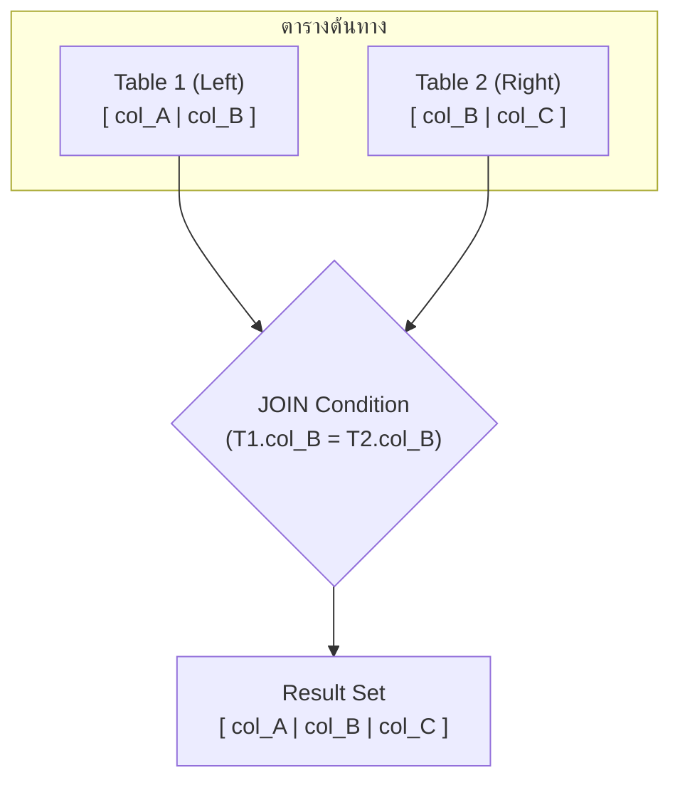

# Database - LAB 6: SQL JOIN (Inner, Cross, Natural, Self Join)

> **วิชา:** 06066300 Database System Concept | **สถาบัน:** มหาวิทยาลัย
> **Source:** `Resources/Books/Database/lab DB/DB66-LAB 6-Join (1).pdf`

---

## Part 1: Macro Architecture & Overview

**JOIN** คือการรวมข้อมูลจากตั้งแต่ 2 ตารางขึ้นไปเข้าด้วยกัน โดยอาศัยเงื่อนไขความสัมพันธ์ระหว่างคอลัมน์ ซึ่งเป็นหัวใจสำคัญของ Relational Database เพราะข้อมูลในระบบจริงถูกจัดเก็บแยกตารางตามหลัก Normalization การ JOIN จึงเป็นวิธีนำข้อมูลกลับมาใช้ร่วมกัน



### ตารางเปรียบเทียบ JOIN ประเภทต่างๆ

| JOIN Type | คำอธิบาย | เงื่อนไข | ผลลัพธ์ |
| :--- | :--- | :--- | :--- |
| **CROSS JOIN** | Cartesian Product — คูณทุก row ของทั้งสองตาราง | ไม่มีเงื่อนไข | m × n rows |
| **INNER JOIN** | เฉพาะ row ที่ตรงเงื่อนไขทั้งสองฝั่ง | ON / WHERE | แถวที่ match เท่านั้น |
| **EQUI JOIN** | INNER JOIN ที่ใช้ `=` เป็นเงื่อนไข | `=` | แถวที่ค่าเท่ากัน |
| **NATURAL JOIN** | JOIN อัตโนมัติตามคอลัมน์ที่ชื่อเหมือนกัน | ชื่อคอลัมน์ตรงกัน | ไม่มีคอลัมน์ซ้ำ |
| **SELF JOIN** | JOIN ตารางเดียวกันกับตัวเอง | Alias ต่างกัน | ความสัมพันธ์ภายในตาราง |

---

## Part 2: Module-by-Module Deep Dive

### 2.1 CROSS JOIN (Cartesian Product)

> 💡 **Intuition:** ลองนึกถึง CROSS JOIN ว่าเป็น "**การจับคู่ทุกแบบที่เป็นไปได้**" — ถ้ามี 3 คน (A, B, C) และ 4 สีเสื้อ (แดง, น้ำเงิน, เขียว, เหลือง) CROSS JOIN คือการจับคู่ **ทุกคน** กับ **ทุกสี** ได้ 3 × 4 = 12 คู่ โดยไม่มีข้อจำกัด ใช้เมื่อต้องการให้เกิด combination ทั้งหมด (เหมือน **ตารางสูตรคูณ**)
> [Source: generated — not verified against original document]

> **CROSS JOIN** คือการจับคู่ทุก row ของตาราง A กับทุก row ของตาราง B โดยไม่มีเงื่อนไขใดๆ ผลลัพธ์คือ **m × n rows** โดยที่ m และ n คือจำนวน row ของแต่ละตาราง

**เมื่อไหร่ใช้:** ใช้เมื่อต้องการ generate ทุก combination ที่เป็นไปได้ เช่น สินค้า × สี, ขนาด × วัสดุ

```sql
-- CROSS JOIN Syntax
SELECT t1.col1, t2.col2
FROM table1 t1
CROSS JOIN table2 t2;

-- ผลลัพธ์: ถ้า table1 มี 3 rows, table2 มี 4 rows → ได้ 12 rows
```

**ตัวอย่าง:**

```sql
-- ตาราง employee (3 rows) × ตาราง department (4 rows) = 12 rows
SELECT e.emp_name, d.dept_name
FROM employee e
CROSS JOIN department d;
```

**🧭 ทำความเข้าใจ** _[Source: generated — not verified against original document]_

**แตกวลีสำคัญ:**
- "จับคู่ทุก row" → SQL สร้าง row ทั้งหมด ไม่มีการกรองตาม condition
- "ผลลัพธ์ = m × n rows" → ถ้า table A มี m rows, table B มี n rows → ได้ m × n rows เสมอ
- "Cartesian Product" → ชื่อทางคณิตศาสตร์ของการจับคู่ทั้งหมด

**ตัวอย่าง:**
- ✅ `FROM A CROSS JOIN B` → ทุก row ของ A จับคู่ทุก row ของ B
- ❌ `FROM A, B` (ลืม WHERE) → เป็น CROSS JOIN โดยไม่รู้ตัว (**dangerous!**)
- **ต่างกันตรง:** CROSS JOIN ไม่มี ON/WHERE, INNER JOIN ต้องมี ON

**อย่าสับสน:** "CROSS JOIN" ไม่ได้หมายถึง "JOIN บน column ชื่อ cross" — มันหมายถึง "จับคู่ทุก row ของสองตาราง โดยไม่มีเงื่อนไข"

**เช็คความเข้าใจ:** products table มี 5 rows, colors table มี 3 rows — `CROSS JOIN` จะได้กี่ rows?
<details><summary>เฉลย</summary>

5 × 3 = 15 rows (ทุก product จับคู่ทุก color)
</details>

---

### 2.2 INNER JOIN (EQUI JOIN)

> 💡 **Intuition:** ลองนึกถึง INNER JOIN ว่าเป็น "**การหาคู่ที่ตรงกัน**" — ถ้ามีรายชื่อพนักงานและรายชื่อแผนก INNER JOIN เพียงหาพนักงานที่ **มี dept_id ตรงกับ** department table เท่านั้น พนักงานที่ dept_id = NULL หรือ dept_id ไม่มีใน department จะ **หายไป** (ตัดออก) เทียบเหมือนจิ๊กซอว์ — ชิ้นที่ไม่มีคู่ต่อก็ไม่ได้อยู่ในภาพ
> [Source: generated — not verified against original document]

> **INNER JOIN** คือการ JOIN ที่ return เฉพาะแถวที่มีค่าตรงกัน (match) ในทั้งสองตาราง แถวที่ไม่มีคู่ match จะถูกตัดทิ้ง

**Syntax หลัก 2 แบบ:**

```sql
-- แบบที่ 1: ใช้ JOIN keyword + ON
SELECT columns
FROM table1
INNER JOIN table2 ON table1.key = table2.key;

-- แบบที่ 2: ใช้ WHERE (เก่ากว่า แต่ยังใช้งานได้)
SELECT columns
FROM table1, table2
WHERE table1.key = table2.key;
```

**ตัวอย่างจริง:**

```sql
-- JOIN employee กับ department เพื่อดูชื่อพนักงานพร้อมชื่อแผนก
SELECT e.emp_id, e.emp_name, d.dept_name
FROM employee e
INNER JOIN department d ON e.dept_id = d.dept_id;

-- เฉพาะ employee ที่มี dept_id อยู่ใน department จะปรากฏในผลลัพธ์
-- employee ที่ dept_id = NULL หรือไม่มีใน department จะถูกตัดออก
```

**การ JOIN มากกว่า 2 ตาราง:**

```sql
SELECT e.emp_name, d.dept_name, l.location_city
FROM employee e
INNER JOIN department d ON e.dept_id = d.dept_id
INNER JOIN location l   ON d.location_id = l.location_id;
```

**🧭 ทำความเข้าใจ** _[Source: generated — not verified against original document]_

**แตกวลีสำคัญ:**
- "return เฉพาะแถวที่ match" → SQL ดูแต่ละ row และเลือกเฉพาะที่ ON condition = TRUE
- "แถวที่ไม่มีคู่ match จะถูกตัดออก" → ถ้า dept_id = NULL หรือ ไม่มี matching row → หายไป
- "EQUI JOIN" → INNER JOIN ที่ใช้ `=` เป็น condition (vs. `>`, `<` เป็นต้น)

**ตัวอย่าง:**
- ✅ `INNER JOIN department ON e.dept_id = d.dept_id` → ได้พนักงานที่มี dept_id อยู่ใน department
- ❌ `INNER JOIN department d ON e.dept_id = d.dept_id WHERE e.dept_id IS NULL` (ตั้งใจหาพนักงานที่ไม่มีแผนก) → ได้ 0 แถวเสมอ เพราะแถวที่ dept_id = NULL ถูก INNER JOIN ตัดไปก่อนแล้ว ต้องใช้ LEFT JOIN
- **ต่างกันตรง:** INNER JOIN ตัด unmatched rows, LEFT JOIN เก็บมัน

**อย่าสับสน:** "INNER JOIN" ไม่ได้หมายถึง "เลือก INNER columns" — มันหมายถึง "แสดงแถวที่ตรงเงื่อนไข ทั้งสองฝั่ง"

**เช็คความเข้าใจ:** employees มี 10 rows, departments มี 5 rows — INNER JOIN จะได้กี่ rows?
<details><summary>เฉลย</summary>

ขึ้นอยู่กับจำนวนพนักงานที่ dept_id ตรงกับ departments table — อาจเป็น 0 ถึง 10 rows (ไม่ใช่ 5 หรือ 10 ตายตัว) เพราะ dept_id เป็น Primary Key ของ department พนักงานแต่ละคนจึง match ได้ไม่เกิน 1 แผนก
</details>

---

### 2.3 NATURAL JOIN

> 💡 **Intuition:** ลองนึกถึง NATURAL JOIN ว่าเป็น "**การจับคู่ที่ให้ระบบหาเอง**" — เหมือนว่า SQL บอกว่า "ฉันจะหา column ที่มีชื่อเหมือนกันแล้ว ใช้ column นั้นเป็น join condition" โดยคุณไม่ต้องเขียน ON เอง สะดวก แต่อันตรายถ้า table มี column ชื่อเหมือนกันหลายตัว เพราะระบบจะ join บนทุกตัวที่ชื่อตรงกัน
> [Source: generated — not verified against original document]

> **NATURAL JOIN** คือ JOIN ที่ระบบ JOIN อัตโนมัติโดยใช้ **คอลัมน์ที่มีชื่อเหมือนกัน** ในทั้งสองตาราง โดยไม่ต้องระบุ ON และจะแสดงคอลัมน์ร่วมนั้นเพียงครั้งเดียวในผลลัพธ์

```sql
-- Syntax
SELECT *
FROM table1
NATURAL JOIN table2;

-- เทียบเท่ากับ INNER JOIN แต่ระบบหาเงื่อนไขให้อัตโนมัติ
```

**ตัวอย่าง:**

```sql
-- ถ้า employee มีคอลัมน์ dept_id และ department ก็มีคอลัมน์ dept_id
SELECT emp_name, dept_name
FROM employee
NATURAL JOIN department;
-- ระบบจะ JOIN บน dept_id อัตโนมัติ และแสดง dept_id เพียงครั้งเดียว
```

**ข้อควรระวัง:** ถ้าสองตารางมีหลายคอลัมน์ที่ชื่อเหมือนกัน ระบบจะ JOIN บนทุกคอลัมน์เหล่านั้น ซึ่งอาจให้ผลผิดพลาด

**🧭 ทำความเข้าใจ** _[Source: generated — not verified against original document]_

**แตกวลีสำคัญ:**
- "JOIN อัตโนมัติ ไม่ต้องระบุ ON" → SQL หา column ชื่อเดียวกันเอง
- "แสดงคอลัมน์ร่วมเพียงครั้งเดียว" → ถ้า dept_id อยู่ทั้ง employee และ department → ผลลัพธ์มีแค่ 1 dept_id (ไม่ซ้ำ)

**ตัวอย่าง:**
- ✅ `NATURAL JOIN` เมื่อ column ชื่อเหมือนกัน 1 ตัว → ดี ง่าย
- ❌ `NATURAL JOIN` เมื่อ column ชื่อเหมือนกัน 3 ตัว → อันตราย ระบบใช้ทั้ง 3 column เป็นเงื่อนไขพร้อมกัน แถวที่ควร match อาจหายไป
- **ต่างกันตรง:** NATURAL JOIN = INNER JOIN โดยให้ระบบหา condition, INNER JOIN = ต้องเขียน ON เอง

**อย่าสับสน:** "NATURAL" ไม่ได้หมายถึง "ธรรมชาติทั่วไป" — มันหมายถึง "join กับ natural columns" (ชื่อเหมือนกัน)

**เช็คความเข้าใจ:** ถ้า employees มี columns (employee_id, first_name, **dept_id**) และ departments มี columns (dept_id, department_name) — `NATURAL JOIN` จะใช้ column ไหนเป็น condition?
<details><summary>เฉลย</summary>

dept_id (เพียงตัวเดียว) — SQL join บน `employees.dept_id = departments.dept_id` โดยอัตโนมัติ
</details>

---

### 2.4 SELF JOIN

> 💡 **Intuition:** ลองนึกถึง SELF JOIN ว่าเป็น "**การค้นหาความสัมพันธ์ภายในสิ่งเดียว**" — เหมือนว่า employee table มีพนักงานทั้งหมดแล้ว แต่ manager_id ของพนักงาน ก็ชี้ไปที่พนักงานคนอื่นในตารางเดียวกัน (พนักงานเป็นหัวหน้าด้วย) ดังนั้น SELF JOIN ก็เหมือน "แยก table เดียวเป็นสองฝั่ง" ฝั่งหนึ่งพนักงาน ฝั่งหนึ่งหัวหน้า แล้วจับคู่กันด้วย `e.manager_id = m.emp_id`
> [Source: generated — not verified against original document]

> **SELF JOIN** คือการ JOIN ตาราง **กับตัวมันเอง** โดยใช้ **Alias** 2 ชื่อเพื่อแยกแยะ เหมาะสำหรับข้อมูลที่มี **ลำดับชั้น (Hierarchy)** ในตารางเดียว เช่น พนักงาน-หัวหน้า, หมวดหมู่-หมวดหมู่ย่อย

```sql
-- Syntax: ต้องใส่ Alias ทั้งสองฝั่ง
SELECT a.column, b.column
FROM table_name a
INNER JOIN table_name b ON a.key = b.related_key;
```

**ตัวอย่าง: หาชื่อพนักงานพร้อมชื่อหัวหน้า**

```sql
-- ตาราง employee มี columns: emp_id, emp_name, manager_id
-- manager_id อ้างอิงกลับมายัง emp_id

SELECT 
    e.emp_name   AS "ชื่อพนักงาน",
    m.emp_name   AS "ชื่อหัวหน้า"
FROM employee e
INNER JOIN employee m ON e.manager_id = m.emp_id;

-- พนักงานที่ manager_id = NULL (CEO) จะไม่ปรากฏ เพราะ INNER JOIN
-- ถ้าต้องการรวม CEO ด้วยต้องใช้ LEFT JOIN แทน
```

**🧭 ทำความเข้าใจ** _[Source: generated — not verified against original document]_

**แตกวลีสำคัญ:**
- "JOIN ตาราง กับตัวมันเอง" → ใช้ตาราง employee 2 ครั้ง (alias `e` และ `m`)
- "Alias ต่างกัน" → ต้องให้ SQL รู้ว่า column `emp_name` มาจาก `e` (พนักงาน) หรือ `m` (หัวหน้า)
- "ลำดับชั้น (Hierarchy)" → ความสัมพันธ์ที่ record บ่งอ้าง (reference) record อื่นในตารางเดียวกัน

**ตัวอย่าง:**
- ✅ `FROM employee e INNER JOIN employee m ON e.manager_id = m.emp_id` → หา (พนักงาน, หัวหน้า) pairs
- ❌ `FROM employee INNER JOIN employee ON manager_id = emp_id` → error ORA-00918 (column ambiguously defined) เพราะไม่รู้ว่า column มาจากฝั่งไหน
- **ต่างกันตรง:** SELF JOIN ต้อง Alias, INNER JOIN 2 ตาราง ต่างชื่อ ไม่ต้อง Alias (แต่แนะนำ)

**อย่าสับสน:** "SELF JOIN" ไม่ได้หมายถึง "JOIN column กับตัวมันเอง" — มันหมายถึง "JOIN ตาราง กับตัวมันเอง" (เป็นสำเนา 2 ฝั่ง)

**เช็คความเข้าใจ:** ทำไม SELF JOIN ต้อง Alias 2 ตัว?
<details><summary>เฉลย</summary>

เพราะ SQL ต้องรู้ว่า `manager_id` ในฝั่งซ้าย (employee `e`) และ `emp_id` ในฝั่งขวา (employee `m`) หมายถึงตัวไหน ถ้าไม่มี Alias SQL จะสับสน
</details>

---

### 2.5 การใช้ Table Alias

> 💡 **Intuition:** นึกถึง Alias เหมือน "ป้ายชื่อย่อ" ที่ติดให้ตารางในคิวรีนั้น เช่น `employee` → `e` เพื่อให้ระบุได้ว่าคอลัมน์ไหนมาจากตารางไหนโดยไม่ต้องพิมพ์ชื่อยาว — จุดที่ Analogy ไม่ตรง: ป้ายนี้มีผลเฉพาะในคิวรีนั้น ไม่ได้เปลี่ยนชื่อตารางจริงในฐานข้อมูล และเมื่อประกาศ Alias แล้วต้องใช้ Alias แทนชื่อเต็มในส่วนอื่นของคิวรีนั้นทันที
> [Source: generated — not verified against original document]


**Alias** ช่วยให้ Query สั้นลงและอ่านง่ายขึ้น โดยเฉพาะเมื่อ JOIN หลายตาราง

```sql
-- ไม่ใช้ Alias (ยาวและอ่านยาก)
SELECT employee.emp_name, department.dept_name
FROM employee
INNER JOIN department ON employee.dept_id = department.dept_id;

-- ใช้ Alias (สั้นกว่า อ่านง่ายกว่า)
SELECT e.emp_name, d.dept_name
FROM employee e          -- e คือ alias ของ employee
INNER JOIN department d  -- d คือ alias ของ department
ON e.dept_id = d.dept_id;
```

**🧭 ทำความเข้าใจ** _[Source: generated — not verified against original document]_

**แตกวลีสำคัญ:**
- "Alias" → ชื่อย่อที่ประกาศในส่วน `FROM` เช่น `FROM employee e` หมายถึง `e` คือ `employee` ในคิวรีนั้น
- "Qualified column" → คอลัมน์ที่มีชื่อตารางหรือ Alias นำหน้า เช่น `e.emp_name` เพื่อระบุว่าเป็นของตารางไหน

**ตัวอย่าง:**
- ✅ `SELECT e.emp_name, d.dept_name FROM employee e INNER JOIN department d ON e.dept_id = d.dept_id;` — ทุกที่ในคิวรีอ้างด้วย `e.` หรือ `d.`
- ❌ `SELECT employee.emp_name FROM employee e INNER JOIN department d ON e.dept_id = d.dept_id;` — ตั้ง Alias `e` ให้ `employee` แล้ว แต่ยังอ้างด้วยชื่อเต็ม Oracle จะแจ้ง `ORA-00904: invalid identifier`
- **ต่างกันตรง:** ✅ อ้างด้วย Alias ที่ประกาศไว้ / ❌ อ้างด้วยชื่อเดิมหลังประกาศ Alias แล้ว

**อย่าสับสน:** Checklist ข้างบนระบุว่า `tablename AS alias` ก็ได้ ในฝั่ง Oracle การใส่ `AS` ให้ตาราง ไม่ได้รับการรองรับในทางปฏิบัติ — ควรรันทดสอบใน Environment ของคุณเพื่อยืนยัน (Uncertain)

**เช็คความเข้าใจ:** `SELECT e.first_name, department_id FROM employee e INNER JOIN department d ON e.dept_id = d.dept_id;` — ทำไมคิวรีนี้อาจ Error ทั้งที่ `department_id` เป็นคอลัมน์ที่มีอยู่จริง?
<details><summary>เฉลย</summary>

ถ้า `department_id` มีอยู่ทั้งในตาราง `employee` และ `department` การเขียนแบบไม่ระบุ Alias จะคลุมเครือ Oracle จะแจ้ง `ORA-00918: column ambiguously defined` ต้องเขียนเป็น `e.department_id` หรือ `d.department_id` ให้ชัดเจน
</details>

---

### 2.6 Schema ที่ใช้ใน LAB 6 (HR Schema)

```sql
-- HR Schema (Oracle-style) — ใช้ทดสอบใน LAB
-- employees: employee_id, first_name, last_name, salary, department_id, manager_id
-- departments: department_id, department_name, manager_id, location_id
-- locations: location_id, city, country_id
-- jobs: job_id, job_title, min_salary, max_salary
```

#### 💡 เสริม: INNER JOIN ตัดแถวที่ไม่มีคู่ออก

> 💡 **Intuition:** นึกถึงงานเลี้ยงที่กำหนดว่า "ต้องมีบัตรทั้งสองฝั่งจึงเข้าได้" — คนที่มีบัตรฝั่งเดียวจะถูกกันออกไปทั้งคน ไม่ได้แสดงแบบครึ่งๆ กลางๆ — จุดที่ Analogy ไม่ตรง: `INNER JOIN` ไม่ได้ "ทิ้งข้อมูล" จากตารางจริง แค่ไม่แสดงแถวที่ไม่มีคู่ในผลลัพธ์ของคิวรีนั้นเท่านั้น
> [Source: generated — not verified against original document]

**🧭 ทำความเข้าใจ** _[Source: generated — not verified against original document]_

**ข้อมูลทดสอบ (ใช้ตรวจด้วยมือ):**
- `employee`: (Ann, dept_id = 10), (Ben, dept_id = 20), (Cat, dept_id = NULL)
- `department`: (dept_id = 10, IT), (dept_id = 30, HR)

**แตกวลีสำคัญ:**
- "ไม่มีคู่" → แถวที่เงื่อนไข `ON` เป็นจริงไม่ได้กับตารางอีกฝั่ง
- "NULL = ..." → เปรียบเทียบ `NULL` ด้วย `=` ได้ผล Unknown ไม่ถือว่า match

**ตัวอย่าง (Trace ผลลัพธ์):**
- ✅ `FROM employee e INNER JOIN department d ON e.dept_id = d.dept_id` → ได้ 1 แถว: (Ann, IT) — Ben (20) ไม่มีแผนก 20 และ Cat (NULL) ไม่ match จึงถูกตัด ส่วน HR (30) ไม่มีพนักงาน จึงไม่ปรากฏ
- ❌ คาดว่าจะได้ 3 แถวเพราะมีพนักงาน 3 คน — ผิด เพราะ INNER JOIN เก็บเฉพาะคู่ที่ match ทั้งสองฝั่ง
- **ต่างกันตรง:** ถ้าต้องการพนักงานทุกคนแม้ไม่มีแผนก ต้องใช้ `LEFT JOIN` (ซึ่งได้ 3 แถว: Ann-IT, Ben-NULL, Cat-NULL)

**อย่าสับสน:** การ "ไม่แสดง" ใน INNER JOIN ไม่ได้หมายถึงข้อมูลในตารางหายไป ตาราง `employee` ยังมี Ben และ Cat เหมือนเดิมทุกประการ

**เช็คความเข้าใจ:** จากข้อมูลทดสอบด้านบน ถ้าเปลี่ยนเป็น `FROM department d INNER JOIN employee e ON d.dept_id = e.dept_id` จะได้จำนวนแถวเท่าไร และผลลัพธ์ต่างจากเดิมไหม?
<details><summary>เฉลย</summary>

ได้ 1 แถว (IT, Ann) เหมือนเดิม เพราะ INNER JOIN เป็นสมมาตร (ลำดับตารางไม่เปลี่ยนแถวที่ match กัน) ต่างจาก OUTER JOIN ที่ลำดับตารางมีผลต่อฝั่งที่ถูกเก็บครบ
</details>

---

## Part 3: Quick Reference & Exam Cheat Sheet

### Checklist สรุปหัวใจสำคัญก่อนสอบ

- [ ] **CROSS JOIN:** ผลลัพธ์ = m × n rows ไม่มีเงื่อนไข — ระวัง result set ขนาดใหญ่มาก
- [ ] **INNER JOIN:** เฉพาะแถวที่ match — ใช้ ON หรือ WHERE ก็ได้
- [ ] **NATURAL JOIN:** JOIN อัตโนมัติตามชื่อคอลัมน์ที่เหมือนกัน — ไม่มี ON
- [ ] **SELF JOIN:** JOIN ตัวเอง ต้องใช้ Alias 2 ตัว — ใช้กับข้อมูล Hierarchy
- [ ] **Alias:** ใช้ `tablename alias` หรือ `tablename AS alias` ก็ได้
- [ ] **JOIN หลายตาราง:** ต่อ JOIN ซ้ำได้ไม่จำกัด

### สรุป Syntax Pattern

| JOIN Type | Syntax Pattern |
| :--- | :--- |
| CROSS JOIN | `FROM A CROSS JOIN B` |
| INNER JOIN | `FROM A INNER JOIN B ON A.key = B.key` |
| NATURAL JOIN | `FROM A NATURAL JOIN B` |
| SELF JOIN | `FROM T a INNER JOIN T b ON a.col = b.col` |
| WHERE style | `FROM A, B WHERE A.key = B.key` |

### Concept Map

```text
SQL JOIN
├── CROSS JOIN (Cartesian Product — ไม่มีเงื่อนไข)
│
├── INNER JOIN (เฉพาะที่ match)
│   ├── EQUI JOIN (ใช้ = เป็นเงื่อนไข) ← INNER JOIN ทั่วไป
│   └── NON-EQUI JOIN (ใช้ >, <, BETWEEN เป็นเงื่อนไข)
│
├── NATURAL JOIN (JOIN อัตโนมัติตามชื่อคอลัมน์)
│
└── SELF JOIN (JOIN กับตัวเอง — ต้องใช้ Alias)
```

---

## ⚠️ Common Pitfalls & Exam Traps

- **CROSS JOIN สร้าง row จำนวนมากโดยไม่ตั้งใจ:** ถ้าลืมใส่ WHERE ใน Old-style JOIN (`FROM A, B`) ผลลัพธ์จะเป็น Cartesian Product โดยไม่รู้ตัว — ตรวจสอบ WHERE เสมอ
- **NATURAL JOIN อันตรายเมื่อมีคอลัมน์ชื่อเหมือนกันหลายคอลัมน์:** ระบบจะ JOIN บนทุกคอลัมน์ที่ชื่อตรงกัน ซึ่งอาจทำให้ผลลัพธ์ผิดพลาดโดยไม่มี Error — ในงาน Production ควรใช้ INNER JOIN + ON แทน
- **SELF JOIN ลืม Alias:** หากไม่ใช้ Alias ระบบจะ Error เพราะ SQL ไม่รู้ว่า column ไหนมาจาก instance ไหน
- **INNER JOIN ตัด NULL ออก:** row ที่ Foreign Key เป็น NULL หรือไม่มีคู่ match จะหายไปจากผลลัพธ์ — ถ้าต้องการ row เหล่านี้ต้องใช้ OUTER JOIN
- **ชื่อคอลัมน์ซ้ำใน JOIN:** เมื่อ SELECT * จาก JOIN ที่มีชื่อคอลัมน์ซ้ำ ต้องระบุ `tablealias.columnname` เพื่อหลีกเลี่ยง Ambiguous Column Error

---

## แบบฝึกหัด (Practice Exercises)

ใช้ Schema: `employees`, `departments`, `locations` (HR Schema)

### ระดับ Basic

**ข้อ 1:** แสดงชื่อพนักงานทุกคน (first_name, last_name) พร้อมชื่อแผนก (department_name) ที่พวกเขาสังกัด โดยใช้ INNER JOIN

**ข้อ 2:** ถ้า departments มี 27 rows และ locations มี 23 rows — CROSS JOIN ระหว่าง 2 ตารางนี้จะได้ผลลัพธ์กี่ rows?

**ข้อ 3:** เขียน Query แสดงชื่อพนักงาน (first_name) และ department_name โดยใช้ NATURAL JOIN ระหว่าง employees และ departments

### ระดับ Intermediate

**ข้อ 4:** แสดงชื่อพนักงานแต่ละคน (first_name, last_name) พร้อมชื่อหัวหน้าของพวกเขา (manager first_name, manager last_name) โดยใช้ SELF JOIN — พนักงานที่ไม่มีหัวหน้าไม่ต้องแสดง

**ข้อ 5:** แสดงรายชื่อพนักงาน พร้อมชื่อแผนก และชื่อเมืองที่แผนกนั้นตั้งอยู่ โดย JOIN 3 ตารางเข้าด้วยกัน (employees → departments → locations)

**ข้อ 6:** แสดงพนักงานที่อยู่ในแผนกเดียวกับพนักงานที่มี last_name = 'King' (ไม่รวม King เอง)

### ระดับ Application

**ข้อ 7:** เขียน Query แสดงคู่พนักงานที่ทำงานในแผนกเดียวกัน (ใช้ SELF JOIN) โดยไม่แสดงคู่ซ้ำ เช่น ถ้าแสดง (A, B) แล้วไม่ต้องแสดง (B, A)

---

### เฉลย

```sql
-- ข้อ 1: INNER JOIN employees กับ departments
SELECT e.first_name, e.last_name, d.department_name
FROM employees e
INNER JOIN departments d ON e.department_id = d.department_id;

-- ข้อ 2: CROSS JOIN rows = 27 × 23 = 621 rows

-- ข้อ 3: NATURAL JOIN
SELECT first_name, department_name
FROM employees
NATURAL JOIN departments;

-- ข้อ 4: SELF JOIN หาชื่อหัวหน้า
SELECT e.first_name || ' ' || e.last_name  AS employee_name,
       m.first_name || ' ' || m.last_name  AS manager_name
FROM employees e
INNER JOIN employees m ON e.manager_id = m.employee_id;

-- ข้อ 5: JOIN 3 ตาราง
SELECT e.first_name, e.last_name, d.department_name, l.city
FROM employees e
INNER JOIN departments d ON e.department_id = d.department_id
INNER JOIN locations l   ON d.location_id = l.location_id;

-- ข้อ 6: พนักงานในแผนกเดียวกับ King
SELECT e.first_name, e.last_name
FROM employees e
INNER JOIN employees k ON e.department_id = k.department_id
WHERE k.last_name = 'King'
  AND e.employee_id != k.employee_id;

-- ข้อ 7: คู่พนักงานในแผนกเดียวกัน (ไม่ซ้ำ)
SELECT a.first_name AS emp1, b.first_name AS emp2, a.department_id
FROM employees a
INNER JOIN employees b ON a.department_id = b.department_id
WHERE a.employee_id < b.employee_id;  -- < ป้องกันคู่ซ้ำ
```

---

## เอกสารเชื่อมโยง (Wiki-Style Backlinks)

- **วิชาและหัวข้อที่เกี่ยวข้อง:**
  - [[LAB 7 - SQL OUTER JOIN]] (JOIN ชนิด Outer ที่เก็บแถวที่ไม่ match ไว้ด้วย — ต่อเนื่องจาก LAB นี้)
  - [[LAB 5 - SQL SELECT with Conditions]] (WHERE clause ที่ใช้คู่กับ JOIN)
  - [[LAB 9 - SQL Subqueries]] (Subquery เป็นอีกวิธีที่ทำสิ่งเดียวกับ JOIN ได้บางกรณี)
  - [[Chapter 01 Introduction to Database System & Relational Model]] (พื้นฐาน Relational Model ที่ทำให้ JOIN มีความหมาย)

- **แบบทดสอบที่เกี่ยวข้อง:**
  - [[SQL-Mock-Quiz-03-Lab5-9-DML]] (ชุดข้อสอบรวมจาก Lab 5-9 และ DML)

- **แหล่งข้อมูล:**
  - Source: `Resources/Books/Database/lab DB/DB66-LAB 6-Join (1).pdf`
