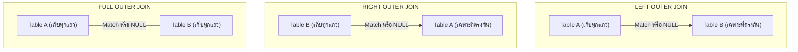

# Database - LAB 7: SQL OUTER JOIN (Left, Right, Full Outer Join)

> **วิชา:** 06066300 Database System Concept | **สถาบัน:** มหาวิทยาลัย
> **Source:** `Resources/Books/Database/lab DB/DB66-LAB 7-Outer Join.pdf`

---

## Part 1: Macro Architecture & Overview

**OUTER JOIN** คือส่วนขยายของ INNER JOIN ที่รักษาแถวซึ่ง **ไม่มีคู่ match** ไว้ในผลลัพธ์ด้วย แทนที่จะตัดทิ้งเหมือน INNER JOIN ช่องที่ไม่มีข้อมูลจะถูกเติมด้วย `NULL` OUTER JOIN สำคัญมากสำหรับ Reporting และการตรวจสอบข้อมูลที่ขาดหายไป



### ตารางเปรียบเทียบ OUTER JOIN ทั้ง 3 ชนิด

| JOIN Type | แถวที่เก็บ | NULL ปรากฏที่ไหน | Use Case |
| :--- | :--- | :--- | :--- |
| **LEFT OUTER JOIN** | ทุกแถวของ Left table | คอลัมน์จาก Right table | หา record ที่ไม่มีความสัมพันธ์ทางขวา |
| **RIGHT OUTER JOIN** | ทุกแถวของ Right table | คอลัมน์จาก Left table | หา record ที่ไม่มีความสัมพันธ์ทางซ้าย |
| **FULL OUTER JOIN** | ทุกแถวของทั้งสองตาราง | ทั้งสองฝั่ง | หา record ที่ไม่มี match ในทั้งสองตาราง |

---

## Part 2: Module-by-Module Deep Dive

### 2.1 LEFT OUTER JOIN

> 💡 **Intuition:** ลองนึกถึง LEFT OUTER JOIN ว่าเป็น "**เช็คชื่อสมาชิกฝั่งซ้ายครบทุกคน แม้บางคนไม่มีคู่ฝั่งขวา**" — ตาราง Left (เช่น employees) ยังคงแสดงทุก row แต่ column จาก Right (เช่น departments) ที่ไม่เจอจะเป็น NULL เหมือน "ทีมซ้ายตัวหลัก ทีมขวาช่วยเสริม"
> [Source: generated — not verified against original document]

> **LEFT OUTER JOIN** (หรือ `LEFT JOIN`) คือการ JOIN ที่ return **ทุกแถวจาก Left table** และ match ที่ตรงจาก Right table ถ้าแถวใน Left ไม่มีคู่ใน Right ช่องของ Right จะเป็น `NULL`

```sql
-- Syntax
SELECT columns
FROM left_table
LEFT OUTER JOIN right_table ON left_table.key = right_table.key;

-- หรือย่อ (OUTER เป็น optional)
SELECT columns
FROM left_table
LEFT JOIN right_table ON left_table.key = right_table.key;
```

**ตัวอย่าง: แสดงพนักงานทุกคน แม้บางคนยังไม่มีแผนก**

```sql
-- พนักงานที่ department_id = NULL จะยังปรากฏ
-- แต่ department_name จะเป็น NULL
SELECT e.first_name, e.last_name, d.department_name
FROM employees e
LEFT JOIN departments d ON e.department_id = d.department_id;

-- ผลลัพธ์:
-- Smith    | Sales
-- Johnson  | IT
-- Doe      | NULL   ← ยังไม่มีแผนก
```

**เทคนิค: หาแถวที่ไม่มีคู่ match**

```sql
-- หาพนักงานที่ไม่มีแผนก (department_id เป็น NULL หรือไม่มีใน departments)
SELECT e.first_name, e.last_name
FROM employees e
LEFT JOIN departments d ON e.department_id = d.department_id
WHERE d.department_id IS NULL;  -- กรองเฉพาะที่ไม่มีคู่
```

**🧭 ทำความเข้าใจ** _[Source: generated — not verified against original document]_

**แตกวลีสำคัญ:**
- "ทุกแถวจาก Left table" → employees ทุกคนขึ้นแสดง ไม่ว่า match หรือไม่
- "ช่องของ Right จะเป็น NULL" → departments columns = NULL ถ้าไม่มี matching dept_id
- "LEFT" → ตารางแรก (FROM) ก็คือ "ซ้าย"

**ตัวอย่าง:**
- ✅ `LEFT JOIN departments d ON e.dept_id = d.dept_id` → employees ทั้งหมด + departments ที่ match (หรือ NULL)
- ❌ `INNER JOIN departments d ON e.dept_id = d.dept_id` → พนักงานที่ไม่มี dept ทั้งคนหายไป
- **ต่างกันตรง:** LEFT JOIN เก็บแถวซ้าย, INNER JOIN ตัดแถวที่ไม่มี match

**อย่าสับสน:** "LEFT" ไม่ได้หมายถึงตำแหน่ง column บนหน้าจอ — "LEFT" = ตารางที่อยู่ซ้ายของคำว่า JOIN (ตารางที่เขียนใน FROM ก่อน)

**เช็คความเข้าใจ:** Employees มี 10 rows, Departments มี 5 rows — `LEFT JOIN` จะได้กี่ rows?
<details><summary>เฉลย</summary>

ได้ 10 rows พอดี ถ้า dept_id เป็น Primary Key ของ departments (พนักงานแต่ละคน match ได้ไม่เกิน 1 แผนก) — โดยทั่วไปคือ "อย่างน้อย 10 rows" เพราะทุก employee ต้องขึ้น ถ้า employees บางคนไม่มี dept_id ในตาราง departments, บรรทัดนั้นจะมี NULL ใน department columns
</details>

---

### 2.2 RIGHT OUTER JOIN

> 💡 **Intuition:** ลองนึกถึง RIGHT OUTER JOIN ว่าเป็น "**LEFT JOIN แต่หมุนกลับข้าง**" — ถ้า LEFT เก็บทุกแถวของตารางแรก RIGHT ก็เก็บทุกแถวของตารางที่สอง (Right table ขึ้นแสดงครบเสมอ) `A RIGHT JOIN B` ให้ผลเหมือน `B LEFT JOIN A`
> [Source: generated — not verified against original document]

> **RIGHT OUTER JOIN** (หรือ `RIGHT JOIN`) คือตรงข้ามกับ LEFT JOIN — return **ทุกแถวจาก Right table** ช่องของ Left ที่ไม่มีคู่จะเป็น `NULL`

```sql
-- Syntax
SELECT columns
FROM left_table
RIGHT OUTER JOIN right_table ON left_table.key = right_table.key;
```

**ตัวอย่าง: แสดงทุกแผนก แม้บางแผนกไม่มีพนักงาน**

```sql
-- แผนกที่ไม่มีพนักงานจะยังปรากฏ แต่ first_name จะเป็น NULL
SELECT e.first_name, e.last_name, d.department_name
FROM employees e
RIGHT JOIN departments d ON e.department_id = d.department_id;

-- ผลลัพธ์:
-- Smith    | Sales
-- Johnson  | IT
-- NULL     | Legal     ← แผนกที่ยังไม่มีพนักงาน
```

> 💡 **Tip:** RIGHT JOIN สามารถเขียนใหม่เป็น LEFT JOIN ได้เสมอโดยสลับลำดับตาราง — ในทางปฏิบัติ Developer มักใช้ LEFT JOIN เป็นหลัก

**🧭 ทำความเข้าใจ** _[Source: generated — not verified against original document]_

**แตกวลีสำคัญ:**
- "ทุกแถวจาก Right table" → ตารางที่สอง (ขวา) ทั้งหมดขึ้นแสดง
- "ช่องของ Left จะเป็น NULL" → employees columns = NULL ถ้าไม่มี matching employee
- "ตรงข้ามกับ LEFT" → RIGHT = LEFT แต่สลับตาราง

**ตัวอย่าง:**
- ✅ `RIGHT JOIN departments d ...` → departments ทั้งหมด + employees ที่ match
- ❌ `INNER JOIN departments d ...` → departments ที่ไม่มี employees หายไป
- **ต่างกันตรง:** RIGHT JOIN เก็บ Right (ตาราง 2), LEFT JOIN เก็บ Left (ตาราง 1)

**อย่าสับสน:** "RIGHT" ไม่ได้หมายถึงตารางที่สำคัญกว่า — "RIGHT" = ตารางที่อยู่ขวาของคำว่า JOIN ถ้าสลับลำดับตาราง RIGHT JOIN ก็เขียนเป็น LEFT JOIN ได้ผลเดียวกัน

**เช็คความเข้าใจ:** `FROM employees e RIGHT JOIN departments d ON ...` จะแสดง departments ทั้งหมดไหม?
<details><summary>เฉลย</summary>

ใช่ departments ทั้งหมดขึ้นแสดง (บาง rows มี NULL ใน employee columns ถ้า department ไม่มี employees)
</details>

---

### 2.3 FULL OUTER JOIN

> 💡 **Intuition:** ลองนึกถึง FULL OUTER JOIN ว่าเป็น "**LEFT + RIGHT รวมกัน**" — แสดง **ทุก**พนักงาน (ซ้าย) **และ ทุก**แผนก (ขวา) แม้จะ unmatched เช่น พนักงานที่ไม่มี dept และ dept ที่ไม่มี employees ทั้งคู่ขึ้นแสดง เหมือน "สรุปสมบูรณ์จากทั้ง 2 ฝั่ง"
> [Source: generated — not verified against original document]

> **FULL OUTER JOIN** คือการรวม LEFT และ RIGHT JOIN เข้าด้วยกัน — return **ทุกแถวจากทั้งสองตาราง** แถวที่ไม่มีคู่ match จะมี `NULL` ในช่องของอีกฝั่ง

```sql
-- Syntax
SELECT columns
FROM left_table
FULL OUTER JOIN right_table ON left_table.key = right_table.key;

-- หรือย่อ
FULL JOIN
```

**ตัวอย่าง:**

```sql
-- แสดงทั้งพนักงานที่ไม่มีแผนก AND แผนกที่ไม่มีพนักงาน
SELECT e.first_name, e.last_name, d.department_name
FROM employees e
FULL OUTER JOIN departments d ON e.department_id = d.department_id;

-- ผลลัพธ์:
-- Smith    | Sales
-- Johnson  | IT
-- Doe      | NULL     ← พนักงานที่ไม่มีแผนก
-- NULL     | Legal    ← แผนกที่ไม่มีพนักงาน
```

**หา unmatched records จากทั้งสองฝั่ง:**

```sql
SELECT e.first_name, d.department_name
FROM employees e
FULL OUTER JOIN departments d ON e.department_id = d.department_id
WHERE e.employee_id IS NULL   -- แผนกที่ไม่มีพนักงาน
   OR d.department_id IS NULL; -- พนักงานที่ไม่มีแผนก
```

**🧭 ทำความเข้าใจ** _[Source: generated — not verified against original document]_

**แตกวลีสำคัญ:**
- "รวม LEFT และ RIGHT" → FULL = LEFT + RIGHT ผนวกเข้า (union-like)
- "ทุกแถวจากทั้งสองตาราง" → employees ทั้งหมด **และ** departments ทั้งหมด
- "NULL ในช่องของอีกฝั่ง" → ถ้า employee ไม่มี dept → department columns = NULL, ถ้า dept ไม่มี employee → employee columns = NULL

**ตัวอย่าง:**
- ✅ `FULL OUTER JOIN departments ...` → ได้ทั้งพนักงาน + departments (รวม unmatched)
- ❌ `INNER JOIN departments ...` → unmatched rows หายไป
- **ต่างกันตรง:** FULL = LEFT + RIGHT ทั้งหมด, INNER = เฉพาะ match

**อย่าสับสน:** "FULL OUTER" ไม่ได้หมายถึง "full table scan" — มันหมายถึง "full join" (ทั้งสองตาราง)

**เช็คความเข้าใจ:** `FULL OUTER JOIN` กับ `CROSS JOIN` ต่างกันตรงไหน?
<details><summary>เฉลย</summary>

FULL OUTER: join **ตาม ON condition** เก็บทั้งสองฝั่ง (ทั้ง matched + unmatched)

CROSS JOIN: **ไม่มี condition** จับคู่ทุก row (m × n)

ตัวอย่าง: employees 10, departments 5
- CROSS JOIN = 50 rows (ทั้งหมด)
- FULL OUTER JOIN = 10 ถึง 15 rows (พนักงานทุกคนขึ้น 1 แถว + แผนกที่ไม่มีพนักงานอีกแผนกละ 1 แถว ถ้า dept_id เป็น PK)
</details>

---

---

### 2.4 OUTER JOIN กับ SELF JOIN

> 💡 **Intuition:** นึกถึงผังบริษัท — CEO ไม่มีหัวหน้า ถ้าใช้ `INNER JOIN` ระบบจะหาหัวหน้าของ CEO ไม่เจอ แล้วตัดแถวของ CEO ทิ้งทั้งแถว `LEFT JOIN` จึงเหมือน "เก็บทุกชื่อในรายชื่อพนักงานไว้ก่อน แล้วช่องหัวหน้าว่างถ้าหาไม่เจอ" — จุดที่ Analogy ไม่ตรง: `LEFT JOIN` รับประกันเฉพาะฝั่งซ้าย (พนักงาน) ว่าจะครบ ไม่ได้รับประกันว่าทุกคนฝั่งขวา (หัวหน้า) จะถูกแสดง
> [Source: generated — not verified against original document]


สามารถรวม OUTER JOIN กับ SELF JOIN ได้ เช่น แสดงพนักงานทุกคนรวมถึง CEO ที่ไม่มีหัวหน้า

```sql
-- SELF JOIN แบบ INNER จะไม่แสดง CEO (manager_id = NULL)
-- เปลี่ยนเป็น LEFT JOIN เพื่อรวม CEO ด้วย
SELECT 
    e.first_name  AS employee_name,
    m.first_name  AS manager_name
FROM employees e
LEFT JOIN employees m ON e.manager_id = m.employee_id;

-- CEO จะปรากฏโดย manager_name = NULL
```

**🧭 ทำความเข้าใจ** _[Source: generated — not verified against original document]_

**แตกวลีสำคัญ:**
- "Self JOIN" → JOIN ตารางเดียวกันสองครั้งโดยตั้ง Alias ต่างกัน เช่น `e` = พนักงาน, `m` = หัวหน้า (ข้อมูลเดียวกันแต่คนละบทบาท)
- "manager_name = NULL" → พนักงานคนนั้นไม่มีหัวหน้าในตาราง (เช่น CEO) ไม่ได้หมายความว่าข้อมูลหาย

**ข้อมูลทดสอบ (ตรวจด้วยมือ):** `employees`: (1, King, manager_id = NULL), (2, Ann, manager_id = 1)

**ตัวอย่าง (Trace ผลลัพธ์):**
- ✅ `FROM employees e LEFT JOIN employees m ON e.manager_id = m.employee_id` → 2 แถว: (King, NULL) และ (Ann, King)
- ❌ `FROM employees e INNER JOIN employees m ON e.manager_id = m.employee_id` → ได้ 1 แถว: (Ann, King) — King หายไป
- **ต่างกันตรง:** LEFT JOIN เก็บแถวของ CEO ไว้โดยค่าฝั่งหัวหน้าเป็น NULL / INNER JOIN ตัดทิ้ง

**อย่าสับสน:** NULL ใน `manager_name` ของ CEO มาจาก "ไม่มีคู่ตอน JOIN" ไม่ได้แปลว่าตาราง `employees` มีค่าผิดปกติ — แค่ `manager_id` เป็น NULL หมายถึงไม่มีหัวหน้า

**เช็คความเข้าใจ:** จากข้อมูลทดสอบด้านบน ถ้าเปลี่ยนเป็น `FROM employees e RIGHT JOIN employees m ON e.manager_id = m.employee_id` จะได้แถวอะไรบ้าง?
<details><summary>เฉลย</summary>

ได้ 2 แถว: (Ann, King) และ (NULL, Ann) RIGHT JOIN เก็บทุกแถวของ `m` (ตารางขวา) ซึ่งรวม Ann ด้วย เมื่อ Ann ไม่มีลูกน้องใน `e` จึงได้ `e` เป็น NULL ส่วน King ทำหน้าที่เป็นแถวของ `e` ซึ่งต้องมี `manager_id` ที่ตรงกับ `m` ตัวใดตัวหนึ่ง แต่ King ไม่มี `manager_id` จึงไม่มีคู่และไม่ปรากฏ
</details>

---

### 2.5 เปรียบเทียบ INNER vs OUTER JOIN

> 💡 **Intuition:** นึกถึงงานเลี้ยงที่มีรายชื่อแขกสองฝั่ง — `INNER JOIN` แสดงเฉพาะคู่ที่จับคู่กันได้จริงทั้งสองฝั่ง `LEFT JOIN` แสดงทุกคนฝั่งซ้ายแม้ไม่มีคู่ `RIGHT JOIN` แสดงทุกคนฝั่งขวาแม้ไม่มีคู่ และ `FULL OUTER JOIN` แสดงทุกคนทั้งสองฝั่ง — จุดที่ Analogy ไม่ตรง: คำว่า "OUTER" ไม่ได้แปลว่าได้แถว "ทั้งหมดทุกฝั่งเสมอ" ต้องดูว่าเป็น LEFT, RIGHT หรือ FULL
> [Source: generated — not verified against original document]


```sql
-- กรณีทดสอบ:
-- employees: 107 rows (บางคนไม่มี department)
-- departments: 27 rows (บางแผนกไม่มีพนักงาน)

-- INNER JOIN → ได้เฉพาะที่ match ทั้งคู่
SELECT COUNT(*) FROM employees e
INNER JOIN departments d ON e.department_id = d.department_id;
-- ได้น้อยกว่า 107

-- LEFT JOIN → ได้ทุก employee
SELECT COUNT(*) FROM employees e
LEFT JOIN departments d ON e.department_id = d.department_id;
-- ได้ครบ 107

-- RIGHT JOIN → ได้ทุก department
SELECT COUNT(*) FROM employees e
RIGHT JOIN departments d ON e.department_id = d.department_id;
-- อาจได้มากกว่า 107 ถ้าหลายคนอยู่แผนกเดียวกัน
```

**🧭 ทำความเข้าใจ** _[Source: generated — not verified against original document]_

**แตกวลีสำคัญ:**
- "Unmatched row" → แถวที่ไม่มีคู่ในอีกตารางตามเงื่อนไข `ON`
- "Preserved side" → ฝั่งที่ OUTER JOIN รับประกันว่าจะเก็บทุกแถว (LEFT = ซ้าย, RIGHT = ขวา, FULL = ทั้งสองฝั่ง)

**ข้อมูลทดสอบ (ตรวจด้วยมือ):**
- `employees`: (A, department_id = 1), (B, NULL), (C, department_id = 2)
- `departments`: (1, IT), (3, HR) — ไม่มี department 2

**ตัวอย่าง (Trace ผลลัพธ์):**
- ✅ INNER: (A, IT) → 1 แถว
- ✅ LEFT: (A, IT), (B, NULL), (C, NULL) → 3 แถว
- ✅ RIGHT: (A, IT), (NULL, HR) → 2 แถว
- ✅ FULL: (A, IT), (B, NULL), (C, NULL), (NULL, HR) → 4 แถว
- ❌ ใช้ `INNER JOIN` เมื่อต้องการนับพนักงานทั้งหมด → ได้ 1 คน ทั้งที่มี 3 คน
- **ต่างกันตรง:** จำนวนแถวขึ้นกับว่า "ฝั่งไหนถูกเก็บครบ" ไม่ได้ขึ้นกับจำนวนแถวในตารางโดยตรง

**อย่าสับสน:** `OUTER JOIN` ไม่ได้หมายถึง "แถวเกินมา" — แถวที่ NULL เติมมาคือแถวที่ไม่มีคู่จริงในอีกตาราง

**เช็คความเข้าใจ:** จากข้อมูลทดสอบ `SELECT COUNT(*) FROM employees e LEFT JOIN departments d ON e.department_id = d.department_id WHERE d.department_id IS NULL;` ได้ค่าเท่าไร และเป็นพนักงานคนไหน?
<details><summary>เฉลย</summary>

ได้ `2` คือ B และ C เพราะ B มี department_id เป็น NULL และ C อ้างถึง department 2 ที่ไม่มีอยู่ในตาราง `departments` ทั้งคู่จึงไม่มีคู่และ `d.department_id` เป็น NULL
</details>

#### 💡 เสริม: หา Unmatched Records ด้วย LEFT JOIN + IS NULL

> 💡 **Intuition:** นึกถึงการเช็คชื่อในห้อง — เรียกทุกคนในรายชื่อแล้วดูว่าใครไม่มีบัตรประจำแผนก (ช่องว่าง) การกรองด้วย `WHERE d.dept_id IS NULL` คือการเลือกเฉพาะคนที่ช่องนั้นว่าง — จุดที่ Analogy ไม่ตรง: ต้องเช็คคอลัมน์ฝั่งที่ถูก JOIN เข้ามา (ฝั่งขวาของ LEFT JOIN) ที่เป็น Key ซึ่งจะไม่เป็น NULL เมื่อมีคู่ ถ้าเช็คคอลัมน์ฝั่งซ้ายแทนจะได้ผลอีกแบบ
> [Source: generated — not verified against original document]

รูปแบบมาตรฐานคือ `FROM A LEFT JOIN B ON ... WHERE B.key IS NULL` ซึ่งได้เฉพาะแถวของ A ที่ไม่มีคู่ใน B

**🧭 ทำความเข้าใจ** _[Source: generated — not verified against original document]_

**ข้อมูลทดสอบ (ตรวจด้วยมือ):** `employee`: (Ann, dept_id = 10), (Ben, dept_id = 20), (Cat, dept_id = NULL) / `department`: (10, IT), (30, HR)

**แตกวลีสำคัญ:**
- "unmatched" → แถวฝั่ง A ที่ไม่มีคู่ใน B เมื่อ LEFT JOIN คอลัมน์ของ B ในแถวนั้นจะเป็น NULL
- "B.key IS NULL" → ตรวจ Key ของฝั่ง B ที่ใช้ JOIN ว่าว่างหรือไม่

**ตัวอย่าง:**
```sql
SELECT e.emp_name
FROM employee e
LEFT JOIN department d ON e.dept_id = d.dept_id
WHERE d.dept_id IS NULL;
```
- ✅ `WHERE d.dept_id IS NULL` → ได้ Ben (dept 20 ไม่มีใน department) และ Cat (dept NULL) รวม 2 แถว
- ❌ `WHERE d.dept_id = NULL` → ได้ 0 แถวเสมอ เพราะการเทียบ `= NULL` ได้ผล Unknown
- ❌ `WHERE e.dept_id IS NULL` → ได้เฉพาะ Cat เพราะ Ben ยังมี dept_id = 20 จึงไม่ถูกกรองออก
- **ต่างกันตรง:** ตรวจ NULL ที่ฝั่ง B (ตารางที่ JOIN เข้ามา) = หา unmatched / ตรวจ NULL ที่ฝั่ง A = หาค่าว่างในตัวตารางนั้นเอง

**อย่าสับสน:** `IS NULL` ในกรณีนี้ไม่ได้แปลว่า "ข้อมูลเสีย" แต่เป็นวิธีบอกว่า "ไม่มีคู่"

**เช็คความเข้าใจ:** ถ้าเปลี่ยน `LEFT JOIN` เป็น `INNER JOIN` แล้วคงเงื่อนไข `WHERE d.dept_id IS NULL` จะได้ผลอะไร?
<details><summary>เฉลย</summary>

ได้ 0 แถว เพราะ INNER JOIN ตัดแถวที่ไม่มีคู่ออกตั้งแต่ก่อนถึง WHERE จึงไม่มีแถวไหนที่ `d.dept_id` เป็น NULL เหลืออยู่ การหา unmatched ต้องใช้ OUTER JOIN เสมอ
</details>

---

## Part 3: Quick Reference & Exam Cheat Sheet

---

## Part 3: Quick Reference & Exam Cheat Sheet

### Checklist สรุปหัวใจสำคัญก่อนสอบ

- [ ] **LEFT JOIN:** เก็บทุกแถวของ Left table — Right ที่ไม่ match จะเป็น NULL
- [ ] **RIGHT JOIN:** เก็บทุกแถวของ Right table — Left ที่ไม่ match จะเป็น NULL
- [ ] **FULL OUTER JOIN:** เก็บทุกแถวจากทั้งสองตาราง — ช่องที่ไม่มีคู่เป็น NULL
- [ ] **หา unmatched records:** ใช้ LEFT/RIGHT JOIN แล้วกรองด้วย `WHERE otherside.key IS NULL`
- [ ] **RIGHT JOIN แปลงเป็น LEFT JOIN:** สลับลำดับตารางและเงื่อนไข
- [ ] **OUTER keyword:** เป็น optional — `LEFT JOIN` = `LEFT OUTER JOIN`

### สรุป Syntax Pattern

| JOIN Type | Syntax |
| :--- | :--- |
| LEFT JOIN | `FROM A LEFT JOIN B ON A.key = B.key` |
| RIGHT JOIN | `FROM A RIGHT JOIN B ON A.key = B.key` |
| FULL OUTER JOIN | `FROM A FULL OUTER JOIN B ON A.key = B.key` |
| หา unmatched | `LEFT JOIN ... WHERE B.key IS NULL` |

### Concept Map — ความครอบคลุมของ JOIN แต่ละแบบ

```text
ข้อมูลทั้งหมด
├── CROSS JOIN .............. A × B (ทุก combination)
├── FULL OUTER JOIN ........ A ∪ B (ทุก row จากทั้งสองฝั่ง)
├── LEFT JOIN .............. A ทั้งหมด + match จาก B
├── RIGHT JOIN ............. B ทั้งหมด + match จาก A
└── INNER JOIN ............. A ∩ B (เฉพาะที่ match)
```

---

## ⚠️ Common Pitfalls & Exam Traps

- **สับสน LEFT/RIGHT:** LEFT JOIN เก็บ Left table ทั้งหมด ไม่ใช่ Right — จำโดยดูว่า "ตารางไหนต้องได้ครบ" คือ LEFT
- **ลืมกรอง IS NULL เมื่อหา unmatched:** ถ้าแค่ LEFT JOIN โดยไม่กรอง `WHERE B.key IS NULL` จะได้ผลรวมทั้ง matched และ unmatched
- **NULL ในเงื่อนไข WHERE:** `WHERE column = NULL` ผิดเสมอ — ต้องใช้ `WHERE column IS NULL`
- **FULL OUTER JOIN บางระบบไม่รองรับ:** MySQL ไม่มี FULL OUTER JOIN โดยตรง ต้องใช้ `UNION` ของ LEFT JOIN และ RIGHT JOIN แทน
- **COUNT(*) vs COUNT(column) ใน OUTER JOIN:** `COUNT(*)` นับรวม NULL แต่ `COUNT(column)` ไม่นับ NULL — ผลลัพธ์ต่างกัน

---

## แบบฝึกหัด (Practice Exercises)

ใช้ Schema: `employees`, `departments`, `locations` (HR Schema)

### ระดับ Basic

**ข้อ 1:** แสดงพนักงานทุกคน (first_name, last_name) พร้อมชื่อแผนก — รวมพนักงานที่ยังไม่มีแผนกด้วย

**ข้อ 2:** แสดงแผนกทุกแผนก (department_name) พร้อมชื่อพนักงาน — รวมแผนกที่ยังไม่มีพนักงานด้วย

**ข้อ 3:** แสดงพนักงานทุกคนพร้อมชื่อหัวหน้า รวม CEO ที่ไม่มีหัวหน้าด้วย

### ระดับ Intermediate

**ข้อ 4:** หาชื่อพนักงานที่ **ยังไม่ได้อยู่ในแผนกใด** (department_id เป็น NULL หรือ department ไม่มีอยู่)

**ข้อ 5:** หาชื่อแผนกที่ **ยังไม่มีพนักงานสักคน**

**ข้อ 6:** แสดงข้อมูลทั้งพนักงานที่ไม่มีแผนก AND แผนกที่ไม่มีพนักงาน ในผลลัพธ์เดียวกัน

### ระดับ Application

**ข้อ 7:** เขียน Query แสดง department_name และจำนวนพนักงานในแต่ละแผนก รวมถึงแผนกที่ไม่มีพนักงานด้วย (ควรแสดงเป็น 0 ไม่ใช่ NULL)

---

### เฉลย

```sql
-- ข้อ 1: LEFT JOIN — พนักงานทุกคน รวมที่ไม่มีแผนก
SELECT e.first_name, e.last_name, d.department_name
FROM employees e
LEFT JOIN departments d ON e.department_id = d.department_id;

-- ข้อ 2: RIGHT JOIN — แผนกทุกแผนก รวมที่ไม่มีพนักงาน
SELECT e.first_name, e.last_name, d.department_name
FROM employees e
RIGHT JOIN departments d ON e.department_id = d.department_id;

-- ข้อ 3: SELF LEFT JOIN — รวม CEO ที่ไม่มีหัวหน้า
SELECT e.first_name AS employee, m.first_name AS manager
FROM employees e
LEFT JOIN employees m ON e.manager_id = m.employee_id;

-- ข้อ 4: พนักงานที่ไม่มีแผนก
SELECT e.first_name, e.last_name
FROM employees e
LEFT JOIN departments d ON e.department_id = d.department_id
WHERE d.department_id IS NULL;

-- ข้อ 5: แผนกที่ไม่มีพนักงาน
SELECT d.department_name
FROM employees e
RIGHT JOIN departments d ON e.department_id = d.department_id
WHERE e.employee_id IS NULL;

-- ข้อ 6: FULL OUTER JOIN — ทั้งสองฝั่งที่ไม่มีคู่
SELECT e.first_name, d.department_name
FROM employees e
FULL OUTER JOIN departments d ON e.department_id = d.department_id
WHERE e.employee_id IS NULL OR d.department_id IS NULL;

-- ข้อ 7: จำนวนพนักงานต่อแผนก รวมแผนกที่ว่าง
SELECT d.department_name, COUNT(e.employee_id) AS emp_count
FROM employees e
RIGHT JOIN departments d ON e.department_id = d.department_id
GROUP BY d.department_name;
-- COUNT(e.employee_id) จะเป็น 0 สำหรับแผนกที่ไม่มีพนักงาน (ไม่นับ NULL)
```

---

## เอกสารเชื่อมโยง (Wiki-Style Backlinks)

- **วิชาและหัวข้อที่เกี่ยวข้อง:**
  - [[LAB 6 - SQL JOIN (Inner, Cross, Natural, Self)]] (INNER JOIN ที่เป็นพื้นฐานของ OUTER JOIN)
  - [[LAB 8 - SQL GROUP BY and Aggregate Functions]] (GROUP BY มักใช้ร่วมกับ OUTER JOIN เพื่อ Reporting)
  - [[LAB 9 - SQL Subqueries]] (Subquery เป็นอีกวิธีหา unmatched records)

- **แหล่งข้อมูล:**
  - Source: `Resources/Books/Database/lab DB/DB66-LAB 7-Outer Join.pdf`
