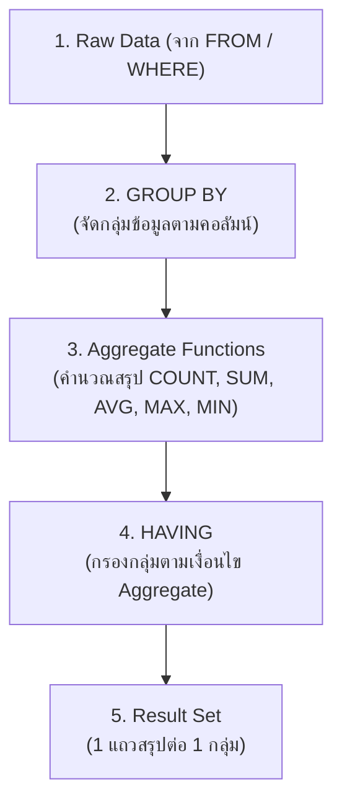

# Database - LAB 8: SQL GROUP BY and Aggregate Functions

> **วิชา:** 06066300 Database System Concept | **สถาบัน:** มหาวิทยาลัย
> **Source:** `Resources/Books/Database/lab DB/DB66-LAB 8-Group By Function.pdf`

---

## Part 1: Macro Architecture & Overview

**Aggregate Functions** คือฟังก์ชันที่ทำการคำนวณบน **กลุ่มข้อมูล (Group)** และ return ค่าเดียว เช่น ผลรวม, ค่าเฉลี่ย, จำนวนนับ **GROUP BY** คือ clause ที่ใช้แบ่งข้อมูลออกเป็นกลุ่มเพื่อให้ Aggregate Functions คำนวณทีละกลุ่ม และ **HAVING** คือ WHERE ของกลุ่มข้อมูล



### ตารางสรุป Aggregate Functions

| Function | ความหมาย | นับ NULL? | ใช้กับ |
| :--- | :--- | :--- | :--- |
| `COUNT(*)` | นับจำนวนทุกแถว | ✅ นับ NULL | ทุก data type |
| `COUNT(col)` | นับจำนวนแถวที่ไม่ใช่ NULL | ❌ ไม่นับ NULL | ทุก data type |
| `COUNT(DISTINCT col)` | นับค่าที่ไม่ซ้ำ | ❌ ไม่นับ NULL | ทุก data type |
| `SUM(col)` | รวมค่า | ❌ ข้าม NULL | ตัวเลข |
| `AVG(col)` | ค่าเฉลี่ย | ❌ ข้าม NULL | ตัวเลข |
| `MAX(col)` | ค่าสูงสุด | ❌ ข้าม NULL | ตัวเลข, ข้อความ, วันที่ |
| `MIN(col)` | ค่าต่ำสุด | ❌ ข้าม NULL | ตัวเลข, ข้อความ, วันที่ |

---

## Part 2: Module-by-Module Deep Dive

### 2.1 Aggregate Functions พื้นฐาน

> 💡 **Intuition:** ลองนึกถึง Aggregate Functions ว่าเป็น "**ตัวสรุป**" — ถ้ามีรายชื่อคะแนนสอบ 100 คน COUNT บอกว่า "มี 100 คน", AVG บอก "คะแนนเฉลี่ย 75", MAX บอก "สูงสุด 99", MIN บอก "ต่ำสุด 30" ไม่แสดงแต่ละคน แต่แสดง "สรุป"
> [Source: generated — not verified against original document]

**ใช้ได้โดยไม่ต้องมี GROUP BY** — คำนวณบนทั้งตาราง

```sql
-- นับจำนวนพนักงานทั้งหมด
SELECT COUNT(*) AS total_employees
FROM employees;

-- เงินเดือนเฉลี่ย, สูงสุด, ต่ำสุด, รวม
SELECT 
    AVG(salary)  AS avg_salary,
    MAX(salary)  AS max_salary,
    MIN(salary)  AS min_salary,
    SUM(salary)  AS total_salary
FROM employees;

-- นับเฉพาะคนที่มี department (ไม่นับ NULL)
SELECT COUNT(department_id) AS employees_with_dept
FROM employees;
```

**🧭 ทำความเข้าใจ** _[Source: generated — not verified against original document]_

**แตกวลีสำคัญ:**
- "คำนวณบน **กลุ่มข้อมูล**" → Aggregate ทำงานกับหลาย rows แล้วสรุปเป็น 1 ค่า (ไม่ใช่ row-by-row)
- "`COUNT(*)` นับทุกแถว" → นับจำนวนแถวทั้งหมด รวมแถวที่บาง column เป็น NULL, `COUNT(col)` นับเฉพาะแถวที่ col ไม่เป็น NULL
- "`COUNT(DISTINCT col)`" → นับค่าที่ไม่ซ้ำกัน (ถ้า dept_id ซ้ำกัน 3 คน ก็นับเป็น 1)

**ตัวอย่าง:** (สมมติตารางมี 10 แถว และ department_id เป็น NULL 2 แถว)
- ✅ `COUNT(*)` = 10 (ทั้ง 10 แถว รวม NULL)
- ✅ `COUNT(department_id)` = 8 (เฉพาะ 8 แถวที่มี dept, 2 แถว NULL ข้าม)
- **ต่างกันตรง:** COUNT(*) นับแถว, COUNT(col) นับค่าที่ไม่ NULL

**อย่าสับสน:** "Aggregate Function" ไม่ได้หมายถึง "aggregate table" — มันหมายถึง "function ที่รวม/สรุป ข้อมูลหลาย rows"

**เช็คความเข้าใจ:** ถ้า commission_pct column มี 10 rows แต่ 7 rows = NULL — `COUNT(commission_pct)` จะได้เท่าไหร่?
<details><summary>เฉลย</summary>

3 (เพราะ COUNT(col) ข้าม NULL, เหลือแค่ 3 rows ที่มีค่า)
</details>

---

### 2.2 GROUP BY

> 💡 **Intuition:** ลองนึกถึง GROUP BY ว่าเป็น "**การแบ่งกลุ่ม**" — ถ้า SELECT ด้วย department_id GROUP BY department_id ก็เหมือนว่า "ให้ SQL แยกพนักงานเป็นกองตาม department → dept 10 กองหนึ่ง, dept 20 อีกกองหนึ่ง" แล้ว Aggregate Function ทำงานทีละกลุ่ม (แต่ละ dept) ผลลัพธ์ก็ได้ 1 แถวต่อ 1 dept เหมือน "แยกกอง (group) แล้วสรุปแต่ละกอง"
> [Source: generated — not verified against original document]

> **GROUP BY** ใช้แบ่งข้อมูลเป็น subgroup ตามค่าของคอลัมน์ที่ระบุ และ Aggregate Function จะคำนวณทีละกลุ่ม ผลลัพธ์จะมี **1 แถวต่อ 1 กลุ่ม** 

**กฎสำคัญของ GROUP BY:**

> ใน SELECT ทุก column ที่ไม่ใช่ Aggregate Function **ต้องอยู่ใน GROUP BY** มิฉะนั้นจะ Error

```sql
-- Syntax
SELECT column1, AGGREGATE_FUNCTION(column2)
FROM table
GROUP BY column1;  -- ต้องระบุ column1 ที่อยู่ใน SELECT
```

**ตัวอย่าง:**

```sql
-- จำนวนพนักงานในแต่ละแผนก
SELECT department_id, COUNT(*) AS emp_count
FROM employees
GROUP BY department_id;
-- ผลลัพธ์: 1 แถวต่อ 1 department_id

-- เงินเดือนเฉลี่ยในแต่ละแผนก
SELECT department_id, AVG(salary) AS avg_salary
FROM employees
GROUP BY department_id
ORDER BY avg_salary DESC;

-- กลุ่มตาม department AND job
SELECT department_id, job_id, COUNT(*) AS count
FROM employees
GROUP BY department_id, job_id;  -- ทุก column ที่ไม่ใช่ Aggregate ต้องอยู่ใน GROUP BY
```

**🧭 ทำความเข้าใจ** _[Source: generated — not verified against original document]_

**แตกวลีสำคัญ:**
- "แบ่งข้อมูลเป็น subgroup" → SQL ลำเลียงแถวที่ columns match เข้าไปในกลุ่มเดียวกัน
- "1 แถวต่อ 1 กลุ่ม" → ถ้า department_id มีค่า 10, 20, 30 → ผลลัพธ์ 3 แถว (1 per group)
- "ทั้ง column ที่ไม่ใช่ Aggregate ต้องอยู่ใน GROUP BY" → Rule: ทุก column ใน SELECT ที่ไม่ได้อยู่ใน Aggregate ต้องอยู่ใน GROUP BY (แต่ column ใน GROUP BY ไม่จำเป็นต้องอยู่ใน SELECT)

**ตัวอย่าง:**
- ✅ `SELECT department_id, COUNT(*) FROM employees GROUP BY department_id` → 1 dept ID 1 row
- ❌ `SELECT department_id, first_name, COUNT(*) FROM employees GROUP BY department_id` → ERROR ORA-00979 not a GROUP BY expression (first_name ไม่อยู่ใน GROUP BY)
- **ต่างกันตรง:** SELECT columns ต้องเป็น "ชื่อกลุ่ม" (GROUP BY column) หรือ "สรุปกลุ่ม" (Aggregate)

**อย่าสับสน:** "GROUP BY" ไม่ได้หมายถึง "sort" — มันหมายถึง "partition into groups" (ผลลัพธ์ไม่รับประกันว่าเรียงลำดับ ถ้าต้องการเรียงต้องใส่ ORDER BY เอง)

**เช็คความเข้าใจ:** `SELECT department_id, job_id, AVG(salary) FROM employees GROUP BY department_id, job_id` จะได้ผลลัพธ์กี่แถว?
<details><summary>เฉลย</summary>

ขึ้นอยู่กับ combination ที่ไม่ซ้ำกันของ (department_id, job_id) เช่น ถ้ามี 5 dept × 3 job = 15 combination ที่เป็นไปได้ เฉพาะ combinations ที่มี data จึงขึ้นแสดง (ตัวอย่าง: 9 rows ถ้ามี 9 combinations ที่มีพนักงาน)
</details>

---

### 2.3 HAVING

> 💡 **Intuition:** ลองนึกถึง HAVING ว่าเป็น "**WHERE ของกลุ่ม**" — WHERE กรองทีละแถว ส่วน HAVING กรองกลุ่ม (หลังจากสรุป) เช่น WHERE `salary > 5000` กรองทีละคน แต่ HAVING `COUNT(*) > 5` กรองเฉพาะกลุ่มที่มีคนมากกว่า 5 คน ลำดับ: WHERE ก่อน (แล้ว group) HAVING หลัง (กรองกลุ่ม)
> [Source: generated — not verified against original document]

> **HAVING** คือ filter ที่ใช้กรอง **หลังจาก GROUP BY** ทำงานแล้ว เปรียบเหมือน WHERE แต่ใช้กับกลุ่มข้อมูล สามารถใช้ Aggregate Function ใน HAVING condition ได้

**ความแตกต่างระหว่าง WHERE และ HAVING:**

| ข้อ | WHERE | HAVING |
| :--- | :--- | :--- |
| กรองอะไร | แถวดิบ (row) ก่อน GROUP BY | กลุ่ม (group) หลัง GROUP BY |
| ใช้ Aggregate Function ได้ไหม | ❌ ไม่ได้ | ✅ ได้ |
| ตำแหน่ง | ก่อน GROUP BY | หลัง GROUP BY |

```sql
-- HAVING Syntax
SELECT column, AGGREGATE_FUNCTION(col)
FROM table
WHERE condition           -- กรองแถวก่อน grouping (optional)
GROUP BY column
HAVING aggregate_condition;  -- กรองหลัง grouping
```

**ตัวอย่าง:**

```sql
-- แผนกที่มีพนักงานมากกว่า 5 คน
SELECT department_id, COUNT(*) AS emp_count
FROM employees
GROUP BY department_id
HAVING COUNT(*) > 5;

-- แผนกที่มีเงินเดือนเฉลี่ยสูงกว่า 8000
SELECT department_id, AVG(salary) AS avg_salary
FROM employees
GROUP BY department_id
HAVING AVG(salary) > 8000
ORDER BY avg_salary DESC;

-- ใช้ WHERE และ HAVING ร่วมกัน
-- WHERE กรองก่อน, HAVING กรองหลัง
SELECT department_id, COUNT(*) AS emp_count
FROM employees
WHERE salary > 5000           -- กรองเฉพาะคนที่เงินเดือน > 5000 ก่อน
GROUP BY department_id
HAVING COUNT(*) >= 3;         -- จากนั้นเลือกเฉพาะแผนกที่มีคนที่ผ่านเงื่อนไข >= 3 คน
```

**🧭 ทำความเข้าใจ** _[Source: generated — not verified against original document]_

**แตกวลีสำคัญ:**
- "กรองหลัง GROUP BY" → ORDER: FROM → WHERE → GROUP BY → HAVING (WHERE มาก่อน)
- "ใช้ Aggregate Function ใน HAVING" → `HAVING COUNT(*) > 5`, `HAVING AVG(salary) > 7000` ใช้ได้
- "`ใช้ WHERE ไม่ได้`" → WHERE ไม่รู้จัก COUNT, AVG ฯลฯ (ตอนที่ WHERE ทำงาน ยังไม่มีการจัดกลุ่ม)

**ตัวอย่าง:**
- ✅ `HAVING COUNT(*) > 5` → เลือกกลุ่มที่มีคน > 5 คน
- ❌ `WHERE COUNT(*) > 5` → ERROR ORA-00934 group function is not allowed here
- **ต่างกันตรง:** WHERE กรองแถว, HAVING กรองกลุ่ม (ปกติใช้คู่ GROUP BY ถ้าไม่มี GROUP BY ทั้งตารางจะถือเป็น 1 กลุ่ม)

**อย่าสับสน:** HAVING ไม่ได้มาแทน WHERE — ใช้ทั้งคู่ใน query เดียวได้ WHERE กรองแถวก่อนจัดกลุ่ม ส่วน HAVING กรองกลุ่มหลังสรุปแล้ว เงื่อนไขที่ไม่ใช้ Aggregate ควรใส่ใน WHERE

**เช็คความเข้าใจ:** `WHERE department_id = 10 GROUP BY department_id HAVING COUNT(*) > 3` จะหา rows ที่ตรง อะไร?
<details><summary>เฉลย</summary>

WHERE = department_id = 10 ก่อน (ดึง dept 10 มา)
GROUP BY = จัดกลุ่ม dept 10 (แต่ group เดียว)
HAVING = กรองกลุ่มที่ COUNT > 3 → ถ้า dept 10 มีมากกว่า 3 คน → ได้ 1 row (สรุปของกลุ่ม dept 10)

ถ้า dept 10 มี 3 คนหรือน้อยกว่า → 0 rows (HAVING กรองออก)
</details>

---

### 2.4 การ GROUP BY กับ JOIN

> 💡 **Intuition:** นึกถึงการนับคนลงชั้นเรียน — ถ้าเริ่มจาก "รายชื่อวิชา" แล้วแปะรายชื่อนักเรียนลงไป จะมีวิชาที่ยังไม่มีนักเรียนเลย เวลาถามว่า "วิชานี้มีนักเรียนกี่คน" ต้องนับเฉพาะช่องที่มีชื่อนักเรียนจริง ไม่ใช่นับทุกบรรทัดที่มีอยู่ — จุดที่ Analogy ไม่ตรง: ในผลลัพธ์ของ JOIN แถวที่ฝั่งซ้ายเป็น NULL ยังเป็นแถวจริง ดังนั้น `COUNT(*)` จะนับมัน ส่วน `COUNT(คอลัมน์ฝั่งที่แปะเข้ามา)` จะไม่นับ
> [Source: generated — not verified against original document]


สามารถใช้ GROUP BY ร่วมกับ JOIN เพื่อดึงชื่อที่อ่านง่ายแทน ID

```sql
-- จำนวนพนักงานในแต่ละแผนก พร้อมชื่อแผนก
SELECT d.department_name, COUNT(e.employee_id) AS emp_count
FROM employees e
RIGHT JOIN departments d ON e.department_id = d.department_id
GROUP BY d.department_name
ORDER BY emp_count DESC;

-- เงินเดือนเฉลี่ยแต่ละแผนก พร้อมชื่อแผนก เฉพาะแผนกที่ avg > 7000
SELECT d.department_name, AVG(e.salary) AS avg_salary
FROM employees e
INNER JOIN departments d ON e.department_id = d.department_id
GROUP BY d.department_name
HAVING AVG(e.salary) > 7000
ORDER BY avg_salary DESC;
```

**🧭 ทำความเข้าใจ** _[Source: generated — not verified against original document]_

**ข้อมูลทดสอบ (ตรวจด้วยมือ):** `departments`: A (มีพนักงาน 2 คน), B (ไม่มีพนักงาน) — ใช้ `RIGHT JOIN` เก็บทุกแผนก ผลลัพธ์ก่อน GROUP BY จะได้ 3 แถว: (A, emp1), (A, emp2), (B, NULL)

**แตกวลีสำคัญ:**
- "COUNT(e.employee_id)" → นับเฉพาะแถวที่ `employee_id` ไม่เป็น NULL ดังนั้นแผนก B ได้ 0
- "COUNT(*)" → นับทุกแถวในกลุ่ม รวมแถวที่ฝั่งพนักงานเป็น NULL ดังนั้นแผนก B ได้ 1

**ตัวอย่าง:**
- ✅ `COUNT(e.employee_id)` → A = 2, B = 0 — ถูกต้องสำหรับ "จำนวนพนักงาน"
- ❌ `COUNT(*)` → A = 2, B = 1 — นับแผนกว่างเป็น 1 คน ซึ่งผิด
- **ต่างกันตรง:** นับ "แถวของผลลัพธ์" (`COUNT(*)`) กับ นับ "พนักงานจริง" (`COUNT(e.employee_id)`) ให้ผลต่างกันเมื่อมี Outer JOIN

**อย่าสับสน:** การ GROUP BY หลัง JOIN ไม่ได้ทำให้ข้อมูลหาย — แผนก B ยังอยู่ในผลลัพธ์ แค่จำนวนพนักงานของมันเป็น 0

**เช็คความเข้าใจ:** ถ้าสลับเป็น `INNER JOIN` แทน `RIGHT JOIN` ในข้อมูลทดสอบ แผนก B จะปรากฏในผลลัพธ์ไหม?
<details><summary>เฉลย</summary>

ไม่ปรากฏ เพราะ INNER JOIN ตัดแถวที่ไม่มีคู่ออกก่อน GROUP BY จึงไม่มีกลุ่มของแผนก B เหลืออยู่ ผลลัพธ์จะเหลือเฉพาะแผนก A
</details>

---

### 2.5 ORDER ของ SQL Clauses (สำคัญมาก)

> 💡 **Intuition:** นึกถึงการทำอาหาร — ต้องหั่นวัตถุดิบก่อน (FROM / WHERE) แล้วแบ่งเป็นชุด (GROUP BY) จากนั้นคัดชุดที่ใช้ได้ (HAVING) และสุดท้ายจัดจาน (ORDER BY) จะสลับกันไม่ได้ เพราะแต่ละขั้นรับของจากขั้นก่อนหน้า — จุดที่ Analogy ไม่ตรง: SQL เขียนเริ่มต้นด้วย `SELECT` แต่ตอนประมวลผลจริง `FROM` ทำก่อน `SELECT` ซึ่งเป็นสาเหตุที่ Alias ที่ตั้งใน `SELECT` มักใช้ใน `WHERE` ไม่ได้
> [Source: generated — not verified against original document]


SQL clauses ต้องเรียงในลำดับที่กำหนดเท่านั้น:

```sql
SELECT   column, AGGREGATE(col)    -- 1. ระบุ column ที่ต้องการ
FROM     table                     -- 2. ระบุตาราง
[JOIN    other_table ON ...]       -- 3. JOIN (optional)
WHERE    row_condition             -- 4. กรองแถวก่อน GROUP (optional)
GROUP BY column                   -- 5. จัดกลุ่ม (optional)
HAVING   group_condition          -- 6. กรองกลุ่ม (optional)
ORDER BY column                   -- 7. เรียงลำดับ (optional)
[LIMIT   n];                      -- 8. จำกัดจำนวน (optional)
```

> **จำง่าย:** `SELECT → FROM → WHERE → GROUP BY → HAVING → ORDER BY`
> ย่อ: **SF W G H O** (Safe Fish With Green Herb Onion)

**🧭 ทำความเข้าใจ** _[Source: generated — not verified against original document]_

**แตกวลีสำคัญ:**
- "WHERE กรองแถว" → ทำก่อน GROUP BY จึงใช้ Aggregate Function ไม่ได้
- "HAVING กรองกลุ่ม" → ทำหลัง GROUP BY จึงใช้ Aggregate Function ได้

**ข้อมูลทดสอบ (ตรวจด้วยมือ):** `employees` (salary, department_id): (6000, 10), (4000, 10), (8000, 10), (9000, 20), (5000, 20)

```sql
SELECT department_id, COUNT(*) AS cnt
FROM employees
WHERE salary > 5000          -- ขั้น 1: เหลือ (6000,10), (8000,10), (9000,20)
GROUP BY department_id       -- ขั้น 2: กลุ่ม 10 = 2 แถว, กลุ่ม 20 = 1 แถว
HAVING COUNT(*) >= 2         -- ขั้น 3: เหลือเฉพาะกลุ่ม 10
ORDER BY department_id;      -- ขั้น 4: เรียงผลลัพธ์
```

- ✅ ผลลัพธ์: `(10, 2)` — กรองแถวก่อน แล้วกรองกลุ่ม
- ❌ `WHERE COUNT(*) >= 2` → Oracle แจ้ง `ORA-00934: group function is not allowed here` เพราะ WHERE ทำงานก่อนมีกลุ่ม
- ❌ `GROUP BY department_id HAVING salary > 5000` → Oracle แจ้ง `ORA-00979: not a GROUP BY expression` เพราะ `salary` ไม่ได้เป็นกลุ่ม ต้องกรองด้วย WHERE หรือใช้ Aggregate
- **ต่างกันตรง:** WHERE กรอง "แถวดิบ" ก่อนแบ่งกลุ่ม / HAVING กรอง "ผลของกลุ่ม" หลังแบ่งกลุ่มแล้ว

**อย่าสับสน:** การเขียน `WHERE` ก่อน `GROUP BY` ในโค้ดไม่ได้หมายความว่า "ทำงานก่อนจริง" — แต่ลำดับการประมวลผลคือ FROM → WHERE → GROUP BY → HAVING → SELECT → ORDER BY

**เช็คความเข้าใจ:** ถ้าเปลี่ยน `WHERE salary > 5000` เป็น `HAVING salary > 5000` (และคงส่วนอื่นไว้) ผลลัพธ์จะเป็นอะไร และทำไม?
<details><summary>เฉลย</summary>

Query จะ Error (ORA-00979) เพราะ `salary` ไม่อยู่ใน GROUP BY และไม่ได้อยู่ใน Aggregate Function ถ้าต้องการกรองแถวดิบต้องใช้ `WHERE` เสมอ `HAVING` ใช้กับผลสรุปของกลุ่มเท่านั้น
</details>

---

### 2.6 COUNT(*) vs COUNT(col) vs COUNT(DISTINCT col)

> 💡 **Intuition:** นึกถึงการเช็คชื่อหน้าห้อง — `COUNT(*)` คือการนับ "จำนวนที่นั่งทั้งหมด" ไม่ว่าที่นั่งนั้นจะมีคนหรือไม่ ส่วน `COUNT(col)` คือนับเฉพาะ "ที่นั่งที่มีป้ายชื่อติดอยู่" และ `COUNT(DISTINCT col)` คือนับ "จำนวนสาขาที่ต่างกัน" ที่มีคนนั่งอยู่ โดยไม่นับซ้ำ — จุดที่ Analogy ไม่ตรง: ที่นั่งว่างเป็นแถวจริงที่ถูกนับโดย `COUNT(*)` ไม่ได้เป็นที่นั่งที่หายไป
> [Source: generated — not verified against original document]


```sql
-- ตัวอย่างข้อมูล employees:
-- emp_id: 1, 2, 3, 4, 5
-- department_id: 10, 10, NULL, 20, 10

SELECT
    COUNT(*)                    AS total_rows,       -- 5 (นับทุกแถวรวม NULL)
    COUNT(department_id)        AS has_dept,         -- 4 (ไม่นับ NULL)
    COUNT(DISTINCT department_id) AS unique_dept     -- 2 (10 และ 20)
FROM employees;
```

**🧭 ทำความเข้าใจ** _[Source: generated — not verified against original document]_

**แตกวลีสำคัญ:**
- "COUNT(*)" → นับจำนวนแถวทั้งหมดในกลุ่ม ไม่สนใจค่าใน Column (รวมแถวที่เป็น NULL)
- "COUNT(col)" → นับเฉพาะแถวที่ค่าใน `col` ไม่เป็น NULL
- "COUNT(DISTINCT col)" → นับค่าที่ไม่ซ้ำกันและไม่เป็น NULL

**ตัวอย่าง (ใช้ข้อมูลในโค้ดด้านบน: 10, 10, NULL, 20, 10):**
- ✅ `COUNT(*)` = 5 — ทุกแถว
- ✅ `COUNT(department_id)` = 4 — ข้ามแถวที่เป็น NULL
- ✅ `COUNT(DISTINCT department_id)` = 2 — ค่าที่ไม่ซ้ำคือ {10, 20}
- ❌ คิดว่า `COUNT(department_id)` = 5 เพราะมี 5 แถว — ผิด เพราะ NULL ไม่ถูกนับ
- **ต่างกันตรง:** `COUNT(*)` นับแถว / `COUNT(col)` นับค่าที่ไม่ NULL / `COUNT(DISTINCT col)` นับค่าที่ไม่ซ้ำและไม่ NULL

**อย่าสับสน:** `COUNT(col)` ไม่ได้แปลว่า "นับจำนวนของ col" แบบนับสิ่งของ แต่คือ "นับแถวที่ค่าใน col ไม่ว่าง"

**เช็คความเข้าใจ:** จากข้อมูลเดิม `SELECT COUNT(*) FROM employees WHERE department_id IS NULL;` ได้เท่าไร และ `SELECT COUNT(department_id) FROM employees WHERE department_id IS NULL;` ได้เท่าไร?
<details><summary>เฉลย</summary>

ได้ 1 กับ 0 ตามลำดับ — `COUNT(*)` นับแถวที่ผ่านเงื่อนไข (1 แถวคือ emp_id 3) แต่ `COUNT(department_id)` ของแถวที่ `department_id` เป็น NULL จะเป็น 0 เพราะไม่มีค่าให้นับ
</details>

---

## Part 3: Quick Reference & Exam Cheat Sheet

### Checklist สรุปหัวใจสำคัญก่อนสอบ

- [ ] **Aggregate Functions:** COUNT, SUM, AVG, MAX, MIN — ส่วนใหญ่ไม่นับ NULL (ยกเว้น COUNT(*))
- [ ] **GROUP BY:** แบ่งกลุ่ม — ทุก column ใน SELECT ที่ไม่ใช่ Aggregate ต้องอยู่ใน GROUP BY
- [ ] **HAVING:** กรองกลุ่ม (หลัง GROUP BY) — ใช้ Aggregate Function ได้
- [ ] **WHERE:** กรองแถว (ก่อน GROUP BY) — ใช้ Aggregate Function ไม่ได้
- [ ] **Clause Order:** `SELECT → FROM → WHERE → GROUP BY → HAVING → ORDER BY`
- [ ] **COUNT(*) vs COUNT(col):** `COUNT(*)` นับ NULL, `COUNT(col)` ไม่นับ NULL

### สรุปสูตร / Notation

| Function | Syntax | ตัวอย่าง |
| :--- | :--- | :--- |
| `COUNT(*)` | `COUNT(*)` | `SELECT COUNT(*) FROM emp;` |
| `COUNT(col)` | `COUNT(column)` | `COUNT(department_id)` |
| `COUNT DISTINCT` | `COUNT(DISTINCT col)` | `COUNT(DISTINCT dept_id)` |
| `SUM` | `SUM(column)` | `SUM(salary)` |
| `AVG` | `AVG(column)` | `AVG(salary)` |
| `MAX` | `MAX(column)` | `MAX(salary)` |
| `MIN` | `MIN(column)` | `MIN(salary)` |

### Concept Map

```text
Aggregate Query Pipeline
│
SELECT [col], [AGGREGATE(col)]
    │
FROM [table]
    │
WHERE [row filter]       ← กรองแถวก่อน
    │
GROUP BY [col]           ← แบ่งกลุ่ม
    │
    ├── COUNT(*)         ← นับทุกแถวในกลุ่ม (รวม NULL)
    ├── COUNT(col)       ← นับที่ไม่ใช่ NULL ในกลุ่ม
    ├── SUM(col)         ← รวมในกลุ่ม
    ├── AVG(col)         ← เฉลี่ยในกลุ่ม
    ├── MAX(col)         ← สูงสุดในกลุ่ม
    └── MIN(col)         ← ต่ำสุดในกลุ่ม
    │
HAVING [group filter]    ← กรองกลุ่มหลัง aggregate
    │
ORDER BY [col]           ← เรียงลำดับผลลัพธ์
```

---

## ⚠️ Common Pitfalls & Exam Traps

- **ใส่ column ใน SELECT แต่ไม่ใส่ใน GROUP BY:** Error ทันที — "column must appear in GROUP BY clause or be used in an aggregate function"
- **ใช้ Aggregate Function ใน WHERE:** Error — ต้องใช้ใน HAVING แทน เช่น `WHERE COUNT(*) > 5` → ผิด ต้องเป็น `HAVING COUNT(*) > 5`
- **COUNT(*) vs COUNT(col) สับสน:** ถ้าต้องการนับแถวทั้งหมดใช้ `COUNT(*)` ถ้าต้องการนับเฉพาะที่ไม่ใช่ NULL ใช้ `COUNT(col)`
- **AVG ไม่นับ NULL — อาจให้ผลผิด:** ถ้าต้องการ AVG ที่นับ NULL เป็น 0 ต้องใช้ `SUM(col) / COUNT(*)` แทน `AVG(col)`
- **GROUP BY ต้องใช้ชื่อคอลัมน์ ไม่ใช่ Alias:** บางระบบ (เช่น Oracle) ไม่รับ Alias ใน GROUP BY — ต้องใช้ชื่อจริงของคอลัมน์
- **HAVING กับ WHERE ใช้ร่วมกันได้:** WHERE กรองก่อน GROUP BY, HAVING กรองหลัง — ใช้ร่วมกันได้และสามารถเพิ่มประสิทธิภาพโดยกรอง WHERE ก่อน

---

## แบบฝึกหัด (Practice Exercises)

ใช้ Schema: `employees`, `departments` (HR Schema)

### ระดับ Basic

**ข้อ 1:** นับจำนวนพนักงานทั้งหมดในบริษัท

**ข้อ 2:** หาเงินเดือนสูงสุด ต่ำสุด และค่าเฉลี่ยของพนักงานทั้งบริษัท

**ข้อ 3:** นับจำนวนพนักงานในแต่ละ department_id (GROUP BY department_id)

### ระดับ Intermediate

**ข้อ 4:** แสดงชื่อแผนก (department_name) และจำนวนพนักงานในแต่ละแผนก โดย JOIN กับ departments table

**ข้อ 5:** แสดง department_id และเงินเดือนเฉลี่ย เฉพาะแผนกที่มีเงินเดือนเฉลี่ยมากกว่า 6,000

**ข้อ 6:** แสดง department_name และจำนวนพนักงาน เฉพาะแผนกที่มีพนักงานมากกว่า 5 คน เรียงตามจำนวนมากไปน้อย

### ระดับ Application

**ข้อ 7:** แสดง department_name และเงินเดือนรวม (SUM) ของพนักงานที่มีเงินเดือน > 5,000 เฉพาะแผนกที่เงินเดือนรวมมากกว่า 50,000

**ข้อ 8:** นับจำนวน department ที่มีพนักงานอยู่จริง (ใช้ COUNT DISTINCT)

---

### เฉลย

```sql
-- ข้อ 1: จำนวนพนักงานทั้งหมด
SELECT COUNT(*) AS total_employees
FROM employees;

-- ข้อ 2: เงินเดือน max, min, avg
SELECT 
    MAX(salary) AS max_salary,
    MIN(salary) AS min_salary,
    ROUND(AVG(salary), 2) AS avg_salary
FROM employees;

-- ข้อ 3: จำนวนพนักงานต่อแผนก
SELECT department_id, COUNT(*) AS emp_count
FROM employees
GROUP BY department_id
ORDER BY department_id;

-- ข้อ 4: ชื่อแผนก + จำนวนพนักงาน (JOIN)
SELECT d.department_name, COUNT(e.employee_id) AS emp_count
FROM employees e
INNER JOIN departments d ON e.department_id = d.department_id
GROUP BY d.department_name;

-- ข้อ 5: เงินเดือนเฉลี่ย > 6000
SELECT department_id, AVG(salary) AS avg_salary
FROM employees
GROUP BY department_id
HAVING AVG(salary) > 6000;

-- ข้อ 6: แผนกที่มีพนักงาน > 5 คน
SELECT d.department_name, COUNT(e.employee_id) AS emp_count
FROM employees e
INNER JOIN departments d ON e.department_id = d.department_id
GROUP BY d.department_name
HAVING COUNT(e.employee_id) > 5
ORDER BY emp_count DESC;

-- ข้อ 7: เงินเดือนรวมต่อแผนก (WHERE + GROUP BY + HAVING)
SELECT d.department_name, SUM(e.salary) AS total_salary
FROM employees e
INNER JOIN departments d ON e.department_id = d.department_id
WHERE e.salary > 5000                -- กรองพนักงานก่อน
GROUP BY d.department_name
HAVING SUM(e.salary) > 50000;       -- กรองแผนกหลัง

-- ข้อ 8: จำนวน department ที่มีพนักงาน
SELECT COUNT(DISTINCT department_id) AS active_departments
FROM employees
WHERE department_id IS NOT NULL;
```

---

## เอกสารเชื่อมโยง (Wiki-Style Backlinks)

- **วิชาและหัวข้อที่เกี่ยวข้อง:**
  - [[LAB 6 - SQL JOIN (Inner, Cross, Natural, Self)]] (JOIN ที่มักใช้ก่อน GROUP BY เพื่อดึงชื่อแทน ID)
  - [[LAB 7 - SQL OUTER JOIN (Left, Right, Full)]] (OUTER JOIN + GROUP BY สำหรับ Reporting ที่รวมแผนกว่าง)
  - [[LAB 9 - SQL Subqueries]] (Subquery สามารถใช้แทน HAVING ได้ในบางกรณี)
  - [[LAB 4 - SQL SELECT]] (SELECT พื้นฐานก่อนเรียน GROUP BY)

- **แบบทดสอบที่เกี่ยวข้อง:**
  - [[SQL-Mock-Quiz-03-Lab5-9-DML]] (ชุดข้อสอบรวมจาก Lab 5-9 และ DML)

- **แหล่งข้อมูล:**
  - Source: `Resources/Books/Database/lab DB/DB66-LAB 8-Group By Function.pdf`
