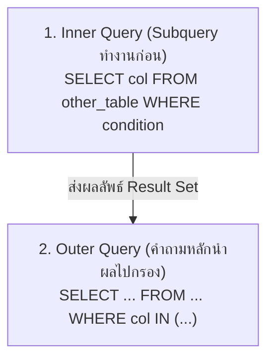

# Database - LAB 9: SQL Subqueries

> **วิชา:** 06066300 Database System Concept | **สถาบัน:** มหาวิทยาลัย
> **Source:** `Resources/Books/Database/lab DB/DB66-LAB 9-Subqueries.pdf`

---

## Part 1: Macro Architecture & Overview

**Subquery** (หรือ Inner Query / Nested Query) คือ SQL query ที่อยู่ภายใน query อื่น Subquery จะถูก execute ก่อน แล้วผลลัพธ์ถูกส่งต่อให้ Outer Query ใช้งาน เปรียบเหมือนการแบ่งปัญหาซับซ้อนออกเป็น 2 ขั้นตอน — ถามคำถามย่อยก่อน แล้วนำคำตอบมาใช้ถามคำถามหลัก



### ตารางเปรียบเทียบ Subquery ประเภทต่างๆ

| ประเภท | ตำแหน่ง | ผลลัพธ์ที่คืน | ใช้ with |
| :--- | :--- | :--- | :--- |
| **Single-Row Subquery** | WHERE | 1 ค่า (scalar) | `=`, `<`, `>`, `!=` |
| **Multi-Row Subquery** | WHERE | หลายค่า | `IN`, `ANY`, `ALL`, `EXISTS` |
| **Correlated Subquery** | WHERE/SELECT | ขึ้นกับ Outer row | `EXISTS`, `NOT EXISTS` |
| **Inline View** | FROM | Virtual table | JOIN, WHERE |
| **Scalar Subquery** | SELECT | 1 ค่าต่อแถว | แสดงผลใน SELECT |

---

## Part 2: Module-by-Module Deep Dive

### 2.1 Single-Row Subquery

> 💡 **Intuition:** ลองนึกถึง Single-Row Subquery ว่าเป็น "**คำถามย่อย ที่ตอบแค่ 1 เลข**" — เช่น "เงินเดือนเฉลี่ยกี่บาท?" ตอบ "6461 บาท" (1 เลข) แล้ว outer query นำมาใช้ "หาพนักงานที่เงินเดือน > 6461" ลำดับ: ตอบคำถามย่อยก่อน (= 1 ค่า) แล้วนำมาเทียบ
> [Source: generated — not verified against original document]

> > **Single-Row Subquery** คือ Subquery ที่ return ค่า **เพียง 1 ค่า (scalar)** ใช้กับ Comparison Operators ทั่วไป เช่น =, `>`, `<`, `!=`

```sql
-- Syntax
SELECT columns
FROM table
WHERE column operator (
    SELECT single_value
    FROM other_table
    WHERE condition
);
```

**ตัวอย่าง:**

```sql
-- หาพนักงานที่มีเงินเดือนสูงกว่าค่าเฉลี่ยของบริษัท
SELECT first_name, last_name, salary
FROM employees
WHERE salary > (
    SELECT AVG(salary)     -- Subquery return ค่าเดียว เช่น 6461.68
    FROM employees
);

-- หาพนักงานที่อยู่ใน department เดียวกับ 'Abel'
SELECT first_name, last_name
FROM employees
WHERE department_id = (
    SELECT department_id
    FROM employees
    WHERE last_name = 'Abel'  -- ต้องมีแค่ 1 row ไม่งั้น Error
);

-- หาพนักงานที่ได้รับเงินเดือนสูงสุดในบริษัท
SELECT first_name, last_name, salary
FROM employees
WHERE salary = (
    SELECT MAX(salary)
    FROM employees
);
```

**ข้อควรระวัง:** ถ้า Subquery return **มากกว่า 1 แถว** แต่ใช้ = จะ Error ทันที (`single-row subquery returns more than one row`)

**🧭 ทำความเข้าใจ** _[Source: generated — not verified against original document]_

**แตกวลีสำคัญ:**
- "return เพียง 1 ค่า (scalar)" → Subquery เป็นคำถามที่ตอบแค่เลขเดียว (เช่น AVG, MAX, COUNT)
- "ใช้ Comparison Operators ทั่วไป" → `=`, `>`, `<`, `!=` ได้เพราะรู้ว่ามีค่าเดียว
- "ต้องมีแค่ 1 row ไม่งั้น Error" → ถ้าตอบ > 1 แถว → Error ORA-01427 "single-row subquery returns more than one row" (ถ้าได้ 0 แถว จะไม่ error แต่ได้ NULL ทำให้ outer query ไม่ได้แถวไหนเลย)

**ตัวอย่าง:**
- ✅ `salary > (SELECT AVG(salary) FROM employees)` → Subquery = 1 ค่า (avg)
- ✅ `department_id = (SELECT department_id FROM employees WHERE last_name = 'Abel')` → ถ้า Abel อยู่ 1 คนเท่านั้น
- ❌ `department_id = (SELECT department_id FROM employees)` → ERROR (return 107 แถว)
- **ต่างกันตรง:** Single-row ต้อง 1 row เท่านั้น, Multi-row ใช้ IN กับหลายค่า

**อย่าสับสน:** "Single-Row Subquery" ไม่ได้หมายถึง subquery ที่อ่านตารางแค่ 1 แถว — หมายถึงผลลัพธ์ที่ส่งกลับมีแค่ 1 แถว (เช่น `AVG(salary)` อ่าน 107 แถว แต่คืนค่าเดียว)

**เช็คความเข้าใจ:** `WHERE salary = (SELECT salary FROM employees WHERE last_name = 'King')` ทำไมอาจ Error?
<details><summary>เฉลย</summary>

ถ้ามี 2 คน last_name = 'King' → Subquery return 2 rows → `=` เทียบได้กับค่าเดียวเท่านั้น → ERROR ORA-01427 (ใน HR schema มี King 2 คนจริง: Steven King และ Janette King)

ต้องใช้ IN แทน หรือแน่ใจว่า 'King' เป็นคนเดียวเท่านั้น
</details>

---

### 2.2 Multi-Row Subquery

> 💡 **Intuition:** ลองนึกถึง Multi-Row Subquery ว่าเป็น "**คำถามย่อยที่ตอบหลายเลข**" — เช่น "แผนกที่อยู่ location 1700 มี department_id อะไรบ้าง?" ตอบ เช่น "10, 30, 90" (หลายเลข) แล้ว outer query นำมาใช้ "หาพนักงานจาก dept 10, 30 หรือ 90" ต้องใช้ IN, ANY, ALL เพราะมีหลายค่า ต่างกับ Single-Row ที่ใช้ =
> [Source: generated — not verified against original document]

> **Multi-Row Subquery** คือ Subquery ที่ return **หลายค่า** ใช้กับ Operators พิเศษ: `IN`, `NOT IN`, `ANY`, `ALL`

#### 2.2.1 IN / NOT IN

> 💡 **Intuition:** `IN` เหมือนการเช็คชื่อจากรายการแขกที่ได้มาจาก Subquery — "ชื่อคุณอยู่ในรายการไหม" ส่วน `NOT IN` คือ "ชื่อคุณไม่อยู่ในรายการเลยใช่ไหม" — จุดที่ Analogy ไม่ตรง: ถ้ารายการที่ได้มามี "ค่าว่าง (NULL)" ปนอยู่ การตอบคำถามว่า "ไม่อยู่ในรายการ" จะให้ผลที่ไม่ตรงกับที่คิด เพราะ NULL ไม่ได้แปลว่า "ไม่มี" แต่แปลว่า "ไม่รู้ค่า"
> [Source: generated — not verified against original document]


```sql
-- IN: ค่าต้องอยู่ใน list จาก Subquery
SELECT first_name, last_name
FROM employees
WHERE department_id IN (
    SELECT department_id
    FROM departments
    WHERE location_id = 1700  -- อาจได้หลาย department_id
);

-- NOT IN: ค่าต้องไม่อยู่ใน list
SELECT first_name, last_name
FROM employees
WHERE department_id NOT IN (
    SELECT department_id
    FROM departments
    WHERE department_name LIKE '%IT%'
);
```

**🧭 ทำความเข้าใจ** _[Source: generated — not verified against original document]_

**แตกวลีสำคัญ:**
- "IN (list)" → จริงเมื่อค่าเท่ากับอย่างน้อยหนึ่งค่าในรายการ
- "NOT IN (list)" → จริงเมื่อค่าไม่เท่ากับทุกค่าในรายการ (ต้องผ่านการเปรียบเทียบกับทุกตัว)
- "UNKNOWN" → ผลของการเปรียบเทียบกับ `NULL` ซึ่งไม่ใช่ TRUE จึงไม่ถูกเลือกในคำสั่ง `WHERE`

**ข้อมูลทดสอบ (ตรวจด้วยมือ):** Subquery คืนรายการ `(10, 20, NULL)`

**ตัวอย่าง (Trace ผล):**
- ✅ `30 NOT IN (10, 20)` → `30<>10` TRUE และ `30<>20` TRUE → **TRUE** (แถวนี้ถูกเลือก)
- ❌ `30 NOT IN (10, 20, NULL)` → `30<>10` TRUE, `30<>20` TRUE, `30<>NULL` UNKNOWN → รวมได้ **UNKNOWN** (แถวนี้ไม่ถูกเลือก) — และทุกค่าที่ไม่ตรงกับ 10 หรือ 20 จะได้ผลแบบเดียวกัน ทำให้ `NOT IN` ไม่คืนแถวเลย
- ✅ `10 IN (10, 20, NULL)` → พบ `10=10` เป็น TRUE → **TRUE** (การพบค่าที่ตรงทำให้ได้ TRUE ทันที ไม่สนค่า NULL)
- **ต่างกันตรง:** `IN` มี NULL ในรายการได้ผลยังถูกเมื่อพบค่าตรง / `NOT IN` มี NULL ในรายการจะได้ผลว่างเสมอ

**อย่าสับสน:** `NULL` ในรายการไม่ได้แปลว่า "ค่านี้ไม่อยู่ในรายการ" แต่แปลว่า "มีค่าที่ไม่รู้อยู่หนึ่งค่า" ซึ่งทำให้การยืนยันว่า "ไม่อยู่" เป็นไปไม่ได้

**เช็คความเข้าใจ:** Subquery คืน `(10, NULL)` แล้วเขียน `WHERE x IN (SELECT ...)` และ `WHERE x NOT IN (SELECT ...)` เมื่อ `x = 5` แถวนี้จะปรากฏในผลลัพธ์ของคำสั่งไหนบ้าง?
<details><summary>เฉลย</summary>

ไม่ปรากฏในทั้งสองคำสั่ง — `5 IN (10, NULL)` = `FALSE OR UNKNOWN` = UNKNOWN และ `5 NOT IN (10, NULL)` = `TRUE AND UNKNOWN` = UNKNOWN ผลที่ไม่ใช่ TRUE จะถูกคัดออก วิธีแก้คือกรอง NULL ใน Subquery (`WHERE col IS NOT NULL`) หรือใช้ `NOT EXISTS`
</details>

#### 2.2.2 ANY (ใช้กับ comparison operator)

> `ANY` หมายความว่า เงื่อนไขจริงสำหรับ **อย่างน้อยหนึ่งค่า** ใน list

```sql
-- salary > ANY → เงินเดือนสูงกว่าค่าต่ำสุดใน list (เหมือน > MIN)
SELECT first_name, salary
FROM employees
WHERE salary > ANY (
    SELECT salary
    FROM employees
    WHERE department_id = 60
);
-- ถ้า dept 60 มีเงินเดือน [4800, 6000, 9000]
-- คืนทุกคนที่เงินเดือน > 4800 (ค่าต่ำสุดของ list)
```

#### 2.2.3 ALL (ใช้กับ comparison operator)

> `ALL` หมายความว่า เงื่อนไขจริงสำหรับ **ทุกค่า** ใน list

```sql
-- salary > ALL → เงินเดือนสูงกว่าทุกค่าใน list (เหมือน > MAX)
SELECT first_name, salary
FROM employees
WHERE salary > ALL (
    SELECT salary
    FROM employees
    WHERE department_id = 60
);
-- คืนเฉพาะคนที่เงินเดือน > 9000 (ค่าสูงสุดของ list)
```

**ตารางสรุป ANY vs ALL:**

| Operator | ความหมาย | เทียบเท่า |
| :--- | :--- | :--- |
| `> ANY` | สูงกว่าค่าใดค่าหนึ่ง | `> MIN(subquery)` |
| `< ANY` | ต่ำกว่าค่าใดค่าหนึ่ง | `< MAX(subquery)` |
| `=` `ANY` | เท่ากับค่าใดค่าหนึ่ง | `IN (subquery)` |
| `> ALL` | สูงกว่าทุกค่า | `> MAX(subquery)` |
| `< ALL` | ต่ำกว่าทุกค่า | `< MIN(subquery)` |
| `!= ALL` | ไม่เท่ากับทุกค่า | `NOT IN (subquery)` |

**🧭 ทำความเข้าใจ** _[Source: generated — not verified against original document]_

**แตกวลีสำคัญ:**
- "return หลายค่า" → Subquery ตอบ list (เช่น [10, 20, 30]) ไม่ใช่เลขเดียว
- "`IN` / `NOT IN`" → ค่าต้องอยู่ใน list / ไม่อยู่ใน list (ระวัง: ถ้า subquery มี NULL ปนอยู่แม้แค่ค่าเดียว `NOT IN` จะได้ 0 แถว)
- "`ANY` / `ALL`" → `ANY` = ตรงกับค่าใดค่าหนึ่ง (อย่างน้อย 1 ตัว), `ALL` = ตรงกับทุกค่า

**ตัวอย่าง:**
- ✅ `department_id IN (SELECT department_id FROM departments WHERE ...)` → หลายค่า ใช้ IN
- ✅ `salary > ANY (SELECT salary FROM employees WHERE ...)` → สูงกว่า min ของ list
- ❌ `department_id = (SELECT department_id FROM departments WHERE ...)` → ถ้า return > 1 row = ERROR (ต้องใช้ IN)
- **ต่างกันตรง:** `IN` = "อยู่ใน list", `> ANY` = "สูงกว่าค่าใดค่าหนึ่ง" (ต่างเจตนา)

**อย่าสับสน:** `> ANY` ไม่ได้แปลว่า "มากกว่าทุกค่า" — `> ANY` = มากกว่าอย่างน้อย 1 ค่า (= มากกว่าค่าต่ำสุด), `< ANY` = น้อยกว่าค่าสูงสุด, `> ALL` = มากกว่าค่าสูงสุด, `< ALL` = น้อยกว่าค่าต่ำสุด

**เช็คความเข้าใจ:** `salary > ANY (SELECT salary FROM employees WHERE department_id = 60)` vs `salary > ALL (...)` ต่างกันตรง?
<details><summary>เฉลย</summary>

`> ANY` = สูงกว่าค่าต่ำสุดของ list (เทียบเท่า `> MIN`)
- ถ้า dept 60 มี salary [4800, 6000, 9000] → `> ANY` = > 4800

`> ALL` = สูงกว่าค่าสูงสุดของ list (เทียบเท่า `> MAX`)
- ถ้า dept 60 มี salary [4800, 6000, 9000] → `> ALL` = > 9000

ดังนั้น `> ALL` เข้มกว่า ได้จำนวนแถวน้อยกว่าหรือเท่ากับ `> ANY` เสมอ
</details>

---

### 2.3 Correlated Subquery

> 💡 **Intuition:** นึกถึงการเปรียบเทียบเงินเดือนกับ "เฉลี่ยของโต๊ะตัวเอง" — ทุกคนต้องถามหาค่าเฉลี่ยของโต๊ะที่ตัวเองนั่งใหม่ทุกครั้ง ไม่ใช่ค่าเฉลี่ยของทั้งห้อง จึงต้องคำนวณใหม่ทีละคน — จุดที่ Analogy ไม่ตรง: ฐานข้อมูลไม่ได้เดินไปถามทีละโต๊ะจริง ความหมายของคิวรีคือ "ผลลัพธ์เหมือนรัน Subquery ใหม่ทุกแถว" ซึ่ง Optimizer อาจ Execute ต่างออกไปได้
> [Source: generated — not verified against original document]


> **Correlated Subquery** คือ Subquery ที่ **อ้างอิง column จาก Outer Query** ทำให้ Subquery ต้อง execute ใหม่ทุกครั้งสำหรับแต่ละแถวของ Outer Query

```sql
-- Syntax: Subquery อ้างอิง alias ของ Outer Query (e.department_id)
SELECT e.first_name, e.salary, e.department_id
FROM employees e
WHERE e.salary > (
    SELECT AVG(salary)
    FROM employees
    WHERE department_id = e.department_id  -- ← อ้างอิง e จาก Outer Query
);
-- สำหรับแต่ละพนักงาน: หาค่าเฉลี่ยเงินเดือนของแผนกตัวเอง
-- แล้วเปรียบเทียบว่าพนักงานคนนั้นได้มากกว่าค่าเฉลี่ยแผนกไหม
```

**🧭 ทำความเข้าใจ** _[Source: generated — not verified against original document]_

**แตกวลีสำคัญ:**
- "Outer Query" → คิวรีด้านนอกที่วนทีละแถว (เช่น `FROM employees e`)
- "อ้างอิง alias ของ Outer" → Subquery ใช้ค่าจากแถวปัจจุบันของ Outer เช่น `e.department_id` ทำให้ผลของ Subquery ขึ้นกับแถวนั้น

**ข้อมูลทดสอบ (ตรวจด้วยมือ):** `employees`: Ann (dept 10, 6000), Ben (dept 10, 4000), Cat (dept 20, 7000)

**ตัวอย่าง (Trace):**
- ✅ Correlated: Ann → ค่าเฉลี่ย dept 10 = 5000 → 6000 > 5000 **ผ่าน** / Ben → 4000 > 5000 ไม่ผ่าน / Cat → ค่าเฉลี่ย dept 20 = 7000 → 7000 > 7000 ไม่ผ่าน → **ได้ Ann เพียงคนเดียว**
- ❌ ใช้ค่าเฉลี่ยทั้งบริษัทแทน (ไม่ correlate): ค่าเฉลี่ยรวม = 17000 / 3 ≈ 5666.67 → Ann (6000) ผ่าน และ Cat (7000) ผ่าน → **ได้ 2 คน** — ผลต่างจากเดิมเพราะเปรียบเทียบกับคนละฐาน
- **ต่างกันตรง:** Correlated เทียบกับกลุ่มของ "แถวปัจจุบัน" / Non-correlated เทียบกับค่าคงที่ค่าเดียวของทั้งตาราง

**อย่าสับสน:** Correlated Subquery ไม่ใช่ "Subquery ที่มี Alias" — สิ่งที่ทำให้เป็น Correlated คือการอ้างคอลัมน์จาก Outer Query ข้างใน

**เช็คความเข้าใจ:** จากข้อมูลทดสอบ ถ้าเปลี่ยนคำสั่งเป็น `WHERE e.salary > (SELECT AVG(salary) FROM employees WHERE department_id = 10)` (ไม่อ้างอิง Outer) ผลลัพธ์ต่างจาก Correlated อย่างไร?
<details><summary>เฉลย</summary>

ค่าเฉลี่ยคงที่ที่ 5000 (แผนก 10 เท่านั้น) สำหรับทุกแถว จึงได้ Ann (6000 > 5000) และ Cat (7000 > 5000) รวม 2 คน ต่างจาก Correlated ที่ได้ Ann คนเดียว เพราะ Cat ถูกเทียบกับค่าเฉลี่ยของแผนก 20 ซึ่งคือตัวเอง (7000) ใน Correlated แต่ในเวอร์ชันนี้ถูกเทียบกับแผนก 10 (5000)
</details>

---

### 2.4 EXISTS / NOT EXISTS

> **EXISTS** ตรวจสอบว่า Subquery return ข้อมูลอะไรก็ได้หรือไม่ (return `TRUE` ถ้ามีอย่างน้อย 1 แถว) มักใช้กับ Correlated Subquery

```sql
-- EXISTS: ถ้า Subquery คืน >= 1 แถว → TRUE
SELECT department_name
FROM departments d
WHERE EXISTS (
    SELECT 1               -- SELECT อะไรก็ได้ ค่าไม่สำคัญ
    FROM employees e
    WHERE e.department_id = d.department_id  -- Correlated
);
-- คืน department ที่มีพนักงานอย่างน้อย 1 คน

-- NOT EXISTS: ถ้า Subquery คืน 0 แถว → TRUE
SELECT department_name
FROM departments d
WHERE NOT EXISTS (
    SELECT 1
    FROM employees e
    WHERE e.department_id = d.department_id
);
-- คืน department ที่ไม่มีพนักงานเลย
```

**🧭 ทำความเข้าใจ** _[Source: generated — not verified against original document]_

**แตกวลีสำคัญ:**
- "EXISTS" → จริงเมื่อ Subquery คืนอย่างน้อย 1 แถว ค่าที่ `SELECT` ไม่มีผลต่อผลลัพธ์
- "NOT EXISTS" → จริงเมื่อ Subquery ไม่คืนแถวเลย

**ข้อมูลทดสอบ (ตรวจด้วยมือ):** `departments`: (10, IT), (20, HR), (30, Sales) / `employees`: Ann (dept 10), Ben (dept 10)

**ตัวอย่าง (Trace):**
- ✅ `EXISTS` → IT (มี Ann และ Ben), HR และ Sales ไม่มีแถวใน Subquery → **ได้ IT**
- ✅ `NOT EXISTS` → **ได้ HR และ Sales**
- ✅ `NOT EXISTS` ยังทำงานถูกต้องแม้มีพนักงานที่ `department_id` เป็น NULL — เพราะเงื่อนไข `e.department_id = d.department_id` ของแถวนั้นได้ UNKNOWN จึงไม่นับเป็น "พบ" (ต่างจาก `NOT IN` ที่ตายตัวด้วย NULL ดูหัวข้อ 2.2.1)
- **ต่างกันตรง:** `IN`/`NOT IN` เทียบค่า (ค่าเดียวกับรายการ) / `EXISTS` ถามว่า "มีแถวที่ตรงเงื่อนไขไหม" โดยไม่สนค่าที่คืนมา

**อย่าสับสน:** `SELECT 1` ใน EXISTS ไม่ได้แปลว่าคืนค่า 1 ให้ผู้ใช้ — มันแค่บอกว่า "อะไรก็ได้" เพราะ EXISTS สนแค่การมีแถวหรือไม่มี

**เช็คความเข้าใจ:** ถ้าเปลี่ยน `NOT EXISTS` เป็น `NOT IN (SELECT e.department_id FROM employees e)` และ employees มีแถวที่ department_id เป็น NULL ผลลัพธ์จะเป็นอะไร?
<details><summary>เฉลย</summary>

ได้ 0 แถว เพราะรายการใน Subquery มี NULL อยู่ ทำให้ทุกการเปรียบเทียบ `NOT IN` ได้ UNKNOWN (ดูตัวอย่างใน 2.2.1) ส่วน `NOT EXISTS` ยังคืน HR และ Sales ได้ถูกต้อง
</details>

---

### 2.5 Inline View (Subquery ใน FROM)

> **Inline View** คือการนำ Subquery ไปวางใน `FROM` clause ราวกับเป็นตารางชั่วคราว ต้องตั้ง **Alias** ให้เสมอ

```sql
-- Syntax
SELECT outer_columns
FROM (
    SELECT inner_columns     -- ← Inline View
    FROM table
    WHERE condition
) alias_name               -- ← ต้องมี Alias
WHERE outer_condition;
```

**ตัวอย่าง:**

```sql
-- หาพนักงานที่มีเงินเดือนสูงกว่า avg ของแต่ละแผนก
SELECT e.first_name, e.salary, dept_avg.avg_sal, e.department_id
FROM employees e
INNER JOIN (
    SELECT department_id, AVG(salary) AS avg_sal
    FROM employees
    GROUP BY department_id
) dept_avg ON e.department_id = dept_avg.department_id
WHERE e.salary > dept_avg.avg_sal;
```

---

### 2.6 Scalar Subquery ใน SELECT

```sql
-- แสดงชื่อพนักงานพร้อมเงินเดือนเฉลี่ยของบริษัท (ซ้ำทุกแถว)
SELECT 
    first_name,
    salary,
    (SELECT AVG(salary) FROM employees) AS company_avg,
    salary - (SELECT AVG(salary) FROM employees) AS diff_from_avg
FROM employees;
```

---

## Part 3: Quick Reference & Exam Cheat Sheet

### Checklist สรุปหัวใจสำคัญก่อนสอบ

- [ ] **Single-Row Subquery:** คืน 1 ค่า — ใช้กับ =, `>`, `<`, `!=`
- [ ] **Multi-Row Subquery:** คืนหลายค่า — ใช้กับ `IN`, `NOT IN`, `ANY`, `ALL`
- [ ] **Correlated Subquery:** อ้างอิง Outer Query — execute ใหม่ทุกแถว
- [ ] **EXISTS:** ตรวจสอบว่ามีแถวหรือไม่ — ไม่สนค่า แค่สนว่ามีแถวไหม
- [ ] **Inline View:** Subquery ใน FROM — ต้องมี Alias
- [ ] **ANY vs ALL:** ANY = อย่างน้อยหนึ่ง, ALL = ทุกค่า

### สรุป Syntax Pattern

| ประเภท | Syntax | Operators ที่ใช้ได้ |
| :--- | :--- | :--- |
| Single-Row | `WHERE col = (SELECT single FROM ...)` | `=`, `!=`, `<`, `>`, `<=`, `>=` |
| Multi-Row IN | `WHERE col IN (SELECT multi FROM ...)` | `IN`, `NOT IN` |
| Multi-Row ANY | `WHERE col > ANY (SELECT ...)` | `> < >= <= = !=` + ANY |
| Multi-Row ALL | `WHERE col > ALL (SELECT ...)` | `> < >= <= = !=` + ALL |
| Correlated | `WHERE col = (SELECT ... WHERE t.col = outer.col)` | ทุกแบบ |
| EXISTS | `WHERE EXISTS (SELECT 1 FROM ... WHERE ...)` | `EXISTS`, `NOT EXISTS` |
| Inline View | `FROM (SELECT ...) alias` | — |

### Concept Map

```text
Subquery
├── Single-Row (คืน 1 ค่า)
│   └── ใช้ =, >, <, !=
│
├── Multi-Row (คืนหลายค่า)
│   ├── IN / NOT IN
│   ├── ANY (อย่างน้อย 1 ค่าจริง)
│   └── ALL (ทุกค่าต้องจริง)
│
├── Correlated (อ้างอิง Outer Query)
│   └── EXISTS / NOT EXISTS
│
└── Inline View (อยู่ใน FROM)
    └── ทำงานเป็น Virtual Table
```

---

## ⚠️ Common Pitfalls & Exam Traps

- **Single-Row Subquery คืนมากกว่า 1 แถว:** ถ้าใช้ `=` แต่ Subquery คืน 2+ แถว จะ Error ทันที — ตรวจสอบว่า WHERE ของ Subquery กรองเหลือแค่ 1 แถวเสมอ
- **NOT IN กับ NULL:** ถ้า Subquery return ค่า NULL อยู่ใน list, `NOT IN` จะ return 0 แถวเสมอ เพราะ `col != NULL` เป็น `UNKNOWN` — ใช้ `NOT EXISTS` แทนเมื่อมีโอกาสเจอ NULL
- **สับสน ANY และ ALL:** `> ANY` = สูงกว่าค่าต่ำสุด (ง่ายกว่า), `> ALL` = สูงกว่าทุกค่า รวมค่าสูงสุด (ยากกว่า)
- **Inline View ลืม Alias:** Oracle จะ Error ถ้าไม่มี Alias — เพิ่มชื่อ alias หลัง `)` ของ Subquery เสมอ
- **Correlated Subquery ช้ากว่า JOIN:** เพราะ execute ซ้ำทุกแถวของ Outer Query — ในงาน Production อาจพิจารณา Rewrite เป็น JOIN + GROUP BY แทน
- **EXISTS vs IN:** `EXISTS` หยุดทันทีที่พบแถวแรก (เร็วกว่า) แต่ `IN` ต้อง collect ค่าทั้งหมดก่อน — ใช้ `EXISTS` เมื่อ Subquery อาจคืน list ขนาดใหญ่

---

## แบบฝึกหัด (Practice Exercises)

ใช้ Schema: `employees`, `departments`, `locations` (HR Schema)

### ระดับ Basic

**ข้อ 1:** หาพนักงานทุกคนที่มีเงินเดือนสูงกว่าค่าเฉลี่ยเงินเดือนของบริษัท (แสดง first_name, last_name, salary)

**ข้อ 2:** หาพนักงานที่อยู่ในแผนกเดียวกับ 'Whalen' (ใช้ Single-Row Subquery)

**ข้อ 3:** หาพนักงานที่อยู่ในแผนกที่ตั้งอยู่ใน location_id 1700 (ใช้ IN Subquery)

### ระดับ Intermediate

**ข้อ 4:** หาพนักงานที่มีเงินเดือนสูงกว่าเงินเดือนของพนักงาน **ทุกคน** ในแผนก 60 (ใช้ ALL)

**ข้อ 5:** หาพนักงานที่มีเงินเดือนสูงกว่าเงินเดือนของพนักงาน **อย่างน้อยหนึ่งคน** ในแผนก 60 (ใช้ ANY)

**ข้อ 6:** หาชื่อแผนกที่มีพนักงานอย่างน้อย 1 คน โดยใช้ EXISTS

### ระดับ Application

**ข้อ 7:** หาพนักงานที่มีเงินเดือนสูงกว่าค่าเฉลี่ยของ **แผนกตัวเอง** (ใช้ Correlated Subquery)

**ข้อ 8:** แสดงชื่อแผนกที่ **ไม่มีพนักงานเลย** โดยใช้ NOT EXISTS

---

### เฉลย

```sql
-- ข้อ 1: เงินเดือน > ค่าเฉลี่ยบริษัท
SELECT first_name, last_name, salary
FROM employees
WHERE salary > (SELECT AVG(salary) FROM employees);

-- ข้อ 2: แผนกเดียวกับ Whalen
SELECT first_name, last_name
FROM employees
WHERE department_id = (
    SELECT department_id
    FROM employees
    WHERE last_name = 'Whalen'
);

-- ข้อ 3: แผนกที่อยู่ใน location 1700
SELECT first_name, last_name, department_id
FROM employees
WHERE department_id IN (
    SELECT department_id
    FROM departments
    WHERE location_id = 1700
);

-- ข้อ 4: เงินเดือน > ทุกคนในแผนก 60
SELECT first_name, last_name, salary
FROM employees
WHERE salary > ALL (
    SELECT salary
    FROM employees
    WHERE department_id = 60
);

-- ข้อ 5: เงินเดือน > อย่างน้อย 1 คนในแผนก 60
SELECT first_name, last_name, salary
FROM employees
WHERE salary > ANY (
    SELECT salary
    FROM employees
    WHERE department_id = 60
);

-- ข้อ 6: แผนกที่มีพนักงาน (EXISTS)
SELECT department_name
FROM departments d
WHERE EXISTS (
    SELECT 1
    FROM employees e
    WHERE e.department_id = d.department_id
);

-- ข้อ 7: เงินเดือน > avg ของแผนกตัวเอง (Correlated)
SELECT e.first_name, e.last_name, e.salary, e.department_id
FROM employees e
WHERE e.salary > (
    SELECT AVG(salary)
    FROM employees
    WHERE department_id = e.department_id  -- อ้างอิง Outer row
);

-- ข้อ 8: แผนกที่ไม่มีพนักงาน (NOT EXISTS)
SELECT department_name
FROM departments d
WHERE NOT EXISTS (
    SELECT 1
    FROM employees e
    WHERE e.department_id = d.department_id
);
```

---

## เอกสารเชื่อมโยง (Wiki-Style Backlinks)

- **วิชาและหัวข้อที่เกี่ยวข้อง:**
  - [[LAB 6 - SQL JOIN (Inner, Cross, Natural, Self)]] (JOIN เป็นอีกวิธีหาข้อมูลที่ Subquery ก็ทำได้ — เลือกตามบริบท)
  - [[LAB 7 - SQL OUTER JOIN (Left, Right, Full)]] (NOT EXISTS ทำสิ่งเดียวกับ LEFT JOIN + IS NULL)
  - [[LAB 8 - SQL GROUP BY and Aggregate Functions]] (Single-Row Subquery มักใช้ Aggregate เช่น AVG, MAX)
  - [[LAB 5 - SQL SELECT with Conditions]] (WHERE + Operators พื้นฐานก่อนเรียน Subquery)

- **แหล่งข้อมูล:**
  - Source: `Resources/Books/Database/lab DB/DB66-LAB 9-Subqueries.pdf`
