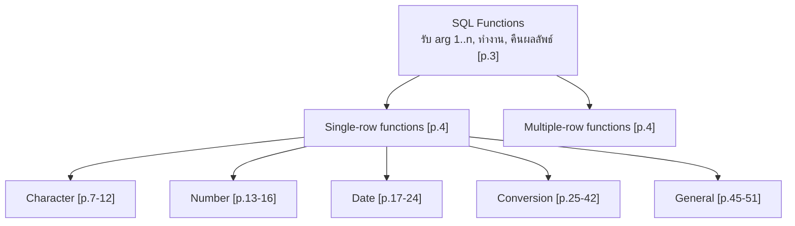
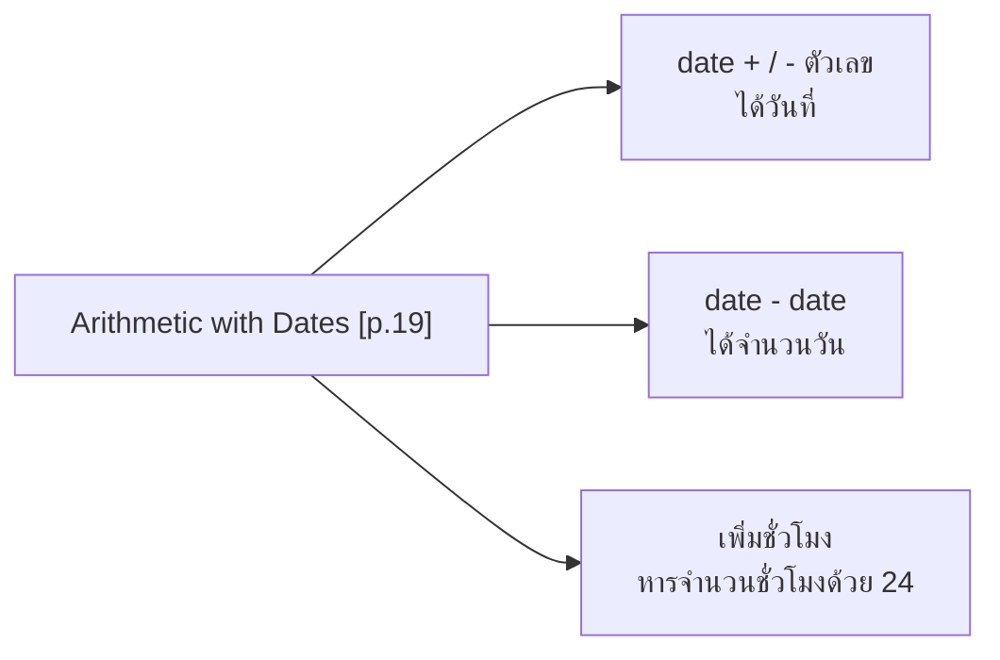
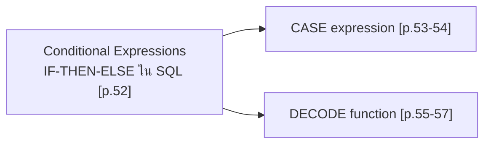
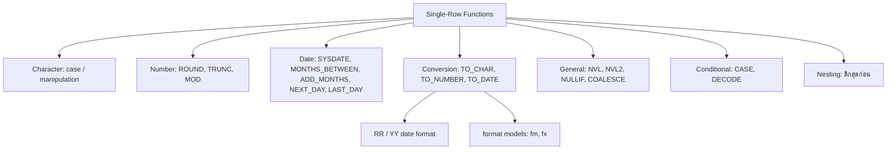

# Database - Les03: Single-Row Functions

> **วิชา:** Database (Oracle SQL) | **ผู้จัดทำสไลด์:** Oracle Corporation, 2001 (ลิขสิทธิ์ตามท้ายสไลด์ [p.1])
> **Source:** `Resources/Books/Database/Les03  -  Compatibility Mode.pdf` (66 หน้า, ภาษาอังกฤษ) — ชื่อบทตามสไลด์: "Single-Row Functions" [p.1]
> **ป้ายแหล่งที่มา:** เนื้อหาที่ไม่มีป้ายพิเศษมาจากสไลด์ `[Source: extracted]` | เนื้อหาที่ผู้เขียนเพิ่มอยู่ใน blockquote ขึ้นต้นด้วย 💡 และติดป้าย `[Source: generated — not verified against original document]` | `[p.N]` = ลำดับหน้าใน PDF (เลขท้ายสไลด์คือ 3-N ตรงกับ p.N ตั้งแต่ p.2)
> **หมายเหตุ:** ตัวอย่างข้อมูล (King, Kochhar ฯลฯ) มาจากตาราง `employees` ของสไลด์ ผลลัพธ์ที่แสดงในสไลด์ที่อ่านจากภาพมีระบุว่าอ่านจากภาพ

> **สไลด์ที่ไม่มีเนื้อหาให้สรุป:** p.1 (หน้าปก), p.33 และ p.35 (สไลด์ว่าง มีแต่ส่วนท้าย), p.60-66 (สไลด์ว่าง 7 หน้า มีแต่ส่วนท้าย — ตรวจจากภาพแล้ว) ดู Pitfalls

---

## Part 1: Macro Architecture & Overview

บทนี้ครอบคลุมฟังก์ชัน SQL ที่ทำงาน **ทีละแถว** (Single-Row Functions) 5 กลุ่ม ได้แก่ Character, Number, Date, Conversion และ General [p.6] วัตถุประสงค์ของบท: อธิบายชนิดของฟังก์ชันใน SQL, ใช้ฟังก์ชัน character / number / date ใน SELECT, และอธิบายการใช้ conversion functions [p.2]



> 💡 *[Source: generated — not verified against original document]* แผนภาพนี้เป็นการจัดของผู้เขียนโน้ต: p.6 แสดง 5 กลุ่ม (Conversion, Character, Number, Date, General) ส่วน Conditional (CASE/DECODE) อยู่ที่ p.52-57 ในสไลด์ไม่ได้อยู่ในกลุ่ม General ที่ p.45 สไลด์ p.4 แสดงเพียงว่าฟังก์ชันแบ่งเป็น Single-row กับ Multiple-row และ p.6 แสดง 5 กลุ่มใต้ Single-row ส่วนการแยกหน้า/เลขหน้าในแผนภาพนี้เป็นการจัดของผู้เขียนโน้ต Multiple-row functions ในบทนี้ไม่มีรายละเอียด

### คุณสมบัติของ Single-Row Functions [p.5]

* จัดการ (manipulate) ข้อมูลแต่ละรายการ
* รับ arguments และคืนค่า **หนึ่งค่า**
* ทำงานกับ **แต่ละแถว** ที่คืนมา
* คืน **หนึ่งผลลัพธ์ต่อแถว**
* อาจเปลี่ยนชนิดข้อมูล (data type) ได้
* ซ้อนกัน (nested) ได้
* arguments เป็นคอลัมน์หรือ expression ได้
* รูปแบบ: `function_name [(arg1, arg2,...)]`

### ตารางสรุปฟังก์ชันทั้งบท

| กลุ่ม | ฟังก์ชันตามสไลด์ | หน้า |
| :--- | :--- | :-: |
| Case-manipulation | LOWER, UPPER, INITCAP | p.7, 9 |
| Character-manipulation | CONCAT, SUBSTR, LENGTH, INSTR, LPAD / RPAD, TRIM, REPLACE | p.7, 11 |
| Number | ROUND, TRUNC, MOD | p.13 |
| Date | MONTHS_BETWEEN, ADD_MONTHS, NEXT_DAY, LAST_DAY, ROUND, TRUNC (และฟังก์ชัน SYSDATE) | p.18, 21 |
| Conversion | TO_CHAR, TO_NUMBER, TO_DATE | p.28-40 |
| General | NVL, NVL2, NULLIF, COALESCE | p.45 |
| Conditional | CASE expression, DECODE | p.52-57 |

---

## Part 2: Detailed Concepts

### 2.1 Character Functions [p.7-12]

> 💡 **Intuition:** ลองนึกถึง Character Functions ว่าเป็น "**เครื่องมือตัดต่อข้อความ**" — เช่น UPPER ทำให้ข้อความเป็นตัวใหญ่หมด, SUBSTR ตัดเอาส่วนหนึ่ง (เหมือนกรรไกร), LENGTH วัดความยาว, TRIM ลบช่องว่าง ฟังก์ชันเหล่านี้ทำงาน row-by-row เพื่อจัดการข้อมูลข้อความอย่างละเอียด
> [Source: generated — not verified against original document]

แบ่งเป็น **Case-manipulation** (LOWER, UPPER, INITCAP) และ **Character-manipulation** (CONCAT, SUBSTR, LENGTH, INSTR, LPAD | RPAD, TRIM, REPLACE) [p.7] (p.8 มีข้อความเหมือน p.7 ทุกอย่าง ตำแหน่งรายการต่างกันเล็กน้อย)

**Case manipulation** — แปลงตัวพิมพ์ของสตริง [p.9]

| Function | Result |
| :--- | :--- |
| `LOWER('SQL Course')` | sql course |
| `UPPER('SQL Course')` | SQL COURSE |
| `INITCAP('SQL Course')` | Sql Course |

**ใช้ใน WHERE** — แสดง employee_id, last_name, department_id ของ Higgins [p.10]

```sql
SELECT employee_id, last_name, department_id
FROM   employees
WHERE  last_name = 'higgins';
-- ผลลัพธ์: no rows selected

SELECT employee_id, last_name, department_id
FROM   employees
WHERE  LOWER(last_name) = 'higgins';
-- ผลลัพธ์ในภาพ: 205 | Higgins | 110
```

**Character manipulation** — จัดการสตริง [p.11]

| Function | Result |
| :--- | :--- |
| `CONCAT('Hello', 'World')` | HelloWorld |
| `SUBSTR('HelloWorld',1,5)` | Hello |
| `LENGTH('HelloWorld')` | 10 |
| `INSTR('HelloWorld', 'W')` | 6 |
| `LPAD(salary,10,'*')` | \*\*\*\*\*24000 |
| `RPAD(salary, 10, '*')` | 24000\*\*\*\*\* |
| `TRIM('H' FROM 'HelloWorld')` | elloWorld |

**ตัวอย่างรวม** [p.12]

```sql
SELECT employee_id, CONCAT(first_name, last_name) NAME,
       job_id, LENGTH (last_name),
       INSTR(last_name, 'a') "Contains 'a'?"
FROM   employees
WHERE  SUBSTR(job_id, 4) = 'REP';
```

**🧭 ทำความเข้าใจ** _[Source: generated — not verified against original document]_

**แตกวลีสำคัญ:**
- "Case-manipulation" → เปลี่ยนตัวพิมพ์ (ใหญ่/เล็ก)
- "Character-manipulation" → ตัดต่อ ตรวจหา ปะติด สตริง
- "ทำงานทีละแถว" → ถ้า column มี 100 แถว UPPER จะปรับ 100 แถวทั้งหมด

**ตัวอย่าง:**
- ✅ `WHERE LOWER(last_name) = 'higgins'` → หา Higgins, HIGGINS, HiGGins ทั้งหมด (case-insensitive)
- ✅ `SUBSTR('HelloWorld', 1, 5)` → 'Hello' (เอาตัวที่ 1-5)
- ❌ คิดแบบ 0-based ว่า `SUBSTR('HelloWorld', 5, 1)` = 'W' → จริง ๆ ได้ 'o' เพราะ SQL นับตำแหน่งเริ่มจาก 1 (ถ้าใส่ start = 0 Oracle ไม่ error แต่ถือเป็น 1)
- **ต่างกันตรง:** `SUBSTR(string, start [, length])` คืน "ข้อความ" ส่วนหนึ่ง, `INSTR(string, search [, start [, occurrence]])` คืน "ตำแหน่ง" เป็นตัวเลข (ไม่เจอได้ 0)

**อย่าสับสน:** "`LENGTH`" ไม่ได้หมายถึง "ขนาดที่ประกาศของ column" (เช่น VARCHAR2(25)) — มันคือ "จำนวนตัวอักษรในค่าจริงของแต่ละแถว" (row-by-row)

**เช็คความเข้าใจ:** `SUBSTR('HelloWorld', 4, 3)` คืนค่าอะไร?
<details><summary>เฉลย</summary>

'loW' (ตัวที่ 4 = 'l', ตัวที่ 5 = 'o', ตัวที่ 6 = 'W', เอา 3 ตัว = 'loW')
</details>

ผลลัพธ์ในภาพ (หัวคอลัมน์ 1-2-3 ในสไลด์ชี้องค์ประกอบของคำสั่ง):

| EMPLOYEE_ID | NAME | JOB_ID | LENGTH(LAST_NAME) | Contains 'a'? |
| :-: | :--- | :--- | :-: | :-: |
| 174 | EllenAbel | SA_REP | 4 | 0 |
| 176 | JonathonTaylor | SA_REP | 6 | 2 |
| 178 | KimberelyGrant | SA_REP | 5 | 3 |
| 202 | PatFay | MK_REP | 3 | 2 |

> 💡 *[Source: generated — not verified against original document]* `SUBSTR(job_id, 4)` คือเอาตัวอักษรตั้งแต่ตำแหน่งที่ 4 ไปจนจบ จึงตรงกับ `SA_REP` / `MK_REP` (ตำแหน่ง 4 เป็นต้นไปคือ `REP`) และ `INSTR(...)` ได้ 0 เมื่อไม่พบตัวอักษร (Abel ไม่มี `a` ตัวเล็ก) — ตรงกับค่า 0 ในภาพ

### 2.2 Number Functions [p.13-16]

> 💡 **Intuition:** ลองนึกถึง Number Functions ว่าเป็น "**เครื่องมือคำนวณเลข**" — ROUND ปัดเศษ (เหมือนปัดเศษในชีวิตจริง), TRUNC ตัดทิ้งทศนิยม (ตัดสั้น ไม่ปัด), MOD หาเศษ (เหมือนหารไม่ลงตัวแล้วดูว่าเหลือเท่าไร)
> [Source: generated — not verified against original document]

| Function | ความหมายตามสไลด์ | ตัวอย่าง |
| :--- | :--- | :--- |
| `ROUND` | ปัดค่าตามทศนิยมที่กำหนด | `ROUND(45.926, 2)` = 45.93 |
| `TRUNC` | ตัดค่าตามทศนิยมที่กำหนด | `TRUNC(45.926, 2)` = 45.92 |
| `MOD` | เศษจากการหาร | `MOD(1600, 300)` = 100 |

**ROUND** [p.14] — `SELECT ROUND(45.923,2), ROUND(45.923,0), ROUND(45.923,-1) FROM DUAL;` ผลลัพธ์ 45.92 / 46 / 50 สไลด์ระบุว่า **DUAL เป็นตารางจำลอง (dummy table)** ที่ใช้ดูผลของฟังก์ชันและการคำนวณ

**TRUNC** [p.15] — `SELECT TRUNC(45.923,2), TRUNC(45.923), TRUNC(45.923,-2) FROM DUAL;` ผลลัพธ์ 45.92 / 45 / 0

**MOD** [p.16] — หาเศษของ salary ÷ 5000 ของพนักงานที่ `job_id = 'SA_REP'`:

| LAST_NAME | SALARY | MOD(SALARY,5000) |
| :--- | :-: | :-: |
| Abel | 11000 | 1000 |
| Taylor | 8600 | 3600 |
| Grant | 7000 | 2000 |

**🧭 ทำความเข้าใจ** _[Source: generated — not verified against original document]_

**แตกวลีสำคัญ:**
- "ROUND — ปัดค่าตามทศนิยม" → ปัดขึ้นหรือลง (standard rounding)
- "TRUNC — ตัด (ไม่ปัด)" → เอาแค่ส่วนที่ต้องการ ไม่ดู "ตัวถัดไป"
- "MOD — หาเศษ" → ผลจากการหารที่ไม่ลงตัว

**ตัวอย่าง:**
- ✅ `ROUND(45.926, 2)` = 45.93 (ปัดขึ้น), `ROUND(45.923, 2)` = 45.92 (ปัดลง)
- ✅ `TRUNC(45.926, 2)` = 45.92 (ตัดเศษส่วน ไม่ปัด)
- ❌ คิดว่า `ROUND(45.926)` กับ `TRUNC(45.926)` ได้ค่าเท่ากัน → จริง ๆ ROUND = 46, TRUNC = 45 (ไม่ใส่ n = ทศนิยม 0 ตำแหน่ง)
- **ต่างกันตรง:** ROUND ดูตัวถัดไป (ปัด), TRUNC ไม่ดู (ตัด)

**อย่าสับสน:** n = -1 ใน `ROUND(x, -1)` ไม่ได้หมายถึง "ปัดให้เป็นค่าลบ" — n ติดลบคือปัดไปทางซ้ายของจุดทศนิยม (-1 = หลักสิบ, -2 = หลักร้อย) ดังนั้น `ROUND(45.923, -1)` = 50 (หลักหน่วยคือ 5 จึงปัดขึ้น) ส่วน `TRUNC(45.923, -1)` = 40

**เช็คความเข้าใจ:** `ROUND(45.5, 0)` vs `TRUNC(45.5, 0)` ได้เท่าไหร่?
<details><summary>เฉลย</summary>

ROUND(45.5, 0) = 46 (Oracle ปัด .5 ออกจากศูนย์ ค่าบวกจึงปัดขึ้น)
TRUNC(45.5, 0) = 45 (ตัดทศนิยม ไม่ปัด)

ผลต่างคือ 1
</details>

### 2.3 Working with Dates [p.17-24]

* Oracle เก็บวันที่ในรูปตัวเลขภายใน: century, year, month, day, hours, minutes, seconds [p.17]
* รูปแบบแสดงผลเริ่มต้นคือ `DD-MON-RR` — **RR** ทำให้เก็บวันที่ศตวรรษที่ 21 ในศตวรรษที่ 20 ได้ด้วยการระบุเลขปีสองหลัก และเก็บวันที่ศตวรรษที่ 20 ในศตวรรษที่ 21 ได้ในทำนองเดียวกัน [p.17]
* ตัวอย่าง `WHERE last_name like 'G%'`: Gietz 07-JUN-94, Grant 24-MAY-99 (อ่านจากภาพ) [p.17]
* `SYSDATE` คือฟังก์ชันที่คืน **วันที่และเวลา** [p.18]



**ตัวอย่างการคำนวณ** [p.20]: `SELECT last_name, (SYSDATE-hire_date)/7 AS WEEKS FROM employees WHERE department_id = 90;`

| LAST_NAME | WEEKS |
| :--- | :-: |
| King | 744.245395 |
| Kochhar | 626.102538 |
| De Haan | 453.245395 |

> 💡 *[Source: generated — not verified against original document]* ค่า WEEKS ขึ้นกับวันที่รัน (SYSDATE) ค่าในตารางคือค่าที่ปรากฏในสไลด์ ไม่ใช่ค่าที่จะได้เมื่อรันตอนนี้ และผลหารด้วย 7 คือการแปลงจำนวนวันเป็นสัปดาห์

**Date functions** [p.21-23]

| Function | คำอธิบายตามสไลด์ | ตัวอย่างและผลตามสไลด์ |
| :--- | :--- | :--- |
| `MONTHS_BETWEEN` | จำนวนเดือนระหว่างสองวันที่ | `MONTHS_BETWEEN('01-SEP-95','11-JAN-94')` = 19.6774194 [p.22] |
| `ADD_MONTHS` | บวกเดือนตามปฏิทินให้วันที่ | `ADD_MONTHS('11-JAN-94',6)` = '11-JUL-94' [p.22] |
| `NEXT_DAY` | วันถัดไปของวันที่ที่ระบุ | `NEXT_DAY('01-SEP-95','FRIDAY')` = '08-SEP-95' [p.22] |
| `LAST_DAY` | วันสุดท้ายของเดือน | `LAST_DAY('01-FEB-95')` = '28-FEB-95' [p.22] |
| `ROUND` | ปัดวันที่ | ดูตารางล่าง [p.23] |
| `TRUNC` | ตัดวันที่ | ดูตารางล่าง [p.23] |

สมมติ `SYSDATE = '25-JUL-95'` [p.23]

| Expression | Result |
| :--- | :-: |
| `ROUND(SYSDATE,'MONTH')` | 01-AUG-95 |
| `ROUND(SYSDATE,'YEAR')` | 01-JAN-96 |
| `TRUNC(SYSDATE,'MONTH')` | 01-JUL-95 |
| `TRUNC(SYSDATE,'YEAR')` | 01-JAN-95 |

Practice 3 Part One (p.24) ครอบคลุม: เขียนคิวรีแสดงวันที่ปัจจุบัน, คิวรีที่ใช้ฟังก์ชัน numeric / character / date, และคำนวณอายุงานเป็นปีและเดือนของพนักงาน — โจทย์จริงไม่อยู่ในไฟล์นี้ (ดู Pitfalls)

### 2.4 Conversion Functions [p.25-42]

Data type conversion มี 2 แบบ: **Implicit** กับ **Explicit** [p.25]


> 💡 *[Source: generated — not verified against original document]* ทิศทางของลูกศรสรุปจากตำแหน่งฟังก์ชันในสไลด์ p.28-30 (NUMBER/DATE ↔ CHARACTER) และความหมายของชื่อฟังก์ชัน

**Implicit conversion** — Oracle server แปลงให้อัตโนมัติ [p.26-27]

| กรณี | จาก | เป็น |
| :--- | :--- | :--- |
| Assignment [p.26] | VARCHAR2 or CHAR | NUMBER |
| Assignment [p.26] | VARCHAR2 or CHAR | DATE |
| Assignment [p.26] | NUMBER | VARCHAR2 |
| Assignment [p.26] | DATE | VARCHAR2 |
| Expression evaluation [p.27] | VARCHAR2 or CHAR | NUMBER |
| Expression evaluation [p.27] | VARCHAR2 or CHAR | DATE |

**TO_CHAR กับวันที่** [p.31-36] — `TO_CHAR(date, 'format_model')`

format model: ต้องอยู่ในเครื่องหมาย single quote และ **case sensitive**, ใช้ date format element ที่ถูกต้องได้, มี element `fm` เพื่อตัดช่องว่างที่เติมหรือเลขศูนย์นำ, และคั่นจากค่า date ด้วยเครื่องหมายจุลภาค [p.31]

| Element | ความหมายตามสไลด์ [p.32] |
| :--- | :--- |
| `YYYY` | ปีเต็มเป็นตัวเลข |
| `YEAR` | ปีที่สะกดเป็นตัวอักษร |
| `MM` | เดือนสองหลัก |
| `MONTH` | ชื่อเต็มของเดือน |
| `MON` | ชื่อเดือนแบบย่อสามตัวอักษร |
| `DY` | ชื่อวันในสัปดาห์แบบย่อสามตัวอักษร |
| `DAY` | ชื่อเต็มของวันในสัปดาห์ |
| `DD` | วันที่ของเดือนเป็นตัวเลข |

องค์ประกอบด้านเวลาและอื่น ๆ [p.34]: element ด้านเวลาจัดรูปส่วนเวลาของวันที่; เพิ่มข้อความด้วยการใส่ใน double quotation marks; ตัวต่อท้ายตัวเลข (number suffixes) สะกดตัวเลขเป็นคำ

| Format | ตัวอย่างผลตามสไลด์ |
| :--- | :--- |
| `HH24:MI:SS AM` | 15:45:32 PM |
| `DD "of" MONTH` | 12 of OCTOBER |
| `ddspth` | fourteenth |

ตัวอย่าง [p.36]: `SELECT last_name, TO_CHAR(hire_date, 'fmDD Month YYYY') AS HIREDATE FROM employees;`

| LAST_NAME | HIREDATE |
| :--- | :--- |
| King | 17 June 1987 |
| Kochhar | 21 September 1989 |
| De Haan | 13 January 1993 |
| Hunold | 3 January 1990 |
| Ernst | 21 May 1991 |
| Lorentz | 7 February 1999 |
| Mourgos | 16 November 1999 |

(ในภาพ "20 rows selected" แสดงแถวแรก ๆ ตามข้างต้น)

**TO_CHAR กับตัวเลข** [p.37-38] — `TO_CHAR(number, 'format_model')`

| Element | ความหมายตามสไลด์ |
| :-: | :--- |
| `9` | แทนตัวเลข |
| `0` | บังคับให้แสดงเลขศูนย์ |
| `$` | วางเครื่องหมายดอลลาร์แบบลอย |
| `L` | ใช้สัญลักษณ์สกุลเงินท้องถิ่นแบบลอย |
| `.` | พิมพ์จุดทศนิยม |
| `,` | พิมพ์ตัวคั่นหลักพัน |

ตัวอย่าง [p.38]: `SELECT TO_CHAR(salary, '$99,999.00') SALARY FROM employees WHERE last_name = 'Ernst';` ผลลัพธ์ `$6,000.00`

**TO_NUMBER และ TO_DATE** [p.39-40, สองหน้านี้เหมือนกัน]

* `TO_NUMBER(char[, 'format_model'])` — แปลงสตริงเป็นตัวเลข
* `TO_DATE(char[, 'format_model'])` — แปลงสตริงเป็นวันที่
* ฟังก์ชันเหล่านี้มี modifier `fx` ซึ่งระบุให้ **ตรงกันแบบเป๊ะ** ระหว่าง character argument กับ date format model ของ TO_DATE

**RR date format** [p.41]

| Current Year | Specified Date | RR Format | YY Format |
| :-: | :-: | :-: | :-: |
| 1995 | 27-OCT-95 | 1995 | 1995 |
| 1995 | 27-OCT-17 | 2017 | 1917 |
| 2001 | 27-OCT-17 | 2017 | 2017 |
| 2001 | 27-OCT-95 | 1995 | 2095 |

กฎของ RR ตามสไลด์ [p.41]:

| ถ้าสองหลักของปีปัจจุบันเป็น | ถ้าปีสองหลักที่ระบุเป็น 0–49 | ถ้าปีสองหลักที่ระบุเป็น 50–99 |
| :-: | :--- | :--- |
| 0–49 | วันที่ที่คืนอยู่ในศตวรรษปัจจุบัน | วันที่ที่คืนอยู่ในศตวรรษก่อนหน้า |
| 50–99 | วันที่ที่คืนอยู่ในศตวรรษถัดไป | วันที่ที่คืนอยู่ในศตวรรษปัจจุบัน |

ตัวอย่าง [p.42]: หาพนักงานที่จ้างก่อนปี 1990 ด้วย RR ซึ่งให้ผลเหมือนกันไม่ว่ารันในปี 1999 หรือปัจจุบัน:

```sql
SELECT last_name, TO_CHAR(hire_date, 'DD-Mon-YYYY')
FROM   employees
WHERE  hire_date < TO_DATE('01-Jan-90', 'DD-Mon-RR');
```

ผลลัพธ์ในภาพ: King 17-Jun-1987, Kochhar 21-Sep-1989, Whalen 17-Sep-1987

### 2.5 Nesting Functions [p.43-44]

* Single-row functions ซ้อนกันได้ **ทุกระดับ**; ประเมินจาก **ระดับลึกสุดไปตื้นสุด** [p.43]
* รูปแบบ `F3(F2(F1(col,arg1),arg2),arg3)` → Step 1 = Result 1, Step 2 = Result 2, Step 3 = Result 3 [p.43]

> 💡 *[Source: generated — not verified against original document]* แผนภาพด้านล่างเป็นการเขียนซ้ำของผู้เขียนโน้ต สไลด์ p.43 แสดงวงเล็บ Step 1-3 ครอบ F1-F3 ไม่ใช่ลูกศร


ตัวอย่าง [p.44]:

```sql
SELECT last_name,
       NVL(TO_CHAR(manager_id), 'No Manager')
FROM   employees
WHERE  manager_id IS NULL;
```

ผลลัพธ์ในภาพ: King | No Manager

### 2.6 General Functions (เกี่ยวกับ NULL) [p.45-51]

> 💡 **Intuition:** นึกถึง NULL เหมือน "ช่องว่างในใบเสร็จที่ยังไม่ได้กรอก" — ถ้าเอาช่องว่างนั้นไปคำนวณต่อ ผลลัพธ์จะกลายเป็นว่างไปทั้งบรรทัด `NVL` คือ "เติมค่าสำรองลงช่องว่าง" เช่น ถ้าไม่มี commission ให้ถือว่าเป็น 0 — จุดที่ Analogy ไม่ตรง: `NVL` ไม่ได้แก้ค่าในตาราง แค่แปลงค่าตอนดึงมาแสดงหรือคำนวณเท่านั้น
> [Source: generated — not verified against original document]


ฟังก์ชันเหล่านี้ใช้กับ data type ใดก็ได้ และเกี่ยวกับการจัดการ NULL: `NVL (expr1, expr2)`, `NVL2 (expr1, expr2, expr3)`, `NULLIF (expr1, expr2)`, `COALESCE (expr1, expr2, ..., exprn)` [p.45]

| Function | ความหมาย | ตัวอย่างในสไลด์ |
| :--- | :--- | :--- |
| `NVL` | แปลง NULL เป็นค่าจริง ใช้ได้กับ date, character, number และ **ชนิดข้อมูลต้องตรงกัน** [p.46] | `NVL(commission_pct,0)`, `NVL(hire_date,'01-JAN-97')`, `NVL(job_id,'No Job Yet')` [p.46] |
| `NVL2` | (ไม่มีนิยามเป็นข้อความ ดูจากตัวอย่าง) | `NVL2(commission_pct, 'SAL+COMM', 'SAL') income` [p.48] |
| `NULLIF` | (ไม่มีนิยามเป็นข้อความ ดูจากตัวอย่าง) | `NULLIF(LENGTH(first_name), LENGTH(last_name)) result` [p.49] |
| `COALESCE` | ข้อดีเหนือ NVL คือรับค่าทางเลือกได้หลายค่า; ถ้า expression แรกไม่เป็น NULL คืนค่านั้น ไม่เช่นนั้นทำ COALESCE กับ expression ที่เหลือ [p.50] | `COALESCE(commission_pct, salary, 10) comm` [p.51] |

**NVL** [p.47] — `SELECT last_name, salary, NVL(commission_pct, 0), (salary*12) + (salary*12*NVL(commission_pct, 0)) AN_SAL FROM employees;`

| LAST_NAME | SALARY | NVL(COMMISSION_PCT,0) | AN_SAL |
| :--- | :-: | :-: | :-: |
| King | 24000 | 0 | 288000 |
| Kochhar | 17000 | 0 | 204000 |
| De Haan | 17000 | 0 | 204000 |
| Hunold | 9000 | 0 | 108000 |
| Ernst | 6000 | 0 | 72000 |
| Lorentz | 4200 | 0 | 50400 |
| Mourgos | 5800 | 0 | 69600 |
| Rajs | 3500 | 0 | 42000 |

**NVL2** [p.48] — `WHERE department_id IN (50, 80)` (8 rows selected ในภาพ)

| LAST_NAME | SALARY | COMMISSION_PCT | INCOME |
| :--- | :-: | :-: | :--- |
| Zlotkey | 10500 | .2 | SAL+COMM |
| Abel | 11000 | .3 | SAL+COMM |
| Taylor | 8600 | .2 | SAL+COMM |
| Mourgos | 5800 | (ว่าง) | SAL |
| Rajs | 3500 | (ว่าง) | SAL |
| Davies | 3100 | (ว่าง) | SAL |
| Matos | 2600 | (ว่าง) | SAL |
| Vargas | 2500 | (ว่าง) | SAL |

> 💡 *[Source: generated — not verified against original document]* สไลด์ไม่ได้ให้นิยามของ NVL2 และ NULLIF เป็นข้อความ จากผลในภาพ NVL2 คืน expr2 (`'SAL+COMM'`) เมื่อ expr1 (`commission_pct`) ไม่เป็น NULL และคืน expr3 (`'SAL'`) เมื่อเป็น NULL; NULLIF ในภาพให้ค่าว่าง (NULL) เมื่อความยาวของสองชื่อเท่ากัน (Bruce/Ernst = 5/5, Curtis/Davies = 6/6) และคืน expr1 เมื่อต่างกัน

**NULLIF** [p.49] (ภาพแสดงแถวแรก ๆ จาก 20 rows)

| FIRST_NAME | expr1 | LAST_NAME | expr2 | RESULT |
| :--- | :-: | :--- | :-: | :-: |
| Steven | 6 | King | 4 | 6 |
| Neena | 5 | Kochhar | 7 | 5 |
| Lex | 3 | De Haan | 7 | 3 |
| Alexander | 9 | Hunold | 6 | 9 |
| Bruce | 5 | Ernst | 5 | (ว่าง) |
| Diana | 5 | Lorentz | 7 | 5 |
| Kevin | 5 | Mourgos | 7 | 5 |
| Trenna | 6 | Rajs | 4 | 6 |
| Curtis | 6 | Davies | 6 | (ว่าง) |

**COALESCE** [p.51] — `ORDER BY commission_pct` (20 rows selected; แสดงแถวแรก ๆ)

| LAST_NAME | COMM |
| :--- | :-: |
| Grant | .15 |
| Zlotkey | .2 |
| Taylor | .2 |
| Abel | .3 |
| King | 24000 |
| Kochhar | 17000 |
| De Haan | 17000 |
| Hunold | 9000 |

**🧭 ทำความเข้าใจ** _[Source: generated — not verified against original document]_

**แตกวลีสำคัญ:**
- "NVL(expr1, expr2)" → ถ้า `expr1` เป็น NULL คืน `expr2` ไม่เช่นนั้นคืน `expr1`
- "NVL2(expr1, expr2, expr3)" → ถ้า `expr1` ไม่เป็น NULL คืน `expr2` ถ้าเป็น NULL คืน `expr3`
- "COALESCE(e1, e2, ..., en)" → คืนค่าแรกที่ไม่เป็น NULL เรียงจากซ้ายไปขวา รับได้หลายค่า
- "NULLIF(e1, e2)" → ถ้า `e1 = e2` คืน NULL ไม่เช่นนั้นคืน `e1` (ทิศทางตรงข้ามกับ NVL)

**ข้อมูลทดสอบ (จำลองเพื่อตรวจด้วยมือ ไม่ใช่ค่าจริงในสไลด์):** King (salary = 24000, commission_pct = NULL)

**ตัวอย่าง:**
- ✅ `salary*12 + salary*12*NVL(commission_pct, 0)` — King: 288000 + 288000 × 0 = **288000** (ได้ค่าจริง)
- ❌ `salary*12 + salary*12*commission_pct` — King: 288000 + 288000 × NULL = **NULL** ทั้งแถว เพราะการคูณด้วย NULL ได้ NULL
- ✅ `NVL2(commission_pct, 'SAL+COMM', 'SAL')` — King ได้ `'SAL'` เพราะ commission เป็น NULL
- **ต่างกันตรง:** `NVL` เลือก "ค่าสำรองแทน NULL" / `NVL2` เลือก "ข้อความตามว่าเป็น NULL หรือไม่"

**อย่าสับสน:** `NULLIF` กับ `NVL` ทำงานกลับทิศกัน — `NVL` ทำให้ NULL กลายเป็นค่า ส่วน `NULLIF` ทำให้ค่าบางตัวกลายเป็น NULL

**เช็คความเข้าใจ:** `COALESCE(commission_pct, 0.1, 0)` และ `NVL(commission_pct, 0.1, 0)` ให้ผลต่างกันอย่างไรเมื่อ commission เป็น NULL?
<details><summary>เฉลย</summary>

`COALESCE` คืน `0.1` (ค่าแรกที่ไม่เป็น NULL) ส่วน `NVL` รับอาร์กิวเมนต์ได้เพียง 2 ตัว การใส่ 3 ตัวจะได้ Error `ORA-00909: invalid number of arguments` ถ้าต้องการหลายทางเลือกต้องใช้ `COALESCE`
</details>

### 2.7 Conditional Expressions [p.52-57]

> 💡 **Intuition:** นึกถึงการแยกพัสดุตามกฎ — `CASE` คือ "ชุดคำสั่งเช็คทีละข้อตามลำดับ (IF ... ELSE IF ...)" ที่เปรียบเทียบด้วยเงื่อนไขอะไรก็ได้ ส่วน `DECODE` คือ "ตารางจับคู่แบบสั้นๆ" ที่เทียบค่าเท่ากันเท่านั้น — จุดที่ Analogy ไม่ตรง: `DECODE` จับคู่ NULL กับ NULL ได้ (ถือว่าเท่ากัน) ซึ่งเป็นพฤติกรรมที่ไม่เหมือนการเปรียบเทียบปกติของ SQL
> [Source: generated — not verified against original document]


ให้ตรรกะ IF-THEN-ELSE ภายในคำสั่ง SQL ผ่าน 2 วิธี: **CASE expression** และ **DECODE function** [p.52]



**CASE** [p.53]

```sql
CASE expr WHEN comparison_expr1 THEN return_expr1
          [WHEN comparison_expr2 THEN return_expr2
           WHEN comparison_exprn THEN return_exprn
           ELSE else_expr]
END
```

ตัวอย่าง [p.54] — ปรับเงินเดือน: IT_PROG × 1.10, ST_CLERK × 1.15, SA_REP × 1.20, อื่น ๆ ใช้ salary เดิม

```sql
SELECT last_name, job_id, salary,
       CASE job_id WHEN 'IT_PROG'  THEN 1.10*salary
                   WHEN 'ST_CLERK' THEN 1.15*salary
                   WHEN 'SA_REP'   THEN 1.20*salary
                   ELSE salary END "REVISED_SALARY"
FROM   employees;
```

| LAST_NAME | JOB_ID | SALARY | REVISED_SALARY |
| :--- | :--- | :-: | :-: |
| … | … | … | … |
| Lorentz | IT_PROG | 4200 | 4620 |
| Mourgos | ST_MAN | 5800 | 5800 |
| Rajs | ST_CLERK | 3500 | 4025 |
| … | … | … | … |
| Gietz | AC_ACCOUNT | 8300 | 8300 |

**DECODE** [p.55] — `DECODE(col|expression, search1, result1 [, search2, result2,...,] [, default])`

ตัวอย่าง [p.56] ให้ผลเหมือนตัวอย่าง CASE: `DECODE(job_id, 'IT_PROG', 1.10*salary, 'ST_CLERK', 1.15*salary, 'SA_REP', 1.20*salary, salary) REVISED_SALARY` ผลในภาพ Lorentz 4620, Mourgos 5800, Rajs 4025, Gietz 8300

ตัวอย่างอัตราภาษี [p.57] — แสดงอัตราภาษีของพนักงานแผนก 80:

```sql
SELECT last_name, salary,
       DECODE (TRUNC(salary/2000, 0),
               0, 0.00,
               1, 0.09,
               2, 0.20,
               3, 0.30,
               4, 0.40,
               5, 0.42,
               6, 0.44,
               0.45) TAX_RATE
FROM   employees
WHERE  department_id = 80;
```

| ค่า `TRUNC(salary/2000, 0)` | TAX_RATE |
| :-: | :-: |
| 0 | 0.00 |
| 1 | 0.09 |
| 2 | 0.20 |
| 3 | 0.30 |
| 4 | 0.40 |
| 5 | 0.42 |
| 6 | 0.44 |
| อื่น ๆ (default) | 0.45 |

> 💡 *[Source: generated — not verified against original document]* ตัวอย่างการคำนวณ: salary 10500 → 10500/2000 = 5.25 → TRUNC = 5 → TAX_RATE 0.42; salary 8600 → 4.3 → 4 → 0.40 สไลด์ p.57 ไม่มีตารางผลลัพธ์ จึงไม่ได้ยืนยันค่าที่ได้กับผลจริง

**🧭 ทำความเข้าใจ** _[Source: generated — not verified against original document]_

**แตกวลีสำคัญ:**
- "Simple CASE" → `CASE expr WHEN value THEN ...` เทียบ `expr` กับค่าแต่ละตัวด้วย `=`
- "Searched CASE" → `CASE WHEN condition THEN ...` ใช้เงื่อนไขใดก็ได้ เช่น `>`, `BETWEEN`, `IS NULL`
- "DECODE" → เทียบด้วยความเท่ากันเท่านั้น และ NULL จับคู่กับ NULL ได้

**ข้อมูลทดสอบ (ตรวจด้วยมือ):** Doe (job_id = NULL), King (job_id = 'AD_PRES')

**ตัวอย่าง:**
- ✅ `DECODE(job_id, 'AD_PRES', 'A', 'ST_MAN', 'B', 'C')` — King ได้ `'A'`, Doe ได้ `'C'` (ไม่มี NULL ในรายการ จึงตกไปค่า default)
- ❌ `CASE job_id WHEN NULL THEN 'X' ELSE 'Y' END` — Doe ได้ `'Y'` เพราะ Simple CASE ใช้ `=` และ `NULL = NULL` ไม่เป็น TRUE (ต้องเขียน `CASE WHEN job_id IS NULL THEN 'X' ...`)
- ✅ `DECODE(job_id, NULL, 'X', 'Y')` — Doe ได้ `'X'` เพราะ DECODE ถือว่า NULL เท่ากับ NULL
- **ต่างกันตรง:** `CASE` เทียบได้หลายรูปแบบ และต้องใช้ `IS NULL` เพื่อจับ NULL / `DECODE` เทียบเฉพาะความเท่ากันแต่จับคู่ NULL ได้

**อย่าสับสน:** `DECODE` ไม่ได้เขียนได้กับทุกเงื่อนไข เช่น `salary > 5000` เขียนด้วย DECODE ตรงๆ ไม่ได้ ต้องใช้ `CASE WHEN salary > 5000 THEN ...`

**เช็คความเข้าใจ:** Doe (job_id = NULL) ได้ผลอะไรจาก `CASE WHEN job_id IS NULL THEN 'X' ELSE 'Y' END` และจาก `CASE job_id WHEN NULL THEN 'X' ELSE 'Y' END`?
<details><summary>เฉลย</summary>

แบบแรก (Searched CASE + `IS NULL`) ได้ `'X'` เพราะเงื่อนไขเป็น TRUE ตรงไปตรงมา แบบที่สอง (Simple CASE + `= NULL`) ได้ `'Y'` เพราะ `NULL = NULL` เป็น UNKNOWN ไม่ใช่ TRUE นี่คือความต่างหลักระหว่าง CASE กับ DECODE
</details>

### 2.8 Summary และ Practice [p.58-59]

สรุปตามสไลด์: ใช้ฟังก์ชันคำนวณกับข้อมูล, แก้ไขข้อมูลรายตัว, **จัดการผลลัพธ์สำหรับกลุ่มของแถว**, เปลี่ยนรูปแบบวันที่เพื่อแสดงผล, แปลงชนิดข้อมูลคอลัมน์, ใช้ฟังก์ชัน NVL, ใช้ตรรกะ IF-THEN-ELSE [p.58]

Practice 3 Part Two (p.59): คิวรีที่ใช้ฟังก์ชัน numeric / character / date, การใช้ concatenation กับฟังก์ชัน, เขียนคิวรีแบบไม่สนตัวพิมพ์เพื่อทดสอบประโยชน์ของ character functions, คำนวณอายุงานเป็นปีและเดือน, และหาวันที่ทบทวน (review date) ของพนักงาน

#### 💡 เสริม: RR กับ YY (การเดาศตวรรษของปี 2 หลัก)

> 💡 **Intuition:** ปี 2 หลักเหมือน "ชื่อเล่นที่กำกวม" — `95` อาจหมายถึง 1995 หรือ 2095 `RR` คือ "เดาให้ใกล้ปีปัจจุบันที่สุด" โดยดูว่าปีที่ให้มาอยู่ฝั่งไหนเมื่อเทียบกับปีปัจจุบัน ส่วน `YY` คือ "เติมศตวรรษปัจจุบันเสมอ" — จุดที่ Analogy ไม่ตรง: ทั้งสองกฎใช้เฉพาะตอนปีเป็น 2 หลัก ถ้าเขียนปี 4 หลักจะไม่ต้องเดา และผลของ `RR` ขึ้นกับปีที่รันคำสั่งจริง
> [Source: generated — not verified against original document]

กฎของ `RR` (ปีที่ให้มา / ปีปัจจุบัน): 00–49 / 00–49 → ศตวรรษปัจจุบัน, 50–99 / 00–49 → ศตวรรษก่อนหน้า, 00–49 / 50–99 → ศตวรรษถัดไป, 50–99 / 50–99 → ศตวรรษปัจจุบัน ส่วน `YY` ใช้ศตวรรษปัจจุบันเสมอ

**🧭 ทำความเข้าใจ** _[Source: generated — not verified against original document]_

**แตกวลีสำคัญ:**
- "RR" → Round-year format ที่เลือกศตวรรษให้ใกล้กับปีปัจจุบันที่สุด
- "YY" → Year format ที่ใช้ศตวรรษปัจจุบันเสมอ (เช่น ปี 2026 → `20xx`)
- "ปีปัจจุบัน" → สมมติวันนี้เป็นปี 2026 (ซึ่งอยู่ในช่วง 00–49) ตัวอย่างด้านล่างใช้สมมตินี้

**ตัวอย่าง:**
```sql
SELECT TO_DATE('15-OCT-95', 'DD-MON-RR') AS rr_95,   -- 1995-10-15
       TO_DATE('15-OCT-95', 'DD-MON-YY') AS yy_95,   -- 2095-10-15
       TO_DATE('15-OCT-25', 'DD-MON-RR') AS rr_25    -- 2025-10-15
FROM dual;
```
- ✅ `DD-MON-RR` กับ `95` → 95 อยู่ในช่วง 50–99 และปีปัจจุบันอยู่ในช่วง 00–49 จึงได้ 1995
- ❌ `DD-MON-YY` กับ `95` → ใช้ศตวรรษปัจจุบัน ได้ 2095 ซึ่งผิดสำหรับข้อมูลวันเกิดคนรุ่นเก่า
- **ต่างกันตรง:** `RR` เลือกศตวรรษที่ใกล้ปีปัจจุบัน / `YY` ตรึงที่ศตวรรษปัจจุบัน

**อย่าสับสน:** `RR` ไม่ใช่ "ชื่อของปี" แต่เป็น Format Model ที่บอกกฎการเดาศตวรรษ

**เช็คความเข้าใจ:** ปีปัจจุบันคือ 2026 แล้วรัน `TO_DATE('05-MAY-75', 'DD-MON-RR')` กับ `TO_DATE('05-MAY-75', 'DD-MON-YY')` ได้ปีอะไร?
<details><summary>เฉลย</summary>

`RR` ได้ 1975 (75 อยู่ในช่วง 50–99 ปีปัจจุบันอยู่ในช่วง 00–49 จึงถอยไปศตวรรษก่อนหน้า) ส่วน `YY` ได้ 2075 เพราะใช้ศตวรรษปัจจุบันเสมอ ถ้าเป็นปี `48` ทั้งสองแบบจะได้ 2048 เหมือนกัน
</details>

---

## Part 3: Study Checklist & Concept Map

### Checklist

- [ ] อธิบายความต่าง Single-row กับ Multiple-row functions และคุณสมบัติ 7 ข้อของ Single-row [p.4-5]
- [ ] ใช้ LOWER / UPPER / INITCAP และเหตุผลที่ต้องใช้ `LOWER(last_name) = 'higgins'` [p.9-10]
- [ ] จำผลของ CONCAT, SUBSTR, LENGTH, INSTR, LPAD, RPAD, TRIM [p.11]
- [ ] แยก ROUND กับ TRUNC และค่าทศนิยมติดลบ (-1, -2) [p.13-15]
- [ ] ใช้ MOD หาเศษ [p.13, 16]
- [ ] อธิบายรูปแบบ DD-MON-RR และ SYSDATE [p.17-18]
- [ ] คำนวณเลขคณิตของวันที่ (เพิ่ม/ลบตัวเลข, ลบวันที่, ชั่วโมง/24) [p.19-20]
- [ ] ใช้ MONTHS_BETWEEN, ADD_MONTHS, NEXT_DAY, LAST_DAY, ROUND/TRUNC กับวันที่ [p.21-23]
- [ ] แยก implicit กับ explicit conversion และเลือก TO_CHAR / TO_NUMBER / TO_DATE [p.25-30]
- [ ] เขียน format model (fm, YYYY, MONTH, DD "of", ddspth, 9, 0, $, L) [p.31-38]
- [ ] อธิบาย fx และกฎ RR เทียบกับ YY [p.39-42]
- [ ] ซ้อนฟังก์ชันและอ่านลำดับการประเมิน [p.43-44]
- [ ] ใช้ NVL, NVL2, NULLIF, COALESCE [p.45-51]
- [ ] เขียน CASE และ DECODE ให้ผลเหมือนกัน [p.52-57]

### Concept Map

> 💡 *[Source: generated — not verified against original document]* แผนที่ความคิดนี้ผู้เขียนโน้ตสร้างเอง (กลุ่ม Conditional และเส้นไป RR / format models ไม่ได้อยู่ในแผนภาพของสไลด์)



---

## ⚠️ Pitfalls & Source Anomalies

* **สไลด์ว่างและสไลด์ซ้ำ:** p.33 และ p.35 เป็นสไลด์ว่าง (ไม่มีชื่อหัวข้อ มีแต่ส่วนท้าย — ตรวจจากภาพแล้ว); p.60-66 ว่างทั้ง 7 หน้า ทั้งที่ p.24 และ p.59 บอกว่ามี Practice 3 (Part One และ Two) — **โจทย์ Practice และเฉลยไม่อยู่ในไฟล์นี้**; p.8 มีข้อความเหมือน p.7; p.28-30 เป็นสไลด์ภาพเดียวกัน 3 หน้า; p.39 ซ้ำกับ p.40 ทุกข้อความ (สไลด์ไม่ระบุสาเหตุ)

> 💡 *[Source: generated — not verified against original document]* ข้อสันนิษฐาน: ไฟล์ "Compatibility Mode" อาจเป็นสไลด์ที่มี animation/build ที่ถูก export เป็นหน้าแยก
* **เลขท้ายสไลด์:** ตั้งแต่ p.2 เลขคือ `3-N` ตรงกับลำดับหน้า p.1 ไม่มีเลข
* **p.34 `HH24:MI:SS AM` → `15:45:32 PM`:** ตัวอย่างในสไลด์แสดง "PM" ทั้งที่ format เขียน `AM` — คงตามต้นฉบับ

> 💡 *[Source: generated — not verified against original document]* น่าจะเป็นพฤติกรรมปกติของ element AM/PM (แสดงตัวบ่งชี้ตามเวลาจริง) ไม่จำเป็นต้องเป็นข้อผิดพลาด ไม่ได้ตรวจกับเอกสาร Oracle
* **p.58 Summary:** บอกว่า "Manipulate output for groups of rows using functions" แต่เนื้อหาบทนี้ไม่มีเรื่อง group functions (Multiple-row functions) — คงตามต้นฉบับ ไม่ได้เติมเนื้อหา
* **p.5 vs p.4:** สไลด์พูดถึง Multiple-row functions แค่ที่ p.4 ไม่มีรายละเอียดต่อ
* **ค่าจากภาพ:** ผลลัพธ์ที่เป็นตารางใน p.10, 12, 16, 17, 20, 36, 38, 42, 44, 47-49, 51, 54, 56 อ่านจากภาพ เฉพาะแถวที่เห็นในสไลด์ (หลายหน้ามี "…" แสดงว่ามีแถวอื่นไม่ได้แสดง)
* **ค่า SYSDATE ในตัวอย่าง:** p.20 (WEEKS) สไลด์ไม่ระบุ SYSDATE ที่ใช้คำนวณ (ไม่ใช่ค่าปัจจุบันแน่นอน); p.23 สมมติ `SYSDATE = '25-JUL-95'`
* **ตัวอย่าง 'higgins':** สไลด์แสดงว่า `last_name = 'higgins'` ไม่พบแถว [p.10]

> 💡 *[Source: generated — not verified against original document]* เหตุผลคือค่าที่เก็บเป็น `Higgins` และการเปรียบเทียบสตริงแยกตัวพิมพ์เล็ก/ใหญ่

---

## เอกสารเชื่อมโยง (Wiki-Style Backlinks)

* **วิชาและหัวข้อที่เกี่ยวข้อง:**
  * [[Chapter 01 Introduction to Database System & Relational Model]] (ตาราง employees และ SELECT พื้นฐาน)

* **แบบฝึกหัด:**
  * [[HW-Database-04]]

* **แหล่งข้อมูล:**
  * Source: `Resources/Books/Database/Les03  -  Compatibility Mode.pdf` (66 slides, Oracle Corporation 2001)
