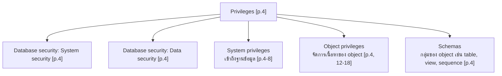
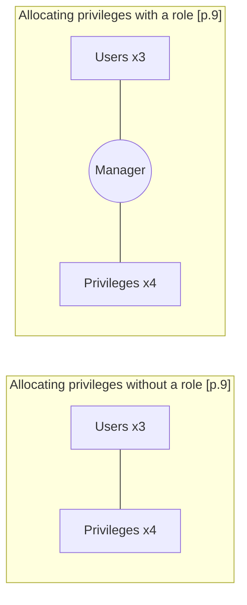
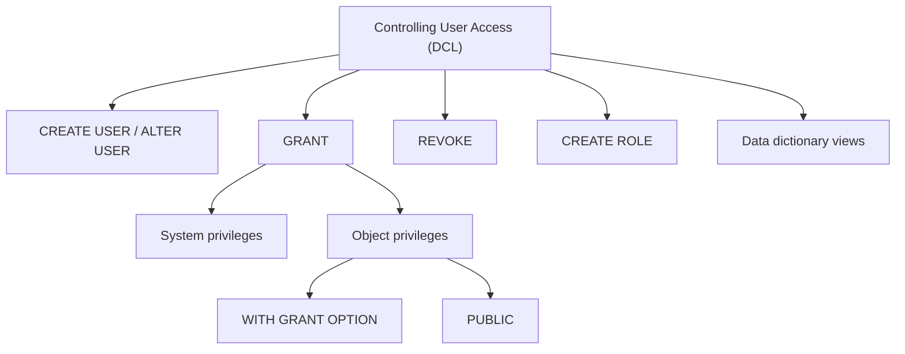

# Database - Les13: Controlling User Access

> **วิชา:** Database (Oracle SQL) | **ผู้จัดทำสไลด์:** Oracle Corporation, 2001 (ลิขสิทธิ์ตามท้ายสไลด์ [p.1])
> **Source:** `Resources/Books/Database/Les13_1.pdf` (20 หน้า, ภาษาอังกฤษ) — ชื่อบทตามสไลด์: "13 Controlling User Access" [p.1]
> **ป้ายแหล่งที่มา:** เนื้อหาที่ไม่มีป้ายพิเศษมาจากสไลด์ `[Source: extracted]` | เนื้อหาที่ผู้เขียนเพิ่มอยู่ใน blockquote ขึ้นต้นด้วย 💡 และติดป้าย `[Source: generated — not verified against original document]` | `[p.N]` = ลำดับหน้าใน PDF (เลขท้ายสไลด์ `13-N` ตรงกับ p.N ถึง p.18; p.19 คือ 13-21, p.20 คือ 13-22)

> **สไลด์ที่ไม่มีเนื้อหาให้สรุป:** p.1 (หน้าปก มีแต่เลข 13 และชื่อบท)

---

## Part 1: Macro Architecture & Overview

บทนี้ว่าด้วยการควบคุมการเข้าถึงฐานข้อมูลด้วยคำสั่ง **DCL** (Summary [p.19]) วัตถุประสงค์ตามสไลด์: สร้าง users; สร้าง roles เพื่อให้ตั้งค่าและดูแลโมเดลความปลอดภัยง่ายขึ้น; ใช้ GRANT และ REVOKE เพื่อให้และเพิกถอน object privileges; สร้างและเข้าถึง database links [p.2] (เรื่อง database links ไม่มีสไลด์เนื้อหาในไฟล์นี้ ดู Pitfalls)



> 💡 *[Source: generated — not verified against original document]* สไลด์ p.4 เป็นรายการแบบ bullet ไม่ได้วาดความสัมพันธ์ แผนภาพนี้เป็นการจัดกลุ่มของผู้เขียนโน้ต (บนสไลด์ "System security" และ "Data security" เป็น bullet ย่อยของ "Database security" ซึ่งอยู่ใต้หัวข้อ Privileges ไม่ใช่โหนดลูกของ Privileges โดยตรง)

### ตารางเปรียบเทียบ System privileges กับ Object privileges

| หัวข้อ | System privileges | Object privileges |
| :--- | :--- | :--- |
| ความหมายตามสไลด์ | การเข้าถึงฐานข้อมูล (Gaining access to the database) [p.4] | การจัดการเนื้อหาของ database objects [p.4] |
| จำนวน/ตัวอย่าง | มีมากกว่า 100 privileges [p.5]; ตัวอย่าง CREATE SESSION, CREATE TABLE, CREATE SEQUENCE, CREATE VIEW, CREATE PROCEDURE [p.7] | แตกต่างกันไปตามชนิด object [p.13]; ดูตาราง p.12 |
| ผู้ให้ | DBA (งานระดับสูง เช่น สร้าง/ลบ users, ลบ tables, backup tables) [p.5]; DBA ให้ system privileges แก่ user [p.7-8] | เจ้าของ object ให้ privileges บน object ของตนได้ [p.13] |
| คำสั่ง | `GRANT privilege [, privilege...] TO user [, user\| role, PUBLIC...]` [p.7] | `GRANT object_priv [(columns)] ON object TO {user\|role\|PUBLIC} [WITH GRANT OPTION]` [p.13] |

### ตารางคำสั่งของบท (Summary [p.19])

| Statement | Action ตามสไลด์ |
| :--- | :--- |
| `CREATE USER` | สร้าง user (โดยปกติทำโดย DBA) |
| `GRANT` | ให้ users อื่นมีสิทธิ์เข้าถึง objects ของคุณ |
| `CREATE ROLE` | สร้างกลุ่มของ privileges (โดยปกติทำโดย DBA) |
| `ALTER USER` | เปลี่ยนรหัสผ่านของ user |
| `REVOKE` | ถอน privileges บน object จาก users |

---

## Part 2: Detailed Concepts

### 2.1 ภาพรวมการควบคุมการเข้าถึง [p.3-5]

สไลด์ p.3 แสดงรูป: Database administrator, Users, กล่อง "Username and password / Privileges" ต่อกับฐานข้อมูล (อ่านจากภาพ)

* Database security แบ่งเป็น System security และ Data security [p.4]
* System privileges: การเข้าถึงฐานข้อมูล; Object privileges: การจัดการเนื้อหาของ database objects [p.4]
* Schemas: กลุ่มของ objects เช่น tables, views และ sequences [p.4]
* System privileges มีมากกว่า 100 ตัว DBA มี system privileges ระดับสูงสำหรับงานเช่น สร้าง users ใหม่, ลบ users, ลบ tables, backup tables [p.5]

### 2.2 Creating Users [p.6]

DBA สร้าง users ด้วยคำสั่ง `CREATE USER`:

```sql
CREATE USER user
IDENTIFIED BY password;

CREATE USER scott
IDENTIFIED BY tiger;
-- User created.
```

### 2.3 User System Privileges [p.7-8]

เมื่อสร้าง user แล้ว DBA ให้ system privileges เฉพาะได้ ตัวอย่างของนักพัฒนาแอปพลิเคชัน: CREATE SESSION, CREATE TABLE, CREATE SEQUENCE, CREATE VIEW, CREATE PROCEDURE [p.7]

```sql
GRANT privilege [, privilege...]
TO user [, user| role, PUBLIC...];

GRANT create session, create table,
      create sequence, create view
TO    scott;
-- Grant succeeded.
```

### 2.4 Roles [p.9-10]

Role คือกลุ่มของ privileges (CREATE ROLE "สร้างกลุ่มของ privileges" [p.19]) สไลด์ p.9 เปรียบเทียบการจัดสรร privileges แบบไม่ใช้ role กับใช้ role:



> 💡 *[Source: generated — not verified against original document]* จากภาพ p.9: ฝั่งไม่ใช้ role แต่ละ user (3 คน) เชื่อมเส้นไปยัง privileges (4 รูปสี่เหลี่ยมข้าวหลามตัด) แต่ละตัวเป็นตาข่าย; ฝั่งใช้ role ทุก user เชื่อมเข้า role "Manager" แล้ว Manager เชื่อมไปยัง privileges ทั้ง 4 การสรุปว่าช่วยลดจำนวนการจัดสรรเป็นความเห็นของผู้เขียนโน้ต เส้นในภาพไม่มีหัวลูกศร

ขั้นตอนตัวอย่าง [p.10]:

```sql
-- 1) Create a role
CREATE ROLE manager;
-- Role created.

-- 2) Grant privileges to a role
GRANT create table, create view
TO manager;
-- Grant succeeded.

-- 3) Grant a role to users
GRANT manager TO DEHAAN, KOCHHAR;
-- Grant succeeded.
```

### 2.5 Changing Your Password [p.11]

* DBA สร้างบัญชี user และกำหนดรหัสผ่านเริ่มต้นให้
* user เปลี่ยนรหัสผ่านเองได้ด้วย `ALTER USER`

```sql
ALTER USER scott
IDENTIFIED BY lion;
-- User altered.
```

### 2.6 Object Privileges [p.12-13]

ตารางที่ p.12 (อ่านจากภาพ; √ = privilege ใช้ได้กับ object ชนิดนั้น):

| Object Privilege | Table | View | Sequence | Procedure |
| :--- | :-: | :-: | :-: | :-: |
| ALTER | √ | | √ | |
| DELETE | √ | √ | | |
| EXECUTE | | | | √ |
| INDEX | √ | | | |
| INSERT | √ | √ | | |
| REFERENCES | √ | √ | | |
| SELECT | √ | √ | √ | |
| UPDATE | √ | √ | | |

* Object privileges แตกต่างกันไปตามชนิด object [p.13]
* เจ้าของ (owner) มีทุก privileges บน object นั้น [p.13]
* เจ้าของให้ privileges เฉพาะบน object ของตนได้ [p.13]

```sql
GRANT object_priv [(columns)]
ON    object
TO    {user|role|PUBLIC}
[WITH GRANT OPTION];
```

### 2.7 Granting Object Privileges [p.14-15]

```sql
-- Grant query privileges on the EMPLOYEES table
GRANT select
ON    employees
TO    sue, rich;
-- Grant succeeded.

-- Grant privileges to update specific columns to users and roles
GRANT update (department_name, location_id)
ON    departments
TO    scott, manager;
-- Grant succeeded.
```

`WITH GRANT OPTION` และ `PUBLIC` [p.15]:

* `WITH GRANT OPTION` — ให้ user มีอำนาจส่งต่อ privileges
* `PUBLIC` — ให้ผู้ใช้ทุกคนในระบบ query ตาราง DEPARTMENTS ของ Alice ได้

```sql
GRANT select, insert
ON    departments
TO    scott
WITH  GRANT OPTION;
-- Grant succeeded.

GRANT select
ON    alice.departments
TO    PUBLIC;
-- Grant succeeded.
```

### 2.8 Confirming Privileges Granted — Data Dictionary Views [p.16]

| Data Dictionary View | Description ตามสไลด์ |
| :--- | :--- |
| `ROLE_SYS_PRIVS` | System privileges ที่ให้แก่ roles |
| `ROLE_TAB_PRIVS` | Table privileges ที่ให้แก่ roles |
| `USER_ROLE_PRIVS` | Roles ที่ user เข้าถึงได้ |
| `USER_TAB_PRIVS_MADE` | Object privileges ที่ให้บน objects ของ user |
| `USER_TAB_PRIVS_RECD` | Object privileges ที่ให้แก่ user |
| `USER_COL_PRIVS_MADE` | Object privileges ที่ให้บนคอลัมน์ของ objects ของ user |
| `USER_COL_PRIVS_RECD` | Object privileges ที่ให้แก่ user บนคอลัมน์เฉพาะ |
| `USER_SYS_PRIVS` | แสดง system privileges ที่ให้แก่ user |

### 2.9 Revoking Object Privileges [p.17-18]

* ใช้ `REVOKE` เพื่อถอน privileges ที่ให้ผู้ใช้อื่นไป [p.17]
* privileges ที่ถูกส่งต่อผ่าน `WITH GRANT OPTION` จะถูกถอนไปด้วย [p.17]

```sql
REVOKE {privilege [, privilege...]|ALL}
ON     object
FROM   {user[, user...]|role|PUBLIC}
[CASCADE CONSTRAINTS];
```

ตัวอย่าง [p.18] — ในฐานะ user Alice ถอน SELECT และ INSERT ที่ให้ Scott บนตาราง DEPARTMENTS:

```sql
REVOKE select, insert
ON     departments
FROM   scott;
-- Revoke succeeded.
```

### 2.10 Practice 13 Overview [p.20]

หัวข้อของ Practice: ให้ privileges บนตารางของตนแก่ users อื่น; แก้ไขตารางของ user อื่นผ่าน privileges ที่ได้รับ; สร้าง synonym; query data dictionary views ที่เกี่ยวกับ privileges — โจทย์จริงไม่อยู่ในไฟล์นี้

---

## Part 3: Study Checklist & Concept Map

### Checklist

- [ ] แยก System privileges กับ Object privileges [p.4-5]
- [ ] เขียน `CREATE USER ... IDENTIFIED BY ...` [p.6]
- [ ] เขียน `GRANT` system privileges ให้ user [p.7-8]
- [ ] อธิบาย role และขั้นตอน CREATE ROLE → GRANT ให้ role → GRANT role ให้ users [p.9-10]
- [ ] เปลี่ยนรหัสผ่านด้วย `ALTER USER` [p.11]
- [ ] อ่านตาราง object privileges ว่า privilege ใดใช้กับ object ชนิดใด [p.12]
- [ ] เขียน `GRANT ... ON ... TO ...` และระบุคอลัมน์ได้ [p.13-14]
- [ ] อธิบาย `WITH GRANT OPTION` และ `PUBLIC` [p.15]
- [ ] เลือก data dictionary view เพื่อตรวจสอบ privileges [p.16]
- [ ] เขียน `REVOKE` และผลต่อ privileges ที่ส่งต่อด้วย WITH GRANT OPTION [p.17-18]

### Concept Map

> 💡 *[Source: generated — not verified against original document]* แผนที่ความคิดนี้ผู้เขียนโน้ตสร้างเอง ไม่ได้อยู่ในสไลด์



---

## ⚠️ Pitfalls & Source Anomalies

* **Database links ไม่มีเนื้อหา:** วัตถุประสงค์ข้อสุดท้ายของ p.2 คือ "Create and access database links" แต่ไม่มีสไลด์ใดในไฟล์นี้สอนเรื่องนี้ (p.3-20 ไม่กล่าวถึง) — ไม่ได้เติมเนื้อหา
* **Practice ไม่มีโจทย์:** p.20 เป็นหน้าภาพรวมของ Practice 13 เท่านั้น
* **เลขท้ายสไลด์:** `13-N` ตรงกับ p.N ถึง p.18 แต่ p.19 คือ 13-21 และ p.20 คือ 13-22 (ข้าม 13-19, 13-20); p.1 ไม่มีเลข
* **p.14 ข้อความ `Grant succeeded.7`:** ในสไลด์ต้นฉบับมีเลข "7" ติดท้าย `Grant succeeded.` ของตัวอย่างแรก (ในภาพก็เห็น) — คงไว้ตามต้นฉบับ ไม่นับเป็นส่วนของผลลัพธ์ และตัดออกจากตัวอย่างโค้ดในโน้ตนี้
* **p.19:** Description ของ `GRANT` ในสไลด์พิมพ์ว่า "access the your objects" (มี "the" เกิน) — ตารางสรุปในโน้ตแปลเป็นภาษาไทยโดยไม่คัดสำนวนผิด
* **ค่า √ ใน p.12:** ในไฟล์ข้อความเครื่องหมายนี้เป็นอักขระ private-use (U+F0D6) ถอดเป็น √ ตามภาพ ตรวจจำนวน 15 เครื่องหมายตรงกับตาราง
* **ผู้ให้ privileges ใน p.15:** ตัวอย่างแรกใช้ตาราง `departments` ธรรมดา ส่วนตัวอย่างที่สองใช้ `alice.departments` (ระบุเจ้าของ) สไลด์ไม่ได้บอกว่าตัวอย่างแรกรันโดยใครอย่างชัดเจน

---

## เอกสารเชื่อมโยง (Wiki-Style Backlinks)

* **วิชาและหัวข้อที่เกี่ยวข้อง:**
  * [[Les03 Single-Row Functions]] (ชุดสไลด์ Oracle เดียวกัน ใช้ตาราง employees / departments)

* **แบบฝึกหัด:**
  * [[HW-Database-05]]

* **แหล่งข้อมูล:**
  * Source: `Resources/Books/Database/Les13_1.pdf` (20 slides, Oracle Corporation 2001)
