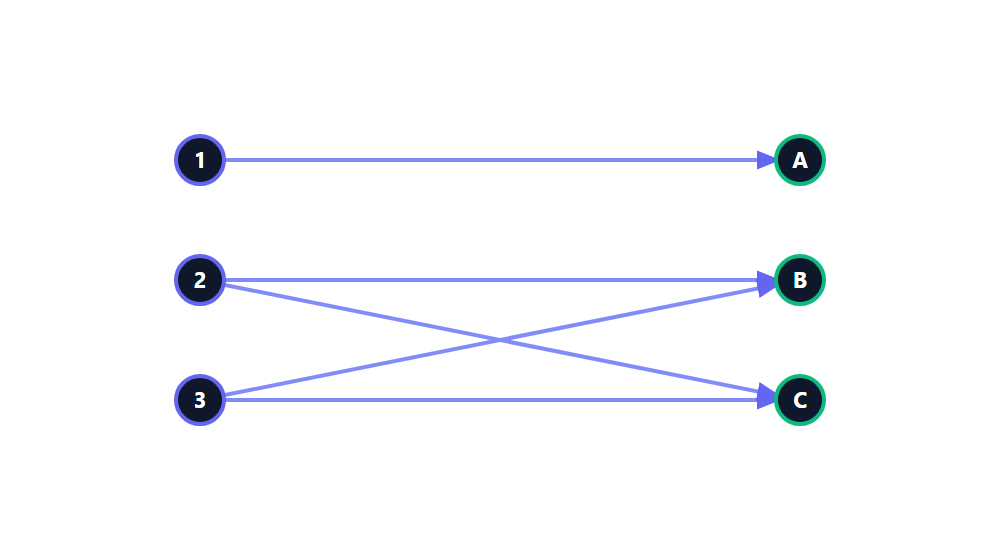

# Discrete Mathematics - Week 10: Relations and Binary Relations

**วิชา:** Discrete Mathematics
**สถาบัน:** มหาวิทยาลัย (Sirasit Lochanachit, PhD)
**Source:** `Resources/Books/Discrete Mathematics/myDiscrete_Week10.pdf` (58 pages, slides)  
**Reference เพิ่มเติม:** `Resources/References/ระบบเรียนรู้เรื่องความสัมพันธ์แบบโต้ตอบ (Relations Interactive Guide).md` (Interactive Guide, noswolf.github.io)

---

## Part 1: Macro Architecture & Overview

```
Week 10: Relations (ความสัมพันธ์)
├── 1. Relations (Basics)
│   ├── Ordered Pair & Cartesian Product (A × B)
│   ├── Relation = Subset of A × B
│   ├── Functions as Relations
│   └── Binary Relations on a Set (A × A)
├── 2. Properties of Relations
│   ├── Reflexive
│   ├── Symmetric
│   ├── Antisymmetric
│   ├── Transitive
│   └── Equivalence Relation + Classes
├── 3. n-ary Relations
│   ├── Degree of Relation
│   ├── n-tuple
│   └── Databases and Tables
└── 4. Representing Relations
    ├── Zero-One Matrices
    └── Directed Graphs (Digraphs)
```

---

## Part 2: Deep Dive

### 1. Relations — พื้นฐาน

#### Cartesian Product (ผลคูณคาร์ทีเชียน)

> 💡 **Intuition:** Cartesian Product เป็นการ "จับคู่ทุกสมาชิก" ของสองเซต — เหมือนการจับคู่ชาย-หญิงในการเต้นรำ: ถ้ามี 2 ชายและ 3 หญิง จะสามารถจับคู่ได้ 2×3 = 6 คู่ — ลำดับสำคัญ (a,b) ≠ (b,a) คือเหตุว่าเรียกว่า "ordered pair"
> [Source: generated — not verified against original document]

> **นิยาม:** Cartesian Product ของเซต $A$ และ $B$ เขียนว่า $A \times B$ คือเซตของ ordered pairs $(a, b)$ ที่ $a \in A$ และ $b \in B$

**ตัวอย่าง:** $A = \{a, b\}$, $B = \{1, 2, 3\}$

$$A \times B = \{(a,1),\ (a,2),\ (a,3),\ (b,1),\ (b,2),\ (b,3)\}$$

**ขนาด:** $|A \times B| = |A| \times |B|$

**🧭 ทำความเข้าใจ** _[Source: generated — not verified against original document]_

**แตกวลีสำคัญ:**
- "ordered pair $(a,b)$" → ลำดับสำคัญ $(a,b)$ ≠ $(b,a)$
- "$a \in A$ และ $b \in B$" → a ต้องมาจาก A และ b ต้องมาจาก B

**ตัวอย่าง:**
- ✅ $(a,1) \in A \times B$ เมื่อ $A = \{a,b\}, B = \{1,2,3\}$ และ $a \in A, 1 \in B$ ✅
- ❌ $(1,a) \notin A \times B$ (ลำดับผิด — 1 ไม่มาจาก A)
- **ต่างกันตรง:** $A \times B$ มี ordered pairs $(a,b)$ แต่ $B \times A$ มี ordered pairs $(b,a)$ (ต่างกันถ้า $A \neq B$)

**อย่าสับสน:** "$A \times B$" ≠ "$B \times A$" (เมื่อ $A \neq B$ และทั้งคู่ไม่ใช่เซตว่าง) — ลำดับสำคัญ

**เช็คความเข้าใจ:** กำหนด $A = \{1,2\}, B = \{x,y\}$ จงเขียน $A \times B$ ทั้งหมด
<details><summary>เฉลย</summary>

$A \times B = \{(1,x), (1,y), (2,x), (2,y)\}$  
|A × B| = 2 × 2 = 4
</details>

---

#### Relation (ความสัมพันธ์)

> 💡 **Intuition:** Relation เป็นการ "เลือกบางคู่" จากทุกคู่ที่เป็นไปได้ — $A \times B$ มีทุกคู่ แต่ relation R เลือกเฉพาะคู่ที่เข้าเงื่อนไข — เหมือนใน party ที่บันทึกเฉพาะคู่ที่ "เป็นเพื่อนกัน" ไม่ได้บันทึกทุกคู่ที่จับได้
> [Source: generated — not verified against original document]

> **นิยาม:** **Binary Relation** $R$ จากเซต $A$ ไปยังเซต $B$ คือ subset ใด ๆ ของผลคูณคาร์ทีเซียน $A \times B$ (เขียนแทนด้วย $R \subseteq A \times B$)
> ในกรณีที่ $A = B$ จะเรียก $R$ จาก $A$ ไป $A$ ว่า **ความสัมพันธ์บนเซต $A$** (Relation on set $A$)

```
เปรียบเทียบ:
  A × B  = ทุก ordered pair ที่เป็นไปได้
  R ⊆ A×B = relation = เลือกมาบางคู่ตามเงื่อนไข
```

สำหรับความสัมพันธ์ $R$ ใด ๆ ถ้า $(a, b) \in R$ เราเขียนได้ว่า $aRb$ ซึ่งอ่านว่า "$a$ มีความสัมพันธ์ $R$ กับ $b$"

**ตัวอย่างจากบริบทจริง:**
- $T = \{(5,a),(1,c),(3,d)\}$ เป็นความสัมพันธ์จากเซต $\{1,2,3,4,5\}$ ไปยัง $\{a,b,c,d\}$
- $\alpha = \{(PSCP, A),(ICS, C),(DM, A)\}$ เป็นความสัมพันธ์จากเซตของรายวิชาไปยังเซตของผลการเรียน

**🧭 ทำความเข้าใจ** _[Source: generated — not verified against original document]_

**แตกวลีสำคัญ:**
- "subset ใด ๆ" → ไม่จำเป็นต้องมีกฎหรือเงื่อนไขชัดเจน — เซตใด ๆ ⊆ A×B ก็เป็น relation
- "$R \subseteq A \times B$" → relation เป็นเซตของ ordered pairs

**ตัวอย่าง:**
- ✅ $R = \{(1,2), (2,3), (1,1)\}$ เป็น relation บน {1,2,3} ✅
- ✅ $S = \emptyset$ เป็น relation บน {1,2} ด้วย (empty relation)
- **ต่างกันตรง:** Relation ได้จากการเลือก subset ใด ๆ ของ A×B ไม่จำเป็นต้องมี "กฎ" ที่ชัดเจน

**อย่าสับสน:** "relation จาก A ไป B" ≠ "relation บน A" — ตัวแรก R ⊆ A×B, ตัวหลัง R ⊆ A×A

**เช็คความเข้าใจ:** ให้ A = {1,2}, B = {a,b}, relation $R = \{(1,a), (2,b)\}$ ขนาด A×B เป็นเท่าใด
<details><summary>เฉลย</summary>

|A × B| = |A| × |B| = 2 × 2 = 4  
R ⊆ A × B ที่มี 2 ordered pairs (ไม่เต็ม A × B)
</details>

---

#### Functions vs. Relations

> 💡 **Intuition:** Function เป็น relation ที่เข้มงวดกว่า — เหมือนตู้ ATM ที่กดรหัสเลขบัญชีหนึ่งครั้งได้ยอดคงเหลือเพียงค่าเดียว (ต้องมีคำตอบและมีคำตอบเดียว) ส่วน Relation เหมือนแอปหาเพื่อนที่คนหนึ่งอาจมีเพื่อนหลายคนหรือไม่มีเลยก็ได้ — สำคัญเพราะ function คือเครื่องมือที่ "คำนวณได้" ส่วน relation กว้างกว่า (analogy ใช้ไม่ได้ตรงที่ ATM ไม่ได้สร้างผลลัพธ์จาก input ทุกตัวได้เสมอ แต่ใน function ต้องกำหนด output ให้ทุก input ซึ่งเป็นกฎทางคณิตศาสตร์)
> [Source: generated — not verified against original document]

| | Relation | Function |
|:---|:---:|:---:|
| Input มีหลาย output ได้ไหม? | ✅ ได้ | ❌ ไม่ได้ |
| Input ต้องมี output ไหม? | ❌ ไม่จำเป็น | ✅ ต้องมีเสมอ |
| ทุก function เป็น relation? | — | ✅ ใช่ |
| ทุก relation เป็น function? | ❌ ไม่ใช่ | — |

**🧭 ทำความเข้าใจ** _[Source: generated — not verified against original document]_

**แตกวลีสำคัญ:**
- "มี output ทุก input" → ทุกสมาชิกของ domain ต้องมีคู่ออกไปอย่างน้อยหนึ่งคู่ (total)
- "output เดียวต่อ input" → ห้ามมี input เดียวกันจับคู่กับ output สองตัวที่ต่างกัน (single-valued)
- "input หลายตัวไปหา output เดียวกันได้" → ไม่ผิดเงื่อนไข function

**ตัวอย่าง:** A = {1, 2}, B = {x, y, z}
- ✅ f = {(1, x), (2, x)} → เป็น function: ทั้งสอง input มี output เดียว (ซ้ำ output กันได้)
- ❌ R₁ = {(1, x), (1, y)} → เป็น relation แต่ไม่ใช่ function เพราะ input 1 มี output สองตัว
- ❌ R₂ = {(1, x)} → เป็น relation แต่ไม่ใช่ function เพราะ input 2 ไม่มี output
- **ต่างกันตรง:** function ต้องผ่านทั้ง "มีคำตอบทุก input" และ "คำตอบเดียวต่อ input"

**อย่าสับสน:** "ทุก function เป็น relation" แต่ "ทุก relation ไม่ใช่ function" — ความสัมพันธ์ที่ไม่ใช่ function ก็ยังเป็น relation ได้

**เช็คความเข้าใจ:** R = {(1, x), (1, y), (2, z)} บน A = {1, 2} → B = {x, y, z} เป็น function หรือไม่
<details><summary>เฉลย</summary>

ไม่ใช่ function — input 1 มี output สองตัว (x และ y) ละเมิดเงื่อนไข single-valued
(เป็น relation ได้ เพราะ R ⊆ A × B)
</details>

---

#### Binary Relation

> 💡 **Intuition:** ถ้า Cartesian Product คือ "ทุกคู่ที่เป็นไปได้" Binary Relation คือ "ชุดคู่ที่เราเลือกมาใช้" — เหมือนรายชื่อคู่ทำงานกลุ่มในห้อง: ทุกคู่ต้องเป็นคนในห้องเดียวกัน (อยู่ในเซตที่กำหนด) แต่ไม่จำเป็นต้องจับคู่ทุกแบบที่เป็นไปได้ (analogy ใช้ไม่ได้ตรงที่ relation อาจว่างเปล่า (∅) หรือมีคู่ซ้ำกับตัวเองได้ เช่น (a, a) ซึ่งการจับคู่ทำงานกลุ่มมักไม่ทำ)
> [Source: generated — not verified against original document]

> **นิยาม:** **Binary Relation** $R$ จาก $A$ ไปยัง $B$ คือ subset $R \subseteq A \times B$

> **นิยาม (on a Set):** **Binary Relation บน $A$** คือ $R \subseteq A \times A$

**ตัวอย่าง 1:** $A = \{a, b, c\}$
$$R = \{(a,a),\ (a,b),\ (a,c)\} \subseteq A \times A \quad \checkmark$$

**ตัวอย่าง 2:** $A = \{1, 2, 3, 4\}$, $R = \{(a,b) \mid a \text{ divides } b\}$
$$R = \{(1,1),(1,2),(1,3),(1,4),(2,2),(2,4),(3,3),(4,4)\}$$

**ตัวอย่าง 3:** Relations บนเซตจำนวนเต็ม:

| Relation | นิยาม |
|:---:|:---|
| $R_1$ | $(a,b)$: $a \leq b$ |
| $R_2$ | $(a,b)$: $a > b$ |
| $R_3$ | $(a,b)$: $a = b$ หรือ $a = -b$ |
| $R_4$ | $(a,b)$: $a = b$ |
| $R_5$ | $(a,b)$: $a = b + 1$ |
| $R_6$ | $(a,b)$: $a + b \leq 3$ |

**🧭 ทำความเข้าใจ** _[Source: generated — not verified against original document]_

**แตกวลีสำคัญ:**
- "$R \subseteq A \times B$" → R เป็นเซตย่อย: ทุกสมาชิกของ R ต้องเป็นคู่ในผลคูณคาร์ทีเชียน แต่ R ไม่ต้องมีทุกคู่
- "บน A" → ทั้ง domain และ codomain เป็น A เดียวกัน คือ $R \subseteq A \times A$
- "ว่าง (∅)" → relation ที่ไม่เลือกคู่ใดเลยก็ยังนับเป็น binary relation

**ตัวอย่าง:** A = {1, 2, 3, 4}, R = {(a,b) | a หาร b ลงตัว} (ตัวอย่าง 2)
- ✅ (2, 4) ∈ R เพราะ 2 | 4 (4 = 2 × 2) และ 2, 4 ∈ A
- ❌ (2, 3) ∉ R เพราะ 2 ∤ 3 (3 = 2 × 1 + 1) → คู่นี้อยู่ใน A×A แต่ไม่ผ่านเงื่อนไข
- ❌ {(a, d)} ไม่ใช่ binary relation บน A = {a, b, c} เพราะ d ∉ A (ไม่อยู่ใน A×A)
- **ต่างกันตรง:** เงื่อนไขแรกคือ "อยู่ใน A×A" (โครงสร้าง) ส่วนเงื่อนไขที่สองคือ "ผ่านนิยามของ R" (ความหมาย)

**อย่าสับสน:** "relation บน A" ≠ "มีทุกคู่ของ A×A" — ถ้า A มี 2 สมาชิก จะมีคู่ใน A×A ได้ 4 คู่ และ relation บน A เลือกคู่ไหนก็ได้ รวมทั้งไม่เลือกเลย

**เช็คความเข้าใจ:** A = {1, 2} มี binary relation บน A ที่แตกต่างกันทั้งหมดกี่แบบ
<details><summary>เฉลย</summary>

A × A = {(1,1), (1,2), (2,1), (2,2)} มี 4 คู่ → แต่ละคู่เลือก "อยู่ใน R" หรือ "ไม่อยู่" (2 ทาง)
จำนวน relation = 2⁴ = **16** แบบ (รวม ∅ และ A×A)
</details>

---

### ตัวอย่างความสัมพันธ์ที่กำหนดด้วยเงื่อนไข (Relations Defined by Conditions)

ในทางคณิตศาสตร์และวิทยาการคอมพิวเตอร์ เรามักกำหนดเงื่อนไขเพื่อสร้างเซตความสัมพันธ์ที่มีความหมาย:

#### ความสัมพันธ์ "น้อยกว่า" (Less Than)

$$R = \{(a,b) \in A \times B : a < b\}$$

สมมติ $A = \{1,2,3\}$, $B = \{2,3\}$  
$R = \{(1,2),(1,3),(2,3)\}$

#### ความสัมพันธ์ "หารลงตัว" (Divisibility)

$$R = \{(a,b) \in A \times B : a \mid b\}$$

---

#### แบบจำลองการแสดงความสัมพันธ์ด้วยภาพ (Arrow / Bipartite Matching Diagram)

การแสดงความสัมพันธ์ระหว่างสองเซต $A$ และ $B$ สามารถเขียนเป็นไดอะแกรมลูกศร (Arrow Diagram หรือ Bipartite Matching) เพื่อแสดงให้เห็นคู่อันดับจาก Domain ไปยัง Codomain:


*(ตัวอย่าง: แผนภาพแสดงการจับคู่ $|A|=3, |B|=3, |R|=5$)*

สมมติ $A = \{2,3\}$, $B = \{4,6,9\}$  
$R = \{(2,4),(2,6),(3,6),(3,9)\}$

#### ความสัมพันธ์ "กำลังสอง" (Square of)

$$R = \{(a,b) \in A \times B : b = a^{2}\}$$

สมมติ $A = \{2,3,4\}$, $B = \{4,9,10\}$  
$R = \{(2,4),(3,9)\}$ *(4 ไม่เข้าเงื่อนไขเพราะ $4^2=16 \notin B$)*

---

## Part 3: Quick Reference & Exam Cheat Sheet

| แนวคิด | นิยาม |
|:---|:---|
| $A \times B$ | $\{(a,b) \mid a \in A, b \in B\}$ |
| Relation | subset ของ $A \times B$ |
| Binary Relation บน $A$ | subset ของ $A \times A$ |
| Function | relation ที่ input มีเพียง 1 output |
| ทุก function เป็น relation | ✅ แต่ไม่ใช่กลับกัน |

---

## ⚠️ Common Pitfalls & Exam Traps

- $(a, b)$ ≠ $(b, a)$ — ordered pair มีลำดับ!
- $A \times B \neq B \times A$ (ยกเว้น $A = B$)
- Relation ไม่จำเป็นต้องมีกฎที่ชัดเจน — เซตใด ๆ ที่เป็น subset ของ $A \times B$ ก็เป็น relation
- ระวังสับสนระหว่าง relation **จาก $A$ ไป $B$** กับ relation **บน $A$**

---

## เอกสารเชื่อมโยง (Wiki-Style Backlinks)

- [[Week10 - Properties of Relations]] (ต่อจาก binary relations — Reflexive, Symmetric, Antisymmetric, Transitive, Equivalence)
- [[Week10 - n-ary Relations and Representing Relations]] (ขยาย relation เป็น n sets + database model + Matrix + Digraph)
- [[Week9 - Applications of Congruences]] (Congruence Modulo ใช้ Relation เป็นฐาน)

**แหล่งข้อมูล:**
- Source: `Resources/Books/Discrete Mathematics/myDiscrete_Week10.pdf` (58 pages, slides)
- Reference: ระบบเรียนรู้เรื่องความสัมพันธ์แบบโต้ตอบ — `Resources/References/ระบบเรียนรู้เรื่องความสัมพันธ์แบบโต้ตอบ (Relations Interactive Guide).md` (noswolf.github.io)
