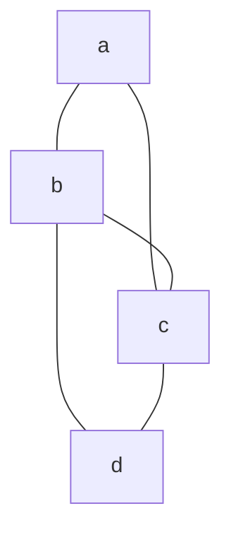
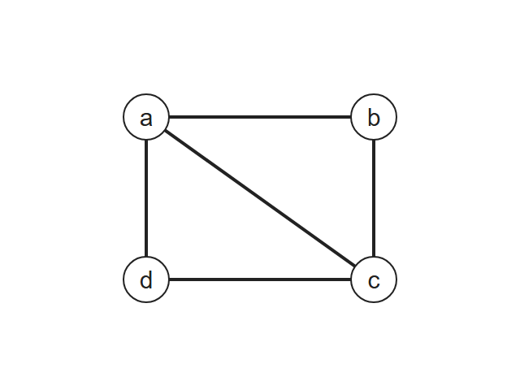
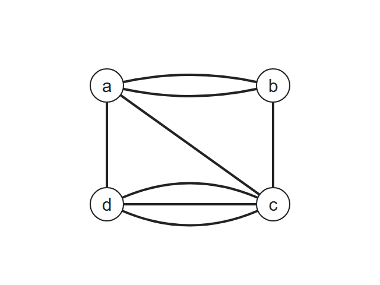
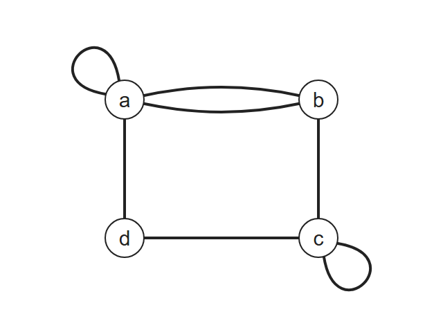
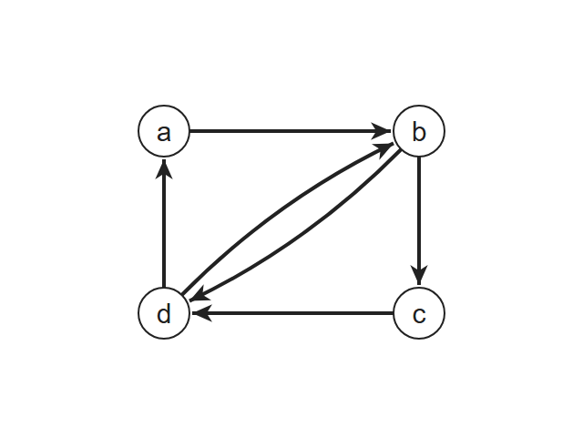
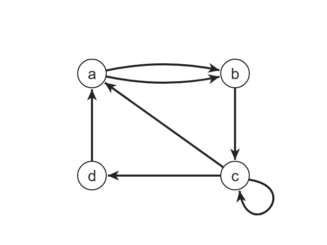
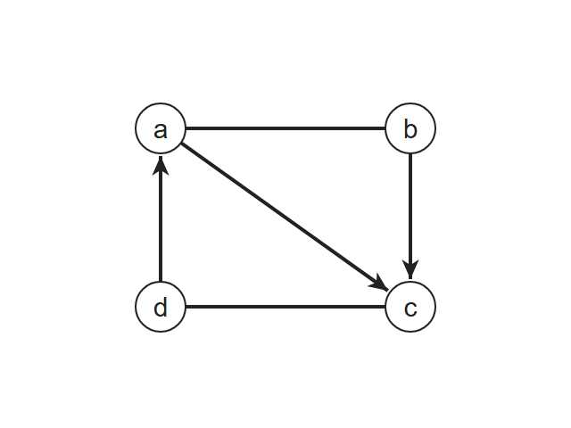
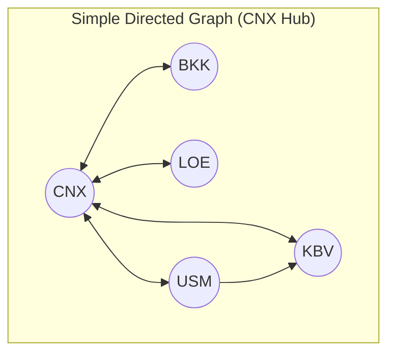
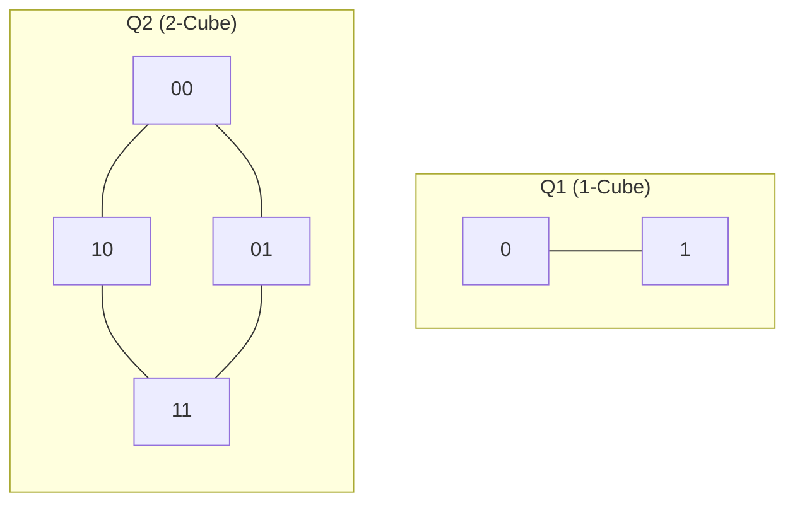

# Discrete Mathematics - Week11: Graphs, Graph Terminology and Representing Graphs

> **วิชา:** Discrete Mathematics | **ผู้สอน:** Dr. Sirasit Lochanachit
> **Source:** `Resources/Books/Discrete Mathematics/DM_Week11.pdf` (55 slides, หัวสไลด์ "Week 12: Graphs Part 1")
> **Source เสริม:** `Resources/References/Graph terminology interactive explorer.md` (Web Clipping — noswolf.github.io/DM_IT)

---

## Part 1: Macro Architecture & Overview

**กราฟ (Graph)** คือโครงสร้างที่ใช้แทน "<mark style="background:#affad1">ความเชื่อมโยงระหว่างวัตถุ</mark>" เช่น ความรู้จักกันระหว่างคน, การทำงานร่วมกัน, ลิงก์ระหว่างเว็บไซต์, เครือข่ายคอมพิวเตอร์/อินเทอร์เน็ต, เครือข่ายถนนและรถไฟ บทนี้ปูพื้นตั้งแต่นิยามของกราฟ, ประเภทของกราฟ (จำแนกด้วย 3 คำถาม), ศัพท์ (adjacent, degree, neighborhood), ทฤษฎีบท Handshaking, กราฟพิเศษ (K<sub>n</sub>, C<sub>n</sub>, W<sub>n</sub>, Q<sub>n</sub>, Bipartite) และวิธีแทนกราฟในคอมพิวเตอร์ (Adjacency List / Adjacency Matrix / Incidence Matrix)

ภาพรวมของบท Graphs ทั้งหมด (Chapter Summary):

```text
Graphs (บทกราฟ)
├── 1. Graphs and Graph Models          ← Week11 (โน้ตนี้)
├── 2. Graph Terminology & Special Types ← Week11 (โน้ตนี้)
├── 3. Representing Graphs              ← Week11 (โน้ตนี้)
├── 4. Connectivity                     ← Week12
└── 5. Euler and Hamiltonian Graphs     ← (สัปดาห์ถัดไป)
```

### ตารางเปรียบเทียบประเภทกราฟ (Graph Types Summary)

| Type | Edges | Multiple edges? | Loops? | ตัวอย่างการใช้งาน |
| :--- | :--- | :--- | :--- | :--- |
| Simple graph | Undirected | ❌ | ❌ | เครือข่ายเพื่อน |
| Multigraph | Undirected | ✅ | ❌ | เที่ยวบินหลายเที่ยวระหว่าง 2 เมือง |
| Pseudograph | Undirected | ✅ | ✅ | เส้นทางเดินป่า (มีเส้นวนกลับจุดเดิม) |
| Simple directed graph | Directed | ❌ | ❌ | การ follow ในโซเชียลมีเดีย |
| Directed multigraph | Directed | ✅ | ✅ | สายรถเมล์ |
| Mixed graph | Directed + Undirected | ✅ | ✅ | แผนที่เมือง (ถนนสองทาง + วันเวย์) |

---

## Part 2: Module-by-Module Deep Dive

### 2.1 นิยามของกราฟ (Definition of a Graph)

> 💡 **Intuition:** คิดกราฟเป็นแผนที่ความสัมพันธ์ — เหมือนรายชื่อเพื่อน (จุดยอด = คน, edge = เส้นเชื่อม/ความรู้จัก) หรือแผนที่ถนน (จุดยอด = เมือง, edge = ถนน) สิ่งสำคัญคือจุดยอดคืออะไร และจุดยอดสองจุดเชื่อมกันหรือไม่ "Endpoint" คือจุดปลายของเส้นเชื่อมแต่ละเส้น — เส้นหนึ่งมีปลายสอง หรือปลายเดียว (วงวน/loop)
> [Source: generated — not verified against original document]

> **Definition:** กราฟ G ประกอบด้วย V ซึ่งเป็น **เซตไม่ว่างของจุดยอด (vertices / nodes)** และ E ซึ่งเป็น **เซตของเส้นเชื่อม (edges)** เขียนแทนด้วย **G = (V, E)**
> แต่ละ edge เชื่อมจุดยอด 1 หรือ 2 จุด เรียกว่า **endpoints** และกล่าวว่า edge นั้น "connects" endpoints ของมัน

**🧭 ทำความเข้าใจ** _[Source: generated — not verified against original document]_

**แตกวลีสำคัญ:**
- "เซตไม่ว่างของจุดยอด" → V ต้องมีจุดอย่างน้อยหนึ่งจุด ไม่มีกราฟว่าง
- "เส้นเชื่อม edges" → E สามารถว่างได้ (กราฟที่มีเฉพาะจุดยอดไม่มีเส้น)
- "เชื่อมจุดยอด 1 หรือ 2 จุด" → เส้นหนึ่งเส้นมี endpoint 1 ตัว (วงวน/loop) หรือ 2 ตัว (เส้นปกติ)
- "endpoints" → จุดปลายของเส้น ไม่ใช่จุดที่อยู่บนเส้น

**ตัวอย่าง:**
- ✅ G = ({a, b, c}, {e1, e2}) โดย e1 เชื่อม a กับ b, e2 เชื่อม b กับ c — เป็นกราฟ (มีจุดและเส้น)
- ✅ G = ({a, b, c}, ∅) โดยไม่มี edge — เป็นกราฟ (เฉพาะจุด)
- ❌ G = (∅, ...) — ไม่ใช่กราฟ (จุดยอดต้องไม่ว่าง)
- **ต่างกันตรง:** "เชื่อม 1 จุด" = loop (วงวนกลับตัวเอง), "เชื่อม 2 จุด" = เส้นปกติ

**อย่าสับสน:** ในรูปวาด เส้นสอง edge อาจวาดตัดกันได้ แต่จุดตัดนั้น**ไม่ใช่** vertex และไม่ใช่ endpoint → endpoints ของ edge คือจุดยอดใน V ที่ edge นั้นเชื่อมเท่านั้น

**เช็คความเข้าใจ:** กราฟมี V = {u, v, w}, edge e₁ เชื่อม u กับ v และ edge e₂ เป็น loop ที่ w — แต่ละ edge มี endpoint อะไรบ้าง
<details><summary>เฉลย</summary>

- e₁ มี endpoints 2 ตัว คือ u และ v
- e₂ (loop) มี endpoint ตัวเดียว คือ w → ตรงกับนิยาม "edge เชื่อมจุดยอด 1 หรือ 2 จุด"

</details>

* **Infinite graph:** กราฟที่ vertex set เป็นเซตอนันต์
* **Finite graph:** กราฟที่ vertex set เป็นเซตจำกัด (วิชานี้ศึกษาเป็นหลัก)

**ตัวอย่าง:** กราฟที่มี 4 vertices และ 5 edges



| Thai Term | English Term | คำอธิบาย |
| :--- | :--- | :--- |
| จุดยอด | Vertex / Node | สมาชิกของ V |
| เส้นเชื่อม | Edge | สมาชิกของ E |
| จุดปลาย | Endpoints | จุดยอดที่ edge เชื่อมอยู่ |
| วงวน | Loop | edge ที่เชื่อมจุดยอดเข้ากับตัวเอง |
| เส้นเชื่อมขนาน | Multiple / Parallel edges | ≥ 2 edges ที่เชื่อมคู่จุดยอดเดียวกัน |
| เส้นเชื่อมมีทิศ | Directed edge (u, v) | edge ที่เริ่มที่ u และจบที่ v วาดเป็นลูกศร |

---

### 2.2 สามคำถามที่ใช้ตั้งชื่อประเภทกราฟ (Three Questions Name the Type)

จากเอกสาร Interactive Explorer การจำแนกกราฟทำได้ด้วยการถาม 3 ข้อ:

1. Edge เป็นแบบ **undirected**, **directed** หรือ **ทั้งสองแบบ**?
2. อนุญาตให้มี **multiple edges** หรือไม่?
3. อนุญาตให้มี **loops** หรือไม่?

#### Undirected Graphs

**(1) Simple graph** — ทุก edge เชื่อมจุดยอด *ที่ต่างกัน* 2 จุด และไม่มี 2 edges ใดเชื่อมคู่จุดยอดเดียวกัน

> 💡 **Intuition:** Simple graph คือกราฟ "ง่ายสุด" ที่ไม่มีลักษณะซับซ้อน — เหมือนระบุว่าเพื่อนสองคนเป็นเพื่อนกันหรือไม่เท่านั้น ไม่มีการนับความเป็นเพื่อนซ้ำ (คือไม่มี "หลาย edges" ระหว่างเพื่อนสองคน) และไม่มีการรู้จักตัวเอง (ไม่มี loop) สิ่งสำคัญ: "เชื่อมจุดยอด 2 จุด **ที่ต่างกัน**" มีความหมายว่า edge ไม่สามารถเชื่อมจุดหนึ่งกับตัวมันเอง และ "ไม่มี 2 edges เชื่อมคู่จุดเดียว" หมายว่าระหว่าง u กับ v มี edge ได้ไม่เกิน 1 เส้น
> [Source: generated — not verified against original document]

* **ตัวอย่าง:** เครือข่ายเพื่อน — สองคนเป็นเพื่อนกันหรือไม่เป็นเท่านั้น



**🧭 ทำความเข้าใจ** _[Source: generated — not verified against original document]_

**แตกวลีสำคัญ:**
- "edge เชื่อม 2 จุดที่ต่างกัน" → ไม่มี loop (วงวนจุดเข้าหาตัวเอง)
- "ไม่มี 2 edges เชื่อมคู่จุดเดียวกัน" → ระหว่างจุด u กับ v มี edge ได้สูงสุด 1 เส้น

**ตัวอย่าง:**
- ✅ กราฟ 3 จุด {a, b, c} ที่มี edge {a,b}, {b,c}, {a,c} — เป็น simple graph (ทุก edge เชื่อม 2 จุดต่างกัน, ไม่มี edge ซ้ำ)
- ❌ กราฟที่มี loop ที่ a เช่น edge {a,a} — ไม่ใช่ simple (edge ต้องเชื่อม 2 จุด **ต่างกัน**)
- ❌ กราฟที่มี 2 edges เชื่อม a กับ b พร้อมกัน — ไม่ใช่ simple (มี "2 edges เชื่อมคู่จุดเดียวกัน")
- **ต่างกันตรง:** Simple graph อนุญาต edge ได้แค่ 1 เส้นต่อคู่จุด, Multigraph อนุญาตหลายเส้น

**อย่าสับสน:** "เชื่อมจุดยอด 2 จุด" หมายถึง edge แต่ละเส้นมีจุดปลาย 2 จุด ไม่ได้บังคับให้ทุกคู่จุดยอดต้องมี edge (กราฟที่ทุกคู่มี edge คือ complete graph K_n)

**เช็คความเข้าใจ:** เพื่อน 4 คน a, b, c, d ที่ทุกคนเป็นเพื่อนกับทุกคน วาดเป็น simple graph ได้กี่ edges
<details><summary>เฉลย</summary>

ทุกคู่เป็นเพื่อนกัน = complete graph K₄ → simple graph มี edge ได้ 1 เส้นต่อคู่ ดังนั้นจำนวน edges = จำนวนคู่ = C(4,2) = 6 เส้น {a,b}, {a,c}, {a,d}, {b,c}, {b,d}, {c,d}

</details>

**(2) Multigraph** — อนุญาตให้หลาย edges เชื่อมคู่จุดยอดเดียวกัน ถ้ามี *m* edges เชื่อม u กับ v จะกล่าวว่า {u, v} มี **multiplicity m** แต่ **ไม่มี loop**

> 💡 **Intuition:** Multigraph อนุญาต "เส้นซ้ำ" ระหว่างคู่จุดเดียว เหมือนเที่ยวบิน — ระหว่าง Bangkok กับ Phuket มีได้หลายเที่ยวบิน แต่ละเที่ยวคือ edge คนละเส้นที่เชื่อมคู่ {Bangkok, Phuket} เดียวกัน multiplicity คือ "มีกี่เส้น" ระหว่างคู่จุดนั้น (ข้อจำกัดของ analogy: เที่ยวบินจริงมีทิศ แต่ multigraph ในที่นี้เป็นกราฟไม่มีทิศ)
> [Source: generated — not verified against original document]

* **ตัวอย่าง:** เที่ยวบิน — มีหลายเที่ยวบินระหว่างสองเมืองเดียวกันได้
* **Computer network:** ใช้เมื่อเราสนใจ "จำนวนลิงก์" ระหว่าง data centers



**🧭 ทำความเข้าใจ** _[Source: generated — not verified against original document]_

**แตกวลีสำคัญ:**
- "อนุญาตให้หลาย edges" → ระหว่างคู่จุด u, v อาจมี edge ได้ 2+ เส้น
- "multiplicity m" → มี m edges เชื่อมคู่ {u, v} นั้น
- "ไม่มี loop" → ยังคงห้าม edge เชื่อมจุดกับตัวเอง

**ตัวอย่าง:**
- ✅ {Bangkok, Chiang Mai} มี 4 edges (4 เที่ยวบิน) → multiplicity = 4
- ✅ บางคู่จุดมี edge เส้นเดียว บางคู่มีหลายเส้น — ไม่จำเป็นต้องซ้ำทุกคู่
- ❌ กราฟที่มี multiple edges และมี loop ที่จุด a — ไม่ใช่ multigraph (multigraph มี loop ไม่ได้ → กราฟนี้เป็น pseudograph)
- **ต่างกันตรง:** Simple graph = edge ได้สูงสุด 1 เส้นต่อคู่, Multigraph = edge ได้หลายเส้น, Pseudograph = อนุญาต loop ด้วย

**อย่าสับสน:** Multigraph ไม่มี loop (ห้ามวงวน) ส่วน simple graph ห้ามทั้ง loop และ multiple edges — Multigraph *อนุญาต* multiple edges แต่ไม่บังคับ จึงถือได้ว่า simple graph ทุกอันเป็น multigraph ด้วย

**เช็คความเข้าใจ:** ท่อ 3 เส้นจาก เมือง A ไป เมือง B สร้าง multigraph ได้ไหม เขียน edge กับ multiplicity
<details><summary>เฉลย</summary>

ได้ เพราะ multigraph อนุญาต multiple edges ระหว่างคู่ {A, B} → edge {A,B} มี multiplicity = 3 (มี 3 edges ระหว่าง A กับ B)

</details>

**(3) Pseudograph** — กราฟไม่มีทิศที่ทั่วไปที่สุด อนุญาตทั้ง loops และ multiple edges

> 💡 **Intuition:** Pseudograph อนุญาตทุกอย่างในกราฟไม่มีทิศ — ต่างจาก multigraph ตรงที่ยอมให้มี loop ด้วย จึงเป็นกราฟไม่มีทิศที่ยืดหยุ่นที่สุด เหมือนเส้นทางเดินป่าที่มีหลายทางเชื่อมจุดสังเกตสองจุด (multiple edges) และมีทางวนที่ออกจากจุดหนึ่งแล้วกลับมาจุดเดิม (loop)
> [Source: generated — not verified against original document]

* **ตัวอย่าง:** เส้นทางเดินป่า — มีหลายทางเชื่อมสองจุดสังเกต และมีเส้นวงกลมที่กลับมาจุดเริ่ม
* **Computer network:** ใช้เมื่อมี **diagnostic links** (feedback loop) ที่ data center ตัวเอง



**🧭 ทำความเข้าใจ** _[Source: generated — not verified against original document]_

**แตกวลีสำคัญ:**
- "loops" → edge เชื่อมจุดกับตัวเอง {v, v}
- "multiple edges" → หลายเส้นระหว่างคู่จุดเดียว
- "ทั่วไปที่สุด" → pseudograph อนุญาตทั้ง multiple edges และ loops (กราฟไม่มีทิศแบบอื่นเป็นกรณีพิเศษของมัน)

**ตัวอย่าง:**
- ✅ {a, b} มี 2 edge, {c, c} มี 1 loop — เป็น pseudograph (อนุญาต multiple + loop)
- ✅ บาง edges ธรรมดา บาง edges ซ้ำ บาง edges loop — mix ได้หมด
- ✅ กราฟที่ไม่มี loop และไม่มี multiple edge ก็ยังเข้านิยาม pseudograph (นิยาม "อนุญาต" ไม่ได้ "บังคับ") แต่ปกติเรียกด้วยชื่อที่เจาะจงกว่า คือ simple graph
- ❌ กราฟที่มี directed edge (u, v) — ไม่ใช่ pseudograph เพราะ pseudograph เป็นกราฟไม่มีทิศ (ถ้ามีทิศและมี loop/multiple edges = directed multigraph)
- **ต่างกันตรง:** Simple = ห้ามทั้งหมด, Multigraph = ห้าม loop อนุญาต multiple, Pseudograph = อนุญาตทั้งหมด

**อย่าสับสน:** Loop {v, v} ไม่ได้หมายถึง "path ที่วนกลับ" แต่เป็น edge ที่มี endpoint ที่จุดเดียว

**เช็คความเข้าใจ:** เส้นทางเดินป่ามีทาง 3 เส้นเชื่อมจุด S กับจุด T และมีทางวน 1 เส้นที่ออกจาก S แล้วกลับมา S เขียนเป็น pseudograph ได้ไหม มีกี่ edges และ deg(S), deg(T) เท่าไร
<details><summary>เฉลย</summary>

1. ทาง 3 เส้นระหว่าง S กับ T = multiple edges {S,T} multiplicity 3 → 3 edges
2. ทางวนที่ S = loop {S,S} → 1 edge
3. มีทั้ง multiple edges และ loop → เป็น pseudograph ได้ (เป็น multigraph ไม่ได้เพราะมี loop) รวม 4 edges
4. deg(S) = 3 + 2 (loop นับ 2) = 5, deg(T) = 3 → ผลรวม 8 = 2 × 4 ตรง Handshaking

</details>

#### Directed and Mixed Graphs

> **Definition (Directed graph / Digraph):** G = (V, E) ที่แต่ละ edge สัมพันธ์กับ **คู่อันดับ (ordered pair)** ของจุดยอด — directed edge (u, v) **เริ่มที่ u และจบที่ v**
> กราฟที่ endpoints ไม่มีลำดับ เรียกว่า **undirected graph**

**(4) Simple directed graph** — ทุก edge (u, v) ชี้จาก u ไป v ไม่มี loop และไม่มี multiple directed edges — แต่เนื่องจาก (u, v) กับ (v, u) เป็นคนละ edge จึง **มีทั้งคู่ได้**
* **ตัวอย่าง:** การ follow ในโซเชียลมีเดีย — a follow b ไม่ได้แปลว่า b follow a
* **Computer network:** ใช้ model เครือข่ายที่มีทิศทาง



**(5) Directed multigraph** — กราฟมีทิศที่อาจมีหลาย directed edges จากจุดหนึ่งไปอีกจุด หรือจากจุดหนึ่งกลับหาตัวเอง
* **ตัวอย่าง:** สายรถเมล์ — หลายสายวิ่งจากป้าย a ไปป้าย b และมีสายวงกลมที่จบที่จุดเริ่ม
* **Computer network:** ใช้ model เครือข่ายที่มี **one-way links หลายเส้น**



**(6) Mixed graph** — มีทั้ง directed และ undirected edges, อนุญาต loops และ multiple edges
* **ตัวอย่าง:** แผนที่เมืองที่มีถนนสองทาง (undirected) และถนนวันเวย์ (directed)



> [!TIP]
> **Names nest (ชื่อซ้อนกัน):** Simple graph ทุกอันเป็น multigraph ด้วย (multigraph *อาจ* มี multiple edges แต่ไม่จำเป็นต้องมี) และ multigraph ทุกอันเป็น pseudograph — เวลาจำแนกให้ใช้ **ชื่อที่เฉพาะเจาะจงที่สุด**
>
> **Direction matters:** ใน directed graph, (u, v) และ (v, u) เป็นคนละ edge — การมีทั้งสองเส้น **ไม่นับว่าเป็น multiple edges**

---

### 2.3 แบบฝึกหัด: Graph Models ของเส้นทางการบิน

**Exercise 1:** เที่ยวบินรายวัน: Bangkok→Chiang Mai 4, Chiang Mai→Bangkok 2, Chiang Mai→Krabi 3, Krabi→Chiang Mai 2, Chiang Mai→Loei 1, Loei→Chiang Mai 2, Chiang Mai→Samui 3, Samui→Chiang Mai 2, Samui→Krabi 1

| ข้อ | เงื่อนไขการวาด edge | ประเภทกราฟ |
| :--- | :--- | :--- |
| a) | 1 edge ระหว่างเมืองที่มีเที่ยวบิน (ทิศใดก็ได้) | **Simple graph** |
| b) | 1 edge ต่อ **ทุกเที่ยวบิน** (ไม่สนทิศ) | **Multigraph** (เช่น BKK–CNX มี multiplicity 6) |
| c) | 1 edge จากเมืองต้นทาง → ปลายทาง (ถ้ามีเที่ยวบิน) | **Simple directed graph** |
| d) | 1 edge **ต่อเที่ยวบิน** จากต้นทาง → ปลายทาง | **Directed multigraph** (BKK→CNX 4 เส้น) |


> **Directed Multigraph (เที่ยวบินไป-กลับ):** BKK $
ightleftharpoons$ CNX (4/2), CNX $
ightleftharpoons$ KBV (3/2), CNX $
ightleftharpoons$ LOE (1/2), CNX $
ightleftharpoons$ USM (3/2), USM $
ightarrow$ KBV (1)

**การประยุกต์ใช้กราฟอื่นๆ:** Social networks, Communications networks (Call graphs), Information networks (Web pages & links), Software design (Module/Library dependencies), Transportation networks, Biological networks (Species/Protein interaction), Semantic Networks (NLP), Tournaments

---

### 2.4 ศัพท์ของกราฟไม่มีทิศ (Undirected Graph Terminology)

* **Definition 1 — Adjacent (Neighbors):** จุดยอด u, v ใน undirected graph G เรียกว่า **adjacent** (เป็นเพื่อนบ้านกัน) ถ้ามี edge e ระหว่าง u และ v — edge e นั้นเรียกว่า **incident with** u และ v และกล่าวว่า e **connects** u กับ v
* **Definition 2 — Neighborhood:** เซตของเพื่อนบ้านทั้งหมดของ v เขียนแทนด้วย **N(v)** สำหรับเซต A ⊆ V: N(A) = ยูเนียนของ N(v) ทุก v ∈ A
* **Definition 3 — Degree:** **deg(v)** = จำนวน edges ที่ incident กับ v **ยกเว้น loop นับเป็น 2**

> 💡 **Intuition:** Degree = "มีเพื่อนกี่คน" หรือในเครือข่ายคอมพิวเตอร์ "มี link กี่เส้น" — นับ edge ที่ติดจุดนั้นทีละเส้น ส่วน loop นับเป็น 2 เพราะปลายทั้งสองข้างของ loop ติดอยู่ที่จุดเดียวกัน (ออกจาก v แล้วกลับเข้า v)
> [Source: generated — not verified against original document]

**🧭 ทำความเข้าใจ** _[Source: generated — not verified against original document]_

**แตกวลีสำคัญ:**
- "edges ที่ incident กับ v" → ทุก edge ที่มี v เป็น endpoint
- "loop นับเป็น 2" → ถ้า {v, v} เป็น loop ที่ v มันนับ 2 สำหรับ deg(v)

**ตัวอย่าง:**
- ✅ v มี 3 edges ปกติติด → deg(v) = 3
- ✅ v มี 2 edges ปกติ + 1 loop → deg(v) = 2 + 2 = 4
- ✅ v มี 0 edges → deg(v) = 0 (isolated)
- ✅ v มี 1 edge ปกติ → deg(v) = 1 (pendant)
- **ต่างกันตรง:** Multiple edges: แต่ละเส้นนับแยกกัน เช่น 2 edges ระหว่าง u, v นับ 1+1 = 2

**อย่าสับสน:** Loop {v,v} นับเป็น "2" ไม่ใช่ "1" เพราะ loop ติดจุดสองครั้ง (เป็นเหมือน edge เข้าออกจุดเดียว)

**เช็คความเข้าใจ:** กราฟมี 4 จุด a, b, c, d มี edges: {a,b}, {b,c}, {c,d}, {a,c}, {a,a} (loop ที่ a) หา deg(a)
<details><summary>เฉลย</summary>

a เชื่อมกับ edges: {a,b} (นับ 1), {a,c} (นับ 1), {a,a} (loop, นับ 2) → deg(a) = 1+1+2 = 4

</details>

  * **Isolated vertex:** deg(v) = 0
  * **Pendant vertex:** deg(v) = 1

**ตัวอย่าง (กราฟใน 2.1):**

| Vertex | N(v) | deg(v) |
| :--- | :--- | :--- |
| a | {b, c} | 2 |
| b | {a, c, d} | 3 |
| c | {a, b, d} | 3 |
| d | {b, c} | 2 |
| **รวม** | | **10 = 2 × 5 edges** ✔ |

---

### 2.5 Handshaking Theorem

> 💡 **Intuition:** ทฤษฎีบทนี้มีชื่อว่า "Handshaking" เพราะ "ถ้ากลุ่มคนจับมือกัน การจับมือแต่ละครั้งจะถูกนับ 2 ครั้ง (1 ครั้งสำหรับแต่ละคนที่จับมือกัน)" ผลรวมของ degree (จำนวนครั้งที่แต่ละคนจับมือ รวมทุกคน) ต้องเป็นเลขคู่เสมอ เพราะทุก edge นับ 2 ครั้ง
> [Source: generated — not verified against original document]

> **Theorem 1 (Handshaking Theorem):** ถ้า G = (V, E) เป็น undirected graph ที่มี m edges แล้ว
> $$2m = \sum_{v \in V} \deg(v)$$
> **Proof:** ทุก edge มีส่วนในการนับ degree **2 ครั้ง** (ครั้งละ endpoint — loop ก็นับ 2) ดังนั้นทั้งสองข้างเท่ากับสองเท่าของจำนวน edges

**🧭 ทำความเข้าใจ** _[Source: generated — not verified against original document]_

**แตกวลีสำคัญ:**
- "ผลรวม degree = 2m" → ผลรวม degree ต้องเป็นเลขคู่เสมอ (เพราะเท่ากับ 2 คูณจำนวน edges)
- "ทุก edge นับ 2 ครั้ง" → edge {u,v} นับ 1 ครั้งที่ u และ 1 ครั้งที่ v

**ตัวอย่าง:**
- ✅ กราฟ 4 จุด มี edges 5 เส้น → 2m = 10 → ผลรวม degree ต้อง = 10
- ✅ กราฟ 3 จุด deg(a) = 2, deg(b) = 2, deg(c) = 2 → รวม = 6 = 2m → m = 3 edges
- ❌ ผลรวม degree = 7 → ขัด Handshaking (7 เป็นเลขคี่ไม่ได้)
- **ต่างกันตรง:** Handshaking = ผลรวม degree มีความสัมพันธ์กับจำนวน edges เท่านั้น ไม่เกี่ยวจำนวนจุด

**อย่าสับสน:** "2m = ผลรวม degree" ไม่ได้หมายว่า degree ของแต่ละจุดต้องเป็นเลขคู่ → หมายถึง **ผลรวม** ต้องเป็นเลขคู่

**เช็คความเข้าใจ:** กราฟมีจุด a, b, c, d ที่มี deg(a) = 3, deg(b) = 2, deg(c) = 3, deg(d) = 2 กราฟนี้มีกี่ edges
<details><summary>เฉลย</summary>

ผลรวม = 3+2+3+2 = 10 → 2m = 10 → m = 5 edges

</details>

> **Theorem 2:** Undirected graph มีจำนวนจุดยอดที่มี **odd degree เป็นจำนวนคู่เสมอ**
> **Proof:** ให้ V₁ = จุดยอด degree คู่, V₂ = จุดยอด degree คี่ จะได้
> $$2m = \sum_{v \in V_1}\deg(v) + \sum_{v \in V_2}\deg(v)$$
> ผลรวมแรกเป็นเลขคู่ และ 2m เป็นเลขคู่ ⇒ ผลรวมที่สองต้องเป็นเลขคู่ แต่ทุกพจน์เป็นเลขคี่ ⇒ จำนวนพจน์ (|V₂|) ต้องเป็นเลขคู่

#### ตัวอย่างและแบบฝึกหัด (พร้อมเฉลย)

| ข้อ | โจทย์ | วิธีคิด | คำตอบ |
| :--- | :--- | :--- | :--- |
| Ex 1 | 10 vertices แต่ละจุด degree 6 มีกี่ edges? | 2m = 10 × 6 = 60 | **m = 30** |
| Ex 2 | 5 vertices ทุกจุด degree 3 ได้ไหม? | ผลรวม = 15 (คี่) | **ไม่ได้** (ขัด Theorem 1/2) |
| Ex 3 | 4 vertices degree 1, 1, 3, 3 วาด undirected graph ได้ไหม? | ผลรวม = 8 (คู่), odd-degree 4 จุด (คู่) | **ได้** (เป็น multigraph/pseudograph; แต่ simple ไม่ได้ เพราะ 2 จุด degree 3 ต้องต่อกับทุกจุด ทำให้จุด degree 1 กลายเป็น 2) |
| Ex 4 | 4 vertices degree 2, 2, 2, 3? | ผลรวม = 9 (คี่) | **ไม่ได้** |
| Exercise 1 | 4 vertices degree 1, 2, 3, 4 เป็น **simple** graph ได้ไหม? | ผลรวม 10 คู่ แต่ simple graph 4 จุด degree สูงสุด = 3 | **ไม่ได้** |
| Exercise 2 | 8 vertices degree 1,1,2,2,9,1,3,1 เป็น simple graph ได้ไหม? | simple graph 8 จุด degree สูงสุด = 7 แต่มี 9 | **ไม่ได้** |
| Exercise 3 | นักเรียน 15 คน ทุกคนมีเพื่อน **อย่างน้อย** 3 คน ได้ไหม? | *พอดี* 3 คน: 15×3 = 45 คี่ → เป็นไปไม่ได้; แต่ "อย่างน้อย 3" เช่น ทุกคนมีเพื่อน 4 คน: 15×4 = 60 คู่ | **ได้** (แต่ทุกคนมีเพื่อน *พอดี* 3 คนไม่ได้) |
| Exercise 4 | 6 คน จับมือกันทุกคู่ มีกี่ครั้ง? | กราฟ K₆: 2m = 6 × 5 | **m = 15** = C(6,2) |

---

### 2.6 ศัพท์ของกราฟมีทิศ (Directed Graph Terminology)

* **Definition 4:** ถ้า (u, v) เป็น edge ของกราฟมีทิศ กล่าวว่า u **adjacent to** v และ v **adjacent from** u
  * u = **initial vertex**, v = **terminal (end) vertex** ของ (u, v)
  * Loop มี initial vertex และ terminal vertex เป็นจุดเดียวกัน
* **Definition 5:**
  * **In-degree** deg⁻(v) = จำนวน edges ที่มี v เป็น **terminal vertex** (ลูกศรชี้เข้า)
  * **Out-degree** deg⁺(v) = จำนวน edges ที่มี v เป็น **initial vertex** (ลูกศรชี้ออก)
  * Loop ที่ v นับ **+1 ทั้ง in-degree และ out-degree**

**ตัวอย่าง:** ใช้ Directed multigraph ในหัวข้อ 2.2 (a→b ×2, b→c, c→d, d→a, c→a, loop ที่ c)

| Vertex  | deg⁻ (in)     | deg⁺ (out)         |
| :------ | :------------ | :----------------- |
| a       | 2 (d→a, c→a)  | 2                  |
| b       | 2             | 1                  |
| c       | 2 (b→c, loop) | 3 (c→d, c→a, loop) |
| d       | 1             | 1                  |
| **รวม** | **7**         | **7** = \|E\| ✔    |

> **Theorem 3:** ถ้า G = (V, E) เป็นกราฟมีทิศ แล้ว
> $$\sum_{v \in V}\deg^-(v) = \sum_{v \in V}\deg^+(v) = |E|$$
> **Proof:** ทุก edge มี initial vertex 1 จุดและ terminal vertex 1 จุดพอดี

---

### 2.7 กราฟอย่างง่ายแบบพิเศษ (Special Types of Simple Graphs)

| กราฟ | นิยาม | \|V\| | \|E\| | deg |
| :--- | :--- | :--- | :--- | :--- |
| **Complete graph K<sub>n</sub>** | simple graph ที่มี edge **พอดี 1 เส้น** ระหว่างทุกคู่จุดยอด | n | n(n−1)/2 | n−1 ทุกจุด |
| **Cycle C<sub>n</sub>** (n ≥ 3) | v₁,…,vₙ กับ edges {v₁,v₂}, {v₂,v₃}, …, {vₙ₋₁,vₙ}, {vₙ,v₁} | n | n | 2 ทุกจุด |
| **Wheel W<sub>n</sub>** (n ≥ 3) | เพิ่มจุดยอดใหม่ 1 จุดเข้า C<sub>n</sub> แล้วเชื่อมกับทั้ง n จุด | n+1 | 2n | ขอบ 3, ศูนย์กลาง n |
| **n-Cube Q<sub>n</sub>** | จุดยอดแทน bit strings ยาว n ทั้ง 2ⁿ ตัว — adjacent **iff ต่างกันพอดี 1 bit** | 2ⁿ | n·2ⁿ⁻¹ | n ทุกจุด |
| **K<sub>m,n</sub>** | (ดู 2.8) | m+n | m·n | — |

* **Noncomplete graph:** simple graph ที่มีอย่างน้อย 1 คู่จุดยอดที่ไม่มี edge เชื่อม



---

### 2.8 กราฟสองส่วน (Bipartite Graphs)

> 💡 **Intuition:** Bipartite = "สองส่วน" — คิดเป็นการจับคู่ เช่น หนังสือและผู้อ่าน, งานและพนักงาน, นักศึกษาและหอพัก edge เชื่อมระหว่างเพียง 2 กลุ่ม ไม่เชื่อม "ภายในกลุ่มเดียว" ทำให้ตรวจได้ง่าย: ระบายสี 2 สีแบบสลับ ถ้าระบายได้ = bipartite
> [Source: generated — not verified against original document]

> **Definition 6:** Simple graph เป็น **bipartite** ถ้าแบ่ง V ออกเป็น 2 เซตย่อยที่ไม่มีส่วนร่วม (disjoint) V₁ และ V₂ ได้ โดยทุก edge เชื่อมจุดใน V₁ กับจุดใน V₂ — **ไม่มี edge เชื่อมจุดสองจุดใน V₁ หรือสองจุดใน V₂**

**🧭 ทำความเข้าใจ** _[Source: generated — not verified against original document]_

**แตกวลีสำคัญ:**
- "แบ่ง V เป็น 2 เซต disjoint" → V₁ และ V₂ ไม่มีจุดร่วม, V₁ ∪ V₂ = V
- "ทุก edge เชื่อมจุดใน V₁ กับจุดใน V₂" → edge ต้อง cross จากเซตหนึ่งไปอีกเซต
- "ไม่มี edge ภายใน V₁ หรือ V₂" → ห้ามจุดสองจุดในเซตเดียวกันเชื่อมกัน

**ตัวอย่าง:**
- ✅ 4 จุด V₁={a,b}, V₂={c,d} edges: {a,c}, {a,d}, {b,c} → bipartite (edge ทั้งหมด cross เซต)
- ❌ กราฟสามเหลี่ยม K₃ → ไม่ bipartite (มี cycle ความยาวคี่)
- ✅ Cycle ความยาวคู่ C₄ = {a,b,c,d} edges: a–b–c–d–a → bipartite (V₁={a,c}, V₂={b,d})
- **ต่างกันตรง:** Bipartite = ไม่มี edge ภายในเซต, Complete bipartite = มี edge ครบทุกคู่ที่อยู่ต่างฝั่ง

**อย่าสับสน:** Bipartite **ไม่ได้บังคับ**ให้มี edge ครบทุกคู่ข้ามฝั่ง (นั่นคือ complete bipartite K<sub>m,n</sub>) → ตัวอย่างแรกไม่มี {b,d} ก็ยังเป็น bipartite

**เช็คความเข้าใจ:** กราฟ 6 จุด a–f ที่เป็น cycle a–b–c–d–e–f–a เป็น bipartite ไหม และวิธีแบ่งเป็นอย่างไร
<details><summary>เฉลย</summary>

เป็น bipartite เพราะ cycle ความยาว 6 (คู่) → แบ่งได้ V₁={a,c,e}, V₂={b,d,f} → edge ทั้งหมด cross เซต เสมอ (a–b, b–c, c–d, d–e, e–f, f–a)

</details>

**วิธีทดสอบ (2-Coloring):** ระบายสีจุดยอดด้วย 2 สี โดยจุดที่ adjacent กันต้องต่างสี — ถ้าทำได้ = bipartite
* กราฟเป็น bipartite **iff ไม่มี cycle ความยาวคี่**
* C₆ → bipartite ✅ (สลับสีได้ลงตัว) | K₃ = C₃ → **ไม่** bipartite ❌ (สามเหลี่ยม) | Q<sub>n</sub> → bipartite เสมอ (แบ่งตามจำนวน bit 1 คู่/คี่)

> **Definition 7 (Complete bipartite graph K<sub>m,n</sub>):** bipartite graph ที่ V₁ มี m จุด, V₂ มี n จุด และมี edge **ระหว่างทุกคู่** ที่อยู่ต่างฝั่งกัน

```text
K2,3:   V1:  a     b
             |\ /|\ /|   (a และ b เชื่อมกับ x, y, z ทุกจุด)
        V2:  x   y   z      |E| = 2 × 3 = 6
```

> หมายเหตุ: Example 5–6 และ Exercise 5–6 ในสไลด์เป็นรูปกราฟ — ให้ใช้วิธี 2-Coloring / หา odd cycle ในการตอบ (เนื้อหาต่อเรื่อง Matching อยู่ใน [[Week12 - Bipartite Graphs and Matchings]] พร้อมเฉลย Example/Exercise ใน [[HW-Discrete-Math-04]])

---

### 2.9 การแทนกราฟ (Representing Graphs)

#### Adjacency List
> **Definition 1:** ใช้แทนกราฟที่ **ไม่มี multiple edges** โดยระบุจุดยอดที่ adjacent กับแต่ละจุดยอด

| Vertex | Adjacent vertices (กราฟใน 2.1) |
| :--- | :--- |
| a | b, c |
| b | a, c, d |
| c | a, b, d |
| d | b, c |

สำหรับกราฟมีทิศใช้ **Initial vertex → Terminal vertices**

#### Adjacency Matrix

> 💡 **Intuition:** ตารางที่ทั้งแถวและคอลัมน์เป็นจุดยอดชุดเดียวกัน แต่ละช่องตอบคำถามว่า "สองจุดนี้มีเส้นเชื่อมกันไหม" — เหมือนตารางระยะทางแบบ มี/ไม่มีถนนตรง ทำให้เช็ค edge ได้ทันทีโดยดูที่ช่องเดียว (analogy ใช้ไม่ได้ตรงที่ตารางนี้เก็บเพียง 0/1 ไม่บอกระยะ และถ้ากราฟมีหลาย edges ต้องใส่จำนวนเส้นแทน 1)
> [Source: generated — not verified against original document]
> **Definition 2:** G = (V, E) เป็น simple graph, |V| = n เรียงจุดยอดเป็น v₁,…,vₙ — **A<sub>G</sub> = [a<sub>ij</sub>]** เป็น n × n zero-one matrix
> $$a_{ij} = \begin{cases} 1 & \text{ถ้า } \{v_i, v_j\} \text{ เป็น edge ของ } G \\ 0 & \text{ถ้าไม่ใช่} \end{cases}$$

```text
      a  b  c  d
  a [ 0  1  1  0 ]
  b [ 1  0  1  1 ]
  c [ 1  1  0  1 ]
  d [ 0  1  1  0 ]
```

* Undirected graph → matrix **สมมาตร** (a<sub>ij</sub> = a<sub>ji</sub>), simple graph → แนวทแยงเป็น 0
* ผลรวมแถว i = deg(v<sub>i</sub>)
* Multigraph/Pseudograph: a<sub>ij</sub> = **จำนวน edges** ระหว่าง v<sub>i</sub>, v<sub>j</sub> (loop ใส่ที่แนวทแยง)
* Directed graph: a<sub>ij</sub> = 1 ถ้ามี (v<sub>i</sub>, v<sub>j</sub>) → **ไม่จำเป็นต้องสมมาตร**

**🧭 ทำความเข้าใจ** _[Source: generated — not verified against original document]_

**แตกวลีสำคัญ:**
- "a_ij = 1" → มี edge ระหว่าง v_i กับ v_j (simple graph ไม่มี loop จึงแนวทแยงเป็น 0)
- "เรียงจุดยอด v₁,…,vₙ" → แถวและคอลัมน์ใช้ลำดับเดียวกัน; เปลี่ยนลำดับได้ matrix เปลี่ยน แต่กราฟเดิม
- "ผลรวมแถว = deg" → ผลรวมแถว i คือจำนวน edge ที่ติดกับ v_i

**ตัวอย่าง:** ใช้ matrix ด้านบน (edges: ab, ac, bc, bd, cd)
- ✅ a_ac = 1 → มี edge a–c; a_ad = 0 → ไม่มี edge a–d
- ✅ แถว b = [1 0 1 1] ผลรวม 3 = deg(b) (edges ab, bc, bd)
- ❌ กราฟ multigraph ที่มี 2 edges ระหว่าง a กับ b แต่ใส่ 1 ในช่อง a_ab → ข้อมูลหายไป ต้องใส่ **2**
- **ต่างกันตรง:** simple graph ใส่ 0/1 ได้; multigraph ต้องใส่จำนวน edge

**อย่าสับสน:** "แถว" คือจุดยอด ไม่ใช่ edge — และ deg(v) คือผลรวมแถว ไม่ใช่จำนวนแถว

**เช็คความเข้าใจ:** ใน matrix ด้านบน จงหา deg(d) จากผลรวมแถว และอธิบายว่าทำไม a_bd = a_db
<details><summary>เฉลย</summary>

แถว d = [0 1 1 0] → ผลรวม 2 → deg(d) = 2 (edges bd, cd)
a_bd = a_db เพราะ edge {b, d} ไม่มีทิศ จึงเขียนค่าเดียวกันในสองตำแหน่งที่สลับกัน (matrix สมมาตร)
</details>

#### Adjacency Matrix vs Adjacency List

| เกณฑ์ | Adjacency Matrix | Adjacency List |
| :--- | :--- | :--- |
| หน่วยความจำ | O(n²) | O(n + m) |
| เหมาะกับ | **Dense graph** (edge เยอะ) | **Sparse graph** (edge น้อย) |
| เช็คว่า u, v adjacent | O(1) | O(deg(u)) |
| ไล่เพื่อนบ้านทั้งหมด | O(n) | O(deg(u)) |

#### Incidence Matrix

> 💡 **Intuition:** ตารางนี้ให้แถวเป็นจุดยอดและคอลัมน์เป็น edge — แต่ละคอลัมน์ทำหน้าที่เหมือน "บัตรบอกปลายทั้งสองของเส้น" ทำให้เห็นว่าเส้นแต่ละเส้นติดกับจุดใดบ้าง (analogy ใช้ไม่ได้ตรงที่ตารางนี้มีขนาด n × m ซึ่งไม่ใช่ n × n เหมือน adjacency matrix ดังนั้นสองตารางมีหน้าที่คนละอย่าง)
> [Source: generated — not verified against original document]
> **Definition 3:** G = (V, E) เป็น undirected graph มี vertices v₁,…,vₙ และ edges e₁,…,eₘ — incidence matrix คือ **n × m matrix M = [m<sub>ij</sub>]**
> $$m_{ij} = \begin{cases} 1 & \text{ถ้า edge } e_j \text{ incident กับ } v_i \\ 0 & \text{ถ้าไม่ใช่} \end{cases}$$

```text
ให้ e1={a,b}, e2={a,c}, e3={b,c}, e4={b,d}, e5={c,d}

      e1 e2 e3 e4 e5
  a [ 1  1  0  0  0 ]
  b [ 1  0  1  1  0 ]
  c [ 0  1  1  0  1 ]
  d [ 0  0  0  1  1 ]
```
* แต่ละ **คอลัมน์มี 1 สองตัว** (2 endpoints) — loop มี 1 ตัวเดียว, multiple edges ได้คอลัมน์ซ้ำกัน

**🧭 ทำความเข้าใจ** _[Source: generated — not verified against original document]_

**แตกวลีสำคัญ:**
- "m_ij = 1" → edge e_j ติดกับจุด v_i (จุด v_i เป็นปลายข้างใดข้างหนึ่งของ e_j)
- "แถว = จุด, คอลัมน์ = edge" → ต่างจาก adjacency matrix ที่แถวและคอลัมน์เป็นจุดทั้งคู่
- "ขนาด n × m" → n = จำนวนจุดยอด, m = จำนวน edge

**ตัวอย่าง:** ใช้ matrix ด้านบน (e₁={a,b}, e₂={a,c}, e₃={b,c}, e₄={b,d}, e₅={c,d})
- ✅ คอลัมน์ e₃ = {b, c}: มี 1 ที่แถว b และ c, มี 0 ที่ a และ d
- ✅ แถว b = [1 0 1 1 0] มี 1 สามตัว (e₁, e₃, e₄) = deg(b) = 3
- ❌ เขียนคอลัมน์ e₁ เป็น 1 แค่ตัวเดียว (ที่ a) → ไม่ครบ เพราะ e₁ มีปลาย 2 จุด (a กับ b)
- **ต่างกันตรง:** incidence: แถว = จุด, คอลัมน์ = edge; adjacency: ทั้งแถวและคอลัมน์ = จุด

**อย่าสับสน:** "incidence matrix" ≠ "adjacency matrix" — incidence เป็นขนาด n × m ตามจำนวน edge ส่วน adjacency เป็น n × n

**เช็คความเข้าใจ:** เพิ่ม edge e₆ = {a, d} เข้า incidence matrix ด้านบน จงเขียนคอลัมน์ e₆ (เรียงแถว a, b, c, d)
<details><summary>เฉลย</summary>

คอลัมน์ e₆ = (1, 0, 0, 1)ᵀ — มี 1 ที่ a และ d เพราะ e₆ ติดกับทั้งสองจุด
</details>

#### 💡 เสริม: Theorem 3 (Handshaking สำหรับกราฟมีทิศ)

> 💡 **Intuition:** ทุกลูกศรมีต้นทาง 1 จุดและปลายทาง 1 จุดพอดี ดังนั้นการนับลูกศรตามฝั่ง "ออก" ของทุกจุด และตามฝั่ง "เข้า" ของทุกจุด ต่างก็นับลูกศรทั้งหมดได้ครั้งเดียวทั้งคู่ — ผลรวม in-degree และ out-degree จึงเท่ากับ |E| (analogy ใช้ไม่ได้ตรงที่ loop นับเป็นทั้ง in และ out ของจุดเดียวกัน ต้องระวังนับให้ครบทั้งสองฝั่ง แต่ผลรวมทั้งกราฟยังถูกต้อง)
> [Source: generated — not verified against original document]

**แตกวลีสำคัญ:**
- "deg⁻(v)" → จำนวน edge ที่ v เป็น terminal vertex (ลูกศรชี้เข้า v)
- "deg⁺(v)" → จำนวน edge ที่ v เป็น initial vertex (ลูกศรชี้ออกจาก v)
- "Σ deg⁻ = Σ deg⁺ = |E|" → ผลรวมของแต่ละฝั่งทั้งกราฟเท่ากับจำนวน edge ทั้งหมด

**ตัวอย่าง:** ใช้ตารางในหัวข้อ 2.6 (|E| = 7)
- ✅ ผลรวม deg⁻ = 2 + 2 + 2 + 1 = 7 และผลรวม deg⁺ = 2 + 1 + 3 + 1 = 7 → เท่ากับ |E| ทั้งคู่
- ❌ ลืมนับ loop ที่ c ฝั่ง out (นับ c แค่ 2 ไม่ใช่ 3) → Σ deg⁺ = 6 ≠ 7 ✗
- **ต่างกันตรง:** loop นับ +1 ทั้งฝั่ง in และ out ของจุดเดียวกัน ต้องนับทั้งสองฝั่งเสมอ

**อย่าสับสน:** deg⁻ / deg⁺ ใช้ได้เฉพาะกราฟมีทิศ — กราฟไม่มีทิศใช้ deg(v) และ Handshaking คือ Σ deg(v) = 2|E| (ไม่ใช่ |E|)

**เช็คความเข้าใจ:** กราฟมีทิศ 4 จุด 5 edges: a→b, a→c, b→c, c→d, d→a จงหา Σ deg⁻ และ Σ deg⁺
<details><summary>เฉลย</summary>

deg⁻: a = 1 (d→a), b = 1 (a→b), c = 2 (a→c, b→c), d = 1 (c→d) → Σ deg⁻ = **5**
deg⁺: a = 2 (a→b, a→c), b = 1 (b→c), c = 1 (c→d), d = 1 (d→a) → Σ deg⁺ = **5**
ทั้งคู่เท่ากับ |E| = 5 ✓
</details>

---

## Part 3: Quick Reference & Exam Cheat Sheet

### Checklist สรุปหัวใจสำคัญก่อนสอบ
* [ ] **G = (V, E):** V ไม่ว่าง, edge มี 1–2 endpoints
* [ ] **จำแนกกราฟด้วย 3 คำถาม:** ทิศ? multiple edges? loops? → ใช้ชื่อเฉพาะที่สุด
* [ ] **deg(v):** loop นับ 2 (undirected) / นับ 1 ทั้ง in และ out (directed)
* [ ] **Handshaking:** Σdeg = 2m → ผลรวม degree ต้องเป็นเลขคู่
* [ ] **Odd-degree vertices มีจำนวนคู่เสมอ**
* [ ] **Simple graph n จุด:** degree สูงสุด = n − 1
* [ ] **Directed:** Σdeg⁻ = Σdeg⁺ = |E|
* [ ] **K<sub>n</sub>, C<sub>n</sub>, W<sub>n</sub>, Q<sub>n</sub>, K<sub>m,n</sub>:** จำจำนวน vertices/edges
* [ ] **Bipartite:** 2-coloring ได้ ⇔ ไม่มี odd cycle
* [ ] **Adjacency matrix (n×n) vs Incidence matrix (n×m)**

### สรุปสูตร / Notation ที่สำคัญ

| Notation | ความหมาย |
| :--- | :--- |
| `G = (V, E)` | กราฟ |
| `N(v)` | Neighborhood ของ v |
| `deg(v)` | degree (undirected) |
| `deg⁻(v)`, `deg⁺(v)` | in-degree, out-degree |
| `Σ deg(v) = 2m` | Handshaking Theorem |
| `K_n: n(n−1)/2 edges` | Complete graph |
| `C_n: n edges`, `W_n: 2n edges` | Cycle, Wheel |
| `Q_n: 2ⁿ vertices, n·2ⁿ⁻¹ edges` | Hypercube |
| `K_{m,n}: mn edges` | Complete bipartite |

### Concept Map

```text
Graph G = (V, E)
├── Types
│   ├── Undirected: Simple ⊂ Multigraph ⊂ Pseudograph
│   ├── Directed: Simple directed, Directed multigraph
│   └── Mixed
├── Terminology
│   ├── Undirected: adjacent, incident, N(v), deg(v)
│   │   └── Handshaking Theorem → #odd vertices is even
│   └── Directed: initial/terminal, deg⁻, deg⁺ → Σdeg⁻ = Σdeg⁺ = |E|
├── Special Simple Graphs: Kn, Cn, Wn, Qn
│   └── Bipartite → Kmn → (Matching ใน Week12)
└── Representation
    ├── Adjacency List (sparse)
    ├── Adjacency Matrix (dense)
    └── Incidence Matrix (vertex × edge)
```

---

## ⚠️ Common Pitfalls & Exam Traps

* **ลืมนับ loop เป็น 2:** ใน undirected graph loop ทำให้ deg เพิ่ม 2 — แต่ใน directed graph loop เพิ่ม in และ out อย่างละ 1
* **คิดว่า (u, v) กับ (v, u) เป็น multiple edges:** ใน directed graph เป็น **คนละ edge** — simple directed graph มีทั้งคู่ได้
* **ผลรวม degree คู่ = วาด simple graph ได้เสมอ:** ผิด! ต้องเช็ค degree ≤ n − 1 และเงื่อนไขอื่นด้วย (เช่น 1, 2, 3, 4 บน 4 จุด)
* **"อย่างน้อย k" ≠ "พอดี k":** 15 คน เพื่อน *พอดี* 3 คนเป็นไปไม่ได้ แต่ *อย่างน้อย* 3 คนเป็นไปได้
* **ตอบชื่อกราฟกว้างเกินไป:** simple graph เป็น pseudograph ด้วยในทางเทคนิค แต่ต้องตอบชื่อที่ **เฉพาะที่สุด**
* **Wheel W<sub>n</sub> มี n+1 จุด** ไม่ใช่ n จุด และ C<sub>n</sub>, W<sub>n</sub> ต้อง n ≥ 3
* **สับสน Adjacency vs Incidence matrix:** Adjacency = vertex×vertex (สี่เหลี่ยมจัตุรัส), Incidence = vertex×edge

---

## เอกสารเชื่อมโยง (Wiki-Style Backlinks)
* **วิชาและหัวข้อที่เกี่ยวข้อง:**
  * [[Week12 - Bipartite Graphs and Matchings]] (บทต่อเนื่อง: Matching, Hall's Theorem)
  * [[Week12 - Paths, Circuits and Connectedness]] (บทต่อเนื่อง: Paths, Connectedness)
  * [[Week12 - Cut Vertices, Edge Cuts and Connectivity]] (บทต่อเนื่อง: κ(G), λ(G))
  * [[Week12 - Road Network Connectivity Barcelona vs Bangkok]] (การประยุกต์ใช้ connectivity)
  * [[Week10 - n-ary Relations and Representing Relations]] (Digraph และ zero-one matrix ของ relation คือ directed graph / adjacency matrix)
  * [[Week10 - Properties of Relations]] (Reflexive ↔ loop ทุกจุด, Symmetric ↔ undirected graph / matrix สมมาตร)
  * [[Week10 - Relations and Binary Relations]] (Binary relation บน A ≡ directed graph บน A)

* **แหล่งข้อมูล:**
  * Source: `Resources/Books/Discrete Mathematics/DM_Week11.pdf` (55 slides, Dr. Sirasit Lochanachit)
  * Source: `Resources/References/Graph terminology interactive explorer.md` (Web Clipping, https://noswolf.github.io/DM_IT/Graphs/Graph_terminology_explorer.html)
  * Reference: Rosen, K. H. — *Discrete Mathematics and Its Applications*, Chapter 10 (Graphs)
