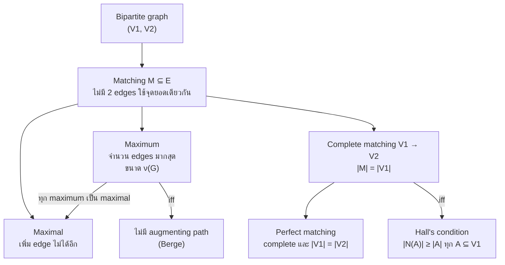
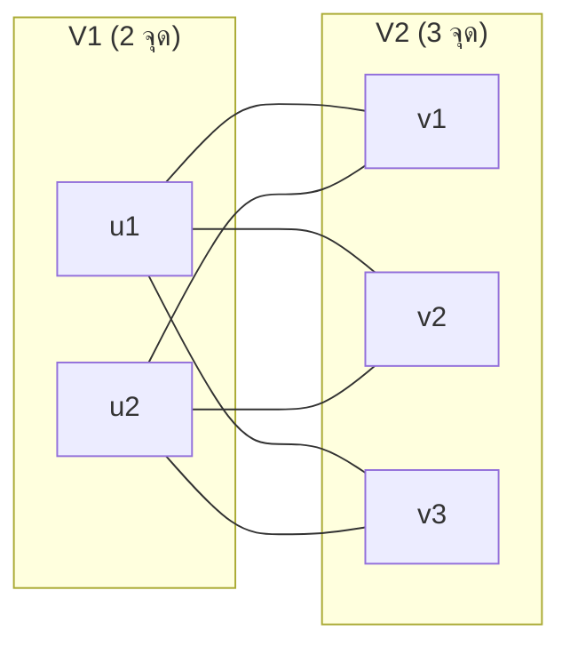
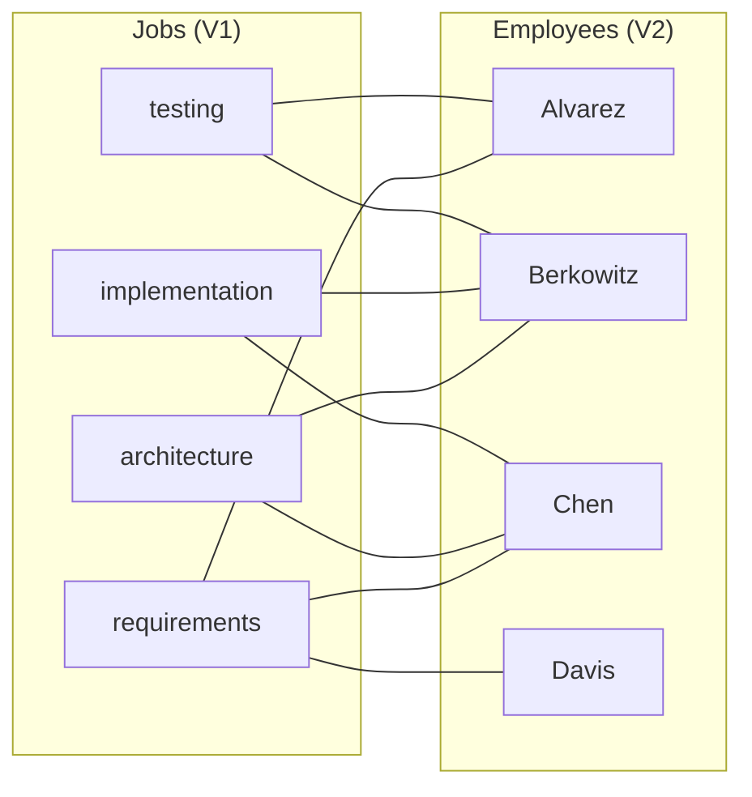
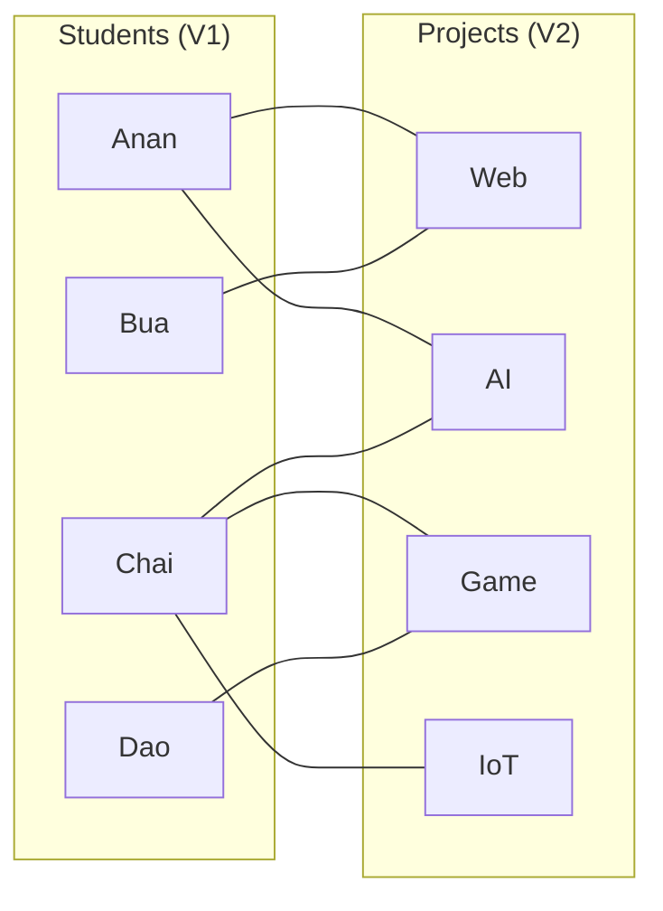
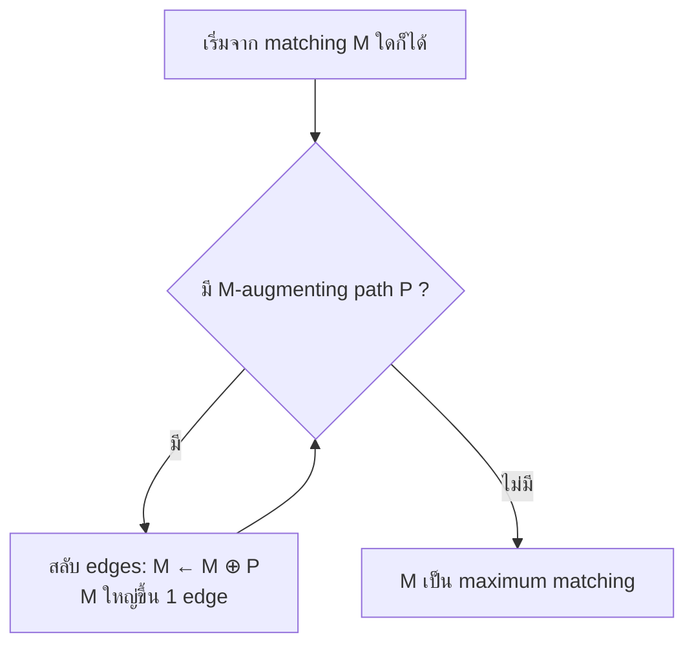
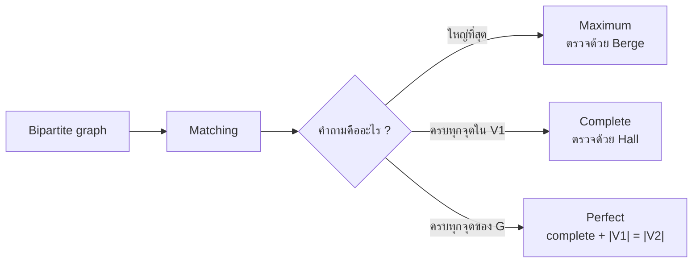

# Discrete Mathematics - Week12: Bipartite Graphs and Matchings

> **วิชา:** Discrete Mathematics | **ผู้สอน:** Dr. Sirasit Lochanachit
> **Source:** `Resources/Books/Discrete Mathematics/DM_Week12.pdf` สไลด์ p.10-26 (ทั้งไฟล์ 51 slides, หัวสไลด์ "Week 13: Graphs Part 2")
> **Reference:** `Resources/References/Matchings in Bipartite Graphs Interactive Notes.md` (Web Clipping, https://noswolf.github.io/DM_IT/Graphs/Matchings.html)
> **ป้ายอ้างอิง:** `[p.N]` = เลขสไลด์ใน PDF, `[R1]` = Matchings reference ข้างบน, blockquote ที่ขึ้นต้น 💡 = เนื้อหาที่ผู้เขียนเพิ่มเอง
> **แบบฝึกหัด:** [[HW-Discrete-Math-04]] Section A-C

---

## Part 1: Macro Architecture & Overview

**Bipartite graph** แบ่งจุดยอดเป็นสองเซต V₁ กับ V₂ โดยทุก edge ข้ามระหว่างสองเซต [p.10] จึงใช้ model โจทย์ที่ต้องจับคู่สมาชิกของเซตหนึ่งกับอีกเซตหนึ่ง เช่น งานกับพนักงาน นักศึกษากับโปรเจกต์ วิชากับผู้ช่วยสอน [p.17][R1] คำถามหลักคือจับคู่ได้พร้อมกันกี่คู่ ถ้าไม่มีใครถูกใช้ซ้ำ [R1] สไลด์ใช้ตัวอย่างมอบหมายงาน (job assignment) และ Marriages on an Island ส่วน **Hall's Marriage Theorem** [p.26] บอกเงื่อนไขที่ทำให้จับคู่ครบทุกจุดใน V₁ ได้ และ [R1] เพิ่มเรื่อง augmenting path กับ Berge's theorem

> 💡 แผนภาพนี้เป็นการจัดกลุ่มของผู้เขียนจากนิยามใน [p.20-22, 26] และ [R1] ไม่ใช่รูปในสไลด์ `[Source: generated — not verified against original document]`

### ตารางเปรียบเทียบชนิดของ matching

| ชนิด | ความหมาย | วิธีตรวจเร็ว | ที่มา |
| :--- | :--- | :--- | :--- |
| Matching | เซตย่อยของ E ที่ไม่มี 2 edges incident กับจุดยอดเดียวกัน | ทุกจุดยอดถูกใช้ไม่เกิน 1 edge | [p.20][R1] |
| Maximal | เพิ่ม edge ใดของ G เข้าไปอีกไม่ได้ | ทุก edge ที่เหลือแตะจุดที่ matched แล้ว | [R1] |
| Maximum | มีจำนวน edges มากที่สุด ขนาดเรียก matching number ν(G) | ไม่มี augmenting path (Berge) | [p.21][R1] |
| Complete (V₁ → V₂) | ทุกจุดใน V₁ เป็น endpoint ของ edge ใน M หรือ \|M\| = \|V₁\| | มีก็ต่อเมื่อ Hall's condition เป็นจริง | [p.22, 26][R1] |
| Perfect | ทุกจุดยอดของ G ถูก match | complete และ \|V₁\| = \|V₂\| | [R1] |

> 💡 ใน bipartite graph แต่ละ edge ใน matching ใช้จุดใน V₁ หนึ่งจุด ดังนั้นทุก matching มีขนาดไม่เกิน |V₁| complete matching ที่ได้ขนาด |V₁| จึงเป็น maximum matching ด้วยเสมอ แต่ maximum matching ไม่จำเป็นต้องเป็น complete `[Source: generated — not verified against original document]`

---

## Part 2: Module-by-Module Deep Dive

### 2.1 Bipartite graph และ complete bipartite graph [p.10, 15-16][R1]

> **Definition 6 (Bipartite):** simple graph เป็น bipartite ถ้าแบ่ง vertex set V เป็น 2 เซตย่อยที่ disjoint คือ V₁ กับ V₂ ได้ โดยทุก edge เชื่อมจุดจากเซตหนึ่งไปอีกเซตหนึ่ง และไม่มี edge เชื่อมจุด 2 จุดใน V₁ หรือ 2 จุดใน V₂ [p.10]

* คู่ (V₁, V₂) เรียกว่า **bipartition** ของ V [R1]
* ใน model การจับคู่ edge หมายถึง "คู่นี้ยอมรับได้" [R1]
* สไลด์ยกตัวอย่างกราฟ C₆ และรูป bipartite ที่มี V₁ = {v₁, v₃, v₅}, V₂ = {v₂, v₄, v₆} [p.10]

> **Definition 7 (Complete bipartite Km,n):** bipartite graph ที่ V₁ มี m จุด V₂ มี n จุด และมี edge ระหว่างทุกคู่ของจุดที่อยู่คนละเซต [p.15]

_ต้นฉบับ: รูป K2,3, K3,3, K3,5, K2,6 [p.16] (แผนภาพข้างบนวาด K2,3 ใหม่)_

Example 5-6 และ Exercise 5-6 ในสไลด์ [p.11-14] ถามว่ากราฟที่เห็น (K₃, C₅ และกราฟ 7 กับ 6 จุด) เป็น bipartite หรือไม่ สไลด์ไม่มีเฉลย วิธีทดสอบ (2-Coloring, odd cycle) อยู่ใน [[Week11 - Graphs, Graph Terminology and Representing Graphs]] และเฉลยอยู่ใน [[HW-Discrete-Math-04]] Section A

---

### 2.2 Job assignment: ตัวอย่างหลักของสไลด์ [p.17-19, 23-24]

> สไลด์ตั้งโจทย์: มีพนักงาน m คน และงาน n อย่าง (m ≥ n) พนักงานแต่ละคนฝึกมาให้ทำงานได้ 1 งานขึ้นไป **Task:** มอบหมายพนักงานให้ทุกงาน โดยไม่มีพนักงานคนใดได้มากกว่า 1 งาน [p.17]

สไลด์ระบุว่าการหาการมอบหมายงาน หรือจัดทีมเข้ากับบทบาท มองเป็นการหา matching ใน graph model ได้ [p.20] โจทย์ที่ p.23-24 ขอให้หา complete matching และ maximum matching **จากเซตของงานไปเซตของพนักงาน** ดังนั้น V₁ = งาน และ V₂ = พนักงาน

**กราฟชุดที่ 1** (Alvarez, Berkowitz, Chen, Davis) อ่านเส้นจากรูป [p.18, 23]:

| พนักงาน | งานที่ทำได้ (edge ในรูป) |
| :--- | :--- |
| Alvarez | requirements, testing |
| Berkowitz | architecture, implementation, testing |
| Chen | requirements, architecture, implementation |
| Davis | requirements |

_ต้นฉบับ: รูปกราฟ [p.18, 23]_

เส้นสีฟ้าในรูปของสไลด์คือ Alvarez–testing, Berkowitz–implementation, Chen–architecture, Davis–requirements [p.18, 23] สีทั้งสี่เส้นไม่ใช้จุดยอดซ้ำกัน จึงเป็น matching ขนาด 4 ที่ครอบคลุมทั้ง 4 งานและทั้ง 4 พนักงาน สไลด์ไม่ได้เขียนข้อสรุปนี้เป็นข้อความ ผู้เขียนอ่านจากสีเส้น `[Source: generated — not verified against original document]`

**กราฟชุดที่ 2** (Washington, Xuan, Ybarra, Ziegler) อ่านเส้นจากรูป [p.19, 24]:

| พนักงาน | งานที่ทำได้ (edge ในรูป) |
| :--- | :--- |
| Washington | architecture |
| Xuan | requirements, implementation, testing |
| Ybarra | architecture |
| Ziegler | requirements, architecture, testing |

สไลด์ถามโจทย์เดียวกัน (p.24) โดยไม่ใส่เส้นสีและไม่เฉลย

> 💡 ใช้ Hall's condition ตรวจ: ให้ A = {requirements, implementation, testing} ⊆ V₁ จะได้ N(A) = {Xuan, Ziegler} ขนาด 2 น้อยกว่า |A| = 3 จึงไม่มี complete matching จากงานไปพนักงาน matching ที่ใหญ่ที่สุดมี 3 edges เช่น implementation–Xuan, requirements–Ziegler, architecture–Washington (งาน testing ไม่มีพนักงานเหลือ เพราะ Xuan กับ Ziegler ถูกใช้แล้ว) `[Source: generated — not verified against original document]`

---

### 2.3 Definitions 8-10 และคำเพิ่มจาก [R1] [p.20-22][R1]

> **Definition 8 (Matching):** matching M ใน simple graph G = (V, E) คือเซตย่อยของ E ที่ไม่มี 2 edges ใดๆ incident กับจุดยอดเดียวกัน [p.20]

> **Definition 9 (Maximum matching):** matching ที่มีจำนวน edges มากที่สุด ในโจทย์งาน คือการมอบหมายให้ได้งานจำนวนมากที่สุด [p.21]

> **Definition 10 (Complete matching จาก V₁ ไป V₂):** matching M ที่ทุกจุดใน V₁ เป็น endpoint ของ edge ใน M หรือ |M| = |V₁| ในโจทย์งาน คือมอบหมายพนักงานให้ครบทุกงาน [p.22]

คำศัพท์เสริมจาก [R1]:

* จุดที่เป็น endpoint ของ edge ใน M เรียกว่า **matched** จุดที่ไม่ใช่เรียก **unmatched** หรือ free
* เซตว่างเป็น matching เสมอ และ edge เดียวก็เป็น matching
* **Maximal** ต่างจาก **maximum**: maximal คือเพิ่ม edge ไม่ได้แล้ว ส่วน maximum คือไม่มี matching ใดใน G ใหญ่กว่า การเลือก edge แบบ greedy ทีละเส้นรับประกันได้แค่ maximal
* complete matching จาก V₁ ไป V₂ มีได้เฉพาะเมื่อ |V₁| ≤ |V₂| เพราะ edge ทั้ง |V₁| เส้นต้องใช้ปลายทางใน V₂ ไม่ซ้ำกัน
* **Perfect matching** คือ match ทุกจุดยอดของ G

**ตัวอย่างจาก [R1]** (นักศึกษา Anan, Bua, Chai, Dao กับโปรเจกต์ Web, AI, Game, IoT): edge ที่ให้คือ Anan–Web, Anan–AI, Bua–Web, Chai–AI, Chai–Game, Chai–IoT, Dao–Game

_ที่มา: รูป fMaximal / fMaximum ใน [R1]_

* Maximal ขนาด 2: [R1] ระบุว่า edge อื่นทุกเส้นแตะ Anan, Chai, Web หรือ Game ซึ่งตรงกับ M = {Anan–Web, Chai–Game}
* Maximum ขนาด 4 = ν(G): [R1] ระบุว่า |M| = 4 (ไม่ได้ระบุ edge) ในกราฟนี้มีชุดที่ใช้ได้คือ Anan–AI, Bua–Web, Chai–IoT, Dao–Game (ผู้เขียนตรวจเอง `[Source: generated — not verified against original document]`)

**Marriages on an Island** [p.25]: มีผู้ชาย m คน (V₁) และผู้หญิง n คน (V₂) แต่ละคนมีรายชื่อเพศตรงข้ามที่ยอมรับเป็นคู่ครอง
* maximum matching = เซตคู่สมรสที่ใหญ่ที่สุดที่เป็นไปได้
* complete matching ของ V₁ = ผู้ชายทุกคนได้แต่งงาน แต่ผู้หญิงอาจไม่ครบทุกคน

---

### 2.4 Hall's Marriage Theorem [p.26][R1]

ให้ A ⊆ V₁ เซต **N(A)** คือเซตของจุดใน V₂ ที่ adjacent กับจุดใน A อย่างน้อยหนึ่งจุด [R1]

> **Theorem 4 (Hall):** bipartite graph G = (V, E) ที่มี bipartition (V₁, V₂) มี complete matching จาก V₁ ไป V₂ ก็ต่อเมื่อ $|N(A)| \ge |A|$ สำหรับทุกเซตย่อย A ของ V₁ [p.26]

[R1] ลงรายละเอียดเพิ่ม:

* **ความหมายจากโจทย์ต้นกำเนิด:** V₁ คือกลุ่มคน V₂ คือคู่ที่เป็นไปได้ edge คือยินดีแต่งงาน ทุกคนใน V₁ แต่งงานได้ ก็ต่อเมื่อทุกกลุ่ม k คนจาก V₁ มีคู่ที่ยอมรับรวมกันอย่างน้อย k คน
* **ทำไมเงื่อนไขจำเป็น (⇒):** ถ้า M complete จุดใน A ถูกจับคู่กับจุดต่างกัน |A| จุด และจุดเหล่านั้นอยู่ใน N(A) ทั้งหมด จึง |N(A)| ≥ |A|
* **แนวพิสูจน์ว่าเงื่อนไขพอ (⇐):** เอา maximum matching M แล้วสมมติว่ามี u ∈ V₁ ที่ unmatched ให้ A คือจุดใน V₁ ที่ไปถึงได้จาก u ด้วย alternating path เพราะ M ไม่มี augmenting path ทุกจุดใน N(A) ถูกจับคู่กับจุดใน A ที่ไม่ใช่ u จึงได้ |N(A)| = |A| − 1 ซึ่งขัดกับ Hall's condition

**ตัวอย่างจาก [R1]:** นักศึกษา Ploy, Kai, Nok, Ton, Fah กับห้อง 101-105 เส้นที่ให้: Ploy–101, Ploy–102, Kai–102, Kai–103, Nok–101, Nok–103, Ton–101, Ton–102, Ton–103, Fah–103, Fah–104, Fah–105 เซต A = {Ploy, Kai, Nok, Ton} มี N(A) = {101, 102, 103} นักศึกษา 4 คน ห้อง 3 ห้อง จึงไม่มี complete matching ทุกเซตย่อยที่เล็กกว่าผ่านเงื่อนไข ดังนั้นต้องตรวจทุกเซตย่อย [R1]

---

### 2.5 Augmenting path และ Berge's theorem [R1]

* **Alternating path:** path ที่ edge สลับกันระหว่างไม่อยู่ใน M กับอยู่ใน M
* **Augmenting path:** alternating path ที่เริ่มและจบที่จุด unmatched
* augmenting path P ที่มี 2k+1 edges มี k+1 edges นอก M และ k edges ใน M การสลับให้ symmetric difference $M \oplus P = (M - P) \cup (P - M)$ ซึ่งยังเป็น matching และใหญ่ขึ้น 1 edge

> **Theorem (Berge, 1957):** matching M เป็น maximum ก็ต่อเมื่อไม่มี M-augmenting path [R1]

_ที่มา: ข้อความ "find an augmenting path, swap, repeat" ใน [R1]_

ตัวอย่างใน [R1]: augmenting path Bua, Web, Anan, AI, Chai, IoT (เรียงตามลำดับจุดยอดบน path) จาก greedy matching เมื่อสลับ edges แล้วนักศึกษาครบทั้ง 4 คน (ผู้เขียนอนุมานว่า edge ที่อยู่ใน M บน path นี้คือ Web–Anan และ AI–Chai จากการสลับ edge นอก M กับใน M ตามนิยาม alternating path `[Source: generated — not verified against original document]`)

---

## Part 3: Quick Reference & Exam Cheat Sheet

### Checklist สรุปหัวใจสำคัญก่อนสอบ
* [ ] **Bipartite:** แบ่ง V เป็น V₁, V₂ ที่ disjoint และทุก edge ข้ามเซต [p.10]
* [ ] **Km,n:** มี edge ระหว่างทุกคู่ข้ามเซต ได้ m·n edges [p.15]
* [ ] **Matching:** เซตของ edges ที่ไม่ใช้จุดยอดร่วมกัน [p.20]
* [ ] **Maximum:** จำนวน edges มากที่สุด ขนาด ν(G) [p.21][R1]
* [ ] **Maximal:** เพิ่ม edge ไม่ได้แล้ว แต่อาจเล็กกว่า maximum [R1]
* [ ] **Complete (V₁ → V₂):** \|M\| = \|V₁\| ต้องมี \|V₁\| ≤ \|V₂\| [p.22][R1]
* [ ] **Perfect:** complete และ \|V₁\| = \|V₂\| [R1]
* [ ] **Hall:** complete matching ⇔ \|N(A)\| ≥ \|A\| ทุก A ⊆ V₁ [p.26]
* [ ] **Berge:** maximum ⇔ ไม่มี augmenting path [R1]

### สรุปสูตร / Notation ที่สำคัญ

| Notation | ความหมาย |
| :--- | :--- |
| $M \subseteq E$ | matching: ไม่มี 2 edges ใช้จุดยอดเดียวกัน |
| $\nu(G)$ | matching number: ขนาดของ maximum matching [R1] |
| $\lvert M \rvert = \lvert V_1 \rvert$ | complete matching จาก V₁ ไป V₂ |
| $N(A)$ | เซตจุดใน V₂ ที่ adjacent กับอย่างน้อย 1 จุดใน A |
| $\lvert N(A) \rvert \ge \lvert A \rvert,\ \forall A \subseteq V_1$ | Hall's condition |
| $M \oplus P$ | symmetric difference ใช้สลับ augmenting path |

### Concept Map

> 💡 Concept map นี้เป็นการสรุปของผู้เขียน `[Source: generated — not verified against original document]`

---

## ⚠️ Common Pitfalls & Exam Traps

* **คิดว่า maximal คือ maximum:** matching ที่เพิ่ม edge ไม่ได้อีกยังอาจเล็กกว่า maximum ได้มาก (ตัวอย่าง [R1]: maximal ขนาด 2 แต่ maximum ขนาด 4) การเลือก edge แบบ greedy ได้แค่ maximal
* **ตรวจ Hall's condition แค่บาง A:** ต้องตรวจทุก A ⊆ V₁ ตัวอย่างห้อง 101-105 ใน [R1] ที่เซตเล็กกว่าผ่านหมดแต่ A ขนาด 4 ไม่ผ่าน
* **สับสนทิศของ complete matching:** "complete จาก V₁ ไป V₂" ครอบคลุมจุดใน V₁ เท่านั้น จึงต้องมี |V₁| ≤ |V₂| และ V₂ อาจเหลือจุดที่ไม่ถูก match (ใน Marriages on an Island ผู้หญิงอาจไม่ครบทุกคน [p.25])
* **คิดว่า complete เท่ากับ perfect:** perfect ต้อง match ทุกจุดของ G หรือ |V₁| = |V₂| ด้วย [R1]
* **สลับ V₁ กับ V₂ ในโจทย์งาน:** สไลด์ p.22-24 ถาม complete matching "from the set of jobs to the set of employees" ดังนั้น V₁ = งาน ถ้าสลับจะได้เงื่อนไข Hall ผิดข้าง
* **เดา edge จากสีในรูป:** รูปใน p.18/23 มีเส้นสีฟ้า 4 เส้นที่เป็น matching 1 ชุด เส้นสีดำก็เป็น edge ของกราฟเช่นกัน ต้องนับทุกเส้น

**ข้อสังเกตเกี่ยวกับต้นฉบับ (ไม่แก้ในเนื้อหา):**
* หัวสไลด์เขียน "Week 13" แต่ชื่อไฟล์เป็น Week12
* p.18 กับ p.23 เป็นรูปเดียวกัน (หัวข้อ Task ต่างกัน) และ p.19 กับ p.24 ก็เช่นกัน
* p.19/24 ไม่มีเส้นสีฟ้าและไม่มีเฉลย คำตอบในหัวข้อ 2.2 ของชุดที่ 2 เป็นของผู้เขียน
* p.11-14 (Example 5-6, Exercise 5-6) ไม่มีเฉลยในสไลด์
* เลขนิยามในสไลด์ซ้ำและเริ่มใหม่: Definition 6 ใช้ใน p.10 และ p.43, Definition 7 ใน p.15 และ p.44, Definition 8 ใน p.20 และ p.47 (กลุ่มหลังเป็นเรื่อง connectivity ดู [[Week12 - Cut Vertices, Edge Cuts and Connectivity]]) โน้ตนี้ใช้เลขตามสไลด์หน้าที่อ้าง
* p.15 มี bullet "An edge between two vertices where one vertex is in the first subset and the other vertex is in the second subset." ซึ่งซ้ำความหมายกับ Definition 7 จึงไม่แยกเขียน

---

## เอกสารเชื่อมโยง (Wiki-Style Backlinks)
* **วิชาและหัวข้อที่เกี่ยวข้อง:**
  * [[Week11 - Graphs, Graph Terminology and Representing Graphs]] (นิยาม Bipartite, Km,n และ 2-Coloring ที่ใช้ในบทนี้)
  * [[Week12 - Paths, Circuits and Connectedness]] (หัวข้อถัดไปของสัปดาห์เดียวกัน: path ที่ใช้ในนิยาม alternating/augmenting path)
  * [[Week12 - Cut Vertices, Edge Cuts and Connectivity]] (ตัววัด connectivity ของกราฟ)
  * [[HW-Discrete-Math-04]] (แบบฝึกหัดพร้อมเฉลย Section A-C)

* **แหล่งข้อมูล:**
  * Source: `Resources/Books/Discrete Mathematics/DM_Week12.pdf` (51 slides, Dr. Sirasit Lochanachit)
  * Source: `Resources/References/Matchings in Bipartite Graphs Interactive Notes.md` (Web Clipping, https://noswolf.github.io/DM_IT/Graphs/Matchings.html)
