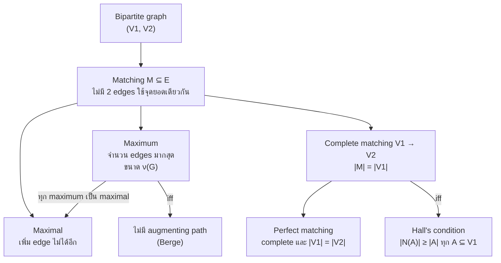
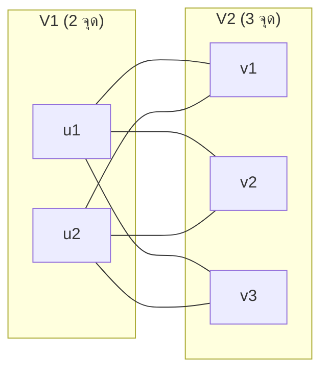
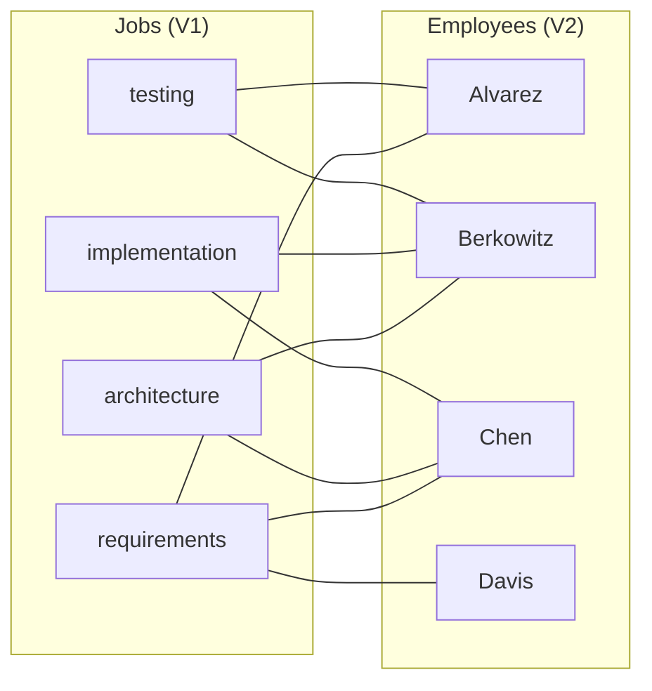
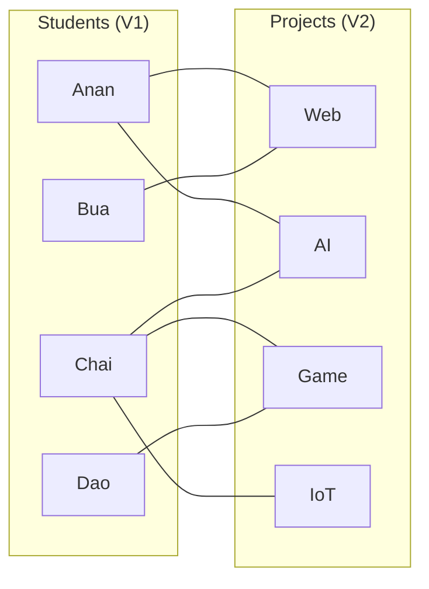
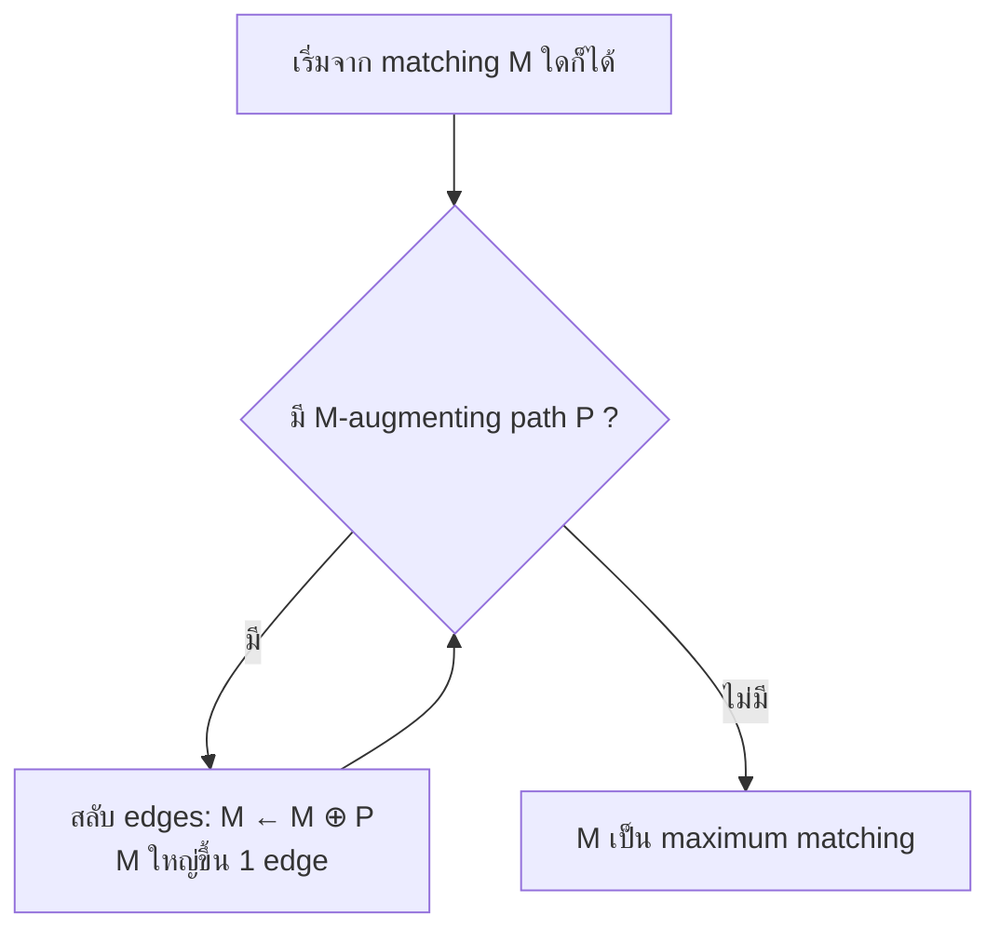
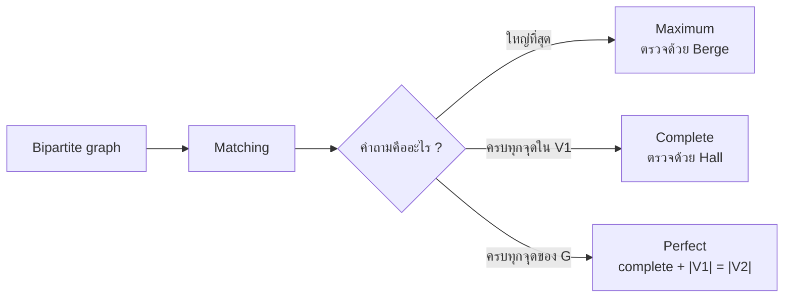

# Discrete Mathematics - Week12: Bipartite Graphs and Matchings

> **วิชา:** Discrete Mathematics | **ผู้สอน:** Dr. Sirasit Lochanachit
> **Source:** `Resources/Books/Discrete Mathematics/DM_Week12.pdf` สไลด์ p.10-26 (ทั้งไฟล์ 51 slides, หัวสไลด์ "Week 13: Graphs Part 2")
> **Reference:** `Resources/References/Matchings in Bipartite Graphs Interactive Notes.md` (Web Clipping, https://noswolf.github.io/DM_IT/Graphs/Matchings.html)
> **ป้ายอ้างอิง:** `[p.N]` = เลขสไลด์ใน PDF, `[R1]` = Matchings reference ข้างบน, blockquote ที่ขึ้นต้น 💡 = เนื้อหาที่ผู้เขียนเพิ่มเอง
> **แบบฝึกหัด:** [[HW-Discrete-Math-04]] Section A-C

---

## Part 1: Macro Architecture & Overview

**Bipartite graph** แบ่งจุดยอดเป็นสองเซต V₁ กับ V₂ โดยทุก edge ข้ามระหว่างสองเซต [p.10] จึงใช้ model โจทย์ที่ต้องจับคู่สมาชิกของเซตหนึ่งกับอีกเซตหนึ่ง เช่น งานกับพนักงาน นักศึกษากับโปรเจกต์ วิชากับผู้ช่วยสอน [p.17][R1] คำถามหลักคือจับคู่ได้พร้อมกันกี่คู่ ถ้าไม่มีใครถูกใช้ซ้ำ [R1] สไลด์ใช้ตัวอย่างมอบหมายงาน (job assignment) และ Marriages on an Island ส่วน **Hall's Marriage Theorem** [p.26] บอกเงื่อนไขที่ทำให้จับคู่ครบทุกจุดใน V₁ ได้ และ [R1] เพิ่มเรื่อง augmenting path กับ Berge's theorem

> 💡 แผนภาพนี้เป็นการจัดกลุ่มของผู้เขียนจากนิยามใน [p.20-22, 26] และ [R1] ไม่ใช่รูปในสไลด์ `[Source: generated — not verified against original document]`

### ตารางเปรียบเทียบชนิดของ matching

| ชนิด | ความหมาย | วิธีตรวจเร็ว | ที่มา |
| :--- | :--- | :--- | :--- |
| Matching | เซตย่อยของ E ที่ไม่มี 2 edges incident กับจุดยอดเดียวกัน | ทุกจุดยอดถูกใช้ไม่เกิน 1 edge | [p.20][R1] |
| Maximal | เพิ่ม edge ใดของ G เข้าไปอีกไม่ได้ | ทุก edge ที่เหลือแตะจุดที่ matched แล้ว | [R1] |
| Maximum | มีจำนวน edges มากที่สุด ขนาดเรียก matching number ν(G) | ไม่มี augmenting path (Berge) | [p.21][R1] |
| Complete (V₁ → V₂) | ทุกจุดใน V₁ เป็น endpoint ของ edge ใน M หรือ \|M\| = \|V₁\| | มีก็ต่อเมื่อ Hall's condition เป็นจริง | [p.22, 26][R1] |
| Perfect | ทุกจุดยอดของ G ถูก match | complete และ \|V₁\| = \|V₂\| | [R1] |

> 💡 ใน bipartite graph แต่ละ edge ใน matching ใช้จุดใน V₁ หนึ่งจุด ดังนั้นทุก matching มีขนาดไม่เกิน |V₁| complete matching ที่ได้ขนาด |V₁| จึงเป็น maximum matching ด้วยเสมอ แต่ maximum matching ไม่จำเป็นต้องเป็น complete `[Source: generated — not verified against original document]`

---

## Part 2: Module-by-Module Deep Dive

### 2.1 Bipartite graph และ complete bipartite graph [p.10, 15-16][R1]

#### Bipartite graph

> 💡 **Intuition:** Bipartite = "แบ่งเป็นสองส่วน" — คิดเป็นคน 2 กลุ่มที่ต่างกัน (เช่น นักเรียนกับห้อง) ทุกเส้นที่เชื่อม (edge) ต้องข้ามระหว่างกลุ่ม ไม่มีเส้นในกลุ่มเดียวกัน คือ "ไม่มีคนในกลุ่มเดียวกันเชื่อมกัน" — เหมาะกับปัญหาที่ต้องจับคู่สมาชิกของสองฝั่ง เช่น งานกับพนักงาน
> [Source: generated — not verified against original document]

> **Definition 6 (Bipartite):** simple graph เป็น bipartite ถ้าแบ่ง vertex set V เป็น 2 เซตย่อยที่ disjoint คือ V₁ กับ V₂ ได้ โดยทุก edge เชื่อมจุดจากเซตหนึ่งไปอีกเซตหนึ่ง และไม่มี edge เชื่อมจุด 2 จุดใน V₁ หรือ 2 จุดใน V₂ [p.10]

**🧭 ทำความเข้าใจ** _[Source: generated — not verified against original document]_

**แตกวลีสำคัญ:**
- "แบ่ง V เป็น 2 เซตย่อยที่ disjoint V₁ กับ V₂" → V₁ ∩ V₂ = ∅ และ V₁ ∪ V₂ = V
- "ทุก edge เชื่อมจากเซตหนึ่งไปอีกเซตหนึ่ง" → ไม่มี edge ระหว่างจุดสองจุดในเซตเดียว

**ตัวอย่าง:**
- ✅ C₆ (วงจร 6 จุด 1-2-3-4-5-6-1) ที่แบ่ง V₁ = {1, 3, 5}, V₂ = {2, 4, 6} → ทุก edge ข้าม → bipartite
- ❌ K₃ (สามเหลี่ยม) → แบ่ง 3 จุดเป็น 2 เซตเมื่อไร จะมี 2 จุดอยู่เซตเดียวกัน และ 2 จุดนั้น adjacent กันเสมอ → ไม่ bipartite
- ❌ C₅ (วงจร 5 จุด) → ระบายสีสลับรอบวงที่มี 5 จุด (คี่) แล้วจุดแรกกับจุดสุดท้ายได้สีเดียวกันแต่ adjacent กัน → ไม่ bipartite
- **ต่างกันตรง:** C₆ เป็น cycle ความยาวคู่ → bipartite, C₃ (= K₃) และ C₅ เป็น cycle ความยาวคี่ → ไม่ bipartite

**อย่าสับสน:** Bipartite graph ไม่จำเป็นต้อง connected และไม่จำเป็นต้องมี edge ครบทุกคู่ข้ามเซต — กรณีที่มี edge ครบทุกคู่ข้ามเซตคือ complete bipartite Km,n

**เช็คความเข้าใจ:** ถ้าได้กราฟ 7 จุด (แบบใน Exercise ของสไลด์) จะตรวจอย่างไรว่าเป็น bipartite หรือไม่

เฉลย

1. เลือกจุดเริ่ม 1 จุด ระบายสี A
2. ระบายเพื่อนบ้านทุกจุดของมันเป็นสี B แล้วเพื่อนบ้านของจุดสี B เป็นสี A ไล่ไปเรื่อย ๆ (ถ้ากราฟไม่ connected ให้ทำซ้ำทีละ component)
3. ถ้าเจอ edge ที่ปลายทั้งสองได้สีเดียวกัน → ไม่ bipartite (แปลว่ามี odd cycle)
4. ถ้าระบายครบโดยไม่เจอ edge แบบนั้น → bipartite โดย V₁ = จุดสี A, V₂ = จุดสี B

* คู่ (V₁, V₂) เรียกว่า **bipartition** ของ V [R1]
* ใน model การจับคู่ edge หมายถึง "คู่นี้ยอมรับได้" [R1]
* สไลด์ยกตัวอย่างกราฟ C₆ และรูป bipartite ที่มี V₁ = {v₁, v₃, v₅}, V₂ = {v₂, v₄, v₆} [p.10]

> **Definition 7 (Complete bipartite Km,n):** bipartite graph ที่ V₁ มี m จุด V₂ มี n จุด และมี edge ระหว่างทุกคู่ของจุดที่อยู่คนละเซต [p.15]

_ต้นฉบับ: รูป K2,3, K3,3, K3,5, K2,6 [p.16] (แผนภาพข้างบนวาด K2,3 ใหม่)_

Example 5-6 และ Exercise 5-6 ในสไลด์ [p.11-14] ถามว่ากราฟที่เห็น (K₃, C₅ และกราฟ 7 กับ 6 จุด) เป็น bipartite หรือไม่ สไลด์ไม่มีเฉลย วิธีทดสอบ (2-Coloring, odd cycle) อยู่ใน [[Week11 - Graphs, Graph Terminology and Representing Graphs]] และเฉลยอยู่ใน [[HW-Discrete-Math-04]] Section A

---

### 2.2 Job assignment: ตัวอย่างหลักของสไลด์ [p.17-19, 23-24]

> สไลด์ตั้งโจทย์: มีพนักงาน m คน และงาน n อย่าง (m ≥ n) พนักงานแต่ละคนฝึกมาให้ทำงานได้ 1 งานขึ้นไป **Task:** มอบหมายพนักงานให้ทุกงาน โดยไม่มีพนักงานคนใดได้มากกว่า 1 งาน [p.17]

สไลด์ระบุว่าการหาการมอบหมายงาน หรือจัดทีมเข้ากับบทบาท มองเป็นการหา matching ใน graph model ได้ [p.20] โจทย์ที่ p.23-24 ขอให้หา complete matching และ maximum matching **จากเซตของงานไปเซตของพนักงาน** ดังนั้น V₁ = งาน และ V₂ = พนักงาน

**กราฟชุดที่ 1** (Alvarez, Berkowitz, Chen, Davis) อ่านเส้นจากรูป [p.18, 23]:

| พนักงาน | งานที่ทำได้ (edge ในรูป) |
| :--- | :--- |
| Alvarez | requirements, testing |
| Berkowitz | architecture, implementation, testing |
| Chen | requirements, architecture, implementation |
| Davis | requirements |

_ต้นฉบับ: รูปกราฟ [p.18, 23]_

เส้นสีฟ้าในรูปของสไลด์คือ Alvarez–testing, Berkowitz–implementation, Chen–architecture, Davis–requirements [p.18, 23] สีทั้งสี่เส้นไม่ใช้จุดยอดซ้ำกัน จึงเป็น matching ขนาด 4 ที่ครอบคลุมทั้ง 4 งานและทั้ง 4 พนักงาน สไลด์ไม่ได้เขียนข้อสรุปนี้เป็นข้อความ ผู้เขียนอ่านจากสีเส้น `[Source: generated — not verified against original document]`

**กราฟชุดที่ 2** (Washington, Xuan, Ybarra, Ziegler) อ่านเส้นจากรูป [p.19, 24]:

| พนักงาน | งานที่ทำได้ (edge ในรูป) |
| :--- | :--- |
| Washington | architecture |
| Xuan | requirements, implementation, testing |
| Ybarra | architecture |
| Ziegler | requirements, architecture, testing |

สไลด์ถามโจทย์เดียวกัน (p.24) โดยไม่ใส่เส้นสีและไม่เฉลย

> 💡 ใช้ Hall's condition ตรวจ: ให้ A = {requirements, implementation, testing} ⊆ V₁ จะได้ N(A) = {Xuan, Ziegler} ขนาด 2 น้อยกว่า |A| = 3 จึงไม่มี complete matching จากงานไปพนักงาน matching ที่ใหญ่ที่สุดมี 3 edges เช่น implementation–Xuan, requirements–Ziegler, architecture–Washington (งาน testing ไม่มีพนักงานเหลือ เพราะ Xuan กับ Ziegler ถูกใช้แล้ว) `[Source: generated — not verified against original document]`

---

### 2.3 Definitions 8-10 และคำเพิ่มจาก [R1] [p.20-22][R1]

#### Matching

> 💡 **Intuition:** Matching = "การจับคู่" — คิดเป็นการจับคู่แต่งงาน (แบบตัวอย่าง Marriages on an Island ในสไลด์ [p.25]) ที่ไม่มีใครแต่งงานกับ 2 คนพร้อมกัน ดังนั้นแต่ละคน (จุดยอด) เป็น endpoint ของ edge ใน M ได้ไม่เกิน 1 เส้น
> [Source: generated — not verified against original document]

> **Definition 8 (Matching):** matching M ใน simple graph G = (V, E) คือเซตย่อยของ E ที่ไม่มี 2 edges ใดๆ incident กับจุดยอดเดียวกัน [p.20]

**🧭 ทำความเข้าใจ** _[Source: generated — not verified against original document]_

**แตกวลีสำคัญ:**
- "เซตย่อยของ E" → M ⊆ E
- "ไม่มี 2 edges incident กับจุดยอดเดียวกัน" → จุดยอดแต่ละจุดเป็น endpoint ของ edge ใน M ไม่เกิน 1 เส้น

**ตัวอย่าง:**
- ✅ M = {a–b, c–d} ในกราฟ 4 จุดที่มี edge a–b และ c–d → ไม่มี edge ใช้จุดเดียวกัน → matching
- ✅ M = ∅ (เซตว่าง) → matching (ตามนิยาม)
- ✅ M = {a–b} → edge เดียวก็เป็น matching
- ❌ M = {a–b, b–c} ในกราฟ a–b–c → ทั้งสอง edge ใช้ b → ไม่เป็น matching
- **ต่างกันตรง:** Matching คือเซตของ edges (ไม่ใช่ vertices) ที่ไม่ใช้จุดซ้ำ

**อย่าสับสน:** Matching ไม่ต้องครอบคลุมทุกจุดยอด — บางจุดอาจไม่เป็น endpoint ของ edge ใด ๆ เลย (unmatched)

**เช็คความเข้าใจ:** ในกราฟ 4 จุด a,b,c,d ที่มี edges a–b, b–c, c–d, d–a (วงจร) matching ขนาด 2 คืออะไร

เฉลย

ต้องเลือก 2 edges ที่ไม่ใช้จุดเดียวกัน (edge ที่อยู่ตรงข้ามกันในวง) → M = {a–b, c–d} หรือ M = {b–c, d–a} ทั้งสองชุดใช้ได้ เพราะแต่ละจุดเป็น endpoint ไม่เกิน 1 edge

#### Maximum matching

> 💡 **Intuition:** Maximum matching = "จับคู่ให้มากที่สุด" — ในโจทย์งาน หมายถึง "มอบหมายงานให้ได้มากที่สุดเท่าที่ทำได้" คือไม่มี matching ใดในกราฟที่มี edge มากกว่า (ต่างจาก maximal ที่แค่เพิ่ม edge เข้าไปตรง ๆ ไม่ได้)
> [Source: generated — not verified against original document]

> **Definition 9 (Maximum matching):** matching ที่มีจำนวน edges มากที่สุด ในโจทย์งาน คือการมอบหมายให้ได้งานจำนวนมากที่สุด [p.21]

**🧭 ทำความเข้าใจ** _[Source: generated — not verified against original document]_

**แตกวลีสำคัญ:**
- "มีจำนวน edges มากที่สุด" → |M| ไม่น้อยกว่า matching ใด ๆ อื่นใน G

**ตัวอย่าง:**
- ✅ วงจร C₄ (a–b–c–d–a): M = {a–b, c–d} ขนาด 2 → maximum (4 จุด match ได้ไม่เกิน 2 edges)
- ✅ วงจร C₆ (1-2-3-4-5-6-1): M = {1–2, 3–4, 5–6} ขนาด 3 → maximum
- ❌ M = {a–b} ใน C₄ → ขนาด 1 เล็กกว่า 2 → ไม่ maximum (และยังไม่ maximal ด้วย เพราะเพิ่ม c–d ได้)
- **ต่างกันตรง:** Maximal matching = เพิ่ม edge ไม่ได้อีก (อาจเล็ก) vs Maximum = ไม่มี matching อื่นใหญ่กว่า

**อย่าสับสน:** Greedy (เลือก edge ทีละเส้นตามที่เห็น) รับประกันได้แค่ maximal ไม่รับประกัน maximum ต้องใช้วิธีที่ดีกว่า (เช่น หา augmenting path)

**เช็คความเข้าใจ:** ตัวอย่างใน [R1] (นักศึกษา 4 คน โปรเจกต์ 4 ตัว) มี maximal ขนาด 2 แต่ maximum ขนาด 4 ทำไมการเลือกแบบ greedy อาจได้แค่ 2

เฉลย

1. Greedy เลือก Anan–Web แล้ว Chai–Game
2. Bua มี edge เดียวคือ Bua–Web แต่ Web ถูกใช้แล้ว, Dao มี edge เดียวคือ Dao–Game แต่ Game ถูกใช้แล้ว → เพิ่ม edge ไม่ได้ → maximal ขนาด 2
3. แต่ matching {Anan–AI, Bua–Web, Chai–IoT, Dao–Game} มี 4 edges และไม่ใช้จุดซ้ำ → maximum คือ 4
4. ทางไปถึง 4: augmenting path Bua–Web–Anan–AI ทำให้ได้ {Bua–Web, Anan–AI, Chai–Game} (ขนาด 3) จากนั้น path Dao–Game–Chai–IoT เป็น augmenting path อีกเส้น (Dao, IoT ว่าง) → {Bua–Web, Anan–AI, Dao–Game, Chai–IoT} ขนาด 4

#### Complete matching จาก V₁ ไป V₂

> 💡 **Intuition:** Complete matching = "จับคู่ครบทุกคน" — ในโจทย์งาน: ทุกงาน (V₁) ได้พนักงาน (V₂) แต่พนักงานอาจเหลือบ้าง
> [Source: generated — not verified against original document]

> **Definition 10 (Complete matching จาก V₁ ไป V₂):** matching M ที่ทุกจุดใน V₁ เป็น endpoint ของ edge ใน M หรือ |M| = |V₁| ในโจทย์งาน คือมอบหมายพนักงานให้ครบทุกงาน [p.22]

**🧭 ทำความเข้าใจ** _[Source: generated — not verified against original document]_

**แตกวลีสำคัญ:**
- "ทุกจุดใน V₁ เป็น endpoint" → complete คือครอบคลุม V₁ เท่านั้น V₂ อาจเหลือจุดไม่ matched
- "|M| = |V₁|" → edge ใน matching เท่ากับจำนวนจุดใน V₁

**ตัวอย่าง:**
- ✅ V₁ = {a, b, c}, V₂ = {x, y, z, w} กับ edges a–x, b–y, c–z → M = {a–x, b–y, c–z} → |M| = 3 = |V₁| → complete จาก V₁ ไป V₂ (w ไม่ถูก match ก็ได้)
- ✅ ไม่ต้อง |V₁| = |V₂| → V₂ มีได้มากกว่า
- ❌ M = {a–x, b–y} ใน V₁ = {a, b, c} → |M| = 2 < |V₁| = 3 → ไม่ complete
- ❌ ถ้ามี edge b–x ด้วย แล้วเลือก {a–x, b–x, c–z} → x ใช้ 2 ครั้ง → ไม่ใช่ matching ตั้งแต่แรก
- **ต่างกันตรง:** Complete matching จาก V₁ ไป V₂ ⇒ |V₁| ≤ |V₂| เสมอ (ต้องมี endpoint พอ ใน V₂)

**อย่าสับสน:** Complete matching ≠ Perfect matching — complete ครอบคลุม V₁ เท่านั้น perfect ต้องครอบคลุมทั้งสองเซต (|V₁| = |V₂| และ |M| = |V₁|)

**เช็คความเข้าใจ:** ทำไมไม่มี complete matching จากเซตงาน 4 งาน (V₁) ไปเซตพนักงาน 3 คน (V₂) ไม่ว่ากราฟจะมี edge อย่างไร

เฉลย

Complete matching ต้องมี |M| = |V₁| = 4 edges และแต่ละ edge ต้องใช้ปลายใน V₂ ไม่ซ้ำกัน แต่ V₂ มีแค่ 3 จุด → edge ที่ 4 ต้องใช้ปลายใน V₂ ซ้ำ → ไม่เป็น matching ดังนั้นเมื่อ |V₁| > |V₂| จะไม่มี complete matching จาก V₁ ไป V₂

คำศัพท์เสริมจาก [R1]:

* จุดที่เป็น endpoint ของ edge ใน M เรียกว่า **matched** จุดที่ไม่ใช่เรียก **unmatched** หรือ free
* เซตว่างเป็น matching เสมอ และ edge เดียวก็เป็น matching
* **Maximal** ต่างจาก **maximum**: maximal คือเพิ่ม edge ไม่ได้แล้ว ส่วน maximum คือไม่มี matching ใดใน G ใหญ่กว่า การเลือก edge แบบ greedy ทีละเส้นรับประกันได้แค่ maximal
* complete matching จาก V₁ ไป V₂ มีได้เฉพาะเมื่อ |V₁| ≤ |V₂| เพราะ edge ทั้ง |V₁| เส้นต้องใช้ปลายทางใน V₂ ไม่ซ้ำกัน
* **Perfect matching** คือ match ทุกจุดยอดของ G

**ตัวอย่างจาก [R1]** (นักศึกษา Anan, Bua, Chai, Dao กับโปรเจกต์ Web, AI, Game, IoT): edge ที่ให้คือ Anan–Web, Anan–AI, Bua–Web, Chai–AI, Chai–Game, Chai–IoT, Dao–Game

_ที่มา: รูป fMaximal / fMaximum ใน [R1]_

* Maximal ขนาด 2: [R1] ระบุว่า edge อื่นทุกเส้นแตะ Anan, Chai, Web หรือ Game ซึ่งตรงกับ M = {Anan–Web, Chai–Game}
* Maximum ขนาด 4 = ν(G): [R1] ระบุว่า |M| = 4 (ไม่ได้ระบุ edge) ในกราฟนี้มีชุดที่ใช้ได้คือ Anan–AI, Bua–Web, Chai–IoT, Dao–Game (ผู้เขียนตรวจเอง `[Source: generated — not verified against original document]`)

**Marriages on an Island** [p.25]: มีผู้ชาย m คน (V₁) และผู้หญิง n คน (V₂) แต่ละคนมีรายชื่อเพศตรงข้ามที่ยอมรับเป็นคู่ครอง
* maximum matching = เซตคู่สมรสที่ใหญ่ที่สุดที่เป็นไปได้
* complete matching ของ V₁ = ผู้ชายทุกคนได้แต่งงาน แต่ผู้หญิงอาจไม่ครบทุกคน

---

### 2.4 Hall's Marriage Theorem [p.26][R1]

ให้ A ⊆ V₁ เซต **N(A)** คือเซตของจุดใน V₂ ที่ adjacent กับจุดใน A อย่างน้อยหนึ่งจุด [R1]

#### Hall's Marriage Theorem

> 💡 **Intuition:** Hall's Theorem บอกว่าเมื่อไรจึงมี complete matching — "ทุกกลุ่มคน A ใน V₁ ต้องมีคู่ที่เป็นไปได้รวมกัน N(A) มากพอ (อย่างน้อย |A| คน)" เช่น กลุ่ม 3 คนต้องมีตัวเลือกรวมกันอย่างน้อย 3 คน ถ้า 3 คนนี้มีตัวเลือกรวมกันแค่ 2 คน → ไม่พอ → จับคู่ครบไม่ได้
> [Source: generated — not verified against original document]

> **Theorem 4 (Hall):** bipartite graph G = (V, E) ที่มี bipartition (V₁, V₂) มี complete matching จาก V₁ ไป V₂ ก็ต่อเมื่อ $|N(A)| \ge |A|$ สำหรับทุกเซตย่อย A ของ V₁ [p.26]

**🧭 ทำความเข้าใจ** _[Source: generated — not verified against original document]_

**แตกวลีสำคัญ:**
- "N(A) = neighbors ของ A" → เซตจุด V₂ ที่เชื่อมกับอย่างน้อย 1 จุด ใน A
- "|N(A)| ≥ |A| สำหรับทุกเซต A ⊆ V₁" → ต้องตรวจทุกเซตย่อยที่ไม่ว่างของ V₁ (2^|V₁| − 1 เซต) ถ้ามี subset เดียวที่ไม่ผ่าน → ไม่มี complete matching
- "ก็ต่อเมื่อ" (iff) → เป็นทั้งเงื่อนไขจำเป็นและเงื่อนไขเพียงพอ

**ตัวอย่าง:**
- ✅ V₁ = {a, b, c}, V₂ = {x, y, z} edges: a–x, a–y, b–y, b–z, c–z → ตรวจครบ 7 subset: {a}→{x,y}, {b}→{y,z}, {c}→{z}, {a,b}→{x,y,z}, {a,c}→{x,y,z}, {b,c}→{y,z}, {a,b,c}→{x,y,z} ทุกเซตได้ |N(A)| ≥ |A| ✓ → มี complete matching คือ a–x, b–y, c–z
- ❌ V₁ = {a, b, c}, V₂ = {x, y, z} edges: a–x, b–x, c–y, c–z → subset {a,b} ได้ N({a,b}) = {x} ขนาด 1 < 2 → ไม่ผ่าน → ไม่มี complete matching (ทั้งที่ |V₁| = |V₂|)
- **ต่างกันตรง:** ต้องตรวจทุก subset ไม่ใช่แค่ A = V₁ (ในตัวอย่าง ❌ ถ้าตรวจแค่ V₁ จะได้ N(V₁) = {x,y,z} ขนาด 3 ผ่าน แต่ {a,b} ไม่ผ่าน)

**อย่าสับสน:** Hall's condition เป็นเงื่อนไขของ **complete matching จาก V₁ ไป V₂** (ตรวจเฉพาะ A ⊆ V₁) ไม่ใช่เงื่อนไขของ maximum matching — ถ้าไม่ผ่าน กราฟยังมี maximum matching เสมอ เพียงแต่ขนาดน้อยกว่า |V₁|

**เช็คความเข้าใจ:** กราฟ [R1] นักศึกษา 5 คน Ploy, Kai, Nok, Ton, Fah กับห้อง 101-105 ตรวจ Hall's condition กับ subset A = {Ploy, Kai, Nok, Ton} ได้ผลอย่างไร

เฉลย

1. ห้องที่ 4 คนนี้เชื่อมถึง: Ploy → 101, 102; Kai → 102, 103; Nok → 101, 103; Ton → 101, 102, 103
2. N(A) = {101, 102, 103} ขนาด 3 < |A| = 4
3. Hall's condition ไม่ผ่าน → ไม่มี complete matching จากนักศึกษาไปห้อง

[R1] ลงรายละเอียดเพิ่ม:

* **ความหมายจากโจทย์ต้นกำเนิด:** V₁ คือกลุ่มคน V₂ คือคู่ที่เป็นไปได้ edge คือยินดีแต่งงาน ทุกคนใน V₁ แต่งงานได้ ก็ต่อเมื่อทุกกลุ่ม k คนจาก V₁ มีคู่ที่ยอมรับรวมกันอย่างน้อย k คน
* **ทำไมเงื่อนไขจำเป็น (⇒):** ถ้า M complete จุดใน A ถูกจับคู่กับจุดต่างกัน |A| จุด และจุดเหล่านั้นอยู่ใน N(A) ทั้งหมด จึง |N(A)| ≥ |A|
* **แนวพิสูจน์ว่าเงื่อนไขพอ (⇐):** เอา maximum matching M แล้วสมมติว่ามี u ∈ V₁ ที่ unmatched ให้ A คือจุดใน V₁ ที่ไปถึงได้จาก u ด้วย alternating path เพราะ M ไม่มี augmenting path ทุกจุดใน N(A) ถูกจับคู่กับจุดใน A ที่ไม่ใช่ u จึงได้ |N(A)| = |A| − 1 ซึ่งขัดกับ Hall's condition

**ตัวอย่างจาก [R1]:** นักศึกษา Ploy, Kai, Nok, Ton, Fah กับห้อง 101-105 เส้นที่ให้: Ploy–101, Ploy–102, Kai–102, Kai–103, Nok–101, Nok–103, Ton–101, Ton–102, Ton–103, Fah–103, Fah–104, Fah–105 เซต A = {Ploy, Kai, Nok, Ton} มี N(A) = {101, 102, 103} นักศึกษา 4 คน ห้อง 3 ห้อง จึงไม่มี complete matching ทุกเซตย่อยที่เล็กกว่าผ่านเงื่อนไข ดังนั้นต้องตรวจทุกเซตย่อย [R1]

---

### 2.5 Augmenting path และ Berge's theorem [R1]

#### Augmenting path

> 💡 **Intuition:** Augmenting path = "ทางเพิ่มขนาด" — เป็น path ที่ edge สลับระหว่าง "ไม่อยู่ใน M" กับ "อยู่ใน M" โดยเริ่มและจบที่จุด unmatched ถ้าสลับสถานะทุก edge บน path (เส้นนอก M เอาเข้า, เส้นใน M เอาออก) จะได้ matching ที่ใหญ่ขึ้น 1 edge และ Berge บอกว่าถ้า M ยังไม่ maximum จะมี augmenting path อยู่เสมอ
> [Source: generated — not verified against original document]

* **Alternating path:** path ที่ edge สลับกันระหว่างไม่อยู่ใน M กับอยู่ใน M
* **Augmenting path:** alternating path ที่เริ่มและจบที่จุด unmatched

**🧭 ทำความเข้าใจ** _[Source: generated — not verified against original document]_

**แตกวลีสำคัญ:**
- "สลับกันระหว่าง ∉M กับ ∈M" → ลำดับ edge หนึ่งเส้น ∉M, หนึ่งเส้น ∈M, หนึ่งเส้น ∉M, ...
- "เริ่มและจบ unmatched" → จุดแรกและจุดสุดท้ายของ path ไม่เป็น endpoint ของ edge ใดใน M

**ตัวอย่าง:** (V₁ = {a, b, c}, V₂ = {x, y, z}, edges a–x, b–x, b–y, c–z, M = {b–x, c–z} → unmatched คือ a กับ y)
- ✅ Path a–x–b–y: a–x ∉M, x–b ∈M, b–y ∉M และ a, y unmatched → augmenting path → M ⊕ P = {a–x, b–y, c–z} ขนาด 3
- ❌ Path a–x–b: a–x ∉M, x–b ∈M เป็น alternating path แต่ b เป็น matched (จับคู่กับ x) → ไม่ใช่ augmenting path
- **ต่างกันตรง:** Alternating path จบที่จุด matched ได้, augmenting path ต้องเริ่มและจบที่จุด unmatched

**อย่าสับสน:** การสลับตาม augmenting path ได้ |M ⊕ P| = |M| + 1 เสมอ เพราะ P มี edge นอก M มากกว่า edge ใน M อยู่ 1 เส้น (ในตัวอย่าง ✅: นอก M 2 เส้น, ใน M 1 เส้น)

**เช็คความเข้าใจ:** ทำไม maximum matching จึงไม่มี augmenting path

เฉลย

1. สมมติ M เป็น maximum แต่มี augmenting path P
2. สลับ edge ตาม P จะได้ M ⊕ P ซึ่งยังเป็น matching และมีขนาด |M| + 1
3. แปลว่ามี matching ใหญ่กว่า M ขัดกับที่ M เป็น maximum → maximum matching จึงไม่มี augmenting path
4. นี่คือทิศ ⇒ ของ Berge ส่วนทิศกลับ (ไม่มี augmenting path ⇒ M เป็น maximum) ต้องพิสูจน์แยก

* augmenting path P ที่มี 2k+1 edges มี k+1 edges นอก M และ k edges ใน M การสลับให้ symmetric difference $M \oplus P = (M - P) \cup (P - M)$ ซึ่งยังเป็น matching และใหญ่ขึ้น 1 edge

> **Theorem (Berge, 1957):** matching M เป็น maximum ก็ต่อเมื่อไม่มี M-augmenting path [R1]

_ที่มา: ข้อความ "find an augmenting path, swap, repeat" ใน [R1]_

ตัวอย่างใน [R1]: จาก greedy matching เริ่มต้น $M = \{\text{Anan–Web}, \text{Chai–Game}\}$ (ขนาด 2) การหานักศึกษาให้ครบทั้ง 4 คนทำได้โดยการหา augmenting path 2 รอบ:
1. **รอบแรก:** ใช้ augmenting path `Bua – Web – Anan – AI` (Bua และ AI unmatched) เมื่อสลับ edges จะได้ $M' = \{\text{Bua–Web}, \text{Anan–AI}, \text{Chai–Game}\}$ (ขนาด 3)
2. **รอบที่สอง:** ใช้ augmenting path `Dao – Game – Chai – IoT` (Dao และ IoT unmatched) เมื่อสลับ edges จะได้ $M'' = \{\text{Bua–Web}, \text{Anan–AI}, \text{Dao–Game}, \text{Chai–IoT}\}$ ซึ่งเป็น Maximum Matching ขนาด 4 ครบทั้ง 4 คนพอดี

#### 💡 เสริม: Berge's Theorem (ตรวจ Maximum Matching ด้วย Augmenting Path)

> 💡 **Intuition:** ถ้าจับคู่แบบตามใจไปก่อน มักจับได้ไม่มากที่สุด augmenting path คือเส้นทางที่บอกวิธี "สลับคู่" แล้วได้คู่เพิ่มอีก 1 คู่ ถ้ายังมีเส้นทางแบบนี้แปลว่ายังจับได้มากขึ้น Berge บอกว่าถ้าไม่มีเส้นทางแบบนี้เลย การจับคู่นั้นดีที่สุดแล้ว (analogy ใช้ไม่ได้ตรงที่การสลับคู่ในชีวิตจริงอาจทำให้คนอื่นเดือดร้อน แต่ในการสลับตาม augmenting path ทุกจุดที่เคยถูกจับคู่ยังคงถูกจับคู่อยู่)
> [Source: generated — not verified against original document]

**แตกวลีสำคัญ:**
- "maximum matching" → matching ที่มีจำนวน edge มากที่สุดในกราฟนั้น
- "ก็ต่อเมื่อ (if and only if)" → สองทิศต้องเป็นจริงพร้อมกัน: (1) M เป็น maximum ⇒ ไม่มี M-augmenting path; (2) ไม่มี M-augmenting path ⇒ M เป็น maximum
- "M-augmenting path" → augmenting path ที่สัมพันธ์กับ matching M ตัวนั้น

**ตัวอย่าง:** ใช้กราฟเดิมจากหัวข้อ Augmenting path (V₁ = {a, b, c}, V₂ = {x, y, z}, edges a–x, b–x, b–y, c–z)
- ✅ M = {b–x, c–z} ไม่ maximum: มี augmenting path a–x–b–y → สลับได้ M ⊕ P = {a–x, b–y, c–z} ขนาด 3
- ✅ M' = {a–x, b–y, c–z} (ขนาด 3) เป็น maximum: ทุกจุดถูกจับคู่แล้ว จึงไม่มีจุด unmatched ให้เริ่ม augmenting path
- ❌ สับสน maximal กับ maximum: M = {b–x, c–z} เพิ่ม edge เข้าไปไม่ได้แล้ว (a กับ y ไม่มี edge ต่อกัน) จึงเป็น **maximal** แต่ยัง **ไม่ใช่ maximum** (ขนาด 2 < 3)
- **ต่างกันตรง:** maximal = "เพิ่มอีกไม่ได้แล้ว" (ดูเฉพาะที่), maximum = "ใหญ่ที่สุดทั้งกราฟ" (ดูทั้งกราฟ) — Berge ตัดสิน maximum ด้วย augmenting path

**อย่าสับสน:** "maximal" ≠ "maximum" — matching ที่เพิ่มไม่ได้แล้วอาจยังไม่ใหญ่ที่สุด

**เช็คความเข้าใจ:** ในกราฟเดิม M = {a–x} เป็น maximum หรือไม่ ถ้าไม่ ให้ระบุ augmenting path ที่ใช้ได้

เฉลย

ไม่ maximum — จุด unmatched ได้แก่ b, c (ฝั่ง V₁) และ y, z (ฝั่ง V₂) เส้นทาง b–y มี edge ∉ M และปลายทั้งสองเป็น unmatched จึงเป็น augmenting path (ไม่มี edge ใน M เลย)
สลับแล้วได้ M = {a–x, b–y} ขนาด 2 → ยังมี augmenting path c–z ได้อีก → {a–x, b–y, c–z} ขนาด 3 (maximum)

#### 💡 เสริม: Complete Bipartite Graph Km,n

> 💡 **Intuition:** ลองนึกว่าทุกคนในกลุ่ม A รู้จักทุกคนในกลุ่ม B ครบทุกคู่ — Km,n คือ "ทุกคู่ข้ามกลุ่มเชื่อมกันหมด" ทำให้นับ edge ได้ง่ายเป็น m × n (หนึ่งเส้นต่อหนึ่งคู่) และเป็นกราฟ bipartite ที่เชื่อมครบที่สุด (analogy ใช้ไม่ได้ตรงที่ในชีวิตจริงการรู้จักมักไม่ครบทุกคู่ และ Km,n ไม่มีความสัมพันธ์ภายในกลุ่มเดียวกันเลยซึ่งต่างจากสังคมจริง)
> [Source: generated — not verified against original document]

**แตกวลีสำคัญ:**
- "complete" → มี edge ครบทุกคู่ของจุดที่อยู่คนละฝั่ง ไม่ขาดสักคู่
- "Km,n" → m คือจำนวนจุดในฝั่ง V₁ และ n คือจำนวนจุดในฝั่ง V₂
- "จำนวน edge = m × n" → นับคู่ข้ามฝั่งทั้งหมด

**ตัวอย่าง:**
- ✅ K2,3: V₁ = {u₁, u₂}, V₂ = {v₁, v₂, v₃} → จำนวน edge = 2 × 3 = 6 เส้น (ตามภาพด้านบน)
- ✅ K3,3: จำนวน edge = 3 × 3 = 9 เส้น
- ❌ K₃ (สามเหลี่ยม): มี edge ครบทุกคู่ แต่ไม่ใช่ bipartite (จุดทั้งสามต่อกันเป็นวง แบ่งเป็นสองฝั่งที่ไม่มี edge ภายในไม่ได้) → ไม่ใช่ Km,n
- **ต่างกันตรง:** ต้องแบ่งเป็นสองฝั่ง (bipartite) และทุกคู่ข้ามฝั่งต้องมี edge (complete)

**อย่าสับสน:** "bipartite" ≠ "complete bipartite" — bipartite ขอแค่ไม่มี edge ภายในฝั่งเดียวกัน ส่วน complete bipartite ต้องมี edge ครบทุกคู่ข้ามฝั่งด้วย

**เช็คความเข้าใจ:** K2,4 มีจุดยอดกี่จุด และมี edge กี่เส้น

เฉลย

จุดยอด = 2 + 4 = **6** จุด; edge = 2 × 4 = **8** เส้น

---

## Part 3: Quick Reference & Exam Cheat Sheet

### Checklist สรุปหัวใจสำคัญก่อนสอบ
* [ ] **Bipartite:** แบ่ง V เป็น V₁, V₂ ที่ disjoint และทุก edge ข้ามเซต [p.10]
* [ ] **Km,n:** มี edge ระหว่างทุกคู่ข้ามเซต ได้ m·n edges [p.15]
* [ ] **Matching:** เซตของ edges ที่ไม่ใช้จุดยอดร่วมกัน [p.20]
* [ ] **Maximum:** จำนวน edges มากที่สุด ขนาด ν(G) [p.21][R1]
* [ ] **Maximal:** เพิ่ม edge ไม่ได้แล้ว แต่อาจเล็กกว่า maximum [R1]
* [ ] **Complete (V₁ → V₂):** \|M\| = \|V₁\| ต้องมี \|V₁\| ≤ \|V₂\| [p.22][R1]
* [ ] **Perfect:** complete และ \|V₁\| = \|V₂\| [R1]
* [ ] **Hall:** complete matching ⇔ \|N(A)\| ≥ \|A\| ทุก A ⊆ V₁ [p.26]
* [ ] **Berge:** maximum ⇔ ไม่มี augmenting path [R1]

### สรุปสูตร / Notation ที่สำคัญ

| Notation | ความหมาย |
| :--- | :--- |
| $M \subseteq E$ | matching: ไม่มี 2 edges ใช้จุดยอดเดียวกัน |
| $\nu(G)$ | matching number: ขนาดของ maximum matching [R1] |
| $\lvert M \rvert = \lvert V_1 \rvert$ | complete matching จาก V₁ ไป V₂ |
| $N(A)$ | เซตจุดใน V₂ ที่ adjacent กับอย่างน้อย 1 จุดใน A |
| $\lvert N(A) \rvert \ge \lvert A \rvert,\ \forall A \subseteq V_1$ | Hall's condition |
| $M \oplus P$ | symmetric difference ใช้สลับ augmenting path |

### Concept Map

> 💡 Concept map นี้เป็นการสรุปของผู้เขียน `[Source: generated — not verified against original document]`

---

## ⚠️ Common Pitfalls & Exam Traps

* **คิดว่า maximal คือ maximum:** matching ที่เพิ่ม edge ไม่ได้อีกยังอาจเล็กกว่า maximum ได้มาก (ตัวอย่าง [R1]: maximal ขนาด 2 แต่ maximum ขนาด 4) การเลือก edge แบบ greedy ได้แค่ maximal
* **ตรวจ Hall's condition แค่บาง A:** ต้องตรวจทุก A ⊆ V₁ ตัวอย่างห้อง 101-105 ใน [R1] ที่เซตเล็กกว่าผ่านหมดแต่ A ขนาด 4 ไม่ผ่าน
* **สับสนทิศของ complete matching:** "complete จาก V₁ ไป V₂" ครอบคลุมจุดใน V₁ เท่านั้น จึงต้องมี |V₁| ≤ |V₂| และ V₂ อาจเหลือจุดที่ไม่ถูก match (ใน Marriages on an Island ผู้หญิงอาจไม่ครบทุกคน [p.25])
* **คิดว่า complete เท่ากับ perfect:** perfect ต้อง match ทุกจุดของ G หรือ |V₁| = |V₂| ด้วย [R1]
* **สลับ V₁ กับ V₂ ในโจทย์งาน:** สไลด์ p.22-24 ถาม complete matching "from the set of jobs to the set of employees" ดังนั้น V₁ = งาน ถ้าสลับจะได้เงื่อนไข Hall ผิดข้าง
* **เดา edge จากสีในรูป:** รูปใน p.18/23 มีเส้นสีฟ้า 4 เส้นที่เป็น matching 1 ชุด เส้นสีดำก็เป็น edge ของกราฟเช่นกัน ต้องนับทุกเส้น

**ข้อสังเกตเกี่ยวกับต้นฉบับ (ไม่แก้ในเนื้อหา):**
* หัวสไลด์เขียน "Week 13" แต่ชื่อไฟล์เป็น Week12
* p.18 กับ p.23 เป็นรูปเดียวกัน (หัวข้อ Task ต่างกัน) และ p.19 กับ p.24 ก็เช่นกัน
* p.19/24 ไม่มีเส้นสีฟ้าและไม่มีเฉลย คำตอบในหัวข้อ 2.2 ของชุดที่ 2 เป็นของผู้เขียน
* p.11-14 (Example 5-6, Exercise 5-6) ไม่มีเฉลยในสไลด์
* เลขนิยามในสไลด์ซ้ำและเริ่มใหม่: Definition 6 ใช้ใน p.10 และ p.43, Definition 7 ใน p.15 และ p.44, Definition 8 ใน p.20 และ p.47 (กลุ่มหลังเป็นเรื่อง connectivity ดู [[Week12 - Cut Vertices, Edge Cuts and Connectivity]]) โน้ตนี้ใช้เลขตามสไลด์หน้าที่อ้าง
* p.15 มี bullet "An edge between two vertices where one vertex is in the first subset and the other vertex is in the second subset." ซึ่งซ้ำความหมายกับ Definition 7 จึงไม่แยกเขียน

---

## เอกสารเชื่อมโยง (Wiki-Style Backlinks)
* **วิชาและหัวข้อที่เกี่ยวข้อง:**
  * [[Week11 - Graphs, Graph Terminology and Representing Graphs]] (นิยาม Bipartite, Km,n และ 2-Coloring ที่ใช้ในบทนี้)
  * [[Week12 - Paths, Circuits and Connectedness]] (หัวข้อถัดไปของสัปดาห์เดียวกัน: path ที่ใช้ในนิยาม alternating/augmenting path)
  * [[Week12 - Cut Vertices, Edge Cuts and Connectivity]] (ตัววัด connectivity ของกราฟ)
  * [[HW-Discrete-Math-04]] (แบบฝึกหัดพร้อมเฉลย Section A-C)

* **แหล่งข้อมูล:**
  * Source: `Resources/Books/Discrete Mathematics/DM_Week12.pdf` (51 slides, Dr. Sirasit Lochanachit)
  * Source: `Resources/References/Matchings in Bipartite Graphs Interactive Notes.md` (Web Clipping, https://noswolf.github.io/DM_IT/Graphs/Matchings.html)
