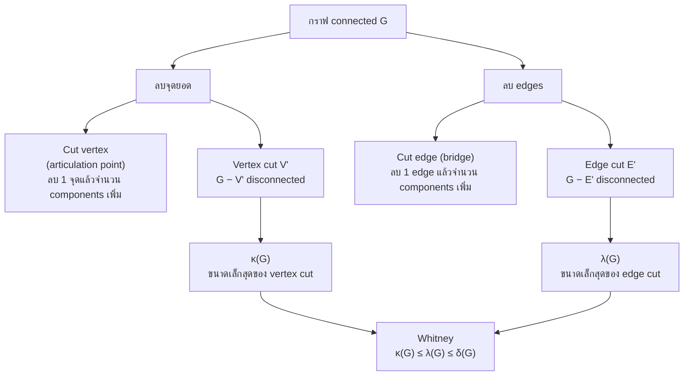
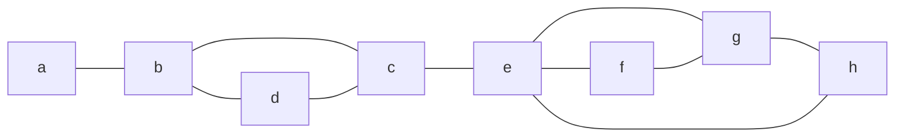
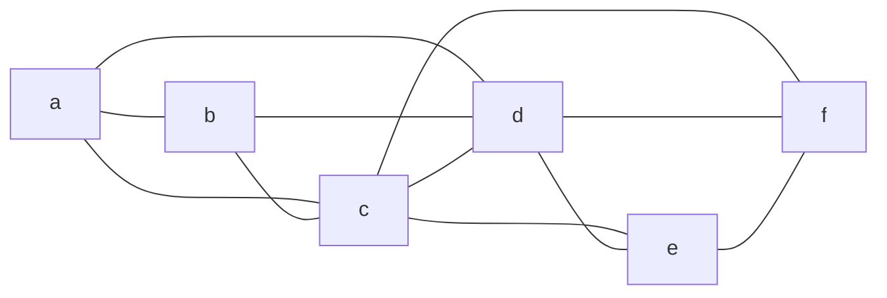
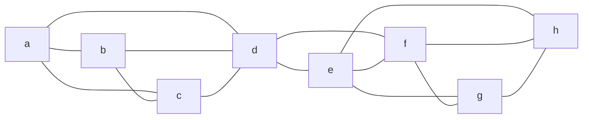
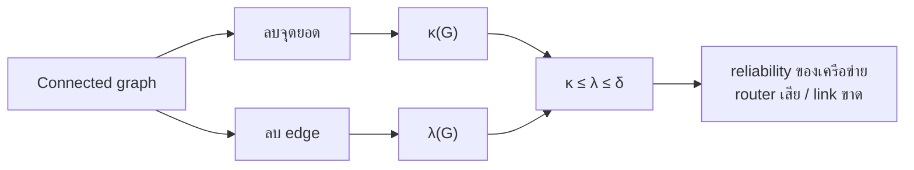

# Discrete Mathematics - Week12: Cut Vertices, Edge Cuts and Connectivity

> **วิชา:** Discrete Mathematics | **ผู้สอน:** Dr. Sirasit Lochanachit
> **Source:** `Resources/Books/Discrete Mathematics/DM_Week12.pdf` สไลด์ p.40-49 (ทั้งไฟล์ 51 slides, หัวสไลด์ "Week 13: Graphs Part 2")
> **Reference:** `Resources/References/Paths, Cuts and Connectivity Interactive Notes.md` (Web Clipping, https://noswolf.github.io/DM_IT/Graphs/Connectivity.html) และ `Resources/References/Roadblocks and connectivity Barcelona vs Bangkok.md` ส่วน "The ideas behind the simulation" (https://noswolf.github.io/DM_IT/Graphs/Roadblocks.html)
> **ป้ายอ้างอิง:** `[p.N]` = เลขสไลด์ใน PDF, `[R2]` = Paths, Cuts and Connectivity reference, `[R3]` = Roadblocks reference, blockquote ที่ขึ้นต้น 💡 = เนื้อหาที่ผู้เขียนเพิ่มเอง
> **แบบฝึกหัด:** [[HW-Discrete-Math-04]] Section E-F

---

## Part 1: Macro Architecture & Overview

ถ้ากราฟแทนเครือข่ายคอมพิวเตอร์ กราฟ connected หมายความว่าเครื่อง 2 เครื่องใดๆ สื่อสารกันได้ [p.40] คำถามของบทนี้คือต้องลบอะไรออกจากกราฟเท่าไรจึงจะ disconnected ถ้าลบ **จุดยอด** (พร้อม edges ที่ติดกัน) ได้ **cut vertex**, **vertex cut** และตัววัด **κ(G)** [p.40-45] ถ้าลบ **edges** ได้ **cut edge**, **edge cut** และ **λ(G)** [p.40, 47-48] ตัววัดทั้งสองเชื่อมกันด้วย Whitney's inequality [R2][R3] และใช้ประเมินความทนทาน (reliability) ของเครือข่าย [p.50-51]

> 💡 แผนภาพนี้เป็นการจัดกลุ่มของผู้เขียนจากนิยามใน [p.40-48] และ [R2] `[Source: generated — not verified against original document]`

### ตารางเปรียบเทียบ Vertex connectivity กับ Edge connectivity

| หัวข้อ | Vertex connectivity κ(G) | Edge connectivity λ(G) |
| :--- | :--- | :--- |
| ลบอะไร | จุดยอด พร้อม incident edges [p.40] | edges (จุดยอดอยู่ครบ) [R2] |
| ชุดที่ทำให้ disconnected | Vertex cut (separating set) [p.43] | Edge cut [p.47] |
| กรณีมีตัวเดียว | Cut vertex (articulation point), ตัวอย่าง: Router [p.40] | Cut edge (bridge), ตัวอย่าง: Link [p.40] |
| นิยามค่า | จำนวนจุดยอดน้อยที่สุดใน vertex cut ของ noncomplete graph [p.44] | จำนวน edges น้อยที่สุดใน edge cut [p.48] |
| ขอบเขต (G มี n จุด) | 0 ≤ κ(G) ≤ n − 1 [p.45] | 0 ≤ λ(G) ≤ n − 1 [p.48] |
| ค่า 0 เมื่อ | G disconnected [p.45] (และ G = K₁ ตาม [R2]) | G ไม่ connected หรือมีจุดเดียว [p.48] |
| ค่าของ Kn | κ(Kn) = n − 1 [p.44] | ไม่ระบุในสไลด์ (ดูตารางกราฟมาตรฐาน) |
| ความหมายในเครือข่าย | กี่ router ต้องเสียก่อนบางเครื่องติดต่อกันไม่ได้ [R2] | กี่ cable ต้องขาดก่อนบางเครื่องติดต่อกันไม่ได้ [R2] |

---

## Part 2: Module-by-Module Deep Dive

### 2.1 Cut vertex และ cut edge [p.40-42][R2]

> **Definition 5 (สไลด์):** การลบจุดยอดออกจากกราฟพร้อม incident edges ทั้งหมด ได้ subgraph ที่มี connected components มากขึ้น (คือ subgraph ที่ไม่ connected) จุดยอดแบบนี้เรียก **cut vertex** (หรือ **articulation point**) ตัวอย่าง: Router ส่วน edge แบบนี้เรียก **cut edge** หรือ **bridge** ตัวอย่าง: Link [p.40]

[R2] ให้นิยามครบทั้งสองฝั่ง:
* ลบจุดยอดคือลบมันพร้อม edges ที่ติดกัน ลบ edge คือเหลือ endpoints ไว้
* **Cut vertex:** จุดที่ลบแล้วจำนวน connected components มากกว่า G
* **Cut edge (bridge):** edge ที่ลบแล้วจำนวน connected components มากกว่า G
* กราฟ connected ที่ไม่มี cut vertex เรียก **nonseparable**
* ลบ cut edge หนึ่งเส้นเพิ่ม component พอดี 1 ก้อน ส่วนลบ cut vertex อาจเพิ่มได้หลายก้อน
* edge เป็น cut edge ก็ต่อเมื่อมันไม่อยู่บน simple circuit ใดเลย (R2 อ้างว่าพิสูจน์ใน Exercise 7 ของหน้านั้น) จึงทุก edge ของต้นไม้เป็น cut edge

**ตัวอย่าง "Find the cut vertices and cut edges in G₁" [p.41]** (อ่าน edges จากรูป สไลด์ไม่มีเฉลย): G₁ มี 8 จุด edges a–b, b–d, d–c, b–c, c–e, e–f, e–g, f–g, g–h, e–h

_ต้นฉบับ: รูป G₁ [p.41]_

> 💡 ผลของผู้เขียน: cut vertex คือ b (ลบแล้ว a โดดเดี่ยว), c (แยก {a, b, d} ออกจาก {e, f, g, h}) และ e (แยก {a, b, c, d} ออกจาก {f, g, h}) cut edge คือ {a, b} และ {c, e} `[Source: generated — not verified against original document]`

**Complete graph Kn (n ≥ 3):** ลบจุดยอดหนึ่งจุดพร้อม incident edges ได้ Kn−1 ซึ่งยัง connected ดังนั้น Kn ไม่มี cut vertex [p.42]

**ตัวอย่างจาก [R2]** (กราฟ 10 จุด a-j): cut vertex คือ c, e, f, i และ cut edge คือ e–f กับ i–j ส่วน edges บนสามเหลี่ยมและสี่เหลี่ยมอยู่บน circuit จึงไม่ใช่ cut edge

---

### 2.2 Vertex cut และ vertex connectivity κ(G) [p.43-46][R2][R3]

> **Definition 6 (Vertex cut / separating set):** เซตย่อย V′ ของ vertex set V ของ G = (V, E) เป็น vertex cut ถ้า G − V′ disconnected ตัวอย่างในสไลด์: เซต {b, c, e} เป็น vertex cut ขนาด 3 [p.43] (กราฟในรูป p.43 มี edges ชุดเดียวกับกราฟใน p.30 ตามที่อ่านจากรูป)

> **Definition 7 (Vertex connectivity):** vertex connectivity ของ noncomplete graph G เขียน κ(G) คือจำนวนจุดยอดน้อยที่สุดใน vertex cut [p.44]

* ถ้า G เป็น complete graph การลบจุดยอดเซตใดๆ พร้อม incident edges ยังเหลือ complete graph จึงกำหนดแทนว่า **κ(Kn) = n − 1** ซึ่งเป็นจำนวนจุดที่ต้องลบจนเหลือจุดเดียว [p.44]
* สำหรับทุกกราฟ G κ(G) คือจำนวนจุดยอดน้อยที่สุดที่ลบแล้ว disconnect G หรือเหลือกราฟจุดเดียว ถ้า G มี n จุด 0 ≤ κ(G) ≤ n − 1 และ κ(G) = 0 ก็ต่อเมื่อ G disconnected κ(G) ยิ่งมาก G ยิ่งเชื่อมกันแน่น [p.45]

เพิ่มจาก [R2] และ [R3]:
* cut vertex คือ vertex cut ที่มี 1 สมาชิก
* κ(G) = 0 เมื่อ G disconnected หรือ G = K₁ (สไลด์ p.45 พูดแค่ disconnected)
* G เป็น **k-connected** ถ้า κ(G) ≥ k กราฟ connected ที่มีอย่างน้อย 3 จุดเป็น 2-connected ก็ต่อเมื่อไม่มี cut vertex [R2]
* กราฟ connected ที่มีอย่างน้อย 3 จุดมี κ(G) = 1 ก็ต่อเมื่อมี cut vertex [R3]

**ตัวอย่างจาก [R2]** (กราฟ 6 จุด edges a–b, a–c, a–d, b–c, b–d, c–d, c–e, c–f, d–e, d–f, e–f):

_ที่มา: รูป fVcut / fEcut ใน [R2]_

V′ = {c, d} เป็น vertex cut: G − V′ แยกเป็น {a, b} กับ {e, f} ไม่มีจุดเดียวที่ทำให้กราฟ disconnected จึง κ(G) = 2 [R2]

---

### 2.3 Edge cut และ edge connectivity λ(G) [p.47-49][R2]

> **Definition 8:** วัด connectivity ของกราฟ connected G = (V, E) ด้วยจำนวน edges น้อยที่สุดที่ลบแล้ว disconnect กราฟ ถ้ามี cut edge ลบเส้นเดียวก็พอ ถ้าไม่มี ให้หาเซต edges ที่เล็กที่สุดที่ลบได้ เซต edges E′ เรียก **edge cut** ของ G ถ้า subgraph G − E′ disconnected [p.47]

> **Edge connectivity λ(G):** จำนวน edges น้อยที่สุดใน edge cut ของ G λ(G) = 0 ถ้า G ไม่ connected และ λ(G) = 0 ถ้า G เป็นกราฟจุดเดียว ถ้า G มี n จุด 0 ≤ λ(G) ≤ n − 1 [p.48]

เพิ่มจาก [R2]:
* cut edge คือ edge cut ที่มี 1 สมาชิก G เป็น **k-edge-connected** ถ้า λ(G) ≥ k
* edge cut ที่หาได้เสมอคือลบ edges ทั้งหมดที่ติดกับจุดที่ degree ต่ำสุด จุดนั้นจะโดดเดี่ยว จึง λ(G) ≤ δ(G) โดย δ(G) = min deg(v)
* ในเครือข่าย κ(G) นับ router ที่ต้องเสีย และ λ(G) นับ cable ที่ต้องขาด ก่อนที่บางคู่คอมพิวเตอร์จะติดต่อกันไม่ได้

ตัวอย่างจาก [R2] (กราฟเดียวกับหัวข้อ 2.2): E′ = {a–b, a–c, a–d} เป็น edge cut ที่แยก a ออก ไม่มี 2 edges ใดทำให้ disconnected จึง λ(G) = 3

**ตัวอย่างในสไลด์ [p.46, 49]:** สไลด์ถาม "Find the cut vertices or vertex cut, and vertex connectivity κ(G)" (p.46) และ "Find the cut edges or edge cut, and edge connectivity λ(G)" (p.49) กับกราฟ G₂ ถึง G₅ ชุดเดียวกัน ไม่มีเฉลย

> 💡 ผลของผู้เขียนจากกราฟที่อ่านจากรูป (คำนวณจาก edges ที่ผู้เขียนอ่าน อาจอ่านรูปผิดได้ ไล่ทุกเซตย่อยเพื่อหาค่าต่ำสุด):
>
> | กราฟ | edges ที่อ่านจากรูป | κ(G) และตัวอย่าง vertex cut | λ(G) และตัวอย่าง edge cut |
> | :--- | :--- | :--- | :--- |
> | G₂ | a–b, a–c, b–c, c–d, d–e, e–f, f–c | 1: {c} เป็น cut vertex | 2: ไม่มี cut edge (a–b–c เป็นสามเหลี่ยม, c–d–e–f เป็นสี่เหลี่ยม) edge cut เช่น {a–c, b–c} |
> | G₃ | a–b, a–g, b–g, b–c, c–d, c–f, d–e, e–f, f–g | 2: {b, g} | 2: {a–b, a–g} |
> | G₄ | a–b, a–g, a–f, b–g, b–c, c–d, c–e, c–f, d–e, d–f, e–f, g–f | 2: {c, f} | 3: {b–c, a–f, g–f} |
> | G₅ | a–b, a–h, a–g, b–c, b–g, b–h, b–d, c–d, c–f, c–g, c–e, d–e, d–f, e–f, f–g, f–h, g–h | 3: {b, g, h} | 3: {a–b, a–g, a–h} |
>
> `[Source: generated — not verified against original document]`

---

### 2.4 Whitney's inequality และ Menger's theorem [R2][R3]

> **Theorem (Whitney, 1932):** สำหรับทุกกราฟ G $\kappa(G) \le \lambda(G) \le \min_{v \in V} \deg(v)$ [R2][R3]

* **ด้านขวา:** ลบ edges ทั้งหมดที่ติดกับจุดที่ degree ต่ำสุด จุดนั้นโดดเดี่ยว จึง λ(G) ≤ δ(G) [R2][R3]
* **ด้านซ้าย:** ถ้าเอา edge cut ที่เล็กที่สุด แล้วแทนแต่ละ edge ด้วย endpoint ที่เลือกดี จุดที่เลือกเป็น vertex cut ที่ไม่ใหญ่กว่า [R2] ในภาษาถนน การปิดสี่แยกมีพลังอย่างน้อยเท่าการปิดถนน [R3]
* อสมการทั้งสองข้างอาจเป็น strict ได้ ตัวอย่างใน [R2]: K₄ สองก้อนเชื่อมกันผ่านจุด d มี **κ(G) = 1** (ลบ d), **λ(G) = 2** (ลบ d–e กับ d–f), **δ(G) = 3** (เช่น deg a = 3)

_ที่มา: รูป fGap ใน [R2] (K₄ บน a, b, c, d กับ K₄ บน e, f, g, h เชื่อมด้วย d–e และ d–f)_

บทเรียนด้านเครือข่ายจาก [R2]: การออกแบบอาจรอดการขาดของ cable หนึ่งเส้น แต่ยังมี router ตัวเดียวที่ถ้าเสียแล้วเครือข่ายแยก

> **Menger's theorem [R3]:** สำหรับจุดยอด u, v ที่ไม่ adjacent กัน จำนวนมากสุดของ path u–v ที่ไม่ใช้จุดร่วมกัน (ยกเว้น u และ v) เท่ากับจำนวนจุดยอดน้อยสุดที่ลบแล้วแยก u จาก v รุ่น edge เปลี่ยนคำว่า vertex เป็น edge ทั้งสองที่ ผลที่ตามมา: G เป็น k-connected ก็ต่อเมื่อทุกคู่จุดยอดมี path ที่ไม่ซ้ำจุดภายในกัน k เส้น

---

### 2.5 ตารางกราฟมาตรฐาน

> 💡 ค่า κ และ λ ของกราฟมาตรฐาน (ไม่อยู่ในสไลด์และ reference) ผู้เขียนคำนวณกรณี C₅, W₅, K₃,₄, Q₃ และต้นไม้ที่มี 4 จุดโดยไล่ทุกเซตย่อย:
>
> | กราฟ | κ(G) | λ(G) | min deg |
> | :--- | :--- | :--- | :--- |
> | Path / Tree (≥ 3 จุด) | 1 | 1 | 1 |
> | Cn (n ≥ 3) | 2 | 2 | 2 |
> | Wn (n ≥ 3) | 3 | 3 | 3 |
> | Kn | n − 1 | n − 1 | n − 1 |
> | Km,n | min(m, n) | min(m, n) | min(m, n) |
> | Qn | n | n | n |
>
> `[Source: generated — not verified against original document]`

---

## Part 3: Quick Reference & Exam Cheat Sheet

### Checklist สรุปหัวใจสำคัญก่อนสอบ
* [ ] **Cut vertex = articulation point, cut edge = bridge:** ลบแล้วจำนวน components เพิ่ม [p.40][R2]
* [ ] **Cut vertex คือจุดเดียว, vertex cut คือเซตของจุด:** G − V′ disconnected [p.43]
* [ ] **κ(G):** จำนวนจุดยอดน้อยสุดใน vertex cut และ κ(Kn) = n − 1 [p.44]
* [ ] **κ(G) = 0:** G disconnected (และ K₁ ตาม [R2]) [p.45]
* [ ] **λ(G):** จำนวน edges น้อยสุดใน edge cut, λ = 0 ถ้า disconnected หรือมีจุดเดียว [p.48]
* [ ] **0 ≤ κ(G), λ(G) ≤ n − 1** สำหรับกราฟ n จุด [p.45, 48]
* [ ] **Whitney:** κ(G) ≤ λ(G) ≤ min deg(v) [R2]
* [ ] **Kn ไม่มี cut vertex** (n ≥ 3) [p.42]
* [ ] **Menger:** G เป็น k-connected ⇔ ทุกคู่จุดยอดมี k path ที่ไม่ซ้ำจุดภายในกัน [R3]

### สรุปสูตร / Notation ที่สำคัญ

| Notation | ความหมาย |
| :--- | :--- |
| $G - V'$ | ลบเซตจุดยอด V′ พร้อม incident edges ทั้งหมด |
| $G - E'$ | ลบเซต edges E′ (จุดยอดอยู่ครบ) |
| $\kappa(G)$ | vertex connectivity |
| $\lambda(G)$ | edge connectivity |
| $\delta(G) = \min_{v} \deg(v)$ | degree ต่ำสุดของกราฟ |
| $\kappa(G) \le \lambda(G) \le \delta(G)$ | Whitney's inequality |

### Concept Map

> 💡 Concept map นี้เป็นการสรุปของผู้เขียน `[Source: generated — not verified against original document]`

---

## ⚠️ Common Pitfalls & Exam Traps

* **สับสน cut vertex กับ vertex cut:** cut vertex คือจุดเดียว vertex cut คือเซตของจุดที่ลบแล้ว disconnected [p.40, 43]
* **คิดว่า Kn มี vertex cut:** Kn ไม่มี vertex cut ลบแล้วยัง complete จึงต้องกำหนด κ(Kn) = n − 1 [p.42, 44]
* **คิดว่า κ(G) = 0 มีแค่กรณี disconnected:** สไลด์ p.45 เขียนแค่ disconnected แต่ [R2] เพิ่มกรณี G = K₁ (สอดคล้องกับ κ(K₁) = 1 − 1 = 0)
* **ลืมกรณี λ(G) = 0 ของกราฟจุดเดียว:** กราฟจุดเดียวถือว่า connected แต่ λ = 0 ตามนิยาม [p.48]
* **คิดว่า κ(G) = min deg:** Whitney ให้แค่ κ ≤ λ ≤ δ ตัวอย่างใน [R2] มี κ = 1, λ = 2, δ = 3
* **คิดว่าลบ cut vertex แล้วเพิ่ม component ได้แค่ 1 ก้อน:** เพิ่ม 1 ก้อนพอดีเป็นคุณสมบัติของ cut edge ส่วน cut vertex เพิ่มได้หลายก้อน [R2]
* **เอา vertex cut ใดๆ มาตอบเป็น κ(G):** เซตใดที่ลบแล้ว disconnected ก็เป็น vertex cut แต่ κ(G) คือขนาดของเซตที่เล็กที่สุด สไลด์ p.43 ยกเซต {b, c, e} เป็นตัวอย่างของ vertex cut ขนาด 3 ต้องตรวจว่าไม่มีเซตที่เล็กกว่าก่อนสรุปค่า κ

**ข้อสังเกตเกี่ยวกับต้นฉบับ (ไม่แก้ในเนื้อหา):**
* p.40 Definition 5 อธิบายการลบจุดยอด แล้วใช้ "Such edge is called a cut edge or bridge" โดยไม่นิยามการลบ edge ฝั่ง edge นิยามจาก [R2]
* p.45 ระบุ κ(G) = 0 iff disconnected ต่างจาก [R2] ที่รวม K₁
* p.46 กับ p.49 ใช้กราฟ G₂-G₅ ชุดเดียวกัน (ไม่มี G₁ ใน 2 หน้านี้ เพราะ G₁ ถูกใช้ใน p.41) และไม่มีเฉลย
* ตารางเฉลย G₂-G₅ ในหัวข้อ 2.3 เป็นของผู้เขียน อ่าน edges จากรูปสไลด์ (G₂ มี a–b ทำให้ a, b, c เป็นสามเหลี่ยม)
* เลขนิยามในสไลด์ซ้ำและเริ่มใหม่: Definition 4 ใช้ใน p.2 และ p.38, Definition 5 ใน p.3 และ p.40, Definition 6 ใน p.10 และ p.43, Definition 7 ใน p.15 และ p.44, Definition 8 ใน p.20 และ p.47 (เลขกลับไปเริ่มที่ Definition 1 ที่ p.28) โน้ตนี้ใช้เลขตามสไลด์หน้าที่อ้าง

---

## เอกสารเชื่อมโยง (Wiki-Style Backlinks)
* **วิชาและหัวข้อที่เกี่ยวข้อง:**
  * [[Week12 - Paths, Circuits and Connectedness]] (นิยาม connected, component ที่ใช้ตัดสินว่าลบแล้ว disconnected)
  * [[Week12 - Road Network Connectivity Barcelona vs Bangkok]] (ใช้ κ, λ, Whitney และ Menger กับเครือข่ายถนนจริง)
  * [[Week12 - Bipartite Graphs and Matchings]] (หัวข้ออื่นของสัปดาห์เดียวกัน)
  * [[Week11 - Graphs, Graph Terminology and Representing Graphs]] (degree, Kn, Cn, Wn, Qn ที่ใช้ในตารางกราฟมาตรฐาน)
  * [[HW-Discrete-Math-04]] (แบบฝึกหัดพร้อมเฉลย Section E-F)

* **แหล่งข้อมูล:**
  * Source: `Resources/Books/Discrete Mathematics/DM_Week12.pdf` (51 slides, Dr. Sirasit Lochanachit)
  * Source: `Resources/References/Paths, Cuts and Connectivity Interactive Notes.md` (Web Clipping)
  * Source: `Resources/References/Roadblocks and connectivity Barcelona vs Bangkok.md` (Web Clipping)
