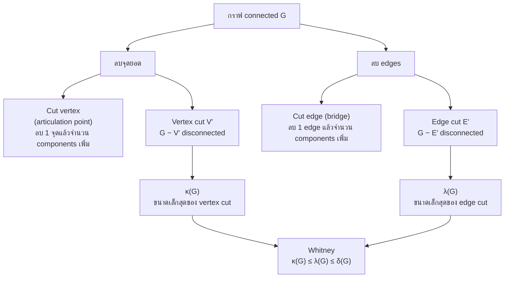
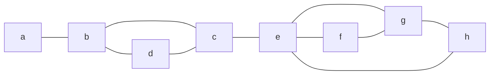
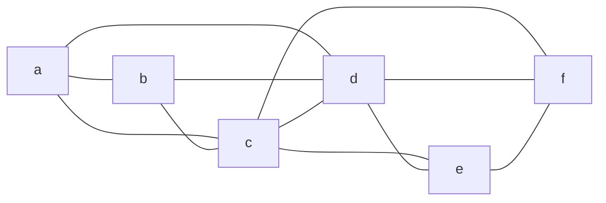
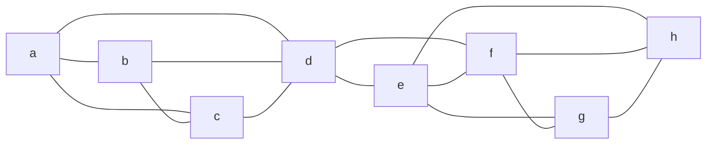
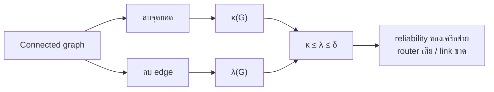

# Discrete Mathematics - Week12: Cut Vertices, Edge Cuts and Connectivity

> **วิชา:** Discrete Mathematics | **ผู้สอน:** Dr. Sirasit Lochanachit
> **Source:** `Resources/Books/Discrete Mathematics/DM_Week12.pdf` สไลด์ p.40-49 (ทั้งไฟล์ 51 slides, หัวสไลด์ "Week 13: Graphs Part 2")
> **Reference:** `Resources/References/Paths, Cuts and Connectivity Interactive Notes.md` (Web Clipping, https://noswolf.github.io/DM_IT/Graphs/Connectivity.html) และ `Resources/References/Roadblocks and connectivity Barcelona vs Bangkok.md` ส่วน "The ideas behind the simulation" (https://noswolf.github.io/DM_IT/Graphs/Roadblocks.html)
> **ป้ายอ้างอิง:** `[p.N]` = เลขสไลด์ใน PDF, `[R2]` = Paths, Cuts and Connectivity reference, `[R3]` = Roadblocks reference, blockquote ที่ขึ้นต้น 💡 = เนื้อหาที่ผู้เขียนเพิ่มเอง
> **แบบฝึกหัด:** [[HW-Discrete-Math-04]] Section E-F

---

## Part 1: Macro Architecture & Overview

ถ้ากราฟแทนเครือข่ายคอมพิวเตอร์ กราฟ connected หมายความว่าเครื่อง 2 เครื่องใดๆ สื่อสารกันได้ [p.40] คำถามของบทนี้คือต้องลบอะไรออกจากกราฟเท่าไรจึงจะ disconnected ถ้าลบ **จุดยอด** (พร้อม edges ที่ติดกัน) ได้ **cut vertex**, **vertex cut** และตัววัด **κ(G)** [p.40-45] ถ้าลบ **edges** ได้ **cut edge**, **edge cut** และ **λ(G)** [p.40, 47-48] ตัววัดทั้งสองเชื่อมกันด้วย Whitney's inequality [R2][R3] และใช้ประเมินความทนทาน (reliability) ของเครือข่าย [p.50-51]

> 💡 แผนภาพนี้เป็นการจัดกลุ่มของผู้เขียนจากนิยามใน [p.40-48] และ [R2] `[Source: generated — not verified against original document]`

### ตารางเปรียบเทียบ Vertex connectivity กับ Edge connectivity

| หัวข้อ | Vertex connectivity κ(G) | Edge connectivity λ(G) |
| :--- | :--- | :--- |
| ลบอะไร | จุดยอด พร้อม incident edges [p.40] | edges (จุดยอดอยู่ครบ) [R2] |
| ชุดที่ทำให้ disconnected | Vertex cut (separating set) [p.43] | Edge cut [p.47] |
| กรณีมีตัวเดียว | Cut vertex (articulation point), ตัวอย่าง: Router [p.40] | Cut edge (bridge), ตัวอย่าง: Link [p.40] |
| นิยามค่า | จำนวนจุดยอดน้อยที่สุดใน vertex cut ของ noncomplete graph [p.44] | จำนวน edges น้อยที่สุดใน edge cut [p.48] |
| ขอบเขต (G มี n จุด) | 0 ≤ κ(G) ≤ n − 1 [p.45] | 0 ≤ λ(G) ≤ n − 1 [p.48] |
| ค่า 0 เมื่อ | G disconnected [p.45] (และ G = K₁ ตาม [R2]) | G ไม่ connected หรือมีจุดเดียว [p.48] |
| ค่าของ Kn | κ(Kn) = n − 1 [p.44] | ไม่ระบุในสไลด์ (ดูตารางกราฟมาตรฐาน) |
| ความหมายในเครือข่าย | กี่ router ต้องเสียก่อนบางเครื่องติดต่อกันไม่ได้ [R2] | กี่ cable ต้องขาดก่อนบางเครื่องติดต่อกันไม่ได้ [R2] |

---

## Part 2: Module-by-Module Deep Dive

### 2.1 Cut vertex และ cut edge [p.40-42][R2]

#### Cut vertex และ Cut edge

> 💡 **Intuition:** Cut vertex = "จุดคอขวด" — ลบจุดนี้แล้วเครือข่ายแยกเป็นหลายส่วน เช่น เมือง 2 ฝั่งที่ไปมาหากันได้ผ่านเมืองกลางเมืองเดียว ถ้าเมืองกลางหายไป สองฝั่งก็ไปถึงกันไม่ได้ (ในเครือข่ายคอมพิวเตอร์คือ router ตัวเดียวที่ traffic ต้องผ่าน) Cut edge = "ลิงก์คอขวด" — ลบ edge เส้นเดียวแล้วกราฟแยก เช่น cable เส้นเดียวที่เชื่อมคอมพิวเตอร์ 2 cluster ถ้าขาด 2 cluster ก็ติดต่อกันไม่ได้
> [Source: generated — not verified against original document]

> **Definition 5 (สไลด์):** การลบจุดยอดออกจากกราฟพร้อม incident edges ทั้งหมด ได้ subgraph ที่มี connected components มากขึ้น (คือ subgraph ที่ไม่ connected) จุดยอดแบบนี้เรียก **cut vertex** (หรือ **articulation point**) ตัวอย่าง: Router ส่วน edge แบบนี้เรียก **cut edge** หรือ **bridge** ตัวอย่าง: Link [p.40]

**🧭 ทำความเข้าใจ** _[Source: generated — not verified against original document]_

**แตกวลีสำคัญ:**
- "ลบจุดยอด พร้อม incident edges" → ลบจุด v แล้วลบ edge ที่มี v เป็น endpoint
- "connected components มากขึ้น" → ถ้า G connected → G − v มี ≥ 2 components; ถ้า G มี k components → G − v มี ≥ k+1 components
- "cut edge" = ลบ edge เพียง edge นั้น (จุดยอดอยู่ครบ)

**ตัวอย่าง:**
- ✅ Path a–b–c–d → b คือ cut vertex (ลบ b ได้ {a}, {c,d}) c คือ cut vertex (ลบ c ได้ {a,b}, {d}) และทุก edge (a–b, b–c, c–d) เป็น cut edge
- ✅ วงจร C₄: a–b–c–d–a ไม่มี cut vertex (ลบจุดใดก็ยังเหลือ path เชื่อมจุดที่เหลือ) และไม่มี cut edge (ทุก edge อยู่บน circuit)
- ❌ Complete graph K₃ (สามเหลี่ยม) → ไม่มีทั้ง cut vertex และ cut edge (ลบจุด 1 จุดเหลือ edge 1 เส้นที่ยังเชื่อม 2 จุดที่เหลือ, ลบ edge 1 เส้นเหลือ path ยาว 2)
- **ต่างกันตรง:** Cut vertex = จุดเดียว, Vertex cut = เซตของจุด (มีกี่จุดก็ได้)

**อย่าสับสน:** Cut vertex ≠ Vertex cut — cut vertex คือกรณี "ลบ 1 จุดก็พอ" ส่วน vertex cut คือเซตจุดที่ไม่จำเป็นต้องมีจุดเดียว

**เช็คความเข้าใจ:** กราฟรูปดาว 5 จุด: จุดกลาง e เชื่อมกับ a, b, c, d (edges a–e, b–e, c–e, d–e) ไม่มี edge อื่น ข้อใดถูก (1) e เป็น cut vertex (2) a–e เป็น cut edge (3) กราฟนี้ไม่มี cut vertex

เฉลย

1. (1) ถูก — ลบ e ได้ {a}, {b}, {c}, {d} เป็น 4 components
2. (2) ถูก — ลบ a–e แล้ว a โดดเดี่ยว (จริง ๆ ทุก edge ของกราฟนี้เป็น cut edge)
3. (3) ผิด — e เป็น cut vertex (ส่วน a, b, c, d ไม่ใช่ เพราะลบแล้วที่เหลือยังเชื่อมผ่าน e)

[R2] ให้นิยามครบทั้งสองฝั่ง:
* ลบจุดยอดคือลบมันพร้อม edges ที่ติดกัน ลบ edge คือเหลือ endpoints ไว้
* **Cut vertex:** จุดที่ลบแล้วจำนวน connected components มากกว่า G
* **Cut edge (bridge):** edge ที่ลบแล้วจำนวน connected components มากกว่า G
* กราฟ connected ที่ไม่มี cut vertex เรียก **nonseparable**
* ลบ cut edge หนึ่งเส้นเพิ่ม component พอดี 1 ก้อน ส่วนลบ cut vertex อาจเพิ่มได้หลายก้อน
* edge เป็น cut edge ก็ต่อเมื่อมันไม่อยู่บน simple circuit ใดเลย (R2 อ้างว่าพิสูจน์ใน Exercise 7 ของหน้านั้น) จึงทุก edge ของต้นไม้เป็น cut edge

**ตัวอย่าง "Find the cut vertices and cut edges in G₁" [p.41]** (อ่าน edges จากรูป สไลด์ไม่มีเฉลย): G₁ มี 8 จุด edges a–b, b–d, d–c, b–c, c–e, e–f, e–g, f–g, g–h, e–h

_ต้นฉบับ: รูป G₁ [p.41]_

> 💡 ผลของผู้เขียน: cut vertex คือ b (ลบแล้ว a โดดเดี่ยว), c (แยก {a, b, d} ออกจาก {e, f, g, h}) และ e (แยก {a, b, c, d} ออกจาก {f, g, h}) cut edge คือ {a, b} และ {c, e} `[Source: generated — not verified against original document]`

**Complete graph Kn (n ≥ 3):** ลบจุดยอดหนึ่งจุดพร้อม incident edges ได้ Kn−1 ซึ่งยัง connected ดังนั้น Kn ไม่มี cut vertex [p.42]

**ตัวอย่างจาก [R2]** (กราฟ 10 จุด a-j): cut vertex คือ c, e, f, i และ cut edge คือ e–f กับ i–j ส่วน edges บนสามเหลี่ยมและสี่เหลี่ยมอยู่บน circuit จึงไม่ใช่ cut edge

---

### 2.2 Vertex cut และ vertex connectivity κ(G) [p.43-46][R2][R3]

#### Vertex cut

> 💡 **Intuition:** Vertex cut = "ชุดจุดเปราะบาง" — เซต V′ ที่ลบออกพร้อมกันแล้วเครือข่าย disconnected เช่นในสไลด์ ลบ {b, c, e} พร้อมกันแล้วกราฟแยกเป็นส่วนที่ไม่ติดต่อกัน
> [Source: generated — not verified against original document]

> **Definition 6 (Vertex cut / separating set):** เซตย่อย V′ ของ vertex set V ของ G = (V, E) เป็น vertex cut ถ้า G − V′ disconnected ตัวอย่างในสไลด์: เซต {b, c, e} เป็น vertex cut ขนาด 3 [p.43] (กราฟในรูป p.43 มี edges ชุดเดียวกับกราฟใน p.30 ตามที่อ่านจากรูป)

**🧭 ทำความเข้าใจ** _[Source: generated — not verified against original document]_

**แตกวลีสำคัญ:**
- "เซตย่อย V′" → ไม่ต้องเป็น 1 จุด
- "G − V′ disconnected" → หลังลบ V′ กราฟที่เหลือต้องมี ≥ 2 components (ถ้าเหลือจุดเดียว K₁ ถือว่า connected จึงไม่นับเป็น vertex cut)

**ตัวอย่าง:**
- ✅ Path a–b–c–d: V′ = {b} ลบแล้ว {a}, {c,d} disconnected → {b} คือ vertex cut
- ✅ Path a–b–c–d: V′ = {b, c} ลบแล้ว {a}, {d} disconnected → {b,c} คือ vertex cut
- ❌ C₄ (a–b–c–d–a): V′ = {a} ลบแล้ว {b–c–d} ยัง connected → {a} ไม่ vertex cut
- ❌ Path a–b–c: V′ = {b, c} ลบแล้วเหลือ a จุดเดียว ซึ่ง connected (1 component) → {b, c} ไม่ใช่ vertex cut
- **ต่างกันตรง:** Vertex cut ≠ cut vertex — vertex cut เป็นเซต cut vertex คือจุดเดียว

**อย่าสับสน:** Vertex cut มีได้หลายชุดหลายขนาด (เช่น {b} และ {b, c} ใน path a–b–c–d) — κ(G) คือขนาดของชุดที่เล็กที่สุดเท่านั้น

**เช็คความเข้าใจ:** กราฟ G มี 5 จุด a, b, c, d, e และ edges a–b, b–c, c–d, d–e, a–c, c–e หา vertex cut ขนาด 1 และ κ(G)

เฉลย

1. ลบ c: เหลือ edges a–b และ d–e → components {a,b} กับ {d,e} → {c} เป็น vertex cut (c เป็น cut vertex)
2. ลบจุดอื่นทีละจุด: ลบ a เหลือ b–c, c–d, d–e, c–e (connected), ลบ b เหลือ a–c, c–d, d–e, c–e (connected), ลบ d หรือ e ก็ยังเชื่อมผ่าน c → ไม่ใช่ vertex cut
3. G connected (κ ≠ 0) และมี vertex cut ขนาด 1 → κ(G) = 1 (ตรวจเพิ่มได้ว่าทุก vertex cut ของกราฟนี้ต้องมี c อยู่)

#### Vertex connectivity κ(G)

> 💡 **Intuition:** κ(G) = "หมายเลขความเชื่อมแน่น (จุดยอด)" — นับว่าต้องลบจุดน้อยที่สุดกี่จุดเครือข่ายจึงแยก ยิ่ง κ(G) มาก เครือข่ายยิ่ง resilient: κ(G) = 0 คือขาดกันอยู่แล้ว (หรือมีจุดเดียว), κ(G) = 1 คือ router เสียตัวเดียวก็แยกได้, κ(G) = 2 คือต้องเสียอย่างน้อย 2 ตัว
> [Source: generated — not verified against original document]

> **Definition 7 (Vertex connectivity):** vertex connectivity ของ noncomplete graph G เขียน κ(G) คือจำนวนจุดยอดน้อยที่สุดใน vertex cut [p.44]

**🧭 ทำความเข้าใจ** _[Source: generated — not verified against original document]_

**แตกวลีสำคัญ:**
- "จำนวนจุดยอดน้อยที่สุด" → min |V′| โดยที่ G − V′ disconnected
- "noncomplete graph" → ถ้า G = K_n ต้องกำหนด κ(K_n) = n−1 เพิ่มเติม (เพราะว่า K_n ไม่มี vertex cut ตามนิยาม disconnection)

**ตัวอย่าง:**
- ✅ Path a–b–c–d: κ(G) = 1 (ลบ b หรือ c พอ)
- ✅ วงจร C₄ a–b–c–d–a: κ(G) = 2 (ต้องลบ 2 จุด เช่น {a,c} ถึงจะแยก)
- ✅ K₄ (สมบูรณ์ 4 จุด): κ(K₄) = 3 (ต้องลบ 3 จุด ถึงจะเหลือ 1 จุด)
- ✅ Disconnected G: κ(G) = 0 (ไม่ต้องลบจุดเลยก็ disconnected อยู่แล้ว)
- **ต่างกันตรง:** κ(G) เป็น "ตัวเลข" (ขนาดของ vertex cut ที่เล็กที่สุด) ส่วน vertex cut เป็น "เซตของจุด"

**อย่าสับสน:** κ(Kn) = n − 1 ไม่ใช่ n — Kn ไม่มี vertex cut เลย สไลด์จึงกำหนดค่าเป็นจำนวนจุดที่ต้องลบจนเหลือจุดเดียว [p.44] (จุดเดียวที่เหลือไม่ได้ disconnected แต่ใช้เป็นจุดหยุดของการนับ)

**เช็คความเข้าใจ:** ทำไม κ(G) ≤ n − 1 เสมอ สำหรับกราฟ n จุด

เฉลย

1. ตาม [p.45] κ(G) คือจำนวนจุดน้อยที่สุดที่ลบแล้ว G disconnected **หรือเหลือกราฟจุดเดียว**
2. ลบ n − 1 จุดใดก็ได้ จะเหลือกราฟจุดเดียวเสมอ → เงื่อนไขข้อ 1 เป็นจริงเสมอเมื่อลบ n − 1 จุด
3. ค่าน้อยที่สุดจึงไม่เกิน n − 1 → κ(G) ≤ n − 1 (เท่ากับ n − 1 พอดีเมื่อ G = Kn)

* ถ้า G เป็น complete graph การลบจุดยอดเซตใดๆ พร้อม incident edges ยังเหลือ complete graph จึงกำหนดแทนว่า **κ(Kn) = n − 1** ซึ่งเป็นจำนวนจุดที่ต้องลบจนเหลือจุดเดียว [p.44]
* สำหรับทุกกราฟ G κ(G) คือจำนวนจุดยอดน้อยที่สุดที่ลบแล้ว disconnect G หรือเหลือกราฟจุดเดียว ถ้า G มี n จุด 0 ≤ κ(G) ≤ n − 1 และ κ(G) = 0 ก็ต่อเมื่อ G disconnected κ(G) ยิ่งมาก G ยิ่งเชื่อมกันแน่น [p.45]

เพิ่มจาก [R2] และ [R3]:
* cut vertex คือ vertex cut ที่มี 1 สมาชิก
* κ(G) = 0 เมื่อ G disconnected หรือ G = K₁ (สไลด์ p.45 พูดแค่ disconnected)
* G เป็น **k-connected** ถ้า κ(G) ≥ k กราฟ connected ที่มีอย่างน้อย 3 จุดเป็น 2-connected ก็ต่อเมื่อไม่มี cut vertex [R2]
* กราฟ connected ที่มีอย่างน้อย 3 จุดมี κ(G) = 1 ก็ต่อเมื่อมี cut vertex [R3]

**ตัวอย่างจาก [R2]** (กราฟ 6 จุด edges a–b, a–c, a–d, b–c, b–d, c–d, c–e, c–f, d–e, d–f, e–f):

_ที่มา: รูป fVcut / fEcut ใน [R2]_

V′ = {c, d} เป็น vertex cut: G − V′ แยกเป็น {a, b} กับ {e, f} ไม่มีจุดเดียวที่ทำให้กราฟ disconnected จึง κ(G) = 2 [R2]

---

### 2.3 Edge cut และ edge connectivity λ(G) [p.47-49][R2]

#### Edge cut

> 💡 **Intuition:** Edge cut = "ชุด cables เปราะบาง" — เซต E′ ที่ลบออกพร้อมกัน (ลบ cables) เครือข่าย disconnected ต่างจาก vertex cut ที่ลบจุดยอด edge cut ลบ "เส้นเชื่อม" เท่านั้น
> [Source: generated — not verified against original document]

> **Definition 8:** วัด connectivity ของกราฟ connected G = (V, E) ด้วยจำนวน edges น้อยที่สุดที่ลบแล้ว disconnect กราฟ ถ้ามี cut edge ลบเส้นเดียวก็พอ ถ้าไม่มี ให้หาเซต edges ที่เล็กที่สุดที่ลบได้ เซต edges E′ เรียก **edge cut** ของ G ถ้า subgraph G − E′ disconnected [p.47]

**🧭 ทำความเข้าใจ** _[Source: generated — not verified against original document]_

**แตกวลีสำคัญ:**
- "เซต edges E′" → edge cut อาจมี 1 edge (cut edge) หรือมากกว่า
- "G − E′ disconnected" → ลบ E′ ได้ ≥2 components

**ตัวอย่าง:**
- ✅ Path a–b–c–d: E′ = {b–c} ลบแล้ว {a,b}, {c,d} → edge cut ขนาด 1
- ✅ วงจร C₄ a–b–c–d–a: E′ = {a–b, c–d} ลบแล้วเหลือ edges b–c และ d–a → components {b,c} กับ {a,d} → edge cut ขนาด 2
- ✅ K₃ (สามเหลี่ยม): E′ = {a–b, a–c} ลบแล้ว {a}, {b,c} → edge cut ขนาด 2 (deg(a) = 2)
- ❌ วงจร C₄ a–b–c–d–a: E′ = {a–b} ลบแล้วเหลือ path b–c–d–a ยัง connected → ไม่ใช่ edge cut
- **ต่างกันตรง:** Edge cut ≠ cut edge — cut edge คือ edge cut ขนาด 1

**อย่าสับสน:** จุดยอดอยู่ครบในการลบ edge cut (ไม่ใช่ลบจุด)

**เช็คความเข้าใจ:** ในวงจร C₅ (1-2-3-4-5-1) edge cut ที่เล็กที่สุดคืออะไร และ λ(C₅) = ?

เฉลย

1. ลบ edge 1 เส้น เหลือ path ที่ผ่านครบ 5 จุด → ยัง connected → C₅ ไม่มี cut edge (ทุก edge อยู่บน circuit)
2. ลบ 2 เส้นใดก็ได้ เช่น {1–2, 3–4} ได้ components {2,3} กับ {4,5,1} → disconnected
3. ดังนั้น edge cut ที่เล็กที่สุดมีขนาด 2 → λ(C₅) = 2

#### Edge connectivity λ(G)

> 💡 **Intuition:** λ(G) = "หมายเลขความเชื่อมแน่น (edges)" — นับว่าต้องตัด cable น้อยที่สุดกี่เส้นเครือข่ายจึงแยก: λ(G) = 0 คือขาดกันอยู่แล้ว (หรือมีจุดเดียว), λ(G) = 1 คือ cable ขาดเส้นเดียวก็แยก, λ(G) = 2 คือต้องขาดอย่างน้อย 2 เส้น
> [Source: generated — not verified against original document]

> **Edge connectivity λ(G):** จำนวน edges น้อยที่สุดใน edge cut ของ G λ(G) = 0 ถ้า G ไม่ connected และ λ(G) = 0 ถ้า G เป็นกราฟจุดเดียว ถ้า G มี n จุด 0 ≤ λ(G) ≤ n − 1 [p.48]

**🧭 ทำความเข้าใจ** _[Source: generated — not verified against original document]_

**แตกวลีสำคัญ:**
- "จำนวน edges น้อยที่สุด" → min |E′| โดยที่ G − E′ disconnected
- "λ(G) = 0 ถ้า disconnected หรือมี 1 จุด" → กรณีพิเศษที่ไม่ต้องลบ edge เลย (กราฟขาดกันอยู่แล้ว หรือมีจุดเดียวตามนิยามสไลด์)

**ตัวอย่าง:**
- ✅ Path a–b–c–d: λ(G) = 1 (ลบ edge เดียว เช่น b–c ก็พอ)
- ✅ วงจร C₄: λ(G) = 2 (ลบ 1 edge ยัง connected, ลบ 2 edges ใดก็ได้ เช่น {a–b, c–d} ก็แยก)
- ✅ K₄: λ(G) = 3 (ทุกจุดมี degree 3 → ลบ 3 edges ที่ติดจุดหนึ่งจุดก็แยกจุดนั้นออก และลบ 2 เส้นใดก็ยัง connected)
- ✅ Disconnected graph: λ(G) = 0
- **ต่างกันตรง:** λ(G) คำนวณจากขนาด edge cut ที่เล็กสุด (ไม่ใช่เซตเดียว)

**อย่าสับสน:** λ(G) ≤ δ(G) (degree ต่ำสุด) เพราะลบ edges ทั้งหมด ของจุด degree min → จุดโดดเดี่ยว

**เช็คความเข้าใจ:** ทำไม λ(G) ≤ δ(G)

เฉลย

1. ให้ v เป็นจุดที่ deg(v) = δ(G) (degree ต่ำสุด) และ G มีอย่างน้อย 2 จุด
2. ลบ edges ทั้งหมดที่ติด v (ไม่เกิน δ(G) เส้น) → v โดดเดี่ยว แยกจากจุดอื่น → G disconnected
3. แปลว่ามี edge cut ขนาดไม่เกิน δ(G) → ค่าน้อยที่สุด λ(G) ≤ δ(G)

เพิ่มจาก [R2]:
* cut edge คือ edge cut ที่มี 1 สมาชิก G เป็น **k-edge-connected** ถ้า λ(G) ≥ k
* edge cut ที่หาได้เสมอคือลบ edges ทั้งหมดที่ติดกับจุดที่ degree ต่ำสุด จุดนั้นจะโดดเดี่ยว จึง λ(G) ≤ δ(G) โดย δ(G) = min deg(v)
* ในเครือข่าย κ(G) นับ router ที่ต้องเสีย และ λ(G) นับ cable ที่ต้องขาด ก่อนที่บางคู่คอมพิวเตอร์จะติดต่อกันไม่ได้

ตัวอย่างจาก [R2] (กราฟเดียวกับหัวข้อ 2.2): E′ = {a–b, a–c, a–d} เป็น edge cut ที่แยก a ออก ไม่มี 2 edges ใดทำให้ disconnected จึง λ(G) = 3

**ตัวอย่างในสไลด์ [p.46, 49]:** สไลด์ถาม "Find the cut vertices or vertex cut, and vertex connectivity κ(G)" (p.46) และ "Find the cut edges or edge cut, and edge connectivity λ(G)" (p.49) กับกราฟ G₂ ถึง G₅ ชุดเดียวกัน ไม่มีเฉลย

> 💡 ผลของผู้เขียนจากกราฟที่อ่านจากรูป (คำนวณจาก edges ที่ผู้เขียนอ่าน อาจอ่านรูปผิดได้ ไล่ทุกเซตย่อยเพื่อหาค่าต่ำสุด):
>
> | กราฟ | edges ที่อ่านจากรูป | κ(G) และตัวอย่าง vertex cut | λ(G) และตัวอย่าง edge cut |
> | :--- | :--- | :--- | :--- |
> | G₂ | a–b, a–c, b–c, c–d, d–e, e–f, f–c | 1: {c} เป็น cut vertex | 2: ไม่มี cut edge (a–b–c เป็นสามเหลี่ยม, c–d–e–f เป็นสี่เหลี่ยม) edge cut เช่น {a–c, b–c} |
> | G₃ | a–b, a–g, b–g, b–c, c–d, c–f, d–e, e–f, f–g | 2: {b, g} | 2: {a–b, a–g} |
> | G₄ | a–b, a–g, a–f, b–g, b–c, c–d, c–e, c–f, d–e, d–f, e–f, g–f | 2: {c, f} | 3: {b–c, a–f, g–f} |
> | G₅ | a–b, a–h, a–g, b–c, b–g, b–h, b–d, c–d, c–f, c–g, c–e, d–e, d–f, e–f, f–g, f–h, g–h | 3: {b, g, h} | 3: {a–b, a–g, a–h} |
>
> `[Source: generated — not verified against original document]`

---

### 2.4 Whitney's inequality และ Menger's theorem [R2][R3]

#### Whitney's inequality

> 💡 **Intuition:** Whitney's inequality บอกว่า κ(G) ≤ λ(G) ≤ δ(G) — ด้านขวา: ตัดถนนทุกเส้นที่ออกจากจุดที่ degree ต่ำสุด จุดนั้นก็ถูกตัดขาดแล้ว จึงไม่ต้องตัดเกิน δ เส้น ด้านซ้าย: ปิดสี่แยก (ลบจุดยอด) 1 แห่งเท่ากับปิดถนนทุกเส้นที่ต่อกับมันพร้อมกัน การลบจุดจึงทรงพลังกว่า ใช้จำนวนน้อยกว่าหรือเท่ากับการตัดถนน [R3]
> [Source: generated — not verified against original document]

> **Theorem (Whitney, 1932):** สำหรับทุกกราฟ G $\kappa(G) \le \lambda(G) \le \min_{v \in V} \deg(v)$ [R2][R3]

**🧭 ทำความเข้าใจ** _[Source: generated — not verified against original document]_

**แตกวลีสำคัญ:**
- "κ(G) ≤ λ(G)" → การลบจุดทรงพลังกว่าการลบ edge (ลบจุด 1 จุดเอา edge ที่ติดไปด้วยทั้งหมด) จึงต้องลบจำนวนน้อยกว่าหรือเท่ากัน
- "λ(G) ≤ δ(G)" → ตัด edges ทั้งหมดของจุดที่ degree ต่ำสุด (δ เส้น) ก็ทำให้ disconnected ได้เสมอ

**ตัวอย่าง (อสมการอาจ strict):**
- ✅ Path a–b–c–d: κ = 1, λ = 1, δ = 1 (จุดปลาย a, d มี degree 1) → 1 ≤ 1 ≤ 1 ✓
- ✅ C₄ a–b–c–d–a: κ = 2, λ = 2, δ = 2 → 2 ≤ 2 ≤ 2 ✓ (ทั้งสองข้างอสมการเท่ากัน)
- ✅ K₄: κ = 3, λ = 3, δ = 3 → 3 ≤ 3 ≤ 3
- ✅ Graph "bowtie" (สามเหลี่ยม a–b–d กับสามเหลี่ยม d–e–f ใช้จุด d ร่วมกัน): κ = 1 (ลบ d), λ = 2 (ไม่มี cut edge เพราะทุก edge อยู่บนสามเหลี่ยม แต่ลบ a–d กับ b–d ก็แยก {a,b} ออก), δ = 2 (d มี degree 4 ส่วนจุดอื่น degree 2) → 1 < 2 = 2 (strict เฉพาะ κ < λ ส่วน λ = δ)
- **ต่างกันตรง:** แต่ละข้างของอสมการอาจเป็น "=" หรือ "<" ก็ได้ ต้องคำนวณ κ, λ, δ แยกกันเสมอ

**อย่าสับสน:** Whitney ให้ "bound" ไม่ใช่ "สูตร" — ค่า κ, λ อาจต่างจาก δ มาก ก่อนตัดสินต้องหาเซตที่เล็กที่สุดจริง

**เช็คความเข้าใจ:** กราฟมี κ(G) = 1, λ(G) = 1, δ(G) = 3 ได้ไหม

เฉลย

ได้ ตัวอย่าง: K₄ สองก้อน {a,b,c,d} และ {e,f,g,h} เชื่อมกันด้วย bridge เส้นเดียว d–e
1. **δ(G) = 3:** ทุกจุดใน K₄ มี degree 3 ส่วน d และ e มี degree 4 (บวก bridge) → min = 3
2. **λ(G) = 1:** ลบ edge d–e เส้นเดียว กราฟแยกเป็น 2 ก้อน
3. **κ(G) = 1:** ลบจุด d (edge d–e หายไปด้วย) เหลือ {a,b,c} กับ {e,f,g,h} ที่ไม่เชื่อมกัน
4. ตรวจ Whitney: 1 ≤ 1 ≤ 3 ✓ — แสดงว่า δ สูงไม่ได้รับประกันว่ากราฟทนทาน ถ้ามีจุดคอขวดจุดเดียว

* **ด้านขวา:** ลบ edges ทั้งหมดที่ติดกับจุดที่ degree ต่ำสุด จุดนั้นโดดเดี่ยว จึง λ(G) ≤ δ(G) [R2][R3]
* **ด้านซ้าย:** ถ้าเอา edge cut ที่เล็กที่สุด แล้วแทนแต่ละ edge ด้วย endpoint ที่เลือกดี จุดที่เลือกเป็น vertex cut ที่ไม่ใหญ่กว่า [R2] ในภาษาถนน การปิดสี่แยกมีพลังอย่างน้อยเท่าการปิดถนน [R3]
* อสมการทั้งสองข้างอาจเป็น strict ได้ ตัวอย่างใน [R2]: K₄ สองก้อนเชื่อมกันผ่านจุด d มี **κ(G) = 1** (ลบ d), **λ(G) = 2** (ลบ d–e กับ d–f), **δ(G) = 3** (เช่น deg a = 3)

_ที่มา: รูป fGap ใน [R2] (K₄ บน a, b, c, d กับ K₄ บน e, f, g, h เชื่อมด้วย d–e และ d–f)_

บทเรียนด้านเครือข่ายจาก [R2]: การออกแบบอาจรอดการขาดของ cable หนึ่งเส้น แต่ยังมี router ตัวเดียวที่ถ้าเสียแล้วเครือข่ายแยก

> **Menger's theorem [R3]:** สำหรับจุดยอด u, v ที่ไม่ adjacent กัน จำนวนมากสุดของ path u–v ที่ไม่ใช้จุดร่วมกัน (ยกเว้น u และ v) เท่ากับจำนวนจุดยอดน้อยสุดที่ลบแล้วแยก u จาก v รุ่น edge เปลี่ยนคำว่า vertex เป็น edge ทั้งสองที่ ผลที่ตามมา: G เป็น k-connected ก็ต่อเมื่อทุกคู่จุดยอดมี path ที่ไม่ซ้ำจุดภายในกัน k เส้น

---

### 2.5 ตารางกราฟมาตรฐาน

> 💡 ค่า κ และ λ ของกราฟมาตรฐาน (ไม่อยู่ในสไลด์และ reference) ผู้เขียนคำนวณกรณี C₅, W₅, K₃,₄, Q₃ และต้นไม้ที่มี 4 จุดโดยไล่ทุกเซตย่อย:
>
> | กราฟ | κ(G) | λ(G) | min deg |
> | :--- | :--- | :--- | :--- |
> | Path / Tree (≥ 3 จุด) | 1 | 1 | 1 |
> | Cn (n ≥ 3) | 2 | 2 | 2 |
> | Wn (n ≥ 3) | 3 | 3 | 3 |
> | Kn | n − 1 | n − 1 | n − 1 |
> | Km,n | min(m, n) | min(m, n) | min(m, n) |
> | Qn | n | n | n |
>
> `[Source: generated — not verified against original document]`

#### 💡 เสริม: Menger's Theorem (เวอร์ชัน vertex)

> 💡 **Intuition:** ถ้าอยากรู้ว่าสองจุดเชื่อมกันแน่นแค่ไหน ให้นับ "เส้นทางที่ไม่ชนกันกลางทาง" ระหว่างสองจุด — Menger บอกว่าจำนวนเส้นทางแบบนี้เท่ากับจำนวนจุดน้อยสุดที่ต้องลบเพื่อตัดสองจุดนี้ขาดจากกัน เหมือนเมืองสองเมืองที่มีเส้นทางหลายสาย: จำนวนเส้นทางที่ไม่ผ่านสี่แยกร่วมกันเท่ากับจำนวนสี่แยกน้อยสุดที่ต้องปิดเพื่อตัดการเดินทาง (analogy ใช้ไม่ได้ตรงที่ทฤษฎีนี้ใช้กับจุดที่ไม่ adjacent กันเท่านั้น ถ้า u กับ v ต่อกันตรงจะมี path นั้นเป็นอีกเส้นทันที)
> [Source: generated — not verified against original document]

**แตกวลีสำคัญ:**
- "u, v ไม่ adjacent กัน" → ไม่มี edge เชื่อม u กับ v ตรง ๆ (ถ้ามีต้องยกเว้นออกจากการนับ)
- "path ที่ไม่ใช้จุดร่วม (ยกเว้น u และ v)" → จุดกลางของแต่ละ path ต้องไม่ซ้ำกัน (internally vertex-disjoint)
- "จุดน้อยสุดที่ลบแล้วแยก u จาก v" → vertex cut ที่เล็กที่สุดระหว่าง u กับ v

**ตัวอย่าง:** C₄ = a–b–c–d–a, u = a, v = c (ไม่ adjacent)
- ✅ path 1: a–b–c (จุดกลาง b); path 2: a–d–c (จุดกลาง d) → ไม่ซ้ำกัน → ได้ 2 path
- ✅ ลบ {b, d} (2 จุด) แล้ว a แยกจาก c → min = 2 ตรงกับจำนวน path ✓
- ❌ ลบ {b} จุดเดียว → a ยังไป c ได้ทาง a–d–c จึงยังไม่แยก → ลบจุดเดียวไม่พอ
- **ต่างกันตรง:** นับ path ที่แยกกันจริงกลางทาง และต้องลบชุดจุดที่ทำให้ "ไม่มีทางเหลือเลย"

**อย่าสับสน:** Menger ≠ Whitney — Whitney ให้ขอบเขต κ ≤ λ ≤ δ ส่วน Menger ให้ความเท่ากันระหว่างจำนวน path กับ cut สำหรับคู่จุดที่ไม่ adjacent

**เช็คความเข้าใจ:** Path a–b–c–d (ไม่มี cycle) ระหว่าง u = a กับ v = d มี path ที่ไม่ใช้จุดร่วมกี่เส้น และต้องลบจุดน้อยสุดกี่จุดเพื่อแยก a จาก d

เฉลย

- จำนวน path ที่ไม่ใช้จุดร่วม: มีเส้นเดียวคือ a–b–c–d → **1**
- จุดน้อยสุดที่ลบแล้วแยก a จาก d: ลบ b หรือ c จุดเดียวก็พอ → **1** (ตรงกับ Menger)

---

## Part 3: Quick Reference & Exam Cheat Sheet

### Checklist สรุปหัวใจสำคัญก่อนสอบ
* [ ] **Cut vertex = articulation point, cut edge = bridge:** ลบแล้วจำนวน components เพิ่ม [p.40][R2]
* [ ] **Cut vertex คือจุดเดียว, vertex cut คือเซตของจุด:** G − V′ disconnected [p.43]
* [ ] **κ(G):** จำนวนจุดยอดน้อยสุดใน vertex cut และ κ(Kn) = n − 1 [p.44]
* [ ] **κ(G) = 0:** G disconnected (และ K₁ ตาม [R2]) [p.45]
* [ ] **λ(G):** จำนวน edges น้อยสุดใน edge cut, λ = 0 ถ้า disconnected หรือมีจุดเดียว [p.48]
* [ ] **0 ≤ κ(G), λ(G) ≤ n − 1** สำหรับกราฟ n จุด [p.45, 48]
* [ ] **Whitney:** κ(G) ≤ λ(G) ≤ min deg(v) [R2]
* [ ] **Kn ไม่มี cut vertex** (n ≥ 3) [p.42]
* [ ] **Menger:** G เป็น k-connected ⇔ ทุกคู่จุดยอดมี k path ที่ไม่ซ้ำจุดภายในกัน [R3]

### สรุปสูตร / Notation ที่สำคัญ

| Notation | ความหมาย |
| :--- | :--- |
| $G - V'$ | ลบเซตจุดยอด V′ พร้อม incident edges ทั้งหมด |
| $G - E'$ | ลบเซต edges E′ (จุดยอดอยู่ครบ) |
| $\kappa(G)$ | vertex connectivity |
| $\lambda(G)$ | edge connectivity |
| $\delta(G) = \min_{v} \deg(v)$ | degree ต่ำสุดของกราฟ |
| $\kappa(G) \le \lambda(G) \le \delta(G)$ | Whitney's inequality |

### Concept Map

> 💡 Concept map นี้เป็นการสรุปของผู้เขียน `[Source: generated — not verified against original document]`

---

## ⚠️ Common Pitfalls & Exam Traps

* **สับสน cut vertex กับ vertex cut:** cut vertex คือจุดเดียว vertex cut คือเซตของจุดที่ลบแล้ว disconnected [p.40, 43]
* **คิดว่า Kn มี vertex cut:** Kn ไม่มี vertex cut ลบแล้วยัง complete จึงต้องกำหนด κ(Kn) = n − 1 [p.42, 44]
* **คิดว่า κ(G) = 0 มีแค่กรณี disconnected:** สไลด์ p.45 เขียนแค่ disconnected แต่ [R2] เพิ่มกรณี G = K₁ (สอดคล้องกับ κ(K₁) = 1 − 1 = 0)
* **ลืมกรณี λ(G) = 0 ของกราฟจุดเดียว:** กราฟจุดเดียวถือว่า connected แต่ λ = 0 ตามนิยาม [p.48]
* **คิดว่า κ(G) = min deg:** Whitney ให้แค่ κ ≤ λ ≤ δ ตัวอย่างใน [R2] มี κ = 1, λ = 2, δ = 3
* **คิดว่าลบ cut vertex แล้วเพิ่ม component ได้แค่ 1 ก้อน:** เพิ่ม 1 ก้อนพอดีเป็นคุณสมบัติของ cut edge ส่วน cut vertex เพิ่มได้หลายก้อน [R2]
* **เอา vertex cut ใดๆ มาตอบเป็น κ(G):** เซตใดที่ลบแล้ว disconnected ก็เป็น vertex cut แต่ κ(G) คือขนาดของเซตที่เล็กที่สุด สไลด์ p.43 ยกเซต {b, c, e} เป็นตัวอย่างของ vertex cut ขนาด 3 ต้องตรวจว่าไม่มีเซตที่เล็กกว่าก่อนสรุปค่า κ

**ข้อสังเกตเกี่ยวกับต้นฉบับ (ไม่แก้ในเนื้อหา):**
* p.40 Definition 5 อธิบายการลบจุดยอด แล้วใช้ "Such edge is called a cut edge or bridge" โดยไม่นิยามการลบ edge ฝั่ง edge นิยามจาก [R2]
* p.45 ระบุ κ(G) = 0 iff disconnected ต่างจาก [R2] ที่รวม K₁
* p.46 กับ p.49 ใช้กราฟ G₂-G₅ ชุดเดียวกัน (ไม่มี G₁ ใน 2 หน้านี้ เพราะ G₁ ถูกใช้ใน p.41) และไม่มีเฉลย
* ตารางเฉลย G₂-G₅ ในหัวข้อ 2.3 เป็นของผู้เขียน อ่าน edges จากรูปสไลด์ (G₂ มี a–b ทำให้ a, b, c เป็นสามเหลี่ยม)
* เลขนิยามในสไลด์ซ้ำและเริ่มใหม่: Definition 4 ใช้ใน p.2 และ p.38, Definition 5 ใน p.3 และ p.40, Definition 6 ใน p.10 และ p.43, Definition 7 ใน p.15 และ p.44, Definition 8 ใน p.20 และ p.47 (เลขกลับไปเริ่มที่ Definition 1 ที่ p.28) โน้ตนี้ใช้เลขตามสไลด์หน้าที่อ้าง

---

## เอกสารเชื่อมโยง (Wiki-Style Backlinks)
* **วิชาและหัวข้อที่เกี่ยวข้อง:**
  * [[Week12 - Paths, Circuits and Connectedness]] (นิยาม connected, component ที่ใช้ตัดสินว่าลบแล้ว disconnected)
  * [[Week12 - Road Network Connectivity Barcelona vs Bangkok]] (ใช้ κ, λ, Whitney และ Menger กับเครือข่ายถนนจริง)
  * [[Week12 - Bipartite Graphs and Matchings]] (หัวข้ออื่นของสัปดาห์เดียวกัน)
  * [[Week11 - Graphs, Graph Terminology and Representing Graphs]] (degree, Kn, Cn, Wn, Qn ที่ใช้ในตารางกราฟมาตรฐาน)
  * [[HW-Discrete-Math-04]] (แบบฝึกหัดพร้อมเฉลย Section E-F)

* **แหล่งข้อมูล:**
  * Source: `Resources/Books/Discrete Mathematics/DM_Week12.pdf` (51 slides, Dr. Sirasit Lochanachit)
  * Source: `Resources/References/Paths, Cuts and Connectivity Interactive Notes.md` (Web Clipping)
  * Source: `Resources/References/Roadblocks and connectivity Barcelona vs Bangkok.md` (Web Clipping)
