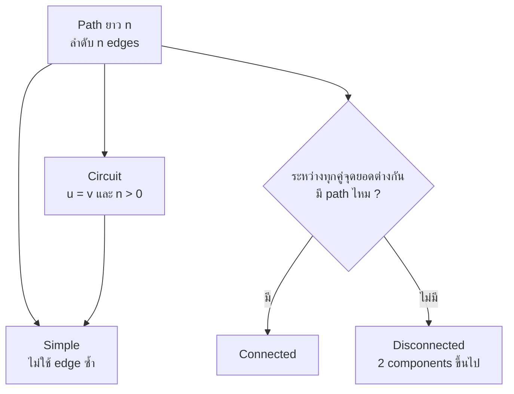
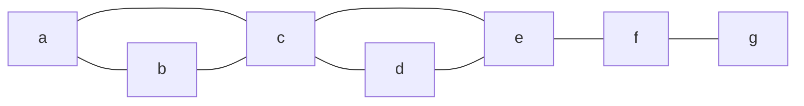
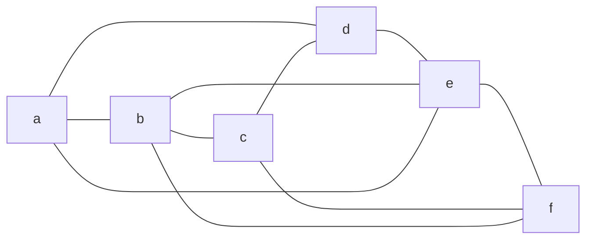
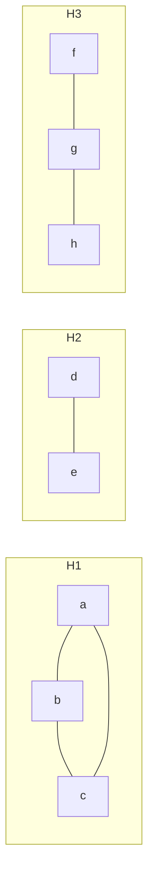
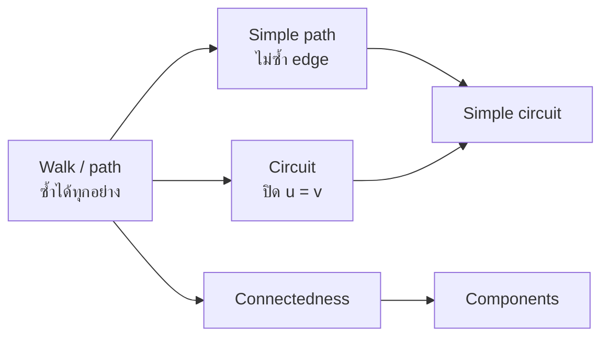

# Discrete Mathematics - Week12: Paths, Circuits and Connectedness

> **วิชา:** Discrete Mathematics | **ผู้สอน:** Dr. Sirasit Lochanachit
> **Source:** `Resources/Books/Discrete Mathematics/DM_Week12.pdf` สไลด์ p.27-39 (ทั้งไฟล์ 51 slides, หัวสไลด์ "Week 13: Graphs Part 2")
> **Reference:** `Resources/References/Paths, Cuts and Connectivity Interactive Notes.md` ส่วน Paths, Circuits and simple paths, Connectedness (Web Clipping, https://noswolf.github.io/DM_IT/Graphs/Connectivity.html)
> **ป้ายอ้างอิง:** `[p.N]` = เลขสไลด์ใน PDF, `[R2]` = Paths, Cuts and Connectivity reference ข้างบน, blockquote ที่ขึ้นต้น 💡 = เนื้อหาที่ผู้เขียนเพิ่มเอง
> **แบบฝึกหัด:** [[HW-Discrete-Math-04]] Section D

---

## Part 1: Macro Architecture & Overview

บทนี้เริ่มหัวข้อ Connectivity ของกราฟ (หัวข้อ 4 ในสไลด์ [p.27]) โดยเริ่มจาก **path** คือลำดับของ edges ที่เดินจากจุดยอดหนึ่งไปอีกจุดตาม edges ของกราฟ [p.27] จากนั้นกำหนด **circuit** และ **simple path/circuit** [p.29] ใช้ path อธิบายกราฟทางสังคม (acquaintanceship graph, Hollywood graph) [p.31-33] แล้วนิยาม **connected / disconnected** กับ **connected component** [p.36-38] เนื้อหาต่อเนื่องไปที่ [[Week12 - Cut Vertices, Edge Cuts and Connectivity]]

> 💡 แผนภาพนี้เป็นการจัดกลุ่มของผู้เขียนจากนิยามใน [p.28-29, 36] `[Source: generated — not verified against original document]`

### ตารางเปรียบเทียบคำเรียกลำดับจุดยอด (Rosen เทียบกับตำราอื่น) [R2]

[R2] ใช้คำตาม Rosen และชี้ว่าตำราอื่นเรียกแนวคิดเดียวกันต่างกัน:

| ลำดับ | Rosen | ตำราอื่น |
| :--- | :--- | :--- |
| เปิด edges และ vertices ซ้ำได้ | path | walk |
| เปิด ไม่ซ้ำ edge | simple path | trail |
| เปิด ไม่ซ้ำ vertex | simple path | path |
| ปิด ซ้ำอะไรก็ได้ | circuit | closed walk |
| ปิด ไม่ซ้ำ edge | simple circuit | circuit (closed trail) |
| ปิด ไม่ซ้ำ vertex ยกเว้นจุดปลาย | simple circuit | cycle |

---

## Part 2: Module-by-Module Deep Dive

### 2.1 Path [p.27-28][R2]

> 💡 **Intuition:** Path = "เส้นทาง" — คิดเป็นการเดินทางในกราฟ เช่น Bangkok → Saraburi → Korat (ตัวอย่างในสไลด์) เดินไปตาม edges ของกราฟ ทุกก้าวต้องไปยังจุดที่ adjacent กับจุดที่อยู่ (มี edge เชื่อม) ตามนิยามของ Rosen path เยี่ยมจุดซ้ำและเดิน edge ซ้ำได้ — ข้อบังคับมีแค่ว่าจุดที่ติดกันในลำดับต้อง adjacent
> [Source: generated — not verified against original document]

> **Informal definition:** path คือลำดับของ edges ที่เริ่มที่จุดยอดหนึ่งของกราฟ แล้วเดินจากจุดยอดไปจุดยอดตาม edges ของกราฟ ตัวอย่างในสไลด์: `Bangkok --- Saraburi --- Korat` [p.27]

**🧭 ทำความเข้าใจ** _[Source: generated — not verified against original document]_

**แตกวลีสำคัญ:**
- "ลำดับของ edges" → Path คือลำดับ ไม่ใช่เพียงเซต (ลำดับสำคัญ)
- "จุดยอดไปจุดยอดตาม edges" → จุดที่ต่อเนื่องในลำดับต้อง adjacent (มี edge เชื่อม)
- "ความยาว n" → จำนวน **edges** ไม่ใช่จำนวนจุดยอด

**ตัวอย่าง:**
- ✅ Path a → b → c → d ยาว 3 (3 edges) ไม่เยี่ยมจุดซ้ำ
- ✅ Path a → b → a → c ยาว 3 (เยี่ยมจุด a สองครั้ง, edge a–b ใช้สองครั้ง)
- ✅ Path a (ไม่มี edge) ยาว 0
- **ต่างกันตรง:** Simple path = ไม่ซ้ำ edge, Path ธรรมดา = ซ้ำได้

**อย่าสับสน:** ความยาวของ path a–b–c–d คือ **3 ไม่ใช่ 4** (นับ edges ไม่ใช่จุดยอด)

**เช็คความเข้าใจ:** ลำดับจุดยอด a, c, b, a เป็น path ยาวเท่าไร ในกราฟที่มี edges a–c, c–b, b–a

เฉลย

Path a → c → b → a มี edges ทั้ง 3 เส้น → ความยาว = 3

สไลด์เขียนหัวข้อ "Applications: Numerous problems can be modeled with paths formed by traveling along edges of graphs such as:" แต่ไม่มีรายการต่อท้ายใน p.27 (ตรวจจากภาพสไลด์แล้ว) ผู้เขียนจึงไม่เติมรายการเอง

> **Definition 1:** ให้ n เป็นจำนวนเต็มไม่ติดลบ และ G เป็น undirected graph **path ความยาว n จาก u ไป v** ใน G คือลำดับของ n edges e₁, …, eₙ ที่มีลำดับจุดยอด x₀ = u, x₁, …, xₙ₋₁, xₙ = v โดย eᵢ มี endpoints เป็น xᵢ₋₁ กับ xᵢ (i = 1, …, n) ถ้ากราฟเป็น simple graph เขียน path ด้วยลำดับจุดยอด x₀, x₁, …, xₙ ได้ [p.28]

เพิ่มจาก [R2]:
* ความยาวคือจำนวน edges ซึ่งน้อยกว่าจำนวนจุดยอดในลำดับอยู่ 1 จุดยอดเดี่ยว ๆ เป็น path ยาว 0
* สิ่งที่บังคับมีอย่างเดียวคือจุดยอดที่ติดกันในลำดับต้อง adjacent กัน path อาจเยี่ยมจุดยอดซ้ำและใช้ edge ซ้ำได้

---

### 2.2 Circuit และ simple path [p.29][R2]

> 💡 **Intuition:** Circuit = "วงจร" — path ที่กลับมาจุดเริ่มต้น (เช่น เที่ยวบิน Bangkok → Phuket → Bangkok ถ้าใช้เส้นทางเดียวกันไป-กลับ จะเป็น circuit ที่ไม่ simple) Simple = "ไม่มี edge ซ้ำ" คิดเป็นเที่ยวบินที่ไม่ใช้เส้นทางเดียวสองครั้ง (แต่อาจผ่านเมืองซ้ำได้ — simple ห้ามแค่ edge ซ้ำ)
> [Source: generated — not verified against original document]

> **Definition 2:** path เป็น **circuit** ถ้าเริ่มและจบที่จุดยอดเดียวกัน (u = v) และมีความยาวมากกว่า 0 path หรือ circuit เป็น **simple** ถ้าไม่มี edge เดียวกันซ้ำเกิน 1 ครั้ง path หรือ circuit **pass through** จุดยอด x₁, x₂, …, xₙ₋₁ และ **traverse** edges e₁, e₂, …, eₙ [p.29]

**🧭 ทำความเข้าใจ** _[Source: generated — not verified against original document]_

**แตกวลีสำคัญ:**
- "เริ่มและจบจุดเดียวกัน (u = v) ยาว > 0" → Circuit ต้องปิด และต้องมี edge อย่างน้อย 1 เส้น
- "Simple = ไม่มี edge ซ้ำเกิน 1 ครั้ง" → ทุก edge ในลำดับปรากฏ ไม่เกิน 1 ครั้ง (ไม่ห้ามจุดยอดซ้ำ)

**ตัวอย่าง:**
- ✅ Path a → b → c → a ยาว 3, circuit (ปิด) → simple circuit
- ❌ Path a → b → c → b → a ยาว 4 เป็น circuit (ปิด) แต่**ไม่ simple** (edge {b,c} และ {a,b} ใช้อย่างละ 2 ครั้ง)
- ❌ Path a → b → c → a → b **ไม่เป็น circuit** (ไม่ปิด เริ่มที่ a แต่จบที่ b) และไม่ simple ด้วย (ใช้ {a,b} 2 ครั้ง)
- **ต่างกันตรง:** Simple path = ไม่ซ้ำ edge, Simple circuit = ไม่ซ้ำ edge แต่ต้องปิด

**อย่าสับสน:** ใน simple graph simple circuit สั้นสุดยาว 3 (สามเหลี่ยม) ยาว 2 ไม่ได้ เพราะ a → b → a ต้องใช้ edge {a,b} สองครั้ง (ใน multigraph ที่มี 2 edges ระหว่าง a กับ b ยาว 2 ได้)

**เช็คความเข้าใจ:** ลำดับ a → b → c → d → c → a ใน simple graph เป็น simple path หรือ simple circuit หรือไม่ใช่ทั้งสองอย่าง

เฉลย

ไม่ใช่ทั้งสองอย่าง
1. เริ่มและจบที่ a และยาว 5 > 0 → เป็น **circuit**
2. แต่ edge {c,d} ใช้ 2 ครั้ง (c→d แล้ว d→c) → **ไม่ simple**
3. สรุป: เป็น circuit ที่ไม่ simple จึงไม่ใช่ simple circuit และไม่ใช่ simple path

เพิ่มจาก [R2]: ใน simple graph circuit ที่เป็น simple สั้นที่สุดยาว 3 เพราะ circuit u, v, u ใช้ edge {u, v} สองครั้ง

**ตัวอย่างจาก [R2]** (กราฟ 7 จุด a-g มี edges a–b, a–c, b–c, c–d, c–e, d–e, e–f, f–g):

_ที่มา: รูป fPath / fCirc / fNotSimple ใน [R2]_

| ลำดับ | ชนิด | เหตุผล [R2] |
| :--- | :--- | :--- |
| a, c, d, e, f | path ยาว 4 | 4 edges 5 จุดยอด |
| a, b, c, d, e, c, a | simple circuit ยาว 6 | ไม่มี edge ซ้ำ แต่เยี่ยมจุด c สองครั้ง |
| a, b, c, a, b | path ยาว 4 ที่ไม่ simple | ใช้ edge a–b ซ้ำ (ครั้งที่ 1 และ 4) |

---

### 2.3 ตัวอย่างในสไลด์: Path Example [p.30]

สไลด์ถาม "Which sequence is a path, circuit, or simple?" กับลำดับ a,d,c,f,e / d,e,c,a / b,c,f,e,b / a,b,e,d,a,b และเขียน edges ที่ผ่านของลำดับแรกเท่านั้น: {a,d}, {d,c}, {c,f}, {f,e} [p.30]

กราฟในสไลด์ (อ่านจากรูป) มี 6 จุด edges: a–b, b–c, d–e, e–f, a–d, b–e, c–f, a–e, b–f, c–d

_ต้นฉบับ: รูปกราฟ [p.30]_

> 💡 ผลการตรวจของผู้เขียนจากรูปด้านบน:
> * a, d, c, f, e: edges {a,d}, {d,c}, {c,f}, {f,e} มีครบและไม่ซ้ำ จึงเป็น simple path ยาว 4
> * d, e, c, a: ไม่มี edge {e, c} ใน G จึงไม่ใช่ path
> * b, c, f, e, b: เริ่มและจบที่ b ไม่ซ้ำ edge จึงเป็น simple circuit ยาว 4
> * a, b, e, d, a, b: เป็น path ยาว 5 ที่ใช้ edge {a, b} สองครั้ง จึงไม่ simple
>
> `[Source: generated — not verified against original document]`

---

### 2.4 Path ในกราฟทางสังคม [p.31-35]

* **Acquaintanceship graph:** มี path ระหว่างคน 2 คน ถ้ามีโซ่ของคนเชื่อมกัน โดยคน 2 คนที่ติดกันในโซ่รู้จักกัน [p.31] (รูปในสไลด์เป็นกราฟชื่อคน เช่น Eduardo, Jan, Paula, Todd)
* **Six degrees of separation:** นักสังคมศาสตร์หลายคนคาดว่าคนเกือบทุกคู่บนโลกเชื่อมกันด้วยโซ่ที่มีไม่เกิน 6 คน ซึ่งหมายความว่าเกือบทุกคู่จุดยอดในกราฟคนทั้งโลกเชื่อมกันด้วย path ที่ยาวไม่เกิน 5 [p.32]
* **Hollywood graph:** นักแสดง a กับ b เชื่อมกันเมื่อมีโซ่นักแสดงที่ทุก 2 คนติดกันเคยเล่นหนังเรื่องเดียวกัน [p.33]
* **Bacon number** ของนักแสดง c คือความยาวของ shortest path ระหว่าง c กับ Kevin Bacon [p.33] ลองเล่นที่ https://oracleofbacon.org/graph.php [p.33]

**Table 2: จำนวนนักแสดงที่มี Bacon number ที่กำหนด (as of August 2017)** [p.33]

| Bacon number | จำนวนคน |
| :---: | ---: |
| 0 | 1 |
| 1 | 3,452 |
| 2 | 401,636 |
| 3 | 1,496,104 |
| 4 | 390,878 |
| 5 | 4,388 |
| 6 | 631 |
| 7 | 131 |
| 8 | 9 |
| 9 | 1 |

p.34-35 เป็นรูป "Six Degrees of Kevin Bacon" (อ้าง oracleofbacon.org และไฟล์รูปจาก wordpress) ไม่มีข้อความนิยามเพิ่ม

---

### 2.5 Connectedness [p.36-39][R2]

> 💡 **Intuition:** Connected = "เชื่อมกันเป็นชิ้นเดียว" — จากจุดใดก็เดินไปถึงจุดอื่นได้ทุกจุด (ไม่มีเกาะแยก) เหมือนเครือข่ายสื่อสารที่ทั้งหมดรับส่งข้อมูลกันได้ Disconnected คือกราฟแยกออกเป็นชิ้นๆ (เหมือนเครือข่ายสองเมืองที่ไม่มีถนนเชื่อม)
> [Source: generated — not verified against original document]

> **Definition 3:** undirected graph เป็น **connected** ถ้ามี path ระหว่างทุกคู่ของจุดยอดที่ต่างกัน กราฟที่ไม่ connected เรียก **disconnected** [p.36]

**🧭 ทำความเข้าใจ** _[Source: generated — not verified against original document]_

**แตกวลีสำคัญ:**
- "ทุกคู่ของจุดยอดที่ต่างกัน" → ต้องมี path ระหว่าง v₁ และ v₂ (ไม่มี path ระหว่างคู่ใดคู่หนึ่ง = disconnected)
- "path" → path ธรรมดาพอ (ไม่ต้อง simple)

**ตัวอย่าง:**
- ✅ ต้นไม้ (tree) → connected (นิยามของต้นไม้คือกราฟ connected ที่ไม่มี simple circuit)
- ✅ Complete graph K_n → connected
- ❌ กราฟสองชิ้น: {a,b} เชื่อม, {c,d} เชื่อมแยก → disconnected (ไม่มี path a–c)
- **ต่างกันตรง:** Connected = ทุกคู่จุดมี path ถึงกัน (1 component), Disconnected = มีอย่างน้อย 1 คู่ที่ไม่มี path (≥ 2 components)

**อย่าสับสน:** Connected ต้องการแค่ **path** ไม่ต้องมี **edge ตรง** ทุกคู่ — path a–b–c ก็พอสำหรับคู่ a กับ c (กรณีมี edge ตรงทุกคู่คือ complete graph)

**เช็คความเข้าใจ:** กราฟสี่เหลี่ยม a–b–c–d–a เป็น connected ไหม เพราะเหตุใด

เฉลย

ใช่ connected เพราะทุกคู่ของจุดมี path ถึงกัน: คู่ที่ติดกัน (a,b), (b,c), (c,d), (d,a) ใช้ edge ตรง ส่วนคู่ตรงข้าม a กับ c ใช้ path a–b–c และ b กับ d ใช้ path b–c–d

* เราพูดว่า "disconnect" กราฟ เมื่อลบ vertices หรือ edges หรือทั้งสองอย่างจนได้ subgraph ที่ไม่ connected [p.37]
* ตัวอย่างในสไลด์: คอมพิวเตอร์ 2 เครื่องใดๆ ในเครือข่ายสื่อสารกันได้ ก็ต่อเมื่อกราฟ connected [p.37]
* รูป G₁ และ G₂ ใน p.37 (อ่านจากรูป): G₁ มี edges a–b, a–c, b–c, c–f, c–d, f–d, f–g, d–e เชื่อมกันทั้งหมด ส่วน G₂ มี edges a–b, a–c, e–d, e–f, d–f แยกเป็น 2 ก้อน สไลด์ไม่ระบุคำตอบ ข้อสรุปว่า G₁ connected และ G₂ disconnected เป็นของผู้เขียน `[Source: generated — not verified against original document]`

> **Definition 4 (Connected component):** connected component ของ G คือ connected subgraph ของ G ที่ไม่เป็น proper subgraph ของ connected subgraph อื่นของ G กราฟ G ที่ไม่ connected มี connected components ตั้งแต่ 2 ก้อนขึ้นไป ซึ่ง disjoint กันและมี G เป็น union [p.38]

_ต้นฉบับ: รูป H₁, H₂, H₃ และกราฟ H ที่เป็น union [p.38]_

เพิ่มจาก [R2]:
* ทุกจุดยอดอยู่ใน component เดียวพอดี และกราฟ connected ก็ต่อเมื่อมี 1 component
* **Theorem:** ทุกคู่จุดยอดที่ต่างกันของ undirected graph ที่ connected มี simple path เชื่อมกัน แนวพิสูจน์: เอา shortest path จาก u ไป v ถ้ามันเยี่ยมจุดซ้ำ ส่วนระหว่าง 2 ครั้งที่เยี่ยมตัดออกได้ ได้ path ที่สั้นกว่า ดังนั้น shortest path ไม่ซ้ำจุดและไม่ซ้ำ edge

**ตัวอย่าง "Connected Graphs Example" [p.39]** (อ่านจากรูป สไลด์ไม่มีเฉลย):

> 💡 กราฟซ้ายมีจุด i, j, k, l, m, n, o, x และ edges i–n, i–x, n–x, n–m, m–l, x–l, j–x, o–m, k–l จึง connected กราฟขวามีจุด x, y, z, v ที่เชื่อมกันครบทุกคู่ (K₄) กับจุด u, w ที่เชื่อมกันด้วยเส้นโค้ง 2 เส้น และไม่มี edge ระหว่างสองกลุ่ม จึง disconnected มี 2 components คือ {x, y, z, v} กับ {u, w} `[Source: generated — not verified against original document]`

#### 💡 เสริม: Connected Component (ส่วนประกอบที่เชื่อมกัน)

> 💡 **Intuition:** ถ้ากราฟแตกเป็นหลายเกาะ แต่ละเกาะที่เดินถึงกันได้หมดคือ connected component — เป็นชิ้นที่ใหญ่สุดที่ยังเชื่อมกันได้ และแต่ละจุดอยู่ในชิ้นเดียวเท่านั้น (analogy ใช้ไม่ได้ตรงที่เกาะจริงมองเห็นขอบเขตชัด แต่ใน graph ต้องดูจาก edge จริง จุดที่ไม่มี edge ออกเลยจะเป็น component ของตัวเองเสมอ)
> [Source: generated — not verified against original document]

**แตกวลีสำคัญ:**
- "connected subgraph ที่ไม่ใช่ proper subgraph ของอีกชิ้น" → ชิ้นที่ใหญ่สุดที่ยังเชื่อมกัน ไม่ถูกบรรจุอยู่ในชิ้นที่ใหญ่กว่าที่ยังเชื่อมกัน
- "disjoint และ union = G" → ทุกจุดอยู่ใน component เดียวพอดี ไม่ซ้อนกัน
- "กราฟ connected ⇔ มี component เดียว" → ถ้ามีตั้งแต่ 2 ชิ้นขึ้นไปคือไม่ connected

**ตัวอย่าง:** กราฟที่มีจุด {1,2,3,4,5} และ edge 1–2, 2–3, 4–5
- ✅ มี 2 components: {1,2,3} และ {4,5} (ไม่มี edge ข้ามกลุ่ม)
- ❌ นับ {1, 2} เป็น component แยก ทั้งที่ 2 เชื่อมกับ 3 อยู่ → {1,2} ไม่ใช่ชิ้นที่ใหญ่สุด (ถูกบรรจุใน {1,2,3})
- **ต่างกันตรง:** component ต้อง "ใหญ่สุดในแง่ connected" ไม่ใช่แค่ "มีบางส่วนที่เชื่อมกัน"

**อย่าสับสน:** "connected" ≠ "มีจุดเยอะ" — กราฟที่มี 1 จุดเดียวก็ connected ได้ (มี component เดียว)

**เช็คความเข้าใจ:** ถ้าเพิ่ม edge 3–4 เข้าไปในกราฟข้างบน จะมีกี่ components

เฉลย

เหลือ **1 component** คือ {1,2,3,4,5} เพราะ 3–4 เชื่อมสองกลุ่มเข้าด้วยกัน → กราฟ connected

#### 💡 เสริม: Theorem — ทุกคู่จุดยอดของกราฟ connected มี Simple Path

> 💡 **Intuition:** ถ้าเดินจาก u ไป v ได้ เส้นทางที่สั้นที่สุดจะไม่เยี่ยมจุดเดิมซ้ำ เพราะถ้าซ้ำ ก็ตัดส่วนวนนั้นออกได้เส้นทางที่สั้นกว่า ดังนั้น "เดินถึงได้" รับประกันว่ามี path แบบไม่ซ้ำจุดอย่างน้อยหนึ่งเส้น (analogy ใช้ไม่ได้ตรงที่เส้นทางในชีวิตจริงมักมีหลายทาง ส่วนทฤษฎีนี้รับประกันแค่ว่ามีอย่างน้อยหนึ่ง)
> [Source: generated — not verified against original document]

**แตกวลีสำคัญ:**
- "simple path" → path ที่ไม่เยี่ยมจุดซ้ำ
- "walk" → การเดินที่ซ้ำจุดได้ (ยังไม่ใช่ path)
- "shortest path ไม่วนซ้ำ" → วิธีพิสูจน์: เลือก walk ที่สั้นสุด ถ้าซ้ำจุดจะตัดรอบออกได้สั้นกว่า (ขัดกับความสั้นสุด)

**ตัวอย่าง:** กราฟ edge a–b, b–c, c–a, c–d
- ✅ a ไป d: a–c–d เป็น simple path (ไม่ซ้ำจุด)
- ❌ walk a–b–c–a–c–d เป็น walk ที่ถูกต้อง แต่ไม่ใช่ simple path เพราะจุด c ปรากฏสองครั้ง
- **ต่างกันตรง:** walk เดินซ้ำจุดได้ ส่วน simple path ห้ามซ้ำจุด

**อย่าสับสน:** ทฤษฎีนี้ใช้กับกราฟ connected เท่านั้น — จุดที่อยู่คนละ component ไม่มี path เชื่อมกันเลย

**เช็คความเข้าใจ:** ในกราฟ a–b, b–c, c–a, c–d มี simple path จาก b ไป d กี่เส้น

เฉลย

- b–c–d ✅ (ไม่ซ้ำจุด)
- b–a–c–d ✅ (ไม่ซ้ำจุด)
→ **2 simple paths**

---

## Part 3: Quick Reference & Exam Cheat Sheet

### Checklist สรุปหัวใจสำคัญก่อนสอบ
* [ ] **Path ยาว n:** ลำดับ n edges ไม่ใช่ n จุดยอด จุดยอดเดี่ยวคือ path ยาว 0 [p.28][R2]
* [ ] **Circuit:** เริ่มและจบจุดเดียวกัน (u = v) และยาว > 0 [p.29]
* [ ] **Simple:** ไม่ใช้ edge ซ้ำ (ไม่ได้ห้ามเยี่ยมจุดซ้ำ) [p.29][R2]
* [ ] **Six degrees:** โซ่ 6 คน คือ path ยาว 5 [p.32]
* [ ] **Bacon number:** ความยาว shortest path ไปหา Kevin Bacon [p.33]
* [ ] **Connected:** มี path ระหว่างทุกคู่ของจุดยอดที่ต่างกัน [p.36]
* [ ] **Component:** connected subgraph ที่ใหญ่สุด, disjoint, union = G [p.38]
* [ ] **Connected graph:** มี simple path ระหว่างทุกคู่ [R2]

### สรุปสูตร / Notation ที่สำคัญ

| Notation | ความหมาย |
| :--- | :--- |
| $x_0, x_1, \dots, x_n$ | path ยาว n ใน simple graph [p.28] |
| $u = v,\ n > 0$ | circuit [p.29] |
| $G - V'$ | กราฟที่ลบเซตจุดยอด V′ พร้อม edges ที่ติดกัน |
| $c(G)$ | จำนวน connected components (G connected ⇔ c(G) = 1) สัญลักษณ์ c ใช้ใน [R3] ส่วนเนื้อหา "connected ⇔ 1 component" อยู่ใน [R2] |

### Concept Map

> 💡 Concept map นี้เป็นการสรุปของผู้เขียน และใช้ชื่อ "walk" ของ [R2] ในตารางเปรียบเทียบ `[Source: generated — not verified against original document]`

---

## ⚠️ Common Pitfalls & Exam Traps

* **นับความยาว path เป็นจำนวนจุดยอด:** ความยาว = จำนวน edges ลำดับ a, d, c, f, e ยาว 4 ไม่ใช่ 5 [p.28, 30][R2]
* **คิดว่า simple หมายถึงไม่ซ้ำจุดยอด:** ตามนิยามของสไลด์ simple คือไม่ซ้ำ edge circuit a, b, c, d, e, c, a เป็น simple circuit ทั้งที่เยี่ยม c สองครั้ง [p.29][R2]
* **ใช้คำ circuit กับ cycle สลับกัน:** [R2] เตือนว่า Rosen เรียก circuit แต่ตำราอื่นเรียกว่า walk, trail, cycle ต้องดูนิยามของตำราที่ใช้ก่อนตอบ
* **คิดว่า six degrees คือ path ยาว 6:** สไลด์บอกโซ่ไม่เกิน 6 คน ซึ่งเท่ากับ path ยาวไม่เกิน 5 [p.32]
* **ตรวจ connected แค่จุดยอดที่ติดกัน:** ต้องมี path ระหว่างทุกคู่ของจุดยอดที่ต่างกัน และรูปที่ดูใกล้กันอาจเป็นคนละ component (เช่น กราฟขวาของ p.39)
* **คิดว่า Bacon number คือจำนวนหนังที่เล่นร่วมกัน:** สไลด์นิยามเป็นความยาวของ shortest path [p.33]

**ข้อสังเกตเกี่ยวกับต้นฉบับ (ไม่แก้ในเนื้อหา):**
* หัวสไลด์เขียน "Week 13" แต่ชื่อไฟล์เป็น Week12
* p.27 มีหัวข้อ "Applications ... such as:" แต่ไม่มีรายการ
* p.30 แสดง edges ของลำดับแรกเท่านั้น ลำดับที่เหลือไม่มีเฉลยในสไลด์
* p.37 (G₁, G₂) และ p.39 ไม่มีเฉลย คำตอบข้างบนเป็นของผู้เขียนที่อ่านจากรูป
* p.33 ตาราง Bacon number มีหัวตาราง "as of August 2017" ข้อมูลอาจต่างจากปัจจุบัน
* [R2] เขียนว่า circuit "also called a cycle" แต่ตารางของ [R2] เองให้ cycle หมายถึง circuit ที่ไม่ซ้ำจุดยอด (ยกเว้นจุดปลาย) จึงไม่เหมือนกับ circuit ทั่วไปทุกกรณี เก็บตามต้นฉบับ
* เลขนิยามในสไลด์เริ่มใหม่ที่ p.28 (Definition 1) หลังจากเลข 1-10 ในหัวข้อ bipartite จึงมีเลขซ้ำกับหัวข้ออื่น เช่น Definition 4 ใน p.2 และ p.38

---

## เอกสารเชื่อมโยง (Wiki-Style Backlinks)
* **วิชาและหัวข้อที่เกี่ยวข้อง:**
  * [[Week11 - Graphs, Graph Terminology and Representing Graphs]] (นิยามกราฟ, degree, adjacency ที่ใช้นิยาม path)
  * [[Week10 - Properties of Relations]] (connectivity relation และ transitive closure สัมพันธ์กับการมี path ระหว่างจุดยอด)
  * [[Week12 - Bipartite Graphs and Matchings]] (alternating/augmenting path ใช้นิยาม path ของบทนี้)
  * [[Week12 - Cut Vertices, Edge Cuts and Connectivity]] (หัวข้อถัดไป: ลบจุดยอดหรือ edge แล้ว connectedness เปลี่ยนอย่างไร)
  * [[Week13 - Euler Circuits and Paths]] (simple circuit ที่ผ่านทุก edge)
  * [[HW-Discrete-Math-04]] (แบบฝึกหัดพร้อมเฉลย Section D)

* **แหล่งข้อมูล:**
  * Source: `Resources/Books/Discrete Mathematics/DM_Week12.pdf` (51 slides, Dr. Sirasit Lochanachit)
  * Source: `Resources/References/Paths, Cuts and Connectivity Interactive Notes.md` (Web Clipping, https://noswolf.github.io/DM_IT/Graphs/Connectivity.html)
  * Reference: https://oracleofbacon.org/graph.php (Bacon number)
