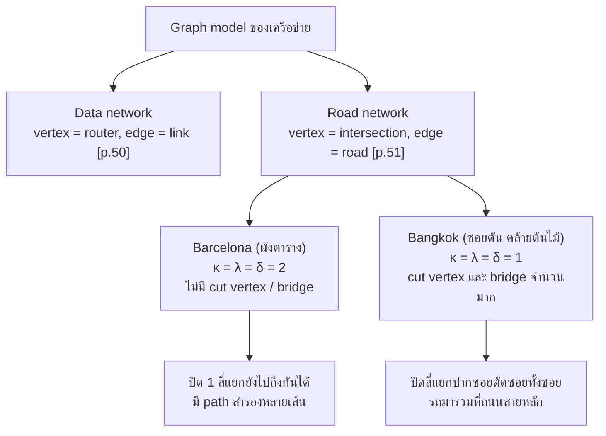
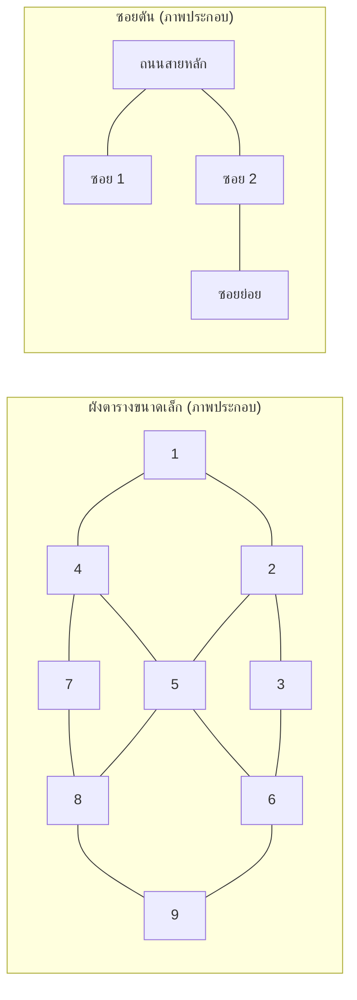
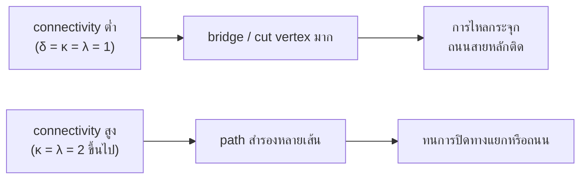

# Discrete Mathematics - Week12: Road Network Connectivity, Barcelona vs Bangkok

> **วิชา:** Discrete Mathematics | **ผู้สอน:** Dr. Sirasit Lochanachit
> **Source:** `Resources/Books/Discrete Mathematics/DM_Week12.pdf` สไลด์ p.50-51 (ทั้งไฟล์ 51 slides, หัวสไลด์ "Week 13: Graphs Part 2")
> **Reference:** `Resources/References/Roadblocks and connectivity Barcelona vs Bangkok.md` (Web Clipping ของ simulation, https://noswolf.github.io/DM_IT/Graphs/Roadblocks.html)
> **ป้ายอ้างอิง:** `[p.N]` = เลขสไลด์ใน PDF, `[R3]` = Roadblocks reference ข้างบน, blockquote ที่ขึ้นต้น 💡 = เนื้อหาที่ผู้เขียนเพิ่มเอง
> **แบบฝึกหัด:** [[HW-Discrete-Math-04]] Section G

---

## Part 1: Macro Architecture & Overview

สไลด์ปิดหัวข้อ connectivity ด้วยการประยุกต์ใช้: **graph connectivity มีบทบาทสำคัญต่อความน่าเชื่อถือ (reliability) ของเครือข่าย** [p.50] เครือข่ายข้อมูล model ด้วยจุดยอดเป็น router และ edge เป็น link ระหว่างกัน [p.50] เครือข่ายถนน model ด้วยจุดยอดเป็นทางแยก (intersection) และ edge เป็นถนนระหว่างทางแยก [p.51] Reference [R3] เป็น simulation ที่เอาแนวคิดนี้ไปเทียบถนนสองเมือง: ผังตารางแบบ Eixample ของ Barcelona (`κ = λ = δ = 2`) กับเครือข่ายซอยตันของ Bangkok ที่คล้ายต้นไม้ (`κ = λ = δ = 1`) การปิดสี่แยกหรือถนนจึงให้ผลต่างกันมาก

_ที่มา: สไลด์ [p.50-51] และ "Reading the two cities" ใน [R3]_

### ตารางเปรียบเทียบ Barcelona กับ Bangkok (ตามข้อความใน [R3])

| หัวข้อ | Barcelona | Bangkok |
| :--- | :--- | :--- |
| โครงสร้าง | ใกล้ grid graph (Eixample) | ซอยตันแตกจากถนนสายหลักเหมือนต้นไม้เล็ก ๆ |
| degree ที่พบ | interior intersection degree 4 (6 ตรงที่ Diagonal ตัด), มุมทั้ง 4 degree 2 | ปลายซอยตัน degree 1 |
| δ = κ = λ | 2 | 1 |
| Cut vertices / bridges | ไม่มี | จาก 99 intersections เป็น cut vertex 52 จุด; จาก 103 road segments เป็น bridge 70 เส้น |
| Independent loops | 45 | 5 (เกิดจากถนนสายหลักกับซอยทะลุ Asok, Thong Lo, Ekkamai) |
| เส้นทางระหว่าง 2 interior intersections | 4 เส้นที่ไม่ซ้ำจุดภายในกัน | ทุกเที่ยวที่เริ่มลึกในซอยต้องผ่านปากซอย |
| ผลต่อจราจร | ถนนโล่ง | ถนนสายหลักติดแม้ยังไม่ปิดอะไร เพราะ connectivity ต่ำทำให้การไหลกระจุก |

---

## Part 2: Module-by-Module Deep Dive

### 2.1 สไลด์: การประยุกต์ใช้ connectivity [p.50-51]

* **Data network [p.50]:** vertices แทน router, edges แทน link ระหว่าง router รูปในสไลด์เป็นแผนภาพเครือข่ายของมหาวิทยาลัย (อ้าง https://its.umich.edu/enterprise/wifi-networks/campus-network-diagram-description)
* **Road network [p.51]:** vertices แทนทางแยก, edges แทนถนนที่วิ่งระหว่างทางแยก รูปในสไลด์เป็นภาพถ่ายทางอากาศของผังถนนในเมือง (อ้าง https://twitter.com/doverview/status/590242249201602560) สไลด์ไม่ได้ระบุว่าเป็นเมืองใด

ผูกกับหัวข้อก่อนหน้า: cut vertex ใน data network คือ router ส่วน cut edge คือ link [p.40] ดู [[Week12 - Cut Vertices, Edge Cuts and Connectivity]]

---

### 2.2 แนวคิดเบื้องหลัง simulation [R3]

**Definitions** (G เป็นกราฟ connected):
* **κ(G):** จำนวนจุดยอดน้อยที่สุดที่ลบแล้วเหลือกราฟ disconnected หรือจุดเดียว
* **λ(G):** จำนวน edges น้อยที่สุดที่ลบแล้วเหลือกราฟ disconnected
* โดยธรรมเนียม ทั้งคู่เป็น 0 สำหรับกราฟ disconnected และ κ(Kn) = n − 1
* **Cut vertex:** จุดเดียวที่ลบแล้วเพิ่ม components, **bridge:** edge เดียวที่มีสมบัติเดียวกัน กราฟ connected ที่มีอย่างน้อย 3 จุดมี κ(G) = 1 ก็ต่อเมื่อมี cut vertex และ λ(G) = 1 ก็ต่อเมื่อมี bridge ในภาษาถนน อุบัติเหตุหนึ่งครั้งที่ cut vertex หรือต้นไม้ล้มทับ bridge หนึ่งเส้นก็แบ่งเมืองได้

**Whitney's inequality:** κ(G) ≤ λ(G) ≤ δ(G)
* ด้านขวา: เอาสี่แยกที่มีถนนน้อยที่สุด (δ(G) เส้น) แล้วปิดถนนทั้งหมด สี่แยกนั้นถูกตัดขาด λ(G) จึงไม่เกิน δ(G)
* ด้านซ้าย: การปิดสี่แยกมีพลังอย่างน้อยเท่าการปิดถนน เพราะจากชุดถนนที่ปิดแล้วแบ่งเมืองได้ เลือกปลายข้างที่เหมาะสมของแต่ละถนนมาปิดแทนได้โดยปิดไม่มากกว่าเดิม

**Menger's theorem:** สำหรับจุดยอด u, v ที่ไม่ adjacent จำนวนมากสุดของ path u–v ที่ไม่ใช้จุดร่วมกัน (ยกเว้น u และ v) เท่ากับจำนวนจุดยอดน้อยสุดที่ลบแล้วแยก u จาก v รุ่น edge สลับคำว่า vertex เป็น edge G เป็น k-connected ก็ต่อเมื่อทุกคู่จุดยอดเชื่อมกันด้วย k path ที่ไม่ซ้ำจุดภายใน สำหรับคนขับรถ κ คือจำนวนทางเลี่ยงอิสระที่รับประกันได้

**Independent loops:** คือ cycle rank $|E| - |V| + c$ โดย c คือจำนวน components นับว่าลบ edges ได้กี่เส้นก่อนกราฟกลายเป็น forest

---

### 2.3 อ่านผังสองเมือง [R3]

**Barcelona:** Eixample ใกล้ grid graph ทางแยกด้านในมี degree 4 (6 ตรงที่ Diagonal ตัด) ส่วนมุมทั้ง 4 มี degree 2 จึง κ = λ = δ = 2 ไม่มี cut vertex หรือ bridge มี independent loops 45 วง คนขับมีทางเลือกมาก ระหว่าง interior intersection สองจุดมี 4 route ที่ไม่ซ้ำจุดภายใน

**Bangkok:** ซอยจำนวนมากเป็นทางตันแตกจากถนนสายหลักเหมือนต้นไม้ ปลายซอยตัน degree 1 จึง δ = κ = λ = 1 จาก 99 intersections มี cut vertex 52 จุด และจาก 103 road segments มี bridge 70 เส้น มี independent loops แค่ 5 วง เกิดจากถนนสายหลักกับซอยทะลุ Asok, Thong Lo และ Ekkamai ทุกเที่ยวที่เริ่มลึกในซอยต้องผ่านปากซอย จึงทำให้ถนนสายหลักติดก่อนจะมีการปิดอะไรเสียอีก

> 💡 แผนภาพนี้เป็นภาพประกอบของผู้เขียนเพื่อเปรียบเทียบ grid กับโครงสร้างต้นไม้ ไม่ใช่แผนที่จริงของ [R3] ใน grid 3×3 นี้ มุม 4 จุดมี degree 2 และ κ = λ = 2 ตรงกับที่ [R3] พิสูจน์สำหรับ grid m × n ส่วนซอยตันทุก edge เป็น bridge `[Source: generated — not verified against original document]`

### Snapshot จาก panel ของ simulation [R3]

panel ใน [R3] เป็นค่าหลังปิดสี่แยกในหน้าจอที่ clip ไว้ ไม่ใช่ค่าของเครือข่ายตั้งต้น (ผู้เขียนจับคู่ panel แรกกับ Barcelona และ panel ที่สองกับ Bangkok ตามลำดับประโยคใน [R3] เพราะ clip ไม่มีป้ายชื่อเมือง):

| ค่า | Barcelona (ปิด 2 สี่แยก) | Bangkok (ปิด 1 สี่แยก) |
| :--- | :--- | :--- |
| ผลการปิด | ตัดขาด 1 สี่แยก, แยกเป็น 2 ส่วน | ตัดขาด 10 สี่แยก, แยกเป็น 3 ส่วน |
| \|V\| / \|E\| | 52 / 92 | 98 / 99 |
| Independent loops | 42 | 4 |
| Cut vertices / Bridges | 0 / 0 | 54 / 72 |
| Pairs ที่ไปถึงกันได้ | 96% | 81% |
| Average speed | 92% | 52% |
| Cars crawling / Drivers stranded | 6 / 4 | 35 / 6 |
| Jammed road segments | 1 | 7 |
| Trips finished (25 วินาทีล่าสุด) | 95 | 17 |
| κ(G) ≤ λ(G) ≤ δ(G) | 0 ≤ 0 ≤ 0 | 0 ≤ 0 ≤ 1 |

> 💡 ตรวจสูตร cycle rank กับ panel: Barcelona 92 − 52 + 2 = 42 และ Bangkok 99 − 98 + 3 = 4 ตรงกับค่า Independent loops ใน panel จึงสรุปได้ว่าตัวเลขใน panel เป็นกราฟหลังปิดสี่แยก ส่วนตัวเลข 99 / 103 / 52 / 70 / 5 / 45 ในข้อความเป็นเครือข่ายตั้งต้น `[Source: generated — not verified against original document]`

---

### 2.4 กิจกรรมในชั้นเรียน (Try this in class) [R3]

โจทย์ 5 ข้อนี้ออกแบบสำหรับ simulation เวอร์ชันโต้ตอบ (ไฟล์ใน vault เป็นเพียง web clipping ไม่มีตัว simulator) เก็บไว้ให้ทำเมื่อเปิดหน้าเว็บ https://noswolf.github.io/DM_IT/Graphs/Roadblocks.html:
1. เทียบ average speed และสีของถนนสายหลักของสองเมืองก่อนปิดอะไร ถามว่าทำไม Sukhumvit Road และ Thong Lo เป็นสีเหลืองอำพันและแดง ขณะที่ถนนใน Barcelona โล่ง
2. เลือก *Close an intersection* ปิดสี่แยก Sukhumvit หนึ่งแห่งที่ปากซอย ดูรถในซอย แล้วเปิด *Highlight cut vertices and bridges*
3. ใน Barcelona หาจำนวนการปิดน้อยที่สุดที่ทำให้ grid disconnected ผู้เรียนควรพบว่าได้ 2 และทำได้ทางเดียวคือขังมุม
4. เลือก *Trace disjoint routes* กับ interior intersection 2 จุดใน Barcelona แล้วกับปลายซอยตันใน Bangkok และจุดบน Sukhumvit Road เทียบจำนวนกับ Menger's theorem
5. กด *Worst-case strike* ทั้งโหมดสี่แยกและโหมดถนน ระบบปิด minimum cut ที่ทำให้สี่แยกถูกตัดขาดมากที่สุด และรายงานความเสียหาย

---

### 2.5 คำถามอภิปรายพร้อมเฉลยใน [R3]

**Q1. พิสูจน์ว่า grid graph ขนาด m × n (m, n ≥ 2) มี κ = λ = 2**
มุมมี degree 2 จึง λ ≤ δ = 2 สำหรับ κ ≥ 2: ลบจุด x ใดๆ เลือกแถวและคอลัมน์ที่ไม่ผ่าน x ทั้งคู่ รวมกันเป็นกากบาทที่ connected จุด u อื่นอยู่ในแถวที่ไม่ผ่าน x หรือในคอลัมน์ที่ไม่ผ่าน x (u ไม่อาจแชร์ทั้งแถวและคอลัมน์กับ x พร้อมกัน) แล้ววิ่งตรงตามเส้นนั้นจนชนกากบาท จึงไม่มีจุดเดียวที่ทำให้ grid disconnected และ Whitney ให้ 2 ≤ κ ≤ λ ≤ 2

**Q2. ทำไมทุก edge ของต้นไม้เป็น bridge และทุกจุดที่ไม่ใช่ใบเป็น cut vertex**
ต้นไม้มี path เดียวระหว่างจุดยอดสองจุดใดๆ ลบ edge uv ทำลาย path u–v เพียงเส้นเดียว u กับ v จึงอยู่คนละ component จุด w ที่ไม่ใช่ใบมีเพื่อนบ้านสองจุดที่ path เชื่อมกันเส้นเดียวผ่าน w ผังซอยตันคือต้นไม้ที่ห้อยจากทางแยกเดียว ซึ่งเป็นเหตุผลที่แผนที่ Bangkok เต็มไปด้วยสีม่วงเมื่อเปิด highlight

**Q3. หากราฟที่ κ(G) < λ(G) และอธิบายเป็นเมือง**
สามเหลี่ยมสองรูปที่ใช้จุดร่วมกันหนึ่งจุด ("bowtie") มี κ = 1 แต่ λ = 2 ในรูปเมือง: ย่านที่เชื่อมกันดี 2 ย่านมาบรรจบกันที่วงเวียนเดียว อุบัติเหตุที่วงเวียนแบ่งเมือง แต่ถ้าใช้ roadblock ต้องปิดถนน 2 เส้นจึงจะแบ่งได้เท่ากัน

**Q4. ต้องสร้างทางเชื่อมใหม่กี่เส้นเพื่อให้ model ของ Bangkok เป็น 2-edge-connected**
ย่อทุกชิ้นที่เป็น 2-edge-connected เป็นจุดเดียว bridges จะกลายเป็นต้นไม้ Eswaran และ Tarjan (1976) แสดงว่าต้องใช้และพอดี ⌈p/2⌉ edges โดย p คือจำนวนใบของต้นไม้นั้น ใน model นี้ p = 31 จึงต้องสร้าง 16 เส้น แต่ละเส้นเชื่อมปลายซอยตัน 2 ปลาย นี่คือรุ่นทางทฤษฎีของแนวคิดเชื่อมซอยข้างเคียง

**Q5. ทำทุกถนนในแต่ละ model เป็นทางเดินรถทางเดียวได้ไหม โดยทุกคนยังไปถึงทุกปลายทางได้**
คำถามนี้ขอ strongly connected orientation (reachability relation ของ digraph ที่ได้เป็น total) Robbins' theorem (1939) บอกว่ากราฟ connected มีได้ก็ต่อเมื่อไม่มี bridge grid ของ Barcelona ผ่านเกณฑ์ ระบบทางเดียวจึงรักษาการไปถึงทุกสี่แยกได้ ส่วน bridge ใดๆ ใน Bangkok เช่นซอยตัน ต้องเป็นสองทางไม่เช่นนั้นคนขับติดอยู่ปลายซอย

**Q6. โครงการ superilla (superblock) ของ Barcelona ปิดถนนด้านในบางสายไม่ให้รถผ่าน ทำไม grid รับได้**
ลองปิดถนนด้านในบางเส้นใน simulation แล้วดู κ กับ λ เพราะจุดด้านในมี degree 4 และ grid มี independent loops มาก ลบ edges ด้านในได้หลายเส้นโดยไม่เกิด bridge ค่าต่ำสุด 2 ที่มาจากมุมจึงไม่ลดลง ส่วนในผังซอย edge เกือบทุกเส้นเป็น bridge อยู่แล้ว จึงไม่มีความจุสำรองให้ปล่อย

### Model notes [R3]
* แผนที่ทั้งสองเป็น stylised ไม่ตรงสเกล และหมายเลขซอยเป็นค่าประมาณ ถนนทุกเส้นถือเป็นสองทาง
* คนขับแต่ละคนสุ่มปลายทาง และเลือกเส้นทางที่เร็วที่สุดในขณะนั้นที่ทุกสี่แยก
* ถนนช้าลงเมื่อรถเกินความจุ ตามเส้นโค้งคล้ายฟังก์ชัน BPR ที่ใช้ในการวางแผนขนส่ง ถนนสายหลักรับรถได้มากกว่าซอย
* คนขับที่ไม่มีเส้นทางรอประมาณ 3.5 วินาทีแล้วสุ่มปลายทางใหม่
* κ(G) และ λ(G) คำนวณใหม่หลังทุกการเปลี่ยนด้วย maximum flow จึงเป็นค่าที่แน่นอนของกราฟขณะนั้น
* รถวิ่งชิดขวาใน Barcelona และชิดซ้ายใน Bangkok เหมือนจริง

---

## Part 3: Quick Reference & Exam Cheat Sheet

### Checklist สรุปหัวใจสำคัญก่อนสอบ
* [ ] **Model:** router = vertex, link = edge [p.50]; intersection = vertex, road = edge [p.51]
* [ ] **Cut vertex / bridge ในถนน:** อุบัติเหตุที่ cut vertex หรือต้นไม้ล้มที่ bridge ก็แบ่งเมือง [R3]
* [ ] **Whitney:** κ ≤ λ ≤ δ (ปิดถนนทุกเส้นที่สี่แยก degree ต่ำสุดก็ตัดสี่แยกนั้นได้) [R3]
* [ ] **Menger:** G k-connected ⇔ ทุกคู่จุดยอดมี k path ที่ไม่ซ้ำจุดภายใน [R3]
* [ ] **grid m × n (m, n ≥ 2):** κ = λ = 2 [R3]
* [ ] **ต้นไม้:** ทุก edge เป็น bridge และทุกจุดที่ไม่ใช่ใบเป็น cut vertex [R3]
* [ ] **Robbins:** กราฟ connected มีทิศทางเดียวแบบ strongly connected ก็ต่อเมื่อไม่มี bridge [R3]
* [ ] **Eswaran-Tarjan:** ทำให้เป็น 2-edge-connected ต้องเพิ่ม ⌈p/2⌉ edges เมื่อ p คือจำนวนใบของต้นไม้ของ bridges [R3]
* [ ] **Cycle rank:** $\lvert E \rvert - \lvert V \rvert + c$ [R3]

### สรุปสูตร / Notation ที่สำคัญ

| Notation | ความหมาย |
| :--- | :--- |
| $\kappa(G) \le \lambda(G) \le \delta(G)$ | Whitney [R3] |
| $\lvert E \rvert - \lvert V \rvert + c$ | จำนวน independent loops (cycle rank) [R3] |
| $\lceil p/2 \rceil$ | จำนวน edges ใหม่ที่ต้องเพิ่ม ให้เป็น 2-edge-connected (p = จำนวนใบ) [R3] |

### Concept Map

> 💡 Concept map นี้เป็นการสรุปของผู้เขียนจากข้อความใน [R3] `[Source: generated — not verified against original document]`

---

## ⚠️ Common Pitfalls & Exam Traps

* **เอาตัวเลขใน panel ไปปนกับตัวเลขในข้อความ:** panel ของ [R3] เป็นค่าหลังปิดสี่แยก (Barcelona 52 จุด / Bangkok 98 จุด) ส่วนข้อความเป็นเครือข่ายตั้งต้น (Bangkok 99 จุด) ตรวจด้วยสูตร cycle rank ได้ตามหัวข้อ 2.3
* **อ่านภาพ p.51 ว่าเป็น Barcelona:** ภาพถ่ายดูคล้ายผังบล็อกแบบ Eixample แต่สไลด์ไม่ได้ระบุเมือง ข้อมูล Barcelona มาจาก [R3] เท่านั้น
* **คิดว่าปิดถนนที่ซอยตันกระทบเฉพาะซอยนั้น:** ซอยตันมี bridge ทุกเส้น และทุกเที่ยวที่เริ่มในซอยต้องผ่านปากซอย ผลจึงรวมถึงการจราจรบนถนนสายหลัก [R3]
* **คิดว่า κ = λ เสมอ:** bowtie มี κ = 1, λ = 2 [R3]
* **คิดว่าทำให้ทุกถนนเป็นทางเดียวได้เสมอ:** ต้องไม่มี bridge (Robbins) bridge ต้องคงสองทาง [R3]
* **สับสน cut vertex กับ bridge ในภาษาถนน:** cut vertex คือสี่แยกที่ปิดแล้วเมืองแยก bridge คือถนนเส้นเดียวที่ปิดแล้วเมืองแยก [R3]

**ข้อสังเกตเกี่ยวกับต้นฉบับ (ไม่แก้ในเนื้อหา):**
* [R3] ข้อความกับ panel ใช้ตัวเลขคนละชุด (ดูหัวข้อ 2.3) เป็นเพราะ panel เป็น snapshot
* [R3] ข้อความ "Barcelona ... 45 independent loops" ต่างจาก panel 42 ด้วยเหตุผลเดียวกัน
* [R3] ระบุ "p = 31, 16 new links" สำหรับ model ตั้งต้นของ Bangkok เก็บตามต้นฉบับ ผู้เขียนไม่ได้ตรวจซ้ำกับ simulator
* Roadblocks เป็น web clipping จึงไม่มี simulator ในไฟล์ กิจกรรม 2.4 ใช้ได้เมื่อเปิดหน้าเว็บต้นทาง

---

## เอกสารเชื่อมโยง (Wiki-Style Backlinks)
* **วิชาและหัวข้อที่เกี่ยวข้อง:**
  * [[Week12 - Cut Vertices, Edge Cuts and Connectivity]] (นิยาม κ, λ, cut vertex, bridge, Whitney ที่ใช้ในบทนี้)
  * [[Week12 - Paths, Circuits and Connectedness]] (path, component, connected)
  * [[Week12 - Bipartite Graphs and Matchings]] (หัวข้ออื่นของสัปดาห์เดียวกัน)
  * [[Week11 - Graphs, Graph Terminology and Representing Graphs]] (degree, grid, กราฟมีทิศที่ใช้ใน Q5)
  * [[HW-Discrete-Math-04]] (แบบฝึกหัดพร้อมเฉลย Section G)

* **แหล่งข้อมูล:**
  * Source: `Resources/Books/Discrete Mathematics/DM_Week12.pdf` (51 slides, p.50-51)
  * Source: `Resources/References/Roadblocks and connectivity Barcelona vs Bangkok.md` (Web Clipping, https://noswolf.github.io/DM_IT/Graphs/Roadblocks.html)
  * Reference: Eswaran, K. P. และ Tarjan, R. E. (1976) กับ Robbins, H. E. (1939) ตามที่ [R3] อ้างถึง
