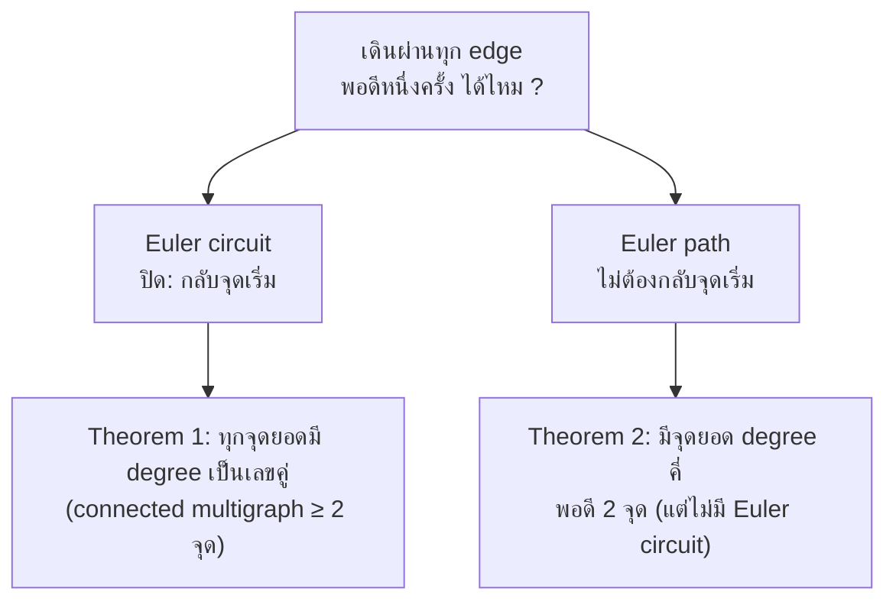
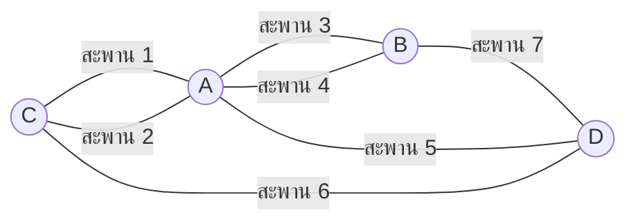
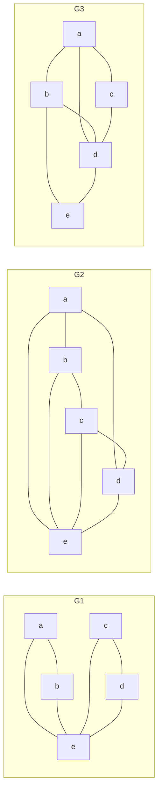
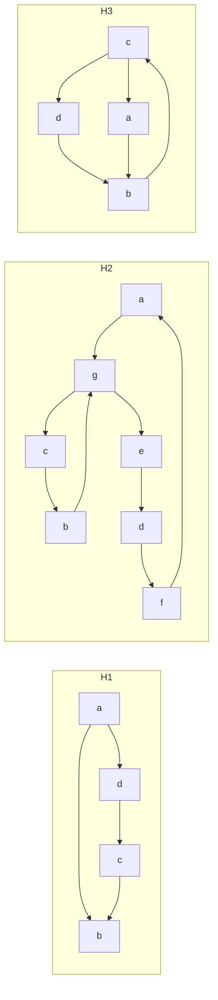
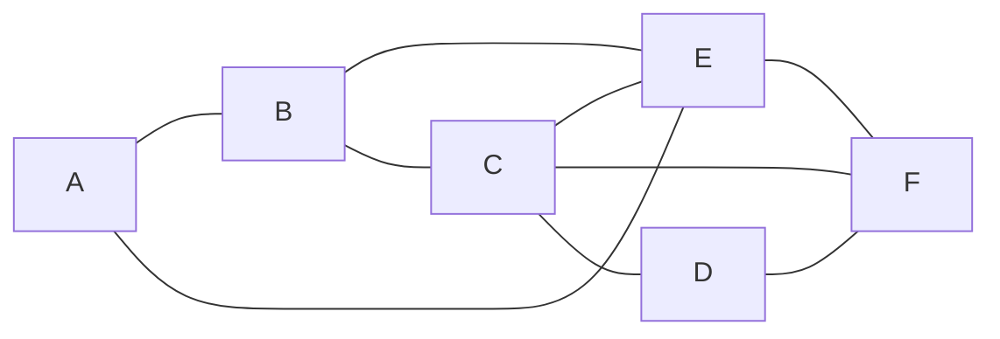
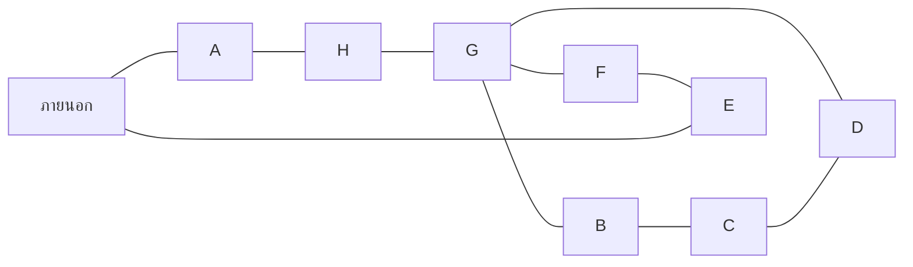
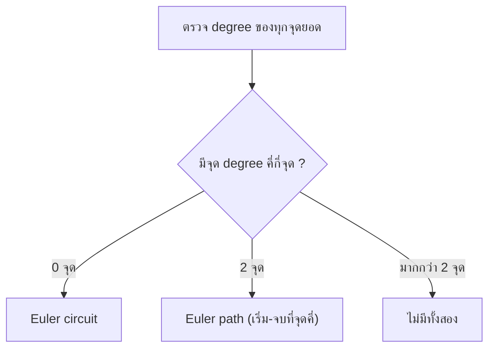

# Discrete Mathematics - Week13: Euler Circuits and Paths

> **วิชา:** Discrete Mathematics | **ผู้สอน:** Dr. Sirasit Lochanachit
> **Source:** `Resources/Books/Discrete Mathematics/DM_Week13.pdf` สไลด์ p.2-15 (ทั้งไฟล์ 25 slides, หัวสไลด์ "Week 14: Graphs Part 3")
> **ป้ายอ้างอิง:** `[p.N]` = เลขสไลด์ใน PDF, blockquote ที่ขึ้นต้น 💡 = เนื้อหาที่ผู้เขียนเพิ่มเอง (รวมเฉลยของตัวอย่างที่สไลด์ไม่เฉลย)
> **แบบฝึกหัด:** [[HW-Discrete-Math-05]] Section A-B

---

## Part 1: Macro Architecture & Overview

บทนี้เริ่มจากปัญหา Seven Bridges of Königsberg ซึ่งสไลด์จัดไว้ในหัวข้อ "History of Graph" [p.2-5] คำถามทั่วไปคือ เดินตาม edges ของกราฟโดยเริ่มที่จุดยอดหนึ่งและกลับมาที่จุดนั้น โดยผ่านทุก edge **พอดีหนึ่งครั้ง** ได้หรือไม่ [p.6] คำตอบตรวจได้ง่ายด้วยการดู degree ของจุดยอด [p.6] สไลด์นิยาม **Euler circuit** และ **Euler path** [p.7] ให้เงื่อนไขที่ใช้ตัดสิน (Theorem 1 และ 2) [p.10, 13] แล้วใช้กับกราฟ แผนผังอาคาร และปัญหาวาดรูปโดยไม่ยกดินสอ [p.8-14] ส่วนคำถามคู่กันที่ผ่านทุก **จุดยอด** พอดีหนึ่งครั้ง (Hamilton) อยู่ใน [[Week13 - Hamilton Circuits and Paths]]

_ที่มา: นิยามและทฤษฎีบทใน [p.7, 10, 13]_

### ตารางเปรียบเทียบ Euler circuit กับ Euler path

| หัวข้อ | Euler circuit | Euler path |
| :--- | :--- | :--- |
| นิยาม [p.7] | simple circuit ที่มีทุก edge ของ G | simple path ที่มีทุก edge ของ G |
| simple หมายถึง [p.7] | ใช้แต่ละ edge พอดี 1 ครั้ง | ใช้แต่ละ edge พอดี 1 ครั้ง |
| เงื่อนไขใน multigraph ที่ connected (undirected) | ทุกจุดยอด degree เป็นเลขคู่ [p.10] | มีจุดยอด degree คี่พอดี 2 จุด และไม่มี Euler circuit [p.13] |
| เริ่มและจบ | จุดเดียวกัน | ไม่ระบุในสไลด์ |
| ตัวอย่างจากสไลด์ที่ตรงเงื่อนไข (ผลของผู้เขียน `[Source: generated — not verified against original document]`) | G₁ ใน p.8 | G₃ ใน p.8, G₁ และ G₂ ใน p.13 |

> 💡 ในกราฟ Euler path ต้องเริ่มที่จุดคี่จุดหนึ่งและจบที่อีกจุดหนึ่ง (ผู้เขียนตรวจกับตัวอย่าง p.13) `[Source: generated — not verified against original document]`

---

## Part 2: Module-by-Module Deep Dive

### 2.1 ประวัติ: Seven Bridges of Königsberg [p.2-5]

* เมือง Königsberg ในปรัสเซีย (ปัจจุบันเรียก Kaliningrad และเป็นส่วนหนึ่งของ Russian republic ตามคำในสไลด์) แบ่งเป็น 4 ส่วนโดยแขนของแม่น้ำ Pregel [p.2]
* ในศตวรรษที่ 18 สะพาน 7 แห่งของ Königsberg เชื่อมบริเวณเหล่านี้ [p.2]
* ชาวเมืองสงสัยว่า เริ่มที่จุดใดจุดหนึ่งในเมือง เดินข้ามสะพานทุกแห่งครั้งเดียวโดยไม่ข้ามสะพานใดซ้ำ แล้วกลับมาจุดเริ่มได้หรือไม่ [p.4]
* ปี 1736 นักคณิตศาสตร์ชาวสวิส Leonhard Euler พิสูจน์ว่า .... [p.5] (ประโยคในสไลด์ค้างอยู่ ไม่มีข้อสรุป)

รูปกราฟของปัญหา (multigraph ที่ p.7 วาดจุด A, B, C, D และ edges คู่ระหว่าง A–C กับ A–B) อ่านจากรูป:

_ต้นฉบับ: แผนที่ [p.2-5] และรูป multigraph [p.7]_

> 💡 degree ของจุดยอด: A = 5, B = 3, C = 3, D = 3 ทั้ง 4 จุดเป็นเลขคี่ จึงขัด Theorem 1 ที่ต้องการทุกจุดเป็นเลขคู่ จึงไม่มีทางข้ามสะพานทั้ง 7 แห่งครั้งเดียวแล้วกลับจุดเริ่ม ข้อสรุปนี้เป็นของผู้เขียน เพราะประโยคใน p.5 ไม่จบ `[Source: generated — not verified against original document]`

---

### 2.2 นิยาม Euler circuit และ Euler path [p.6-7]

* คำถาม Euler: เดินตาม edges เริ่มที่จุดยอดหนึ่งและกลับจุดเดิม โดยผ่านทุก edge พอดี 1 ครั้งได้หรือไม่ มี Euler circuit หรือไม่ ตอบได้ง่ายโดยดู degree ของจุดยอด [p.6]
* คำถามคู่ขนาน: เดินแล้วกลับจุดเดิมโดยผ่านทุกจุดยอดพอดี 1 ครั้ง (Hamilton circuit) ยากสำหรับกราฟส่วนใหญ่ [p.6]

> **Definition 1:** **Euler circuit** ในกราฟ G คือ simple circuit ที่มีทุก edge ของ G **Euler path** ใน G คือ simple path ที่มีทุก edge ของ G โปรดจำว่า path หรือ circuit เป็น simple ถ้ามีแต่ละ edge พอดี 1 ครั้ง [p.7]

รูปใน p.7 วาด multigraph ของ Königsberg (จุด A, B, C, D)

---

### 2.3 ตัวอย่าง: กราฟไม่มีทิศและมีทิศ [p.8-9]

**Example 1 [p.8]:** กราฟไม่มีทิศ G₁, G₂, G₃ ข้อไหนมี Euler circuit และข้อที่ไม่มีข้อไหนมี Euler path (สไลด์ไม่เฉลย) edges อ่านจากรูป:
* G₁: a–b, a–e, b–e, c–d, c–e, d–e
* G₂: a–b, a–d, b–c, c–d, a–e, b–e, c–e, d–e
* G₃: a–b, a–c, a–d, b–d, b–e, c–d, d–e

_ต้นฉบับ: รูป G₁, G₂, G₃ [p.8]_

> 💡 เฉลยของผู้เขียน (ตรวจ degree ตาม Theorem 1 และ 2):
>
> | กราฟ | degree (a, b, c, d, e) | จุด degree คี่ | ผล |
> | :--- | :--- | :--- | :--- |
> | G₁ | 2, 2, 2, 2, 4 | ไม่มี | มี Euler circuit เช่น a, b, e, c, d, e, a |
> | G₂ | 3, 3, 3, 3, 4 | a, b, c, d (4 จุด) | ไม่มีทั้ง Euler circuit และ Euler path |
> | G₃ | 3, 3, 2, 4, 2 | a, b (2 จุด) | ไม่มี Euler circuit แต่มี Euler path เช่น a, c, d, e, b, d, a, b |
>
> `[Source: generated — not verified against original document]`

**Example 2 [p.9]:** กราฟมีทิศ H₁, H₂, H₃ ข้อไหนมี Euler circuit และข้อที่ไม่มีข้อไหนมี Euler path (สไลด์ไม่เฉลยและไม่ให้ทฤษฎีบทสำหรับกราฟมีทิศ) edges อ่านจากรูป:
* H₁: a→b, a→d, d→c, c→b
* H₂: a→g, g→c, c→b, b→g, g→e, e→d, d→f, f→a
* H₃: c→d, d→b, b→c, c→a, a→b

_ต้นฉบับ: รูป H₁, H₂, H₃ [p.9]_

> 💡 เกณฑ์สำหรับกราฟมีทิศ (ไม่อยู่ในสไลด์ เป็นความรู้มาตรฐาน): กราฟต้อง connected เมื่อมองข้ามทิศ และมี Euler circuit เมื่อทุกจุดยอดมี in-degree = out-degree ส่วน Euler path (ที่ไม่ใช่ circuit) ต้องมีจุดยอดหนึ่งจุดที่ out − in = 1 (จุดเริ่ม) และอีกหนึ่งจุดที่ in − out = 1 (จุดจบ) ที่เหลือ in = out
>
> | กราฟ | จุดที่ in ≠ out | ผล |
> | :--- | :--- | :--- |
> | H₁ | a (out 2, in 0), b (in 2, out 0), c (out 1, in 1), d (in 1, out 1) | ไม่มีทั้ง circuit และ path เพราะ a ต่าง 2 |
> | H₂ | ไม่มี (ทุกจุด in = out) | มี Euler circuit a, g, c, b, g, e, d, f, a |
> | H₃ | c (out 2, in 1), b (in 2, out 1) | ไม่มี circuit แต่มี Euler path จาก c ไป b เช่น c, a, b, c, d, b |
>
> `[Source: generated — not verified against original document]`

---

### 2.4 Necessary conditions สำหรับ Euler circuit [p.10-12]

เกณฑ์ง่ายๆ สำหรับตัดสินว่า multigraph มี Euler circuit หรือ path หรือไม่ เงื่อนไขจำเป็น: ทุกจุดยอดต้องมี degree เป็นเลขคู่ [p.10]

> **Theorem 1:** multigraph ที่ connected และมีจุดยอดตั้งแต่ 2 จุดขึ้นไป มี Euler circuit ก็ต่อเมื่อทุกจุดยอดมี degree เป็นเลขคู่ [p.10]

**Example 3 [p.11]:** ให้แผนผังอาคาร เป็นไปได้หรือไม่ที่จะเข้าอาคารจาก A และออกสู่ห้อง A โดยผ่านประตูทุกบานครั้งเดียว และต้องเข้าทุกห้อง สไลด์ไม่เฉลย

อ่านจากรูป: ตัวอักษร A อยู่นอกผนังซ้ายสุด ผู้เขียนจึงถือ A เป็นพื้นที่ภายนอก ประตูอยู่ที่ผนัง A–B, A–E, B–E, B–C, C–E, C–F, C–D, D–F, E–F (ประตู 9 บาน) แปลงเป็นกราฟโดยให้ห้องเป็นจุดยอด ประตูเป็น edge

_ต้นฉบับ: รูปแผนผัง [p.11] (ประตูอ่านจากรูป)_

> 💡 degree: A = 2, B = 3, C = 4, D = 2, E = 4, F = 3 มีจุดคี่ 2 จุด (B, F) ตาม Theorem 1 จึงไม่มี Euler circuit คำตอบคือไม่ได้ `[Source: generated — not verified against original document]`

**Mohammed's Scimitars Problem [p.12]:** วาดรูปแบบต่อเนื่องโดยไม่ยกดินสอได้หรือไม่ เช่น วาดดาบโค้งของ Mohammed (scimitars) ให้เริ่มและจบที่จุดเดียวกันได้หรือไม่ สไลด์ไม่เฉลย

รูปในสไลด์เป็นภาพถ่ายดาบโค้งและเส้นวาดเสี้ยวพระจันทร์สองรูปซ้อนกัน

> 💡 แนวทางตอบ: แปลงรูปเป็นกราฟโดยให้จุดตัดและปลายเส้นเป็นจุดยอด แล้วตรวจ Theorem 1 ถ้าทุกจุดมี degree เป็นเลขคู่ วาดแบบเริ่มและจบที่เดียวกันได้ ผู้เขียนไม่ได้วิเคราะห์รูปนี้ จึงไม่ให้คำตอบ `[Source: generated — not verified against original document]`

---

### 2.5 Necessary conditions สำหรับ Euler path [p.13-14]

> **Theorem 2:** multigraph ที่ connected มี Euler path แต่ไม่มี Euler circuit ก็ต่อเมื่อมีจุดยอดที่ degree เป็นเลขคี่พอดี 2 จุด [p.13]

**Example (ไม่มีเลขใน p.13):** กราฟไหนมี Euler path (สไลด์ไม่เฉลย) edges อ่านจากรูป:
* G₁: a–b, b–c, c–d, d–a, b–d
* G₂ (7 จุด): a–g, a–b, b–c, c–d, d–e, g–f, f–e, b–g, c–g, c–f, d–f
* G₃ (6 จุดรอบ + g ตรงกลาง): a–b, b–c, c–d, d–e, e–f, f–a และ g เชื่อมกับทั้ง 6 จุด

> 💡 เฉลยของผู้เขียน:
>
> | กราฟ | จุด degree คี่ | ผล |
> | :--- | :--- | :--- |
> | G₁ | b (3), d (3) | มี Euler path เช่น b, a, d, c, b, d |
> | G₂ | b (3), d (3) | มี Euler path เช่น b, a, g, b, c, g, f, c, d, f, e, d |
> | G₃ | a, b, c, d, e, f (6 จุด จุดละ 3) | ไม่มี Euler path |
>
> `[Source: generated — not verified against original document]`

**Example 4 [p.14]:** ให้แผนผังอาคาร เป็นไปได้หรือไม่ที่จะเข้าห้อง A และออกจากห้อง E โดยผ่านประตูทุกบานครั้งเดียว และต้องเข้าทุกห้อง สไลด์ไม่เฉลย

อ่านจากรูป: ห้อง A–H มีประตูภายใน 8 บาน คือ A–H, H–G, B–G, G–F, B–C, G–D, F–E, C–D และมีประตูภายนอก 2 บาน (ผนังซ้ายของ A และผนังขวาของ E)

_ต้นฉบับ: รูปแผนผัง [p.14] (ประตูอ่านจากรูป)_

> 💡 ถ้านับเฉพาะประตูภายใน degree คี่มีสองห้องคือ A (1) และ E (1) ตาม Theorem 2 จึงมี Euler path จาก A ไป E เส้นทางตัวอย่าง: เข้า A → H → G → B → C → D → G → F → E แล้วออกประตูภายนอกของ E ใช้ประตูภายในครบ 8 บานและผ่านครบ 8 ห้อง คำตอบคือทำได้ `[Source: generated — not verified against original document]`

---

### 2.6 การประยุกต์ใช้ Euler path และ circuit [p.15]

Euler path และ circuit ใช้แก้ปัญหาที่ต้องหา path หรือ circuit ที่ผ่านแต่ละรายการพอดี 1 ครั้ง เช่น [p.15]
* ถนนแต่ละสายในย่าน
* ถนนในเครือข่ายขนส่ง
* การเชื่อมต่อในโครงข่ายสาธารณูปโภค (utility grid)
* link ในเครือข่ายสื่อสาร

การประยุกต์อื่นที่สไลด์ระบุ: การจัดวางวงจร, network multicasting และชีววิทยาโมเลกุลที่ใช้ Euler path ใน sequencing ของ DNA [p.15] รูปในสไลด์เป็นแผนภาพเส้นทางรถจากคลัง (Depot) ไปหาลูกค้า (Customers)

---

## Part 3: Quick Reference & Exam Cheat Sheet

### Checklist สรุปหัวใจสำคัญก่อนสอบ
* [ ] **Euler circuit:** simple circuit ที่มีทุก edge (แต่ละ edge พอดี 1 ครั้ง) [p.7]
* [ ] **Euler path:** simple path ที่มีทุก edge [p.7]
* [ ] **Theorem 1:** connected multigraph ที่มี ≥ 2 จุด มี Euler circuit ⇔ ทุกจุด degree เป็นเลขคู่ [p.10]
* [ ] **Theorem 2:** connected multigraph มี Euler path แต่ไม่มี Euler circuit ⇔ มีจุด degree คี่พอดี 2 จุด [p.13]
* [ ] **ปัญหาอาคาร:** ห้อง = จุดยอด, ประตู = edge แล้วนับ degree ตามทฤษฎีบท [p.11, 14]
* [ ] **Königsberg:** ทั้ง 4 ส่วนของเมืองมี degree เป็นเลขคี่ [p.7, ผลของผู้เขียน]
* [ ] **ตรวจได้เร็ว:** Euler ดู degree ได้ แต่ Hamilton ยากสำหรับกราฟส่วนใหญ่ [p.6]

### สรุปสูตร / Notation ที่สำคัญ

| Notation | ความหมาย |
| :--- | :--- |
| $\deg(v)$ เป็นเลขคู่ ทุก $v$ | เงื่อนไข Euler circuit (Theorem 1) [p.10] |
| $\#\{v : \deg(v) \text{ เป็นเลขคี่}\} = 2$ | เงื่อนไข Euler path ที่ไม่ใช่ circuit (Theorem 2) [p.13] |
| $\deg^-(v) = \deg^+(v)$ ทุก $v$ | เกณฑ์ Euler circuit ในกราฟมีทิศ (ความรู้มาตรฐาน ไม่อยู่ในสไลด์) |

### Concept Map

> 💡 Concept map นี้เป็นการสรุปของผู้เขียนจาก Theorem 1 และ 2 (กราฟต้อง connected) `[Source: generated — not verified against original document]`

---

## ⚠️ Common Pitfalls & Exam Traps

* **สับสน Euler กับ Hamilton:** Euler ผ่านทุก **edge** พอดี 1 ครั้ง Hamilton ผ่านทุก **จุดยอด** พอดี 1 ครั้ง [p.6, 7, 16]
* **คิดว่า Euler path คือ Euler circuit:** Theorem 2 พูดถึง Euler path "แต่ไม่มี Euler circuit" และต้องมีจุดคี่พอดี 2 จุด ถ้าไม่มีจุดคี่เลยจะมี circuit [p.10, 13]
* **ลืมเงื่อนไข connected:** ทั้ง Theorem 1 และ 2 ใช้กับ multigraph ที่ connected [p.10, 13] ถ้า edges ของกราฟกระจายอยู่ในหลายส่วนที่ไม่ติดกัน จะไม่มี Euler circuit ที่ผ่านทุก edge แม้ degree ของทุกจุดเป็นเลขคู่
* **ใช้ degree ของกราฟไม่มีทิศกับกราฟมีทิศ:** Example 2 [p.9] ใช้กราฟมีทิศ ต้องเทียบ in-degree กับ out-degree ไม่ใช่นับ degree รวม (สไลด์ไม่มีทฤษฎีบทข้อนี้ ใช้เกณฑ์มาตรฐานตามหัวข้อ 2.3)
* **นับ "ภายนอก" ผิดในโจทย์อาคาร:** ประตูที่เปิดสู่ภายนอกเป็น edge ที่ปลายข้างหนึ่งไม่อยู่ใน graph ถ้าโจทย์ให้เข้าและออกทางประตูภายนอก ให้นับเฉพาะประตูภายในแล้วใช้ Theorem 2 (Example 4) หรือเติมจุดยอด "ภายนอก" เข้ากราฟ
* **ตอบจากรูปโดยไม่นับ degree ครบ:** กราฟที่ดูสมมาตรมักมีจุดคี่ซ่อนอยู่ (เช่น G₂ ใน p.8 มี degree 3 สี่จุด)

**ข้อสังเกตเกี่ยวกับต้นฉบับ (ไม่แก้ในเนื้อหา):**
* หัวสไลด์เขียน "Week 14" แต่ชื่อไฟล์เป็น Week13
* p.5 ประโยค "Euler proved that ...." ไม่จบ
* p.8, p.9, p.11, p.12, p.13, p.14 เป็นโจทย์ที่ไม่มีเฉลย เฉลยทั้งหมดในบทนี้เป็นของผู้เขียนที่อ่านกราฟจากรูป
* p.9 ถามเรื่องกราฟมีทิศ แต่ทฤษฎีบทในสไลด์พูดถึง degree ทั่วไป
* p.10 มีรูปเล็กมุมขวาล่าง เป็นกราฟจุด A-E ที่มี loop ที่ B และเส้นสีแดง พร้อมข้อความ "CDCBBADEBC" โดยไม่มีคำอธิบายในสไลด์
* หัวข้อ "Example" ใน p.13 ไม่มีเลข ถัดไปคือ Example 4 [p.14]
* A ใน Example 3 [p.11] ผู้เขียนตีความเป็นพื้นที่ภายนอกจากตำแหน่งตัวอักษร ถ้าตีความอื่นคำตอบอาจเปลี่ยน

---

## เอกสารเชื่อมโยง (Wiki-Style Backlinks)
* **วิชาและหัวข้อที่เกี่ยวข้อง:**
  * [[Week13 - Hamilton Circuits and Paths]] (คู่ขนาน: ผ่านทุกจุดยอดพอดี 1 ครั้ง)
  * [[Week12 - Paths, Circuits and Connectedness]] (นิยาม path, circuit, simple ที่ใช้ในบทนี้)
  * [[Week11 - Graphs, Graph Terminology and Representing Graphs]] (degree, multigraph, directed graph, in-degree และ out-degree)
  * [[HW-Discrete-Math-05]] (แบบฝึกหัดพร้อมเฉลย Section A-B)

* **แหล่งข้อมูล:**
  * Source: `Resources/Books/Discrete Mathematics/DM_Week13.pdf` (25 slides, Dr. Sirasit Lochanachit)
