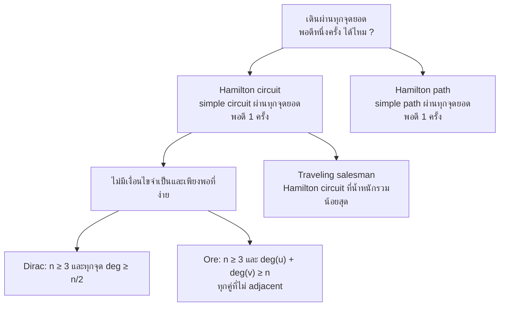
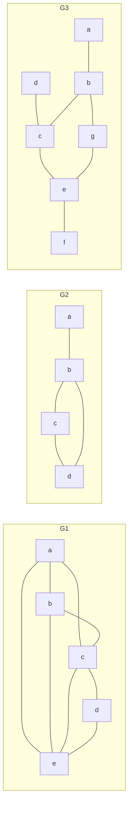
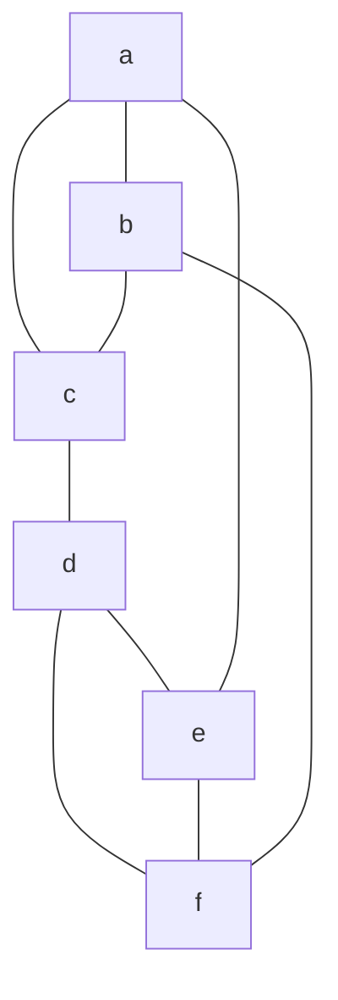
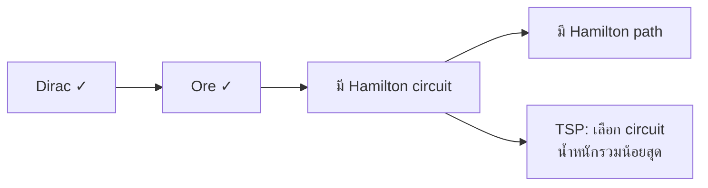

# Discrete Mathematics - Week13: Hamilton Circuits and Paths

> **วิชา:** Discrete Mathematics | **ผู้สอน:** Dr. Sirasit Lochanachit
> **Source:** `Resources/Books/Discrete Mathematics/DM_Week13.pdf` สไลด์ p.6, 16-25 (ทั้งไฟล์ 25 slides, หัวสไลด์ "Week 14: Graphs Part 3")
> **ป้ายอ้างอิง:** `[p.N]` = เลขสไลด์ใน PDF, blockquote ที่ขึ้นต้น 💡 = เนื้อหาที่ผู้เขียนเพิ่มเอง (รวมเฉลยของตัวอย่างที่สไลด์ไม่เฉลย)
> **แบบฝึกหัด:** [[HW-Discrete-Math-05]] Section C-E

---

## Part 1: Macro Architecture & Overview

คำถามคู่ของ Euler คือ เดินตาม edges โดยเริ่มที่จุดยอดหนึ่งและกลับมาที่จุดนั้น พร้อมผ่านแต่ละ **จุดยอด** พอดีหนึ่งครั้งได้หรือไม่ นั่นคือ **Hamilton circuit** [p.6, 16] ต่างจาก Euler ที่ตรวจด้วย degree ได้ง่าย ปัญหา Hamilton ยากสำหรับกราฟส่วนใหญ่ [p.6] และยังไม่มีเงื่อนไขง่ายๆ ที่จำเป็นและเพียงพอ รู้เพียงเงื่อนไขที่เพียงพอไม่กี่ข้อ เช่น **Dirac's Theorem** และ **Ore's Theorem** [p.20-21] การประยุกต์ที่โด่งดังคือ **traveling salesman problem** [p.24] สไลด์ปิดบทด้วยการเปิดหัวข้อ shortest-path ในกราฟถ่วงน้ำหนัก (หน้าเดียว) [p.25]

_ที่มา: นิยามและทฤษฎีบทใน [p.16, 20-21, 24]_

### ตารางเปรียบเทียบ Euler กับ Hamilton

| หัวข้อ | Euler | Hamilton |
| :--- | :--- | :--- |
| ผ่านอะไรพอดี 1 ครั้ง | ทุก edge [p.7] | ทุกจุดยอด [p.16] |
| นิยาม circuit | simple circuit ที่มีทุก edge | simple circuit ที่ผ่านทุกจุดยอดพอดี 1 ครั้ง |
| การตรวจ | ตอบได้ง่ายโดยดู degree [p.6] | ยากสำหรับกราฟส่วนใหญ่ [p.6] |
| เงื่อนไขที่รู้ | จำเป็นและเพียงพอ (Theorem 1, 2) [p.10, 13] | ไม่มีเงื่อนไขง่ายๆ ที่จำเป็นและเพียงพอ รู้เฉพาะเงื่อนไขเพียงพอบางข้อ [p.20] |
| การประยุกต์ที่สไลด์ยก | ถนน เครือข่ายขนส่ง สาธารณูปโภค DNA sequencing [p.15] | ทางแยก ท่อสาธารณูปโภค node ในเครือข่าย traveling salesman [p.24] |

ดูรายละเอียดฝั่ง Euler ที่ [[Week13 - Euler Circuits and Paths]]

---

## Part 2: Module-by-Module Deep Dive

### 2.1 นิยามและที่มาของคำ [p.16-17]

> 💡 **Intuition:** Hamilton circuit/path คือการเดินผ่านทุก **จุดยอด** พอดีหนึ่งครั้ง (ต่างจาก Euler ที่ผ่านทุก edge) — เหมือนการนำเที่ยวที่ต้องไปเยี่ยมทุกเมืองพอดีหนึ่งครั้งแล้วกลับเมืองเดิม (circuit) หรือไม่ต้องกลับก็ได้ (path) ทำไมสำคัญ: ปัญหา traveling salesman (หาเส้นทางที่ไปครบทุกเมืองแล้วกลับจุดเริ่มด้วยค่าใช้จ่ายน้อยสุด) คือการหา Hamilton circuit ที่น้ำหนักรวมต่ำสุด
> [Source: generated — not verified against original document]

> **Definition 2:** simple circuit ในกราฟ G ที่ผ่านทุกจุดยอดพอดี 1 ครั้ง เรียกว่า **Hamilton circuit** simple path ในกราฟ G ที่ผ่านทุกจุดยอดพอดี 1 ครั้ง เรียกว่า **Hamilton path** [p.16]

**🧭 ทำความเข้าใจ** _[Source: generated — not verified against original document]_

**แตกวลีสำคัญ:**
- "ผ่านทุกจุดยอดพอดี 1 ครั้ง" → ต้องไปเยี่ยมทุกจุด ไม่ซ้ำและไม่ข้ามจุดใด
- "Simple circuit" → เริ่มและจบที่จุดเดียวกัน ไม่ใช้ edge ซ้ำ (circuit = ปิด)
- "Simple path" → ไม่ต้องกลับจุดเริ่ม (path = ไม่ต้องปิด)

**ตัวอย่าง:**
- ✅ วงจร a–b–c–d–a (4 จุด) → Hamilton circuit
- ✅ เส้นทาง a–b–c–d (4 จุด ไม่ต้องกลับ a) → Hamilton path
- ❌ ในกราฟ 5 จุด เดิน a–b–c–d–a–e → ไม่ใช่ Hamilton path/circuit เพราะผ่าน a ซ้ำกลางทาง
- **ต่างกันตรง:** Euler = ผ่านทุก edge, Hamilton = ผ่านทุก จุดยอด

**อย่าสับสน:** "ผ่านทุกจุดยอด" ≠ "ผ่านทุก edge" — Hamilton ไม่ต้องใช้ edge ทั้งหมด เพียง path ที่เชื่อมทุกจุด

**เช็คความเข้าใจ:** กราฟ 5 จุด {a,b,c,d,e} มี edges a–b–c–d–e–a (เส้นวง) มี Hamilton circuit หรือไม่

เฉลย

ใช่ มี Hamilton circuit คือ a–b–c–d–e–a เพราะเส้นวงนี้ผ่านทุก 5 จุดพอดีหนึ่งครั้ง

**Hamilton's Puzzle: A Voyage Round the World [p.17]:** คำว่า Hamilton มาจากเกมชื่อ **Icosian puzzle** ที่นักคณิตศาสตร์ชาวไอริช Sir William Rowan Hamilton คิดขึ้นในปี 1857 เกมประกอบด้วยทรงสิบสองหน้า (dodecahedron คือ polyhedron ที่มีหน้าเป็นห้าเหลี่ยมปกติ 12 หน้า) ที่ไม้ มีหมุดที่ทุกจุดยอดของทรง และมีเชือก รูปในสไลด์มี (a) ทรงสิบสองหน้า และ (b) รูปกราฟแบบแบนที่ดูเหมือนจุดยอดและ edges ของทรงนั้น (สไลด์ไม่มีคำอธิบายใต้รูป b)

**ตัวอย่างใน p.18 (หัวข้อสไลด์ "Hamilton Circuits and Paths Examples"):** เป็นรูปล้วน แถวบนมี 5 กราฟ แถวล่างเป็นกริดเล็ก 8 ช่อง (2 × 4) ที่มีส่วนของเส้นสีแดงและจุดสีแดงหรือดำ สไลด์ไม่มีข้อความอธิบาย จึงไม่ระบุว่าเส้นแดงแต่ละรูปเป็น circuit หรือ path

---

### 2.2 Exercise 1: กราฟไหนมี Hamilton circuit หรือ Hamilton path [p.19]

สไลด์ถาม "Which of the simple graphs have a Hamilton circuit or, if not, a Hamilton path?" กับกราฟ G₁, G₂, G₃ ไม่เฉลย edges อ่านจากรูป:
* G₁: a–b, a–c, a–e, b–c, b–e, c–e, c–d, d–e
* G₂: a–b, b–c, c–d, b–d
* G₃: a–b, b–g, d–c, c–e, e–f, b–c, g–e

_ต้นฉบับ: รูป G₁, G₂, G₃ [p.19]_

> 💡 เฉลยของผู้เขียน:
>
> | กราฟ | ผล | เหตุผล |
> | :--- | :--- | :--- |
> | G₁ | มี Hamilton circuit a, b, c, d, e, a | ผ่านครบ 5 จุด ใช้ edges a–b, b–c, c–d, d–e, e–a |
> | G₂ | ไม่มี circuit แต่มี Hamilton path d, c, b, a | a มี degree 1 จึงอยู่บน circuit ไม่ได้ |
> | G₃ | ไม่มีทั้ง circuit และ path | a, d, f เป็นใบ (degree 1) 3 จุด path ที่ผ่านทุกจุดมีปลายได้แค่ 2 ปลาย |
>
> `[Source: generated — not verified against original document]`

---

### 2.3 เงื่อนไขการมี Hamilton circuit [p.20-21]

* Euler circuit มีเงื่อนไขจำเป็นและเพียงพอ (Theorem 1) แต่ Hamilton circuit ยังไม่มีเงื่อนไขง่ายๆ ที่จำเป็นและเพียงพอ [p.20]
* พบแค่เงื่อนไขที่เพียงพอไม่กี่ข้อ แนวคิด: ยิ่งแต่ละจุดยอดมี edges มาก ยิ่งมีโอกาสมี Hamilton circuit [p.20]

> 💡 **Intuition:** เพราะไม่มีเงื่อนไขจำเป็นและเพียงพอที่ง่าย — เราใช้เงื่อนไขที่ "เพียงพอ" แทน: ถ้ากราฟผ่าน Dirac หรือ Ore → มี Hamilton circuit แน่นอน แต่ถ้าไม่ผ่าน → สรุปอะไรไม่ได้ (อาจมีหรือไม่มีก็ได้) เหมือนสอบได้ 90 คะแนนรับประกันว่าผ่าน แต่คนที่ได้ 60 ก็อาจผ่านได้เหมือนกัน ทำไมสำคัญ: ให้วิธีตรวจเร็วว่ากราฟมี Hamilton circuit แน่นอน โดยไม่ต้องไล่หาเส้นทาง
> [Source: generated — not verified against original document]

> **Dirac's Theorem:** ถ้า G เป็น simple graph ที่มี n ≥ 3 จุด และ degree ของทุกจุดยอดใน G ≥ n/2 แล้ว G มี Hamilton circuit [p.21]

**🧭 ทำความเข้าใจ** _[Source: generated — not verified against original document]_

**แตกวลีสำคัญ:**
- "Simple graph, n ≥ 3" → ต้องไม่ loop/multigraph, ต้อง ≥ 3 จุด
- "Degree ของทุกจุด ≥ n/2" → ถ้า 5 จุด ทุกจุดต้อง deg ≥ 2.5 คือ ≥ 3
- "มี Hamilton circuit" → เงื่อนไข เพียงพอ (sufficient ไม่จำเป็น necessary)

**ตัวอย่าง:**
- ✅ K₅ (5 จุด): ทุกจุด deg = 4 ≥ 2.5 → เข้า Dirac → มี Hamilton circuit (กราฟ 5 จุดที่ทุกจุด deg = 3 สร้างไม่ได้ เพราะผลรวม degree = 15 เป็นเลขคี่)
- ✅ กราฟ 6 จุด: ทุกจุด deg = 4 ≥ 3 (เช่น K₆ ลบ 3 edges ที่ไม่มีจุดร่วมกัน) → เข้า Dirac → มี Hamilton circuit
- ❌ C₅ (วง 5 จุด): ทุกจุด deg = 2 < 2.5 → ไม่เข้า Dirac แต่ตัว C₅ เองเป็น Hamilton circuit → ไม่ผ่าน Dirac ไม่ได้แปลว่าไม่มี circuit
- **ต่างกันตรง:** Dirac ตรวจทุกจุด, Ore ตรวจคู่ที่ไม่ adjacent

**อย่าสับสน:** "Dirac เป็นเงื่อนไขเพียงพอ" ≠ "เป็นเงื่อนไขจำเป็น" — กราฟที่ไม่เข้า Dirac อาจยังมี Hamilton circuit (ต้องตรวจ Ore หรือวิธีอื่น)

**เช็คความเข้าใจ:** กราฟ 4 จุด ทุกจุด degree = 2 เข้า Dirac หรือไม่

เฉลย

n = 4 ≥ 3 และ n/2 = 4/2 = 2 ดังนั้นต้อง degree ≥ 2 ทุกจุด ทั้ง 4 จุด deg = 2 ≥ 2 → เข้า Dirac → มี Hamilton circuit (simple graph 4 จุดที่ทุกจุด deg = 2 คือ C₄ เช่น a–b–c–d–a)

> **Ore's Theorem:** ถ้า G เป็น simple graph ที่มี n ≥ 3 จุด และ deg(u) + deg(v) ≥ n สำหรับทุกคู่จุดยอดที่ไม่ adjacent กัน แล้ว G มี Hamilton circuit [p.21]

**🧭 ทำความเข้าใจ** _[Source: generated — not verified against original document]_

**แตกวลีสำคัญ:**
- "ทุกคู่จุดยอดที่ไม่ adjacent" → เฉพาะคู่ที่ไม่มี edge เชื่อม (adjacent คู่มี edge)
- "deg(u) + deg(v) ≥ n" → ผลรวม degree ต้อง ≥ จำนวนจุด
- "Dirac ⇒ Ore" → ถ้าผ่าน Dirac (ทุกจุด ≥ n/2) จะผ่าน Ore อัตโนมัติ (แต่กลับกันไม่จริง)

**ตัวอย่าง:**
- ❌ C₅ คือ a–b–c–d–e–a: คู่ไม่ adjacent คือ (a,c), (a,d), (b,d), (b,e), (c,e) ทุกจุด deg = 2 ดังนั้น deg(u)+deg(v) = 4 < 5 → ไม่เข้า Ore แต่ตัวมันเองคือ Hamilton circuit (Ore เป็นเงื่อนไขเพียงพอ ไม่ใช่จำเป็น)
- ✅ K₅ ลบ edge a–b: deg(a) = deg(b) = 3, จุดอื่น deg = 4 คู่ไม่ adjacent มีคู่เดียวคือ (a,b): 3+3 = 6 ≥ 5 → เข้า Ore → มี Hamilton circuit
- ❌ เอาคู่ที่ adjacent (มี edge เชื่อม) มาเช็คด้วย → ไม่จำเป็น Ore ไม่สนใจคู่ที่ adjacent
- **ต่างกันตรง:** Dirac = ทุกจุด, Ore = คู่ที่ไม่ adjacent

**อย่าสับสน:** "ทุกคู่" ไม่ได้หมายถึง "ทุกจุดทั้งหมด" — Ore เช็คคู่ (pairs) ของจุดที่ไม่มี edge

**เช็คความเข้าใจ:** กราฟ 6 จุด a-f มี edges: a–b–c–d–e–f–a (วงจร 6 จุด) + เพิ่ม a–d เข้า Ore หรือไม่

เฉลย

วงจร 6 จุด: ทุกจุด deg = 2. เพิ่ม a–d: deg(a) = 3, deg(d) = 3, อื่น deg = 2

Edges มี 7 เส้น: a–b, b–c, c–d, d–e, e–f, f–a, a–d จากคู่ทั้งหมด 15 คู่ จึงเหลือคู่ไม่ adjacent 8 คู่: (a,c), (a,e), (b,d), (b,e), (b,f), (c,e), (c,f), (d,f)

ตรวจ:
- deg(a)+deg(c) = 3+2 = 5 < 6 ❌

เจอคู่ที่ไม่ผ่านแล้ว 1 คู่ก็พอ → ไม่เข้า Ore แต่กราฟนี้ยังมี Hamilton circuit คือ a–b–c–d–e–f–a (วงเดิม) → ตัวอย่างว่า Ore เป็นแค่เงื่อนไขเพียงพอ

รูปใน p.20 (อ่านจากรูป): จุด a, d, e แถวบน และ b, c แถวล่าง มี edges a–d, d–e, a–b, d–c, b–c

> 💡 รูป p.20 คือสี่เหลี่ยม a–d–c–b ที่มีจุด e ห้อยจาก d (สไลด์ไม่อธิบายรูป) e มี degree 1 จึงไม่มี Hamilton circuit ในกราฟนี้ แต่มี Hamilton path เช่น e, d, a, b, c สอดคล้องกับแนวคิดว่าจุดที่มี edges น้อยทำให้มี circuit ยาก `[Source: generated — not verified against original document]`

> 💡 Dirac ⇒ Ore: ถ้าทุกจุดมี degree ≥ n/2 ผลรวม degree ของคู่จุดใดๆ ≥ n อยู่แล้ว จึงเข้าเงื่อนไขของ Ore เสมอ สองทฤษฎีบทเป็นเงื่อนไขเพียงพอ ไม่ใช่เงื่อนไขจำเป็น `[Source: generated — not verified against original document]`

---

### 2.4 ตัวอย่างและแบบฝึกหัดที่ใช้ Dirac และ Ore [p.22-23]

สไลด์เตรียมช่องว่าง n =, deg(a) = ... ให้เติม แล้วใช้ Dirac และ Ore แสดงว่ากราฟมี Hamilton circuit (ไม่เฉลย) ข้อความของ Ore ในสไลด์ถูกตัดเหลือ "deg(u) + deg(v) ≥ n for"

**Example 1 [p.22]:** กราฟ G₁ ชุดเดียวกับ Exercise 1 [p.19] (จุด a, b, c, d, e)

> 💡 เฉลยของผู้เขียน:
> * n = 5, deg(a) = 3, deg(b) = 3, deg(c) = 4, deg(d) = 2, deg(e) = 4
> * **Dirac:** ต้องการ degree ≥ n/2 = 2.5 หรือก็คือ ≥ 3 แต่ deg(d) = 2 จึงไม่เข้าเงื่อนไข
> * **Ore:** คู่ที่ไม่ adjacent มีแค่ (a, d) และ (b, d) ซึ่ง deg(a) + deg(d) = 5 ≥ 5 และ deg(b) + deg(d) = 5 ≥ 5 จึงเข้าเงื่อนไข จึงมี Hamilton circuit ตัวอย่าง a, b, c, d, e, a
>
> `[Source: generated — not verified against original document]`

**Exercise [p.23]:** กราฟ 6 จุด a-f อ่าน edges จากรูป: a–b, a–c, b–c, c–d, d–e, d–f, e–f, a–e, b–f (ป้าย c และ d อยู่ใกล้จุดสองจุดกลางรูป ผู้เขียนกำหนด c เป็นจุดบนที่ต่อกับ a และ b ส่วน d เป็นจุดล่างที่ต่อกับ e และ f ถ้าสลับป้ายได้กราฟที่ isomorphic กัน degree และข้อสรุปเหมือนเดิม)

_ต้นฉบับ: รูปกราฟ [p.23]_

> 💡 เฉลยของผู้เขียน: n = 6 และ deg(a) = deg(b) = deg(c) = deg(d) = deg(e) = deg(f) = 3 ทุกจุด ≥ n/2 = 3 จึงเข้าเงื่อนไข Dirac และมี Hamilton circuit ตัวอย่าง a, b, c, d, f, e, a (Ore ก็ผ่านเพราะผลรวม degree ของคู่ใดๆ เท่ากับ 6 ≥ 6) `[Source: generated — not verified against original document]`

---

### 2.5 การประยุกต์ใช้ และ Shortest-path [p.24-25]

Hamilton path และ circuit ใช้แก้ปัญหาที่ต้องหา path หรือ circuit ที่ผ่านแต่ละรายการพอดี 1 ครั้ง เช่น [p.24]
* ทางแยกถนน
* การวางท่อในโครงข่ายสาธารณูปโภค
* node ในเครือข่ายสื่อสาร

**Traveling salesman problem** ถามหาเส้นทางที่สั้นที่สุดที่พนักงานขายควรเดินเพื่อผ่านเมืองชุดหนึ่ง วิธีแก้เกี่ยวข้องกับการหา Hamilton circuit ที่ผลรวมน้ำหนักของ edges น้อยที่สุด [p.24]

**Shortest-Path Problems [p.25]:** กราฟที่มีตัวเลขกำกับแต่ละ edge เรียก **weighted graph** คำถามคือ shortest path ซึ่งก็คือ path ที่มีความยาวน้อยที่สุด ระหว่างจุดยอดสองจุดที่กำหนดคืออะไร รูปในสไลด์เป็นกราฟระยะทาง (MILEAGE) ระหว่างเมืองในสหรัฐฯ อ่านจากรูป: 

| เมืองที่ 1 | เมืองที่ 2 | น้ำหนัก (ไมล์) |
| :--- | :--- | ---: |
| San Francisco | New York (เส้นโค้งบนสุด) | 2534 |
| San Francisco | Chicago | 1855 |
| San Francisco | Denver | 957 |
| San Francisco | Los Angeles | 349 |
| Denver | Chicago | 908 |
| Denver | Los Angeles | 834 |
| Los Angeles | New York | 2451 |
| Chicago | Boston | 860 |
| Chicago | New York | 722 |
| Boston | New York | 191 |
| Chicago | Atlanta | 606 |
| New York | Atlanta | 760 |
| New York | Miami | 1090 |
| Atlanta | Miami | 595 |

> 💡 การจับคู่ตัวเลขกับเส้นอ่านจากรูปในสไลด์โดยผู้เขียน `[Source: generated — not verified against original document]`

สไลด์หน้านี้เป็นหน้าสุดท้ายและไม่มีอัลกอริทึมหรือเนื้อหาต่อ

#### 💡 เสริม: Weighted Graph และ Shortest Path

> 💡 **Intuition:** ถ้า edge มี "ระยะ" กำกับ เส้นทางที่ใช้ edge น้อยที่สุดอาจไม่ใช่เส้นทางที่ระยะรวมสั้นที่สุด — เหมือนขับรถไปที่ทำงาน ทางตรงที่ผ่านทางด่วนที่อ้อมอาจไกลกว่าทางอ้อมที่สั้นกว่า shortest path จึงต้องเทียบ "ผลรวมน้ำหนัก" ทั้งเส้นทาง (analogy ใช้ไม่ได้ตรงที่ระยะทางบนถนนจริงอาจเปลี่ยนตามเวลาและจราจร แต่ weight ในกราฟคงที่)
> [Source: generated — not verified against original document]

**แตกวลีสำคัญ:**
- "weighted graph" → กราฟที่ทุก edge มีตัวเลข (น้ำหนัก) กำกับ
- "ความยาวของ path" → ผลรวมน้ำหนักของ edge บน path นั้น
- "shortest path" → path ที่ความยาวรวมน้อยที่สุดระหว่างสองจุด (ไม่ใช่จำนวน edge น้อยที่สุด)

**ตัวอย่าง:** กราฟ A–B (น้ำหนัก 2), B–C (น้ำหนัก 3), A–C (น้ำหนัก 6)
- ✅ A → C ผ่าน B: 2 + 3 = **5** → สั้นกว่า
- ❌ A → C ตรง ๆ: ความยาว 6 → ไม่สั้นที่สุด แม้จะมีแค่ 1 edge
- **ต่างกันตรง:** ต้องเทียบผลรวมน้ำหนัก ไม่ใช่จำนวน edge

**อย่าสับสน:** shortest path ≠ path ที่มี edge น้อยสุด — ทางตรงที่มี 1 edge อาจยาวกว่าทางอ้อมที่มี 2 edges

**เช็คความเข้าใจ:** เพิ่ม edge C–D น้ำหนัก 1 และ B–D น้ำหนัก 10 (จากกราฟข้างบน) หาความยาว shortest path จาก A ไป D

เฉลย

- A–B–C–D: 2 + 3 + 1 = **6**
- A–B–D: 2 + 10 = 12
- A–C–D: 6 + 1 = 7
→ shortest path คือ A–B–C–D ความยาว **6**

---

## Part 3: Quick Reference & Exam Cheat Sheet

### Checklist สรุปหัวใจสำคัญก่อนสอบ
* [ ] **Hamilton circuit:** simple circuit ที่ผ่านทุกจุดยอดพอดี 1 ครั้ง [p.16]
* [ ] **Hamilton path:** simple path ที่ผ่านทุกจุดยอดพอดี 1 ครั้ง [p.16]
* [ ] **ไม่มีเงื่อนไขง่ายที่จำเป็นและเพียงพอ:** มีแค่เงื่อนไขเพียงพอ [p.20]
* [ ] **Dirac:** simple graph, n ≥ 3, ทุกจุด deg ≥ n/2 ⇒ มี Hamilton circuit [p.21]
* [ ] **Ore:** simple graph, n ≥ 3, deg(u) + deg(v) ≥ n ทุกคู่ที่ไม่ adjacent ⇒ มี Hamilton circuit [p.21]
* [ ] **ตรวจ Dirac/Ore ไม่ผ่านไม่ได้แปลว่าไม่มี circuit** (G₁ ใน p.22 ไม่ผ่าน Dirac แต่ผ่าน Ore)
* [ ] **Traveling salesman:** หา Hamilton circuit ที่น้ำหนักรวมน้อยสุด [p.24]
* [ ] **Weighted graph:** edge มีตัวเลขกำกับ ใช้กับ shortest path [p.25]

### สรุปสูตร / Notation ที่สำคัญ

| Notation | ความหมาย |
| :--- | :--- |
| $\deg(v) \ge n/2$ ทุก $v$ | เงื่อนไข Dirac (n ≥ 3) [p.21] |
| $\deg(u) + \deg(v) \ge n$ ทุกคู่ $u, v$ ที่ไม่ adjacent | เงื่อนไข Ore (n ≥ 3) [p.21] |

### Concept Map

> 💡 Concept map นี้เป็นการสรุปของผู้เขียน ลูกศรแต่ละเส้นอ่านว่า "ทำให้เป็นจริง" `[Source: generated — not verified against original document]`

---

## ⚠️ Common Pitfalls & Exam Traps

* **คิดว่า Dirac หรือ Ore เป็นเงื่อนไขจำเป็น:** เป็นเพียงเงื่อนไขเพียงพอ [p.20-21] กราฟ G₁ ใน p.22 ไม่เข้า Dirac (deg(d) = 2 < 2.5) แต่มี Hamilton circuit
* **ลืมเงื่อนไข n ≥ 3 และ simple graph:** ทั้ง Dirac และ Ore ระบุ n ≥ 3 และ simple graph [p.21]
* **ตรวจ Ore กับทุกคู่จุดยอด:** Ore ตรวจเฉพาะคู่ที่ไม่ adjacent [p.21] คู่ที่ adjacent กันไม่ต้องตรวจ
* **สับสน Euler กับ Hamilton:** Euler ผ่านทุก edge Hamilton ผ่านทุกจุดยอด และ Euler ตรวจด้วย degree ได้ ส่วน Hamilton ไม่มีเกณฑ์ง่ายๆ [p.6]
* **คิดว่า traveling salesman คือ Hamilton circuit ใดๆ:** ต้องเป็น Hamilton circuit ที่ผลรวมน้ำหนักน้อยที่สุดในกราฟถ่วงน้ำหนัก [p.24]
* **คิดว่ากราฟไม่เข้า Dirac/Ore แล้วไม่มี circuit:** C₆ (วงจร 6 จุด) มี degree 2 ทุกจุด ไม่เข้า Dirac (2 < 3) และไม่เข้า Ore (คู่ที่ไม่ adjacent ได้ผลรวม 4 < 6) แต่ตัวมันเองคือ Hamilton circuit

> 💡 ตัวอย่าง C₆ ในข้อสุดท้ายเป็นของผู้เขียน `[Source: generated — not verified against original document]`

**ข้อสังเกตเกี่ยวกับต้นฉบับ (ไม่แก้ในเนื้อหา):**
* หัวสไลด์เขียน "Week 14" แต่ชื่อไฟล์เป็น Week13
* p.22 และ p.23 กล่องข้อความของ Ore ถูกตัดเหลือ "deg(u) + deg(v) ≥ n for" (ฉบับเต็มอยู่ใน p.21)
* หัวข้อ "Example 1" ใช้ซ้ำใน p.22 หลังจากใช้ใน p.8 และชื่อ "Exercise 1" ใน p.19 กับ "Exercise" ใน p.23 ไม่มีเลขต่อกัน
* p.18 เป็นรูปล้วน ไม่มีข้อความอธิบายหรือป้ายกำกับ
* p.19, p.22, p.23 ไม่มีเฉลย เฉลยในบทนี้เป็นของผู้เขียน
* p.25 มีแค่ 1 หน้า เป็นการเปิดหัวข้อ shortest-path ยังไม่มีอัลกอริทึมในไฟล์นี้

---

## เอกสารเชื่อมโยง (Wiki-Style Backlinks)
* **วิชาและหัวข้อที่เกี่ยวข้อง:**
  * [[Week13 - Euler Circuits and Paths]] (คู่ขนาน: ผ่านทุก edge พอดี 1 ครั้ง)
  * [[Week12 - Paths, Circuits and Connectedness]] (นิยาม path, circuit, simple)
  * [[Week11 - Graphs, Graph Terminology and Representing Graphs]] (degree, simple graph ที่ใช้ใน Dirac และ Ore)
  * [[HW-Discrete-Math-05]] (แบบฝึกหัดพร้อมเฉลย Section C-E)

* **แหล่งข้อมูล:**
  * Source: `Resources/Books/Discrete Mathematics/DM_Week13.pdf` (25 slides, Dr. Sirasit Lochanachit)
