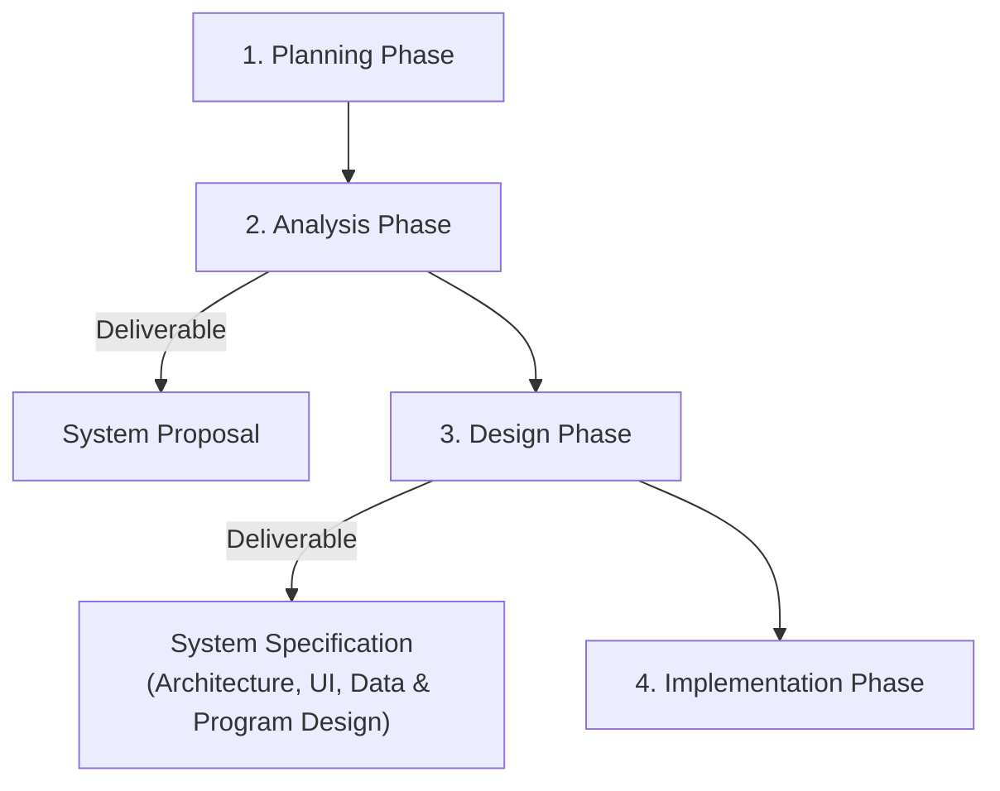

# ISAD - Unit 07: Design Strategies

> **วิชา:** 06066304 Information System Analysis and Design | **สถาบัน:** KMITL (King Mongkut's Institute of Technology Ladkrabang)
> **อาจารย์:** Asst. Prof. Manop Phankokkruad, Ph.D.
> **Source:** `Resources/Books/Information System Analysis and Design/ISAD2026-UNIT07-design-strategies-v1.pdf` (33 slides)

---

## Part 1: Macro Architecture & Overview

Unit 07 ครอบคลุมการเปลี่ยนผ่านจาก **Analysis Phase** ไปสู่ **Design Phase** ในวงจรการพัฒนาระบบ (SDLC) โดยเน้นที่การเลือกกลยุทธ์การจัดหาระบบ (**System Acquisition Strategy**) ซึ่งเป็นจุดตัดสินใจสำคัญว่าองค์กรจะสร้างระบบเองภายใน ซื้อซอฟต์แวร์สำเร็จรูป หรือจ้างภายนอก แต่ละแนวทางมีข้อดีข้อเสียและปัจจัยที่ควรพิจารณาแตกต่างกัน



### ตารางเปรียบเทียบ System Acquisition Strategy ทั้ง 3 แบบ

| ประเด็น | Custom Development | Packaged Software | Outsourcing |
| :--- | :--- | :--- | :--- |
| **ความหมาย** | พัฒนาระบบขึ้นเองตั้งแต่ต้น | ซื้อซอฟต์แวร์สำเร็จรูป | จ้างบุคคลภายนอกสร้างหรือดูแล |
| **ความยืดหยุ่น** | สูงมาก | ต่ำ (ตามที่ vendor กำหนด) | ปานกลาง |
| **ความเสี่ยง** | สูง | ต่ำ | ปานกลาง–สูง |
| **ค่าใช้จ่าย** | สูง | ปานกลาง | ต่ำในช่วงแรก |
| **ระยะเวลา** | นาน | สั้น | ขึ้นกับ vendor |
| **เหมาะกับ** | ความต้องการเฉพาะ/กลยุทธ์หลัก | ความต้องการทั่วไป | งานที่ไม่ใช่กลยุทธ์หลัก |

---

## Part 2: Module-by-Module Deep Dive

### 2.1 Transition from Requirements to Design

#### Design Phase คืออะไร

> 💡 **Intuition:** ลองคิดถึงการไปแคมป์ปิ้ง: ช่วง Analysis คือการลิสต์ว่าต้องการอะไร (ที่นอนกันฝนสำหรับ 4 คน, ไฟฟ้าสำหรับชาร์จโทรศัพท์, อาหาร 2 วัน) ส่วน Design Phase คือการตัดสินใจว่าจะทำให้ได้อย่างไร: ใช้เต็นท์รุ่นไหน วัสดุอะไร ขนาดเท่าไหร่ ใช้ Power Bank หรือแผงโซลาร์ วางเต็นท์ตรงไหน การเปลี่ยนจากคำถาม "เราต้องการอะไร" เป็น "เราจะทำให้ได้อย่างไร" นี่แหละคือ Design
> [Source: generated — not verified against original document]

> Design Phase คือขั้นตอนที่ตัดสินใจว่า **ระบบใหม่จะทำงานอย่างไร** — เป็น "สะพาน" เชื่อม Requirements สู่ Solution จริง

- **Analysis Phase** → ตอบคำถาม **"What"** (ธุรกิจต้องการอะไร)
- **Design Phase** → ตอบคำถาม **"How"** (จะสร้างระบบนั้นอย่างไร)

**🧭 ทำความเข้าใจ** _[Source: generated — not verified against original document]_

**แตกวลีสำคัญ:**
- "ระบบจะทำงานอย่างไร" → ไม่ใช่สิ่งที่ต้องทำ แต่เป็น _วิธี_ ที่ใช้ทำ (Technology, Architecture, UI, Database)
- "สะพาน เชื่อม Requirements สู่ Solution" → Requirements คือสิ่งที่ผู้ใช้บอกว่าต้องการ Solution คือระบบจริงที่ทำงาน Design Phase คือการแปลงข้อความความต้องการ (Requirements) เป็นแบบก่อสร้าง (Plans)

**ตัวอย่าง:**
- ✅ **Analysis บอก:** "ระบบต้องอนุญาตให้ผู้จัดการจัดการบัญชีผู้ใช้ได้" → **Design ตอบ:** "เราจะใช้ Role-Based Access Control (RBAC), พร้อม Database Permission Level เพื่อจำกัดสิทธิ์" — นี่คือการตอบ "How"
- ❌ **ถ้า Design เพียงแค่บอก:** "ระบบต้องอนุญาตให้ผู้จัดการจัดการบัญชีผู้ใช้ได้" — นั่นคือยังอยู่ที่ระดับ Analysis ยังไม่ก้าวพ้น "What"
- **ต่างกันตรง:** Analysis บอกปัญหา Design บอกการแก้ปัญหา

**อย่าสับสน:** "Design" และ "Analysis" ต่างกัน — Analysis ถามว่า "ต้องการอะไร" Design ถามว่า "จะสร้างอย่างไร"

**เช็คความเข้าใจ:** บริษัทต้องการระบบเก็บข้อมูลลูกค้า เรียกหากลุ่มคนซื้อจากภูมิภาคกำหนด ควรเกิดขึ้นในช่วง Analysis หรือ Design? เพราะอะไร?
<details><summary>เฉลย</summary>

**Analysis** — "จำเป็นต้องสามารถเรียกข้อมูลลูกค้าตามภูมิภาค" คือความต้องการทางธุรกิจ (What)

**Design** จะตัดสินใจ: "ใช้ WHERE clause ใน SQL ตามหลัก Regional ID หรือใช้ Partition ใน Database?"

</details>

#### กระบวนการเปลี่ยนผ่าน

1. **System Proposal** (Output จาก Analysis) → นำเสนอต่อ Approval Committee ผ่าน System Walk-through
2. ช่วงต้นของ Design Phase → แปลง **Business Requirements** เป็น **System Requirements** (รายละเอียดเชิงเทคนิค)
3. System Requirements ถูกสื่อสารผ่าน Design Documents, Physical Process Models, และ Data Models
4. **System Specification** (Output หลักของ Design Phase) → ส่งต่อให้ทีม Programming เพื่อ Implementation

> ⚠️ ช่วงปลาย Design Phase จะมีการทบทวน Feasibility Analysis และ Project Plan อีกครั้ง ก่อนที่ Project Sponsor จะตัดสินใจว่าจะ "ดำเนินการต่อ" หรือ "ยุติโครงการ"

---

### 2.2 System Acquisition Strategies — 3 กลยุทธ์หลัก

#### กลยุทธ์ที่ 1: Custom Development

> 💡 **Intuition:** นึกถึงการทำชุดสูท: คุณไปหาช่างตัดผ้าและบอกความต้องการเฉพาะของคุณ (ผ้า, สี, รูป) ช่างก็วาดแบบและตัดทำให้จากศูนย์ ใช้เวลานาน, มีค่าใช้จ่าย, แต่คุณได้สิ่งที่พอดีกับตัวคุณเพียงคนเดียว นั่นคือ Custom — สร้างจากศูนย์เพื่อให้พอดีกับความต้องการที่เฉพาะเจาะจง
> [Source: generated — not verified against original document]

**Custom Development** คือการสร้างระบบใหม่ตั้งแต่เริ่มต้นโดยทีมภายในองค์กร

**ข้อดี (Pros):**
- มีความยืดหยุ่นและสร้างสรรค์ในการแก้ปัญหาทางธุรกิจได้อย่างเต็มที่
- สามารถนำเทคโนโลยีล่าสุดมาใช้เพื่อสนับสนุนกลยุทธ์ขององค์กรได้
- สร้างทักษะเชิงเทคนิคและความรู้เชิงธุรกิจสะสมไว้ภายในองค์กร

**ข้อเสีย (Cons):**
- ต้องใช้ความพยายามและเวลาสูงมาก
- ต้องการบุคลากร IS ที่มีทักษะหลากหลายและสูง ซึ่งหาและรักษาไว้ยาก
- ความเสี่ยงในการพัฒนาระบบจากศูนย์นั้นสูงมาก

**🧭 ทำความเข้าใจ** _[Source: generated — not verified against original document]_

**แตกวลีสำคัญ:**
- "ความยืดหยุ่น ... ได้อย่างเต็มที่" → สามารถปรับเปลี่ยนทุกส่วน: UI, Database, Algorithm, Integration points
- "สร้างทักษะเชิงเทคนิค ... ไว้ภายในองค์กร" → เมื่อโครงการจบ ทีมของคุณยังมีความรู้และความสามารถนั้นอยู่ (ไม่เหมือน Outsourcing ที่จ้างแล้วจบ)
- "ความเสี่ยง ... สูงมาก" → อาจเกิดการไป Over-budget, Delay, หรือ Quality ต่ำ ถ้า Project Management ไม่ดี

**ตัวอย่าง:**
- ✅ **ใช้ Custom ได้ดี:** กลยุทธ์หลักขององค์กร, ความต้องการเฉพาะมาก, และมีทีม Developer ที่มีประสบการณ์ → ระบบที่เป็นจุดแข่งขันหลักของบริษัท เช่น ระบบ Dynamic Pricing เฉพาะของสายการบิน
- ❌ **ไม่ควร Custom:** ระบบ HR ทั่วไป, เวลาน้อย, Budget น้อย → เพราะมี HR Software สำเร็จรูปมากมาย
- **ต่างกันตรง:** Custom ใช้เมื่อไม่มี Solution สำเร็จรูป หรือต้องการควบคุมทุกอย่าง

**อย่าสับสน:** "สร้างเองทั้งหมด" หมายถึง In-house Team ทำ ไม่ได้หมายถึงเขียน Code บรรทัดแรกแบบ Scratch ทั้งหมด — ยังคงใช้ Frameworks, Libraries ได้

**เช็คความเข้าใจ:** ธนาคารต้องการระบบให้ลูกค้าโอนเงินแบบ Same-day ซึ่งมีกฎหมายเฉพาะที่เปลี่ยนตามประเทศ Custom Development หรือ Packaged Software ดีกว่า? เพราะอะไร?
<details><summary>เฉลย</summary>

**Custom Development** — เพราะความต้องการเป็น Niche (ไม่มี Solution สำเร็จรูปครอบคลุม), มีกฎหมายเฉพาะแต่ละประเทศ, และนี่คือกลยุทธ์หลักของธนาคาร → ต้องการการควบคุมเต็มที่ และสามารถ maintain ได้อย่างต่อเนื่อง

</details>

---

#### กลยุทธ์ที่ 2: Packaged Software

> 💡 **Intuition:** นึกถึง IKEA — คุณไปเลือกชุดเฟอร์นิเจอร์สำเร็จรูป ประกอบมันเองก็ได้ เร็ว, ราคาถูกกว่า Custom Furniture, แต่ "ต้องนั่งในสไตล์ IKEA" — ถ้าคุณต้องการสี Marsala แต่เขามีแค่ Black & White ก็ต้องยอมรับ Packaged = ซื้อของสำเร็จรูปจากร้าน ไม่ได้พอดีกับเราทุกอย่าง แต่ "ดีพอ" และได้เร็ว
> [Source: generated — not verified against original document]

**Packaged Software** คือการซื้อซอฟต์แวร์สำเร็จรูปที่ถูกพัฒนามาสำหรับความต้องการทางธุรกิจทั่วไป

**ลักษณะสำคัญ:**
- มีตั้งแต่ขนาดเล็ก (เครื่องมือเฉพาะทาง) ไปจนถึงขนาดใหญ่อย่าง **ERP (Enterprise Resource Planning)**
- ติดตั้งและใช้งานได้รวดเร็วกว่า Custom Development มาก
- ได้รับการทดสอบแล้ว → ลดความเสี่ยงด้านคุณภาพ

**ข้อจำกัด:**
- องค์กรต้อง "ยอมรับ" ฟีเจอร์ที่มีให้เท่านั้น
- แก้ไขได้บางส่วนผ่าน **Customization** (ปรับ Parameters) หรือสร้าง **Workaround** (โปรแกรมเสริมที่เชื่อมต่อกับ Packaged Application)

**🧭 ทำความเข้าใจ** _[Source: generated — not verified against original document]_

**แตกวลีสำคัญ:**
- "ยอมรับฟีเจอร์ที่มีให้เท่านั้น" → Packaged Software ออกแบบมาสำหรับ 80% ของตลาด ถ้า Business ต้องการ 20% พิเศษ → ใช้ Customization (ถ้า Vendor เปิดให้ปรับ), สร้าง Workaround, หรือปรับวิธีทำงานของธุรกิจให้เข้ากับซอฟต์แวร์ เพราะแก้ Source Code ของ Vendor เองไม่ได้
- "ได้รับการทดสอบแล้ว" → มีผู้ใช้หลายร้อยหรือพันคน → Bug น้อย, ความมั่นคง สูง
- "Customization" → Parameter Settings (Configuration) ที่ Vendor เตรียมให้ (เช่น เปลี่ยน Color Theme, Report Layout)
- "Workaround" → เขียน Code เสริม (Plugin, Script) เชื่อมกับ Packaged Software เพื่อรองรับสิ่งที่ Software ไม่มี

**ตัวอย่าง:**
- ✅ **ใช้ Packaged Software ได้:** ระบบ HR ทั่วไป, Accounting Software, CRM ทั่วไป → เพราะต้องการทั่วไป, ต้องการเร็ว, Budget จำกัด
- ❌ **ไม่ควร Packaged:** ระบบลอจิสติกส์สำหรับเฉพาะอุตสาหกรรม หรือ Fixed Assets Tracking ที่มีกฎอย่างพิเศษ → เพราะ Packaged อาจไม่มี Feature ที่พอ
- **ต่างกันตรง:** Packaged ดีเมื่อความต้องการเป็นแบบทั่วไป; Custom ดีเมื่อความต้องการเฉพาะเจาะจง

**อย่าสับสน:** "Customization" (ปรับ Config) ≠ "Workaround" (เขียน Code เสริม) — Customization คือ Standard Feature ของ Vendor, Workaround คือเรา "สร้างเพิ่มเติม"

**เช็คความเข้าใจ:** บริษัทต้องการระบบ ERP สำหรับขาย/ซื้อ/คลัง ระหว่าง SAP (Packaged) กับ Custom Development ตัวเลือกไหนดีกว่า? เพราะอะไร?
<details><summary>เฉลย</summary>

**Packaged Software (SAP)** — เพราะ ERP Process เป็น Standard (Sell, Buy, Inventory คือ Best Practices เดียวกัน), ติดตั้งได้เร็วกว่าและความเสี่ยงต่ำกว่าการสร้าง Custom ที่ใช้เวลานาน, มีผู้ใช้มากมายจึงผ่านการทดสอบมาแล้วและมี Support ดี

ถ้า Business มีกระบวนการ Custom (เช่น ขายแบบ Make-to-Order ที่ Unique) → อาจต้อง Workaround เสริม หรือเปลี่ยนวิธีทำงาน

</details>

**Systems Integration:**

> 💡 **Intuition:** นึกถึงบริษัทที่มี 3 แผนก: แผนกแรกใช้ Excel และโปรแกรมเก่า (Legacy), แผนกสองใช้ SAP (Packaged Software), แผนกสามใช้ Shopify (Packaged/SaaS) ตอนนี้บริษัทต้องการให้ทุกแผนกทำงานด้วยกัน → ต้อง "เสียบ" ระบบทั้ง 3 เข้าด้วยกัน เชื่อมข้อมูล เพื่อไม่ให้ data ซ้ำหรือหลุด นั่นคือ Integration
> [Source: generated — not verified against original document]

> **Systems Integration** คือการสร้างระบบใหม่โดยการรวมกัน (Combine) ระหว่าง Packaged Software, ระบบเก่า (Legacy Systems), และซอฟต์แวร์ใหม่ที่เขียนขึ้นมาเพื่อเชื่อมต่อ

- ความท้าทายหลัก: การ integrate ข้อมูลจากระบบที่แตกต่างกัน

**🧭 ทำความเข้าใจ** _[Source: generated — not verified against original document]_

**แตกวลีสำคัญ:**
- "รวมกัน (Combine)" → ไม่ได้เลือกแหล่งซอฟต์แวร์แค่แบบเดียว แต่ผสมหลายแหล่ง (Packaged + Legacy + Code ใหม่) เข้าเป็นระบบเดียว
- "Legacy Systems" → ระบบเก่า ที่องค์กรใช้งานมาสักระยะ ไม่สามารถเปลี่ยนได้ทันที
- "ซอฟต์แวร์ใหม่เพื่อเชื่อมต่อ" → Middleware, Adapter, API Gateway — ตัวแปลข้อมูลระหว่างระบบต่างๆ

**ตัวอย่าง:**
- ✅ **ใช้ Systems Integration ได้:** บริษัทมี Accounting Software (20 ปี), ต้องเพิ่ม CRM ใหม่ (Packaged) → ต้อง Integration เพื่อให้เมื่อทำการขาย (CRM) ระบบ Accounting อัปเดตอัตโนมัติ
- ❌ **ไม่ต้อง Integration:** บริษัทตัดสินใจเปลี่ยนจากระบบเก่าเป็น One Single ERP ใหม่ → ไม่ต้อง Integration (เหลือระบบเดียว แค่ทำ Data Conversion ครั้งเดียว)
- **ต่างกันตรง:** Integration เกิดเมื่อ "ต้องรักษา Legacy ไว้" + "เพิ่ม Packaged/ระบบใหม่" ใช้งานไปพร้อมกัน

**อย่าสับสน:** "Workaround" (Plugin สำหรับ Packaged) ≠ "Integration" (เชื่อม Packaged + Legacy + New Software) — Workaround คือปรับแต่ง 1 ระบบ Integration คือ เสียบหลายระบบ

**เช็คความเข้าใจ:** โรงแรมใช้ระบบจองห้อง (Legacy 10 ปี) และซื้อ Accounting Software ใหม่ (Packaged) ต้องการให้เมื่อมีการจอง ข้อมูลถูกส่งไป Accounting อัตโนมัติ → เป็น Integration หรือ Workaround?
<details><summary>เฉลย</summary>

**Systems Integration** — เพราะเชื่อม 2 ระบบ (Legacy + Packaged) เข้าด้วยกัน วิธีที่ใช้ได้ เช่น เขียน API Adapter หรือ ETL Process ที่ส่งข้อมูลจากระบบจองห้องไปยัง Accounting Software

</details>

---

#### กลยุทธ์ที่ 3: Outsourcing

> 💡 **Intuition:** นึกถึงการเช่าบ้าน — คุณเช่า แต่เจ้าบ้านคือคนดูแล ซ่อม ทำความสะอาด คุณต้องจ่ายค่าเช่า แต่ "การควบคุม" อยู่กับเจ้าบ้าน ถ้าเจ้าบ้านเลิกให้เช่า → คุณต้องไปหาบ้านใหม่ นั่นแหละ Outsourcing — เราใช้บริการจากภายนอก ราคาต่ำแต่ "การควบคุม" ไม่ได้อยู่ในมือ
> [Source: generated — not verified against original document]

**Outsourcing** คือการจ้าง Vendor, Developer, หรือ Service Provider ภายนอกมาสร้างหรือดูแลระบบ

**รูปแบบ Outsourcing:**
- **ASP (Application Service Provider)** — ให้บริการซอฟต์แวร์และบริการผ่าน Internet
- **SaaS (Software as a Service)** — ต่อยอดจากโมเดล ASP

**ข้อดี:** ต้นทุนเริ่มต้นต่ำ, Setup เร็ว

**ความเสี่ยง (Risks):**
- ข้อมูลลับขององค์กรอาจถูกเปิดเผย (Compromising Confidential Information)
- เสียการควบคุมการพัฒนาในอนาคต (Losing Control over Future Development)
- สูญเสียทักษะภายในองค์กร (Losing In-house Skills)

> ⚠️ **"You should never outsource what you do not understand."**

**ประเภทสัญญา Outsourcing:**

| ประเภทสัญญา | ลักษณะ |
| :--- | :--- |
| **Time and Arrangements** | จ่ายตามเวลาและค่าใช้จ่ายจริงที่ใช้ไป |
| **Fixed-price Contract** | กำหนดราคาตายตัว ไม่ขึ้นกับทรัพยากรหรือเวลาที่ใช้ |
| **Value-added Contract** | Outsourcer รับส่วนแบ่งจากผลประโยชน์ที่ระบบสร้างขึ้น |

**แนวทาง Outsourcing ที่ดี (Outsourcing Guidelines):**
- รักษาการสื่อสารแบบเปิดตลอดเวลา
- กำหนดและ Stabilize Requirements **ก่อน** เซ็นสัญญา
- มองความสัมพันธ์เป็น Partnership
- คัดเลือก Vendor อย่างรอบคอบ
- มีผู้รับผิดชอบจัดการความสัมพันธ์กับ Outsourcer
- อย่า Outsource สิ่งที่ตัวเองไม่เข้าใจ
- เน้นความยืดหยุ่นในข้อกำหนด, ความสัมพันธ์ระยะยาว, และสัญญาระยะสั้น

**🧭 ทำความเข้าใจ** _[Source: generated — not verified against original document]_

**แตกวลีสำคัญ:**
- "ต้นทุนเริ่มต้นต่ำ" → ไม่ต้องเสียต้นทุน Hiring, Recruiting, Training บุคลากรใหม่
- "เสียการควบคุมการพัฒนา" → ทิศทางการพัฒนาต่อ (Feature, Roadmap, ราคา) ขึ้นกับ Vendor; ถ้า Vendor เลิกทำหรือถูกซื้อกิจการ คุณมีอำนาจต่อรองน้อย
- "สูญเสียทักษะภายใน" → เมื่อจบโครงการ ทีมของคุณไม่ได้เรียนรู้ → เวลาต้องแก้หรือต่อยอด ต้องพึ่ง Vendor อีก
- "อย่า Outsource สิ่งที่ตัวเองไม่เข้าใจ" → ถ้าคุณเข้าใจ Requirement เอง สามารถ Monitor และ Verify Vendor ได้; ถ้าไม่เข้าใจ → ต้องพึ่ง Vendor ทั้งหมด

**ตัวอย่าง:**
- ✅ **ใช้ Outsourcing ได้:** ระบบ HR (ไม่ใช่ Core Competency), ระบบ Helpdesk, Network Infrastructure → เพราะไม่ใช่จุดที่ธุรกิจใช้แข่งขัน
- ❌ **ไม่ควร Outsourcing:** Core Algorithm ที่สร้าง Competitive Advantage, ระบบวิเคราะห์ข้อมูลลูกค้า → เพราะนั่นคือ Core Competency (ความสามารถหลัก)
- **ต่างกันตรง:** Outsource ได้สำหรับงาน "Non-core"; งาน "Core" ควรเก็บความรู้ไว้ In-house (มักใช้ Custom Development)

**อย่าสับสน:** "อย่า Outsource สิ่งที่ตัวเองไม่เข้าใจ" เป็น **คำเตือน** — ถ้าจะ Outsource งานใด องค์กรต้องเข้าใจงานนั้น **ก่อน** เพื่อเขียน Requirement และตรวจงาน Vendor ได้

**เช็คความเข้าใจ:** บริษัทขายออนไลน์ ต้องการระบบ Payment Gateway (รับเงิน) หรือ Recommendation Engine (แนะนำสินค้า) ควร Custom/Packaged/Outsource ตัวไหน? เพราะอะไร?
<details><summary>เฉลย</summary>

- **Payment Gateway** → **Outsourcing** (หรือ Packaged) — เพราะเป็น Non-core (บริษัทขาย ไม่ใช่ธนาคาร), มี Standard Solution, เสี่ยงด้าน Security ต้องให้ Specialist
- **Recommendation Engine** → **Custom Development** — เพราะเป็น Core (สร้าง UX ดีทำให้ขายได้เยอะ), ต้องการ Competitive Advantage, ต้องรู้ข้อมูลลูกค้า → ควรสร้าง In-house

</details>

---

### 2.3 Influences on the Acquisition Strategy — 5 ปัจจัยที่มีผล

ไม่มีกลยุทธ์ใดที่ "ดีที่สุด" สำหรับทุกสถานการณ์ ต้องพิจารณาจากปัจจัยต่อไปนี้:

#### ปัจจัยที่ 1: Business Need (ความต้องการทางธุรกิจ)

| ลักษณะความต้องการ | กลยุทธ์ที่เหมาะ |
| :--- | :--- |
| ทั่วไป / มี Solution อยู่แล้ว | **Packaged Software** |
| เฉพาะเจาะจง / ไม่มี Solution สำเร็จรูป | **Custom Development** |
| ไม่ใช่กลยุทธ์หลักขององค์กร | **Outsourcing** |

#### ปัจจัยที่ 2: In-House Experience (ความเชี่ยวชาญภายในองค์กร)

| ระดับ In-House Experience | กลยุทธ์ที่เหมาะ |
| :--- | :--- |
| มีทั้ง Functional และ Technical Skills ครบ | **Custom Development** |
| ขาดทักษะเทคนิคในการสร้างระบบ | **Packaged Software** |
| ต้องการ Outside Experience | **Outsourcing** |

#### ปัจจัยที่ 3: Project Skills (ทักษะที่ใช้ในโครงการ)

- ทักษะแบ่งเป็น **Technical Skills** (เช่น SQL) และ **Functional Skills** (เช่น E-commerce)
- หากทักษะนั้นสำคัญต่อกลยุทธ์องค์กร → ควรพัฒนา In-house
- หากเป็นแค่ Operational Issue (เช่น Network Security) → ควร Outsource หรือซื้อ Packaged Software เพื่อให้ Internal Team โฟกัสงานที่สำคัญกว่า

#### ปัจจัยที่ 4: Project Management (การบริหารโครงการ)

- **Custom Development** → ต้องการ Project Management และ Methodology ที่ดีมาก
- ปัจจัยที่อาจทำให้โครงการเสียทิศทาง: ปัญหาด้านงบประมาณ, การจัดบุคลากร, และ Business Users ที่ต้องการมากเกินไป
- **Packaged Software / Outsourcing** → ยังคงต้องการการจัดการ แต่ได้รับผลกระทบจากปัจจัยภายในน้อยกว่า

#### ปัจจัยที่ 5: Time Frame (กรอบเวลา)

- เวลาจำกัด → มองหาระบบที่สร้างและทดสอบแล้ว (**Packaged Software**)
- หากเลือก Custom แต่เวลาน้อย → ใช้เทคนิค **Timeboxing** เพื่อจัดการปัญหา
- **Outsourcing** อาจใช้เวลานานพอๆ กับ Custom Development

---

### 2.4 Selecting an Acquisition Strategy

#### เครื่องมือในการรวบรวมข้อมูลจาก Vendor

| เครื่องมือ | ย่อว่า | ใช้เมื่อไหร่ |
| :--- | :--- | :--- |
| **Request for Proposal** | **RFP** | ต้องการข้อเสนอละเอียดจาก Vendor สำหรับโครงการขนาดใหญ่ |
| **Request for Information** | **RFI** | โครงการขนาดเล็ก / งบน้อย ต้องการข้อมูลพื้นฐาน |
| **Request for Quote / Invitation for Bid** | **RFQ / IFB** | มีรายการที่ต้องการชัดเจน ต้องการแค่ราคา |

- **RFP** → อธิบายรายละเอียดระบบที่ต้องการ ให้ Vendor ตอบกลับว่าจะตอบสนองความต้องการนั้นอย่างไร

#### Alternative Matrix (ตารางเปรียบเทียบทางเลือก)

> 💡 **Intuition:** ลองคิดว่าเลือกซื้อรถ — คุณมี 3 ตัวเลือก (Toyota, Honda, BMW) ต้องเปรียบเทียบ ราคา, เชื้อเพลิง, Maintenance, ความสวย, Speed — แต่ละคนให้ความสำคัญแต่ละเรื่องไม่เท่ากัน สำหรับคุณราคาสำคัญที่สุด (Weight 50%) สำหรับเพื่อน ความสวยสำคัญที่สุด (Weight 50%) → ทำตาราง ให้ Score แต่ละตัวในแต่ละเรื่อง คูณ Weight แล้วรวม → ได้คะแนนรวม → เลือกคะแนนสูงสุด นั่นคือ Matrix
> [Source: generated — not verified against original document]

> **Alternative Matrix** คือตารางที่รวบรวม Pros/Cons และการวิเคราะห์ Feasibility ของทุก Design Alternative ไว้ในที่เดียว เพื่อให้ Approval Committee ตัดสินใจได้ง่าย

**ขั้นตอนการสร้าง Alternative Matrix:**
1. สร้างตารางบรรจุ Technical, Economical, และ Organizational Feasibility ของแต่ละทางเลือก
2. เพิ่ม **Weights (น้ำหนัก)** ตาม Priority ของเกณฑ์แต่ละข้อ → ได้ **Weighted Alternative Matrix**
3. เพิ่มคอลัมน์ **Score** เพื่อสื่อสารว่าแต่ละทางเลือกตอบโจทย์เกณฑ์ได้ดีแค่ไหน
4. **Approval Committee** ทำการตัดสินใจขั้นสุดท้าย

```text
Alternative Matrix Structure:
┌──────────────┬───────────────┬───────────────┬───────────────┐
│  Criteria    │  Alternative  │  Alternative  │  Alternative  │
│  (+ Weight)  │     A         │     B         │     C         │
├──────────────┼───────────────┼───────────────┼───────────────┤
│ Technical    │ Score × Wt    │ Score × Wt    │ Score × Wt    │
│ Economical   │ Score × Wt    │ Score × Wt    │ Score × Wt    │
│ Organizational│ Score × Wt   │ Score × Wt    │ Score × Wt    │
├──────────────┼───────────────┼───────────────┼───────────────┤
│ TOTAL        │   ΣScore      │   ΣScore      │   ΣScore      │
└──────────────┴───────────────┴───────────────┴───────────────┘
→ ทางเลือกที่ได้ TOTAL Score สูงสุด = ทางเลือกที่แนะนำ
```

**🧭 ทำความเข้าใจ** _[Source: generated — not verified against original document]_

**แตกวลีสำคัญ:**
- "Pros/Cons และการวิเคราะห์ Feasibility" → ไม่ใช่แค่บอก "ดี-ไม่ดี" ต้องวิเคราะห์ว่า ทำได้จริงหรือไม่ (Technical), ใช้เงินได้หรือไม่ (Economical), องค์กรพร้อมหรือไม่ (Organizational)
- "Weight (น้ำหนัก)" → บอกว่าเกณฑ์ไหน ความสำคัญเท่าไหร่ (เช่น Budget คิดเป็น 40% ของการตัดสินใจ)
- "Score" → คะแนนที่ให้แต่ละทางเลือกในแต่ละเกณฑ์ (เช่น 1-10 หรือ 1-5 โดยคะแนนสูง = ดีกว่า) แล้วคูณกับ Weight

**ตัวอย่าง:**
- ✅ **ใช้ Alternative Matrix ได้ดี:** เลือกระหว่าง Custom Development (ราคาแพง, ยืดหยุ่น) / Packaged Software (ราคาถูก, ไม่ยืดหยุ่น) / Outsourcing (ราคาปานกลาง, ต้องหา Vendor) → ต้องชั่งน้ำหนัก จึงใช้ Matrix
- ❌ **ไม่ต้อง Matrix:** เลือกระหว่าง Custom vs. Outsourcing แต่ Custom ทำไม่ได้เลย (ไม่ผ่าน Technical Feasibility เพราะไม่มีทีม) → เหลือทางเลือกเดียว ตัดสินได้ทันที
- **ต่างกันตรง:** Matrix ใช้เมื่อทุกทางเลือกเป็นไปได้ แต่ต้อง Weighted decision (มี trade-offs)

**อย่าสับสน:** "Alternative Matrix" (เพียงแค่ Pros/Cons) ≠ "Weighted Alternative Matrix" (เพิ่ม Weight + Score) — Weighted ดีกว่าเพราะทำให้การตัดสินใจเป็นระบบและโปร่งใส (แต่การกำหนด Weight ยังเป็นการตัดสินใจของคน)

**เช็คความเข้าใจ:** บริษัท Decision Criteria คือ Cost (Weight 50%), Speed to Market (Weight 30%), Flexibility (Weight 20%) คะแนน 3 ตัวเลือก: Custom (10/10 flexibility แต่ 2/10 speed, 3/10 cost), Packaged (5/10 flexibility, 9/10 speed, 8/10 cost), Outsourcing (6/10 flexibility, 8/10 speed, 7/10 cost) — ทุกเกณฑ์คะแนนสูง = ดีกว่า (Cost 8/10 = ถูก) ทางเลือกไหนได้ Score สูงสุด?
<details><summary>เฉลย</summary>

คำนวณตาม Weight:

- **Custom:** (3 × 0.5) + (2 × 0.3) + (10 × 0.2) = 1.5 + 0.6 + 2 = **4.1**
- **Packaged:** (8 × 0.5) + (9 × 0.3) + (5 × 0.2) = 4 + 2.7 + 1 = **7.7** ← สูงสุด
- **Outsourcing:** (7 × 0.5) + (8 × 0.3) + (6 × 0.2) = 3.5 + 2.4 + 1.2 = **7.1**

→ **Packaged Software** เป็นทางเลือกที่แนะนำ เพราะ Cost และ Speed to Market สำคัญกว่า

</details>

---

## Part 3: Quick Reference & Exam Cheat Sheet

### Checklist สรุปหัวใจสำคัญก่อนสอบ

- [ ] **Design Phase:** ตอบคำถาม "How" — ตัดสินใจว่าระบบจะทำงานอย่างไร, Output คือ System Specification
- [ ] **System Proposal:** Output สุดท้ายของ Analysis Phase → เป็น Input สำหรับ Design Phase
- [ ] **3 กลยุทธ์:** Custom Development / Packaged Software / Outsourcing — รู้ Pros, Cons, และเมื่อไหรควรใช้
- [ ] **Workaround:** โปรแกรมเสริมที่สร้างขึ้นมาเชื่อมกับ Packaged Software เพื่อรองรับความต้องการพิเศษ
- [ ] **Systems Integration:** รวม Packaged Software + Legacy Systems + New Software เข้าด้วยกัน
- [ ] **ASP / SaaS:** รูปแบบ Outsourcing ที่ส่งบริการผ่าน Internet
- [ ] **5 ปัจจัย:** Business Need / In-House Experience / Project Skills / Project Management / Time Frame
- [ ] **Timeboxing:** เทคนิคจัดการเวลาสำหรับ Custom Development ที่มีกรอบเวลาจำกัด
- [ ] **RFP / RFI / RFQ:** เครื่องมือรวบรวมข้อมูลจาก Vendor — รู้ว่าอันไหนใช้เมื่อไหร่
- [ ] **Alternative Matrix:** ตารางเปรียบเทียบ + Weights + Score → ช่วย Approval Committee ตัดสินใจ

### สรุป Acquisition Strategy ที่ควรเลือก

| สถานการณ์ | กลยุทธ์ที่แนะนำ |
| :--- | :--- |
| ความต้องการ Unique + มีทักษะ In-house ครบ | Custom Development |
| ความต้องการทั่วไป + เวลาน้อย | Packaged Software |
| ขาดทักษะ + งานไม่ใช่กลยุทธ์หลัก | Outsourcing |
| งบน้อย + ต้องการเริ่มเร็ว | Outsourcing (ASP/SaaS) |

### Concept Map

```text
Design Strategies (Unit 07)
├── 1. Transition to Design
│     ├── Analysis → System Proposal → Design
│     ├── Design Phase: "How to build"
│     └── Output: System Specification (A–H)
│
├── 2. System Acquisition Strategies
│     ├── Custom Development (สร้างเอง)
│     ├── Packaged Software (ซื้อ + Customize)
│     │     ├── Workaround
│     │     └── Systems Integration
│     └── Outsourcing (จ้างภายนอก)
│           ├── ASP / SaaS
│           └── Contract Types: Time / Fixed-price / Value-added
│
├── 3. Influences on Strategy
│     ├── Business Need
│     ├── In-House Experience
│     ├── Project Skills
│     ├── Project Management
│     └── Time Frame
│
└── 4. Selecting a Strategy
      ├── RFP / RFI / RFQ
      └── Alternative Matrix (Weighted)
```

---

## ⚠️ Common Pitfalls & Exam Traps

- **สับสนระหว่าง RFP / RFI / RFQ:** RFP = ละเอียดที่สุด, RFI = สั้นกว่า สำหรับโครงการเล็ก, RFQ = แค่ขอราคา (มีรายการชัดเจนแล้ว)
- **คิดว่า Custom Development ดีที่สุดเสมอ:** ผิด — ถ้าความต้องการทั่วไปและเวลาจำกัด Packaged Software อาจดีกว่ามาก
- **ลืม Workaround vs. Systems Integration:** Workaround คือโปรแกรมเสริมสำหรับ Packaged ที่ยังคงใช้ต่อ ส่วน Systems Integration คือการรวมหลายระบบเข้าด้วยกัน
- **คิดว่า Outsourcing ถูกและเร็วเสมอ:** ไม่ใช่ — Outsourcing อาจใช้เวลานานเท่า Custom Development และมีความเสี่ยงด้านความลับของข้อมูล
- **ลืม 5 ปัจจัยของ Acquisition Strategy:** ต้องรู้ทั้ง 5 ปัจจัย: Business Need, In-House Experience, Project Skills, Project Management, Time Frame
- **Alternative Matrix:** ต้องมีทั้ง Weights (น้ำหนัก) และ Score — ตารางที่ไม่มี Weight คือ Alternative Matrix ธรรมดา ไม่ใช่ Weighted Alternative Matrix
- **"Never outsource what you don't understand":** นี่คือหลักการสำคัญที่มักออกข้อสอบ

---

## เอกสารเชื่อมโยง (Wiki-Style Backlinks)

- **วิชาและหัวข้อที่เกี่ยวข้อง:**
  - [[ISAD - Unit 01 Introduction]] (ภาพรวมของ SDLC และบทบาทของแต่ละ Phase)
  - [[ISAD - Unit 06 Requirements]] (Analysis Phase ที่เป็น Input ของ Design Phase)
  - [[ISAD - Unit 08 Architecture Design]] (ต่อจาก Design Strategies — เนื้อหา Architecture Design)

- **แหล่งข้อมูล:**
  - Source: `Resources/Books/Information System Analysis and Design/ISAD2026-UNIT07-design-strategies-v1.pdf` (33 slides, KMITL)
  - อาจารย์: Asst. Prof. Manop Phankokkruad, Ph.D. — School of Information Technology, KMITL
