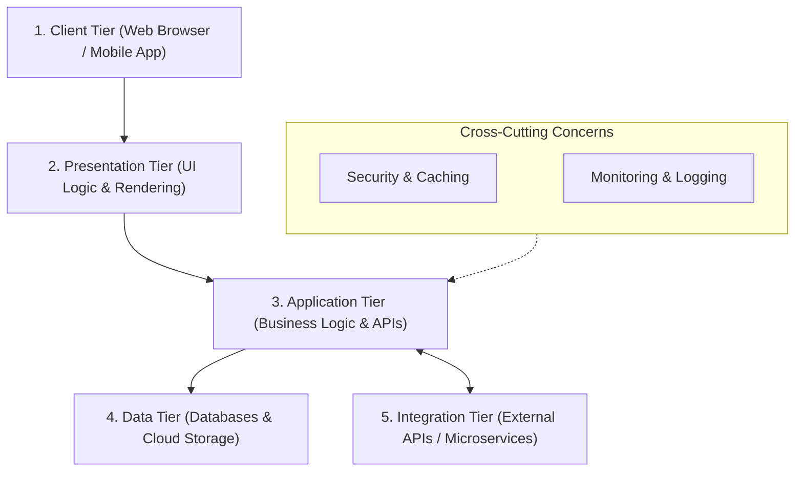
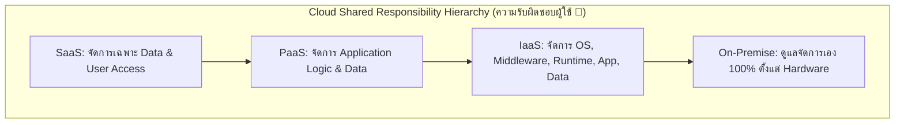

# ISAD - Unit 08: Architecture Design

> **วิชา:** 06066304 Information System Analysis and Design | **สถาบัน:** KMITL (King Mongkut's Institute of Technology Ladkrabang)
> **อาจารย์:** Asst. Prof. Manop Phankokkruad, Ph.D.
> **Source:** `Resources/Books/Information System Analysis and Design/ISAD2026-UNIT08-Architecture Design-v1.pdf` (39 slides)

---

## Part 1: Macro Architecture & Overview

**Architecture Design** คือกระบวนการวางแผนว่าระบบจะถูกกระจาย (Distribute) ไปบน Hardware อย่างไร รวมถึงกำหนด Operating System, Application Software และ Hardware ที่แต่ละเครื่องจะใช้ เป็นหนึ่งใน Output สำคัญของ Design Phase ใน SDLC

จุดเริ่มต้นของ Architecture Design คือ **Non-Functional Requirements** ที่รวบรวมมาตั้งแต่ช่วง Analysis Phase และ Output ของ Architecture Design คือ **Hardware and Software Specification** ซึ่งเป็นเอกสารระบุว่าต้องใช้ Hardware และ Software อะไรบ้างเพื่อรองรับระบบ

```text
SDLC — Design Phase Focus
─────────────────────────────────────────────────────
  Non-Functional Requirements (จาก Analysis Phase)
               │
               ▼
        Architecture Design
         ├── Application Architecture
         │     ├── 3 Software Layers
         │     └── Client-Server Architecture (2/3/N-Tier)
         ├── Advanced Configs
         │     ├── Virtualization
         │     └── Cloud Computing (IaaS / PaaS / SaaS)
         └── Guided by Non-Functional Requirements
               ├── Operational
               ├── Performance
               ├── Security
               └── Cultural & Political
               │
               ▼
     Hardware & Software Specification
       (Document ส่งต่อให้ทีม Implementation)
─────────────────────────────────────────────────────
```

### ตารางเปรียบเทียบ Client-Server Architecture Tiers

| Tier | ชั้น | Presentation Layer | Application Layer | Data Layer | เหมาะกับ |
| :--- | :--- | :--- | :--- | :--- | :--- |
| **Two-Tier** | 2 | Client | — (รวมอยู่ใน Server) | Server | ระบบเล็ก ตรงไปตรงมา |
| **Three-Tier** | 3 | Client | Middleware/API Server | DB Server | ระบบองค์กรทั่วไป |
| **N-Tier** | 4+ | Client + Presentation | Application + Integration | Data + Security/Cache | ระบบซับซ้อน Scale ใหญ่ |

---

## Part 2: Module-by-Module Deep Dive

### 2.1 Elements of an Architecture Design

#### 3 Software Layers (ชั้นซอฟต์แวร์พื้นฐาน)

> 💡 **Intuition:** ลองคิดถึง "ตลาดสด": ป้ายราคาและหน้าร้าน (Presentation) คือสิ่งที่ลูกค้าเห็น, ผู้ขายที่คิดราคาและทอนเงิน (Application) คือคนที่ตัดสินใจตามกฎ, ตู้แช่และคลังสินค้า (Data) คือที่เก็บของจริง — แต่ละส่วนทำหน้าที่ต่างกัน ถ้าเปลี่ยนป้ายราคาก็ไม่ต้องย้ายตู้แช่ นั่นคือเหตุผลที่ต้องแยก Layer ข้อจำกัดของ analogy นี้: ในซอฟต์แวร์ Layer ติดต่อกันผ่าน Interface ที่กำหนดไว้ และแต่ละ Layer อาจรันบนคนละเครื่องได้
> [Source: generated — not verified against original document]

ระบบซอฟต์แวร์ทุกระบบแบ่งออกเป็น 3 ชั้นพื้นฐาน:

| Layer | หน้าที่ | ตัวอย่าง |
| :--- | :--- | :--- |
| **Presentation Layer** | แสดงผลและรับ Input จากผู้ใช้ (UI Logic) | Web Browser, Mobile App UI |
| **Application Layer** | ประมวลผล Business Logic, APIs | Application Server, REST API |
| **Data Layer** | จัดเก็บและเข้าถึงข้อมูล (Data Storage + Data Access Logic) | Database Server, File Storage |

**🧭 ทำความเข้าใจ** _[Source: generated — not verified against original document]_

**แตกวลีสำคัญ:**
- "ชั้น (Layer)" → หน้าที่หนึ่งกลุ่มที่แยกจากหน้าที่อื่น ไม่ใช่ตำแหน่งทางกายภาพ
- "Presentation Layer" → สิ่งที่ผู้ใช้เห็นและกดได้ ไม่ควรคำนวณเงินเดือนเอง
- "Application Layer" → ตรรกะธุรกิจ (Business Logic) เช่น คิดภาษี, ตรวจสิทธิ์
- "Data Layer" → การเก็บและดึงข้อมูล รวมถึงวิธีเข้าถึง (Data Access Logic)

**ตัวอย่าง:**
- ✅ หน้าเว็บสั่งซื้อส่งคำขอ "สั่งซื้อสินค้า A จำนวน 2" ไป Application Layer แล้ว Application Layer คิดราคาและบันทึกลง Data Layer — แต่ละ Layer ทำหน้าที่ของตัวเอง
- ❌ เขียนสูตรคิดส่วนลดไว้ใน JavaScript ฝั่งหน้าจอ — ผู้ใช้ดู Source ได้ และเปลี่ยนกฎต้องแจกโค้ดใหม่ให้ทุกเครื่อง เป็นการรวม Presentation กับ Application เข้าด้วยกัน
- **ต่างกันตรง:** คำถามที่ตอบได้ว่า "ตรรกะนี้ควรอยู่ Layer ไหน" คือ "มันคือการแสดงผล, การคิดตามกฎ, หรือการเก็บข้อมูล"

**อย่าสับสน:** "Application Layer" ≠ "Application" (โปรแกรมทั้งตัว) — Application Layer คือ Layer หนึ่งที่เก็บ Logic ส่วนโปรแกรมทั้งระบบประกอบด้วยทุก Layer รวมกัน

**เช็คความเข้าใจ:** ฟีเจอร์ "ลดราคา 10% ถ้าลูกค้าเป็นสมาชิก" ควรอยู่ Layer ไหน และเพราะอะไร?
<details><summary>เฉลย</summary>

อยู่ **Application Layer** — เป็น Business Logic (กฎการคิดราคา) ถ้าไปไว้ Presentation Layer ผู้ใช้เข้าถึงกฎได้ และถ้าไปไว้ Data Layer จะปนหน้าที่การเก็บข้อมูลกับการตัดสินใจทางธุรกิจ

</details>

#### 3 Hardware Components หลัก

> 💡 **Intuition:** ลองคิดถึงระบบโทรศัพท์: เครื่องโทรศัพท์ (Client) คือสิ่งที่คุณกดและเห็นหน้าจอ, ชุมสาย (Server) คือศูนย์ที่ให้บริการสายและข้อมูล, เส้นสายและสัญญาณ (Network) คือทางที่ทำให้สองฝั่งคุยกันได้ ขาดข้อใดข้อหนึ่ง การโทรก็ไม่เกิด ข้อจำกัดของ analogy: เครื่อง Server ในระบบจริงอาจเป็นคลาวด์ที่กระจายหลายเครื่องพร้อมกัน ไม่ใช่ศูนย์เดียว
> [Source: generated — not verified against original document]

| Component | บทบาท | ตัวอย่าง |
| :--- | :--- | :--- |
| **Client Computers** | สร้าง GUI ให้ผู้ใช้โต้ตอบกับระบบ | PC, Laptop, Tablet, Smartphone |
| **Servers** | ให้บริการ Resources, Services, และข้อมูลแก่ Client | Web Server, DB Server, App Server |
| **Networks** | เชื่อมต่อ, สื่อสาร, แชร์ Resource ระหว่างอุปกรณ์ | LAN, Internet, Cloud Network |

**🧭 ทำความเข้าใจ** _[Source: generated — not verified against original document]_

**แตกวลีสำคัญ:**
- "Client Computers" → อุปกรณ์ที่ผู้ใช้จับต้องได้ สร้าง GUI และส่ง Request
- "Servers" → เครื่องที่ตอบ Request ให้บริการ Resource, Service และข้อมูล
- "Networks" → เส้นทางสื่อสาร ถ้าเส้นทางขาด Client กับ Server ก็ไม่คุยกัน แม้ทั้งสองฝั่งยังทำงานอยู่

**ตัวอย่าง:**
- ✅ นักศึกษาใช้ Notebook (Client) เปิดเว็บมหาวิทยาลัย → Web Server ตอบกลับผ่าน Internet — ครบทั้ง 3 องค์ประกอบ
- ❌ Server ใน Office เปิดอยู่ แต่ Wi-Fi ของ Office ล่ม — Server ทำงานได้ แต่ผู้ใช้เข้าไม่ได้ ปัญหาอยู่ที่ Network ไม่ใช่ Server
- **ต่างกันตรง:** Client คือจุดที่ผู้ใช้โต้ตอบ, Server คือจุดที่ประมวลผล/เก็บข้อมูล, Network คือทางระหว่างสองจุด

**อย่าสับสน:** "Server" หมายถึง "เครื่องที่ให้บริการ" ไม่ได้หมายถึง "เครื่องที่มีขนาดใหญ่" — Laptop ก็เป็น Server ได้ถ้ารันบริการให้ Client เชื่อมต่อ

**เช็คความเข้าใจ:** ถ้าแอปบนมือถือเรียกข้อมูลไม่ได้ทั้งที่ Server ทำงานปกติ ให้ตรวจสอบองค์ประกอบใดก่อน และเพราะอะไร?
<details><summary>เฉลย</summary>

ตรวจ **Network** ก่อน — Server ทำงานปกติแล้ว ปัญหาที่เหลือคือทางเชื่อมระหว่างมือถือกับ Server (สัญญาณ, Wi-Fi, DNS หรือ Firewall) ถ้าทางเชื่อมเป็นปกติค่อยไปดู Client

</details>

---

### 2.2 Client-Server Architectures

> 💡 **Intuition:** ลองคิดถึง Café: คุณ (Client) สั่งกาแฟกับพนักงาน → ครัว (Server) ประมวลผล (ชงกาแฟ) → ส่งกลับมาให้คุณ (Response) คุณ ไม่ต้องรู้ว่าครัวทำงานอย่างไร คุณเพียงสั่งและรอ นั่นคือ Client-Server: แยก "ผู้บริโภค" กับ "ผู้ให้บริการ"
> [Source: generated — not verified against original document]

> **Client-Server Architecture** ประกอบด้วย 2 ส่วนหลัก:
> - **Client** — โต้ตอบกับผู้ใช้, ส่ง Request ไปยัง Server
> - **Server** — ประมวลผล Request, จัดการ Resource, ส่ง Response กลับ

**🧭 ทำความเข้าใจ** _[Source: generated — not verified against original document]_

**แตกวลีสำคัญ:**
- "Client — โต้ตอบกับผู้ใช้" → Client เน้น UI และ Input/Output ของผู้ใช้ (Thin Client แทบไม่มี Logic; Thick Client อาจมี Business Logic บางส่วน)
- "Server — ประมวลผล Request" → Server เป็นตัวคิด (Business Logic) แล้วส่งผลลัพธ์กลับ
- "Scalable" → เพราะหากต้องการเพิ่มความสามารถ เพียงแค่เพิ่ม Server หรือ Client ได้ อาจไม่ต้องเปลี่ยนโครงสร้างทั้งหมด

**ตัวอย่าง:**
- ✅ **ใช้ Client-Server ได้ดี:** ระบบ Bank: ผู้ใช้ใหม่แค่เปิด Web Browser ไม่ต้องติดตั้งอะไร; เมื่อโหลดเพิ่มก็ขยายที่ฝั่ง Server
- ❌ **ไม่ควรใช้ Client-Server:** ระบบที่ทำงาน Offline ต้อง Local Database ทั้งหมด (เช่น Game ที่ไม่มี Network) → ทุกอย่างต้องอยู่บนเครื่องผู้ใช้ (Client-based / Standalone)
- **ต่างกันตรง:** Client-Server แยกความรับผิดชอบ: Client = UI, Server = Logic/Data

**อย่าสับสน:** "Client" ≠ "Thin Client" — "Client" คือหน้าที่ (ส่วนที่ User มองเห็น) "Thin Client" คือการออกแบบ (Client ทำเฉพาะ UI, Server ทำทั้งหมด)

**เช็คความเข้าใจ:** ระบบ Email (Gmail) ที่ใช้ Web Browser สามารถให้ผู้ใช้ 1 ล้านคนใช้พร้อมกันได้ ทำไมจึงเหมาะกับ Client-Server Architecture?
<details><summary>เฉลย</summary>

เพราะ:
1. **Scalable**: เพิ่มผู้ใช้ (Client) ไม่จำเป็นต้องเพิ่ม Web Browser Code — แค่เพิ่ม Server/Database Capacity
2. **Separation of Concern**: Web Browser แสดงผล, Server ประมวลผล Logic, Database เก็บข้อมูล — แต่ละส่วนอิสระต่อกัน
3. **Easy to Update**: อัปเดต Logic ที่ Server ไม่ต้องให้แต่ละ Client ดาวน์โหลดใหม่

</details>

#### ข้อดีของ Client-Server Architecture

- **Scalable** — สามารถเพิ่ม Client หรือ Server ได้ตามความต้องการ
- **รองรับ Client/Server หลายประเภท** — ผ่าน Middleware
- **3 Layer เป็นอิสระต่อกัน** — Presentation, Application, Data แยกออกจากกัน
- **Fault Isolation** — ถ้า Server เสีย จะกระทบเฉพาะแอปที่ใช้ Server นั้น

> ⚠️ **ข้อจำกัดหลัก:** Client-Server Architecture มีความซับซ้อนสูง (Complexity)

---

#### Two-Tier Architecture

> 💡 **Intuition:** ลองคิดถึงร้านเล่นเกมเดิม: คุณ (Client) ส่งเหรียญให้ตู้เกม (Server) แล้วตู้เกมก็ประมวลผลและแสดงผล — ง่ายมาก ไม่มี "คนคั่น" ระหว่าง คุณ กับตู้เกม แต่ถ้าต้องการเปลี่ยนกฎเกม (Business Logic) ต้องไป Edit ตู้เกมตัวเดียว (เหมือน Two-Tier ที่ Business Logic อยู่รวมกับ Database Server)
> [Source: generated — not verified against original document]

รูปแบบที่ **ง่ายที่สุด** — Client คุยกับ Server โดยตรง ไม่มี Middleware

```text
Two-Tier Architecture
──────────────────────────────────────
  Tier 1: CLIENT (Presentation Layer)
    ├── Front-end interface ที่ผู้ใช้โต้ตอบ
    ├── จัดการ Input/Output
    └── ส่ง Request ไปยัง Server
              │
              ▼  (Direct Connection)
  Tier 2: SERVER (Data Layer)
    ├── Back-end ประมวลผล Request
    ├── มี Business Logic + Database รวมกัน
    └── ส่ง Response กลับ
──────────────────────────────────────
ตัวอย่าง: Web Browser ↔ Database Server
```

**🧭 ทำความเข้าใจ** _[Source: generated — not verified against original document]_

**แตกวลีสำคัญ:**
- "Business Logic + Database รวมกัน" → Tier 2 (Server) ทำทั้ง "คิด" (Logic) และ "เก็บข้อมูล" (Database) ที่เดียว
- "Direct Connection" → ไม่มี Middleware หรือ API ตรงไปตรงมา ปลอดภัยน้อย, ความเสี่ยงสูง ถ้า Server ล้ม ทั้งระบบล้ม
- "ง่ายที่สุด" → Architecture ง่าย แต่ "Update Business Logic ยาก" (ต้องไปยัง Database Server เดียว)

**ตัวอย่าง:**
- ✅ **ใช้ Two-Tier ได้:** ระบบงานภายในแผนกขนาดเล็ก (ผู้ใช้ไม่กี่คนต่อ Database Server ของแผนก), ระบบอนุมัติงานขนาดเล็ก, Prototype ต้องสร้างเร็ว
- ❌ **ไม่ควรใช้ Two-Tier:** ระบบ Enterprise ต้อง Scale ใหญ่ (หลายคน), ต้อง Update Logic บ่อย, ต้องการ Security สูง
- **ต่างกันตรง:** ระบบใหม่ในปัจจุบันส่วนน้อยที่ใช้ Two-Tier เพราะ Security + Scalability ไม่พอ

**อย่าสับสน:** "Two-Tier" = 2 ชั้นทั้งหมด (Client + Server) ≠ "Thin Client" (รูปแบบการออกแบบ Client)

**เช็คความเข้าใจ:** ระบบ Two-Tier มี Client (Web Browser) และ Database Server รวม Business Logic ในตัว ถ้าต้องการเปลี่ยนกฎการคำนวณเงินเดือน (Salary Calculation) ต้องไปทำที่ไหน?
<details><summary>เฉลย</summary>

ต้องไป Modify **Database Server** เดียว (เพราะ Business Logic อยู่ที่นั่น) — ข้อเสียคือ Logic ผูกกับ Database จึงต้องแก้ Stored Procedure/Database โดยตรง เสี่ยงกระทบข้อมูล และต้องทดสอบใหม่ทั้งระบบ

</details>

---

#### Three-Tier Architecture

> 💡 **Intuition:** ลองคิด Restaurant: คุณ (Client) สั่งกับพนักงาน (Tier 1: Presentation) → พนักงานไป บอก Chef (Tier 2: Application Server/Middleware) → Chef ไป ขอวัตถุดิบจาก Warehouse (Tier 3: Database) → Chef ทำ → ส่งให้พนักงาน → พนักงานส่งให้คุณ — มี "คนคั่น" (Middleware) ช่วยจัดการการสื่อสาร ทำให้ง่ายต่อการเปลี่ยนแปลง
> [Source: generated — not verified against original document]

เพิ่ม **Application Layer (Middleware)** ระหว่าง Client กับ DB Server

```text
Three-Tier Architecture
──────────────────────────────────────────────
  Tier 1: CLIENT (Presentation Layer)
    └── Web/Mobile UI ส่ง Request และแสดงผล
              │
              ▼
  Tier 2: APPLICATION SERVER (Application Layer)
    ├── Business Logic, APIs, Processing
    └── เป็นตัวกลางระหว่าง Client กับ Database
              │
              ▼
  Tier 3: DATABASE SERVER (Data Layer)
    └── SQL/NoSQL Database จัดการข้อมูล
──────────────────────────────────────────────
เหมาะกับ: ระบบองค์กรส่วนใหญ่
```

**🧭 ทำความเข้าใจ** _[Source: generated — not verified against original document]_

**แตกวลีสำคัญ:**
- "Application Layer (Middleware)" → ตัวกลาง ที่เก็บ Business Logic ทั้งหมด (Salary, Invoice, Rules) แยกจาก Database ออกมา
- "เป็นตัวกลางระหว่าง Client กับ Database" → ถ้า Client ต้องการข้อมูล ต้องผ่าน App Server → App Server ไป Query Database → ตอบกลับ
- "ระบบองค์กรส่วนใหญ่" → เพราะ Balance ระหว่าง Complexity กับ Flexibility — ไม่ยากเกิน แต่อัพเดต Logic ได้ง่าย

**ตัวอย่าง:**
- ✅ **ใช้ Three-Tier ได้ดี:** ระบบ ERP (Sales, Inventory, HR), ระบบ Bank Online — เพราะต้องหลาย User, Update Logic บ่อย, Scale ปานกลาง-ใหญ่
- ❌ **ไม่คุ้ม:** ระบบขนาดเล็กมาก (Internal Tool ผู้ใช้น้อย) — เพราะ Overhead Middleware ไม่คุ้ม หรือระบบที่ต้อง Latency ต่ำสุด (Game Real-time)
- **ต่างกันตรง:** Three-Tier vs Two-Tier คือการแยก Business Logic — Two-Tier ไว้ใน Database, Three-Tier ไว้ใน App Server

**อย่าสับสน:** "Application Layer" ≠ "Application" — "Application Layer" คือ Tier ที่บริหาร Logic เช่น Java/Python Server; "Application" คือโปรแกรมทั้งหมด

**เช็คความเข้าใจ:** ระบบ Three-Tier ต้องการเปลี่ยนวิธีคำนวณเงินเดือน (Salary) ต้องไปแก้ไขที่ Tier ไหนและเหตุผล?
<details><summary>เฉลย</summary>

ต้องแก้ **Application Layer (App Server)** เพราะ Business Logic เก็บอยู่ที่นั่น ไม่ต้องไปยัง Database

ข้อดี: 
- ไม่ต้องแตะ Database จึงลดความเสี่ยงด้าน Data Integrity
- เปลี่ยน Logic ที่ App Server ที่เดียว Client ทุกเครื่องได้ผลทันที ไม่ต้องแจก Update

</details>

---

#### N-Tier Architecture

> 💡 **Intuition:** ลองคิดถึงสายการผลิตในโรงงาน: แต่ละสถานี (รับวัตถุดิบ → ประกอบ → ตรวจคุณภาพ → คลังสินค้า → ฝ่ายขาย) ทำหน้าที่เดียวและส่งต่อกัน เมื่อสินค้ามีความซับซ้อนขึ้น ก็เพิ่มสถานีได้โดยไม่ต้องรื้อสถานีเดิม นั่นคือ N-Tier: แยกเป็นหลาย Tier ตามความซับซ้อน ข้อจำกัดของ analogy: ทุกสถานีที่เพิ่มขึ้นทำให้เกิด Overhead (เวลาส่งต่อ, Latency) จึงไม่ใช่ว่า Tier มากจะดีเสมอ
> [Source: generated — not verified against original document]

แบ่งระบบออกเป็น **หลาย Layer** เพื่อรองรับความซับซ้อน, Scalability, และความปลอดภัย



**🧭 ทำความเข้าใจ** _[Source: generated — not verified against original document]_

**แตกวลีสำคัญ:**
- "N-Tier" → N คือจำนวน Tier ใดก็ได้ (3 ขึ้นไป) ไม่ได้หมายถึงจำนวนที่ตายตัว
- "Integration Tier" → Tier ที่คุยกับระบบภายนอก (External API, Microservices) แยกจาก Application Tier ที่เป็นตรรกะหลัก
- "Cross-Cutting Concerns" → สิ่งที่ต้องใช้ทุก Tier เช่น Security, Caching, Monitoring/Logging ไม่ได้อยู่ Tier ใด Tier หนึ่ง

**ตัวอย่าง:**
- ✅ ระบบ E-Commerce ขนาดใหญ่: แยก Integration Tier สำหรับ Payment Gateway และ Shipping API ออกจาก Application Tier — เปลี่ยนผู้ให้บริการจ่ายเงินได้โดยไม่แตะตรรกะการสั่งซื้อ
- ❌ ระบบ Internal Tool ผู้ใช้ 5 คน แตกเป็น 6 Tier — Overhead มากกว่าประโยชน์ ควรใช้ Three-Tier หรือน้อยกว่า
- **ต่างกันตรง:** Three-Tier คือกรณี N=3 ส่วน N-Tier คือแนวคิดที่เพิ่ม Tier ตามความจำเป็น โดยแต่ละ Tier แยกหน้าที่ชัดเจน

**อย่าสับสน:** "N-Tier" ≠ "N-Layer" ในความหมายทางโค้ด — Tier คือการแยกตาม "ตำแหน่งการทำงาน/การ Deploy" บนเครื่องหรือ Service คนละชุด ส่วน Layer แยกตาม "หน้าที่ทางตรรกะ" ภายในโปรแกรมเดียวได้

**เช็คความเข้าใจ:** ระบบต้องเรียก API ของ Payment Gateway ภายนอก และต้องการให้เปลี่ยนผู้ให้บริการภายหลังได้โดยไม่กระทบ Business Logic ควรวาง Integration Tier ไว้ที่ไหนและเหตุผล?
<details><summary>เฉลย</summary>

วางไว้ระหว่าง **Application Tier** กับระบบภายนอก — Application Tier เรียก Integration Tier ซึ่งรู้จักรายละเอียดของ Payment Gateway เพียงที่เดียว เมื่อเปลี่ยนผู้ให้บริการ แก้เฉพาะ Integration Tier โดย Business Logic ไม่ต้องเปลี่ยน

</details>

---

### 2.3 Advances in Architecture Configurations

#### A. Virtualization

> 💡 **Intuition:** Virtualization เหมือน **"อาคารคอนโด 1 หลัง (Physical Server) แบ่งเป็นหลายห้อง (VM)"** — แต่ละห้องมีกุญแจ/มิเตอร์ของตัวเอง ใช้โครงสร้างอาคารร่วมกัน ช่วยให้ใช้ทรัพยากรของเครื่องจริงได้อย่างคุ้มค่าสูงสุด
> [Source: generated — not verified against original document]

> **Virtualization** คือการสร้าง Virtual Device หรือ Resource เสมือน เพื่อใช้งาน Physical Hardware ได้อย่างมีประสิทธิภาพมากขึ้น

| ประเภท | ความหมาย |
| :--- | :--- |
| **Server Virtualization** | แบ่ง Physical Server เดียวออกเป็น Virtual Server หลายตัว |
| **Storage Virtualization** | รวม Network Storage หลายตัวให้ดูเหมือนเป็น Storage เดียว |

**🧭 ทำความเข้าใจ** _[Source: generated — not verified against original document]_

**แตกวลีสำคัญ:**
- "Virtual Device หรือ Resource เสมือน" → ไม่ใช่ device จริง แต่ System รู้ว่ามีจริง (เลียนแบบ)
- "ใช้งาน Physical Hardware ได้อย่างมีประสิทธิภาพมากขึ้น" → แทนที่จะซื้อ Physical Server 10 เครื่อง (แพง, กินไฟและพื้นที่) ซื้อ 1-2 เครื่องแรงๆ แล้ว Virtualize → ประหยัด
- "Server Virtualization" vs "Storage Virtualization" → ไม่ใช่อันเดียว; Server = แบ่ง PC เดียว เป็น หลาย Virtual PC; Storage = รวมพื้นที่เก็บข้อมูล

**ตัวอย่าง:**
- ✅ **ใช้ Virtualization ได้ดี:** บริษัท IT มี Physical Server 1 ตัว ต้องรัน 10 Applications (Database, Web, Mail, File Share) → สร้าง Virtual Server 10 ตัว (แต่ละตัว Independent) รันบน Physical 1 ตัว → ประหยัดต้นทุน Power, Cooling, Space
- ❌ **อาจไม่เหมาะ:** System ที่ต้อง Performance สูงมากๆ (Gaming Server) — Virtualization มี Overhead (VM Manager) ช้ากว่า Bare Metal
- **ต่างกันตรง:** Virtualization vs Cloud — Virtualization คือ "เทคนิค" ส่วน Cloud คือ "บริการ" (มักใช้ Virtualization ภายใน)

**อย่าสับสน:** "Virtualization" ≠ "Virtual Machine" — Virtualization คือเทคโนโลยี/แนวคิด, Virtual Machine คือสิ่งที่ Virtualization สร้างขึ้น

**เช็คความเข้าใจ:** บริษัท ต้องรัน 3 Applications (HR, Accounting, Inventory) บน Physical Server เครื่องเดียว ไม่มี Budget ซื้อ Server ใหม่ — ใช้เทคนิคไหนดีที่สุด?
<details><summary>เฉลย</summary>

**Server Virtualization** — เพราะ:
1. สร้าง Virtual Server 3 ตัว บน Physical 1 ตัว
2. แต่ละ Virtual Server ทำงานอิสระเฉพาะระดับ Software (ถ้า App หนึ่ง Down อีก 2 ตัวยังทำงาน)
3. ข้อแลกเปลี่ยน: ต้องมี Admin ดูแล Hypervisor และถ้า Physical Server เสีย VM ทั้ง 3 ตัวจะล่มพร้อมกัน

</details>

---

#### B. Cloud Computing

> **Cloud Computing** คือการให้บริการ Computing Resources (Infrastructure, Platform, Software) ผ่าน Remote Servers และ Network โดยสามารถเข้าถึงได้จากทุกที่ ทุกเวลา

##### Cloud Service Models (3 รูปแบบบริการ)

> 💡 **Intuition:** ลองคิดถึงการกินข้าว: **IaaS** = เช่าห้องครัวเปล่า (คุณติดตั้งเตา วัตถุดิบ ปรุง และล้างเอง) **PaaS** = ครัวพร้อมเตาและอุปกรณ์ครบ คุณแค่ลงมือทำอาหาร (เขียน Code) **SaaS** = สั่งอาหารสำเร็จรูปมารับประทาน (ใช้งานอย่างเดียว ไม่ต้องยุ่งกับครัว) = ควบคุมเองมาก → ควบคุมน้อย
> [Source: generated — not verified against original document]

| Model | ย่อว่า | สิ่งที่ให้บริการ | ใครเหมาะใช้ |
| :--- | :--- | :--- | :--- |
| **Infrastructure-as-a-Service** | **IaaS** | Physical/Virtual Servers, Storage, Networking — รากฐานพื้นฐาน | บริษัทที่ต้องการควบคุมทุกอย่างด้วยตนเองและมีทีม IT เชี่ยวชาญ |
| **Platform-as-a-Service** | **PaaS** | IaaS + Middleware, DB, OS, Dev Tools — แพลตฟอร์มสำหรับพัฒนา | Developer ที่ต้องการ Platform สำเร็จรูปโดยไม่ต้องจัดการ Infrastructure |
| **Software-as-a-Service** | **SaaS** | Application สำเร็จรูป เข้าถึงผ่าน Web Browser/App | ผู้ใช้ทั่วไปที่ต้องการแค่ซอฟต์แวร์ ไม่สนใจ Infrastructure |

**🧭 ทำความเข้าใจ** _[Source: generated — not verified against original document]_

**แตกวลีสำคัญ:**
- "Infrastructure-as-a-Service" → ให้เฉพาะ "เครื่อง" (Server, Storage, Network); ผู้ใช้ติดตั้งและดูแล OS, Middleware, Database เอง
- "Platform-as-a-Service" → ให้ "เครื่อง" + "OS" + "Database" + "Development Tools"; ทำให้ Developer พิมพ์ Code ได้เลย ไม่ต้องเตรียม Infrastructure
- "Software-as-a-Service" → ให้แค่ "ซอฟต์แวร์สำเร็จรูป"; ผู้ใช้คลิกใช้ได้ผ่าน Browser

**ตัวอย่าง:**
- ✅ **IaaS:** AWS EC2, Google Compute → บริษัท IT ต้องสร้าง Custom Solution, Scale ไดนามิก
- ✅ **PaaS:** Heroku, Google App Engine → Developer เขียน Code แล้ว Deploy ขึ้น Cloud ได้เลย
- ✅ **SaaS:** Gmail, Salesforce, Dropbox → ผู้ใช้ธรรมดา Click → ใช้ได้ผ่าน Browser
- ❌ **ผิด**: เลือก IaaS แล้วไม่มีทีม IT → เหนื่อย ควรเลือก PaaS/SaaS

**อย่าสับสน:** "IaaS" ≠ "Virtualization" — IaaS ใช้ Virtualization ภายใน แต่ IaaS คือ "บริการ" ที่ให้เช่า, Virtualization คือ "เทคนิค" ที่เขาใช้

**เช็คความเข้าใจ:** Developer เขียน Node.js Application ต้องการ Deploy บน Cloud โดยไม่ต้องจัดการ Server/OS/Database เอง ควรเลือก IaaS หรือ PaaS? เพราะอะไร?
<details><summary>เฉลย</summary>

**PaaS** — เพราะ:
1. PaaS ให้ OS, Database, Runtime สำเร็จรูปแล้ว 
2. Developer เพียงเขียน Code → Deploy → ทำงาน
3. IaaS ต้องจัดการ OS + Database + Configuration เอง → เหนื่อยไม่สมควร

</details>



##### Cloud Deployment Models (3 รูปแบบการ Deploy)

> 💡 **Intuition:** ลองคิดเรื่องที่อยู่อาศัย: **Private Cloud** = บ้านที่คุณสร้างเองและอยู่คนเดียว (ควบคุมทุกอย่างแต่ลงทุนเอง), **Public Cloud** = คอนโดให้เช่ารวม (จ่ายตามใช้ ไม่ต้องดูแลตึก แต่ใช้ห้องร่วมกับคนอื่น), **Hybrid Cloud** = อยู่บ้านตัวเองและเช่าคอนโดเผื่อใช้ในช่วงพีก ข้อจำกัดของ analogy: Public Cloud แชร์โครงสร้างพื้นฐานกัน แต่ข้อมูลของแต่ละลูกค้าถูกแยกด้วย Logical Isolation ไม่ได้แชร์ห้องจริง
> [Source: generated — not verified against original document]

| Model | ลักษณะ | ข้อดี |
| :--- | :--- | :--- |
| **Private Cloud** | ใช้เฉพาะองค์กรเดียว จัดการภายในหรือจ้าง 3rd Party | ปลอดภัยสูง ควบคุมได้เต็มที่ |
| **Public Cloud** | ให้บริการผ่าน Internet สาธารณะ (จ่ายตามใช้ หรือฟรี) | ต้นทุนต่ำ ยืดหยุ่นสูง |
| **Hybrid Cloud** | ผสม Public Cloud + Private Cloud/On-Premise | สมดุลระหว่างความปลอดภัยและความยืดหยุ่น |

**🧭 ทำความเข้าใจ** _[Source: generated — not verified against original document]_

**แตกวลีสำคัญ:**
- "Private Cloud" → ทรัพยากรใช้เฉพาะองค์กรเดียว อาจดูแลเองหรือจ้าง 3rd Party ดูแลให้ก็ได้ (ยังเป็น Private ถ้าใช้คนเดียว)
- "Public Cloud" → ผู้ให้บริการขายให้หลายลูกค้าบน Infrastructure เดียวกัน จ่ายตามการใช้งาน
- "Hybrid Cloud" → ข้อมูลหรือ Workload บางส่วนอยู่ Private/On-Premise อีกส่วนอยู่ Public — ต้องมีการเชื่อมต่อระหว่างสองฝั่ง

**ตัวอย่าง:**
- ✅ โรงพยาบาลเก็บประวัติคนไข้ไว้ Private/On-Premise เพราะข้อกำหนดด้านความเป็นส่วนตัว แต่ใช้ Public Cloud รันระบบ Analytics ชั่วคราว → **Hybrid**
- ❌ สตาร์ทอัพใช้ AWS สำหรับทุกอย่างโดยไม่มีข้อมูลหรือระบบใดอยู่นอก Cloud → เป็น **Public** ไม่ใช่ Hybrid แม้จะมีหลาย Service
- **ต่างกันตรง:** ดูที่ "ทรัพยากรอยู่ที่ไหน และใครใช้ร่วม" — ใช้คนเดียว = Private, ใช้ร่วมหลายลูกค้า = Public, ผสมทั้งสองฝั่ง = Hybrid

**อย่าสับสน:** "Private Cloud" ≠ "อยู่ในบริษัทเสมอ" — Private Cloud อาจถูกจ้าง 3rd Party ดูแลและตั้งอยู่ที่ Data Center ของผู้ให้บริการก็ได้ สิ่งที่กำหนดคือ "ใช้คนเดียว"

**เช็คความเข้าใจ:** ธนาคารต้องการเก็บข้อมูลลูกค้าไว้ในระบบที่ใช้เฉพาะธนาคาร แต่ต้องการ Scale ระบบ Mobile Banking เป็น Public Cloud ชั่วคราวในช่วงเงินเดือนออก — เป็น Deployment Model แบบใด?
<details><summary>เฉลย</summary>

**Hybrid Cloud** — ข้อมูลลูกค้าอยู่ Private (ใช้เฉพาะธนาคาร) ส่วน Workload ที่ต้องขยายชั่วคราวอยู่ Public Cloud ทั้งสองฝั่งต้องเชื่อมต่อกัน

</details>

---

### 2.4 Creating an Architecture Design

> Architecture Design เริ่มต้นจาก **Non-Functional Requirements** ที่ถูก Refine ให้ละเอียดขึ้น จากนั้นนำมาใช้ออกแบบสถาปัตยกรรมและพัฒนา Hardware/Software Specification

#### Non-Functional Requirements — 4 ประเภท

> 💡 **Intuition:** ลองคิด Smartphone: **Functional Requirement** = "ต้องโทรออกได้, ส่ง SMS ได้, จ่ายเงินได้" (สิ่งที่ต้องทำ); **Non-Functional** = "ต้องเร็ว (Performance)", "ต้องทำงานได้ทั้ง iOS และ Android (Operational)", "ต้องปลอดภัยไม่ให้ใครแอบดู (Security)" — Non-Functional คือ "ยังไง" ที่ต้องทำ ไม่ใช่ "อะไร" ที่ต้องทำ
> [Source: generated — not verified against original document]

**Non-Functional Requirements** คือคุณลักษณะของระบบที่ **ไม่ใช่** สิ่งที่ระบบต้องทำ (ไม่ใช่ Functional) แต่เป็นลักษณะที่ระบบต้องมี

| ประเภท | นิยาม | ตัวอย่าง |
| :--- | :--- | :--- |
| **Operational** | สภาพแวดล้อมทางกายภาพและเทคนิคที่ระบบต้องทำงาน | "ระบบสามารถทำงานบน Handheld Device ได้" / "ต้อง Integrate กับระบบ Inventory เดิม" |
| **Performance** | ความเร็ว, Capacity, และ Reliability ของระบบ | "การโต้ตอบระหว่าง User กับระบบต้องไม่เกิน 2 วินาที" / "Download Parameter ใหม่ภายใน 5 นาที" |
| **Security** | การควบคุมการเข้าถึงระบบ | "เฉพาะ Manager โดยตรงเท่านั้นที่ดูข้อมูลพนักงานได้" / "ลูกค้าดูประวัติคำสั่งซื้อได้เฉพาะในเวลาทำการ" |
| **Cultural & Political** | ปัจจัยทางวัฒนธรรม, การเมือง, และกฎหมาย | "ข้อมูลส่วนตัวต้องได้รับการคุ้มครองตาม Data Protection Act" |

**🧭 ทำความเข้าใจ** _[Source: generated — not verified against original document]_

**แตกวลีสำคัญ:**
- "ไม่ใช่ สิ่งที่ระบบต้องทำ" → Functional = "_บริการ_" ที่ System ให้, Non-Functional = "_คุณสมบัติ_" ของการให้บริการ
- "Operational" → ระบบต้อง Runtime ที่ไหน (PC/Mobile/Server), integrate กับ Legacy ไหม, อยู่ online/offline
- "Performance" → ต้องเร็ว (Response Time), สามารถจัดการ User หลายคน (Throughput), ความน่าเชื่อถือ (Uptime 99.9%)
- "Security" → ใครควรเข้าถึงอะไร, Encrypt ยังไง, Audit Log
- "Cultural & Political" → วัฒนธรรม การเมือง และกฎหมายของประเทศ/องค์กร (เช่น GDPR, HIPAA)

**ตัวอย่าง:**
- ✅ **Non-Functional ดี:** "ระบบ Banking ต้องรองรับ 10,000 concurrent users, Response Time < 2 วินาที, Uptime 99.99%, Encrypt แบบ AES-256" — เหล่านี้คือ "ลักษณะ" ที่ต้องมี
- ❌ **ผิด:** "ระบบต้องเก็บเงินฝาก" — นี่คือ Functional Requirement ไม่ใช่ Non-Functional
- **ต่างกันตรง:** Functional = "_อะไร_" (What), Non-Functional = "_ยังไง_" (How well, How fast, How secure)

**อย่าสับสน:** "Non-Functional" ไม่ได้หมายถึง "ไม่สำคัญ" — บางครั้ง Non-Functional สำคัญกว่า Functional (เช่น Bank ต้องปลอดภัยยิ่งกว่าต้องเร็ว)

**เช็คความเข้าใจ:** ระบบ E-Commerce ต้องการต่อไปนี้ — "ลูกค้าสามารถค้นหาสินค้า", "Response Time < 1 วินาที", "ต้อง Integrate กับ Payment Gateway" — ข้อไหนเป็น Functional ข้อไหนเป็น Non-Functional?
<details><summary>เฉลย</summary>

- "ลูกค้าสามารถค้นหาสินค้า" → **Functional** (สิ่งที่ System ต้องทำ)
- "Response Time < 1 วินาที" → **Non-Functional** (คุณสมบัติของการค้นหา)
- "ต้อง Integrate กับ Payment Gateway" → **Non-Functional** (Operational requirement — ต้องพอดีกับระบบอื่น)

</details>

---

### 2.5 Hardware & Software Specification

> **Hardware and Software Specification** คือเอกสารที่อธิบายว่าต้องใช้ Hardware และ Software อะไรบ้างเพื่อรองรับระบบที่ออกแบบ

#### ขั้นตอนการสร้าง Specification

```text
ขั้นตอนที่ 1: กำหนด SOFTWARE ก่อน
  ├── ระบุ Operating System และซอฟต์แวร์เฉพาะทาง
  └── พิจารณาค่าใช้จ่ายเพิ่มเติม: Training, Warranty,
      Maintenance, Licensing Agreements

ขั้นตอนที่ 2: สร้างรายการ HARDWARE ที่ต้องการ
  └── Database Servers, Network Servers, Peripheral Devices,
      Clients, Backup Devices, Storage Components, ฯลฯ

ขั้นตอนที่ 3: ระบุ MINIMUM REQUIREMENTS ของแต่ละ Hardware
  └── ตัวอย่าง Web Server Spec:
      ├── CPU: 2.4-GHz 64-bit processor, Compatible x64
      ├── RAM: 32 GB (Server Core) / 32 GB (Desktop Experience)
      ├── Storage: 16 TB
      └── Network: Ethernet ≥ 1 Gbps, PCI Express compliant
```

#### ตัวอย่าง Web Server Scale Specification

| ขนาด | Disk Cache | CPU Cores | RAM | API Requests (7 วัน) |
| :--- | :--- | :--- | :--- | :--- |
| **Small** | 500 GB | 8 cores | 16 GB | 2 ล้าน |
| **Medium** | 4 TB | 12 cores | 32 GB | 6 ล้าน |
| **Large** | 100 TB | 16 cores | 64 GB | 12 ล้าน |

#### 6 ปัจจัยในการเลือก Hardware & Software

> 💡 **Intuition:** ลองคิดถึงการซื้อรถกระบะไว้ทำธุรกิจส่งของ: ไม่ใช่แค่ดูราคาป้าย แต่ต้องดูว่าบรรทุกได้พอไหม (Functions), ขับแล้วทันงานไหม (Performance), ต่อพ่วงกับรถคันเดิมได้ไหม (Legacy), ซื้อยี่ห้อเดียวกันทั้งฝูงในอนาคตไหม (Strategy), ค่าน้ำมัน ประกัน ซ่อม รวมตลอดอายุรถ (Cost of Ownership) และศูนย์บริการดีแค่ไหน (Vendor) — ราคาซื้อเป็นแค่ส่วนหนึ่งของต้นทุนรวม ข้อจำกัดของ analogy: ในระบบจริงการเปลี่ยน Vendor หลังลงทุนไปแล้วมักแพงกว่าการเปลี่ยนรถ
> [Source: generated — not verified against original document]

| ปัจจัย | คำถามที่ต้องตอบ | ตัวอย่าง |
| :--- | :--- | :--- |
| **1. Functions & Features** | ต้องการฟีเจอร์เฉพาะอะไร? | ขนาดหน้าจอ, ฟีเจอร์ของซอฟต์แวร์ |
| **2. Performance** | Hardware/Software ทำงานได้เร็วแค่ไหน? | ความเร็ว Processor, DB Writes/sec |
| **3. Legacy Systems** | ทำงานร่วมกับระบบเก่าได้ไหม? | เขียนข้อมูลเข้า Database เดิมได้ไหม? |
| **4. Hardware & OS Strategy** | แผน Migration ในอนาคตคืออะไร? | เป้าหมายใช้ Hardware ของ Vendor เดียว |
| **5. Cost of Ownership** | มีค่าใช้จ่ายอื่นนอกจากราคาซื้อ? | License, Maintenance รายปี, Training, Salary |
| **6. Vendor Performance** | Vendor มีชื่อเสียงและอนาคตดีไหม? | ประวัติการซัพพอร์ต, ความมั่นคงของบริษัท |

**🧭 ทำความเข้าใจ** _[Source: generated — not verified against original document]_

**แตกวลีสำคัญ:**
- "Functions & Features" → ต้องมีความสามารถอะไรบ้างที่ขาดไม่ได้ (Must-have)
- "Legacy Systems" → ระบบใหม่ต้องคุยกับระบบเดิมได้ ไม่อย่างนั้นต้องเสียค่าเปลี่ยนผ่านข้อมูล
- "Hardware & OS Strategy" → แผนระยะยาว เช่น ต้องการใช้ Vendor เดียวทั้งองค์กรเพื่อให้ดูแลง่าย
- "Cost of Ownership" → ราคาซื้อ + License + Maintenance + Training + เงินเดือนทีมที่ดูแล
- "Vendor Performance" → ความน่าเชื่อถือของผู้ขายตลอดอายุการใช้งาน

**ตัวอย่าง:**
- ✅ เลือก Database ที่ราคา License ต่ำ แต่ต้องจ้างผู้เชี่ยวชาญเพิ่ม 2 คน — ประเมินแล้วว่า Cost of Ownership สูงกว่าตัวเลือกที่แพงกว่าตอนซื้อ
- ❌ เลือก Hardware เพียงเพราะ Spec สูงสุดในตาราง โดยไม่ดูว่า Software เดิมรองรับหรือไม่ — ข้อ 1 และ 3 ถูกละเลย
- **ต่างกันตรง:** ตัวเลือกที่ "ดีที่สุดในสเปค" ≠ ตัวเลือกที่ "ดีที่สุดสำหรับองค์กร" เพราะต้องดูต้นทุนและความเข้ากันได้ด้วย

**อย่าสับสน:** "Cost of Ownership" ≠ "ราคาซื้อ (Purchase Price)" — Cost of Ownership คือต้นทุนรวมตลอดอายุการใช้งาน

**เช็คความเข้าใจ:** บริษัทมี Legacy Database ที่ต้องเขียนข้อมูลต่อไป และกำลังเลือกระหว่าง Software A (Spec สูง ไม่รองรับ Legacy) กับ Software B (Spec กลาง รองรับ Legacy) ควรเลือกตัวไหน และใช้ปัจจัยข้อใด?
<details><summary>เฉลย</summary>

เลือก **Software B** — ใช้ปัจจัยข้อ **3. Legacy Systems** เป็นตัวตัดสิน ถ้าเลือก A ต้องเสียค่าเขียน Integration/Migration เพิ่ม และเสี่ยงข้อมูลไม่ตรงกันระหว่างระบบเก่ากับใหม่ Spec ที่สูงกว่าไม่ช่วยถ้าใช้งานร่วมกับระบบเดิมไม่ได้

</details>

---

## Part 3: Quick Reference & Exam Cheat Sheet

### Checklist สรุปหัวใจสำคัญก่อนสอบ

- [ ] **Architecture Design:** วางแผนการกระจาย Software ไปบน Hardware — เริ่มจาก Non-Functional Requirements
- [ ] **3 Software Layers:** Presentation → Application → Data (จำ Top-Down)
- [ ] **3 Hardware Components:** Client / Server / Network
- [ ] **Two-Tier:** Client คุยกับ Server โดยตรง — ง่าย แต่ Business Logic อยู่ใน Server ทั้งหมด
- [ ] **Three-Tier:** Client → App Server (Middleware) → DB Server — แยก Business Logic ออกมา
- [ ] **N-Tier:** หลาย Layer เพิ่ม Security, Caching, Monitoring — ซับซ้อนแต่ Scale ได้ดี
- [ ] **Virtualization:** แบ่ง Physical Server → หลาย Virtual Server / รวม Storage หลายตัว → เป็น Storage เดียว
- [ ] **Cloud Models (IaaS/PaaS/SaaS):** IaaS = Infrastructure, PaaS = Platform + Dev Tools, SaaS = Application สำเร็จรูป
- [ ] **Cloud Deployment:** Private (ปลอดภัย) / Public (ถูก ยืดหยุ่น) / Hybrid (ผสม)
- [ ] **4 Non-Functional Req.:** Operational / Performance / Security / Cultural & Political
- [ ] **Hardware Spec Process:** Software ก่อน → รายการ Hardware → Minimum Requirements
- [ ] **6 ปัจจัยเลือก H/W S/W:** Functions, Performance, Legacy, OS Strategy, Cost of Ownership, Vendor

### สรุปเปรียบเทียบ Cloud Service Models

| | IaaS | PaaS | SaaS |
| :--- | :--- | :--- | :--- |
| ผู้ใช้ควบคุม | มากที่สุด | ปานกลาง | น้อยที่สุด |
| ต้องการทักษะ IT | สูงมาก | ปานกลาง | ต่ำ |
| ตัวอย่าง | AWS EC2, GCP Compute | Heroku, Google App Engine | Gmail, Salesforce, Dropbox |

### Concept Map

```text
Architecture Design (Unit 08)
├── 1. Elements
│     ├── Software Layers: Presentation → Application → Data
│     └── Hardware: Client / Server / Network
│
├── 2. Client-Server Architecture
│     ├── Two-Tier (Client ↔ Server)
│     ├── Three-Tier (Client ↔ App Server ↔ DB)
│     └── N-Tier (Client ↔ multiple layers ↔ DB)
│
├── 3. Advanced Configurations
│     ├── Virtualization (Server / Storage)
│     └── Cloud Computing
│           ├── Service Models: IaaS / PaaS / SaaS
│           └── Deployment: Private / Public / Hybrid
│
├── 4. Creating Architecture Design
│     └── Non-Functional Requirements
│           ├── Operational
│           ├── Performance
│           ├── Security
│           └── Cultural & Political
│
└── 5. Hardware & Software Specification
      ├── Define Software → List Hardware → Min Requirements
      └── 6 Selection Factors
```

---

## ⚠️ Common Pitfalls & Exam Traps

- **สับสน Two-Tier กับ Three-Tier:** Two-Tier = Business Logic อยู่ใน Server รวมกับ Database; Three-Tier = แยก Business Logic ออกมาเป็น App Server กลาง
- **คิดว่า N-Tier คือแค่ Three-Tier ที่ใหญ่กว่า:** N-Tier มี Layer เพิ่มจริงๆ เช่น Security Tier, Integration Tier, Monitoring Layer ซึ่ง Three-Tier ไม่มี
- **IaaS vs PaaS สับสน:** IaaS = ให้แค่ Infrastructure ดิบ (VM, Storage, Network); PaaS = ให้ Infrastructure + Dev Platform (DB, OS, Dev Tools) ด้วย
- **Non-Functional Req ≠ Functional Req:** Functional = ระบบต้องทำอะไร; Non-Functional = ระบบต้องมีคุณสมบัติอะไร (เร็ว, ปลอดภัย, รองรับ Mobile)
- **Hardware Spec ต้องกำหนด Software ก่อน Hardware เสมอ** — ลำดับนี้สำคัญ ซอฟต์แวร์กำหนด Requirement ของ Hardware
- **Cost of Ownership ≠ ราคาซื้อ:** ต้องรวม Maintenance, Training, License รายปี และ Salary ด้วย
- **Client-Server Limitation:** ข้อจำกัดหลักคือ "Complexity" ไม่ใช่ Cost หรือ Speed

---

## เอกสารเชื่อมโยง (Wiki-Style Backlinks)

- **วิชาและหัวข้อที่เกี่ยวข้อง:**
  - [[ISAD - Unit 07 Design Strategies]] (Design Phase Overview และ System Acquisition Strategies ที่นำไปสู่ Architecture Design)
  - [[ISAD - Unit 09 UI Design]] (UI/Presentation Layer Design ซึ่งเป็น Layer บนสุดของ Architecture)

- **แหล่งข้อมูล:**
  - Source: `Resources/Books/Information System Analysis and Design/ISAD2026-UNIT08-Architecture Design-v1.pdf` (39 slides, KMITL)
  - อาจารย์: Asst. Prof. Manop Phankokkruad, Ph.D. — School of Information Technology, KMITL
