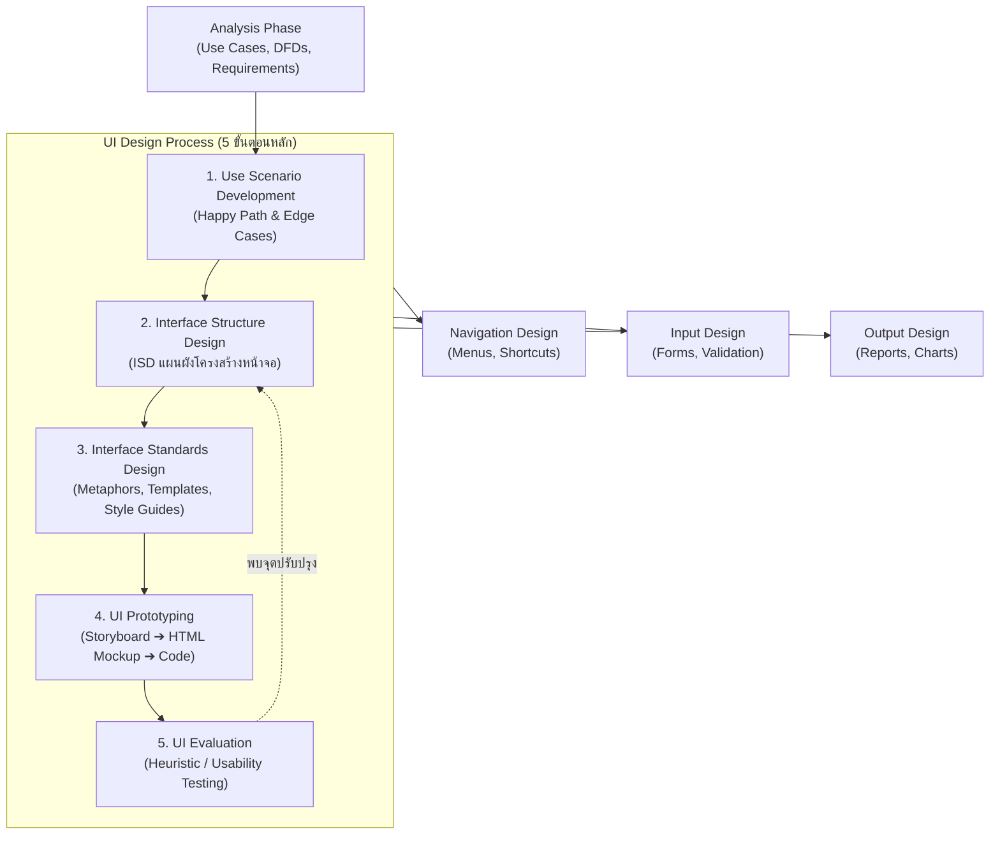
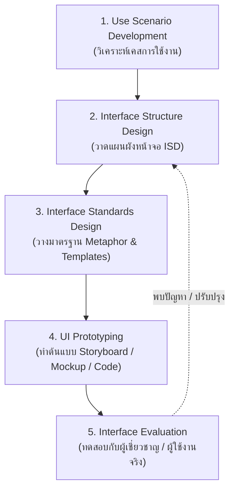
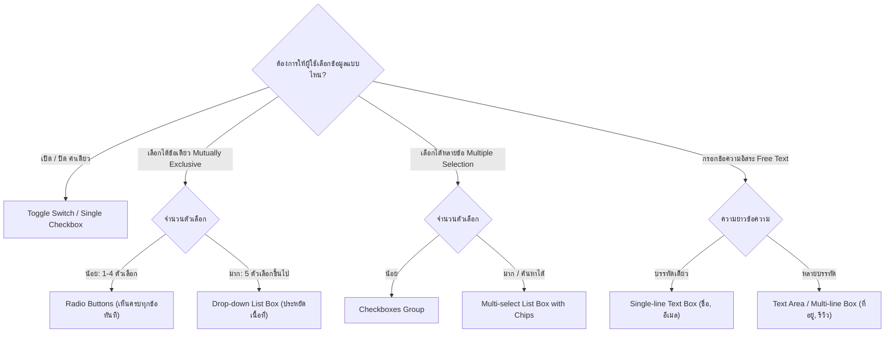

# ISAD - Unit 09: User Interface Design

> **วิชา:** 06066304 Information System Analysis and Design | **สถาบัน:** KMITL (King Mongkut's Institute of Technology Ladkrabang)
> **อาจารย์:** Asst. Prof. Manop Phankokkruad, Ph.D.
> **Source:** `Resources/Books/Information System Analysis and Design/ISAD2026-unit09-UID-v1.pdf` (61 slides)
> **Additional Context:** เสริมทฤษฎี Interaction Design, Usability Engineering (Nielsen Norman Group), และ Mobile UX Guidelines

---

## Part 1: Macro Architecture & Overview

**User Interface Design (UID)** คือกระบวนการออกแบบส่วนติดต่อระหว่างผู้ใช้กับระบบคอมพิวเตอร์ ซึ่งเป็นผลลัพธ์สำคัญในช่วง **Design Phase** ของวงจรพัฒนาระบบ (SDLC) หน้าที่หลักคือการแปลง Functional & Non-Functional Requirements ที่ได้จากช่วง Analysis Phase ให้กลายเป็นหน้าจอ โครงสร้างการนำทาง รูปแบบการรับข้อมูล และการแสดงผลที่ใช้งานได้จริง

### ความแตกต่างของ Interface ในระบบ
- **System Interfaces (Machine-to-Machine):** การเชื่อมต่อแลกเปลี่ยนข้อมูลระหว่างโปรแกรมหรือระบบ เช่น REST API, Message Queue, EDI จัดการในส่วนของ System Integration และ Architecture Design
- **User Interfaces (Human-to-Computer):** การสื่อสารระหว่างมนุษย์กับซอฟต์แวร์ ผ่านการมองเห็น การสัมผัส และการได้ยิน **(แกนหลักของ Unit นี้)**



### ตารางเปรียบเทียบ: ระดับของ UI Prototype (Fidelity Spectrum)

| ประเภท Prototype | ระดับ Fidelity | เครื่องมือ / เทคโนโลยี | จุดเด่น (Strengths) | ข้อจำกัด (Trade-offs) | ช่วงเวลาที่เหมาะสม |
| :--- | :---: | :--- | :--- | :--- | :--- |
| **Storyboard** | **Low** | ภาพวาดมือ, Sketch, Figma Wireframe | สร้างเร็วมาก, ต้นทุนต่ำ, โฟกัส User Journey & อารมณ์ | ไม่สามารถกด Interactive จริงได้ ขาดมิติด้าน Technical | ช่วงต้นของการระดมสมองและเก็บ Feedback เบื้องต้น |
| **HTML/CSS Prototype** | **Medium–High** | HTML5, CSS3, JavaScript, Web Mockups | ทดสอบ Flow และ Navigation ได้จริงบน Browser | ยังไม่มี Business Logic จริง และไม่ได้ต่อ Database จริง | ช่วงทดสอบ Usability กับ User ทั่วไป |
| **Language Prototype** | **High** | React, Flutter, Swift, C# (ภาษาจริง) | เหมือนระบบจริง 100%, นำ Code ไปพัฒนาต่อในระบบจริงได้ | ใช้เวลาและต้นทุนในการสร้างสูงที่สุด แก้ไขโครงสร้างยาก | ช่วงก่อนเริ่ม Implementation จริง หรือ Lab Usability |

### ตารางเปรียบเทียบ: 4 วิธีการประเมิน UI (Interface Evaluation)

| วิธีการประเมิน | ผู้ดำเนินการ | วิธีการทดสอบ | ความเร็ว / ต้นทุน | เหมาะสำหรับ |
| :--- | :--- | :--- | :---: | :--- |
| **Heuristic Evaluation** | ผู้เชี่ยวชาญ UI/UX (Expert) | ตรวจสอบกับหลักการสากล (เช่น Nielsen's 10 Usability Heuristics) | เร็ว / ต่ำ | ค้นหาข้อผิดพลาดเชิงโครงสร้างก่อนส่งให้ User |
| **Walkthrough Evaluation** | ทีม Design + กลุ่มตัวแทนผู้ใช้ | ทีมนักวิเคราะห์เปิด Prototype บรรยายทีละขั้นตอนให้ User ดู | ปานกลาง / ต่ำ | ให้ User ทำความเข้าใจ Flow และเก็บ Feedback ขั้นแรก |
| **Interactive Evaluation** | ผู้ใช้จริง + ทีมงานนั่ง Observe | ให้ผู้ใช้กดใช้งาน Prototype โดยมีทีมคอยสังเกตและจดบันทึก | ปานกลาง / ปานกลาง | หาจุดที่ผู้ใช้เกิดความสับสนขณะใช้งานจริง |
| **Formal Usability Testing** | ผู้ใช้จริงในห้อง Lab | ทดสอบในแล็บ มีการอัดวิดีโอ จับเวลา Task Completion และ Eye-tracking | ช้า / สูง | ระบบขนาดใหญ่หรือระบบ Critical ที่ต้องการสถิติยืนยัน |

---

## Part 2: Module-by-Module Deep Dive

### 2.1 หลักการสำคัญ 6 ประการของการออกแบบ UI (6 Principles of UI Design)

#### 1. Layout (การจัดวางพื้นที่หน้าจอ)

> 💡 **Intuition:** ลองคิดถึงแผงหน้าปัดรถยนต์: เครื่องวัดความเร็วอยู่กลางสายตา ไฟเตือนอยู่ด้านบน ปุ่มที่ใช้บ่อยอยู่ที่มือเอื้อมถึง คนขับจึงรู้ว่าต้องมองตรงไหนโดยไม่ต้องค้นหา Layout ที่ดีคือการวางทุกอย่างตรงที่สายตาคาดหวัง ข้อจำกัดของ analogy: แผงหน้าปัดรถมีมาตรฐานตายตัวที่ผู้ผลิตควบคุม ส่วนหน้าจอ UI ต้องปรับตามหน้าจอและงานที่ต่างกันมาก
> [Source: generated — not verified against original document]

การแบ่งพื้นที่บนหน้าจอหรือเอกสารออกเป็นสัดส่วนที่ชัดเจน สม่ำเสมอ และสอดคล้องกับพฤติกรรมการอ่านตามธรรมชาติของมนุษย์ (เช่น วัฒนธรรมตะวันตกอ่านจากซ้ายไปขวา และบนลงล่าง: *F-Pattern* และ *Z-Pattern*)

```text
โครงสร้าง Layout มาตรฐาน 3 ส่วน (3-Zone Standard Screen Layout)
┌────────────────────────────────────────────────────────────────────────┐
│ [1] NAVIGATION AREA: Header, Menu Bar, Breadcrumbs, System Logo        │
├───────────────────┬────────────────────────────────────────────────────┤
│ [1] SUB-NAV /     │ [2] REPORTS & FORMS AREA (Work Area)               │
│     SIDEBAR       │     - ข้อมูลหลัก, แบบฟอร์มกรอกข้อมูล               │
│     - Tree View   │     - รายงาน ตารางผลลัพธ์ กราฟ                     │
│     - Filter Menu │     - พื้นที่ที่สายตาผู้ใช้ทำงานมากที่สุด          │
├───────────────────┴────────────────────────────────────────────────────┤
│ [3] STATUS AREA: สถานะระบบ, แถบแจ้งเตือน, Pagination, ปุ่ม Actions หลัก │
└────────────────────────────────────────────────────────────────────────┘
```
- **Grouping:** รวมข้อมูลที่สัมพันธ์กันไว้ในกรอบหรือการ์ดเดียวกัน (Gestalt Principle of Proximity)
- **Visual Flow:** การนำสายตาจากบนซ้ายลงล่างขวาอย่างเป็นระเบียบ

**🧭 ทำความเข้าใจ** _[Source: generated — not verified against original document]_

**แตกวลีสำคัญ:**
- "3-Zone Standard Screen Layout" → แบ่งจอเป็น 3 โซนที่รู้หน้าที่แน่นอน: Navigation (บน), Work Area (กลาง), Status (ล่าง)
- "Grouping (Proximity)" → ข้อมูลที่เกี่ยวข้องกันต้องอยู่ใกล้กัน หรือในกรอบเดียวกัน ผู้ใช้จะเห็นว่าเป็นเรื่องเดียวกัน
- "Visual Flow" → ลำดับที่สายตาควรไหลผ่าน (บนซ้ายไปล่างขวา) เพื่อให้ทำงานตามลำดับ

**ตัวอย่าง:**
- ✅ หน้าแก้ไขลูกค้า: ชื่อ-นามสกุลและเบอร์โทรอยู่ในการ์ด "ข้อมูลติดต่อ" การ์ดเดียวกัน ที่อยู่อยู่การ์ดถัดลงไป — ผู้ใช้รู้ว่าอะไรอยู่ด้วยกัน
- ❌ วางปุ่ม Save ไว้มุมล่างซ้ายสุดของหน้ายาว ขณะที่ช่องกรอกอยู่กลางจอ — ผู้ใช้ต้องหาเอง และเกิดการกดผิดหรือไม่เจอ
- **ต่างกันตรง:** Layout ตอบว่า "วางพื้นที่ตรงไหน" ส่วน Grouping ตอบว่า "ข้อมูลไหนควรอยู่ด้วยกัน"

**อย่าสับสน:** "Layout" ≠ "Aesthetics" — Layout เน้นให้ใช้งานได้ตามลำดับสายตา ส่วน Aesthetics เน้นความสวยและความสะอาด หน้าที่สวยแต่สลับตำแหน่งทุกครั้งยังถือว่า Layout ไม่ดี

**เช็คความเข้าใจ:** หน้าแรกของระบบมี Sidebar อยู่ด้านซ้าย แต่หน้าที่สองมี Sidebar อยู่ด้านขวา — ผิดหลัก Layout ข้อใด และควรแก้อย่างไร?
<details><summary>เฉลย</summary>

ผิดเรื่อง **Consistency** ที่อยู่ในโครงสร้าง 3-Zone เดิม — Sidebar ต้องอยู่ตำแหน่งเดิมทุกหน้า แก้โดยกำหนด Template กลาง (Interface Template ในขั้น Standards) ให้ทุกหน้าใช้ Sidebar ซ้ายเหมือนกัน

</details>

#### 2. Content Awareness (การตระหนักรู้ในเนื้อหา)

> 💡 **Intuition:** ลองคิดถึงป้าย "คุณอยู่ที่นี่" ในห้างสรรพสินค้า หรือจุดสีน้ำเงินใน Google Maps ถ้าไม่มีจุดนั้น คุณรู้ว่ามีแผนที่ แต่ไม่รู้ว่าตัวเองอยู่ตรงไหน หน้าจอที่ไม่บอกตำแหน่งและเนื้อหาก็เป็นแบบนั้น ข้อจำกัดของ analogy: ป้ายในห้างบอกแค่ "ตำแหน่ง" แต่ Content Awareness ต้องบอกทั้ง "ตำแหน่ง" และ "หน้านี้มีข้อมูลอะไร" ด้วย
> [Source: generated — not verified against original document]

ความสามารถของระบบที่ทำให้ผู้ใช้ทราบได้ทันทีว่า **"ตอนนี้อยู่ที่ไหน"** และ **"หน้านี้มีข้อมูลอะไร"** โดยไม่ต้องพยายามคิดหรือจำ
- **Clear Titles:** ทุกหน้าจอ ฟอร์ม และกล่องข้อความต้องมีหัวเรื่องระบุชัดเจน
- **Breadcrumb Navigation:** เช่น `หน้าหลัก > คลังสินค้า > รายการสินค้า > แก้ไขรหัส #1092` ช่วยให้รู้ลำดับขั้น (Hierarchy)
- **Menu Highlighting:** เมนูที่กำลังเปิดอยู่ต้องมีสีหรือสไตล์ที่แตกต่างอย่างชัดเจน (Active State)

**🧭 ทำความเข้าใจ** _[Source: generated — not verified against original document]_

**แตกวลีสำคัญ:**
- "Content Awareness" → ผู้ใช้รู้ทันทีว่า "อยู่ที่ไหน" (Location) และ "หน้านี้มีอะไร" (Content)
- "Breadcrumb" → เส้นทางลำดับขั้นของหน้า เช่น หน้าหลัก > คลังสินค้า > รายการสินค้า บอกว่าหน้านี้อยู่ใต้หมวดใด
- "Active State" → เมนูที่เปิดอยู่ต้องดูต่างจากเมนูอื่น เพื่อให้รู้ว่าตอนนี้อยู่หมวดไหน

**ตัวอย่าง:**
- ✅ หน้า "แก้ไขรหัส #1092" มี Breadcrumb "หน้าหลัก > คลังสินค้า > รายการสินค้า > แก้ไขรหัส #1092" และเมนู "คลังสินค้า" ถูกไฮไลต์ — ผู้ใช้รู้ทั้งตำแหน่งและลำดับ
- ❌ หน้าที่ไม่มีหัวเรื่อง และเมนูทั้งหมดดูเหมือนกัน — ผู้ใช้ต้องเดาว่าตัวเองอยู่หน้าไหน
- **ต่างกันตรง:** Content Awareness บอกว่า "ฉันอยู่ที่ไหน" ส่วน Navigation บอกว่า "ไปต่อที่ไหนได้บ้าง"

**อย่าสับสน:** Breadcrumb ≠ History (ปุ่ม Back) — Breadcrumb บอกลำดับชั้นของหน้า (Hierarchy) ส่วน History บอกว่าเมื่อกี้ผู้ใช้มาจากหน้าไหน

**เช็คความเข้าใจ:** ผู้ใช้เปิดหน้า "หน้าหลัก > ลูกค้า > แก้ไข" จากการค้นหา ข้อมูลใดบ้างที่ Breadcrumb บอกได้ และข้อใดบอกไม่ได้?
<details><summary>เฉลย</summary>

- **บอกได้:** หน้านี้อยู่ใต้หมวด "ลูกค้า" และเป็นหน้าแก้ไข (ลำดับชั้น)
- **บอกไม่ได้:** ผู้ใช้มาจากหน้าค้นหา — ข้อมูลนั้นเป็น History ซึ่ง Breadcrumb ไม่ได้เก็บไว้

</details>

#### 3. Aesthetics (สุนทรียภาพและความน่าใช้งาน)
การออกแบบให้สวยงาม สะอาดตา และไม่รบกวนสมาธิในการทำงาน (Form follows Function)
- **Minimalist Design:** แสดงเฉพาะสิ่งที่จำเป็นในเวลานั้น (Less is more)
- **White Space (Negative Space):** การเว้นพื้นที่ว่างรอบองค์ประกอบเพื่อลดความอึดอัดสายตา และช่วยเน้นจุดสำคัญ
- **Typography & Hierarchy:** ใช้ฟอนต์มาตรฐานไม่เกิน 2 ตระกูล แบ่งขนาดหัวเรื่อง (H1, H2, H3) และเนื้อหาชัดเจน หลีกเลี่ยงการใช้ตัวพิมพ์ใหญ่ทั้งหมด (ALL CAPS) ตลอดข้อความยาวๆ
- **Color Psychology:** กำหนดสีหลัก (Primary), สีรอง (Secondary), และสีแสดงสถานะ (Success-เขียว, Warning-ส้ม, Error-แดง) ตามมาตรฐาน

#### 4. User Experience (ประสบการณ์ผู้ใช้ตามระดับความเชี่ยวชาญ)
ระบบต้องตอบโจทย์ทั้งผู้ใช้มือใหม่และผู้ใช้ประจำอย่างสมดุล:

| กลุ่มผู้ใช้ | ลักษณะพฤติกรรม | สิ่งที่ UI ต้องเตรียมรองรับ |
| :--- | :--- | :--- |
| **Novice Users (มือใหม่)** | เน้น **Ease of Learning** (เรียนรู้ง่าย) ต้องการคำอธิบาย กลัวทำผิด | Tooltips, คำแนะนำทีละสเต็ป (Wizards), ปุ่มขนาดใหญ่, ข้อความกำกับชัดเจน |
| **Expert Users (ผู้เชี่ยวชาญ)** | เน้น **Ease of Use & Speed** (ทำงานได้เร็ว) ชินกับระบบแล้ว | Keyboard Shortcuts (เช่น `Ctrl+S`, `Tab`), Macro keys, หน้ารวมข้อมูลแบบกะทัดรัด |

#### 5. Consistency (ความสม่ำเสมอ — ปัจจัยที่สำคัญที่สุด)

> 💡 **Intuition:** ลองคิดถึง Traffic Light: หากวันแรกสีแดง = หยุด, วันที่สอง สีแดง = ผ่านไป — คนจะสับสนและเกิดอุบัติเหตุ นั่นคือการขาด Consistency ในการออกแบบ UI ถ้า "ปุ่ม Save" อยู่ด้านขวาในหน้าแรก อยู่ด้านซ้ายในหน้าสอง → ผู้ใช้ต้องหยุดคิด ทำให้อึดอัด Consistency = สิ่งเดิมอยู่ที่เดิมและทำงานแบบเดิมเสมอ → ผู้ใช้คาดเดาได้
> [Source: generated — not verified against original document]

**Consistency คือหัวใจหลักที่ทำให้ระบบใช้งานง่าย** เพราะช่วยให้ผู้ใช้สามารถ **คาดเดา (Predict)** ได้ว่าจะเกิดอะไรขึ้นต่อไปเมื่อคลิกหรือกดปุ่ม
- **Visual Consistency:** สี ฟอนต์ ขนาดปุ่ม และตำแหน่งการวางเหมือนกันทุกหน้า
- **Functional Consistency:** เช่น ปุ่ม "ยกเลิก" อยู่ฝั่งซ้าย ปุ่ม "บันทึก" อยู่ฝั่งขวาเสมอ, การกดปุ่ม `ESC` จะปิดหน้าต่างเสมอ
- **Terminology Consistency:** ใช้คำศัพท์เดิมตลอดระบบ เช่น หากใช้คำว่า "แก้ไข (Edit)" ห้ามสลับไปใช้คำว่า "ปรับปรุง (Modify)" ในอีกหน้าจอ

**🧭 ทำความเข้าใจ** _[Source: generated — not verified against original document]_

**แตกวลีสำคัญ:**
- "Visual Consistency" → ทุกหน้าต้องใช้ Font, Color Palette, Button Size เดียวกัน → ผู้ใช้รู้สึกว่าใช้ระบบเดียว ไม่รู้สึกกระโดดไปมาระหว่างระบบ
- "Functional Consistency" → ลำดับปุ่ม, Keyboard Shortcuts, และการโต้ตอบต้องเหมือนกันทุกที่ → ผู้ใช้ไม่ต้องเรียนรู้ใหม่
- "Terminology Consistency" → ห้ามใช้คำศัพท์ต่างกันสำหรับสิ่งเดียว → ลดความสับสนคำศัพท์

**ตัวอย่าง:**
- ✅ **Consistency ดี:** ธนาคาร App เสมอ: ปุ่ม "โอนเงิน" อยู่ขวาล่าง, "ประวัติ" อยู่ซ้ายบน, "Exit" = `ESC` เสมอ → ผู้ใช้ใช้อยู่ 6 เดือน แล้ว "รู้" ว่าไปไหน ไม่ต้องหา
- ❌ **ขาด Consistency:** หน้า "โปรไฟล์" ปุ่ม Save อยู่ล่าง, หน้า "คำสั่ง" ปุ่ม Save อยู่บน → ผู้ใช้ต้องเลื่อนขึ้น-ลง ทุกหน้า
- **ต่างกันตรง:** ไม่ว่ารูป Aesthetic ดีเพียงใด ถ้าขาด Consistency จะใช้งานยากเสมอ

**อย่าสับสน:** "Consistency" ≠ "Uniformity" — Consistency ใช้ได้หลากหลายสี/ฟอนต์ ตราบใช้เหมือนกันตลอด; Uniformity = ทุกหน้าหน้าตาเหมือนกันเป๊ะ แม้งานต่างกัน (อาจใช้งานไม่เหมาะ)

**เช็คความเข้าใจ:** ระบบ E-Commerce มี 2 หน้า: "Search Result" (ใช้ Grid Layout) และ "Wishlist" (ใช้ List Layout) — ควรทำให้เหมือนกัน (Consistency) หรือแตกต่างกัน (Flexibility)? เพราะอะไร?
<details><summary>เฉลย</summary>

**ควร Consistent** ในเรื่อง:
- ปุ่ม "Add to Cart" อยู่ตำแหน่งเดียว (ขวาล่าง)
- ฟอนต์ ราคา สีพื้นหลัง เหมือนกัน
- การกดเข้า Detail Page ต้องเหมือน

แต่ **สามารถต่างกันได้** ใน Layout: Grid ใน Search (เห็นมากๆ), List ใน Wishlist (แสดง Details) — เพราะเป้าหมายการใช้งานต่างกัน

**สรุป**: Consistency คือ "ผู้ใช้จะไม่สับสนไม่ว่าที่ไหน" ไม่ใช่ "ทุกหน้าต้องเหมือนเป๊ะ"

</details>

#### 6. Minimal User Effort (การลดภาระการทำงานของผู้ใช้)

> 💡 **Intuition:** ลองคิดถึงแอปสั่งกาแฟ: ถ้าต้องเปิดเมนู เลือกร้าน เลือกแก้ว แล้วกดกลับหลายรอบเพื่อสั่งเหมือนเดิม ก็เหนื่อย แต่ถ้ามีปุ่ม "สั่งซ้ำ" อยู่หน้าแรก ทำได้ทันที นั่นคือการลดภาระผู้ใช้ ข้อจำกัดของ analogy: การลดคลิกไม่ได้แปลว่าตัดขั้นตอนที่ช่วยกันผิดพลาด เช่น การยืนยันก่อนลบข้อมูล
> [Source: generated — not verified against original document]

ออกแบบเพื่อลดจำนวนคลิกและการกดแป้นพิมพ์ให้น้อยที่สุด
- **3-Click Rule:** ผู้ใช้ควรเข้าถึงข้อมูลหรือฟังก์ชันที่ต้องการได้ภายในไม่เกิน **3 คลิก** นับจากหน้าหลัก
- **Contextual Actions:** แสดงปุ่มการทำงานที่เกี่ยวข้องกับรายการนั้นๆ โดยตรง เช่น การมีปุ่ม Action ข้างแถวตาราง แทนที่จะต้องคลิกเข้าไปดูข้างในก่อน

**🧭 ทำความเข้าใจ** _[Source: generated — not verified against original document]_

**แตกวลีสำคัญ:**
- "3-Click Rule" → หลักการที่ตั้งเป้าให้เข้าถึงข้อมูลหรือฟังก์ชันได้ภายใน 3 คลิกจากหน้าหลัก (เป็นแนวทาง ไม่ใช่กฎตายตัว)
- "Contextual Actions" → ปุ่มการทำงานอยู่ใกล้กับรายการที่ต้องใช้ ไม่ต้องเปิดหน้าใหม่ก่อน
- "Minimal User Effort" → ลดการคลิกและการพิมพ์ แต่ไม่ได้หมายถึงการตัดขั้นตอนที่ป้องกันความผิดพลาด

**ตัวอย่าง:**
- ✅ ตารางพนักงานมีปุ่ม "แก้ไข" และ "ลบ" อยู่ท้ายแถว — ผู้ใช้แก้ไขได้ใน 1 คลิก
- ❌ ต้องคลิกชื่อพนักงาน → เปิดหน้า Detail → คลิก Edit → คลิก Save ทุกครั้งที่จะแก้เบอร์โทรเพียงช่องเดียว
- **ต่างกันตรง:** Minimal Effort ลด "จำนวนขั้นตอน" ส่วน Consistency ทำให้ "ขั้นตอนคาดเดาได้" — สองหลักการนี้ทำงานร่วมกัน

**อย่าสับสน:** Minimal Effort ≠ การซ่อนฟังก์ชัน — การลดคลิกคือทำให้เข้าถึงง่าย ไม่ใช่เอาปุ่มสำคัญไปซ่อนไว้

**เช็คความเข้าใจ:** ระบบต้องการให้ลบข้อมูลลูกค้าได้จากตารางโดยตรง (ลดคลิก) — ควรตัดขั้นตอน "ยืนยันการลบ" ออกด้วยหรือไม่? เพราะอะไร?
<details><summary>เฉลย</summary>

**ไม่ควรตัด** — การลดคลิกใช้กับ "การเข้าถึง" (ปุ่ม Delete อยู่ท้ายแถว) แต่ขั้นตอน Confirmation Message เป็นการ Simplify Recovery สำหรับการกระทำที่ย้อนกลับไม่ได้ การลบข้อมูลต้องยังมีการยืนยัน

</details>

---

### 2.2 กระบวนการออกแบบ User Interface (5-Step UI Design Process)

> 💡 **Intuition:** ลองคิดถึงการสร้างบ้าน: คุยก่อนว่าต้องการห้องอะไร (Use Scenario) → วาดผังว่าห้องต่อกันอย่างไร (ISD) → กำหนดมาตรฐานวัสดุ (Standards) → ทำบ้านจำลองให้เดินลองได้ (Prototype) → ให้คนอยู่จริงลองใช้ (Evaluation) — ถ้าพบว่าห้องน้ำต้องเดินผ่านครัวถึงจะเข้าได้ ต้องกลับไปแก้ "ผัง" ไม่ใช่แค่ทาสีใหม่ ข้อจำกัดของ analogy: ในบ้านจริงการแก้ผังแพงมาก แต่ใน UI การแก้ต้นแบบถูกกว่ามาก จึงควรวนซ้ำบ่อยๆ
> [Source: generated — not verified against original document]

กระบวนการออกแบบ UI เป็นการทำงานแบบ **Iterative (วนซ้ำปรับปรุง)** ไม่ใช่เส้นตรงแบบขั้นตอนเดียวจบ



#### Step 1: Use Scenario Development (การพัฒนา Use Scenario)
- **Use Scenario คืออะไร:** คือเส้นทางการใช้งานจริง (Path) เส้นทางหนึ่งที่คัดเลือกมาจาก Use Case โดยเลือกเส้นทางที่ผู้ใช้ทำงาน **บ่อยที่สุด (Common Path)** หรือ **สำคัญที่สุด (Critical Path)**
- เขียนบรรยายเป็นข้อความเล่าเรื่อง (Narrative Description) สั้นๆ
- *ตัวอย่างเคสจริง:*
  > **Scenario:** นายสมชายต้องการค้นหาสินค้าและสั่งซื้อด่วน  
  > 1. สมชายเปิดหน้าแรกและพิมพ์ชื่อ "หูฟัง Bluetooth" ในช่องค้นหา  
  > 2. กดเลือกฟิลเตอร์ "ราคาไม่เกิน 1,000 บาท"  
  > 3. คลิกปุ่ม "ซื้อทันที (Buy Now)" จากรายการผลลัพธ์  
  > 4. ตรวจสอบที่อยู่จัดส่งและกด "ยืนยันชำระเงิน" ผ่าน PromptPay QR

#### Step 2: Interface Structure Design — ISD (การออกแบบโครงสร้างส่วนติดต่อ)
- **ISD (Interface Structure Diagram):** แผนผังที่แสดงภาพรวมของระบบว่าประกอบด้วยหน้าจอ (Screens), ฟอร์ม (Forms), และรายงาน (Reports) อะไรบ้าง และผู้ใช้สามารถ Navigate ข้ามไปมาระหว่างหน้าใดได้บ้าง
- **มาตรฐานการวาดกล่องใน ISD:**
  ```text
  ┌─────────────────────────────────────┐
  │ [เลขประจำหน้าจอ] เช่น 1.2.1        │ ◄── Numbering Hierarchy (ช่วยอ้างอิง)
  ├─────────────────────────────────────┤
  │ [ชื่อหน้าจอ] เช่น Customer Edit Form │ ◄── Name of Screen / Form
  └─────────────────────────────────────┘
  ```
- เส้นที่เชื่อมระหว่างกล่องแสดงถึง **Action หรือทิศทางการเปลี่ยนหน้า (Transition)**

#### Step 3: Interface Standards Design (การกำหนดมาตรฐาน UI)
การสร้าง Design System และกฎพื้นฐานเพื่อให้ทีมพัฒนาทำหน้าจอไปในทิศทางเดียวกัน:
1. **Interface Metaphor (อุปมาอุปไมยของ UI):** การยืมแนวคิดหรือสิ่งของในโลกจริงมาเปรียบเทียบเพื่อให้ผู้ใช้เข้าใจการทำงานทันที เช่น:
   - *Shopping Cart / Shopping Bag:* ตะกร้าสินค้าสำหรับสะสมรายการก่อนจ่ายเงิน
   - *Desktop & Trash Bin:* โต๊ะทำงานและถังขยะสำหรับลบไฟล์
   - *Tabbed Folders:* แถบแท็บสลับหน้าเหมือนแฟ้มเอกสาร
2. **Interface Template:** โครงร่างหลักของหน้าจอ (Header, Footer, Navigation Drawer)
3. **Interface Objects & Actions (Object-Action Grammar):** นิยามคำศัพท์และลำดับคำสั่ง เช่น "เลือกไฟล์ (Object) -> คลิกปุ่มลบ (Action)"
4. **Interface Icons:** กำหนดไอคอนสากล เช่น รูปแว่นขยาย = ค้นหา, รูปเฟือง = การตั้งค่า

#### Step 4: Interface Design Prototyping (การทำต้นแบบ UI)
แปลงภาพในกระดาษให้กลายเป็นโมเดลที่สัมผัสได้ เพื่อลดความเข้าใจคลาดเคลื่อนระหว่างผู้ใช้กับทีม Dev (Storyboard -> HTML Mockup -> Language Prototype)

#### Step 5: Interface Evaluation (การประเมินส่วนติดต่อ)
นำต้นแบบไปตรวจสอบเพื่อค้นหาข้อผิดพลาดตั้งแต่เนิ่นๆ (Fail early, fix cheaply) ตาม 4 วิธีการประเมิน

**🧭 ทำความเข้าใจ** _[Source: generated — not verified against original document]_

**แตกวลีสำคัญ:**
- "Iterative" → ทำซ้ำเป็นวงรอบ ไม่ใช่เดินทางเดียวจบ ผลจากขั้นที่ 5 กลับไปแก้ขั้นที่ 2 ได้
- "Use Scenario (Common / Critical Path)" → เลือกเส้นทางที่ใช้บ่อยหรือสำคัญที่สุดมาออกแบบก่อน
- "ISD" → แผนผังโครงสร้างหน้าจอและเส้นทางการเปลี่ยนหน้า (ยังไม่ใช่หน้าตา)
- "Interface Standards" → กฎกลาง เช่น Template, ไอคอน, คำศัพท์ ที่ทุกหน้าใช้ร่วมกัน
- "Prototype" → ของที่จับต้องหรือทดลองได้ ทิ้งได้ ไม่ใช่สินค้าจริง

**ตัวอย่าง:**
- ✅ พบว่าผู้ทดสอบหาปุ่ม "ชำระเงิน" ไม่เจอ → กลับไปแก้ ISD (ย้ายทางเข้า) แล้วจึงตรวจ Prototype ใหม่
- ❌ ข้ามขั้น ISD ไปวาดหน้าจอสวยๆ เลย → หน้าจอแต่ละหน้าดูดี แต่ไม่รู้ว่าเชื่อมกันอย่างไร ผู้ใช้จึงหลงทาง
- **ต่างกันตรง:** ขั้น 1–3 ตอบว่า "ต้องมีอะไรและจัดโครงสร้างอย่างไร" ส่วนขั้น 4–5 ตอบว่า "ใช้งานจริงได้ไหม"

**อย่าสับสน:** Prototype ≠ Product — Prototype ใช้เพื่อทดสอบและเรียนรู้ ไม่ใช่ระบบที่ส่งมอบให้ผู้ใช้จริง

**เช็คความเข้าใจ:** ในการทดสอบ (Step 5) ผู้ใช้เข้าใจปุ่มทุกปุ่ม แต่บอกว่าไม่รู้ว่าจะกลับไปหน้าหลักจากหน้าคำสั่งซื้อได้อย่างไร ควรย้อนกลับไปขั้นไหน?
<details><summary>เฉลย</summary>

ย้อนไป **Step 2 (Interface Structure Design / ISD)** — ปัญหาอยู่ที่เส้นทางการเปลี่ยนหน้า (Transition) ซึ่งกำหนดใน ISD ถ้าแก้แค่ปุ่มหรือสี (Step 3–4) จะไม่แก้ราก

</details>

---

### 2.3 Navigation Design (การออกแบบระบบนำทาง)

> 💡 **Intuition:** ลองคิด Shopping Mall: ป้ายชี้ทาง (Sign) ชัดเจนอยู่ทุกมุม ไม่ว่าเดินอยู่ตรงไหนก็รู้ว่าจะไป Toilet/Escalator ทางไหน — ที่ทำให้ "ไม่ต้องหยุดคิด" นั่นคือ Navigation Design ดี ส่วน Mall ที่ป้ายไม่ชัดหรือป้ายเก่า ทำให้ Guest เดินไปมา ผิดทาง นั่นคือ Navigation ที่ไม่ดี
> [Source: generated — not verified against original document]

ระบบนำทางที่ดีคือระบบที่ **ผู้ใช้ใช้งานได้อย่างลื่นไหลโดยไม่ต้องหยุดคิดว่าจะไปหน้าไหนต่อ**

#### หลักการพื้นฐานของ Navigation (3 Core Principles)
1. **Prevent Mistakes (ป้องกันข้อผิดพลาด):** ปิดการใช้งานปุ่มที่ไม่เกี่ยวข้อง (Grey out / Disabled State) แทนที่จะปล่อยให้คลิกแล้วขึ้น Error
2. **Simplify Recovery (กู้คืนได้ง่ายเมื่อทำผิด):** มีปุ่ม "ยกเลิก (Cancel)", "ย้อนกลับ (Undo)", และถามยืนยันก่อนทำงานที่มีผลกระทบรุนแรง
3. **Consistent Grammar Order:** ใช้ลำดับการสั่งงานแบบสม่ำเสมอ เช่น `Noun-Verb` (เลือกรายการก่อน แล้วกดปุ่มลบ) ตลอดทั้งระบบ

#### ประเภทของ Navigation Controls
1. **Languages:**
   - *Command Language:* พิมพ์คำสั่ง เช่น Terminal, SQL CLI (เหมาะกับผู้เชี่ยวชาญ)
   - *Natural Language:* ป้อนภาษาธรรมชาติ เช่น Search Box, AI Assistant, Chatbot
2. **Menus:**
   - *Menu Bar:* เมนูด้านบนแนวนอน (File, Edit, View)
   - *Drop-down & Cascading Menus:* เมนูแบบเลื่อนลงและแตกกิ่งย่อย (ไม่ควรซ้อนเกิน 2–3 ชั้น)
   - *Pop-up / Context Menu:* คลิกขวาเพื่อแสดงคำสั่งเฉพาะรายการนั้น
   - *Tab Menu:* แถบสลับหมวดหมู่
3. **Direct Manipulation:** การโต้ตอบกับวัตถุบนหน้าจอโดยตรง เช่น การลากและวาง (Drag & Drop), การใช้นิ้วถ่างซูม (Pinch to zoom)

#### ประเภทของ System Messages (การสื่อสารของระบบกับผู้ใช้)

| ประเภทข้อความ | วัตถุประสงค์ | ตัวอย่างที่ไม่ดี (Bad) | ตัวอย่างที่ดี (Good) |
| :--- | :--- | :--- | :--- |
| **Error Message** | แจ้งเมื่อเกิดข้อผิดพลาด | `Error 0x8004: Invalid data` (ผู้ใช้ไม่เข้าใจ) | `เบอร์โทรศัพท์ต้องเป็นตัวเลข 10 หลัก (เช่น 081-234-5678)` |
| **Confirmation Message** | ถามยืนยันก่อนทำ Action ร้ายแรง | `คุณแน่ใจหรือไม่? [OK] [Cancel]` | `คุณต้องการลบข้อมูลลูกค้า "สมชาย" ใช่หรือไม่? การกระทำนี้ไม่สามารถย้อนกลับได้ [ลบข้อมูล] [ยกเลิก]` |
| **Acknowledgment Message** | แจ้งเมื่อการทำงานสำเร็จ | ไม่มีข้อความตอบสนอง (ทำให้ผู้ใช้กดซ้ำ) | แสดง Toast Notification: `บันทึกข้อมูลสินค้าเรียบร้อยแล้ว` |
| **Delay Message** | แจ้งเมื่อระบบกำลังประมวลผลนาน | หน้าจอนิ่งค้าง ไม่มีสัญญาณใดๆ | แสดง Progress Bar หรือ Spinner พร้อมข้อความ: `กำลังประมวลผลไฟล์ (35%)...` |
| **Help Message** | ให้คำแนะนำเพิ่มเติม | มีแต่ข้อความคู่มือยาว 10 หน้า | Tooltip แนะนำสั้นๆ ข้างช่องกรอกข้อมูล: `รหัสผ่านต้องมีอย่างน้อย 8 ตัวอักษรและมีตัวพิมพ์ใหญ่` |

**🧭 ทำความเข้าใจ** _[Source: generated — not verified against original document]_

**แตกวลีสำคัญ:**
- "Prevent Mistakes" → UI ปิดปุ่มที่ใช้ไม่ได้ (Disable / Grey out) แทนปล่อยให้คลิกแล้วขึ้น Error
- "Simplify Recovery" → มี Undo, Cancel, Back ให้ย้อนกลับได้ง่าย
- "Consistent Grammar Order" → ทั้งระบบ Format เหมือน: เลือกรายการ → กดปุ่ม Action

**ตัวอย่าง:**
- ✅ **ป้องกันผิด:** Delete ปุ่ม Disable เมื่อไม่เลือกรายการ → ผู้ใช้ไม่ต้องกลัว
- ✅ **กู้คืนง่าย:** Order ถูก Submit → มี "Undo Order" ปุ่มอยู่ 30 วินาที → ผู้ใช้มีเวลาเปลี่ยนใจ
- ❌ **Grammar ไม่สม่ำเสมอ:** หน้าหนึ่งเลือกรายการก่อนแล้วกดลบ (Noun-Verb) อีกหน้ากดลบก่อนแล้วค่อยเลือก (Verb-Noun)
- **ต่างกันตรง:** Prevent = กันไม่ให้ผิดตั้งแต่แรก; Recovery = ผิดแล้วแก้ได้ง่าย

**อย่าสับสน:** Prevent Mistakes ≠ Simplify Recovery — Prevent ทำงานก่อนผู้ใช้ทำผิด; Recovery ช่วยหลังทำผิด

**เช็คความเข้าใจ:** ระบบ Accounting มี Feature Delete Record — ควรใช้ Prevent Mistakes หรือ Simplify Recovery? ทำไม?
<details><summary>เฉลย</summary>

ทั้งสองอย่าง:
1. **Prevent:** ปุ่ม Delete ต้อง Grey Out ถ้าไม่เลือก Record
2. **Simplify Recovery:** ถามยืนยัน "ลบ Record XYZ ไม่ได้ย้อนกลับ — ยืนยันไหม?"
3. **Consistent Grammar:** เลือก Record (Noun) → Action Delete (Verb) ทั้งระบบ

เพราะการลบข้อมูลบัญชีผิดมีผลกระทบสูง จึงต้องใช้ทั้งกันก่อนและแก้หลัง

</details>

---

### 2.4 Input Design (การออกแบบการรับข้อมูล)

**เป้าหมายหลัก:** ดึงข้อมูลเข้าสู่ระบบให้ **ถูกต้อง แม่นยำ ครบถ้วน** โดยให้ผู้ใช้ **กรอกข้อมูลน้อยที่สุดและง่ายที่สุด**

#### หลักการลดภาระการป้อนข้อมูล
- **Capture data at source (ดึงข้อมูลจากแหล่งกำเนิด):** ใช้เทคโนโลยีอัตโนมัติ เช่น การสแกน Barcode, QR Code, เครื่องอ่านชิปบัตรประชาชน (Smart Card Reader), หรือ OCR แทนการให้คนมานั่งคีย์ทีละตัว
- **Minimize Keystrokes:** ใช้ **Default Values** สำหรับค่าที่เป็นมาตรฐานหรือใช้บ่อยที่สุด เช่น กำหนดวันที่เป็นวันปัจจุบันอัตโนมัติ, กำหนดรหัสประเทศเป็น `+66`
- **Smart Auto-complete:** ระบบช่วยเติมคำอัตโนมัติเมื่อพิมพ์ไป 2-3 ตัวอักษร

#### คู่มือการเลือกใช้ Input Controls



#### การตรวจสอบความถูกต้องของข้อมูล (6 Types of Input Validation)

| ประเภทการตรวจสอบ | นิยามและหลักการ | ตัวอย่างเชิงปฏิบัติ |
| :--- | :--- | :--- |
| **1. Completeness Check** | ตรวจสอบว่าช่องที่จำเป็น (Required Field) มีการกรอกข้อมูล ไม่ปล่อยว่าง | ช่อง "ชื่อ-นามสกุล" และ "เบอร์โทรศัพท์" ห้ามเป็นค่าว่าง (`NOT NULL`) |
| **2. Format Check** | ตรวจสอบรูปแบบตัวอักษรและไวยากรณ์ให้ตรงตาม Pattern | เช็กอีเมลด้วย Regex (`^[a-zA-Z0-9._%+-]+@[a-zA-Z0-9.-]+\.[a-zA-Z]{2,}$`), รหัสไปรษณีย์ 5 หลัก |
| **3. Range Check** | ตรวจสอบว่าตัวเลขหรือวันที่ตกอยู่ภายในช่วง Min-Max ที่กำหนด | อายุพนักงานต้องอยู่ระหว่าง `18 ถึง 60` ปี, วันที่เริ่มงานต้องไม่เกินวันปัจจุบัน |
| **4. Check Sum Digit** | นำตัวเลขมาคำนวณตามสูตรทางคณิตศาสตร์เพื่อเช็กว่าไม่ได้พิมพ์เลขสลับหรือตก | การตรวจเลขบัตรประชาชน 13 หลัก หรือเลขบัตรเครดิตด้วยสูตร **Luhn Algorithm** |
| **5. Consistency Check** | ตรวจสอบความสอดคล้องกันระหว่างฟิลด์ตั้งแต่ 2 ฟิลด์ขึ้นไป | หากเลือกสถานะ "หย่าร้าง" ในช่องสถานะสมรส ช่อง "วันที่หย่า" จะต้องถูกกรอก |
| **6. Database Check** | ตรวจสอบความถูกต้องกับฐานข้อมูลจริง (Entity & Referential Integrity) | เช็กรหัสลูกค้าที่กรอกว่ามีอยู่ในตาราง `Customer` หรือไม่, เช็กว่า Username ซ้ำในระบบหรือไม่ |

**🧭 ทำความเข้าใจ Input Validation** _[Source: generated — not verified against original document]_

**แตกวลีสำคัญ:**
- "Completeness Check" → ฟิลด์จำเป็นต้องกรอก ไม่ยอมว่าง
- "Format Check" → ตัวอักษร, จำนวนหลัก, รูปแบบต้องถูก (Email ต้องมี @)
- "Range Check" → ค่าต้องอยู่ในช่วง Min–Max (อายุ 18–60)
- "Check Sum Digit" → ใช้สูตรคณิตศาสตร์ยืนยัน (บัตร ID, Card)
- "Consistency Check" → ฟิลด์ต่างๆ ต้องสอดคล้องกัน (สถานะ 'หย่าร้าง' → ต้องกรอก 'วันที่หย่า')
- "Database Check" → ข้อมูลต้องมีอยู่ในระบบ (Foreign Key)

**ตัวอย่าง:**
- ✅ **ครบถ้วน:** ช่อง "ชื่อ" ต้องกรอก → System ตรวจ ถ้าว่าง → Error
- ✅ **Format ถูก:** Email = "user@domain.com" ✓ vs "user@domain" ✗ (ขาด .com)
- ✅ **Range ถูก:** อายุ 17 → Error (ต่ำกว่า 18); 65 → Error (เกิน 60)
- ✅ **Check Sum:** เลขบัตรเครดิต → Luhn; เลขบัตรประชาชน 13 หลัก → Check Digit แบบ Mod 11
- **ต่างกันตรง:** Completeness = ว่าง/ไม่ว่าง; Format = รูปแบบตัวอักษร

**อย่าสับสน:** "Format Check" ≠ "Consistency Check" — Format = รูปแบบของค่าในฟิลด์เดียว (Email, Phone); Consistency = ความสัมพันธ์ระหว่างฟิลด์

**เช็คความเข้าใจ:** กระบวนการ Order Online — ผู้ใช้กรอก:
- Shipping Address: "123 Moo 5..."
- Phone: "08123456789"
- Promo Code: "SAVE50"

ควรใช้ Validation ประเภทไหนสำหรับแต่ละฟิลด์?
<details><summary>เฉลย</summary>

1. **Shipping Address:**
   - Completeness: ต้องกรอก
   - Format: ตรวจว่า Post Code เป็นตัวเลข 5 หลัก
   - Database: เช็ก Province มีจริงในระบบ

2. **Phone:**
   - Completeness: ต้องกรอก (ห้ามว่าง)
   - Format: ตัวเลข 10 หลัก ขึ้นต้นด้วย 0 → "08123456789" มี 11 หลัก จึงไม่ผ่าน Format Check
   - (ไม่ใช้ Check Sum เพราะเบอร์โทรศัพท์ไม่มีหลักตรวจสอบ)

3. **Promo Code:**
   - Database Check: เช็กว่าโค้ด SAVE50 มีจริง + ยังใช้ได้ + ไม่หมดวงเงิน

</details>

---

### 2.5 Output Design (การออกแบบการแสดงผลและรายงาน)

**เป้าหมายหลัก:** นำเสนอข้อมูลให้ผู้รับสารเข้าใจความหมายได้อย่างถูกต้อง รวดเร็ว โดยไม่เกิดภาวะข้อมูลล้นเกิน (Information Overload)

#### 3 หลักการสำคัญของ Output Design

> 💡 **Intuition:** ลองคิด Doctor's Report vs Patient's Brochure: Doctor อ่านรายละเอียดยาว (ผลแล็บ, ค่าความดัน, ประวัติการรักษา) ต้องตัดสินใจวิธีรักษา; Patient อ่านง่ายๆ (กิน ยา 3 ครั้ง/วัน, Watch for Fever) — ผู้อ่านต่างกัน → ความสำคัญต่างกัน → Output ต้องต่างกัน นั่นคือการ "เข้าใจการใช้งาน"
> [Source: generated — not verified against original document]

1. **Understand Report Usage:** รู้ว่ารายงานนี้ใครเป็นคนอ่าน นำไปใช้ตัดสินใจอะไร (ผู้บริหารต้องการภาพรวม, เจ้าหน้าที่ปฏิบัติงานต้องการรายละเอียด)
2. **Manage Information Load:** คัดกรองและจัดลำดับความสำคัญของข้อมูล แสดงผลแบบสรุปก่อน แล้วจึงให้คลิกเจาะลึก (Drill-down) เมื่อต้องการ
3. **Minimize Bias (ลดความเอนเอียง):** ออกแบบกราฟและตารางอย่างตรงไปตรงมา ไม่บิดเบือนสเกล เช่น:
   - แกน Y ของกราฟแท่งต้องเริ่มต้นที่เลข **0** เสมอ เพื่อไม่ให้ความต่างของข้อมูลดูเกินจริง
   - หลีกเลี่ยงการใช้กราฟ 3D หรือกราฟวงกลม (Pie Chart) ที่มีสไลซ์ย่อยเกิน 5 รายการ

**🧭 ทำความเข้าใจ Output Design** _[Source: generated — not verified against original document]_

**แตกวลีสำคัญ:**
- "Understand Report Usage" → ผู้บริหาร ≠ Clerk ≠ Customer → รายงานต่างกัน
- "Manage Information Load" → ไม่ใช่ทั้งหมด แต่ "สำคัญ → เจาะลึก" (Hierarchy)
- "Minimize Bias" → กราฟต้อง Fair ไม่หลอกตา (แกน Y เริ่มที่ 0, ไม่ใช้กราฟ 3D/Pie ที่มีสไลซ์เกิน 5)

**ตัวอย่าง:**
- ✅ **ชัดเจนต่อผู้บริหาร:** Dashboard "ยอดขาย ↑15%" + 1 Trend Chart → สามารถตัดสินใจได้
- ✅ **Detail Report สำหรับ Audit:** รายละเอียด 1000+ Row + Filter/Sort + Export Excel → เจ้าหน้าที่ค้นหา
- ❌ **แกน Y เริ่มที่ 980:** ค่า 985 กับ 1000 ต่างกันแค่ ~1.5% แต่แท่งดูต่างกันหลายเท่า
- **ต่างกันตรง:** Summary = Big Picture ให้ CEO; Detail = Granular ให้ Clerk

**อย่าสับสน:** "Drill-down" ≠ "Scroll" — Drill-down = Click รายการ → เห็นรายละเอียด; Scroll = เลื่อนดูข้อมูลระดับเดียวกันต่อ

**เช็คความเข้าใจ:** ระบบ Sales มี Report 3 ประเภท — ผู้บริหาร, Sales Manager, Accountant — ควร Design แบบไหน?
<details><summary>เฉลย</summary>

1. **ผู้บริหาร (CEO):**
   - 1 Dashboard: ยอดขาย รวม, Trend (ขึ้น/ลง%), Top 3 Region
   - NO Detail: ไม่ต้องเห็น Row เดี่ยว

2. **Sales Manager:**
   - รายได้ต่อ Region, Staff คนละคน
   - Drill-down: คลิก Region → เห็น Staff ต่อ Staff
   - Sort: เรียงจากสูงลงต่ำ

3. **Accountant:**
   - ทุก Row ทั้งหมด + Timestamp, ส่วนลด, Tax
   - Filter + Export Excel
   - ต้อง Fair: ไม่บิดเบือน Calculation

</details>

#### ประเภทของรายงาน (Types of Output Reports)

```text
  ประเภทของรายงานในระบบสารสนเทศ
  ├── 1. Detail Reports: แสดงข้อมูลทุกเรคคอร์ดอย่างละเอียด (เช่น รายการใบเสร็จประจำวัน)
  ├── 2. Summary Reports: ข้อมูลถูกสรุปรวบยอดทางสถิติ (เช่น ยอดขายรวมแยกตามสาขา, ค่าเฉลี่ย)
  ├── 3. Exception Reports: แสดงเฉพาะรายการที่ "ผิดปกติหรือเบี่ยงเบนจากเป้าหมาย"
  │     └─► ตัวอย่าง: รายชื่อสินค้าที่สต็อกต่ำกว่าเกณฑ์ขั้นต่ำ, ลูกหนี้ค้างชำระเกิน 90 วัน
  ├── 4. Turnaround Documents: เอกสารที่พิมพ์ออกจากระบบ ส่งให้บุคคลภายนอก แล้วถูกนำกลับเข้าสู่ระบบอีกครั้ง
  │     └─► ตัวอย่าง: ใบแจ้งหนี้ค่าน้ำประปาที่มี Barcode ให้สแกนเมื่อลูกค้านำไปชำระเงิน
  └── 5. Graphical Visualizations: การนำเสนอด้วย Dashboard, กราฟเส้นแนวโน้ม, Heatmap
```

---

### 2.6 Mobile Device UI Design (การออกแบบ UI สำหรับอุปกรณ์พกพา)

#### ความท้าทายเฉพาะของอุปกรณ์ Mobile (Mobile Constraints)
- หน้าจอขนาดเล็ก มีพื้นที่แสดงผลจำกัด
- ใช้การสั่งงานด้วยการสัมผัส (Touch Screen) ซึ่งมีความแม่นยำต่ำกว่าเมาส์ (*Fat Finger Problem*)
- สภาพแวดล้อมการใช้งานไม่แน่นอน (แสงแดดจ้ากลางแจ้ง, เสียงรบกวน, การใช้งานมือเดียวขณะเดินทาง)
- สัญญาณอินเทอร์เน็ตและความเร็วเครือข่ายผันผวน

#### กฎการออกแบบ Thumb Zone (Steven Hoober's Touch Zone Rule)

> 💡 **Intuition:** ลองคิดถึงการถือมือถือแล้วใช้นิ้วโป้งเดียว เช่นตอนยืนบนรถไฟ: โป้งกดได้สบายที่ด้านล่างของจอ แต่ต้องเอื้อมไปที่มุมบนสุด ปุ่มที่ใช้บ่อยจึงควรอยู่ใกล้โป้ง ข้อจำกัดของ analogy: มือแต่ละคนขนาดไม่เท่ากัน และการถือมือซ้าย/ขวาก็ต่างกัน นี่คือแนวทางทั่วไป ไม่ใช่กฎตายตัวสำหรับทุกคน
> [Source: generated — not verified against original document]

```text
  การเข้าถึงของนิ้วโป้งบนหน้าจอมือถือ (การใช้งานมือเดียว)
  ┌────────────────────────────────┐
  │ [ HARD TO REACH ]              │ ◄── เหมาะสำหรับ: เมนูนานๆ กดที, Back Button
  │ มุมบนสุดของจอ เอื้อมนิ้วยากมาก │
  ├────────────────────────────────┤
  │ [ NATURAL / REACHABLE ]        │ ◄── เหมาะสำหรับ: เนื้อหาหลัก, การ์ดแสดงข้อมูล
  │ เอื้อมถึงได้ปานกลาง            │
  ├────────────────────────────────┤
  │ [ EASY TO REACH ]              │ ◄── เหมาะสำหรับ: Primary CTA, Bottom Navigation Bar,
  │ บริเวณด้านล่าง นิ้วโป้งกดสบาย   │     Floating Action Button (FAB)
  └────────────────────────────────┘
```

**🧭 ทำความเข้าใจ** _[Source: generated — not verified against original document]_

**แตกวลีสำคัญ:**
- "Hard to reach" → มุมบนของจอ เอื้อมด้วยนิ้วโป้งลำบาก เหมาะกับสิ่งที่ใช้ไม่บ่อย เช่น เมนูนานๆ ครั้ง
- "Natural / Reachable" → กลางจอ เหมาะกับเนื้อหาหลักที่ผู้ใช้อ่านและเลื่อนดู
- "Easy to reach" → ด้านล่างของจอ นิ้วโป้งกดสบาย เหมาะกับ Primary CTA และ Bottom Navigation
- "Touch Target" → พื้นที่ที่กดได้ ต้องใหญ่พอ (อย่างน้อย 44x44 pt บน iOS หรือ 48x48 dp บน Android) — ตำแหน่งกับขนาดเป็นคนละเรื่องกัน

**ตัวอย่าง:**
- ✅ แอปมี Bottom Navigation Bar และปุ่ม "ยืนยันคำสั่งซื้อ" อยู่ด้านล่าง — ปุ่มที่กดบ่อยอยู่ในโซนที่โป้งเอื้อมถึง
- ❌ ปุ่ม "ยืนยันคำสั่งซื้อ" (Primary CTA) อยู่มุมบนขวา ขณะที่ปุ่ม "ย้อนกลับ" อยู่ล่างสุด — ตำแหน่งสลับกับการใช้งานจริง
- **ต่างกันตรง:** ความถี่ในการกด ควรกำหนดตำแหน่ง ไม่ใช่ความสวยงามของหน้าจอ

**อย่าสับสน:** "Easy to reach" ≠ "ปุ่มใหญ่" — ตำแหน่งที่กดสบายช่วยให้กดได้ง่าย แต่ถ้าปุ่มเล็กกว่า Touch Target ขั้นต่ำ ก็ยังกดพลาด

**เช็คความเข้าใจ:** แอปหนึ่งวางปุ่ม "ซื้อเลย" (Primary CTA) ไว้มุมบนขวา และ Bottom Navigation ไว้ด้านล่าง ควรแก้อย่างไร และเพราะอะไร?
<details><summary>เฉลย</summary>

ย้ายปุ่ม "ซื้อเลย" ลงไปโซน **Easy to reach** (ด้านล่างใกล้โป้ง) เพราะเป็นการกระทำหลักที่ใช้บ่อย ส่วน Bottom Navigation อยู่ด้านล่างแล้วถูกต้องอยู่แล้ว

</details>

#### กระบวนการออกแบบ Mobile UI (6 ขั้นตอน)
1. **User Research:** วิเคราะห์บริบทการใช้งานนอกสถานที่และพฤติกรรมผู้ใช้บนมือถือ
2. **Define User Flows:** วางเส้นทางสั้น กระชับ ลดขั้นตอนการเปลี่ยนหน้า
3. **Design for Mobile (Mobile-First Strategy):** ออกแบบบนขนาดหน้าจอเล็กที่สุดก่อน แล้วจึงขยายไปหน้าจอใหญ่ (Responsive Web Design)
4. **Prioritize Usability:** อ้างอิงตาม Platform Guidelines สากล:
   - **Apple iOS:** Human Interface Guidelines (HIG)
   - **Google Android:** Material Design Guidelines
   - กำหนดขนาด Touch Target ขั้นต่ำอย่างน้อย **44x44 points (iOS) หรือ 48x48 dp (Android)**
5. **Prototype & Test:** ทดสอบบนเครื่องจริงในสภาพแสงและเครือข่ายที่แตกต่างกัน
6. **Continuous Improvement:** ติดตามข้อมูลการใช้งาน (Analytics, Drop-off rate) และปรับแก้ต่อเนื่อง

#### ข้อแนะนำสำคัญสำหรับ Mobile Design
- ออกแบบให้เลื่อนใน **แนวตั้ง (Vertical Scrolling)** ห้ามเลื่อนแนวนอน
- ดึงความสามารถของอุปกรณ์มาช่วย (Hardware Capabilities) เช่น กล้องถ่ายภาพ, GPS เช็กอิน, สแกนลายนิ้วมือ / Face ID
- ลดการเรียก Request ผ่าน Network โดยใช้ Local Caching และ Lazy Loading รูปภาพ

---

### 2.7 ปัจจัยด้านวัฒนธรรมและภาษาสากล (International & Cultural Issues)

> 💡 **Intuition:** ลองคิดถึงการส่งพัสดุไปต่างประเทศ: ที่อยู่เขียนกลับทิศทาง วันที่สลับตำแหน่ง และบางสีหรือบางสัญลักษณ์หมายถึงอย่างอื่นในประเทศปลายทาง ระบบที่ออกแบบสำหรับประเทศเดียวจึงอาจใช้ไม่ได้ในอีกประเทศ ข้อจำกัดของ analogy: UI เปลี่ยนได้โดยไม่ต้องผลิตกล่องใหม่ แต่ต้องออกแบบให้ยืดหยุ่นตั้งแต่ต้น เช่น เผื่อพื้นที่ข้อความและรองรับทิศทางการอ่านหลายแบบ
> [Source: generated — not verified against original document]


เมื่อระบบต้องเปิดให้ใช้งานระดับ Global นักวิเคราะห์ต้องคำนึงถึง:
1. **Multilingual & Layout Support:** รองรับความยาวของภาษาที่แตกต่างกัน (เช่น ภาษาเยอรมันยาวกว่าอังกฤษ 30%) และภาษาที่อ่านจากขวาไปซ้าย (RTL เช่น ภาษาอาหรับ)
2. **ความหมายของสีตามวัฒนธรรม (Color Connotations):**
   - **สีแดง:** ในโลกตะวันตกหมายถึง อันตราย, การขาดทุน, หยุด | ในวัฒนธรรมจีนหมายถึง โชคลาภ, ความร่ำรวย, หุ้นขึ้น
   - **สีขาว:** ในโลกตะวันตกหมายถึง ความสะอาด บริสุทธิ์ | ในบางประเทศฝั่งเอเชียหมายถึง งานศพ การไว้ทุกข์
3. **มิติทางวัฒนธรรมของ Hofstede (Cultural Dimensions):**
   - *Power Distance:* วัฒนธรรมที่มีระยะห่างทางอำนาจสูง ชอบระบบที่มีลำดับขั้นและการควบคุมชัดเจน
   - *Uncertainty Avoidance:* วัฒนธรรมที่หลีกเลี่ยงความไม่แน่นอน ต้องการคำอธิบายและข้อความยืนยันที่ละเอียดชัดเจน
   - *Individualism vs. Collectivism:* การออกแบบภาพและข้อความที่เน้นความสำเร็จส่วนบุคคล vs. การทำงานเป็นกลุ่ม

**🧭 ทำความเข้าใจ** _[Source: generated — not verified against original document]_

**แตกวลีสำคัญ:**
- "Multilingual & Layout Support" → ข้อความยาวหรือสั้นต่างกันตามภาษา และภาษาอ่านจากขวาไปซ้าย (RTL) ต้องไม่ทำให้ UI พัง
- "Color Connotations" → สีมีความหมายต่างกันตามวัฒนธรรม ต้องตรวจก่อนใช้สีเป็นสัญญาณ
- "Hofstede's Cultural Dimensions" → มิติทางวัฒนธรรม (ระยะห่างอำนาจ, การหลีกเลี่ยงความไม่แน่นอน, ปัจเจก vs กลุ่ม) ที่กระทบวิธีเขียนข้อความและจัดหน้า

**ตัวอย่าง:**
- ✅ ปุ่ม "Submit" ภาษาเยอรมันยาวกว่าภาษาอังกฤษ จึงเผื่อความกว้างปุ่มไว้ล่วงหน้า — ข้อความไม่ตกขอบ
- ❌ นำ UI ภาษาไทย (อ่านซ้ายไปขวา) ไปใช้กับภาษาอาหรับโดยไม่ปรับทิศทาง — เมนูและลำดับการอ่านกลับด้าน ผู้ใช้สับสน
- **ต่างกันตรง:** การ "แปลข้อความ" แก้เฉพาะตัวอักษร แต่การรองรับ "วัฒนธรรมและทิศทาง" ต้องปรับโครงสร้างหน้า

**อย่าสับสน:** การออกแบบเพื่อหลายประเทศ ≠ การแปลข้อความอย่างเดียว — ต้องดูทั้งความยาวข้อความ ทิศทาง รูปแบบวันที่ (เช่น พ.ศ./ค.ศ.) และความหมายของสี

**เช็คความเข้าใจ:** ระบบการเงินจะเปิดตัวในไทยและญี่ปุ่น ต้องตรวจอะไรบ้างก่อนออกแบบหน้าแสดงยอดเงิน?
<details><summary>เฉลย</summary>

- **ความยาวข้อความ:** เผื่อพื้นที่ป้ายชื่อและปุ่มสำหรับภาษาที่ยาวกว่า
- **รูปแบบวันที่และสกุลเงิน:** ใช้฿/¥ และรูปแบบวันที่ท้องถิ่น (พ.ศ./ค.ศ. ตามบริบท)
- **ความหมายของสี:** ตรวจว่าสีที่ใช้เป็นสัญญาณ (เช่น แดง/เขียว) ไม่ทำให้เข้าใจผิดในตลาดใดตลาดหนึ่ง

</details>

---

### 2.8 ข้อกำหนดที่ไม่ใช่เชิงหน้าที่ (Non-Functional Requirements in UI)

| มิติ NFR | ผลกระทบต่อการออกแบบ UI |
| :--- | :--- |
| **Operational Requirements** | ต้องระบุความเข้ากันได้กับ Browser (Chrome, Safari), ความละเอียดหน้าจอขั้นต่ำ, และอุปกรณ์นำเข้า (Touch screen, Barcode Scanner) |
| **Performance Requirements** | กำหนด Response Time ของหน้าจอ เช่น ระบบต้องตอบสนองการคลิกภายใน 1 วินาที, หน้าเว็บต้องโหลดเสร็จภายใน 3 วินาทีบนเครือข่าย 4G |
| **Security Requirements** | การบังคับใช้ Masking ตัวอักษรรหัสผ่าน (`••••`), การซ่อนเลขบัตรประชาชนบางหลัก (`1-1004-XXXXX-XX-X`), Session Timeout อัตโนมัติเมื่อไม่มีการเคลื่อนไหว |
| **Cultural & Political** | รองรับรูปแบบวันที่ตามท้องถิ่น (เช่น `DD/MM/YYYY` vs `MM/DD/YYYY` หรือ พ.ศ. / ค.ศ.), สัญลักษณ์สกุลเงิน (฿, $, €) |

---

## Part 3: Quick Reference & Exam Cheat Sheet

### 1. สูตรจำ 6 Principles of UI Design: **L - CA - A - UX - C - ME**
- **L**ayout: แบ่ง 3 โซน (Nav, Form/Report, Status) อ่านตาม F/Z pattern
- **C**ontent **A**wareness: รู้ว่าอยู่ที่ไหน มี Page Title + Breadcrumbs
- **A**esthetics: สะอาดตา มี White space ฟอนต์อ่านง่าย
- **U**ser E**x**perience: มือใหม่ (Ease of Learning) vs ผู้เชี่ยวชาญ (Ease of Use + Shortcuts)
- **C**onsistency: **สำคัญที่สุด** ทำให้ผู้ใช้ Predict ได้
- **M**inimal **E**ffort: กฎ 3-Click Rule ลดการพิมพ์

### 2. สรุป UI Design Process 5 ขั้นตอน
$$\text{Use Scenario} \xrightarrow{\text{วาดผัง}} \text{ISD} \xrightarrow{\text{วางมาตรฐาน}} \text{Standards/Metaphor} \xrightarrow{\text{สร้างโมเดล}} \text{Prototyping} \xrightarrow{\text{ทดสอบ}} \text{Evaluation}$$

### 3. เช็กลิสต์ Input Validation 6 ตัว
1. **Completeness:** กรอกครบไหม (Not Null)
2. **Format:** ถูกฟอร์แมตไหม (Regex, Email, Phone)
3. **Range:** อยู่ในช่วง Min-Max ไหม
4. **Check Sum:** ตรวจเลขสูตรคณิตศาสตร์ (บัตร ปชช., บัตรเครดิต)
5. **Consistency:** สอดคล้องกันเองระหว่างฟิลด์ไหม
6. **Database Check:** เช็ก Foreign Key / ข้อมูลซ้ำในตารางจริง

### 4. ชนิดของรายงาน Output
- **Detail:** ละเอียดทุกเรคคอร์ด
- **Summary:** ข้อมูลสรุปรวบยอด (Sum, Avg)
- **Exception:** เฉพาะที่เบี่ยงเบนจากเป้า (สต็อกขาด, หนี้เกินกำหนด)
- **Turnaround:** ส่งออกไป แล้วนำกลับมาสแกนเข้าใหม่

---

## ⚠️ Common Pitfalls & Exam Traps

1. ❌ **หลงผิด:** คิดว่า *Consistency* หมายถึงทุกหน้าต้องมีหน้าตาและการจัดวางเหมือนกันเป๊ะ 100%  
   ✅ **ความจริง:** หมายถึง **ความสอดคล้องในพฤติกรรมและการทำงาน (Behavior & Meaning)** ผู้ใช้ทำความคุ้นเคยกับส่วนหนึ่งแล้วนำความรู้นั้นไปใช้กับส่วนอื่นของระบบได้ทันที
2. ❌ **หลงผิด:** คิดว่า *Use Scenario* กับ *Use Case* คือสิ่งเดียวกัน  
   ✅ **ความจริง:** Use Case คือคำอธิบายฟังก์ชันงานทั้งหมดที่มีทั้ง Main Path และ Alternative Paths ส่วน **Use Scenario คือการหยิบเส้นทางทำงานเพียง 1 เส้นทาง (มักเป็น Common Happy Path)** มาเขียนเล่าเรื่องเพื่อใช้ออกแบบ UI
3. ❌ **หลงผิด:** คิดว่า *ISD (Interface Structure Diagram)* คือ Flowchart แสดงโค้ด Logic  
   ✅ **ความจริง:** ISD แสดง **การนำทางระหว่างหน้าจอ (Navigation flow between screens/forms)** ไม่ได้แสดงขั้นตอนประมวลผลของโปรแกรม
4. ❌ **หลงผิด:** คิดว่า *Exception Report* คือรายงานแสดงข้อผิดพลาด (Error/Crash Report) ของระบบ  
   ✅ **ความจริง:** ในทาง ISAD Exception Report คือรายงานทางธุรกิจที่แสดง **ข้อมูลที่อยู่นอกเหนือเกณฑ์ปกติหรือตกเกณฑ์เป้าหมาย** (เช่น สินค้าขายไม่ออกเกิน 6 เดือน)
5. ❌ **หลงผิด:** คิดว่า *3-Click Rule* เป็นกฎเหล็กที่ห้ามละเมิดเด็ดขาด  
   ✅ **ความจริง:** เป็นเพียง Rule of Thumb ในทาง UX สมัยใหม่ ความชัดเจนของทิศทาง (Information Scent) สำคัญกว่า หากคลิก 4-5 ครั้งแต่ผู้ใช้ไม่ต้องหยุดคิดเลย ย่อมดีกว่า 3 คลิกที่ซับซ้อนและสับสน
6. ❌ **หลงผิด:** คิดว่าการประเมิน UI ต้องรอให้โปรแกรมเมอร์เขียนระบบเสร็จก่อน (Implementation เสร็จ)  
   ✅ **ความจริง:** การประเมิน UI (Evaluation) **ต้องทำตั้งแต่ช่วง Design Phase บน Prototype** เพื่อแก้ไขได้ทันก่อนลงมือเขียนโค้ดจริง

---

## เอกสารเชื่อมโยง (Wiki-Style Backlinks)

- [[ISAD - Unit 07 Design Strategies]] — การเลือกกลยุทธ์พัฒนาระบบ (Custom, Package, Outsourcing) ที่ส่งผลต่อการออกแบบ UI
- [[ISAD - Unit 08 Architecture Design]] — ความต้องการด้าน Non-Functional Requirements และ Hardware/Software Architecture ที่รองรับ UI
- [[ISAD - Unit 05 Use Case Analysis]] — Essential Use Cases ที่นำมาแปลงเป็น Use Scenarios สำหรับออกแบบหน้าจอ