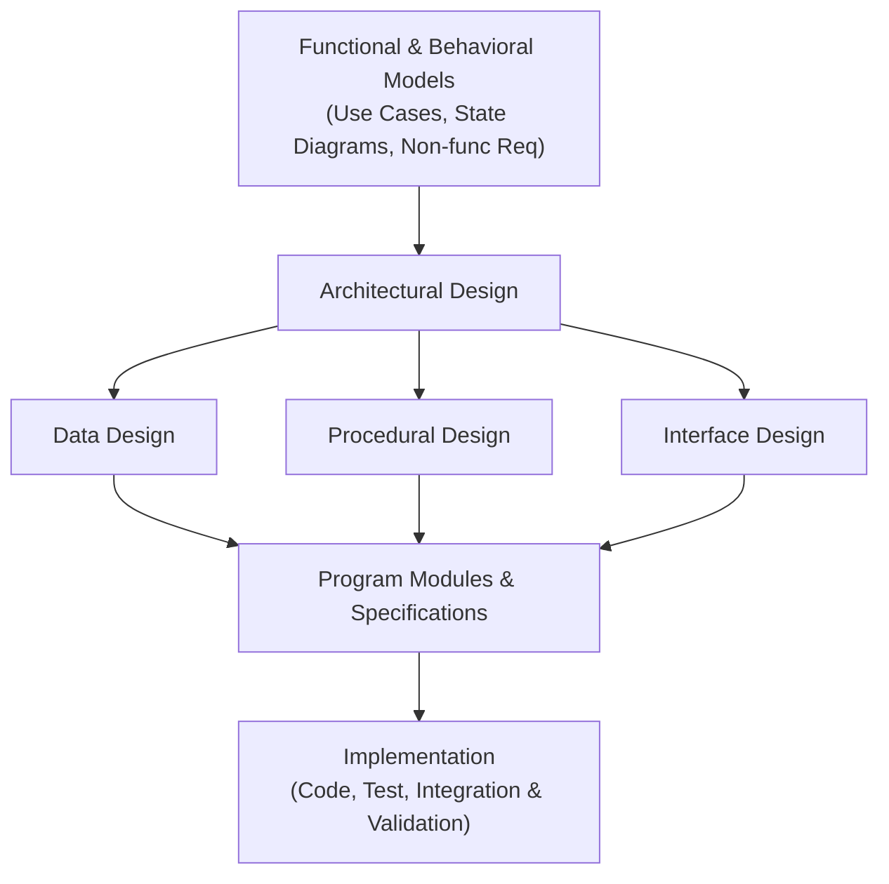
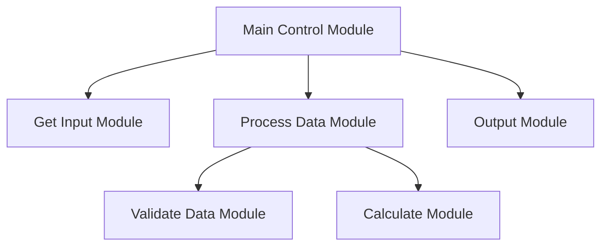

# ISAD - Unit 10: Software Design

> **วิชา:** 06066304 Information System Analysis and Design | **สถาบัน:** KMITL (King Mongkut's Institute of Technology Ladkrabang)
> **อาจารย์:** Asst. Prof. Manop Phankokkruad, Ph.D.
> **Source:** `Resources/Books/Information System Analysis and Design/ISAD2026-UNIT10-SoftwareDesign-v2.pdf` (46 slides)
> **Additional Context:** เสริมทฤษฎี SOLID Principles, Design Patterns (GoF), และ Clean Code แนวคิดจาก Software Engineering

---

## Part 1: Macro Architecture & Overview

**Software Design** คือกระบวนการแปลง **User Requirements** ให้อยู่ในรูปแบบที่เหมาะสมสำหรับนักพัฒนา (Programmers) ใช้เขียนโค้ด โดย Analysts มีหน้าที่กำหนดว่าจะต้องเขียนโปรแกรมอะไรบ้าง และสร้าง **Program Specifications** เป็นคำแนะนำสำหรับนักพัฒนา

Software Design เป็น **กระบวนการวนซ้ำ (Iterative Process)** ที่แปลง Requirements ให้เป็น Blueprint สำหรับสร้างซอฟต์แวร์ ในช่วง Design Phase นักวิเคราะห์จะตัดสินใจในรายละเอียดการ Implementation เช่น ภาษาโปรแกรมที่จะใช้ การจัดระเบียบ Process โดยใช้ **Structure Chart** และการสร้าง **Program Specifications** ที่ละเอียด



### ความสัมพันธ์กับ Unit ก่อนหน้า
- **[[ISAD - Unit 09 User Interface Design]]:** Unit 09 เน้น UI/UX และการออกแบบ Input/Output ที่ผู้ใช้มองเห็น ส่วน Unit 10 นี้เน้นโครงสร้างภายใน (Internal Architecture) ของซอฟต์แวร์ที่นักพัฒนาต้องสร้าง
- **Logical → Physical:** Analysis Phase สร้าง Logical DFDs ที่ไม่ระบุวิธี Implementation ส่วน Design Phase สร้าง Physical Process Models ที่อธิบายว่าระบบสุดท้ายทำงานอย่างไร

---

## Part 2: Core Concepts

### 2.1 Fundamental Software Design Concepts

Software Design มี **9 แนวคิดพื้นฐาน** ที่นักวิเคราะห์ต้องเข้าใจ:

#### 1. Abstraction (การนามธรรม)

> 💡 **Intuition:** ลองคิด Photoshop "Save" ปุ่ม: User คลิก "Save" — ไม่ต้องรู้ที่ข้างในเกิด "เปิด File Handler → แปลงรูปแบบไฟล์ → Compress → เขียน Disk → Verify Checksum" — User เห็นแค่ Business Concept "Save" ส่วน Implementation ซ่อน นั่นคือ Abstraction ดี: ซ่อนความซับซ้อน แสดงแค่สิ่งที่ผู้ใช้ต้องรู้
> [Source: generated — not verified against original document]

**Abstraction** คือการพิจารณา Component ในระดับสูง โดยละเว้น Implementation Details

- **Highest-Level Abstraction:** อธิบายด้วยภาษาของ Problem Domain (เช่น "ระบบต้องคำนวณภาษี")
- **Lower-Level Abstraction:** อธิบายรายละเอียดมากขึ้น (เช่น "Function `calculateTax(income, rate)` คืนค่า `income * rate`")
- **Procedural Abstraction:** ลำดับคำสั่งที่มีหน้าที่เฉพาะเจาะจง (เช่น Function, Method)
- **Data Abstraction:** กลุ่มข้อมูลที่อธิบาย Data Object (เช่น Class, Struct)

> **ตัวอย่างจริง:** ใน E-Commerce System นักวิเคราะห์บอกว่า "ระบบต้องประมวลผลการชำระเงิน" — นี่คือ Abstraction ระดับสูง ระดับต่ำลงมาคือ "เรียก Payment Gateway API → ตรวจสอบ Response → Update Order Status → ส่ง Email ยืนยัน"

**🧭 ทำความเข้าใจ Abstraction** _[Source: generated — not verified against original document]_

**แตกวลีสำคัญ:**
- "Component ในระดับสูง" → ไม่ต้องระบุ Implementation ทั้งหมด เพียงแค่พอใจว่า "Save" ทำงาน
- "ละเว้น Implementation Details" → User ไม่ต้องรู้ว่า "อัด" ไฟล์ยังไง แค่รู้ว่า "มี Save" ก็พอ
- "Procedural Abstraction" → ฟังก์ชันแบบ `calculateTax()` ซ่อนการคำนวณภายใน
- "Data Abstraction" → Class/Struct ที่รวมข้อมูลของ Data Object เดียวกัน (เช่น Customer = name, address, phone) ให้มองเป็นหน่วยเดียว

**ตัวอย่าง:**
- ✅ **Abstraction ดี:** User เรียก `save()` โดยไม่รู้ว่า System ทำ "Open File → Compress → Encrypt → Write" ข้างใน
- ❌ **Abstraction แย่:** User ต้องรู้ว่า "ต้องเปิด File Handler, เลือก Codec, ตั้ง Buffer Size" — รายละเอียดภายในรั่วออกมาถึงผู้ใช้
- **ต่างกันตรง:** Abstraction = "ซ่อนรายละเอียด"; Implementation = "รายละเอียดจริงที่ต้องทำ"

**อย่าสับสน:** "Abstraction" ≠ "Abstract Class" — Abstraction คือแนวคิด, Abstract Class คือ Feature ของภาษาโปรแกรม

**เช็คความเข้าใจ:** ระบบ Banking มี Method `transferMoney(fromAcc, toAcc, amount)` — Abstraction ของ Method นี้ควรซ่อนอะไร?
<details><summary>เฉลย</summary>

Method ควรซ่อน:
- Database Query Details (SELECT, UPDATE)
- Transaction Management (BEGIN, COMMIT, ROLLBACK)
- Security Check (การตรวจสอบ IP, Encryption)
- Logging Details

User/Caller เพียงแค่:
```python
transferMoney(fromAcc=101, toAcc=202, amount=500)
# ได้รับ: Success / Error message
# ไม่ต้องรู้ว่า: Query ยังไง, Log เก็บไหน, Encrypt ด้วยอะไร
```

</details>

#### 2. Architecture (สถาปัตยกรรมซอฟต์แวร์)

> 💡 **Intuition:** ลองคิดถึงการสร้างบ้าน: ก่อนลงมือก่ออิฐ ต้องมีผังว่าห้องไหนอยู่ตรงไหน ห้องต่อกันอย่างไร และท่อน้ำกับสายไฟวิ่งทางไหน — นั่นคือ Architecture ส่วนการเลือกสีกระเบื้องและลูกบิดประตูคือ Detailed Design ถ้าไม่มีผัง การเปลี่ยนห้องทีหลังจะแพงมาก ข้อจำกัดของ analogy: ซอฟต์แวร์เปลี่ยนแปลงได้ง่ายกว่าบ้านจริง แต่การเปลี่ยนโครงสร้างใหญ่ที่หลังก็ยังแพงอยู่เสมอ
> [Source: generated — not verified against original document]

**Software Architecture** คือโครงสร้างครบถ้วนของซอฟต์แวร์ ประกอบด้วย:
- โครงสร้างของ Program Modules และวิธีที่ Module เหล่านั้นโต้ตอบกัน
- โครงสร้างของ Data ที่ Component ใช้
- Software Design มุ่งสร้าง **Architectural Framework** ก่อน แล้วจึงทำ Detailed Design ต่อ

> **ตัวอย่างจริง:** MVC (Model-View-Controller), Microservices, Layered Architecture ล้วนเป็นตัวอย่างของ Software Architecture Patterns ที่ทีมต้องเลือกก่อนลงมือเขียนโค้ด

**🧭 ทำความเข้าใจ** _[Source: generated — not verified against original document]_

**แตกวลีสำคัญ:**
- "โครงสร้างของ Program Modules และวิธีที่ Module เหล่านั้นโต้ตอบกัน" → Architecture ตอบว่า "มีชิ้นส่วนอะไร และคุยกันอย่างไร" ยังไม่ลงถึงรายละเอียดภายในแต่ละชิ้น
- "โครงสร้างของ Data ที่ Component ใช้" → ต้องรู้ว่าข้อมูลถูกเก็บและส่งต่ออย่างไรตั้งแต่ระดับ Architecture
- "Architectural Framework ก่อน แล้วจึง Detailed Design" → วางโครงใหญ่ก่อน แล้วค่อยเติมรายละเอียดของแต่ละ Module

**ตัวอย่าง:**
- ✅ ทีมตัดสินใจก่อนเขียนโค้ดว่าใช้ Layered Architecture (Presentation / Business / Data) ทุก Feature ใหม่จึงวางตามชั้นเดิม
- ❌ เริ่มเขียนโค้ดไปครึ่งระบบ แล้วพบว่า Logic ปนอยู่กับหน้าจอทุกที่ — การแยกชั้นทีหลังต้องรื้อโค้ดจำนวนมาก
- **ต่างกันตรง:** Architecture = โครงสร้างระดับระบบ (ชิ้นส่วนและการสื่อสาร); Detailed Design = รายละเอียดของ Class/Method ภายในแต่ละชิ้น

**อย่าสับสน:** "Architecture" ≠ "Framework หรือภาษาที่เลือก" — Architecture คือแผนการแบ่งส่วนและการสื่อสาร ส่วน Framework/ภาษาคือเครื่องมือที่ใช้สร้างตามแผนนั้น

**เช็คความเข้าใจ:** ทีมบอกว่า "เราใช้ React กับ Node.js แล้ว จึงได้ Architecture แล้ว" ถูกหรือไม่? ต้องตอบคำถามอะไรเพิ่มเพื่อให้ได้ Architecture จริง?
<details><summary>เฉลย</summary>

**ยังไม่ถูก** — React และ Node.js เป็นเครื่องมือ ยังไม่บอกว่า Module แบ่งอย่างไร โต้ตอบกันอย่างไร และข้อมูลเก็บที่ไหนและถูกส่งต่ออย่างไร ต้องตอบ 3 ข้อนี้ก่อนจึงจะได้ Architectural Framework

</details>

#### 3. Patterns (รูปแบบการออกแบบ)

> 💡 **Intuition:** ลองคิด LEGO Building Instruction: ไม่ได้ "วาดจากศูนย์" ทุกครั้ง แต่มี "Blueprint ทั่วไป" (Pattern) สำหรับสร้าง Tower, Bridge, Castle — เลือก Blueprint ที่ตรงกับสิ่งที่จะสร้างแล้วทำตาม เสร็จสิ้นได้ เร็ว ถูกต้อง นั่นคือ Design Pattern: Proven Solution ซ้ำๆ ได้
> [Source: generated — not verified against original document]

**Design Pattern** คือโครงสร้างการออกแบบที่พิสูจน์แล้วว่าแก้ปัญหาเฉพาะรูปแบบได้ดี นักออกแบบใช้ Pattern เพื่อ:
- **A. ตรวจสอบความเหมาะสม:** Pattern นี้ใช้กับปัญหาปัจจุบันได้ไหม?
- **B. นำกลับมาใช้ใหม่:** ประหยัดเวลาออกแบบ
- **C. เป็นแนวทาง:** ใช้เป็น Guide สร้าง Pattern ที่คล้ายกัน

> **ตัวอย่างจริง (GoF Design Patterns):**
> - **Singleton Pattern:** ระบบ Configuration ที่ต้องการ Instance เดียว เช่น Database Connection Pool
> - **Observer Pattern:** ระบบ Notification ที่ผู้ใช้ Subscribe แล้วได้รับแจ้งเตือนอัตโนมัติ
> - **Factory Pattern:** ระบบสร้าง Payment Object แบบต่างๆ (CreditCard, PayPal, QR Code) โดยไม่ต้องระบุ Class ตรงๆ

**🧭 ทำความเข้าใจ Design Patterns** _[Source: generated — not verified against original document]_

**แตกวลีสำคัญ:**
- "โครงสร้างการออกแบบที่พิสูจน์แล้ว" → ไม่ใช่การคิดใหม่ แต่เป็น Tried and Tested Solution ที่ใช้กันแพร่หลาย
- "ตรวจสอบความเหมาะสม" → ก่อนใช้ Pattern ต้องถามว่า "ปัญหาในชีวิตจริงของ Project นี้ตรงกับปัญหาที่ Pattern แก้ไหม?"
- "นำกลับมาใช้ใหม่" → Reuse Design Idea ไม่ใช่ Copy-Paste Code — เข้าใจ Intent แล้วปรับให้เหมาะกับ Context
- "เป็นแนวทาง" → ใช้ Pattern ที่มีเป็นต้นแบบในการสร้าง Pattern ใหม่ที่คล้ายกันสำหรับปัญหาของคุณ

**ตัวอย่าง:**
- ✅ **ใช้ Pattern ดี:** บริษัทต้องสร้าง Order ได้หลายประเภท (Online, Store, Phone) → ใช้ Factory Pattern เพราะ Pattern แก้ปัญหา "สร้าง Object ตามเงื่อนไข"
- ❌ **ใช้ Pattern ผิด:** ใช้ Singleton กับ Class `Order` ทั้งที่ระบบต้องมี Order หลายรายการพร้อมกัน
- **ต่างกันตรง:** Design Patterns = เทมเพลต; Custom Design = ออกแบบใหม่จากศูนย์

**อย่าสับสน:** "Design Pattern" ≠ "Algorithm" — Design Pattern สนใจ Structure/Organization; Algorithm สนใจ Step-by-step Logic

**เช็คความเข้าใจ:** ระบบ Payment ต้องรองรับ Visa, Mastercard, PayPal, Cryptocurrency 4 ประเภท ซึ่งแต่ละประเภทมี Logic ต่างกัน ควรใช้ Design Pattern ไหน?
<details><summary>เฉลย</summary>

**Factory Pattern** (หรือ Strategy Pattern) — เพราะ:
1. ต้องสร้าง Payment Object ตามประเภท (Visa, Mastercard, ฯลฯ)
2. Logic ต่างกันแต่อินเทอร์เฟซเดียวกัน (charge(), verify(), refund())
3. เพิ่มประเภท Payment ใหม่โดยไม่กระทบ Existing Code

Implementation (Pseudo-code):
```python
class PaymentFactory:
    def create_payment(payment_type):
        if payment_type == "visa":
            return VisaPayment()
        elif payment_type == "crypto":
            return CryptoPayment()
        # ...etc

# Caller ไม่ต้องรู้ว่า Visa Logic ยังไง
payment = PaymentFactory.create_payment("visa")
payment.charge(amount)
```

</details>

#### 4. Modularity (การแบ่งโมดูล)

> 💡 **Intuition:** ลองคิดถึง LEGO: ไม่ได้สร้าง "ปราสาท" เป็นก้อนเดียวใหญ่ แต่แบ่งเป็น "บล็อกเล็กๆ" → สามารถ ใช้บล็อกตัวหนึ่งในหลายปราสาท, เปลี่ยนบล็อกที่เสีย ไม่ต้องสร้างใหม่ทั้งหมด, หลายคนเล่นพร้อมกันโดยแต่ละคนสร้างบล็อกของตัวเอง นั่นคือ Modularity
> [Source: generated — not verified against original document]

**Modularity** คือการแบ่งซอฟต์แวร์ออกเป็น **Module** อิสระที่แก้ไขได้โดยไม่กระทบ Module อื่น

**ประโยชน์ของ Modularization:**

| ประโยชน์ | คำอธิบาย |
|---|---|
| Functional Separation | แบ่งตามหน้าที่งาน ชัดเจน |
| Reusability | Module ใช้ได้กับ Application อื่น |
| Parallel Development | หลายทีมพัฒนาพร้อมกัน |
| Testability | ทดสอบแต่ละ Module แยกกันได้ง่ายขึ้น |
| Concurrent Execution | รัน Module หลายตัวพร้อมกันได้ |

**🧭 ทำความเข้าใจ** _[Source: generated — not verified against original document]_

**แตกวลีสำคัญ:**
- "Module อิสระ" → แต่ละ Module มีความรับผิดชอบเฉพาะส่วน ไม่ก้าวก่ายกัน
- "แก้ไขได้โดยไม่กระทบ Module อื่น" → ถ้า Module A มีปัญหา ต้องแก้เฉพาะ A; B, C, D ไม่ต้องเปลี่ยน
- "ใช้ได้กับ Application อื่น" → Module Payment Processing ที่ Design ดีนำไปใช้ซ้ำในระบบอื่นขององค์กรได้

**ตัวอย่าง:**
- ✅ **Modularity ดี:** E-Commerce System แบ่ง: Payment Module, Inventory Module, Shipping Module, Notification Module → แต่ละทีมพัฒนาแยกกัน, แต่ละ Module ทดสอบแยก
- ❌ **ไม่มี Modularity:** โค้ด "Spaghetti" — Payment Logic ปนกับ Inventory ปนกับ Shipping → แก้ Payment แล้ว Inventory พังตาม
- **ต่างกันตรง:** Modularity = แยกเป็นชิ้นส่วน ส่วน Monolithic = เป็นก้อนเดียว

**อย่าสับสน:** "Module" ≠ "Function" — Module อาจมีหลาย Functions; Function เป็นหน่วยเล็กสุด

**เช็คความเข้าใจ:** ระบบ Accounting มี Function หนึ่ง: `processTransaction()` ทำทั้ง Validate → Insert → Update → Email → Log ยาว 500 บรรทัด — ควรแบ่ง Module ทำไม?
<details><summary>เฉลย</summary>

ควรแบ่งเป็น Modules:
- **Validation Module:** ตรวจสอบความถูกต้อง
- **Database Module:** Insert/Update ข้อมูล
- **Notification Module:** ส่ง Email
- **Logging Module:** บันทึก Log

ประโยชน์:
- ทดสอบแต่ละ Module แยก (Unit Test)
- แก้ Bug ใน Email ไม่กระทบ Database Logic
- หลายทีมพัฒนาพร้อมกัน

</details>

#### 5. Information Hiding (การซ่อนข้อมูล)

> 💡 **Intuition:** ลองคิดถึงรีโมตทีวี: คุณกดปุ่ม "เพิ่มเสียง" แล้วเสียงดังขึ้น โดยไม่ต้องรู้ว่าวงจรภายในทำงานอย่างไร ทีวีรุ่นใหม่เปลี่ยนวงจรได้โดยที่ปุ่มยังทำงานเหมือนเดิม นั่นคือ Information Hiding: ซ่อนวิธีทำ เปิดเฉพาะปุ่ม (Interface) ข้อจำกัดของ analogy: ในซอฟต์แวร์ สิ่งที่ซ่อนคือ "การตัดสินใจออกแบบภายใน" ไม่ได้แปลว่าซ่อนข้อมูลจากผู้ใช้ปลายทาง
> [Source: generated — not verified against original document]

**Information Hiding** คือแต่ละ Module ซ่อน Internal Details ของตัวเอง และสื่อสารกับ Module อื่นผ่าน **Well-Defined Interfaces** เท่านั้น

- Algorithm และ Data ภายใน Module ไม่ควรเข้าถึงได้จากภายนอก
- ให้ประโยชน์มากที่สุดในช่วง Testing และ Software Maintenance

> **ตัวอย่างจริง:** Class `BankAccount` ซ่อน `balance` เป็น Private — ภายนอกเรียกใช้ได้แค่ `deposit()`, `withdraw()`, `getBalance()` เท่านั้น ไม่สามารถแก้ไข `balance` โดยตรงได้

**🧭 ทำความเข้าใจ** _[Source: generated — not verified against original document]_

**แตกวลีสำคัญ:**
- "Internal Details" → รายละเอียดที่ Module ตัดสินใจเองภายใน เช่น โครงสร้างข้อมูล, Algorithm
- "Well-Defined Interfaces" → ช่องทางเดียวที่ Module อื่นใช้คุยด้วย เช่น `deposit()`, `getBalance()`
- "ประโยชน์ตอน Testing และ Maintenance" → เมื่อเปลี่ยนภายใน Module อื่นไม่ต้องเปลี่ยนตาม

**ตัวอย่าง:**
- ✅ เปลี่ยนการเก็บ `balance` จากตัวเลขเดียวเป็นรายการ Transaction แล้วคำนวณยอดเมื่อเรียก `getBalance()` — ผู้เรียกไม่ต้องแก้โค้ด
- ❌ Module อื่นเขียน `account.balance = 500` ตรงๆ — เมื่อเปลี่ยนโครงสร้างภายใน โค้ดนั้นพังทันที
- **ต่างกันตรง:** Information Hiding เป็นหลักการระดับ Module (ซ่อนการตัดสินใจออกแบบ); Encapsulation เป็นเทคนิค OOP ที่ใช้ทำให้หลักการนี้เกิดขึ้นในระดับ Class

**อย่าสับสน:** "Information Hiding" ≠ "ลบข้อมูล" หรือ "ไม่ให้ใครรู้ผลลัพธ์" — สิ่งที่ซ่อนคือวิธีทำงานภายใน ส่วนผลลัพธ์ที่ Interface คืนค่าให้ยังใช้ได้ตามสัญญา

**เช็คความเข้าใจ:** Module `TaxCalculator` เปลี่ยนสูตรภาษีจากแบบเก่าเป็นแบบใหม่ โดย Interface `calculateTax(amount)` ยังคงเดิม Module อื่นต้องแก้โค้ดหรือไม่? เพราะอะไร?
<details><summary>เฉลย</summary>

**ไม่ต้องแก้** — Module อื่นรู้จักเฉพาะ Interface `calculateTax(amount)` ไม่ได้รู้สูตรภายใน การเปลี่ยนสูตรจึงอยู่ภายในโมดูลเดียว (นี่คือประโยชน์ของ Information Hiding)

</details>

#### 6. Functional Independence (ความเป็นอิสระเชิงหน้าที่)
**Functional Independence** คือการพัฒนา Module ที่มีหน้าที่ **Single-Minded** โดยไม่พึ่งพา Module อื่นมากเกินไป

วัดด้วย 2 เกณฑ์หลัก:

| เกณฑ์ | ความหมาย | เป้าหมาย |
|---|---|---|
| **Cohesion** | ความเกาะเกี่ยวภายใน Module | **High Cohesion** ✅ |
| **Coupling** | การพึ่งพากันระหว่าง Module | **Low Coupling** ✅ |

**Cohesion Types (จากดีที่สุด → แย่ที่สุด):**
```
Functional > Sequential > Communicational > Procedural > Temporal > Logical > Coincidental
     High Cohesion (ดี)                                          Low Cohesion (แย่)
```

**Coupling Types (จากดีที่สุด → แย่ที่สุด):**
```
Data > Stamp > Control > External > Common > Content
  Low Coupling (ดี)                  High Coupling (แย่)
```

> **หลักทองของ Software Design:** "High Cohesion + Low Coupling = Good Design"

> **ตัวอย่างจริง:**
> - ❌ **Coincidental Cohesion (แย่):** Module `Utilities` ที่รวม `calculateTax()`, `sendEmail()`, `resizeImage()` ไว้ด้วยกัน — ไม่มีความสัมพันธ์กัน
> - ✅ **Functional Cohesion (ดี):** Module `TaxCalculator` ที่มีแค่ `calculateIncomeTax()`, `calculateVAT()`, `applyTaxDeduction()` — ล้วนเกี่ยวกับภาษีทั้งหมด

**🧭 ทำความเข้าใจ Cohesion vs Coupling** _[Source: generated — not verified against original document]_

**แตกวลีสำคัญ:**
- "Cohesion" → ความเกาะเกี่ยว "ภายใน" Module — ฟังก์ชันทั้งหมดเกี่ยวข้องกันไหม?
- "Coupling" → การพึ่งพา "ระหว่าง" Module — Module A ต้องรู้รายละเอียด Module B เท่าไหร่?
- "High Cohesion" → Module ทำ "งานนึง" ได้ เหมือน Specialist
- "Low Coupling" → Module ไม่ต้องรู้ Inside อื่น ผ่าน Interface เท่านั้น เหมือน Black Box

**ตัวอย่าง:**
- ✅ **High Cohesion:** Module "OrderProcessor" มี `validateOrder()`, `calculateTotal()`, `applyDiscount()` — ล้วนเกี่ยวกับ Order
- ❌ **Low Cohesion:** Module "Utilities" มี `calculateTax()`, `sendEmail()`, `generateQRCode()` — Unrelated ทั้งหมด
- ✅ **Low Coupling:** OrderProcessor เรียก PaymentModule.charge(amount) — ไม่ต้องรู้ Payment ข้างในทำไง
- ❌ **High Coupling:** OrderProcessor เข้าถึง PaymentModule.gateway.apiKey โดยตรง — Hard-coded ความสัมพันธ์ ยากต่อการเปลี่ยน
- **ต่างกันตรง:** Cohesion = "ฟังก์ชันใน Module นี้เกี่ยวข้อง?"; Coupling = "Module ต่างๆ ต้องรู้กันเท่าไหร่?"

**อย่าสับสน:** "Low Cohesion" ≠ "Good" — Low Cohesion = แย่ ต้องเปลี่ยนเป็น High Cohesion

**เช็คความเข้าใจ:** ระบบ E-Commerce มี Module:
1. ShoppingCart: add(), remove(), calculateTotal(), applyTax(), applyPromo()
2. Product: getPrice(), getStock(), getDescription()

Module 1 มี High หรือ Low Cohesion? ทำไม?
<details><summary>เฉลย</summary>

**Cohesion ปานกลาง-สูง (Communicational Cohesion)** — เพราะ:
- ทุกฟังก์ชันทำงานอยู่บนข้อมูลของ Cart เดียวกัน จึงไม่ใช่ Low Cohesion
- แต่ยังไม่ถึงระดับ **Functional Cohesion** (ระดับดีที่สุด) เพราะกฎการคิดภาษีและเงื่อนไขโปรโมชันมักเปลี่ยนแปลงด้วยเหตุผลทางธุรกิจที่ต่างจาก Cart ทั่วไป

**ทางแก้เพื่อให้ได้ Cohesion สูงสุด:**
- แยกเป็น `TaxCalculator` และ `PromoEngine` แล้วให้ ShoppingCart เรียกใช้
- ShoppingCart จะเหลือเฉพาะการจัดการตะกร้าสินค้า (`add`, `remove`, `calculateTotal`)

Result: ทุก Module มี High Cohesion (Functional) → ต่อยอดและ Test ง่าย

</details>

#### 7. Refinement (การปรับละเอียด)

> 💡 **Intuition:** ลองคิดถึงการเขียนเส้นทางไปบ้านเพื่อน: "ไปบ้านเพื่อน" เป็นประโยคกว้างเกินไปที่จะเดินตามได้ "เลี้ยวซ้ายที่ปากซอย เดินถึงบ้านสีฟ้า" ก็เริ่มทำตามได้ และ "ถ้าประตูล็อก ให้โทรหาเพื่อน" คือรายละเอียดระดับลงมือ Refinement คือการลงรายละเอียดทีละชั้นจนถึงระดับที่ทำได้จริง ข้อจำกัดของ analogy: ในซอฟต์แวร์ระดับสุดท้ายต้องเป็นโค้ดที่ Compile/Run ได้ ไม่ใช่แค่คำแนะนำ
> [Source: generated — not verified against original document]

**Refinement** คือการแปลง Specification ระดับ Abstract ให้กลายเป็น Program ที่ Execute ได้ระดับ Concrete ทีละขั้น (**Stepwise Refinement**)

```text
ตัวอย่าง Stepwise Refinement:

Level 1 (Abstract):  "Open door"

Level 2 (Refined):   walk to door;
                     reach for knob;
                     open door; walk through; close door.

Level 3 (Detailed):  repeat until door opens
                       turn knob clockwise;
                       if knob does not turn, then
                         take key out; find correct key; insert in lock;
                       endif
                       pull/push door
                     end repeat
```

> Abstraction และ Refinement เป็น **แนวคิดเสริมกัน** — Abstraction มองภาพรวม, Refinement ลงรายละเอียด

**🧭 ทำความเข้าใจ Refinement** _[Source: generated — not verified against original document]_

**แตกวลีสำคัญ:**
- "Specification ระดับ Abstract" → ประโยคเป้าหมายที่ยังไม่บอกวิธีทำ เช่น "Open door"
- "Stepwise" → ลงรายละเอียดทีละชั้น ชั้นละขั้นตอนที่เห็นและตรวจได้
- "Concrete" → ระดับที่ผู้พัฒนาหรือเครื่องทำตามได้โดยไม่ต้องเดาเพิ่ม

**ตัวอย่าง:**
- ✅ "Open door" → "walk to door; reach for knob; open door" → "turn knob clockwise; ถ้าไม่หมุน ให้หากุญแจ" — แต่ละชั้นละเอียดกว่าชั้นก่อนหน้า
- ❌ เขียนแค่ "Open door" แล้วส่งให้ Developer ทำต่อ — ยัง Abstract เกินไป ไม่มีขั้นให้ตรวจว่าทำครบหรือยัง
- **ต่างกันตรง:** Abstraction = ซ่อนรายละเอียดเพื่อมองภาพรวม; Refinement = เปิดรายละเอียดทีละชั้นเพื่อทำให้ทำได้จริง

**อย่าสับสน:** Refinement ≠ Refactoring — Refinement ทำให้ Spec ละเอียดจนลงมือได้; Refactoring จัดโครงสร้างโค้ดที่มีอยู่ให้ดีขึ้นโดยพฤติกรรมเดิม

**เช็คความเข้าใจ:** ทีมมี Spec ว่า "ระบบต้องตรวจสอบสิทธิ์ผู้ใช้" การเขียน "1) รับ username/password 2) ตรวจกับตาราง User 3) ถ้าไม่ตรง แสดง Error" เป็น Refinement หรือ Refactoring? เพราะอะไร?
<details><summary>เฉลย</summary>

**Refinement** — เป็นการลงรายละเอียดจาก Spec ระดับ Abstract ไปสู่ขั้นตอนที่ทำได้จริง ยังไม่ได้แก้โค้ดเดิม (ถ้าแก้โค้ดที่มีอยู่โดยพฤติกรรมเดิม จึงจะเป็น Refactoring)

</details>

#### 8. Refactoring (การปรับโครงสร้างโค้ด)

> 💡 **Intuition:** ลองคิดถึงการจัดตู้เสื้อผ้า: ของทุกชิ้นยังอยู่และใส่ได้เหมือนเดิม แต่จัดเป็นหมวด ทิ้งชุดที่ซ้ำกันและไม่ได้ใส่ ทำให้หาของได้เร็วขึ้น นั่นคือ Refactoring — เปลี่ยนโครงสร้างโดยพฤติกรรมไม่เปลี่ยน ข้อจำกัดของ analogy: ในซอฟต์แวร์ต้องมี Test ยืนยันว่าพฤติกรรมยังเหมือนเดิมจริง ไม่ใช่แค่ "ดูเหมือนยังทำงานได้"
> [Source: generated — not verified against original document]

**Refactoring** คือการ Reorganize Design หรือ Code เพื่อให้ **ง่ายขึ้น โดยที่ Behavior/Function ไม่เปลี่ยน**

- ตรวจสอบหา: Redundancy, Unused Elements, Inefficient Algorithms, Poor Data Structures
- แก้ไข "Design Failure" เพื่อให้ได้ Design ที่ดีขึ้น

> **ตัวอย่างจริง:** นำ Code ที่ Copy-Paste ซ้ำ 5 ที่มารวมเป็น Function เดียว, เปลี่ยน Long Method เป็น Method เล็กๆ หลายตัว, Extract Class จาก God Object

**🧭 ทำความเข้าใจ Refactoring** _[Source: generated — not verified against original document]_

**แตกวลีสำคัญ:**
- "Reorganize Design หรือ Code" → จัดโครงสร้างใหม่ เช่น รวมโค้ดซ้ำ แยกคลาส
- "Behavior/Function ไม่เปลี่ยน" → ผลลัพธ์ที่ผู้ใช้หรือระบบเห็นต้องเหมือนเดิมทุกประการ
- "Design Failure" → จุดอ่อนของโครงสร้างที่ทำให้แก้ยาก เช่น Redundancy, God Object

**ตัวอย่าง:**
- ✅ รวมโค้ดคำนวณส่วนลดที่ Copy-Paste อยู่ 5 ที่ เป็น Function เดียว แล้วรัน Test เดิมผ่านทั้งหมด — Refactoring ที่ถูกต้อง
- ❌ Refactor การคำนวณส่วนลดแล้วเปลี่ยนกฎส่วนลดไปด้วยใน Commit เดียวกัน — ถ้าผลพัง ไม่รู้ว่ามาจากการจัดโครงสร้างหรือจากกฎใหม่
- **ต่างกันตรง:** Refactoring = เปลี่ยนโครงสร้าง ไม่เปลี่ยนพฤติกรรม; การเพิ่มฟีเจอร์หรือแก้กฎ = เปลี่ยนพฤติกรรม

**อย่าสับสน:** "God Object" ไม่ใช่ชื่อ Pattern ที่ดี — เป็น Class ที่รับผิดชอบทุกอย่าง ควรแยกเป็นหลาย Class ด้วย Refactoring

**เช็คความเข้าใจ:** ทีมต้องการแก้ Bug ในฟังก์ชันคิดภาษี และต้องการแยกไฟล์ออกเป็นหลาย Module ไปด้วย ควรทำในคอมมิตเดียวกันไหม? ทำไม?
<details><summary>เฉลย</summary>

**ไม่ควร** — แยกเป็น 2 ขั้น: (1) Refactor แยกโค้ดโดยมี Test เดิมยืนยันว่าผลไม่เปลี่ยน (2) แก้ Bug แยกต่างหาก เพราะถ้าทำรวมกันและผลพัง จะไม่รู้ว่าเกิดจากการจัดโครงสร้างหรือจาก Bug fix

</details>

#### 9. Design Classes
**Design Classes** คือการ Refine Analysis Classes ให้มีรายละเอียดพอสำหรับ Implementation

5 ประเภทของ Design Classes:

| ประเภท | บทบาท | ตัวอย่าง |
|---|---|---|
| **User Interface Classes** | จัดการ Interaction กับผู้ใช้ | LoginForm, DashboardView |
| **Business Domain Classes** | Logic หลักของธุรกิจ | Order, Product, Customer |
| **Process Classes** | กระบวนการที่ซับซ้อน | PaymentProcessor, ReportGenerator |
| **Persistent Classes** | จัดการข้อมูลใน Database | OrderRepository, UserDAO |
| **System Classes** | Infrastructure/Utilities | Logger, EmailService, Config |

---

### 2.2 Object-Oriented Methodology

**Object-Oriented Methodology (OOM)** มี **3 คุณสมบัติหลัก (Pillars of OOP):**

#### คำศัพท์พื้นฐาน OOP

| คำศัพท์ | ความหมาย |
|---|---|
| **Class** | Blueprint ที่อธิบาย Attributes และ Operations ของ Object |
| **Object** | Instance ของ Class — Component จริงที่ทำงาน |
| **Method** | Action ที่ Object สามารถทำได้ |
| **Message** | การเรียกให้ Object Execute Method |

#### Encapsulation (การห่อหุ้ม)
**Encapsulation** คือการรวม Attributes และ Methods ไว้ใน Class เดียว และซ่อน Internal Details จากภายนอก

- ข้อมูลภายใน Class เข้าถึงได้ผ่าน Interface ที่ Class กำหนดเท่านั้น
- **Data Hiding:** ป้องกัน Direct Access → ลด Side Effects, รักษา Data Integrity

```python
class BankAccount:
    def __init__(self, balance):
        self.__balance = balance   # Private attribute

    def deposit(self, amount):     # Public Interface
        if amount > 0:
            self.__balance += amount

    def get_balance(self):         # Controlled Access
        return self.__balance
```

#### Inheritance (การสืบทอด)
**Inheritance** คือการนำ Class ที่มีอยู่แล้วมาต่อยอดด้วย Attributes หรือ Operations ใหม่ — **Reuse Existing Classes**

| ประเภท | คำอธิบาย | รองรับโดย |
|---|---|---|
| **Single Inheritance** | มี Parent Class เดียว | Java, Python, C++ |
| **Multiple Inheritance** | มีหลาย Parent Class | Python, C++ (ไม่รองรับใน Java) |

```python
class Person:
    def __init__(self, name):
        self.name = name

class Employee(Person):        # สืบทอดจาก Person
    def __init__(self, name, emp_id):
        super().__init__(name)
        self.emp_id = emp_id
```

> **หมายเหตุ:** นักออกแบบต้องรู้ว่าภาษาที่เลือกรองรับ Inheritance ประเภทใดบ้าง

#### Polymorphism (พหุรูป)

> 💡 **Intuition:** ลองคิดถึงปุ่ม "ชำระเงิน" บนแอปเดียวกัน: ถ้าเลือกบัตรเครดิตระบบหักจากบัตร ถ้าเลือก PromptPay ระบบแสดง QR ผู้ใช้กดปุ่มเดียว แต่ระบบทำงานต่างกันตาม "ชนิด" ของวิธีจ่ายเงิน ข้อจำกัดของ analogy: Polymorphism ในโค้ดต้องมี Method ชื่อและ Contract เดียวกันจริง ถ้าไม่มี การเรียกก็ทำงานไม่ได้
> [Source: generated — not verified against original document]

**Polymorphism** คือความสามารถที่ Object ต่าง Class กัน ตอบสนองต่อ Method เดียวกันในแบบของตัวเอง

```python
class Person:
    def compute_pay(self): return "Base salary"

class Employee(Person):
    def compute_pay(self): return "Salary + Benefits"  # Override

class Customer(Person):
    def compute_pay(self): return "Bill amount"        # Override

# Polymorphism ในทางปฏิบัติ
people = [Person(), Employee(), Customer()]
for p in people:
    print(p.compute_pay())  # Method เดียวกัน → ผลลัพธ์ต่างกัน
```

**🧭 ทำความเข้าใจ** _[Source: generated — not verified against original document]_

**แตกวลีสำคัญ:**
- "พหุรูป" → ชื่อ Method เดียว แต่แต่ละ Class ให้พฤติกรรมของตัวเอง
- "Override" → Subclass เขียน Method ที่รับจาก Parent ใหม่ให้เหมาะกับตัวเอง (เช่น `Employee` เขียน `compute_pay()` ใหม่)
- "Method เดียวกัน" → Signature (ชื่อและ Parameter) ต้องตรงกัน ผู้เรียกจึงไม่ต้องรู้ว่าเป็น Class ไหน

**ตัวอย่าง:**
- ✅ `for p in people: p.compute_pay()` — ผู้เรียกไม่ต้องรู้ชนิดของ `p` ทำงานได้ทุกชนิด
- ❌ `if isinstance(p, Employee): ... elif isinstance(p, Customer): ...` ทุกที่ที่ต้องคำนวณ — เมื่อเพิ่มชนิดใหม่ต้องแก้ทุกจุด
- **ต่างกันตรง:** Polymorphism (Override) ให้ Class ย่อยตอบ Method เดียวกันต่างกัน; Overloading คือชื่อ Method เดียวกันแต่ Parameter ต่างกันในคลาสเดียว (ไม่ใช่สิ่งเดียวกัน)

**อย่าสับสน:** Polymorphism ≠ Inheritance — Inheritance คือการสืบทอดโค้ดจาก Parent; Polymorphism คือผลที่ได้จากการ Override ผ่าน Method เดียวกัน (ทั้งสองมักใช้ด้วยกันแต่ไม่เหมือนกัน)

**เช็คความเข้าใจ:** เพิ่ม Class `Contractor(Person)` ที่มี `compute_pay()` ของตัวเอง ต้องแก้ Loop `for p in people` ไหม? เพราะอะไร?
<details><summary>เฉลย</summary>

**ไม่ต้องแก้** — Loop เรียก `compute_pay()` ผ่าน Interface เดียวกัน `Contractor` ที่ Override Method นี้จะทำงานผ่าน Loop เดิมได้ทันที (นี่คือประโยชน์ของ Polymorphism)

</details>

---

## Part 3: Applied Techniques

### 3.1 Class Design Activities

วัตถุประสงค์ของ Class Design:
- ตรวจสอบว่า Class ให้ Behavior ที่ Use-Case Realizations ต้องการ
- ให้ข้อมูลเพียงพอสำหรับ Implementation โดยไม่กำกวม
- จัดการ Non-Functional Requirements ที่เกี่ยวกับ Class

**กระบวนการ Class Design:**
1. **Adding Specifications** — เพิ่มรายละเอียดให้ Model
2. **Identifying Reuse Opportunities** — หา Class ที่ใช้ซ้ำได้
3. **Restructuring** — ปรับโครงสร้าง Design
4. **Optimizing** — ปรับปรุงประสิทธิภาพ
5. **Mapping to Language** — แปลง Class สู่ภาษาโปรแกรม

#### Adding Specifications

**A. ตรวจสอบ Analysis Models ปัจจุบัน:**
- Class ทุกตัวจำเป็นและเพียงพอ ไม่มี Attribute/Method ที่หายหรือเกิน

**B. Visibility Modifiers:**
```
+ Public    : มองเห็นได้จาก Class อื่น
- Private   : มองเห็นได้เฉพาะภายใน Class
# Protected : มองเห็นได้เฉพาะ Class และ Subclass
```

**C. Method Signatures:** ชื่อ Method, Parameters, Return Type

**D. Constraints:**
- **Preconditions:** เงื่อนไขก่อน Method ทำงาน
- **Postconditions:** เงื่อนไขหลัง Method ทำงาน
- **Invariants:** เงื่อนไขที่ต้องเป็นจริงตลอดเวลา

#### Method Specification

| ส่วนประกอบ | เนื้อหา |
|---|---|
| **General Information** | ชื่อ Method, ชื่อ Class, วัตถุประสงค์ |
| **Events** | สิ่งที่ Trigger Method (Mouse Click, API Call) |
| **Message Passing** | Parameters ที่ส่งเข้าและ Return |
| **Algorithm Specifications** | Logic (Pseudocode) |
| **Other Info** | การคำนวณ, Procedure Calls |

---

### 3.2 Structure Chart & Program Design

#### Structure Chart (แผนภาพโครงสร้าง)
**Structure Chart** แสดงการจัดระเบียบและ Interaction ของ Code ในรูปแบบ Hierarchical ที่แสดง Sequence, Selection, Iteration



#### Fan-In และ Fan-Out

> 💡 **Intuition:** ลองคิดถึงหัวหน้าทีม: **Fan-Out** คือหัวหน้าคนหนึ่งสั่งงานลูกทีมกี่คน ถ้าสั่ง 30 คนโดยตรง งานจะติดขัดและหัวหน้าดูแลไม่ไหว ถ้าสั่ง 5 คนแต่ละคนดูแลทีมย่อยต่อได้ **Fan-In** คือมีหัวหน้ากี่คนที่ขอให้คนคนนี้ช่วย เช่น คนที่ดูแลเอกสารกลางที่ทุกทีมใช้ ข้อจำกัดของ analogy: ตัวเลข ~7 เป็นแนวทางทั่วไป ไม่ใช่กฎตายตัวในทุกระบบ
> [Source: generated — not verified against original document]

| เมตริก | ความหมาย | เป้าหมาย |
|---|---|---|
| **High Fan-In** | หลาย Module เรียกใช้ Module เดียว | ✅ ดี — Reuse สูง |
| **Low Fan-In** | มีแค่ Module เดียวเรียก | ⚠️ ปกติ แต่ระวัง Code Duplication |
| **Low Fan-Out** | Control Module เรียก Subordinate ≤7 ตัว | ✅ ดี |
| **High Fan-Out** | Subordinate มากเกินไป | ❌ ซับซ้อน ควรแบ่งระดับ |

> **กฎทั่วไป:** จำกัด Subordinate ไว้ที่ **~7 Module** ต่อ Control Module

> **ตัวอย่าง High Fan-In:** `ERROR_LOGGER` ถูกเรียกโดยทุก Module ในระบบ — แก้ Bug ครั้งเดียว ทุก Module ได้รับประโยชน์ทันที (Single Point of Fix)

**🧭 ทำความเข้าใจ** _[Source: generated — not verified against original document]_

**แตกวลีสำคัญ:**
- "Fan-In" → จำนวน Module ที่เรียก Module นี้ (ยิ่งสูง ยิ่งถูกใช้ซ้ำ)
- "Fan-Out" → จำนวน Subordinate ที่ Control Module หนึ่งเรียกโดยตรง (ยิ่งสูง ยิ่งซับซ้อนต่อการเข้าใจและทดสอบ)
- "Subordinate ~7" → แนวทางจำกัดจำนวนลูกของ Control Module ไว้ราว 7 ตัว

**ตัวอย่าง:**
- ✅ `ERROR_LOGGER` มี Fan-In สูง — ทุก Module เรียกใช้ การแก้ Logger ครั้งเดียวมีผลทั้งระบบ
- ❌ Control Module หนึ่งเรียก Subordinate 20 ตัวโดยตรง — ควรจัดกลุ่มเป็นชั้นย่อย 2–3 ชั้น
- **ต่างกันตรง:** Fan-In ดูว่า "ถูกใช้ซ้ำแค่ไหน"; Fan-Out ดูว่า "สั่งงานกี่ทอดโดยตรง"

**อย่าสับสน:** High Fan-In ≠ High Fan-Out — ทั้งคู่เป็นตัวเลขคนละด้านของ Module เดียวกัน และ High Fan-In ไม่ได้แปลว่า "ไม่ดี" เสมอ

**เช็คความเข้าใจ:** Module `Main` เรียก 12 Module โดยตรง และ Module `DateUtils` ถูกเรียกจาก 9 Module อื่น ตัวไหนมี Fan-Out สูงที่ควรระวัง และตัวไหนมี Fan-In สูงที่เป็นจุดดี?
<details><summary>เฉลย</summary>

- `Main` มี **Fan-Out สูง** (12 > ~7) ควรแบ่งเป็นชั้นย่อย เช่น จัดกลุ่ม Module ตามหน้าที่
- `DateUtils` มี **Fan-In สูง** (9 Module เรียกใช้) — เป็นจุดดีเพราะ Reuse สูง ถ้าไม่ซับซ้อนเกินไป

</details>

---

### 3.3 Program Specification

**Program Specification** คือนิยามว่าโปรแกรมต้องทำอะไร เป็น Blueprint สำหรับ Developer

**4 ส่วนประกอบหลัก:**

| ส่วนประกอบ | เนื้อหา |
|---|---|
| **Program Information** | ชื่อโปรแกรม, วัตถุประสงค์, Class ที่เกี่ยวข้อง |
| **Events** | เหตุการณ์ที่ Trigger (User Action, Timer, System Event) |
| **Inputs and Outputs** | ข้อมูลรับ/ส่ง, Format, Validation Rules |
| **Pseudocode** | Logic การทำงาน |

```text
ตัวอย่าง Pseudocode: Process Customer Order
Trigger: Customer clicks "Submit Order"

BEGIN
  VALIDATE order_items not empty
  VALIDATE customer has shipping address

  FOR EACH item IN order_items DO
    CHECK inventory
    IF insufficient stock THEN
      NOTIFY customer; REMOVE item
    END IF
  END FOR

  CALCULATE total = SUM(item.price * item.qty)
  APPLY discount IF customer.is_premium

  CALL payment_processor.charge(customer, total)
  IF payment_success THEN
    CREATE order record; SEND confirmation email; UPDATE inventory
  ELSE
    NOTIFY customer of payment failure
  END IF
END
```

---

## Part 4: Common Pitfalls & Exam Points

### ❌ ข้อผิดพลาดที่พบบ่อย

| ข้อผิดพลาด | คำอธิบาย | วิธีแก้ |
|---|---|---|
| **สับสน Cohesion กับ Coupling** | คิดว่า High Coupling ดี หรือ Low Cohesion ดี | จำ: High Cohesion + Low Coupling = Good |
| **Abstraction ≠ Vagueness** | Abstraction ไม่ใช่การพูดเลือน | ระบุระดับของ Abstraction ให้ชัด |
| **Refactoring ≠ Rewriting** | Refactoring ไม่เปลี่ยน Behavior | ถ้า Behavior เปลี่ยน = ไม่ใช่ Refactoring |
| **Fan-Out สูงเกินไป** | Control Module ดูแล Subordinate >7 ตัว | แบ่งงานเป็น Sub-Controller |
| **God Object** | Class เดียวรับผิดชอบทุกอย่าง | ใช้ Single Responsibility Principle |

### 📌 สรุปสำหรับสอบ

| แนวคิด | Core Idea | เป้าหมาย |
|---|---|---|
| **Abstraction** | ซ่อนรายละเอียด, โฟกัสสิ่งสำคัญ | — |
| **Modularity** | แบ่ง → พัฒนาแยก → รวมกัน | — |
| **Cohesion** | ความเกาะเกี่ยวภายใน | **High** ✅ |
| **Coupling** | การพึ่งพาระหว่าง Module | **Low** ✅ |
| **Encapsulation** | ซ่อน Data, เปิด Interface | — |
| **Inheritance** | Reuse + ต่อยอด | — |
| **Polymorphism** | Method เดียว, Behavior ต่างกัน | — |
| **Fan-In** | หลาย Module เรียกตัวเดียว | **High** ✅ |
| **Fan-Out** | ตัวเดียวเรียกหลาย Module | **Low** ✅ |
| **Refactoring** | เปลี่ยนโครงสร้าง, ไม่เปลี่ยน Behavior | — |

---

## Backlinks

- [[ISAD - Unit 09 User Interface Design]] — Unit ก่อนหน้า: UI/UX Design และ User-Facing Interface
- [[ISAD - Vault Map]] — แผนที่รวมทุก Unit ของวิชา ISAD