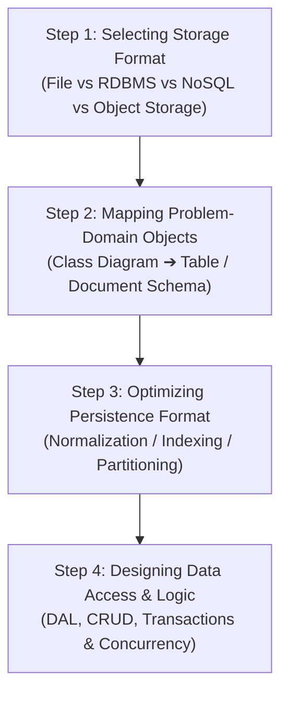
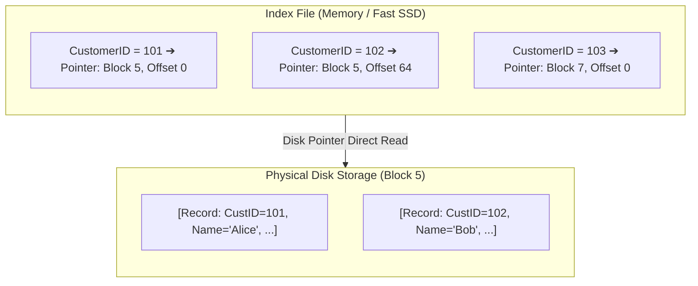

# ISAD - Unit 11: Storage Design

> **วิชา:** 06066304 Information System Analysis and Design | **สถาบัน:** KMITL (King Mongkut's Institute of Technology Ladkrabang)
> **อาจารย์:** Asst. Prof. Manop Phankokkruad, Ph.D.
> **Source:** `Resources/Books/Information System Analysis and Design/ISAD2026-UNIT11-StorageDesign-v2.pdf` (32 slides)
> **Additional Context:** เสริมทฤษฎี Database Normalization, CAP Theorem, และ Modern Storage Architecture (DAS/NAS/SAN/Cloud)

---

## Part 1: Macro Architecture & Overview

**Storage Design** คือขั้นตอนใน Design Phase ที่ออกแบบว่าข้อมูลในระบบจะถูก **จัดเก็บ เข้าถึง และจัดการ** อย่างไร เป็นส่วนที่เชื่อมระหว่าง Business Logic (ที่ออกแบบใน Unit 10) กับ Physical Data บนดิสก์หรือ Cloud

**Data Management Layer ประกอบด้วย 2 ส่วนหลัก:**
- **Data Access and Manipulation Logic:** Logic สำหรับ CRUD Operations
- **Storage Design:** การออกแบบโครงสร้างที่จัดเก็บข้อมูล





> **ข้อควรระวัง:** Index เพิ่ม Read Speed แต่ **ลด Write Speed** (ต้อง Update Index ทุกครั้ง) และกิน Storage — อย่า Index ทุก Column

**4. Estimating Data Storage Size**
- ใช้ **Volumetrics** ประมาณ Raw Data + Overhead (Index, Log, Temp Files)
- ช่วยกำหนด Hardware Capacity ที่ต้องการ

```text
ตัวอย่าง Estimation:
  1,000,000 Orders/year × 256 bytes/row = 256 MB raw data
  + 30% Index Overhead                  = ~78 MB
  + 20% Log & Temp                      = ~51 MB
  Total Year 1:                         ≈ 385 MB
  5-Year Projection:                    ≈ 2 GB (ไม่รวม Data Growth)
```

---

### 3.2 Designing Data Access — Data Access Layer

> 💡 **Intuition:** ลองคิดถึงเคาน์เตอร์ธนาคาร: ลูกค้าบอกว่าต้องการถอนเงิน พนักงานไปจัดการในห้องนิรภัยให้ ลูกค้าไม่ต้องรู้ว่าตู้เก็บเงินทำงานอย่างไร DAL ทำหน้าที่เดียวกันให้ Business Logic ข้อจำกัดของ analogy: ธนาคารมีระบบหลังบ้านรับผิดชอบ Transaction ให้อยู่แล้ว แต่ใน DAL โค้ดของเราต้องกำหนด Transaction และ Locking เองผ่านชั้นนี้
> [Source: generated — not verified against original document]

**Data Access Layer (DAL)** คือชั้น Software ที่รับผิดชอบการเชื่อมต่อกับ Database และดำเนินการ CRUD ทั้งหมด

**บทบาทของ DAL:**
- เป็น **ตัวกลาง** ระหว่าง Business Logic Layer และ Physical Storage
- Encapsulate โค้ดการเชื่อมต่อ Database ทั้งหมด
- ทำให้ Business Logic ไม่ต้องรู้จักรายละเอียดของ Database

**Features ที่ DAL ต้องมี:**

| Feature | คำอธิบาย |
|---|---|
| **Connect to Database** | สร้างและจัดการ Connection (Connection Pooling) |
| **Open/Close Connections** | เปิด-ปิด Connection อย่างมีระเบียบ |
| **CRUD Operations** | Create (INSERT), Read (SELECT), Update (UPDATE), Delete (DELETE) |
| **Transaction Management** | รับประกัน Atomicity — ทำครบทุก Step หรือ Rollback ทั้งหมด |
| **Concurrency Management** | จัดการ Locking เพื่อป้องกัน Race Condition เมื่อหลาย User เข้าพร้อมกัน |

```text
System Architecture with DAL:

┌─────────────────────────────────────────────┐
│           Presentation Layer (UI)            │
├─────────────────────────────────────────────┤
│         Business Logic Layer (BLL)           │
│   (คำนวณ, Validation, Business Rules)       │
├─────────────────────────────────────────────┤
│       Data Access Layer (DAL)                │
│   (CRUD, Connection, Transaction, Concurrency)│
├─────────────────────────────────────────────┤
│         Database / Storage                   │
│   (MySQL, PostgreSQL, MongoDB, S3, ...)     │
└─────────────────────────────────────────────┘
```

> **ตัวอย่างจริง — Repository Pattern (DAL ที่นิยมใช้ใน OOP):**
> ```python
> class OrderRepository:
>     def __init__(self, db_connection):
>         self.db = db_connection       # Encapsulate Connection
>
>     def find_by_id(self, order_id):  # Read
>         return self.db.query(
>             "SELECT * FROM orders WHERE id = %s", [order_id]
>         )
>
>     def save(self, order):           # Create / Update
>         with self.db.transaction():  # Transaction Management
>             self.db.execute(
>                 "INSERT INTO orders (customer_id, total) VALUES (%s, %s)",
>                 [order.customer_id, order.total]
>             )
>
>     def delete(self, order_id):      # Delete
>         self.db.execute(
>             "DELETE FROM orders WHERE id = %s", [order_id]
>         )
> # Business Logic ไม่รู้ว่า DB ข้างล่างเป็น MySQL หรือ PostgreSQL
> ```

**🧭 ทำความเข้าใจ DAL** _[Source: generated — not verified against original document]_

**แตกวลีสำคัญ:**
- "Encapsulate" → ซ่อนโค้ดเชื่อมต่อ Database ไว้ในชั้นเดียว Business Logic เรียกผ่าน Method เช่น `find_by_id()`
- "Connection Pooling" → เก็บ Connection ไว้ใช้ซ้ำ ไม่เปิดใหม่ทุกครั้ง
- "Transaction Management" → ทำหลายคำสั่งให้ครบหรือไม่ทำเลย (Atomicity)
- "Concurrency Management" → ป้องกันการแก้ข้อมูลชนกันเมื่อหลาย User ทำพร้อมกัน ด้วย Locking

**ตัวอย่าง:**
- ✅ `OrderRepository.save()` ใช้ `transaction()` ครอบ INSERT หลายตาราง — ถ้าขั้นกลางพัง ระบบ Rollback ทั้งหมด ไม่เหลือข้อมูลครึ่งๆ กลางๆ
- ❌ Business Logic เขียน SQL string ตรงๆ กระจายทุกไฟล์ — ถ้าย้ายจาก MySQL ไป PostgreSQL ต้องแก้ทั้งระบบ
- **ต่างกันตรง:** BLL ตอบว่า "กฎธุรกิจคืออะไร" ส่วน DAL ตอบว่า "ข้อมูลถูกเข้าถึงและบันทึกอย่างไร"

**อย่าสับสน:** DAL ≠ Database — DAL คือโค้ดฝั่งแอปพลิเคชันที่คุยกับ Database ส่วน Database คือที่เก็บข้อมูลจริง (MySQL, PostgreSQL, MongoDB ฯลฯ)

**เช็คความเข้าใจ:** ระบบต้องย้ายจาก MySQL ไป PostgreSQL ควรแก้โค้ดที่ไหนเป็นหลัก และ Business Logic ต้องแก้หรือไม่?
<details><summary>เฉลย</summary>

แก้หลักที่ **DAL / Repository** เพราะเป็นชั้นที่รู้จักรายละเอียด Database และ Business Logic **ไม่ต้องแก้** เพราะไม่รู้ว่า DB ข้างล่างคือตัวไหน (ตามตัวอย่างในไฟล์)

</details>

#### 💡 เสริม: File Types (Master, Transaction, Lookup, History, Audit)

> 💡 **Intuition:** ลองคิดถึงทะเบียนของสำนักงานเขต: **Master** = ทะเบียนบ้านที่เก็บข้อมูลหลักของคนหนึ่งคน (เปลี่ยนไม่บ่อย), **Transaction** = ใบแจ้งเหตุการณ์รายวัน เช่น แจ้งย้ายเข้าวันนี้, **Lookup** = ตารางรหัสจังหวัดหรือคำนำหน้าที่ทุกฝ่ายใช้ร่วมกัน, **History** = ทะเบียนเก่าที่ย้ายออกมาเก็บเมื่อเรื่องจบแล้ว, **Audit** = สมุดบันทึกว่าใครแก้อะไรเมื่อไหร่ ข้อจำกัดของ analogy: ทะเบียนกระดาษไม่ได้บันทึกตัวเองอัตโนมัติ แต่ Audit File ในระบบถูกเขียนโดยโปรแกรมทุกครั้งที่มีการแก้ไข
> [Source: generated — not verified against original document]

| ประเภทไฟล์ | เก็บอะไร | ตัวอย่าง | การเปลี่ยนแปลง |
| :--- | :--- | :--- | :--- |
| **Master** | ข้อมูลหลักของ Entity ที่ค่อนข้างถาวร | Customer Master, Product Master | แก้เมื่อข้อมูลเปลี่ยน |
| **Transaction** | เหตุการณ์ที่เกิดขึ้น มักมีวันที่ | Order, Payment | เพิ่มแถวตลอดเวลา |
| **Lookup (Reference)** | ค่าอ้างอิงมาตรฐานที่ใช้ร่วมกัน | รหัสจังหวัด, สถานะคำสั่งซื้อ | นานๆ เปลี่ยนที |
| **History** | ข้อมูลเก่าหรือที่ปิดแล้ว ย้ายออกมาเก็บ | Order ที่ปิดเมื่อปีที่แล้ว | เพิ่มอย่างเดียว (Archive) |
| **Audit (Log)** | บันทึกการเปลี่ยนแปลง: ใคร ทำอะไร เมื่อไหร่ | Log การแก้ไขราคาสินค้า | เพิ่มอย่างเดียว ไม่ควรแก้ |

**🧭 ทำความเข้าใจ** _[Source: generated — not verified against original document]_

**แตกวลีสำคัญ:**
- "Master" → ข้อมูลเกี่ยวกับ "ใคร/อะไร" (Entity) ที่อ้างอิงบ่อยจากไฟล์อื่น
- "Transaction" → บันทึก "เกิดอะไรขึ้นเมื่อไหร่" มักชี้กลับไปหา Master ด้วย Key
- "Lookup" → ค่ามาตรฐานที่หลายตารางใช้ร่วมกัน เพื่อไม่ให้พิมพ์ค่าเดิมซ้ำ
- "Audit" → ไฟล์สำหรับตรวจย้อนหลัง ไม่ใช่ไฟล์ที่ผู้ใช้แก้ไข

**ตัวอย่าง:**
- ✅ `Customer` (Master) กับ `Order` (Transaction) ที่มี `CustomerID` — แก้ที่อยู่ลูกค้าครั้งเดียว ประวัติการสั่งซื้อยังอ้างถึงลูกค้าคนเดิมได้
- ❌ ใส่ชื่อและที่อยู่ลูกค้าซ้ำลงในทุก Order — เมื่อลูกค้าย้ายบ้าน ต้องแก้หลายที่ และอาจไม่ตรงกัน
- **ต่างกันตรง:** Master เปลี่ยนไม่บ่อยและเป็นข้อมูล "ใคร"; Transaction เพิ่มเรื่อยๆ และเป็นข้อมูล "เกิดอะไร"

**อย่าสับสน:** "Transaction file" ≠ "Database Transaction (ACID)" — ชื่อคล้ายกันแต่ Transaction File หมายถึงชนิดของข้อมูลที่บันทึกเหตุการณ์ ส่วน Database Transaction คือกลุ่มคำสั่งที่ทำครบหรือ Rollback ทั้งหมด

**เช็คความเข้าใจ:** ตาราง Order ที่ปิดแล้วถูกย้ายไปเก็บในตารางแยกเพื่อให้ตารางหลักเร็วขึ้น ตารางที่ย้ายไปเป็นไฟล์ประเภทไหน และเพราะอะไร?
<details><summary>เฉลย</summary>

**History File** — เก็บข้อมูลเก่าหรือที่จบแล้วออกจากตารางใช้งานประจำ ทำให้ตารางหลักมีขนาดเล็กลงและ Query เร็วขึ้น

</details>

#### 💡 เสริม: Normalization (1NF–3NF)

> 💡 **Intuition:** ลองคิดถึงสมุดรายชื่อพนักงานที่เขียน "ที่อยู่บริษัท" ซ้ำทุกแถว พอบริษัทย้ายต้องไปแก้ทุกแถว และถ้าแก้ไม่ครบ ที่อยู่ก็ขัดกันเอง Normalization คือการแยกข้อมูลเป็นตารางตามเรื่อง เพื่อให้แต่ละข้อเท็จจริงถูกเก็บ "ที่เดียว" ข้อจำกัดของ analogy: การแยกตารางมากเกินไปทำให้ต้อง JOIN บ่อยและ Query ช้าลง (ดู Over-Normalization ใน Part 4)
> [Source: generated — not verified against original document]

**นิยาม (Codd):**
- **1NF:** ทุกช่องเก็บค่าเดียว (Atomic) และไม่มีกลุ่มข้อมูลซ้ำ (Repeating Group)
- **2NF:** อยู่ใน 1NF และทุก Non-key Attribute ขึ้นกับ Primary Key ทั้งชุด (ไม่มี Partial Dependency เมื่อ Key เป็นหลายคอลัมน์)
- **3NF:** อยู่ใน 2NF และไม่มี Transitive Dependency (Non-key Attribute ขึ้นกับ Non-key Attribute อื่น)

**ตัวอย่างการแยกทีละขั้น (Order)**

| ขั้น | โครงสร้าง | ปัญหาที่เห็น |
| :--- | :--- | :--- |
| ก่อน Normalize | Order(OrderID, CustomerName, Items = "A,B,C") | Items เก็บหลายค่าในช่องเดียว → ละเมิด 1NF |
| 1NF | OrderItem(OrderID, ProductID, ProductName, Qty) โดย PK = (OrderID, ProductID) | ProductName ขึ้นกับ ProductID อย่างเดียว → ละเมิด 2NF |
| 2NF | Product(ProductID, ProductName), OrderItem(OrderID, ProductID, Qty), Order(OrderID, CustomerID, CustomerName) | CustomerName ขึ้นกับ CustomerID (non-key) ไม่ใช่ OrderID → ละเมิด 3NF |
| 3NF | Customer(CustomerID, CustomerName), Order(OrderID, CustomerID) | แต่ละข้อเท็จจริงเก็บที่เดียว |

**🧭 ทำความเข้าใจ** _[Source: generated — not verified against original document]_

**แตกวลีสำคัญ:**
- "Atomic" → ค่าในช่องแบ่งต่อไม่ได้อีกในบริบทนั้น ถ้าเก็บ "A,B,C" ไว้ในช่องเดียวคือยังไม่ Atomic
- "Partial Dependency" → คอลัมน์ขึ้นกับ "ส่วนหนึ่ง" ของ Key ผสม (เช่น ขึ้นกับ ProductID เพียงอย่างเดียวในคีย์ (OrderID, ProductID))
- "Transitive Dependency" → A → B → C โดย B ไม่ใช่ Key เช่น CustomerID → CustomerName

**ตัวอย่าง:**
- ✅ ย้าย `ProductName` ไปตาราง Product — เปลี่ยนชื่อสินค้าได้ที่เดียว ไม่มีแถว OrderItem ที่ค้างชื่อเก่า
- ❌ เก็บ `ProductName` ซ้ำในทุกแถว OrderItem — ชื่อสินค้าเปลี่ยนแล้วบางแถวยังเป็นชื่อเก่า (Update Anomaly)
- **ต่างกันตรง:** 2NF ดูว่าคอลัมน์ขึ้นกับ "Key ทั้งชุด" หรือไม่; 3NF ดูว่า Non-key ขึ้นกับ Non-key อื่นหรือไม่

**อย่าสับสน:** "Normalize" ≠ "ทำให้ตารางสวยหรือย่อให้สั้น" — หมายถึงลด Redundancy และป้องกันความผิดพลาดตอนแก้ไขข้อมูล (Update/Insert/Delete Anomaly)

**เช็คความเข้าใจ:** ตาราง Enrollment(StudentID, CourseID, Grade, CourseName) — `CourseName` ขึ้นกับ `CourseID` อย่างเดียว ผิดข้อใดและควรแก้อย่างไร?
<details><summary>เฉลย</summary>

ผิด **2NF** (Partial Dependency) เพราะ Key คือ (StudentID, CourseID) แต่ CourseName ขึ้นกับ CourseID เพียงส่วนเดียว วิธีแก้: แยก `Course(CourseID, CourseName)` ออก และเก็บ `Enrollment(StudentID, CourseID, Grade)`

</details>

#### 💡 เสริม: Indexing

> 💡 **Intuition:** ลองคิดถึงดัชนีท้ายหนังสือ: ถ้าอยากรู้ว่า "Normalization" อยู่หน้าไหน ไม่ต้องพลิกทั้งเล่ม เปิดดัชนีหาคำแล้วได้เลขหน้า (Pointer) ไปยังตำแหน่งจริง Index ในระบบทำแบบเดียวกัน ข้อจำกัดของ analogy: ดัชนีท้ายหนังสือแทบไม่เปลี่ยน แต่ Index ของฐานข้อมูลต้องถูกอัปเดตทุกครั้งที่มีการเพิ่มหรือแก้ข้อมูล จึงทำให้การเขียนช้าลง
> [Source: generated — not verified against original document]

**นิยาม:** Index คือไฟล์แยกที่เก็บค่า Key คู่กับ Pointer ไปยังตำแหน่งของ Record บนดิสก์ ทำให้ค้นหาแบบ Random Access ได้โดยไม่ต้องอ่านทุก Record (ดูแผนภาพใน Part 1)

**🧭 ทำความเข้าใจ** _[Source: generated — not verified against original document]_

**แตกวลีสำคัญ:**
- "Index File" → ไฟล์เล็กที่แยกจากข้อมูลจริง มักอยู่ใน Memory หรือ SSD
- "Pointer" → ตำแหน่งจริงของ Record เช่น Block 5, Offset 0
- "Random Access" → เข้าถึง Record ตรงๆ ผ่าน Index ต่างจาก Sequential Access ที่ต้องอ่านไล่ตามลำดับ

**ตัวอย่าง:**
- ✅ ค้นหา `CustomerID = 101` บ่อย → สร้าง Index บน CustomerID แล้วไปตรง Block ที่ต้องการ
- ❌ สร้าง Index ทุก Column ของตารางที่มีการเขียนบ่อย — ทุกการ INSERT ต้องอัปเดตทุก Index ทำให้ Write ช้าและกินพื้นที่
- **ต่างกันตรง:** Index ช่วย Read เร็วขึ้น แต่แลกกับ Write ที่ช้าลงและพื้นที่เพิ่ม

**อย่าสับสน:** "Index" ≠ "Primary Key" — Primary Key เป็นกฎว่า Key ต้องไม่ซ้ำและไม่ว่าง ส่วน Index คือโครงสร้างที่ช่วยให้ค้นหาเร็ว (ในหลายระบบ PK ถูกสร้าง Index ให้อัตโนมัติ แต่สองแนวคิดนี้ไม่เหมือนกัน)

**เช็คความเข้าใจ:** ตาราง Order มี 10 ล้านแถว ผู้ใช้ค้นด้วย `CustomerID` บ่อยมาก แต่มีการเขียนวันละ 1 ล้านแถว ควรทำ Index บนอะไร และไม่ควรทำอะไร?
<details><summary>เฉลย</summary>

ทำ Index **เฉพาะ `CustomerID`** เพราะเป็นคอลัมน์ที่ใช้ค้นหาบ่อย ไม่ควรทำ Index กับทุกคอลัมน์ เพราะการเขียน 1 ล้านแถวต่อวันจะต้องอัปเดตทุก Index ทำให้ Write ช้าและกินพื้นที่

</details>

#### 💡 เสริม: RAID

> 💡 **Intuition:** ลองคิดถึงการเก็บเอกสารสำคัญหลายกล่อง: **Striping** = แบ่งเอกสารเป็นชิ้นใส่หลายกล่องเพื่อหยิบได้เร็วขึ้น, **Mirroring** = ถ่ายสำเนาเก็บกล่องคู่ไว้ ถ้ากล่องหนึ่งหายยังมีอีกกล่อง, **Parity** = มีใบสรุปรวมที่ช่วยกู้ชิ้นที่หายได้โดยไม่ต้องมีสำเนาทั้งหมด ข้อจำกัดของ analogy: RAID ช่วยทนความเสียหายของ Disk แต่ **ไม่ใช่ Backup** — ถ้าไฟล์ถูกลบโดยผิดพลาด RAID จะลบตามไปด้วย
> [Source: generated — not verified against original document]

| ระดับ | หลักการ | ทนดิสก์ล้มได้ | จำนวนดิสก์ขั้นต่ำ |
| :--- | :--- | :--- | :--- |
| **RAID 0** | Striping | 0 (ไม่มี Redundancy) | 2 |
| **RAID 1** | Mirroring | 1 | 2 |
| **RAID 5** | Striping + Parity | 1 | 3 |
| **RAID 6** | Striping + Double Parity | 2 | 4 |
| **RAID 10** | Mirror + Stripe | 1 ต่อคู่ Mirror | 4 |

**🧭 ทำความเข้าใจ** _[Source: generated — not verified against original document]_

**แตกวลีสำคัญ:**
- "Striping" → แบ่งข้อมูลไปหลายดิสก์ อ่าน/เขียนขนานได้ แต่ถ้าดิสก์ใดพัง ข้อมูลทั้งชุดเสีย
- "Mirroring" → เก็บสำเนาเหมือนกันบนอีกดิสก์ ใช้พื้นที่ครึ่งหนึ่ง
- "Parity" → ข้อมูลตรวจสอบที่ใช้กู้ข้อมูลที่หายไปได้ ใช้พื้นที่น้อยกว่า Mirroring แต่การ Rebuild ใช้เวลานาน

**ตัวอย่าง:**
- ✅ ระบบเก็บข้อมูลลูกค้าสำคัญ ใช้ RAID 1 หรือ RAID 5 (ทนดิสก์ล้มได้) และยังมี Backup แยกต่างหาก
- ❌ ใช้ RAID 0 กับข้อมูลสำคัญเพราะคิดว่าเร็วและปลอดภัย — ดิสก์ใดดิสก์หนึ่งพังทำให้ข้อมูลทั้งหมดหาย
- **ต่างกันตรง:** RAID 1 ทนความเสียหายได้ง่ายแต่เสียพื้นที่ครึ่งหนึ่ง; RAID 5 เสียพื้นที่น้อยกว่าแต่ทนได้ 1 ดิสก์เท่านั้น

**อย่าสับสน:** RAID ≠ Backup — RAID ป้องกันการพังของฮาร์ดแวร์ดิสก์ ส่วน Backup ป้องกันการลบ/แก้ผิดพลาด และการเสียหายรุนแรงของทั้งระบบ

**เช็คความเข้าใจ:** องค์กรใช้ RAID 5 แล้ว มีพนักงานลบไฟล์ลูกค้าโดยผิดพลาด จะกู้คืนได้จาก RAID หรือไม่? ต้องทำอะไรเพิ่ม?
<details><summary>เฉลย</summary>

**กู้จาก RAID ไม่ได้** — RAID ป้องกันดิสก์พัง ไม่ได้ป้องกันการลบข้อมูล การลบจะถูกเขียนลงทุกดิสก์ใน Array ต้องมี **Backup แยก** (เช่น สำเนานอกเครื่องหรือ Snapshot ที่ย้อนได้) จึงจะกู้คืนได้

</details>

---

## Part 4: Common Pitfalls & Exam Points

### ❌ ข้อผิดพลาดที่พบบ่อย

| ข้อผิดพลาด | คำอธิบาย | วิธีแก้ |
|---|---|---|
| **Over-Normalization** | Normalize จนมี JOIN มากเกินไป ทำให้ Query ช้า | De-normalize เฉพาะ Critical Query ที่ทำบ่อย |
| **Over-Indexing** | ทำ Index ทุก Column เพราะคิดว่าจะทำให้เร็ว | Index เฉพาะ Column ที่ใช้ค้นหาบ่อย ระวัง Write Performance |
| **สับสน RAID 0 กับ RAID 1** | คิดว่า RAID 0 มี Redundancy | RAID 0 = Speed Only, No Redundancy! |
| **เลือก Storage แบบ One-size-fits-all** | ใช้ Relational DB กับทุกอย่าง | วิเคราะห์ Data Type และ Access Pattern ก่อนเลือก |
| **ไม่วางแผน Storage Growth** | ไม่ทำ Capacity Estimation | ใช้ Volumetrics ประมาณการล่วงหน้า 3-5 ปี |

### 📌 สรุปสำหรับสอบ

| หัวข้อ | Key Points |
|---|---|
| **RAID 0** | Striping, Speed, No Redundancy |
| **RAID 1** | Mirroring, Redundancy, 50% Space Lost |
| **RAID 5** | Striping + Parity, ทน 1 Disk ล้ม, ≥3 Disks |
| **RAID 6** | Striping + Double Parity, ทน 2 Disk ล้ม, ≥4 Disks |
| **RAID 10** | Mirror + Stripe, Best Speed+Redundancy, ≥4 Disks |
| **Sequential Access** | อ่านตามลำดับ, ดีสำหรับ Report |
| **Random Access** | เข้าถึงโดยตรงผ่าน Index, ดีสำหรับ Search/Update |
| **Normalization** | ลด Redundancy → Storage Efficiency |
| **De-normalization** | เพิ่ม Redundancy บางส่วน → Access Speed |
| **Indexing** | Small Index File + Pointer → Fast Lookup |
| **DAL** | CRUD + Transaction + Concurrency Management |
| **DAS/NAS/SAN** | Direct/Network File-level/Network Block-level |

### เปรียบเทียบ Relational vs. NoSQL

> 💡 **Intuition:** ลองคิด Library: **Relational DB** = หนังสือต้องเข้า Catalog ที่เข้มงวด (ชื่อ, ผู้แต่ง, ISBN) + บันทึกอยู่ที่เดียว ถ้าจะเพิ่มประเภทข้อมูลต้องแก้ Catalog (Schema) ก่อน… ขยาย Scale ยาก (ต้องโต Server) — ดีสำหรับเอกสาร Structured, ต้อง Accuracy; **NoSQL DB** = ห้องเก็บของสไตล์ Warehouse ใส่ของได้หลากหลาย, ไม่ต้อง Catalog เข้มงวด และขยายได้ง่ายด้วยการเพิ่มโกดัง — ดีสำหรับ Big Data, Unstructured
> [Source: generated — not verified against original document]

| เกณฑ์ | Relational (SQL) | NoSQL |
|---|---|---|
| Schema | ชัดเจน (Strict) | ยืดหยุ่น (Flexible) |
| Query | SQL มาตรฐาน | Depends on DB (API, MQL, CQL) |
| Scaling | Vertical (ขยาย Spec) | Horizontal (เพิ่ม Server) |
| ACID | รองรับเต็มรูปแบบ | บางส่วน (Eventual Consistency) |
| Big Data | ยาก | ออกแบบมาสำหรับ Big Data |
| ตัวอย่าง | MySQL, PostgreSQL, Oracle | MongoDB, Redis, Cassandra, Neo4j |

**🧭 ทำความเข้าใจ** _[Source: generated — not verified against original document]_

**แตกวลีสำคัญ:**
- "Schema ชัดเจน" → Relational บังคับให้ทุก Row ต้องมี Column เดียวกัน; NoSQL ยืดหยุ่นได้ Row ไม่เหมือนกัน
- "Vertical vs Horizontal Scaling" → Relational = ซื้อ Server แรง ๆ 1 เครื่อง (ราคาแพง); NoSQL = ซื้อ Server เล็กๆ เยอะๆ (ถูก, ยืดหยุ่น)
- "ACID vs Eventual Consistency" → Relational = ข้อมูลถูกต้อง ทันที; NoSQL (หลายตัว) = ข้อมูลอาจไม่ตรงกันชั่วครู่ แต่สุดท้ายจะตรงกัน (Eventual Consistency)

**ตัวอย่าง:**
- ✅ **ใช้ Relational ได้:** Banking System, E-Commerce Checkout (ต้อง ACID), CRM (Data Structured)
- ✅ **ใช้ NoSQL ได้:** Social Media (User Post ไม่ Fixed), Big Data Analytics, Real-time Streaming (เร็ว)
- ❌ **ผิด:** ใช้ Relational สำหรับ IoT Sensor Data ที่มี Format ต่างกันบ่อย → NoSQL เหมาะกว่า
- **ต่างกันตรง:** เลือก Relational ถ้า "Data Structured + ACID สำคัญ"; NoSQL ถ้า "Big Volume + Flexibility"

**อย่าสับสน:** "NoSQL" ไม่ได้หมายถึง "ไม่ต้อง Query" — NoSQL ยังคง Query ได้ แค่ใช้ API/MQL แทน SQL

**เช็คความเข้าใจ:** ระบบ Real Estate กำลังจะ Scale ขึ้นมากๆ, ข้อมูล Property ต่างกัน (บ้านมี Garden, Condo มี Gym) → ควรเลือก Relational หรือ NoSQL? เพราะอะไร?
<details><summary>เฉลย</summary>

**NoSQL** — เพราะ:
1. Property Types ต่างกัน (Schema Flexible)
2. Scale ต้องการ Horizontal (เพิ่ม Server ง่าย)
3. ไม่ต้อง ACID เข้มงวด (ข้อมูล Listing ไม่ใช่ธุรกรรมการเงินที่ต้องถูกต้องทันทีทุกวินาที)

ส่วนที่ต้องมี ACID (เช่น สัญญาซื้อขาย/เงินมัดจำ) สามารถแยกเก็บใน Relational (Polyglot Persistence) หรือเลือกใช้ Relational ร่วมกับ JSON Column สำหรับ Attribute ที่หลากหลายได้

</details>

---

## Backlinks

- [[ISAD - Unit 10 Software Design]] — Unit ก่อนหน้า: Persistent Classes และ Design Architecture
- [[ISAD - Unit 09 User Interface Design]] — UI ที่ส่ง Data Request มาสู่ Storage Layer
- [[ISAD - Vault Map]] — แผนที่รวมทุก Unit ของวิชา ISAD