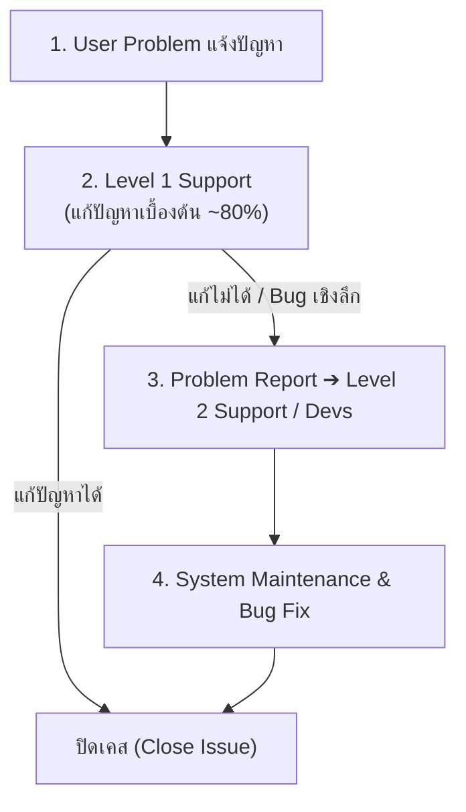
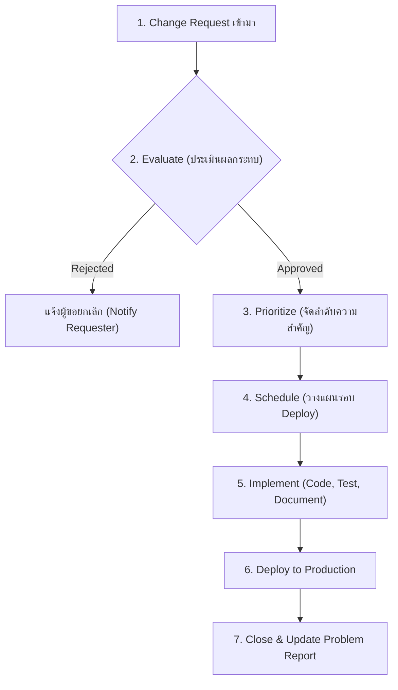

# ISAD - Unit 13: System Transition & Migration

> **วิชา:** 06066304 Information System Analysis and Design | **สถาบัน:** KMITL (King Mongkut's Institute of Technology Ladkrabang)
> **อาจารย์:** Asst. Prof. Manop Phankokkruad, Ph.D.
> **Source:** `Resources/Books/Information System Analysis and Design/ISAD2026-UNIT13-SystemTransition-Migration.pdf` (34 slides)

---

## Part 1: Macro Architecture & Overview

**Unit 13** เป็นบทสุดท้ายของ **Implementation Phase** ต่อจาก Unit 12 (Development, Testing & Documentation) โดยเน้นกระบวนการ **เปลี่ยนผ่านระบบ (System Transition)** จาก As-Is System ไปยัง To-Be System อย่างปลอดภัยและมีแผนรองรับ ความท้าทายหลักไม่ใช่แค่ด้านเทคนิค แต่ยังรวมถึงด้านธุรกิจและด้านคน (People Issues) ซึ่ง Kurt Lewin อธิบายว่าการเปลี่ยนแปลงองค์กรต้องผ่าน 3 ขั้นตอน: **Unfreeze → Move → Refreeze**

### ภาพรวม Implementation Phase (Unit 12 + Unit 13)



**องค์ประกอบของ Problem Report:**

| ฟิลด์ | รายละเอียด |
| :--- | :--- |
| Time & Date of Report | วันเวลาที่รายงาน |
| Reporter Info | ชื่อ อีเมล โทรศัพท์ผู้แจ้ง |
| Support Person Info | ชื่อ อีเมล โทรศัพท์ผู้รับเรื่อง |
| Software/Hardware | Software/Hardware ที่ก่อให้เกิดปัญหา |
| Location | ตำแหน่งที่พบปัญหา |
| Description | คำอธิบายปัญหา |
| Action Taken | สิ่งที่ดำเนินการแล้ว |
| Disposition | ผลลัพธ์ (แก้แล้ว / ส่งต่อ Maintenance) |

---

### 2.9 System Maintenance (การบำรุงรักษาระบบ)

> **System Maintenance** คือกระบวนการตรวจสอบ อัปเดต เฝ้าติดตาม และซ่อมบำรุงระบบคอมพิวเตอร์ เพื่อให้มีความปลอดภัย เชื่อถือได้ และมีประสิทธิภาพต่อเนื่อง

**4 ประเภทของ System Maintenance:**

> 💡 **Intuition:** ลองคิด Car Maintenance: **Preventive** = เปลี่ยนน้ำมันเครื่องตามระยะก่อนเครื่องพัง; **Corrective** = รถเสียแล้วนำไปซ่อม (แก้หลังปัญหา); **Adaptive** = ปรับรถให้ใช้กับน้ำมันชนิดใหม่/ตรงกฎหมายใหม่; **Perfective** = อัปเกรดให้แรงขึ้นหรือติดกล้องถอยหลัง (ปรับปรุง)
> [Source: generated — not verified against original document]

| ประเภท | จุดประสงค์ | ตัวอย่าง Real-World |
| :--- | :--- | :--- |
| **Preventive Maintenance** | ป้องกันปัญหาก่อนเกิด — ค้นหาและแก้ไข latent faults | ติดตั้ง security patches, clean legacy code, defrag disk |
| **Corrective Maintenance** | แก้ bugs, errors, defects ที่ผู้ใช้พบหลังระบบ go-live | แก้ checkout page crash เมื่อใส่ discount code |
| **Adaptive Maintenance** | ปรับระบบให้รองรับ software/hardware/legal ที่เปลี่ยนไป | อัปเดต app รองรับ iOS ใหม่, ปรับระบบเงินเดือนตามกฎหมายภาษีใหม่ |
| **Perfective Maintenance** | ปรับปรุง performance, UI, หรือเพิ่มฟีเจอร์ที่ขอ | Optimize DB ให้โหลดเร็วขึ้น 50%, เพิ่ม Dark Mode |

**🧭 ทำความเข้าใจ** _[Source: generated — not verified against original document]_

**แตกวลีสำคัญ:**
- "Preventive = ป้องกันก่อนเกิด" → ไม่มีปัญหา แต่ต้องดำเนินการเตรียมพร้อม (เช่น Update Security Patch ก่อนมี Hack)
- "Corrective = แก้หลังเกิด" → ระบบ Bug หรือ Crash แล้ว ต้องรีบแก้
- "Adaptive = ปรับให้เข้ากับสิ่งแวดล้อมใหม่" → ไม่ได้ Fix Bug ไม่ได้ Feature ใหม่ แต่ "ต้องใช้ได้กับ Environment ใหม่" (iOS 15 ใหม่, ฐานข้อมูล Migrate)
- "Perfective = ปรับปรุง" → ไม่ Bug ไม่ Crash แต่ต้องการให้ "ดีขึ้น" (เร็ว, สวย, มี Feature)

**ตัวอย่าง:**
- ✅ **Preventive:** ติดตั้ง Security Patch ตามรอบ, Clean Legacy Code, Update Dependencies
- ✅ **Corrective:** ลูกค้าส่ง Bug Report "ปุ่ม Login กดแล้วไม่ทำงาน" → ลงมือแก้
- ✅ **Adaptive:** iOS 16 Release → ต้อง Update App ให้รองรับ
- ✅ **Perfective:** ผู้ใช้ขอให้ Report โหลดเร็วขึ้น → Optimize Query
- **ต่างกันตรง:** Corrective = แก้สิ่งที่ทำงานผิด; Perfective = ทำสิ่งที่ทำงานถูกอยู่แล้วให้ดีขึ้นหรือเพิ่มฟีเจอร์ที่ขอ

**อย่าสับสน:** "Preventive" ≠ "Perfective" — Preventive = ป้องกันปัญหาที่ยังไม่เกิด; Perfective = ทำให้ดีขึ้น

**เช็คความเข้าใจ:** ระบบ Banking พบปัญหาต่อไปนี้ — ควร Classify เป็น Maintenance ประเภทไหน?
1. Security Breach เกิดขึ้น → แพทช์เข้าไป
2. ผู้ใช้ขอให้เพิ่ม Dark Mode
3. Database ต้องเปลี่ยนจาก Oracle เป็น PostgreSQL
4. Transfer บางครั้งโอนยอดผิด → ต้องแก้ Logic
<details><summary>เฉลย</summary>

1. **Corrective** — แก้ Bug/Security ที่เกิดแล้ว (ถ้า Patch ก่อนถูกโจมตี = Preventive)
2. **Perfective** — เพิ่มฟีเจอร์ตามที่ผู้ใช้ขอ ไม่ใช่การแก้ Bug
3. **Adaptive** — ปรับให้ใช้ Database ใหม่ได้
4. **Corrective** — Transfer Logic ผิดพลาด = Bug ต้องแก้

</details>

#### Change Request (คำร้องขอเปลี่ยนแปลง)

> 💡 **Intuition:** ลองคิดถึงการขอแก้บ้าน: เจ้าของบ้านเขียนคำขอเป็นลายลักษณ์อักษร ช่างประเมินราคาและเวลาก่อน ถ้าอนุมัติจึงจัดคิวทำ ไม่ใช่เปลี่ยนแบบตามใจในวันนั้น ข้อจำกัดของ analogy: ในองค์กรคำขอมาได้หลายทาง รวมถึงจากผู้บริหารโดยตรง แต่ทุกคำขอต้องผ่านกระบวนการประเมินแบบเดียวกัน
> [Source: generated — not verified against original document]

> **Change Request** คือข้อเสนออย่างเป็นทางการเพื่อแก้ไขส่วนใดส่วนหนึ่งของระบบ

**5 แหล่งที่มาของ Change Requests:**
1. **Problem Reports** จาก Operations Group (ที่มาที่พบบ่อยที่สุด)
2. **User Enhancements** — คำขอฟีเจอร์ใหม่จากผู้ใช้
3. **Other System Projects** — ระบบอื่นๆ ที่เชื่อมต่อกัน
4. **Infrastructure Changes** — Software/Network ที่เปลี่ยนแปลง
5. **Senior Management Requests** — นโยบายจากผู้บริหารระดับสูง

**กระบวนการ Processing a Change Request:**



**🧭 ทำความเข้าใจ Change Request** _[Source: generated — not verified against original document]_

**แตกวลีสำคัญ:**
- "Change Request" → ข้อเสนออย่างเป็นทางการให้แก้ระบบ มีหลักฐาน ผู้ขอ และเหตุผล
- "Evaluate" → ประเมินผลกระทบต่อ Cost, Schedule และระบบอื่นก่อนตัดสินใจ
- "Prioritize / Schedule" → จัดลำดับความสำคัญแล้ววางในรอบ Deploy ที่เหมาะสม
- "Problem Report vs Change Request" → Problem Report คือการรายงานปัญหาที่พบ อาจนำไปสู่ Change Request ได้ แต่คนละขั้นตอนกัน

**ตัวอย่าง:**
- ✅ ผู้ใช้รายงานว่า Checkout ค้างเมื่อใส่ Discount Code → Problem Report → เปิด Change Request → ประเมิน → Priority สูง → Schedule ใน Release ถัดไป → Deploy → ปิด Problem Report
- ❌ Developer แก้ Production โดยตรงโดยไม่มี Change Request และไม่บันทึก — ไม่มีใครรู้ว่าเปลี่ยนอะไร เมื่อเกิดปัญหาใหม่ตามมาก็ตรวจย้อนกลับไม่ได้
- **ต่างกันตรง:** Problem Report = "มีอะไรผิด"; Change Request = "ควรเปลี่ยนอะไร และจะทำเมื่อไร"

**อย่าสับสน:** "Change Request" ≠ "การแก้ Bug ทันที" — Bug ก็เข้ากระบวนการ Change Request ได้ และทุกคำขอต้องผ่านการประเมินก่อนลงมือ

**เช็คความเข้าใจ:** ผู้จัดการขอเพิ่มฟีเจอร์ใหม่ด่วนภายในเดือนนี้ ต้องทำอะไรก่อนลงมือเขียนโค้ด?
<details><summary>เฉลย</summary>

ส่งคำขอเป็น **Change Request** แล้วให้ **Evaluate** ผลกระทบ (เวลา, ต้นทุน, ระบบอื่น) และ **Prioritize** เทียบกับงานอื่นก่อน จึงจะ **Schedule** เข้ารอบ Deploy และ Implement ได้

</details>

---

### 2.10 Project Assessment (การประเมินผลโครงการ)

> 💡 **Intuition:** ลองคิดถึงการทบทวนหลังแข่งกีฬาจบ: โค้ชดูทั้งการทำงานร่วมกันของทีม และดูอุปกรณ์กับสนามด้วย ไม่ใช่เพื่อหาคนผิด แต่เพื่อให้รอบหน้าทำได้ดีขึ้น ข้อจำกัดของ analogy: การทบทวนที่ไม่นำไปปรับปรุงจริงจะกลายเป็นพิธีกรรม ซึ่ง Project Assessment ที่ดีต้องถูกนำไปใช้ต่อ
> [Source: generated — not verified against original document]

> **Project Assessment** คือกลไกประเมินโครงการตลอด Lifecycle ตั้งแต่เริ่มต้นถึงสิ้นสุด — เพื่อเข้าใจว่าอะไรสำเร็จ อะไรต้องปรับปรุง

**ความสำคัญ:**
- เป็นส่วนประกอบสำคัญของ **Organizational Learning**
- สำคัญเป็นพิเศษสำหรับ Junior Staff ที่กำลังสร้างประสบการณ์
- ช่วยให้องค์กรพัฒนาขีดความสามารถในโครงการต่อๆ ไป

**2 ส่วนของ Project Assessment:**

#### A. Project Team Review

> **Project Team Review** (Post-Project Review) คือการประเมินเชิงโครงสร้างว่าทีมทำงานร่วมกัน ปฏิบัติงาน และดำเนินโครงการอย่างไร

**กระบวนการ:**
- สมาชิกแต่ละคนเขียนเอกสารสั้นรายงานและวิเคราะห์ผลงานของตนเอง
- เน้นที่ **การปรับปรุง ไม่ใช่การลงโทษ**
- Project Manager สรุปเอกสารและแจกเวียนให้องค์กรเรียนรู้

#### B. System Review

> **System Review** คือการประเมินอย่างเป็นทางการถึงสถาปัตยกรรม Infrastructure และสุขภาพทางเทคนิคของระบบโดยรวม

**เป้าหมาย:**
- ประเมินว่าต้นทุนและประโยชน์ที่คาดหวังไว้ เกิดขึ้นจริงหรือไม่หลังติดตั้ง
- ช่วยให้องค์กรพัฒนาขีดความสามารถในการบริหารโครงการในอนาคต

| การประเมิน | เน้นที่ | ผู้รับผิดชอบ |
| :--- | :--- | :--- |
| **Project Team Review** | กระบวนการทำงานของทีม, การ collaborate | Project Manager + ทีม |
| **System Review** | ความสำเร็จของระบบ, ROI จริงเทียบกับที่คาด | Management + Analyst |

**🧭 ทำความเข้าใจ Project Assessment** _[Source: generated — not verified against original document]_

**แตกวลีสำคัญ:**
- "Organizational Learning" → องค์กรเรียนรู้จากโครงการหนึ่งเพื่อให้โครงการถัดไปทำได้ดีขึ้น
- "Project Team Review" → ประเมิน "วิธีทำงาน" ของทีม (การร่วมมือ กระบวนการ) เน้นการปรับปรุง ไม่ลงโทษ
- "System Review" → ประเมิน "ตัวระบบ" (สถาปัตยกรรม, Infrastructure, ต้นทุนและประโยชน์จริงเทียบกับที่คาด)

**ตัวอย่าง:**
- ✅ Team Review พบว่า Requirement เปลี่ยนบ่อยทำให้งานรีบ → ปรับกระบวนการรับ Change Request; System Review พบว่า Database ช้ากว่าที่คาด → วางแผนปรับ Infrastructure
- ❌ ประเมินเพื่อหาคนผิดแล้วเก็บผลไว้เงียบๆ — ทีมจะปิดบังปัญหาในโครงการถัดไป
- **ต่างกันตรง:** Team Review ดูที่ "คนและวิธีทำงาน"; System Review ดูที่ "ระบบที่ส่งมอบ"

**อย่าสับสน:** Project Assessment ≠ Testing — Testing ตรวจว่าระบบทำงานถูกต้องก่อนส่งมอบ ส่วน Project Assessment ประเมินหลังติดตั้งว่าโครงการคุ้มค่าและทำอะไรได้ดีกว่าเดิมบ้าง

**เช็คความเข้าใจ:** หลังติดตั้งระบบ 6 เดือน ผลตอบแทน (ROI) ต่ำกว่าที่คาดไว้มาก การประเมินนี้เป็น Team Review หรือ System Review และผู้รับผิดชอบหลักคือใคร?
<details><summary>เฉลย</summary>

เป็น **System Review** — เพราะเป็นการเทียบ ROI จริงกับที่คาดของระบบ ผู้รับผิดชอบหลักคือ **Management + Analyst** (Team Review คือการดูการทำงานของทีม ซึ่งผู้รับผิดชอบคือ Project Manager + ทีม)

</details>

#### 💡 เสริม: Conversion Strategies (Direct, Parallel, Phased, Pilot)

> 💡 **Intuition:** ลองคิดถึงการเปลี่ยนระบบไฟฟ้าของอาคาร: **Direct** = ตัดไฟเก่าแล้วต่อไฟใหม่ทันที (เร็วที่สุด แต่ถ้าใช้ไม่ได้อาคารดับทันที), **Parallel** = เปิดไฟเก่าและใหม่คู่กันจนมั่นใจ (ปลอดภัยที่สุดแต่จ่ายค่าไฟสองเท่า), **Phased** = เปลี่ยนทีละชั้น, **Pilot** = ลองเปลี่ยนห้องเดียวก่อน ข้อจำกัดของ analogy: ระบบซอฟต์แวร์ต้องจัดการข้อมูลที่ซ้ำหรือ Sync กันระหว่างเก่ากับใหม่ และต้องฝึกผู้ใช้ ซึ่งการเปลี่ยนไฟฟ้าไม่มีปัญหาเหล่านี้
> [Source: generated — not verified against original document]

| Conversion Style | วิธีการ | Risk | Cost | ระยะเวลา | เหมาะกับ |
| :--- | :--- | :--- | :--- | :--- | :--- |
| **Direct Cutover** | ปิดระบบเก่า เปิดระบบใหม่ทันที | สูง | ต่ำ | สั้น | ระบบเล็ก ไม่ซับซ้อน |
| **Parallel** | รันระบบเก่าและใหม่พร้อมกัน เทียบผลลัพธ์ | ต่ำ | สูง | ยาว | ระบบสำคัญที่ยอมรับ Downtime ไม่ได้ |
| **Phased** | เปลี่ยนทีละส่วน (Module หรือแผนก) | กลาง | กลาง | กลาง | ระบบใหญ่ หลาย Module |
| **Pilot** | ให้กลุ่มผู้ใช้เล็กลองระบบใหม่ก่อนขยาย | กลาง | กลาง | กลาง | ต้องการ Feedback จากผู้ใช้จริงก่อนเปิดกว้าง |

**🧭 ทำความเข้าใจ** _[Source: generated — not verified against original document]_

**แตกวลีสำคัญ:**
- "Direct Cutover" → ไม่มีระบบเก่าเป็นตัวสำรองหลังเปลี่ยน ถ้าพังจุดเดียว ทั้งระบบพัง
- "Parallel" → รันคู่กันเพื่อเทียบผลลัพธ์ ถ้าตรงกันจึงปิดระบบเก่า
- "Phased" → ทยอยเปลี่ยนเป็นส่วนๆ ระหว่างทางต้องมีการเชื่อมระหว่างระบบเก่ากับใหม่
- "Pilot" → ทดสอบกับกลุ่มผู้ใช้เล็กทั้งระบบก่อน แล้วค่อยขยายไปทุกกลุ่ม

**ตัวอย่าง:**
- ✅ ระบบบัญชีเล็กของร้านค้า ข้อมูลน้อย เปลี่ยนนอกเวลาทำการ → Direct Cutover เหมาะ เพราะถ้ามีปัญหาก็กู้ได้เร็วและค่าใช้จ่ายต่ำ
- ✅ ระบบจ่ายเงินเดือนขององค์กรที่ห้ามผิด → Parallel เหมาะ เพราะรันสองระบบจนยอดตรงกันก่อนปิดของเดิม
- ❌ เลือก Direct Cutover กับ ERP ใหญ่ที่ทุกแผนกเปลี่ยนพร้อมกันโดยยังไม่ทดสอบ → ถ้าพัง ทุกแผนกหยุดทำงานพร้อมกัน

**ต่างกันตรง:** Direct เสี่ยงที่ "จุดเปลี่ยนจุดเดียว" แต่ประหยัด; Parallel ไม่มีจุดเปลี่ยนที่เสี่ยง แต่ต้องจ่ายค่ารันสองระบบ

**อย่าสับสน:** "Pilot" ≠ "Phased" — Pilot ทดสอบ **ระบบทั้งชุด** กับ **ผู้ใช้กลุ่มเล็ก** ก่อนขยาย; Phased **แบ่งระบบเป็นส่วน** แล้วเปลี่ยนทีละส่วน

**เช็คความเข้าใจ:** โรงพยาบาลต้องการให้ผู้ใช้จริงกลุ่มเล็กลองระบบใหม่และให้ Feedback ก่อนเปิดให้ทั้งโรงพยาบาล ควรเลือก Conversion Style แบบใด และเหตุผลคืออะไร?
<details><summary>เฉลย</summary>

**Pilot** — เพราะเป้าหมายคือให้กลุ่มผู้ใช้เล็กทดลองทั้งระบบและให้ Feedback ก่อนขยาย ระบบเดิมยังใช้งานได้ไปพร้อมกันระหว่างรอ (ถ้า Direct จะไม่มีกลุ่มทดลอง และ Parallel จะไม่ได้ Feedback จากผู้ใช้จริง)

</details>

---

## Part 3: Quick Reference & Exam Cheat Sheet

### Checklist สรุปหัวใจสำคัญก่อนสอบ
* [ ] **Kurt Lewin's 3 Steps:** Unfreeze → Move → Refreeze — กระบวนการเปลี่ยนแปลงองค์กร
* [ ] **Migration Plan มี 3 ส่วน:** Preparing Business / Technology / People
* [ ] **Conversion Strategy 3 มิติ:** Style (ทันที/ค่อยๆ) + Location (ที่ไหน) + Module (เท่าไหร่)
* [ ] **Conversion Styles 4 แบบ:** Direct, Parallel, Phased, Pilot — เปรียบ Risk/Cost/Time
* [ ] **Data Conversion** = ขั้นตอนที่ซับซ้อนที่สุดใน Preparing Technology
* [ ] **3 Key Roles:** Sponsor (ต้องการ), Change Agent (นำ), Potential Adopters (ต้องเปลี่ยน)
* [ ] **4 ขั้นตอน Change Management:** Revise Policy → Assess Cost/Benefit → Motivate → Train
* [ ] **Motivation 2 กลยุทธ์:** Informational (โน้มน้าว) vs Political (ใช้อำนาจ)
* [ ] **3 วิธีได้ทักษะใหม่:** Hiring / Outsourcing / Training
* [ ] **Training Principle:** เน้นงานที่ผู้ใช้ต้องทำ ไม่ใช่ฟีเจอร์ระบบ
* [ ] **Help Desk:** Level 1 แก้ 80%, ที่เหลือ → Problem Report → Level 2
* [ ] **4 ประเภท Maintenance:** Preventive / Corrective / Adaptive / Perfective
* [ ] **5 แหล่ง Change Request:** Operations Problem Reports (ที่พบบ่อยสุด), User, Other Systems, Infrastructure, Management
* [ ] **Project Assessment:** Project Team Review (ทีม) + System Review (ระบบ)

### สรุปตาราง Conversion Strategy

| Strategy | วิธี | Risk | Cost | Time | Use When |
| :--- | :--- | :---: | :---: | :---: | :--- |
| **Direct Cutover** | ปิดเก่า-เปิดใหม่ทันที | 🔴 H | 🟢 L | 🟢 Short | ระบบเล็ก, ไม่ซับซ้อน |
| **Parallel** | รัน 2 ระบบพร้อมกัน | 🟢 L | 🔴 H | 🔴 Long | Critical Systems, ไม่ยอมรับ Downtime |
| **Phased** | เปลี่ยนทีละส่วน | 🟡 M | 🟡 M | 🟡 Medium | ระบบขนาดใหญ่, หลาย Module |
| **Pilot** | ทดสอบกลุ่มเล็กก่อน | 🟡 M | 🟡 M | 🟡 Medium | ต้องการ feedback ก่อนขยาย |

### สรุปตาราง 4 ประเภท System Maintenance

| ประเภท | ทำเมื่อ | จุดประสงค์ |
| :--- | :--- | :--- |
| **Preventive** | Proactive — ก่อนเกิดปัญหา | ป้องกัน Latent Faults |
| **Corrective** | Reactive — หลัง Bug พบ | แก้ไข Bug/Error ที่พบหลัง Go-Live |
| **Adaptive** | เมื่อ Environment เปลี่ยน | ปรับรองรับ OS, Law, Platform ใหม่ |
| **Perfective** | เมื่อต้องการปรับปรุง | เพิ่ม Performance, UI, Features |

### Concept Map — Unit 13

```text
System Transition & Migration (Unit 13)
├── Transition Model (Kurt Lewin)
│   ├── Unfreeze (Analysis & Design)
│   ├── Move (Migration Plan)
│   └── Refreeze (Support & Maintenance)
│
├── Migration Plan
│   ├── 1. Preparing Business
│   │   ├── Conversion Strategy (Direct/Parallel/Phased/Pilot)
│   │   └── Business Contingency Plan
│   ├── 2. Preparing Technology
│   │   ├── Install Hardware
│   │   ├── Install Software
│   │   └── Convert Data ← ซับซ้อนที่สุด
│   └── 3. Preparing People (Change Management)
│       ├── Revise Management Policies
│       ├── Assess Costs & Benefits
│       ├── Motivate Adoption (Informational / Political)
│       └── Conduct Training (Classroom / 1-on-1 / CBT)
│
└── Post-Implementation Activities
    ├── System Support
    │   ├── Online Support
    │   └── Help Desk (L1 → L2 Escalation)
    ├── System Maintenance
    │   ├── Preventive / Corrective / Adaptive / Perfective
    │   └── Change Request (5 Sources)
    └── Project Assessment
        ├── Project Team Review (เน้นทีม)
        └── System Review (เน้น ROI ระบบ)
```

---

## ⚠️ Common Pitfalls & Exam Traps

* **Parallel ≠ Safe ในทุกกรณี:** Parallel Conversion ลด Risk แต่ Cost สูงมาก และต้องรักษาข้อมูลสองระบบให้ Sync — ไม่เหมาะถ้า Resources จำกัด
* **Data Conversion ≠ แค่ Copy ข้อมูล:** ต้องมีการทำ Schema Mapping, Data Cleansing, Validation และ Testing ก่อนใช้งานจริง — เป็นขั้นตอนที่ซับซ้อนที่สุดใน Migration Plan
* **Training ≠ สอนใช้งานระบบ:** หลักการของ ISAD คือ Training ต้องเน้นที่ "งานที่ผู้ใช้ต้องทำ" (Job-Centric) ไม่ใช่ "ฟีเจอร์ที่ระบบมี" (System-Centric)
* **Corrective vs Adaptive ต่างกัน:** Corrective = แก้ Bug ที่มีอยู่แล้ว; Adaptive = ปรับระบบให้รองรับสิ่งแวดล้อมที่เปลี่ยนไป (เช่น OS ใหม่, กฎหมายใหม่)
* **Project Team Review ≠ ลงโทษ:** เป็นกระบวนการเรียนรู้ขององค์กร เน้น Improvement ไม่ใช่ Blame
* **Help Desk Level 1 เป้าหมาย 80%:** ถ้า Level 1 ไม่สามารถแก้ได้ ต้องทำ Problem Report ส่งต่อ Level 2 — ไม่ใช่ส่งตรงไปยัง Developer

---

## เอกสารเชื่อมโยง (Wiki-Style Backlinks)

* **วิชาและหัวข้อที่เกี่ยวข้อง:**
  * [[ISAD - Unit 12 System Development, Testing and Documentation]] (บท System Development ก่อนหน้า — Implementation Phase ส่วนแรก ที่ Unit 13 ต่อยอดจาก)
  * [[ISAD - Unit 11 Storage Design]] (Storage Design ที่เป็นพื้นฐานของ Data Conversion ใน Migration Plan)
  * [[ISAD - Unit 10 Software Design]] (Software Design ที่ถูกนำไปพัฒนาและทดสอบก่อนเข้า Unit 12-13)
  * [[ISAD - Unit 07 Design Strategies]] (Design Strategies ที่กำหนดทิศทางการออกแบบที่ Unit 13 นำไปติดตั้ง)

* **แหล่งข้อมูล:**
  * Source: `Resources/Books/Information System Analysis and Design/ISAD2026-UNIT13-SystemTransition-Migration.pdf` (34 slides, KMITL)
