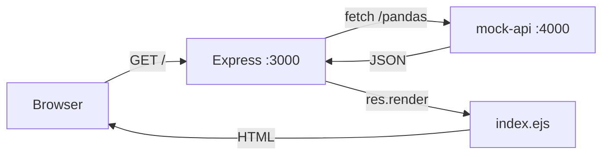

# Mock Exam 1 — Panda Gallery (REST API + EJS)

วันที่เริ่ม: 2026-10-24 · โจทย์: `mock exam/1/README.md` · เต็ม 20 คะแนน
วิธีเรียน: ผู้เรียนพิมพ์โค้ดเอง ผู้สอน (Claude) อธิบายแนวคิด ให้โค้ดทีละก้อนเล็ก แล้วให้รันและรายงานผล ไม่เฉลยทั้งไฟล์

## ภาพรวมที่ใช้อธิบายตอนเริ่ม

Express (`:3000`) ทำ 3 อย่าง: รับ URL → `fetch` ข้อมูลจาก mock-api (`:4000`) → `res.render` ยัดข้อมูลลง EJS แล้วส่ง HTML กลับ ทุก TODO คือการเติมหนึ่งใน 3 ชิ้นนี้

## สรุปสถานะ

| Step | ข้อ (คะแนน) | สถานะ |
|---|---|---|
| 0 | เตรียมเครื่อง | ผ่าน |
| 1 | fetch ข้อมูล (ส่วนแรกของข้อ 3) | ผ่าน |
| 2 | ข้อ 2 Partials (2) | ผ่านหลังแก้ error |
| 3 | ข้อ 3 Grid card (5) | ผ่าน |
| 4 | ข้อ 4 Filter (3) | ผ่านหลังแก้บั๊ก |
| 5 | ข้อ 5 Detail (4) | ผ่าน (ผู้เรียนรายงาน) |
| 6 | ข้อ 6 Error handling (2) | ผ่านหลังแก้บั๊ก |
| 7 | ข้อ 7 Stats (2) | ผ่านหลังแก้บั๊ก |

(ข้อ 1 Static + route 2 คะแนน ผู้เรียนทำไว้แล้วก่อนเริ่มเซสชัน: `express.static` และ `/about` ใน index.js)

---

## รายละเอียดรายขั้น (เพิ่มอะไร / ตัดอะไร / แก้อะไร)

### Step 0: เตรียมเครื่อง
- **ทำ:** เปิด terminal 1 รัน `mock-api` (`npm install && npm start`, :4000) และ terminal 2 รันข้อสอบ (`npm install && npm start`, :3000)
- **ตรวจ:** `localhost:4000/pandas` เห็น JSON 8 ตัว, `localhost:3000/about` เห็นหน้า About
- **สอน:** ข้อสอบมี 2 เซิร์ฟเวอร์ ตัวหนึ่งเป็นข้อมูล ตัวหนึ่งเป็นหน้าเว็บ
- **ไฟล์ที่แตะ:** ไม่มี

### Step 1: ให้ server ดึงข้อมูลได้
- **ไฟล์:** `1/index.js` route `GET /`
- **ตัด:** `res.render('index', { pandas: [], species: '', stats: null, error: null })` ที่เป็น placeholder ข้อมูลว่าง
- **เพิ่ม:**
  - `const response = await fetch(`${API}/pandas`)`
  - `const pandas = await response.json()`
  - `console.log(pandas)` (ไว้ดูผล ชั่วคราว)
  - `res.render('index', { pandas, species: '', stats: null, error: null })` (ส่ง `pandas` จริง)
- **สอน:** `async/await`, `fetch` คืน "ซอง" ต้อง `.json()` อีกรอบ, key ใน object ของ `res.render` กลายเป็นตัวแปรใน EJS
- **เจอ:** ผู้เรียนพิมพ์ `/PANDAS` ตัวพิมพ์ใหญ่ (ไปเจอตอน Step 4)

### Step 2: Partials header/footer
- **ไฟล์ `partials/header.ejs`:** ตัด `<%# TODO 2: nav ... %>` เพิ่ม `<nav>` ที่มี `<a href="/">Home</a>` และ `<a href="/about">About</a>`
- **ไฟล์ `partials/footer.ejs`:** ตัด `<%# TODO 2: footer text %>` เพิ่ม `<footer>Panda Gallery - Web Programming Mock Exam</footer>`
- **ไฟล์ `index.ejs` และ `detail.ejs`:** ตัด comment TODO 2 บนสุด/ล่างสุดไฟล์ละ 2 จุด เพิ่ม `<%- include('partials/header') %>` และ `<%- include('partials/footer') %>`
- **สอน:** ทำไมต้อง `<%-` (ไม่ escape HTML) ไม่ใช่ `<%=`
- **ที่ผู้เรียนสงสัยก่อนหน้านี้:** หน้าขาวหลัง Step 1 ไม่ใช่ปัญหา CSS แต่ `index.ejs` ไม่มี `<head>`/`<link>` เพราะ `<link>` อยู่ใน header partial ที่ยังไม่ได้ include
- **บั๊ก:** เขียน `%)>` แทน `%>` ทั้ง 4 จุด → error "Could not find matching close tag for `<%-`" แก้เป็น `%>`
- **ข้อสังเกตเพิ่ม:** nav แสดงแนวตั้ง ตรวจแล้ว CSS (`nav { display:flex }`) ควรเป็นแนวนอน ให้ผู้เรียนเช็ก HTML ใน header.ejs (ไม่ได้ยืนยันผลสุดท้าย)

### Step 3: Grid card + badge สีแดง
- **ไฟล์ `index.ejs`:** ตัด `<%# TODO 3 ... %>` ในต้น `
` เพิ่มบล็อก
  - `<% pandas.forEach(function(p) { %> ... <% }); %>`
  - ใน loop: `
`, `">`, `
` ที่มี `<h3>` ชื่อ, `` species, `Age: ...`, `<a href="/panda/<%= p.id %>">View</a>`
- **ต่อมาในขั้นเดียวกัน (การบ้านเล็ก):** เปลี่ยน `class="badge"` เป็น `class="badge <%= p.species === 'Red' ? 'red' : '' %>"` (ผู้เรียนเลือกใช้ ternary ผมเสนอทาง `if` เป็นตัวเลือก เพราะโจทย์เขียนว่า "ใช้ if")
- **สอน:** แท็ก EJS 3 แบบ (`<% %>` รันโค้ด / `<%= %>` แสดงค่า escape / `<%- %>` แสดงดิบ), `forEach` ใน EJS, ต้องปิด `}); ` ให้ครบ
- **ทดสอบที่ผู้เรียนรายงาน:** card ขึ้น

### Step 4: Filter ด้วย `req.query`
- **ไฟล์ `index.ejs`:** ตัด `<%# TODO 4 %>` เพิ่มลิงก์ `All (/)`, `Giant (/?species=Giant)`, `Red (/?species=Red)` ผู้เรียนวางลิงก์ไว้นอก `div.filters` ก่อน แล้วย้ายเข้าไปให้ได้สไตล์ปุ่มกลม
- **ไฟล์ `index.js` route `GET /`:**
  - เพิ่ม `const species = req.query.species || ''`
  - เพิ่ม `const url = species ? `${API}/pandas?species=${species}` : `${API}/pandas``
  - เปลี่ยน `fetch(`${API}/pandas`)` เป็น `fetch(url)`
  - เปลี่ยน `species: ''` ใน render เป็นส่ง `species` จริง
- **บั๊กที่เจอ 4 จุด (ผู้เรียนนำโค้ดใหม่ "ต่อท้าย" แทนที่จะ "แทนที่"):**
  1. มี `app.get('/')` สองตัว ตัวแรกบังตัวที่สอง → **ตัดตัวแรกทั้งก้อน**
  2. `/PANDAS` ตัวพิมพ์ใหญ่ → แก้เป็น `/pandas`
  3. `?species= ${species}` มีช่องว่าง → ตัดช่องว่าง
  4. `const pandas = pandas = await ...` → เหลือ `const pandas = await ...`
- **สอน:** `req.query` (ค่าหลัง `?`, ไม่มีค่าเป็น `undefined`) ต่างจาก `req.params`; debug ด้วย `console.log(url)`; ห้าม route path ซ้ำ
- **ทดสอบ:** All = 8, Giant = 5, Red = 3 (ผู้เรียนรายงาน "filter ได้แล้ว")

### Step 5: หน้า Detail
- **ไฟล์ `index.js` route `GET /panda/:id`:**
  - ตัด `res.status(501).send('TODO')`
  - เพิ่ม `await fetch(`${API}/panda/${req.params.id}`)`
  - เพิ่ม `if (!response.ok) return res.status(404).render('detail', { panda: null })`
  - เพิ่ม `const panda = await response.json()` และ `res.render('detail', { panda })`
- **ไฟล์ `detail.ejs`:**
  - ตัด `<%# TODO 5 %>` ทั้งสองจุด
  - branch `!panda`: เพิ่ม `<h2>Panda not found</h2>` และ `<a href="/">Back to gallery</a>`
  - branch else: เพิ่ม ``, `<h1>` ชื่อ, badge (ผู้เรียนเพิ่มเอง), Age, Species, Weight (`weight_kg`), Zoo, Diet, Description
- **สอน:** `req.params.id`, `response.ok`, `return` ตอน 404 เพื่อไม่ให้ render สองรอบ
- **ที่ยังขาด (ผมชี้ไว้):** ลิงก์ Back ใน branch else (ข้อ 5 ขอ) ผู้เรียนรายงานว่า "ทำได้แล้ว" ภายหลัง ผมไม่ได้เปิดตรวจซ้ำ

### Step 6 + 7: try/catch และสถิติ
- **ไฟล์ `index.js` route `GET /`:**
  - เพิ่มครอบด้วย `try { ... } catch (error) { ... }`
  - เพิ่ม `if (!response.ok) throw new Error('Failed to fetch pandas')`
  - เพิ่มคำนวณ `total = pandas.length`, `totalAge = pandas.reduce((sum, panda) => sum + panda.age, 0)`, `stats = { total, avgAge: ... .toFixed(1) }`
  - เปลี่ยน render ให้ส่ง `stats` จริง
  - ใน `catch`: `console.error(error.message)` และ `res.render('index', { pandas: [], species, stats: null, error: 'Cannot load pandas. Please try again later.' })`
- **ไฟล์ `index.ejs`:** ตัด `<%# TODO 7 %>` เพิ่ม `<% if (stats) { %>
Total: ... · Average age: ...
<% } %>` (ผู้เรียนวางไว้ใต้ grid)
- **บั๊ก:** เหลือ `res.render(... stats:null ...)` เดิมอยู่ก่อนบรรทัดคำนวณ stats แล้วมี `res.render` อีกรอบหลังคำนวณ → เรียก render สองรอบ → `ERR_HTTP_HEADERS_SENT` → `catch` render ซ้ำอีกครั้ง ไม่มีใครจับ → server crash
  - **ตัด:** `res.render` ตัวแรก (ผู้เรียนลบเอง)
- **สอน:** `try/catch` ป้องกัน crash, `fetch` throw เฉพาะเชื่อมต่อไม่ได้ ถ้า API ตอบ 500 ต้องเช็ก `response.ok` เอง, `reduce`, `toFixed(1)`, **1 request ตอบได้ครั้งเดียว**
- **จุดเล็กที่แนะนำ:** เงื่อนไขกันหารศูนย์ควรเป็น `total ?` ไม่ใช่ `totalAge ?` (ไม่ได้ยืนยันว่าแก้แล้ว)

---

## บทเรียนที่ควรจำ (สรุป)

1. หน้าว่างให้ดูก่อนว่า template วาดอะไรหรือยัง ก่อนโทษ CSS
2. ตัวปิดแท็ก EJS คือ `%>` เท่านั้น
3. โค้ดที่ผู้สอนให้มักเป็น "แทนที่ของเดิม" ไม่ใช่ "ต่อท้าย" ถ้าเกิน 1 route path เดียวกัน ตัวแรกชนะ
4. 1 request ตอบ response ได้ครั้งเดียว (`res.render`/`res.send`/`res.redirect` อย่างใดอย่างหนึ่ง) ใช้ `return` ตอนตอบกลางทาง
5. Debug: `console.log` ค่าที่สร้างขึ้น (url, data) ก่อนสงสัยที่อื่น

เข้าเกณฑ์ Mistake Log (ข้อ 4) แต่ยังไม่ได้เขียนลง `AIOS/01 Learning/Mistake Log/` รอผู้เรียนสั่ง

## เช็กลิสต์ท้าย README (ยังไม่เห็นผลทดสอบจริงทุกข้อ)

- [x] `/` ขึ้น 8 card, `/?species=Red` ขึ้น 3 card
- [x] `/panda/4` แสดง Rusty, `/panda/99` ได้ 404 ✅ 2026-10-24
- [x] ปิด mock-api แล้วเปิด `/` ไม่ crash ✅ 2026-10-24
- [x] header/footer มาจาก partial ไม่ได้ copy ซ้ำ ✅ 2026-10-24
