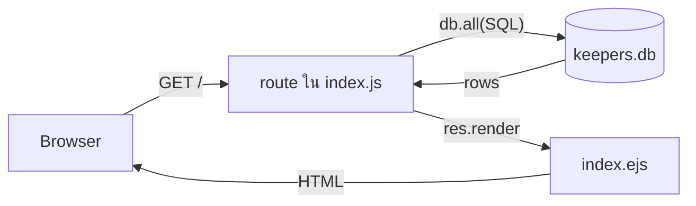

# Mock Exam 2 — Panda Keepers (CRUD + SQLite + CORS)

วันที่เริ่ม: 2026-10-24 · โจทย์: `mock exam/2/README.md` · เต็ม 25 คะแนน
วิธีเรียน: เหมือน [[2026-10-24 Mock Exam 1 Progress]] — ผู้เรียนพิมพ์เอง ผู้สอนอธิบายและให้โค้ดทีละก้อน

## ภาพรวมที่ใช้อธิบายตอนเริ่ม

ต่างจากข้อ 1: ข้อมูลอยู่ใน DB ของเราเอง (`keepers.db`) ไม่ได้ `fetch` จาก API ภายนอก SQLite ใช้ **callback** (`db.all/get/run(sql, params, cb)`) ทุกอย่างที่ต้องใช้ผลลัพธ์ รวมถึง `res.render` ต้องอยู่ใน callback

## สรุปสถานะ

| Step | ข้อ (คะแนน) | สถานะ |
|---|---|---|
| 0 | เตรียมเครื่อง | ผ่าน (ผู้เรียนรายงาน) |
| 1 | ข้อ 1 Read (3) | ผ่าน (ผู้เรียนรายงาน, ผมอ่านโค้ดยืนยันแล้ว) |
| 2 | ข้อ 2 Create (5) | ผ่านหลังแก้บั๊ก 2 จุด (ผู้เรียนรายงาน) |
| 3 | ข้อ 3 Update (6) | ผ่านหลังเพิ่ม `GET /edit/:id` ที่ลืม (ผู้เรียนรายงาน) |
| 4 | ข้อ 4 Delete (4) | ผ่าน (ผู้เรียนรายงาน) |
| 5 | ข้อ 5 JSON API + CORS (4) | ผ่าน (ผู้เรียนรายงาน) |
| 6 | ข้อ 6 Filter (3) | ผ่าน (ผู้เรียนรายงาน) แต่ `ORDER BY id` ใน route `/` ขัดข้อ 1 ต้องแก้กลับเป็น `name` |

---

## รายละเอียดรายขั้น (เพิ่มอะไร / ตัดอะไร / แก้อะไร)

### Step 0: เตรียมเครื่อง
- **ทำ:** `cd 2 && npm install && npm run init && npm start` (พอร์ต 3002)
- **`npm run init`:** รัน `init_db.js` ซึ่ง DROP/CREATE ตาราง `keepers` (id, name, zoo, role, salary) และใส่ 5 แถว (Somchai, Malee, Anan, Pim, Krit)
- **ไฟล์ที่แตะ:** ไม่มี (สร้าง `keepers.db`)

### Step 1: Read (ตาราง + Total salary)
- **ไฟล์ `2/index.js` route `GET /`:**
  - ตัด placeholder `res.render('index', { keepers: [], total: 0, zoos: [], zoo: '' })`
  - เพิ่ม `db.all('select * from keepers order by name', [], (err, keepers) => {...})`
  - ซ้อนใน callback: `db.get('select sum(salary) as total from keepers', [], (err2, row) => {...})`
  - ใน callback ชั้นใน: `res.render('index', { keepers, total: row.total, zoos: [], zoo: '' })`
  - เพิ่มเกราะ `if (err) return res.status(500).send('Database error')` ทั้งสองชั้น
  - `zoos: []` และ `zoo: ''` ยังเป็นค่าว่าง รอข้อ 6
- **ไฟล์ `views/index.ejs`:**
  - ตัด `<%# TODO 1: table ... %>` และ `<%# TODO 1: "Total salary" %>`
  - เพิ่ม `<table>` หัว ID/Name/Zoo/Role/Salary, `keepers.forEach` สร้างแถว, ลิงก์ `Edit` (`/edit/<%= k.id %>`) ใน `td.actions`
  - เพิ่ม `
Total salary: <%= total %>
`
  - **ยังคงไว้ (ยังไม่ทำ):** comment `TODO 4` (ปุ่ม Delete) ใน `td.actions` และ `TODO 6` (`<select>` zoo)
- **สอน:** `db.all` (หลายแถว) / `db.get` (แถวเดียว) / `db.run` (INSERT/UPDATE/DELETE), callback ต้องครอบทุกอย่างที่ใช้ผลลัพธ์, `SUM` ใน SQL ตามโจทย์, `AS total` เพื่อตั้งชื่อคอลัมน์, `return` ตอนตอบ error กันตอบซ้ำ (บทเรียนจากข้อ 1)
- **ผล:** ผู้เรียนเขียน SQL ตัวพิมพ์เล็กได้ถูก ใช้ได้เหมือนกัน

### Step 2: Create (ฟอร์ม + POST + validation)
- **ไฟล์ `views/add.ejs`:**
  - ตัด `<%# TODO 2: form ... %>`
  - เพิ่ม `<form method="POST" action="/add">` มี input `name`, `zoo`, `role` (type text), `salary` (type number) และปุ่ม Save
  - แต่ละ input มี `value="<%= form.xxx || '' %>"` เพื่อเติมค่าเดิมกลับเมื่อ validate ไม่ผ่าน
- **ไฟล์ `2/index.js`:**
  - เพิ่ม `GET /add` → `res.render('add', { error: null, form: {} })`
  - เพิ่ม `POST` route: อ่าน `req.body`, `Number(salary)`, validate, ถ้าไม่ผ่าน `return res.status(400).render('add', { error, form: req.body })`, ถ้าผ่าน `db.run('insert into keepers (name,zoo,role,salary) values (?,?,?,?)', [...], function (err) {... res.redirect('/') })`
  - comment TODO 2 สองบรรทัดเดิมยังเหลืออยู่เหนือ route (ไม่เป็นไร)
- **สอน:** ฟอร์ม POST ส่งผ่าน `req.body` (ต้องมี `express.urlencoded` ซึ่งมีอยู่แล้วที่บรรทัด 16), key มาจาก `name=""` ของ input, placeholder `?` กัน SQL injection (ห้ามต่อ string), `salary === ''` ต้องเช็กแยกเพราะ `Number('')` เป็น 0, `function` ไม่ใช่ arrow ใน `db.run` เพื่อเข้าถึง `this.lastID`
- **บั๊กที่พบจากการอ่านโค้ดของผู้เรียน (ยังไม่ได้แจ้งผลทดสอบจากผู้เรียน, ยังไม่ได้แก้):**
  1. `app.post('/app', ...)` ควรเป็น **`'/add'`** ฟอร์มส่งไป `/add` จึงจะ 404 "Cannot POST /add" ตอนกด Save และไม่มีอะไรถูก INSERT
  2. เงื่อนไข `salaryNum <= 0` ปฏิเสธ salary = 0 แต่โจทย์ขอปฏิเสธเฉพาะ "ติดลบ" ควรเป็น `salaryNum < 0` และปรับข้อความ error ให้ตรง ("non-negative" ไม่ใช่ "positive")
- **แก้แล้ว:** `'/app'` → `'/add'`, `<= 0` → `< 0` (ข้อความ error ยังเขียน "positive" แนะนำให้ปรับเป็น "non-negative")
- **ที่ผู้เรียนเข้าใจผิดหลังแก้:** เห็นว่า "ตารางไม่ขึ้น และ id ไม่เรียง" ทั้งที่ข้อมูลเข้า DB แล้ว (อ่านจาก `keepers.db` ยืนยัน แถว id 6 Linhui อยู่ในไฟล์) สาเหตุ: route `/` ใช้ `order by name` ตามโจทย์ แถวใหม่จึงแทรกตามตัวอักษร ไม่ได้อยู่ท้ายตาราง และ id ดูสลับ ตรวจได้จาก `Total salary` ที่เพิ่มขึ้น (141000 → 151000)
- **ทดสอบ:** กรอกครบ → redirect เห็นแถวใหม่, name ว่าง → 400 ไม่เพิ่มแถว, salary `-5` → 400, salary `0` → ผ่าน (ผู้เรียนรายงานว่าผ่านหมด)

### Step 3: Update (Edit)
- **ไฟล์ `2/index.js`:**
  - ตัด/แทน comment `// TODO 3` (GET และ POST)
  - เพิ่ม `POST /edit/:id`: อ่าน `req.body`, `db.run('update keepers set name = ?, zoo = ?, role = ?, salary = ? where id = ?', [name, zoo, role, Number(salary), req.params.id], function (err) {... res.redirect('/') })`
  - เพิ่ม `GET /edit/:id`: `db.get('SELECT * FROM keepers WHERE id = ?', [req.params.id], ...)` → ถ้า `err` ตอบ 500, ถ้า `!keeper` ตอบ `res.status(404).send('Keeper not found')`, ไม่งั้น `res.render('edit', { keeper })`
- **ไฟล์ `views/edit.ejs`:** ตัด `<%# TODO 3 %>` เพิ่ม `<form method="POST" action="/edit/<%= keeper.id %>">` พร้อม input `name`, `zoo`, `role`, `salary` ที่มี `value="<%= keeper.xxx %>"` และปุ่ม Update (ไม่ต้อง `|| ''` เพราะทุกคอลัมน์เป็น `NOT NULL`)
- **สอน:** `UPDATE ... WHERE id = ?` (ลืม `WHERE` = เขียนทับทุกแถว), ลำดับค่าใน `[...]` ต้องตรงกับ `?` โดย id อยู่ท้ายสุด, `db.get` คืน `undefined` เมื่อไม่พบ → 404, ต้องเช็ก `err` (500) แยกจาก `!keeper` (404), route เดียวกัน path ใช้ได้ทั้ง GET และ POST
- **บั๊ก:** ผู้เรียนวางเฉพาะ `POST /edit/:id` ลืม `GET /edit/:id` → คลิก Edit ได้ "Cannot GET /edit/6" (Express แจ้งว่าไม่มี route รับ GET path นี้) แก้โดยเพิ่ม GET route
- **ทดสอบ:** แก้ salary Linhui, แถวอื่นไม่เปลี่ยน, `/edit/999` → 404 (ผู้เรียนรายงานว่าผ่าน)

### Step 4: Delete
- **ไฟล์ `2/index.js`:** ตัด comment `// TODO 4` เหลือไว้เป็นหัวข้อ เพิ่ม `app.post('/delete/:id', ...)` ใช้ `db.run('delete from keepers where id = ?', [req.params.id], function (err) {... res.redirect('/') })`
- **ไฟล์ `views/index.ejs`:** ตัด `<%# TODO 4 ... %>` ใน `td.actions` เพิ่ม `<form method="post" action="/delete/<%= k.id %>" onsubmit="return confirm('Delete <%= k.name %>?')">` พร้อม `<button type="submit">Delete</button>`
- **สอน:** ทำไมลบด้วย POST ไม่ใช่ลิงก์ GET (prefetch/บอตอาจเปิดลิงก์แล้วลบข้อมูล), `DELETE` ที่ไม่มี `WHERE` = ลบทั้งตาราง, `onsubmit="return confirm(...)"` ต้องมี `return` ไม่งั้น Cancel ก็ยังส่งฟอร์ม, ชื่อที่มี `'` ทำ string ใน onsubmit ขาดได้ (ข้อมูลข้อสอบไม่มี)
- **บั๊ก:** ไม่มี
- **ทดสอบ:** Cancel ไม่ลบ, OK ลบ, รีเฟรชแล้วยังหาย, แถวอื่นอยู่ (ผู้เรียนรายงานว่าผ่าน)

### Step 5: JSON API + CORS
- **ไฟล์ `2/index.js`:** ตัด comment `// TODO 5` เหลือเป็นหัวข้อ เพิ่ม
  - `app.use("/api", cors())` (middleware เฉพาะ path `/api`)
  - `GET /api/keepers` → `db.all('select * from keepers')` → `res.json(rows)`
  - `GET /api/keepers/:id` → `db.get(... where id = ?)` → ไม่พบ `res.status(404).json({ error: 'Keeper not found' })` พบ `res.json(row)`
  - error ของ DB ตอบ 500 เป็น JSON ทั้งสอง route
- **สอน:** Same-Origin Policy (เบราว์เซอร์บล็อกการอ่านคำตอบข้าม origin ไม่ใช่ server), `cors` ใส่หัว `Access-Control-Allow-Origin`, ใส่ path `'/api'` เพื่อเปิดเฉพาะ `/api/*` ตามโจทย์ (`app.use(cors())` เปล่าๆ เปิดทั้งแอป), middleware ต้องอยู่ก่อน route, `res.json` ต่างจาก `res.render`, 404 ของ API ตอบเป็น JSON
- **บั๊ก:** ไม่มี
- **ทดสอบ:** `/api/keepers`, `/api/keepers/1`, `/api/keepers/999` (404 JSON), เปิด `client/index.html` ข้าม origin (ผู้เรียนรายงาน "ทำได้แล้ว" ไม่ได้ระบุผลของ client แยกต่างหาก)

### Step 6: Filter ด้วย zoo
- **ไฟล์ `2/index.js` route `GET /`:**
  - เพิ่ม `const zoo = req.query.zoo || ''`, `const where = zoo ? ' WHERE zoo = ?' : ''`, `const params = zoo ? [zoo] : []`
  - เปลี่ยน SQL ของ `db.all` เป็น template string ที่ต่อ `${where}` และเปลี่ยน SQL ของ `SUM` เป็น `${where}` เหมือนกัน (ส่ง `params`)
  - เพิ่มคิวรีที่ 3 ซ้อนใน callback: `db.all('SELECT DISTINCT zoo FROM keepers ORDER BY zoo', ...)`
  - เปลี่ยน render ให้ส่ง `zoos: zooRows.map(z => z.zoo)`, `zoo`, `total: row.total || 0`
  - ตัดค่า placeholder เดิม `zoos: []`, `zoo: ''`
- **ไฟล์ `views/index.ejs`:** ตัด `<%# TODO 6 ... %>` เพิ่ม `<form method="GET" action="/">` ที่มี `<select name="zoo">` (ตัวเลือก "All zoos" ค่า `''` + วน `zoos.forEach` สร้าง `<option>` ใส่ `selected` เมื่อ `z === zoo`) และปุ่ม Filter
- **สอน:** ต่อโครงสร้าง SQL ที่เรากำหนดเองได้ แต่ค่าจากผู้ใช้ต้องผ่าน `?` เสมอ, `params` ต้องสอดคล้องกับจำนวน `?`, `SELECT DISTINCT`, `SUM` คืน `null` เมื่อไม่มีแถว (ต้อง `|| 0`), ฟอร์ม filter ใช้ GET เพื่อให้ URL แชร์/บุ๊กมาร์กได้, `selected` ค้างค่าที่เลือก
- **ข้อตัดสินใจที่ไม่ชัดเจนในโจทย์:** `Total salary` ตอนกรองคิดเฉพาะ zoo ที่เลือก
- **สิ่งที่พบตอนตรวจโค้ดสุดท้าย:** ผู้เรียนเปลี่ยน `ORDER BY name` เป็น **`ORDER BY id`** ใน route `/` (index.js บรรทัด 25) ขัดกับข้อ 1 ของโจทย์ ("เรียงตามชื่อ") น่าจะเปลี่ยนเพราะเข้าใจว่า id ไม่เรียงคือบั๊ก (ดู Step 2) **ผมแจ้งผู้เรียนแล้ว ยังไม่ได้ยืนยันว่าแก้กลับ**
- **ทดสอบ:** dropdown 3 zoo ไม่ซ้ำ, กรองแล้วตารางและ Total ตรง, All zoos กลับมาครบ, `?zoo=NoSuchZoo` ไม่ crash, Add/Edit/Delete ยังใช้ได้ (ผู้เรียนรายงาน "ผ่าน")

---

## ที่เหลือ

- [x] Step 3: ข้อ 3 Update `GET/POST /edit/:id` (ไม่พบ id → 404)
- [x] Step 4: ข้อ 4 Delete `POST /delete/:id` + `<form method="POST">` + `confirm()` (แทน comment TODO 4 ใน `index.ejs`)
- [x] Step 5: ข้อ 5 JSON API + CORS เฉพาะ `/api/*`
- [x] Step 6: ข้อ 6 Filter `WHERE zoo = ?` + `<select>` จาก `SELECT DISTINCT zoo` (จะแก้ `zoos: []` และ `zoo: ''` ใน route `/`)

## ข้อผิดพลาดที่เจอ (สะสม)

| ที่มา | ข้อผิดพลาด | บทเรียน |
|---|---|---|
| Step 2 | path ของ route ไม่ตรงกับ `action` ของฟอร์ม (`/app` กับ `/add`) | URL ใน `action` กับ `app.post(path)` ต้องตรงกันตัวอักษร ถ้า Save แล้ว 404 ให้เช็กสองจุดนี้ก่อน |
| Step 2 | `<= 0` แทน `< 0` | อ่านโจทย์ให้ตรงคำ "ติดลบ" ≠ "ไม่เป็นบวก" ค่า 0 เป็นกรณีขอบ (edge case) ที่ต้องคิด |
| Step 2 | เข้าใจผิดว่า "ข้อมูลหาย" ทั้งที่อยู่ใน DB | `order by name` ทำให้แถวใหม่ไม่ได้อยู่ท้ายตาราง ตรวจด้วยผลรวมหรืออ่านจาก DB ตรงๆ ก่อนสรุปว่าไม่บันทึก |
| Step 6 | เปลี่ยน `ORDER BY name` เป็น `ORDER BY id` เพราะเข้าใจผิดว่า id ไม่เรียงคือบั๊ก (ดู Step 2) ผิดโจทย์ข้อ 1 | เมื่อผลดูแปลก ให้เช็กกับโจทย์ก่อนแก้โค้ด พฤติกรรมที่โจทย์ระบุไม่ใช่บั๊ก |
| Step 3 | วาง POST route แต่ลืม GET route ของ path เดียวกัน | หน้าที่เปิดด้วยลิงก์ใช้ GET, ฟอร์มที่ submit ใช้ POST ต้องมี route ทั้งคู่ "Cannot GET /x" = ไม่มี route GET ของ path นั้น |

## เช็กลิสต์ท้าย README

(ติ๊กตามที่ผู้เรียนรายงานรายขั้น ไม่ใช่ผลที่ผมรันเอง)

- [x] Add → ปรากฏในตาราง, Edit → ค่าเปลี่ยน, Delete → หาย, refresh แล้วข้อมูลยังอยู่
- [x] POST name ว่าง → 400 ไม่เพิ่มแถว
- [x] `client/index.html` ไม่ติด CORS error
- [x] `/edit/999` → 404
- [ ] ตารางหน้าแรกเรียงตามชื่อ (ข้อ 1 ของโจทย์) ต้องแก้ `ORDER BY id` กลับเป็น `ORDER BY name`
