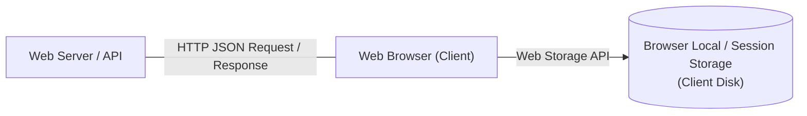

# Web Programming - Unit 06: Web Data with JSON and Local Storage

## Part 1: Macro Architecture & Technology Overview

ในสถาปัตยกรรมเว็บการจัดการข้อมูลฝั่งไคลเอนต์ (Front-End Web Data Management) อาศัยองค์ประกอบหลัก 2 ส่วนในการรับส่งและบันทึกสถานะ (State Persistence):
1. **JSON (JavaScript Object Notation):** มาตรฐานรูปแบบข้อความ (Text Format) น้ำหนักเบา สำหรับแลกเปลี่ยนข้อมูลระหว่าง Client และ Server ผ่าน Web APIs / RESTful Services
2. **Local Storage (Web Storage API):** กลไกการจัดเก็บข้อมูลแบบ Key-Value คู่ขนานบน Web Browser ที่ข้อมูลไม่สูญหายแม้ปิดหน้าต่างเบราว์เซอร์หรือรีสตาร์ตระบบ



### ตารางเปรียบเทียบกลไกการแลกเปลี่ยนและจัดเก็บข้อมูลเว็บ (Data Formats & Storage)

| คุณสมบัติ (Feature) | JSON | XML | Local Storage | Cookies |
| :--- | :--- | :--- | :--- | :--- |
| **ประเภท (Type)** | Data Interchange Format | Data Interchange Format | Client-Side Storage | Client-Side Storage |
| **โครงสร้างข้อมูล** | Key-Value, Arrays | Tree / Tag-based | Key-Value (String) | Key-Value (String) |
| **ความจุ (Capacity)** | ขึ้นกับขนาด HTTP Payload | ขึ้นกับขนาด HTTP Payload | ~5MB - 10MB ต่อ Origin | ~4KB ต่อ Cookie |
| **การหมดอายุ (Expiration)** | N/A (Transient Data) | N/A (Transient Data) | ไม่มีวันหมดอายุ (Persistent) | กำหนดวันหมดอายุได้ |
| **การส่งไป Server** | ส่งผ่าน Fetch / AJAX | ส่งผ่าน Fetch / AJAX | ไม่ถูกส่งไป Server เอง | ถูกส่งไปพร้อม HTTP Request ทุกครั้ง |

---

## Part 2: Module-by-Module Deep Dive

### 2.1 JSON (JavaScript Object Notation) & Data Types

#### JSON vs JavaScript Object

> 💡 **Intuition:** นึกถึง JSON เหมือน "จดหมายที่เขียนเป็นข้อความตามรูปแบบมาตรฐาน" ที่ทุกภาษาโปรแกรมอ่านออก ส่วน JavaScript Object คือ "สิ่งของจริง" ที่โปรแกรม JavaScript ทำงานได้ ใน JavaScript สิ่งที่เขียนว่า `{name: "Jack"}` จะกลายเป็นอ็อบเจกต์ขณะทำงาน แต่เมื่อต้องส่งไปที่เซิร์ฟเวอร์หรือเก็บในไฟล์ ต้องแปลงมันเป็นข้อความ JSON ให้ใครก็ตามสามารถอ่านได้ — นี่คือสาเหตุที่ต้องใช้ `JSON.stringify()` และ `JSON.parse()`
> [Source: generated — not verified against original document]

* **มาตรฐานเปิด:** RFC 7159 / ECMA-262 3rd Edition
* **คุณสมบัติหลัก:** เป็น Text-based, Language-independent, และเครื่องประมวลผล (Parse/Generate) ได้ง่าย
* **ประเภทข้อมูลที่รองรับ (7 Data Types):**
  1. `String`: ข้อความในอักขระ Unicode ครอบด้วย Double Quotes (`"..."`)
  2. `Number`: ตัวเลขทศนิยมแบบ Double-precision (ไม่รองรับ Hexadecimal หรือ Octal)
  3. `Boolean`: ค่าความจริง `true` หรือ `false`
  4. `Array`: ลำดับของข้อมูลเรียงต่อกันในเครื่องหมาย `[...]`
  5. `Object`: เซตของคู่ `key: value` ในเครื่องหมาย `{...}` โดย Key ต้องเป็น String เท่านั้น
  6. `null`: ค่าว่างเปล่า
  7. `Whitespace`: ช่องว่างสำหรับจัดรูปแบบ

**🧭 ทำความเข้าใจ** _[Source: generated — not verified against original document]_

**แตกวลีสำคัญ:**
- "Text-based" → เป็นข้อความปกติ (ไม่ใช่ไบนารี) ที่ใครก็สามารถอ่านได้ จึงส่งผ่าน HTTP ได้ง่าย
- "Language-independent" → ไม่จำกัดเฉพาะ JavaScript — Python, PHP, Java ล้วนแต่รองรับ JSON

**ตัวอย่าง:**
- ✅ JSON: `{"name": "Jack", "age": 25}` — Key ต้องเป็น String ที่มี Double Quotes
- ❌ JavaScript Object ที่ไม่ถูก JSON: `{name: "Jack", age: 25}` — Single quotes หรือไม่มี quotes ก็ได้ใน JS แต่ JSON ไม่ยอม
- **ต่างกันตรง:** JSON คือ "ข้อความที่มีโครงสร้าง" ส่วน JS Object คือ "สิ่งของที่โปรแกรมทำงานกับได้"

**อย่าสับสน:** "JSON Object" (ใน JSON Syntax) หมายถึง `{...}` ที่มี Key เป็น String ทั้งหมด ไม่ได้หมายถึง "JavaScript Object" (Runtime Object ใน JS Engine)

**เช็คความเข้าใจ:** ถ้าคุณเขียน `const person = {name: "Jack", age: 25}` ใน JS Console แล้วพิมพ์ `person` จะมองเห็นอ็อบเจกต์ ถ้าคุณ `JSON.stringify(person)` แล้วพิมพ์ผลลัพธ์ จะเห็นข้อความสตริง — ทำไมผลลัพธ์ต่างกัน?
<details><summary>เฉลย</summary>

เพราะ `person` คือ "สิ่งของจริง" ที่ JavaScript Engine จัดการในหน่วยความจำ — เป็นค่าชนิด `object` ที่เข้าถึง Property ได้ตรงๆ (`person.name`) ส่วน `JSON.stringify(person)` คือการแปลง "สิ่งของนั้น" เป็น "ข้อความ" (String) (`typeof` เป็น `"string"`) ที่มี Double Quotes รอบ Key มีแค่ข้อมูล (Function จะถูกตัดทิ้ง) เพื่อให้ส่งไปที่ที่อื่นหรือเก็บได้ง่าย
</details>

#### ฟังก์ชันหลักในการทำงานกับ JSON (JSON Methods)

> 💡 **Intuition:** นึกถึง `JSON.stringify()` เหมือนการ "หลอมเหลวสิ่งของให้เป็นข้อความส่งไป" และ `JSON.parse()` คือการ "หล่อข้อความนั้นกลับมาเป็นสิ่งของที่ใช้งานได้" — ทั้งสองคือการแปลงรูปแบบเพื่อให้ข้อมูลเคลื่อนไปมาระหว่างโปรแกรมกับไฟล์/เครือข่ายได้
> [Source: generated — not verified against original document]

* **`JSON.stringify(object)`:** แปลง JavaScript Native Object ให้เป็นข้อความ JSON String (Serialization)
* **`JSON.parse(jsonString)`:** แปลงข้อความ JSON String ให้กลับเป็น JavaScript Native Object (Deserialization)

**🧭 ทำความเข้าใจ** _[Source: generated — not verified against original document]_

**แตกวลีสำคัญ:**
- "Serialization" → การแปลงอ็อบเจกต์ (ซับซ้อน) ให้เป็นข้อความ (ง่ายส่ง)
- "Deserialization" → การแปลงข้อความกลับมาเป็นอ็อบเจกต์ที่ใช้งานได้

**ตัวอย่าง:**
```javascript
// ✅ stringify: Object → String
const user = { name: "Jack", roles: ["admin", "user"] };
const jsonText = JSON.stringify(user);
// jsonText = '{"name":"Jack","roles":["admin","user"]}'
// ตอนนี้ jsonText เป็น String ธรรมดา สามารถเก็บหรือส่งได้

// ✅ parse: String → Object
const recovered = JSON.parse(jsonText);
console.log(recovered.name); // "Jack" — สามารถเข้าถึง Property ได้ เพราะกลับมาเป็น Object
```

```javascript
// ❌ ลืม stringify
localStorage.setItem("user", user); // ผิด — user เป็น Object
const value = localStorage.getItem("user");
console.log(value); // "[object Object]" — String ที่ใช้ไม่ได้
```

- **ต่างกันตรง:** `stringify` แปลง Object เป็นข้อความ `parse` แปลงข้อความเป็น Object — คู่กันคือการไปกลับ

**อย่าสับสน:** ไม่จำเป็นต้อง stringify เสมอ — เฉพาะเมื่อต้องส่งข้อมูล (HTTP, localStorage, Database) ส่วน "ภายในโปรแกรม" เก็บเป็น Object ธรรมดา

**เช็คความเข้าใจ:** ทำไมมีคนเก็บ Array ของสินค้า `[{id:1, name:"Apple"}]` โดยตรงใน localStorage แล้วโปรแกรมขัดข้อง?
<details><summary>เฉลย</summary>

เพราะ localStorage จัดเก็บเป็น String เท่านั้น ถ้าบันทึก Object โดยตรง (ไม่ใช้ stringify) มันจะเก็บเป็น "[object Object]" ซึ่งเมื่อดึงออกมาและพยายาม `JSON.parse()` จะเกิด `SyntaxError` เพราะ "[object Object]" ไม่ใช่ JSON ที่ถูกต้อง — ต้อง stringify ก่อน: `localStorage.setItem("items", JSON.stringify(array))`
</details>

### 2.2 Local Storage API (Web Storage)

#### localStorage vs sessionStorage

> 💡 **Intuition:** นึกถึง localStorage เหมือน "กล่องใส่ของจริง" ที่อยู่บ้านของคุณ — ปิดประตูแล้วก็ยังอยู่ เปิดกลับได้ทุกครั้ง ส่วน sessionStorage เหมือน "กระเป๋าเดินทาง" ที่คุณพกไปแต่ทิ้งทันทีเมื่อจบทริป (ปิด browser tab) — localStorage จึงเหมาะเก็บข้อมูลค่อนข้างถาวร (เช่น การตั้งค่า theme หรือภาษาที่ผู้ใช้เลือก) ส่วน sessionStorage เหมาะเก็บข้อมูลชั่วคราวในเซสชันปัจจุบัน
> [Source: generated — not verified against original document]

* **`window.localStorage`:** รหัสคุณสมบัติ Read-only ของ Window Interface ที่ผูกตามจุดกำเนิดโดเมน (**Origin-bounded / Domain-restricted**)
* **ชนิดข้อมูลการจัดเก็บ:** จัดเก็บข้อมูลทุกอย่างในรูปแบบ **UTF-16 DOMString** ( String ทั้ง Key และ Value)

**🧭 ทำความเข้าใจ** _[Source: generated — not verified against original document]_

**แตกวลีสำคัญ:**
- "Origin-bounded" → ข้อมูล localStorage ของ `https://example.com` ไม่สามารถเข้าถึงจาก `https://another.com` — ป้องกันเพื่อความปลอดภัย
- "DOMString" → เพียงแค่ String ปกติ (ข้อความ) — ต้องแปลง Object ด้วย JSON.stringify ก่อนเสมอ

**ตัวอย่าง:**
```javascript
// ✅ localStorage — ข้อมูลติดตัวแม้ปิด Browser
localStorage.setItem("theme", "dark");
// ปิด Browser → เปิดใหม่ → ยังมี "dark" อยู่

// ✅ sessionStorage — หลุดเมื่อปิด Tab
sessionStorage.setItem("tempCart", JSON.stringify([{id:1}]));
// ปิด Tab → เปิด Tab ใหม่ → หายไปแล้ว
```

```javascript
// ❌ ลืมว่า localStorage จัดเก็บเป็น String เท่านั้น
const settings = { theme: "dark", fontSize: 16 };
localStorage.setItem("settings", settings); // ผิด — settings เป็น Object
// เก็บไปแล้วจะกลายเป็น "[object Object]"
```

- **ต่างกันตรง:** localStorage คงอยู่ตลอด sessionStorage หายเมื่อปิด Tab

**อย่าสับสน:** "ชั่วคราว" ของ sessionStorage ไม่ได้แปลว่าหายเร็วหรือหายเมื่อ Refresh — แต่แปลว่า "ผูกกับ Tab ปัจจุบัน (และ Origin เดียวกัน) เท่านั้น" (Tab อื่นมองไม่เห็น) ระหว่างที่ Tab เปิดอยู่ ข้อมูลยังอยู่แม้ Reload หน้า และหายเมื่อปิด Tab

**เช็คความเข้าใจ:** ผู้ใช้เปิด Browser แล้วใส่ localStorage.setItem("cart", "...") แล้ว 3 วันต่อมาเปิด Browser ตัวเดิม — ข้อมูล "cart" ยังมีอยู่ไหม?
<details><summary>เฉลย</summary>

ใช่ยังมี เพราะ localStorage คงอยู่ตลอด (Persistent) จนกว่าจะถูกลบด้วย `localStorage.removeItem("cart")` หรือ `localStorage.clear()` หรือผู้ใช้ล้าง Site Data ของ Browser — นี่คือประโยชน์หลักของ localStorage คือสามารถเก็บข้อมูลระยะยาวได้
</details>

#### เมธอดและคุณสมบัติหลักของ localStorage:
* `localStorage.setItem(key, value)`: เพิ่มหรืออัปเดตข้อมูล Key-Value
* `localStorage.getItem(key)`: ดึงค่าจาก Key (คืนค่า `null` หากไม่พบ Key)
* `localStorage.removeItem(key)`: ลบข้อมูลคู่ Key-Value
* `localStorage.clear()`: ล้างข้อมูลทั้งหมดใน Storage ของ Origin นั้น
* `localStorage.key(index)`: เข้าถึงชื่อ Key ตามลำดับ Index (0 ถึง length - 1)
* `localStorage.length`: คืนค่าจำนวนรายการข้อมูลทั้งหมด

#### การรับฟังเหตุการณ์การเปลี่ยนแปลง Storage (Storage Event)

> 💡 **Intuition:** นึกถึง Storage Event เหมือน "ระบบแจ้งเตือนสมุดบ้านร่วม" — เมื่อคนในบ้านคนหนึ่งแก้ไขสมุดกลาง (localStorage) คนอื่นที่เปิดสมุดเล่มเดียวกันจะได้รับข้อความว่า "ช่องไหนเปลี่ยน" พร้อมค่าก่อนและหลังการเปลี่ยน ทำให้หลายแท็บซิงก์ข้อมูลกันได้โดยไม่ต้องรีเฟรช — จุดที่ Analogy ไม่ตรง: คนที่เป็นผู้แก้เองจะ "ไม่ได้รับ" การแจ้งเตือนนี้ เพราะ Event ถูกยิงไปยัง Window อื่นเท่านั้น
> [Source: generated — not verified against original document]

เมื่อมีการแก้ไข `localStorage` ใน Tab หรือ Window อื่นที่มี Origin เดียวกัน สามารถรับฟังผ่านเหตุการณ์ `storage`:
* **Event Properties:** `key`, `oldValue`, `newValue`, `url`, `storageArea`

**🧭 ทำความเข้าใจ** _[Source: generated — not verified against original document]_

**แตกวลีสำคัญ:**
- "storage event" → เหตุการณ์ที่ Browser ยิงไปยัง Window อื่นที่ใช้ Storage ของ Origin เดียวกัน เมื่อมีการ `setItem`, `removeItem` หรือ `clear` สำเร็จ
- "oldValue" → ค่าก่อนเปลี่ยน (ถ้าเป็น Key ใหม่จะเป็น `null`)
- "newValue" → ค่าหลังเปลี่ยน (ถ้าเป็น `removeItem` หรือ `clear` จะเป็น `null`)

**ตัวอย่าง:**
- ✅ Tab A รัน `localStorage.setItem("theme", "dark")` → Tab B ที่ฟัง `storage` ได้ `event.key === "theme"` และ `event.newValue === "dark"` เพราะอยู่คนละ Tab
- ❌ ฟัง event ใน Tab A แล้วคาดว่าจะได้รับ event จาก `setItem` ของ Tab A เอง — ไม่เกิดขึ้น เพราะ Spec ยิงให้เฉพาะ Window อื่น ถ้าต้องการอัปเดตใน Tab เดียวกัน ต้องเรียก Logic นั้นเองหลัง `setItem`
- **ต่างกันตรง:** ผู้เขียน (Writer) ไม่ได้รับ event ส่วนผู้ฟัง (Listener) ใน Tab อื่นได้รับ

**อย่าสับสน:** "storage event" ไม่ได้หมายถึงเหตุการณ์ "ข้อมูลถูกเขียนลงดิสก์" แต่หมายถึง "ค่าใน Storage เปลี่ยน และ Window อื่นควรรู้" ส่วนการเขียนลงดิสก์เป็นเรื่องภายในของ Browser

**เช็คความเข้าใจ:** เปิดสองแท็บ โดยแท็บ A รัน `localStorage.removeItem("cart")` ในแท็บ B ค่า `event.key` และ `event.newValue` คืออะไร?
<details><summary>เฉลย</summary>

`event.key` = `"cart"` และ `event.newValue` = `null` เพราะ `removeItem` ทำให้ Key ไม่มีค่าอีกต่อไป ส่วน `event.oldValue` คือค่าเดิมก่อนถูกลบ ถ้า Listener อยู่ในแท็บ A เองจะไม่มี event ยิงมาให้
</details>

---

### 2.3 โค้ดตัวอย่างการใช้งานจริง (Implementation Code)

```javascript
// ==========================================
// 1. การจัดการ JSON (Stringify & Parse)
// ==========================================
const userProfile = {
    id: 101,
    name: "Siravit",
    roles: ["Admin", "Developer"],
    active: true
};

// แปลง Object เป็น JSON String เพื่อเตรียมส่งผ่าน Network หรือบันทึกลง Storage
const jsonString = JSON.stringify(userProfile);
console.log("JSON String:", jsonString); 
// Output: '{"id":101,"name":"Siravit","roles":["Admin","Developer"],"active":true}'

// แปลง JSON String กลับเป็น JS Object
const parsedObject = JSON.parse(jsonString);
console.log("User Name:", parsedObject.name); // Output: Siravit


// ==========================================
// 2. การจัดการ Local Storage CRUD Operations
// ==========================================

// Create / Update: ต้องแปลง Object เป็น String ด้วย JSON.stringify ก่อนเสมอ
function saveUserToLocalStorage(key, userObj) {
    const serializedData = JSON.stringify(userObj);
    localStorage.setItem(key, serializedData);
    console.log(`Saved user under key '${key}' successfully.`);
}

// Read: อ่านค่าและแปลงกลับด้วย JSON.parse
function getUserFromLocalStorage(key) {
    const rawData = localStorage.getItem(key);
    if (!rawData) {
        console.log(`Key '${key}' not found in localStorage.`);
        return null;
    }
    return JSON.parse(rawData);
}

// Delete
function removeUserFromLocalStorage(key) {
    localStorage.removeItem(key);
    console.log(`Removed key '${key}' from localStorage.`);
}

// ทดสอบเรียกใช้งาน CRUD
saveUserToLocalStorage("currentUser", userProfile);
const loadedUser = getUserFromLocalStorage("currentUser");
console.log("Loaded Roles:", loadedUser.roles); // ["Admin", "Developer"]


// ==========================================
// 3. การติดตามการเปลี่ยนแปลงผ่าน Storage Event
// ==========================================
window.addEventListener("storage", (event) => {
    console.log(`[Storage Changed] Key: ${event.key}`);
    console.log(`Old Value: ${event.oldValue}`);
    console.log(`New Value: ${event.newValue}`);
    console.log(`Source URL: ${event.url}`);
});
```

---

### 2.4 การวิเคราะห์โจทย์ตัวอย่าง (Assignment Case Analysis)

**โจทย์:** จงสร้างระบบบันทึกรายการสินค้าในตะกร้าสินค้า (Shopping Cart) ฝั่งไคลเอนต์ โดยมีเงื่อนไขดังนี้:
1. ข้อมูลสินค้าประกอบด้วย `productId`, `name`, `price`, และ `quantity`
2. ตะกร้าสินค้าต้องคงอยู่เมื่อผู้ใช้ปิดหน้าต่างเบราว์เซอร์
3. สามารถเพิ่มสินค้าใหม่ คำนวณราคารวม และล้างตะกร้าสินค้าได้

**การแก้ไขปัญหา (Solution Approach):**
* เนื่องจาก `localStorage` จัดเก็บได้เฉพาะ String ข้อความทั่วไป เราจึงต้องจัดเก็บโครงสร้างตะกร้าสินค้าในรูปแบบ Array of Objects ผ่าน `JSON.stringify()` และ `JSON.parse()`

```javascript
class CartManager {
    constructor(storageKey = "shopping_cart") {
        this.storageKey = storageKey;
    }

    getCart() {
        const data = localStorage.getItem(this.storageKey);
        return data ? JSON.parse(data) : [];
    }

    addItem(product) {
        const cart = this.getCart();
        const existingIndex = cart.findIndex(item => item.productId === product.productId);
        
        if (existingIndex > -1) {
            cart[existingIndex].quantity += product.quantity;
        } else {
            cart.push(product);
        }
        
        localStorage.setItem(this.storageKey, JSON.stringify(cart));
    }

    getTotalPrice() {
        const cart = this.getCart();
        return cart.reduce((total, item) => total + (item.price * item.quantity), 0);
    }

    clearCart() {
        localStorage.removeItem(this.storageKey);
    }
}

// ตัวอย่างการใช้งาน
const cart = new CartManager();
cart.addItem({ productId: "P001", name: "Wireless Mouse", price: 550, quantity: 1 });
cart.addItem({ productId: "P002", name: "Mechanical Keyboard", price: 2200, quantity: 1 });

console.log("Cart Total:", cart.getTotalPrice()); // 2750
```

#### 💡 เสริม: Read-Modify-Write Pattern กับ localStorage

> 💡 **Intuition:** นึกถึงตู้เซฟที่ต้องหยิบเอกสารออกมาก่อน แก้ไข แล้วค่อยเก็บกลับเข้าตู้ — ถ้าเขียนทับด้วย `setItem` ทันทีโดยไม่อ่านของเดิมก่อน ก็เหมือนเอากระดาษแผ่นเดียวไปเก็บทับทั้งตู้ ของเดิมหายหมด — จุดที่ Analogy ไม่ตรง: localStorage ไม่มี Transaction หรือ Lock ให้เหมือนตู้ที่ไม่มีกุญแจ ดังนั้นโค้ดต้องรับผิดชอบความถูกต้องของข้อมูลเอง
> [Source: generated — not verified against original document]

รูปแบบมาตรฐานมี 3 ขั้น: **Read** (`getItem` แล้ว `JSON.parse`) → **Modify** (แก้ Array/Object ใน Memory เช่น `push` หรือเพิ่ม `quantity`) → **Write** (`JSON.stringify` แล้ว `setItem` เก็บกลับทั้งก้อน)

**🧭 ทำความเข้าใจ** _[Source: generated — not verified against original document]_

**แตกวลีสำคัญ:**
- "Read" → ดึงค่าเดิมออกมาเป็น Object/Array ก่อนแก้ไขทุกครั้ง
- "Write ทั้งก้อน" → `setItem` แทนที่ค่าของ Key นั้นทั้งหมด ไม่ได้ต่อท้าย

**ตัวอย่าง:**
- ✅ `addItem()` ใน `CartManager` ด้านบน อ่าน `getCart()` ก่อน แล้วค่อย `push` หรือเพิ่ม `quantity` จากนั้นเขียนกลับ → สินค้าเดิมยังอยู่
- ❌ `localStorage.setItem("shopping_cart", JSON.stringify([newItem]))` เขียนทับทั้ง Array ด้วยสมาชิกชิ้นเดียว → สินค้าอื่นหายหมด
- **ต่างกันตรง:** ✅ มีขั้น "อ่านค่าเดิมก่อนเขียน" ส่วน ❌ เขียนทับโดยไม่ดูของเดิม

**อย่าสับสน:** `setItem` ไม่ได้ "เพิ่มเข้าไปใน Array ที่มีอยู่" มันแทนที่ค่าของ Key นั้นทั้งก้อนเสมอ

**เช็คความเข้าใจ:** ถ้า `shopping_cart` มีค่า `[{"productId":"P001","quantity":1}]` แล้วรัน `setItem("shopping_cart", JSON.stringify([{productId:"P002",quantity:1}]))` ค่าที่เหลือคืออะไร?
<details><summary>เฉลย</summary>

เหลือเพียง `[{"productId":"P002","quantity":1}]` — P001 หายไป เพราะ `setItem` เขียนทับค่าของ Key ทั้งก้อน ต้อง `getCart()` ก่อน แล้ว `push` สินค้าใหม่หรือแก้ `quantity` จากนั้นค่อย `setItem` กลับ
</details>

---

## Part 3: Quick Reference & Exam Cheat Sheet

### Checklist สรุปหัวใจสำคัญก่อนสอบ
* [ ] **JSON Syntax Rules:** Key ต้องเป็นข้อความใน Double Quotes (`"..."`) เสมอ ห้ามใช้ Single Quotes (`'...'`) ในข้อความ JSON
* [ ] **JSON Data Types:** รองรับเพียง 7 ชนิด (String, Number, Boolean, Array, Object, null, Whitespace) **ไม่รองรับ Function, Date, หรือ undefined**
* [ ] **`JSON.stringify()` vs `JSON.parse()`:**
  * Object $\rightarrow$ String = `JSON.stringify()`
  * String $\rightarrow$ Object = `JSON.parse()`
* [ ] **Local Storage Persistence:** ข้อมูลผูกกับ Origin/Domain ไม่ส่งไป Server เองอัตโนมัติ และไม่มีวันหมดอายุจนกว่าจะสั่ง `clear()` หรือ `removeItem()`
* [ ] **`localStorage` Data Type Pitfall:** `localStorage` บันทึกค่าเป็น String เสมอ หากบันทึก Object โดยไม่ใช้ `JSON.stringify()` ค่าจะกลายเป็น `"[object Object]"` ซึ่งไม่สามารถนำกลับมาใช้งานได้

---

## เอกสารเชื่อมโยง (Wiki-Style Backlinks)
* **วิชาและหัวข้อที่เกี่ยวข้อง:**
  * [[Database Normalization Summary]] (การเปรียบเทียบการจัดเก็บข้อมูลแบบ NoSQL / Document Store กับ JSON)
  * [[Data & AI Engineer Skill Matrix]] (การจัดการข้อมูลและ RESTful API Interoperability)
  * [[Discrete Mathematics - Week 10 Relations]] (การทำความเข้าใจโครงสร้างข้อมูลแบบ Key-Value และ Mapping)
