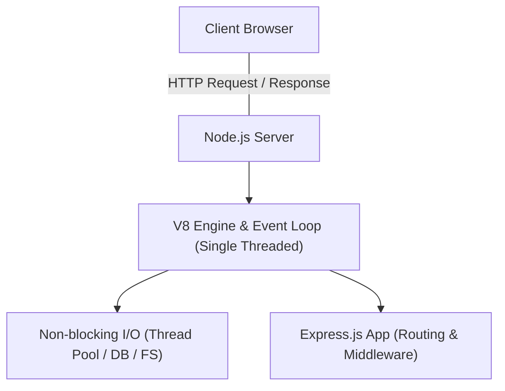

# Web Programming - Unit 07: Back-end Web Development with Node.JS & Express.JS

## Part 1: Macro Architecture & Technology Overview

สถาปัตยกรรมเซิร์ฟเวอร์แบบดั้งเดิม (เช่น Apache/PHP) ใช้รูปแบบ **Thread-per-Request** ซึ่งจะสร้าง Thread ใหม่ทุกครั้งที่มี Request เข้ามา ทำให้สิ้นเปลืองทรัพยากรเมื่อมีทราฟฟิกสูง ในขณะที่ **Node.js** นำเสนอรูปแบบใหม่ผ่าน **Event-driven, Non-blocking I/O Model** บน **Google Chrome V8 Engine** ช่วยให้เซิร์ฟเวอร์แบบ Single-thread สามารถรองรับ Concurrent Requests จำนวนมากได้อย่างมีประสิทธิภาพ



### ตารางเปรียบเทียบการพัฒนาระบบ Back-End: Pure Node.js (`http`) vs Express.js Framework

| คุณสมบัติ (Feature) | Pure Node.js (`http` module) | Express.js Framework |
| :--- | :--- | :--- |
| **ความซับซ้อนของโค้ด** | สูง (ต้องจัดการ Low-level HTTP เอง) | ต่ำ (มี Abstraction Layer ช่วยอ่านง่าย) |
| **ระบบการทำ Routing** | เขียน `if/else` เช็ก `req.url` และ `req.method` เอง | มี `app.get()`, `app.post()`, `app.put()`, `app.delete()` |
| **การให้บริการ Static Files** | ต้องอ่านไฟล์ด้วย `fs.readFile` และตั้ง Content-Type เอง | ใช้บรรทัดเดียว: `app.use(express.static('public'))` |
| **สถาปัตยกรรมแบบ Middleware** | ไม่มี ต้องเขียนฟังก์ชันควบคุมเอง | รองรับ Middleware Chain (`req, res, next`) ในตัว |
| **การส่งตอบกลับ (Response)** | ต้องระบุ `res.writeHead()` และ `res.end()` | มีเมธอดสะดวก เช่น `res.send()`, `res.json()`, `res.status()` |

---

## Part 2: Module-by-Module Deep Dive

### 2.1 สถาปัตยกรรมและมโนทัศน์สำคัญ (Core Concepts)

#### Node Event Loop & Non-blocking I/O

> 💡 **Intuition:** นึกถึง Node.js Event Loop เหมือน "พนักงาน 1 คน ที่นั่งตรงโต๊ะดูแล Queue ของลูกค้า" — เมื่อลูกค้าขอข้อมูลที่ต้องไปค้นในคลัง (Query Database) พนักงาน "มอบหมาย" ให้ฝ่ายหลังร้าน (Background I/O — Thread Pool ของ libuv หรือระบบปฏิบัติการ) ไปทำ แล้วไม่นั่งรอ แต่หันไปรับลูกค้าคนต่อไปใน Queue ทันที — เมื่อฝ่ายหลังร้านทำเสร็จ จะวางผลลัพธ์ไว้ใน Queue แล้วพนักงานคนแรกหยิบมาทำต่อผ่าน Callback — นี่คือ "Non-blocking" ที่ลดการหยุดรอและเพิ่มประสิทธิภาพ
> [Source: generated — not verified against original document]

* **V8 Engine:** เอนจินตีความภาษา JavaScript ประสิทธิภาพสูงจาก Google Chrome นำมาใช้นอกเบราว์เซอร์
* **Non-blocking I/O & Event Loop:** การทำงานแบบ Asynchronous ที่ไม่หยุดรอการอ่าน/เขียนไฟล์ หรือคำสั่งฐานข้อมูล แต่จะมอบหมายงานให้ Background I/O ทำ แล้วกลับมารับผลลัพธ์ผ่าน Callback/Event

**🧭 ทำความเข้าใจ** _[Source: generated — not verified against original document]_

**แตกวลีสำคัญ:**
- "Asynchronous" → ไม่ต้องรอให้งานเสร็จแล้วจึงทำงานต่อไป — สามารถทำงานอื่นไปพร้อมๆ กัน
- "Non-blocking" → Event Loop ไม่หยุดการทำงาน (Block) ขณะรอการอ่าน Database หรือไฟล์

**ตัวอย่าง:**
```javascript
// ❌ Blocking (สไตล์เดิม) — PHP/Apache แบบ Thread-per-Request
// ต้องสร้าง Thread ใหม่และหยุดรอ Database
// ถ้า 1000 Request พร้อมกัน = ต้องมี 1000 Thread = กิน Memory และ CPU สูง

// ✅ Non-blocking (Node.js) — Asynchronous
const fs = require('fs');
fs.readFile('data.txt', 'utf8', (err, data) => {
    console.log('ไฟล์อ่านเสร็จแล้ว:', data);
});
console.log('ไป execute โค้ดต่อไปได้เลย อย่ารอ');
// Output: "ไป execute โค้ดต่อไปได้เลย อย่ารอ" ก่อน "ไฟล์อ่านเสร็จแล้ว"
```

- **ต่างกันตรง:** Blocking ต้องใช้ 1 Thread ต่อ 1 Request และ Thread นั้นนั่งรอ I/O (Thread Overhead สูง) ส่วน Non-blocking ใช้ Event Loop Thread เดียวรับทุก Request แล้วฝากงาน I/O ไว้กับ Background I/O (ไม่ต้องสร้าง Thread ต่อ Request)

**อย่าสับสน:** "Asynchronous" ไม่ได้หมายถึง "เร็วกว่า" — หมายถึง "ไม่รอ" — ช่วยให้รับ Request ที่เป็นงาน I/O พร้อมกันได้มาก (Throughput สูง) แต่งานคำนวณหนัก (CPU-bound) ที่รันบน Event Loop ยังบล็อกทุก Request ได้อยู่ดี

**เช็คความเข้าใจ:** ทำไม Node.js ที่มี Event Loop Thread เดียวจึงรับ Request งาน I/O พร้อมกันได้มากกว่า Server แบบ Thread-per-Request (เช่น Apache แบบดั้งเดิม) ทั้งที่มี Thread น้อยกว่า?
<details><summary>เฉลย</summary>

1. Node.js ใช้ Event Loop Thread เดียว + Background I/O ด้านหลัง
2. เมื่อ Request ต้องรอ Database/ไฟล์ Event Loop ฝากงานนั้นไว้แล้วไปรับ Request ถัดไปทันที (Non-blocking) — Request ไม่ได้ยึด Thread ไว้ระหว่างรอ
3. Server แบบ Thread-per-Request ต้องมี 1 Thread ต่อ 1 Request ที่ค้างรอ I/O → 1000 Request พร้อมกัน = 1000 Thread → Memory สูงและ Context Switch เยอะ
4. ข้อจำกัด: ได้เปรียบเฉพาะงาน I/O-bound ถ้าเป็นงาน CPU-bound Thread เดียวกลายเป็นคอขวด
</details>

* **npm (Node Package Manager):** เครื่องมือจัดการไลบรารีและแพ็กเกจเสริม
  * `package.json`: ไฟล์กำหนดโครงสร้างและ Dependencies ของโปรเจกต์ (สร้างด้วย `npm init -y`)
  * `node_modules`: โฟลเดอร์เก็บไลบรารีที่ดาวน์โหลดจาก npm

### 2.2 โครงสร้าง Express.js และ Middleware Chain

#### Express Middleware & Routing

> 💡 **Intuition:** นึกถึง Express Middleware Chain เหมือน "สายการผลิต" — Request เข้ามาแล้ว ผ่านสถานี (Middleware) สถานีแรก (Logger) บันทึก ส่งต่อ ผ่านสถานีสอง (Auth) เช็คสิทธิ์ ส่งต่อ ผ่านสถานีสาม (Route Handler) ทำงานจริง ส่งคืน Response — หากสถานีไหนเรียก `next()` จะไปสถานีต่อไป หากไม่เรียก สถานีนั้นต้องส่ง Response เอง ไม่เช่นนั้น Request จะค้าง ส่วน Routing คือ "การเลือกว่า Request URL ไหนไปหน้าไหน"
> [Source: generated — not verified against original document]

* **Express Architecture:** Framework น้ำหนักเบาที่จัดการ HTTP Pipeline ผ่านฟังก์ชัน **Middleware**
* **โครงสร้างพารามิเตอร์ `callback(req, res, next)`:**
  * **`req` (Request Object):** อ็อบเจกต์เก็บข้อมูลคำขอที่ส่งมาจาก Client
    * `req.query`: อ่าน Query Parameters จาก URL (เช่น `?category=books`)
    * `req.params`: อ่าน Route Parameters (เช่น `/users/:id`)
    * `req.body`: อ่านข้อมูล Body จาก POST/PUT Request (ต้องใช้ Body-parser Middleware)
  * **`res` (Response Object):** อ็อบเจกต์จัดการการส่งคำตอบกลับ
    * `res.send()`: ส่งข้อความ/HTML (กำหนด Content-Type อัตโนมัติ)
    * `res.json()`: ส่งข้อความโครงสร้าง JSON
    * `res.status(code)`: กำหนด HTTP Status Code (เช่น 200, 404, 500)
  * **`next()`:** ฟังก์ชันส่งต่อการทำงานไปยัง Middleware ถัดไปใน Pipeline

**🧭 ทำความเข้าใจ** _[Source: generated — not verified against original document]_

**แตกวลีสำคัญ:**
- "Middleware" → ฟังก์ชันที่อยู่ "ระหว่างกลาง" Request กับ Response — สามารถแก้ไข Request ก่อนถึง Handler หรือแก้ Response ก่อนส่งกลับ
- "Pipeline" → ลำดับการทำงาน — Middleware ทำงานตามลำดับที่กำหนด

**ตัวอย่าง:**
```javascript
// ✅ Middleware Chain ที่ทำงานตามลำดับ
app.use((req, res, next) => {
    console.log('Middleware 1: Logger');
    next(); // ส่งต่อไป Middleware 2
});

app.use((req, res, next) => {
    console.log('Middleware 2: Auth Check');
    next(); // ส่งต่อไป Route Handler
});

app.get('/profile', (req, res) => {
    console.log('Route Handler: /profile');
    res.send('Your Profile');
});

// Request เข้า → Middleware 1 → Middleware 2 → Route Handler → Response
```

```javascript
// ❌ ลืม next() — ติด Middleware ไม่ไปต่อ
app.use((req, res, next) => {
    console.log('Middleware 1');
    // ไม่มี next() — ไปสถานีต่อไปไม่ได้
});

app.get('/profile', (req, res) => {
    res.send('Never reaches here'); // ไม่ไปถึง — Client ค้างรอจน Timeout
});
```

- **ต่างกันตรง:** เรียก `next()` = ส่งต่อ ไม่เรียก = จบที่ Middleware นั้น

**อย่าสับสน:** `next()` ไม่ใช่ "return" — หลังเรียก `next()` โค้ดบรรทัดถัดไปใน Middleware ยังทำงานต่อ ถ้าต้องการจบฟังก์ชันทันทีให้เขียน `return next()` ส่วน Route Handler (ตัวสุดท้าย) ไม่ต้องเรียก `next()` เพราะจบด้วย `res.send()` แล้ว

**เช็คความเข้าใจ:** ทำไมต้องเรียก `next()` ใน Middleware และเมื่อไหร่จึงไม่ต้องเรียก?
<details><summary>เฉลย</summary>

- ต้องเรียก `next()` เมื่อ Middleware ทำงานของตัวเองเสร็จ (เช่น Log, ตรวจ Auth ผ่าน) และต้องการส่งต่อให้ Middleware/Handler ถัดไป หากไม่เรียกและไม่ส่ง Response, Request จะค้าง
- ไม่ต้องเรียก `next()` เมื่อฟังก์ชันนั้นส่ง Response เองแล้ว เช่น Route Handler ที่จบด้วย `res.send()`/`res.json()` หรือ Auth Middleware ที่ตอบ `res.status(401)` เพื่อตัด Request ทิ้ง
</details>

---

### 2.3 คำสั่ง Command Line สำหรับการตั้งค่าระบบ (Environment & Setup Commands)

```bash
# 1. สร้างโฟลเดอร์โปรเจกต์และย้ายเข้าไป
mkdir my-backend-app
cd my-backend-app

# 2. เริ่มต้นสร้างไฟล์ package.json
npm init -y

# 3. ติดตั้ง Express Framework
npm install express

# 4. ติดตั้ง nodemon สำหรับการพัฒนา (Auto-restart Server เมื่อโค้ดเปลี่ยน)
npm install -g nodemon

# 5. รันโปรเจกต์
node index.js
# หรือรันผ่าน nodemon
nodemon index.js
```

---

### 2.4 โค้ดตัวอย่างการใช้งานจริง (Implementation Code)

#### แบบที่ 1: Pure Node.js Web Server (`http` + `fs` modules)

```javascript
// server_pure.js
const http = require('http');
const fs = require('fs');
const path = require('path');

const PORT = 3000;

const server = http.createServer((req, res) => {
    console.log(`[Request] Method: ${req.method}, URL: ${req.url}`);

    // Basic Routing
    if (req.url === '/' || req.url === '/home') {
        res.writeHead(200, { 'Content-Type': 'text/html; charset=utf-8' });
        res.end('<h1>ยินดีต้อนรับสู่หน้าหลัก (Pure Node.js)</h1>');
    } 
    else if (req.url === '/about') {
        res.writeHead(200, { 'Content-Type': 'text/html; charset=utf-8' });
        res.end('<h1>หน้าเกี่ยวกับเรา (About Page)</h1>');
    } 
    else if (req.url === '/api/data') {
        res.writeHead(200, { 'Content-Type': 'application/json' });
        res.end(JSON.stringify({ status: 'success', message: 'Hello from Pure Node.js API' }));
    } 
    else {
        res.writeHead(404, { 'Content-Type': 'text/html; charset=utf-8' });
        res.end('<h1>404 Not Found - ไม่พบหน้าที่ต้องการ</h1>');
    }
});

server.listen(PORT, () => {
    console.log(`Pure Node.js Server running on http://localhost:${PORT}`);
});
```

#### แบบที่ 2: Express.js Web Application (Routing + Middleware + Static Files)

```javascript
// server_express.js
const express = require('express');
const path = require('path');

const app = express();
const PORT = 3000;

// 1. Built-in Middleware สำหรับอ่าน JSON และ Form Body
app.use(express.json());
app.use(express.urlencoded({ extended: true }));

// 2. Static File Middleware: ให้บริการไฟล์สถิตจากโฟลเดอร์ 'public'
app.use(express.static(path.join(__dirname, 'public')));

// 3. Custom Logger Middleware
app.use((req, res, next) => {
    console.log(`[${new Date().toISOString()}] ${req.method} ${req.url}`);
    next(); // ส่งต่อไปยัง Route Handler ถัดไป
});

// 4. Express Routes
app.get('/', (req, res) => {
    res.send('<h1>ยินดีต้อนรับสู่ Express.js Web Server</h1>');
});

// GET Route พร้อม Query Parameters (เช่น /search?keyword=laptop)
app.get('/search', (req, res) => {
    const keyword = req.query.keyword || 'All';
    res.json({
        message: "ผลการค้นหา",
        searchKeyword: keyword
    });
});

// GET Route พร้อม Route Parameters (เช่น /products/101)
app.get('/products/:id', (req, res) => {
    const productId = req.params.id;
    res.json({
        status: "success",
        productId: productId,
        productName: `Product Item #${productId}`
    });
});

// 5. 404 Handler Middleware (ต้องไว้ล่างสุดเสมอ)
app.use((req, res) => {
    res.status(404).send('<h2>404 Page Not Found (Express)</h2>');
});

// เริ่มทำงานเซิร์ฟเวอร์
app.listen(PORT, () => {
    console.log(`Express.js App is running on http://localhost:${PORT}`);
});
```

---

### 2.5 การวิเคราะห์โจทย์ตัวอย่าง (Assignment Case Analysis)

**โจทย์:** จงสร้าง RESTful API ด้วย Express.js สำหรับระบบจัดการข้อมูลหนังสือ (Book Inventory) โดยรองรับ:
1. `GET /api/books`: คืนค่ารายการหนังสือทั้งหมด
2. `GET /api/books/:id`: คืนค่าข้อมูลหนังสือตาม ID
3. `POST /api/books`: เพิ่มหนังสือใหม่เข้าระบบ
4. ให้บริการไฟล์สถิตหน้าเว็บ (HTML/CSS) ผ่านโฟลเดอร์ `public`

```javascript
const express = require('express');
const app = express();

app.use(express.json());
app.use(express.static('public'));

// Mock Database
let books = [
    { id: 1, title: "Web Programming Fundamentals", price: 350 },
    { id: 2, title: "Node.js & Express Deep Dive", price: 420 }
];

// 1. GET ทั้งหมด
app.get('/api/books', (req, res) => {
    res.json(books);
});

// 2. GET ตาม ID
app.get('/api/books/:id', (req, res) => {
    const bookId = parseInt(req.params.id);
    const book = books.find(b => b.id === bookId);
    if (!book) {
        return res.status(404).json({ error: "Book not found" });
    }
    res.json(book);
});

// 3. POST เพิ่มหนังสือ
app.post('/api/books', (req, res) => {
    const { title, price } = req.body;
    if (!title || !price) {
        return res.status(400).json({ error: "Title and price are required" });
    }
    const newBook = {
        id: books.length + 1,
        title: title,
        price: Number(price)
    };
    books.push(newBook);
    res.status(201).json(newBook);
});

app.listen(3000, () => console.log("Book API Server ready on port 3000"));
```

#### 💡 เสริม: `req.params` vs `req.query` (ค่าที่มากับ URL)

> 💡 **Intuition:** นึกถึง URL เหมือน "ซองจดหมาย" — ส่วน Path (`/users/5`) คือ "ที่อยู่หลักของบ้าน" ที่บอกว่าจะไปห้องไหน ส่วน Query String (`?lang=th`) คือ "ข้อความเพิ่มเติมที่เขียนหลังซอง" ซึ่งไม่ได้เปลี่ยนว่าไปบ้านไหน — `req.params` ดึงค่าจากส่วนแรก ส่วน `req.query` ดึงค่าจากส่วนหลังเครื่องหมาย `?` — จุดที่ Analogy ไม่ตรง: ค่าทั้งสองเป็น String เสมอ ไม่ว่าจะพิมพ์เป็นตัวเลขหรือไม่ และ Query String ไม่มีผลต่อการเลือก Route
> [Source: generated — not verified against original document]

* **`req.params`:** ค่าที่ Express แตกออกมาจาก Route Pattern ที่มี `:` นำหน้า เช่น `/users/:id`
* **`req.query`:** ค่าที่อยู่หลัง `?` คั่นคู่ `key=value` ด้วย `&` เช่น `?page=2&sort=name`

**🧭 ทำความเข้าใจ** _[Source: generated — not verified against original document]_

**แตกวลีสำคัญ:**
- "Route Parameter" → ส่วนของ Path ที่เขียนเป็น `:ชื่อ` ใน Route ต้องมีค่าเสมอ ถ้าไม่มี Route จะไม่ match
- "Query String" → ส่วนหลัง `?` เป็น Optional ถ้าไม่มีเลย `req.query` จะเป็น `{}` (Object ว่าง)

**ตัวอย่าง:**
```javascript
app.get('/users/:id', (req, res) => {
  console.log(req.params.id); // URL /users/5?id=9 → "5"
  console.log(req.query.id);  // URL /users/5?id=9 → "9"
  res.json({ fromPath: req.params.id, fromQuery: req.query.id });
});
```
- ✅ `GET /users/5?lang=th` — `req.params.id` = `"5"` และ `req.query.lang` = `"th"`
- ❌ `GET /users?id=5` กับ Route `/users/:id` — ไม่ match Route นี้ (ไม่มี Segment ต่อจาก `/users`) จึงได้ `404` เพราะค่า `id` อยู่ใน Query ไม่ใช่ Path
- **ต่างกันตรง:** ค่าที่ต้องมีและเป็นส่วนของ "ที่อยู่" ใช้ `params` / ค่าที่เป็นตัวเลือกเพิ่มเติม (filter, sort, page) ใช้ `query`

**อย่าสับสน:** `req.params` กับ `req.body` — `req.body` มาจาก "เนื้อหา" ของ Request (เช่น POST/PUT) และต้องมี Middleware อย่าง `express.json()` ก่อนถึงจะอ่านได้

**เช็คความเข้าใจ:** URL เป็น `/products/42?id=7` และ Route เป็น `app.get('/products/:id', ...)` จะได้ `req.params.id` และ `req.query.id` เป็นค่าอะไร และเป็น Type ใด?
<details><summary>เฉลย</summary>

`req.params.id` = `"42"` และ `req.query.id` = `"7"` ทั้งคู่เป็น String ไม่ใช่ Number ดังนั้น `req.params.id === 42` จะได้ `false` ต้องแปลงก่อนด้วย `Number(req.params.id)` เมื่อต้องเทียบหรือคำนวณเป็นตัวเลข
</details>

#### 💡 เสริม: `express.static` และ Static File Serving

> 💡 **Intuition:** นึกถึงโฟลเดอร์ `public` เหมือน "ชั้นวางของหน้าร้าน" — ใครขอ `/style.css` ก็หยิบให้จากชั้นนั้นได้โดยตรง ไม่ต้องเขียน Route ให้ทุกไฟล์ — จุดที่ Analogy ไม่ตรง: ชื่อโฟลเดอร์ `public` ไม่ได้อยู่ใน URL เพราะ URL อ้างอิงจาก "ภายในชั้น" เท่านั้น
> [Source: generated — not verified against original document]

`app.use(express.static('public'))` บอก Express ว่าไฟล์ในโฟลเดอร์ `public` เปิดให้ Client ขอได้ตรงตามชื่อไฟล์ และถ้ามี `index.html` จะถูกส่งที่ `/` โดยอัตโนมัติ

**🧭 ทำความเข้าใจ** _[Source: generated — not verified against original document]_

**แตกวลีสำคัญ:**
- "Static File" → ไฟล์ที่ส่งตามที่มีอยู่จริงโดยไม่ต้องประมวลผลเพิ่ม เช่น HTML, CSS, JS ฝั่ง Client, รูปภาพ
- "Root Path" → เมื่อไม่ระบุ Path แรกใน `app.use()` Middleware จะทำงานกับทุก URL ที่ขึ้นต้นด้วย `/` ดังนั้นไฟล์ `public/style.css` จึงอยู่ที่ `/style.css`

**ตัวอย่าง:**
- ✅ มีไฟล์ `public/style.css` → `GET /style.css` ได้ไฟล์โดยไม่ต้องเขียน Route เพิ่ม
- ❌ `GET /public/style.css` → `404` เพราะ Express จะไปหา `public/public/style.css` (ชื่อโฟลเดอร์ไม่ได้อยู่ใน URL)
- ❌ `express.static('public')` ที่รันจากโฟลเดอร์อื่น — Path แบบ Relative อ้างอิงจาก Working Directory (ตำแหน่งที่รันคำสั่ง `node`) ไม่ใช่ตำแหน่งของไฟล์ `server.js` ควรใช้ `path.join(__dirname, 'public')` เพื่อกันปัญหานี้
- **ต่างกันตรง:** ไฟล์ใน `public/` ถูกเปิดตามชื่อไฟล์โดยอัตโนมัติ ส่วนไฟล์ที่ส่งผ่าน Route ต้องเขียน Handler เอง

**อย่าสับสน:** `express.static` ไม่ใช่ `res.sendFile()` — อันแรกเปิด "ทั้งโฟลเดอร์" ให้ขอไฟล์ได้ตามชื่อ ส่วนอันหลังส่ง "ไฟล์เดียว" ตาม Route ที่เราเขียน

**เช็คความเข้าใจ:** ไฟล์อยู่ที่ `public/images/logo.png` ควรขอด้วย URL ไหน และทำไม?
<details><summary>เฉลย</summary>

ขอด้วย `GET /images/logo.png` เพราะ `public` คือ Root ของ Static Middleware ไม่ได้เป็นส่วนของ URL ถ้าขอ `/public/images/logo.png` จะได้ `404` เหมือนตัวอย่างข้างบน
</details>

---

## Part 3: Quick Reference & Exam Cheat Sheet

### Checklist สรุปหัวใจสำคัญก่อนสอบ
* [ ] **Single Threaded Non-blocking I/O:** Node.js ใช้ Single Thread ในการรัน Event Loop แต่จัดการ Asynchronous I/O ได้ดีเยี่ยมโดยไม่บล็อกการทำงาน
* [ ] **`require()` vs `import`:** Pure Node.js ใช้ CommonJS (`require()`) เป็นค่าเริ่มต้น
* [ ] **`req.query` vs `req.params`:**
  * `req.query`: ดึงค่าจาก Query String เช่น `?id=1` $\rightarrow$ `{ id: '1' }`
  * `req.params`: ดึงค่าจาก Route Path เช่น `/users/:id` $\rightarrow$ `{ id: '1' }`
* [ ] **Middleware Concept:** ฟังก์ชันที่มีพารามิเตอร์ `(req, res, next)` ต้องเรียก `next()` เสมอหากไม่ใช่ฟังก์ชันสุดท้ายที่ส่ง Response
* [ ] **Static File Serving:** Express ใช้ `app.use(express.static('public'))` ในการเปิดให้ไคลเอ็นต์เข้าถึงไฟล์ในโฟลเดอร์ `public` ได้โดยตรง
* [ ] **Status Codes:** `200` (OK), `201` (Created), `400` (Bad Request), `404` (Not Found), `500` (Internal Server Error)

---

## เอกสารเชื่อมโยง (Wiki-Style Backlinks)
* **วิชาและหัวข้อที่เกี่ยวข้อง:**
  * [[Web Programming - Unit 06 Web Data with JSON and Local Storage]] (การสื่อสารผ่าน JSON ระหว่าง Express API และ Client Storage)
  * [[Database Normalization Summary]] (การออกแบบฐานข้อมูลเพื่อนำมาเชื่อมต่อกับ Node.js Back-End)
  * [[Data & AI Engineer Skill Matrix]] (ทักษะ Back-End Development, RESTful APIs, และ Microservices Architecture)
