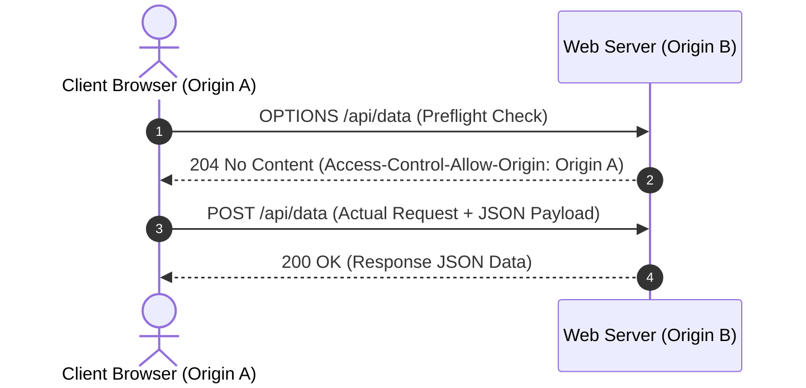

# Web Programming - Unit 11: Web Data Transfer through HTTP Methods and CORS

## Part 1: Macro Architecture & Technology Overview

โปรโตคอล **HTTP (Hypertext Transfer Protocol)** เป็นรากฐานสำคัญของการแลกเปลี่ยนข้อมูลบนเว็บ โดยมีคุณสมบัติพื้นฐานคือ **Stateless Protocol** (ไม่เก็บสถานะของคำขอก่อนหน้าไว้บนเซิร์ฟเวอร์) และทำงานตามสถาปัตยกรรม **Client-Server Model**

ในการรับส่งข้อมูลสำหรับ RESTful Web APIs การเลือกใช้ **HTTP Methods (Verbs)** ที่ถูกต้องเป็นหัวใจสำคัญในการระบุกรรมวิธีบนทรัพยากร (Resource) รวมถึงความเข้าใจเรื่องคุณสมบัติ **Safe**, **Idempotent**, และกลไกความปลอดภัย **CORS (Cross-Origin Resource Sharing)**



### ตารางสรุปเปรียบเทียบคุณสมบัติของ HTTP Methods (Master HTTP Methods Matrix)

| HTTP Method | การทำงาน (Action) | Safe (ไม่เปลี่ยน State) | Idempotent (ผลลัพธ์คงที่) | Request Body | Standard Response Status |
| :--- | :--- | :---: | :---: | :---: | :--- |
| **`GET`** | Read / Fetch Resource | **Yes** | **Yes** | No | `200 OK` |
| **`POST`** | Create New Resource | **No** | **No** | **Yes** (JSON/Form) | `201 Created` |
| **`PUT`** | Full Replace Resource | **No** | **Yes** | **Yes** (Full Object) | `200 OK` / `204 No Content` |
| **`PATCH`** | Partial Update Resource | **No** | **No / Depends** | **Yes** (Partial Data) | `200 OK` / `204 No Content` |
| **`DELETE`** | Remove Resource | **No** | **Yes** | No | `200 OK` / `204 No Content` / `404` |
| **`HEAD`** | Fetch Headers Only | **Yes** | **Yes** | No | `200 OK` (ไม่มี Body) |
| **`OPTIONS`** | CORS Preflight Check | **Yes** | **Yes** | No | `204 No Content` / `200 OK` |

---

## Part 2: Module-by-Module Deep Dive

### 2.1 มโนทัศน์สำคัญ (Core Concepts)

#### Safe vs Idempotent HTTP Methods

> 💡 **Intuition:** นึกถึง "Safe" เหมือน "คนอ่านหนังสือ" ไม่ได้ฉีกหนังสือ "Idempotent" เหมือน "กดปุ่ม 'ปิดทีวี'" 10 ครั้ง ทีวีก็ยังปิดอยู่ — ส่วน "Non-Idempotent" เหมือน "กดปุ่ม 'เพิ่มเพลง'" 10 ครั้ง เพลงจะเพิ่มไปเท่า 10 เพลง — Safe = "ไม่เขียน" Idempotent = "เขียนแต่ผล Final เดียวกัน"
> [Source: generated — not verified against original document]

* **Safe Methods:** HTTP Method ที่ไม่ก่อให้เกิดการเปลี่ยนแปลงข้อมูลหรือสถานะบนเซิร์ฟเวอร์ (เช่น `GET`, `HEAD`, `OPTIONS`)
* **Idempotent Methods:** คุณสมบัติที่คำนวณว่า การเรียกใช้เมธอดเดิมซ้ำหลายๆ ครั้งด้วยข้อมูลชุดเดิม จะต้อง **ส่งผลต่อสถานะของเซิร์ฟเวอร์เท่ากับการเรียกใช้เพียงครั้งเดียว** (เช่น `GET`, `PUT`, `DELETE`)
  * `POST` **ไม่เป็น Idempotent** เพราะการยิงซ้ำจะสร้างข้อมูลซ้ำซ้อนขึ้นเรื่อยๆ
  * `PUT` **เป็น Idempotent** เพราะการแทนที่ข้อมูลด้วยชุดเดิม 10 ครั้ง ผลลัพธ์ใน DB ก็ยังคงเป็นข้อมูลชุดนั้น

**🧭 ทำความเข้าใจ** _[Source: generated — not verified against original document]_

**แตกวลีสำคัญ:**
- "Safe" → ไม่ "เขียน" ข้อมูล — อ่านเท่านั้น
- "Idempotent" → ยิงซ้ำกี่ครั้ง "ผลลัพธ์สุดท้าย" บน Server ยังเหมือนเดิม

**ตัวอย่าง:**
```
✅ GET /products/5 (Safe + Idempotent)
   ยิง 100 ครั้ง → ดึงข้อมูลเดิม 100 ครั้ง → Data ไม่เปลี่ยน

✅ PUT /products/5 { name: "Apple", price: 100 } (Not Safe, Idempotent)
   ยิง 1 ครั้ง → name=Apple, price=100
   ยิง 10 ครั้ง → name=Apple, price=100 (ยังเป็นแบบเดิม ไม่ทวีคูณ)

❌ POST /products { name: "Banana" } (Not Safe, Not Idempotent)
   ยิง 1 ครั้ง → เพิ่ม Banana 1 ชิ้น
   ยิง 10 ครั้ง → เพิ่ม Banana 10 ชิ้น (ข้อมูลทวีคูณ)
```

- **ต่างกันตรง:** Safe = "ไม่เขียน" Idempotent = "เขียนแต่ผล Final เดียวกัน"

**อย่าสับสน:** "Idempotent" ไม่ได้หมายถึง "ได้รับ Response เดียวกัน" — หมายถึง "State on Server เดียวกัน" — ตัวอย่างเช่น DELETE `/users/5` ครั้งแรกได้ `200`/`204` (ลบสำเร็จ) ครั้งที่สองได้ `404` (ไม่มีให้ลบแล้ว) — Response ต่างกัน แต่ State บน Server เหมือนกัน (User 5 ไม่มีอยู่) → DELETE จึงยังเป็น Idempotent — ส่วน PATCH ไม่รับประกันว่า Idempotent (เช่น PATCH ที่สั่ง "เพิ่ม stock อีก 1" ยิงซ้ำแล้วค่าเพิ่มทุกครั้ง)

**เช็คความเข้าใจ:** ทำไม Network ที่ Unstable มักส่ง Request ซ้ำ และต้องเลือก `PUT` (Idempotent) มากกว่า `POST` (Non-Idempotent) สำหรับ Update?
<details><summary>เฉลย</summary>

เพราะ Network ที่ Unstable อาจ Timeout — Client สงสัยว่า Request ไป Server รึเปล่า → พยายาม Retry (ส่งซ้ำ) — ถ้าใช้ POST (Non-Idempotent) ส่งซ้ำ = ข้อมูล Duplicate ขึ้น — ถ้าใช้ PUT (Idempotent) ส่งซ้ำ = Server State ยังเดียวกัน → ปลอดภัย
</details>

#### Same-Origin Policy (SOP) & CORS Preflight

> 💡 **Intuition:** นึกถึง "Same-Origin Policy" เหมือน "ป้องกันคนนอกเข้าบ้าน" — Browser ไม่ยอมให้ JavaScript จาก `https://site-a.com` อ่าน Response ที่ดึงมาจาก `https://site-b.com` โดย Default (Origin เดียวกัน = Scheme, Host, Port ต้องเหมือนกันทั้งหมด) — เพื่อกันเว็บของคนร้ายใช้ Script อ่านข้อมูลบัญชีธนาคารของคุณจากอีกเว็บ — ถ้า `site-b.com` ยินยอม ต้องบอก Browser ผ่าน CORS Header (และถ้าเป็น Non-Simple Request Browser จะถามไฟเขียวด้วย `OPTIONS` Preflight ก่อน) — จุดที่ Analogy ไม่ตรง: "คนนอก" ยังเคาะประตูได้ (Request อาจถึง Server แล้ว) แต่ Browser ไม่ยอมส่งของ (Response) ให้ Script
> [Source: generated — not verified against original document]

* **Same-Origin Policy (SOP):** นโยบายความปลอดภัยพื้นฐานของเบราว์เซอร์ที่ห้ามการดึงข้อมูลข้ามจุดกำเนิด (ต่าง Scheme, Host, หรือ Port)
* **CORS Preflight Check (`OPTIONS`):** สำหรับ Request ที่ไม่ใช่ Simple Request (เช่น มีการใช้ `PUT`, `PATCH`, `DELETE` หรือส่ง Header `Authorization`) เบราว์เซอร์จะส่งคำขอ `OPTIONS` ไปถามเซิร์ฟเวอร์ล่วงหน้าเพื่อตรวจสอบสิทธิ์ก่อนส่งคำขอจริง

**🧭 ทำความเข้าใจ** _[Source: generated — not verified against original document]_

**แตกวลีสำคัญ:**
- "Same-Origin" → Origin = Scheme + Host + Port — เช่น `https://example.com:443`
- "Simple Request" vs "Non-Simple Request" → Simple = GET/HEAD/POST ที่ใช้เฉพาะ Header พื้นฐาน และ Content-Type เป็น `application/x-www-form-urlencoded`, `multipart/form-data` หรือ `text/plain` เท่านั้น (ไม่มี Preflight) / Non-Simple = Method อื่น (PUT/PATCH/DELETE), Content-Type `application/json` หรือมี Custom Header เช่น `Authorization` (ต้อง Preflight)

**ตัวอย่าง:**
```
❌ SOP Block (จาก https://site-a.com ไปดึง https://site-b.com):
fetch('https://site-b.com/api/data')
  .then(res => res.json())
  .catch(e => console.log('CORS Error:', e));
// Browser block: "Access-Control-Allow-Origin header is missing"

✅ CORS Preflight (PUT/PATCH/DELETE หรือ Authorization):
fetch('https://site-b.com/api/users/5', {
  method: 'PUT',
  headers: { 'Authorization': 'Bearer token' },
  body: JSON.stringify({...})
});
// Browser ส่ง OPTIONS ก่อน:
// OPTIONS /api/users/5
// Access-Control-Request-Method: PUT
// Access-Control-Request-Headers: authorization
// ถ้า site-b.com ตอบพร้อม Access-Control-Allow-Origin / -Methods / -Headers ที่อนุญาต → Browser ส่ง PUT จริง
```

- **ต่างกันตรง:** SOP = Browser enforcement (บังคับ) CORS = Server Permission (อนุญาต)

**อย่าสับสน:** "CORS is enforced by the browser, not the server" — Server เพียงบอก Header `Access-Control-Allow-Origin` ว่า "accept request from site-a.com" — Browser ถึงยอมให้ JavaScript อ่าน Response — เครื่องมือที่ไม่ใช่ Browser (curl, Postman) จึงไม่โดน CORS

**เช็คความเข้าใจ:** ทำไม `` ใน HTML ไม่ block แต่ `fetch('https://other-site.com/api')` ถูก block?
<details><summary>เฉลย</summary>

1. SOP อนุญาต "Cross-Origin Embedding" — ``, `<link rel="stylesheet">`, `<script src=...>` โหลดทรัพยากรข้าม Origin มา "แสดงหรือใช้งาน" บนหน้าได้
2. แต่ JavaScript ของหน้าเราอ่านข้อมูลดิบของทรัพยากรนั้นไม่ได้ (เช่น วาดรูปข้าม Origin ลง `<canvas>` แล้วเรียก `getImageData()` จะ Error เพราะ Canvas ถูก Taint)
3. `fetch()`/XHR ตั้งใจให้ Script อ่าน Response Body ได้โดยตรง → ถ้าไม่จำกัด เว็บร้ายจะอ่านข้อมูลส่วนตัวจากเว็บอื่นได้ → Browser จึงบล็อกการอ่าน เว้นแต่ Server ตอบ CORS Header อนุญาต
</details>

---

### 2.2 โค้ดตัวอย่างการใช้งานจริง (Implementation Code)

#### 1. การส่ง Request ฝั่ง Client ด้วย Fetch API (JavaScript Async/Await)

> 💡 **Intuition:** นึกถึง `fetch` เหมือน "การส่งพัสดุ" — ถ้าพัสดุไปถึงหน้าบ้านแล้ว (Server ตอบกลับมาแล้ว ไม่ว่าจะ 200 หรือ 404) `fetch` ก็ถือว่า "ส่งถึงแล้ว" ต้องเปิดกล่องดูเองว่าของข้างในใช่ที่ต้องการหรือไม่ (`res.ok`) — จุดที่ Analogy ไม่ตรง: ถ้าพัสดุไปไม่ถึงเลย (Network ล้มเหลว หรือ CORS ถูก Block) `fetch` จะ reject เป็น Error ทันที ซึ่งต่างจากกรณี 404 ที่ยังได้ Response กลับมา
> [Source: generated — not verified against original document]


```javascript
// client_fetch.js - ฟังก์ชันจัดการ HTTP Methods ฝั่งไคลเอ็นต์

const API_BASE_URL = 'http://localhost:3000/api/users';

// 1. GET: ดึงข้อมูล (Safe, Idempotent, No Body)
async function getUser(id) {
    const res = await fetch(`${API_BASE_URL}/${id}`);
    if (!res.ok) throw new Error(`HTTP error! status: ${res.status}`);
    const data = await res.json();
    return data;
}

// 2. POST: สร้างข้อมูลใหม่ (Not Idempotent, Has Body)
async function createUser(userData) {
    const res = await fetch(API_BASE_URL, {
        method: 'POST',
        headers: { 'Content-Type': 'application/json' },
        body: JSON.stringify(userData)
    });
    if (!res.ok) throw new Error(`Failed to create: ${res.status}`);
    return await res.json(); // คืนค่า Object ที่สร้างเสร็จพร้อม ID
}

// 3. PUT: แทนที่ข้อมูลทั้งหมด (Idempotent, Requires ALL Fields)
async function replaceUser(id, fullUserData) {
    const res = await fetch(`${API_BASE_URL}/${id}`, {
        method: 'PUT',
        headers: { 'Content-Type': 'application/json' },
        body: JSON.stringify(fullUserData) // ต้องส่งทุก ฟิลด์ (name, email, role)
    });
    return await res.json();
}

// 4. PATCH: อัปเดตเฉพาะฟิลด์ที่เปลี่ยน (Partial Update, Bandwidth Efficient)
async function patchUser(id, partialChanges) {
    const res = await fetch(`${API_BASE_URL}/${id}`, {
        method: 'PATCH',
        headers: { 'Content-Type': 'application/json' },
        body: JSON.stringify(partialChanges) // ส่งเฉพาะ { email: "new@ex.com" }
    });
    return await res.json();
}

// 5. DELETE: ลบข้อมูล (Idempotent, Bearer Token Auth)
async function deleteUser(id, token) {
    const res = await fetch(`${API_BASE_URL}/${id}`, {
        method: 'DELETE',
        headers: {
            'Authorization': `Bearer ${token}`
        }
    });
    if (res.status === 204) return true; // Deleted successfully with No Content
    if (res.status === 404) return false; // Already deleted
    throw new Error(`Delete failed: ${res.status}`);
}
```

**🧭 ทำความเข้าใจ** _[Source: generated — not verified against original document]_

**แตกวลีสำคัญ:**
- "fetch resolve" → Promise สำเร็จเมื่อได้ Response กลับมา ไม่ว่า Status จะเป็นอะไร
- "res.ok" → `true` เฉพาะเมื่อ Status อยู่ในช่วง `200–299`
- "reject" → Promise ล้มเหลวเมื่อ Request ไปไม่ถึง Server (Network error หรือ CORS block) และได้ `TypeError`

**ตัวอย่าง:**
```javascript
// ❌ ไม่เช็ค res.ok — 404 ไม่ถูก throw ทำให้โค้ดไม่รู้ว่าพลาด
const res = await fetch('http://localhost:3000/api/users/999');
const data = await res.json(); // ได้ Body ของ Error หรือ parse ไม่ได้ โดยไม่มีการแจ้งเตือน
```
```javascript
// ✅ เช็ค res.ok ก่อนใช้ข้อมูล
const res = await fetch('http://localhost:3000/api/users/999');
if (!res.ok) throw new Error(`HTTP error! status: ${res.status}`); // 404
const data = await res.json();
```
- ✅ `POST` ที่ได้ `201 Created` → `res.ok` เป็น `true` เพราะ `201` อยู่ในช่วง `200–299`
- ❌ คิดว่า `try/catch` จับ `404` ได้เอง — ไม่ได้ เพราะ `fetch` ไม่ throw ตาม Status Code
- **ต่างกันตรง:** "ได้ Response กลับมา" ≠ "Response สำเร็จ" ต้องเช็ค `res.ok` เอง

**อย่าสับสน:** `res.ok` ไม่ได้หมายถึง "ข้อมูลถูกต้องตามที่ต้องการ" แค่บอกว่า Status อยู่ในช่วง 2xx เท่านั้น

**เช็คความเข้าใจ:** ถ้า `getUser(999)` (ตัวอย่างโค้ดด้านบนที่มี `if (!res.ok) throw`) ถูกเรียกใน `try/catch` แล้วเซิร์ฟเวอร์ตอบ 404 โค้ดจะเข้า `catch` ไหม? และถ้า Server ดับอยู่ (Network error) ล่ะ?
<details><summary>เฉลย</summary>

เข้า `catch` ทั้งสองกรณี กรณี 404 เกิดจาก `throw new Error(...)` ที่เราเขียนเองหลังเช็ค `res.ok` ส่วนกรณี Server ดับ `fetch` จะ reject เองอยู่แล้ว แต่ถ้าไม่มี `if (!res.ok)` กรณี 404 จะไม่เข้า `catch` เลย
</details>

#### 2. การตั้งค่า CORS และจัด Route รับ HTTP Methods ฝั่ง Express.js Server

> 💡 **Intuition:** นึกถึง `cors` middleware เหมือน "เจ้าหน้าที่ต้อนรับหน้าอาคาร" ที่ติดป้ายบอกว่าแขกจากบริษัทไหนเข้าได้ (`Access-Control-*` Headers) และตอบ Preflight `OPTIONS` แทนเราอัตโนมัติ — จุดที่ Analogy ไม่ตรง: เจ้าหน้าที่คนนี้แค่ "ติดป้ายว่าใครอ่านผลได้" ไม่ได้ตรวจบัตรผู้ใช้ การยืนยันตัวตน (Authentication) ยังต้องทำที่ Server เอง
> [Source: generated — not verified against original document]

```javascript
// server_cors.js - เซิร์ฟเวอร์ Express ที่รองรับ CORS และ HTTP Methods
const express = require('express');
const cors = require('cors');

const app = express();
const PORT = 3000;

// 1. การตั้งค่า CORS แบบละเอียด (Handling Preflight OPTIONS Automatically)
const corsOptions = {
    origin: 'https://myapp.com', // อนุญาตเฉพาะโดเมนนี้ (หรือ '*' สำหรับทุกโดเมน)
    methods: ['GET', 'POST', 'PUT', 'PATCH', 'DELETE', 'OPTIONS'],
    allowedHeaders: ['Content-Type', 'Authorization'],
    maxAge: 86400 // Cache Preflight 24 ชั่วโมง
};

app.use(cors(corsOptions));
app.use(express.json());

// Mock Data Storage
let users = [
    { id: 42, name: "Alice", email: "alice@ex.com", role: "admin" }
];

// GET /api/users/:id
app.get('/api/users/:id', (req, res) => {
    const u = users.find(u => u.id === parseInt(req.params.id));
    u ? res.json(u) : res.status(404).json({ error: "User not found" });
});

// POST /api/users
app.post('/api/users', (req, res) => {
    const newUser = { id: Date.now(), ...req.body };
    users.push(newUser);
    res.status(201).json(newUser);
});

// PUT /api/users/:id (แทนที่ทั้งตัว)
app.put('/api/users/:id', (req, res) => {
    const id = parseInt(req.params.id);
    const index = users.findIndex(u => u.id === id);
    if (index === -1) return res.status(404).json({ error: "User not found" });
    
    // แทนที่ข้อมูลทั้งหมดด้วย req.body
    users[index] = { id, ...req.body };
    res.json(users[index]);
});

// PATCH /api/users/:id (แก้ไขบางฟิลด์)
app.patch('/api/users/:id', (req, res) => {
    const id = parseInt(req.params.id);
    const index = users.findIndex(u => u.id === id);
    if (index === -1) return res.status(404).json({ error: "User not found" });

    // รวมเฉพาะฟิลด์ที่ส่งมาแก้ไข (Merge Changes)
    users[index] = { ...users[index], ...req.body };
    res.json(users[index]);
});

// DELETE /api/users/:id
app.delete('/api/users/:id', (req, res) => {
    const id = parseInt(req.params.id);
    users = users.filter(u => u.id !== id);
    res.status(204).send(); // 204 No Content
});

app.listen(PORT, () => console.log(`CORS-enabled Server running on port ${PORT}`));
```

**🧭 ทำความเข้าใจ** _[Source: generated — not verified against original document]_

**แตกวลีสำคัญ:**
- "origin" → โดเมนที่อนุญาตให้ Browser ส่ง Request แล้วอ่าน Response ได้ (ส่งออกเป็น `Access-Control-Allow-Origin`)
- "methods" / "allowedHeaders" → Method และ Header ที่อนุญาตให้ใช้กับคำขอข้ามโดเมน (ตอบกลับใน Preflight)
- "maxAge" → จำนวนวินาทีที่ Browser จำผล Preflight ไว้ ทำให้ไม่ต้องส่ง `OPTIONS` ซ้ำทุกครั้ง

**ตัวอย่าง:**
- ✅ `origin: 'https://myapp.com'` และหน้าเว็บเปิดจาก `https://myapp.com` → Browser ให้อ่านผลได้
- ❌ `origin: 'https://myapp.com'` แต่หน้าเว็บเปิดจาก `http://localhost:5173` → Browser block เพราะ Scheme/Host/Port ไม่ตรงกัน (ทั้งสามส่วนนับ)
- ❌ ตั้ง `origin: '*'` แล้วฝั่ง Client ส่ง Cookie ด้วย `credentials: 'include'` — Browser ไม่ยอมรับ เพราะเมื่อมี Credentials ต้องระบุ Origin ให้ชัดเจน
- **ต่างกันตรง:** ✅ Origin ตรงทุกส่วน (Scheme + Host + Port) / ❌ ไม่ตรงแม้แต่ส่วนเดียว Browser ก็ block

**อย่าสับสน:** `origin: '*'` ไม่ได้แปลว่า "ปลอดภัยที่สุด" แต่หมายถึง "ยอมให้ทุกโดเมนอ่าน Response ที่ไม่มี Credentials" ข้อมูลที่ต้องยืนยันตัวตนต้องจำกัด Origin ให้เจาะจง

**เช็คความเข้าใจ:** Server ตั้ง `allowedHeaders: ['Content-Type']` (ไม่มี `Authorization`) แล้ว Client ที่ `https://myapp.com` ส่ง `PUT` พร้อม `Authorization` — Request จริงจะถูกส่งไป Server หรือไม่ และ Error เกิดที่จุดไหน?
<details><summary>เฉลย</summary>

Request จริงไม่ถูกส่งไป Server Browser ส่ง Preflight `OPTIONS` ก่อน พบว่า `Authorization` ไม่อยู่ในรายการที่อนุญาตจึงไม่ส่ง `PUT` จริง Error (CORS) จะปรากฏฝั่ง Client ทั้งที่ Route ฝั่ง Server เขียนถูกต้อง
</details>

---

### 2.3 การวิเคราะห์โจทย์ตัวอย่าง (Assignment Case Analysis)

**โจทย์:** จงเปรียบเทียบความแตกต่างระหว่างการใช้ **`PUT`** และ **`PATCH`** ในการอัปเดตข้อมูลผู้ใช้ในระบบฐานข้อมูล พร้อมยกตัวอย่างกรณีการสูญหายของข้อมูล (Data Loss) หากเลือกใช้ผิดประเภท

**การวิเคราะห์เปรียบเทียบ (PUT vs PATCH Analysis):**
* **`PUT` (Full Replacement):**
  * สัญญาของ `PUT` คือการส่ง **ตัวแทนข้อมูลทั้งหมด (Complete Representation)** ไปแทนที่เอกสารเดิม
  * **ความเสี่ยง:** หากส่งข้อมูลเฉพาะฟิลด์ที่เปลี่ยน เช่น `{ email: "new@ex.com" }` ผ่านเมธอด `PUT` เซิร์ฟเวอร์ที่ปฏิบัติตามมาตรฐานจะทำการลบฟิลด์อื่นที่ไม่ได้ส่งมาทิ้งไป (เช่น `name`, `role` จะกลายเป็น `null` หรือหายไป)
* **`PATCH` (Partial Modification):**
  * ส่งเฉพาะ **ส่วนต่างที่แก้ไข (Delta/Changes)** เช่น `{ email: "new@ex.com" }`
  * เซิร์ฟเวอร์จะทำการอัปเดตเฉพาะฟิลด์ `email` โดยคงฟิลด์ `name` และ `role` ไว้ตามเดิม ประหยัดแบนด์วิดท์และป้องกันปัญหาข้อมูลสูญหาย

#### 💡 เสริม: CORS Response Headers (`Access-Control-*`)

> 💡 **Intuition:** นึกถึง `Access-Control-*` เหมือน "ใบอนุญาตที่ Server แนบมากับ Response" — Browser อ่านใบนี้เพื่อตัดสินว่าจะยอมให้ Script ของหน้าเว็บอ่านผลลัพธ์หรือไม่ — จุดที่ Analogy ไม่ตรง: Server ส่ง Response มาได้ตามปกติเสมอ ใบอนุญาตมีผลเฉพาะกับ Browser เครื่องมืออย่าง `curl` หรือ Postman ไม่สนใจใบนี้เลย
> [Source: generated — not verified against original document]

* **`Access-Control-Allow-Origin`:** โดเมนที่ Browser ยอมให้ Script อ่าน Response ได้
* **`Access-Control-Allow-Methods`:** Method ที่อนุญาต (ตอบกลับใน Preflight)
* **`Access-Control-Allow-Headers`:** Header ที่อนุญาต (ตอบกลับใน Preflight)

**🧭 ทำความเข้าใจ** _[Source: generated — not verified against original document]_

**แตกวลีสำคัญ:**
- "Access-Control-Allow-Origin" → คำตอบของ Server ว่า "โดเมนนี้อ่านผลได้"
- "Preflight Response" → Response ของ `OPTIONS` ที่บอก Browser ว่า Method และ Header ไหนส่งได้บ้าง

**ตัวอย่าง:**
- ✅ Server ตอบ `Access-Control-Allow-Origin: https://myapp.com` และหน้าเว็บมาจาก `https://myapp.com` → Script อ่านผลได้
- ❌ Server ตอบ `Access-Control-Allow-Origin: https://myapp.com` แต่หน้าเว็บมาจาก `https://other.com` → Browser block ทั้งที่ Server ประมวลผลและส่ง Response มาแล้ว
- **ต่างกันตรง:** Server ส่ง Response ได้เสมอ สิ่งที่ Browser ตัดสินคือ "Script ของหน้าเว็บมีสิทธิ์อ่านหรือไม่"

**อย่าสับสน:** Header เหล่านี้ไม่ได้กันการเข้าถึง Server — คำขอยังถึง Server ได้เสมอ นี่คือเหตุผลที่ API ต้องมี Authentication ฝั่ง Server เอง

**เช็คความเข้าใจ:** ทำไม `curl` ไปยัง API ที่ตั้ง CORS ไว้แล้วถึงทำงานได้ แม้ Origin ที่ `curl` ส่งมาจะไม่ตรงกับที่ตั้งไว้?
<details><summary>เฉลย</summary>

เพราะ CORS เป็นกลไกของ Browser เท่านั้น `curl` ไม่ตรวจ `Access-Control-*` Header จึงไม่มีการ Block ส่วน Server ยังรับ Request และตอบกลับตามปกติ การป้องกันจริงของ API จึงต้องทำด้วย Authentication
</details>

---

## Part 3: Quick Reference & Exam Cheat Sheet

### Checklist สรุปหัวใจสำคัญก่อนสอบ
* [ ] **Safe vs Idempotent:**
  * **Safe:** `GET`, `HEAD`, `OPTIONS` (ไม่แก้ข้อมูลในเซิร์ฟเวอร์)
  * **Idempotent:** `GET`, `PUT`, `DELETE`, `HEAD`, `OPTIONS` (ยิงซ้ำกี่ครั้ง ผลลัพธ์บน DB ยังเท่าเดิม)
  * **Non-Idempotent:** `POST` (ยิงซ้ำได้ข้อมูลซ้ำซ้อน)
* [ ] **`PUT` vs `PATCH`:** `PUT` แทนที่ทั้งหมด (ต้องส่งทุกฟิลด์) / `PATCH` แก้ไขเฉพาะจุด (ส่งเฉพาะฟิลด์ที่เปลี่ยน)
* [ ] **CORS Preflight Trigger:** เบราว์เซอร์จะส่ง `OPTIONS` อัตโนมัติเมื่อ:
  1. ใช้ HTTP Method นอกเหนือจาก `GET`, `HEAD`, `POST` (เช่น `PUT`, `PATCH`, `DELETE`)
  2. มีการตั้งค่า Custom Headers (เช่น `Authorization: Bearer <token>`)
* [ ] **CORS Key Headers:** `Access-Control-Allow-Origin`, `Access-Control-Allow-Methods`, `Access-Control-Allow-Headers`

---

## เอกสารเชื่อมโยง (Wiki-Style Backlinks)
* **วิชาและหัวข้อที่เกี่ยวข้อง:**
  * [[Web Programming - Unit 10 Web Services and REST API with Node.JS]] (สถาปัตยกรรม RESTful API และการออกแบบ Endpoints)
  * [[Web Programming - Unit 07 Back-end Web Development with Node.JS & Express.JS]] (การจัดการ Express Middleware และ CORS)
  * [[Web Programming - Unit 06 Web Data with JSON and Local Storage]] (การส่งต่อ HTTP Request/Response ด้วย JSON Payload)
  * [[Data & AI Engineer Skill Matrix]] (ทักษะด้าน HTTP Protocols, RESTful API Standards, และ Network Security)
