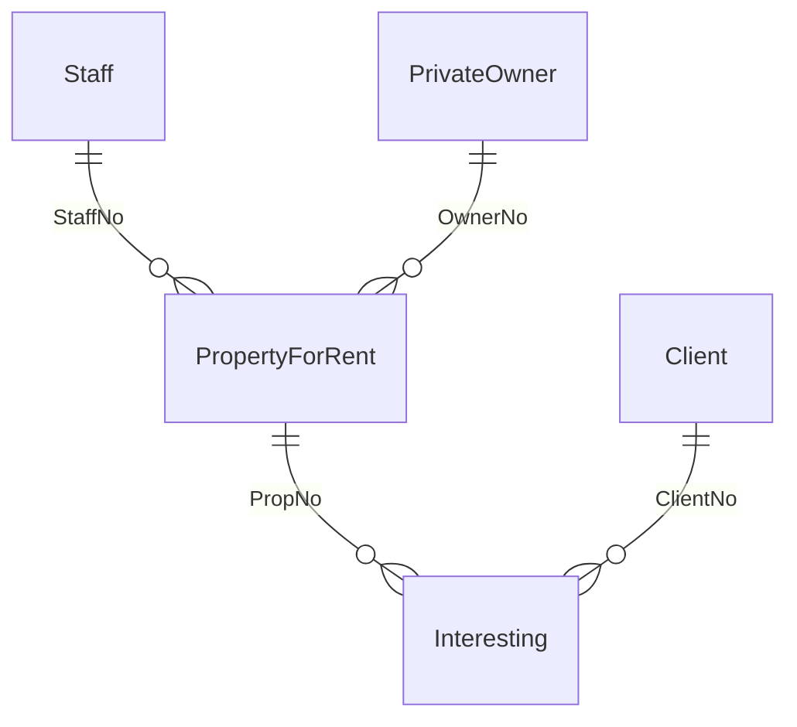

# SQL Mock Quiz: Property Rental Database (18 ข้อ)

## ข้อมูลทั่วไป
* **รหัสแบบฝึกหัด:** SQL-Mock-Quiz (Quiz1_Schema_Sec4-rev)
* **หัวข้อ:** JOIN (`ON`, `USING`, Equijoin), Subquery (`ANY`, single-row), GROUP BY/HAVING, Aggregate, OUTER JOIN, `BETWEEN`, `LIKE`, `ESCAPE`, Alias, ORDER BY
* **วันที่สร้าง:** 2026-10-21
* **Database อ้างอิง:** 5 ตาราง (`PropertyForRent`, `Client`, `Interesting`, `PrivateOwner`, `Staff`) จากไฟล์ `Quiz1_Schema_Sec4-rev.pdf`
* **SQL Dialect:** MySQL (ใช้ backtick, `LIMIT`, ไม่มี `FULL OUTER JOIN`)
* **วิธีใช้:** เขียนคำตอบเองก่อน แล้วค่อยกดเปิดกล่อง "เฉลย" เทียบ ข้อที่ผิดเชิงแนวคิดให้ลงใน `Mistake Log`

> [!NOTE] ข้อกำหนดของข้อสอบแนวนี้
> - ถ้าโจทย์ระบุ `ON` / `USING` / `BETWEEN` / Alias / `AND`/`OR` / `ESCAPE` ต้องใช้ตามที่กำหนด
> - ข้อที่ห้ามใช้ Subquery ต้องแก้ด้วย JOIN
> - Table alias ใช้ตัวอักษรแรกของชื่อตาราง (เช่น `Staff` → `s`) ถ้าโจทย์สั่ง

---

## Schema ที่ใช้



| Table             | Columns                                                                                                  |
| :---------------- | :------------------------------------------------------------------------------------------------------- |
| `PropertyForRent` | PropNo (PK), PropStreet, PropCity, PropPostcode, Type, Rooms, Rent, OwnerNo (FK), StaffNo (FK)           |
| `Client`          | ClientNo (PK), cFirstName, cLastName, ClientTel, PrefType, MaxRent                                       |
| `Interesting`     | ClientNo (PK, FK), PropNo (PK, FK), InterestDate, Comment                                                |
| `PrivateOwner`    | OwnerNo (PK), oFirstName, oLastName, Address, OwnerTel                                                   |
| `Staff`           | StaffNo (PK), sFirstName, sLastName, Position, Sex, DOB, Salary                                          |

---

## ตัวอย่างข้อมูล

ใช้ทดสอบคำตอบด้วยการไล่ผลลัพธ์ในใจ หรือรันกับ MySQL จริง (`SELECT * FROM <table>`)

**`Client`** (5 แถว)

| ClientNo | cFirstName | cLastName | ClientTel      | PrefType  | MaxRent |
| :------- | :--------- | :-------- | :------------- | :-------- | ------: |
| 20010    | Winson     | Roger     | 1-111-548-9841 | townhouse |    2753 |
| 20011    | Rose       | Leona     | 1-386-347-0911 | townhouse |    5000 |
| 20012    | Smith      | Laura     | 1-118-610-0801 | condo     |   10000 |
| 20013    | Pelton     | Tristana  | 1-616-836-7350 | condo     |   50000 |
| 20014    | Kinda      | Lauren    | 1-760-364-4575 | townhouse |     400 |

**`Interesting`** (7 แถว)

| ClientNo | PropNo | InterestDate | Comment                                           |
| :------- | :----- | :----------- | :------------------------------------------------ |
| 20010    | 10011  | 2002-11-21   | ligula. Nullam feugiat 2% placerat                |
| 20010    | 10014  | 2027-01-21   | dolor. Nulla semper tellus id nunc interdum       |
| 20011    | 10013  | 2023-11-20   | lorem tristique aliquet. Phasellus fermentum      |
| 20011    | 10022  | 2015-09-20   | quis, pede. Praesent eu dui. Cum                  |
| 20012    | 10018  | 2012-08-21   | Praesent eu nulla at sem molestie sodales. Mauris |
| 20013    | 10018  | 2026-09-20   | in aliquet lobortis, 2% of nisi nibh lacinia      |
| 20014    | 10016  | 2006-11-21   | ornare placerat, orci lacus                       |

**`PrivateOwner`** (10 แถว)

| OwnerNo | oFirstName | oLastName | Address                       | OwnerTel       |
| :------ | :--------- | :-------- | :---------------------------- | :------------- |
| 30010   | Carlos     | Casey     | P.O. Box 863, 6754 Erat Rd.   | 1-318-657-5669 |
| 30011   | Quinn      | Cameron   | 204-820 Commodo Av.           | 1-528-251-6585 |
| 30012   | Theodore   | Maxwell   | 7838 Nisl. Rd.                | 1-338-803-1217 |
| 30013   | Xandra     | Snow      | 890 A, St.                    | 1-262-127-6631 |
| 30014   | Ina        | Henson    | Ap #150-9816 Aliquam Rd.      | 1-654-281-9956 |
| 30015   | Nasim      | Dean      | 315 Accumsan Rd.              | 1-970-779-8667 |
| 30016   | Keelie     | George    | 904-6768 Eget Rd.             | 1-108-423-7407 |
| 30017   | Heidi      | Oneal     | P.O. Box 861, 1377 Dictum Rd. | 1-675-401-9034 |
| 30018   | Graiden    | Diaz      | 4815 Nisl Rd.                 | 1-557-139-7713 |
| 30019   | Cain       | Whitehead | P.O. Box 576, 2208 Enim. Av.  | 1-456-725-4328 |

**`PropertyForRent`** (10 แถว)

| PropNo | PropStreet                            | PropCity    | PropPostcode | Type      | Rooms | Rent | OwnerNo | StaffNo |
| :----- | :------------------------------------ | :---------- | :----------- | :-------- | ----: | ---: | :------ | :------ |
| 10010  | 591-9236 Ipsum Av.                    | Duluth      | 10273        | condo     |     1 | 2753 | 30015   | 400023  |
| 10011  | Ap #661-9022 Eget St.                 | Rakitnoye   | 42034        | townhouse |     4 | 3989 | 30010   | 400020  |
| 10012  | 5927 Mattis Street                    | Verzegnis   | 72569        | townhouse |     5 | 3965 | 30010   | 400020  |
| 10013  | Ap #559-6508 Adipiscing Rd.           | Mostazal    | 66856        | condo     |     2 | 4171 | 30011   | 400020  |
| 10014  | Ap #641-9968 Fusce Street             | Mayerthorpe | 68271        | townhouse |     9 | 2202 | 30014   | 400022  |
| 10015  | 634-9929 Eget St.                     | Rathenow    | 42915        | townhouse |     9 | 4072 | 30016   | 400023  |
| 10016  | P.O. Box 526, 8201 Non, St.           | Smithers    | 55977        | townhouse |     8 |  371 | 30012   | 400021  |
| 10018  | 2021 At, Ave                          | Eastbourne  | 15439        | townhouse |     1 | 4741 | 30012   | 400021  |
| 10019  | 270-4405 Donec Av.                    | Northampton | 97058        | townhouse |     9 | 1926 | 30013   | 400022  |
| 10022  | P.O. Box 717, 3605 Pellentesque. Road | Shillong    | 86005        | townhouse |     6 | 4802 | 30010   | 400021  |

**`Staff`** (4 แถว)

| StaffNo | sFirstName | sLastName | Position  | Sex | DOB        | Salary |
| :------ | :--------- | :-------- | :-------- | :-- | :--------- | -----: |
| 400020  | Jessica    | Richard   | Sales     | F   | 2024-05-20 |    700 |
| 400021  | Xerxes     | Burks     | Sales     | M   | 2018-11-21 |    703 |
| 400022  | Deborah    | Myers     | Manager   | M   | 2021-07-20 |   1852 |
| 400023  | Isaiah     | Bullock   | Web Admin | F   | 2002-11-21 |    517 |

---

## Skills Matrix

| ข้อ | หัวข้อหลัก                               | ตารางที่ใช้                       | ยาก | ทำได้ |
| :-: | :--------------------------------------- | :-------------------------------- | :-: | :---: |
|  1  | INNER JOIN `ON` + Alias                  | `Staff`, `PropertyForRent`        |  ⭐  |       |
|  2  | Subquery + `< ANY`                       | `PropertyForRent`                 | ⭐⭐  |       |
|  3  | Single-row Subquery (ห้ามตัวแปร) + `<>`  | `Staff`                           | ⭐⭐  |       |
|  4  | `GROUP BY` + `HAVING COUNT` + Alias      | `Interesting`                     | ⭐⭐  |       |
|  5  | `GROUP BY` + `COUNT(DISTINCT)`           | `PropertyForRent`                 | ⭐⭐  |       |
|  6  | `AVG` + Alias                            | `Staff`                           |  ⭐  |       |
|  7  | `LEFT JOIN` + `IS NULL` (แทน Subquery)   | `PrivateOwner`, `PropertyForRent` | ⭐⭐  |       |
|  8  | `LEFT JOIN` (แทน Subquery)               | `PrivateOwner`, `PropertyForRent` | ⭐⭐  |       |
|  9  | JOIN `USING` + `LIKE`                    | `PropertyForRent`, `PrivateOwner` | ⭐⭐  |       |
| 10  | `BETWEEN`                                | `Client`                          |  ⭐  |       |
| 11  | Equijoin (WHERE) + Alias                 | `Client`, `Interesting`           | ⭐⭐  |       |
| 12  | `AND`/`OR` + Date                        | `Staff`                           |  ⭐  |       |
| 13  | `WHERE` + `ORDER BY DESC`                | `Client`                          |  ⭐  |       |
| 14  | Expression + Alias backtick + `ORDER BY` | `PropertyForRent`                 | ⭐⭐  |       |
| 15  | `LIKE` + `ESCAPE` (`%` เป็นตัวอักษรจริง) | `Interesting`                     | ⭐⭐⭐ |       |
| 16  | `WHERE` เท่ากับ                          | `Client`                          |  ⭐  |       |
| 17  | `LIKE` ขึ้นต้น/ลงท้าย                    | `PropertyForRent`                 |  ⭐  |       |
| 18  | `IS NULL` (FK ว่าง)                      | `PropertyForRent`                 |  ⭐  |       |

---

## โจทย์

### ข้อ 1 ⭐
แสดงตำแหน่งงาน เงินเดือนของพนักงาน และแสดงชื่อถนนและเมืองของอสังหาริมทรัพย์สำหรับให้เช่าที่พนักงานคนนั้นๆ เป็นคนดูแล (**ใช้ ON clause**)

หมายเหตุ: ถ้าต้องใช้ Table alias ให้ใช้ตัวอักษรแรกของชื่อตาราง เช่น ตาราง `Staff` ใช้ `s`

**คำตอบของฉัน:**
```sql
select s.Position , s.Salary , pr.PropStreet , pr.PropCity
from staff s
join propertyforrent pr on pr.StaffNo = s.StaffNo
```

> [!INFO]- เฉลย
> ```sql
> SELECT s.Position, s.Salary, p.PropStreet, p.PropCity
> FROM Staff s
> JOIN PropertyForRent p ON s.StaffNo = p.StaffNo;
> ```
>
> - ตารางต่อกันด้วย FK `PropertyForRent.StaffNo` → `Staff.StaffNo`
> - `JOIN` เฉยๆ = `INNER JOIN` แสดงเฉพาะพนักงานที่ดูแลอสังหาฯ อย่างน้อย 1 แห่ง

---

### ข้อ 2 ⭐⭐
แสดงรหัสอสังหาริมทรัพย์ ประเภทอสังหาริมทรัพย์ และค่าเช่าของอสังหาริมทรัพย์สำหรับให้เช่าที่มีค่าเช่า **น้อยกว่าค่าเช่าของอสังหาริมทรัพย์ประเภท condo บางแห่ง**

**คำตอบของฉัน:**
```sql
select PropNo , Type , Rent 
from propertyforrent prf
where Rent < any(select Rent from propertyforrent where Type = 'condo')
```

> [!INFO]- เฉลย
> ```sql
> SELECT PropNo, Type, Rent
> FROM PropertyForRent
> WHERE Rent < ANY (SELECT Rent
>                   FROM PropertyForRent
>                   WHERE Type = 'condo');
> ```
>
> - "บางแห่ง" = `ANY` (`< ANY` เทียบกับค่าสูงสุดของ condo: `Rent < MAX(condo)`)
> - ถ้าโจทย์ใช้คำว่า "ทุกแห่ง" ต้องเปลี่ยนเป็น `ALL`

---

### ข้อ 3 ⭐⭐
แสดงชื่อ นามสกุล และเงินเดือนของพนักงานดูแลอสังหาริมทรัพย์ที่มีตำแหน่งงานเหมือนกับพนักงานรหัส 400021 และไม่ต้องแสดงข้อมูลของพนักงานรหัส 400021 (หมายเหตุ: **ไม่ให้ใช้การกำหนดตัวแปร**)

**คำตอบของฉัน:**
```sql
select sFirstName , sLastName , Salary 
from staff
where Position = (select Position from staff where StaffNo = 400021)
and StaffNo != 400021
```

> [!INFO]- เฉลย
> ```sql
> SELECT sFirstName, sLastName, Salary
> FROM Staff
> WHERE Position = (SELECT Position
>                   FROM Staff
>                   WHERE StaffNo = 400021)
>   AND StaffNo <> 400021;
> ```
>
> - `StaffNo` เป็น PK → Subquery คืนแถวเดียว ใช้ `=` ได้
> - ไม่ใช้ `SET @pos = ...` ตามที่โจทย์ห้าม

---

### ข้อ 4 ⭐⭐
แสดงรหัสอสังหาริมทรัพย์ที่ลูกค้าสนใจ และจำนวนความคิดเห็นของลูกค้าในแต่ละรหัส ให้ตั้งชื่อคอลัมน์ว่า `AmountOfComment` โดยแสดงเฉพาะรหัสอสังหาริมทรัพย์ที่มีจำนวนความคิดเห็นของลูกค้า **มากกว่า 1**

**คำตอบของฉัน:**
```sql
select PropNo , count(Comment) as 'AmountofComment'
from Interesting 
group by ClientNo
having count(Comment) > 1
```

> [!INFO]- เฉลย
> ```sql
> SELECT PropNo, COUNT(Comment) AS AmountOfComment
> FROM Interesting
> GROUP BY PropNo
> HAVING COUNT(Comment) > 1;
> ```
>
> - เงื่อนไขบน Aggregate ต้องอยู่ใน `HAVING` (ใช้ `WHERE` ไม่ได้)
> - `COUNT(Comment)` ไม่นับแถวที่ `Comment` เป็น NULL ส่วน `COUNT(*)` นับทุกแถว

---

### ข้อ 5 ⭐⭐
แสดงรหัสเจ้าของอสังหาริมทรัพย์ และจำนวนพนักงานภายใต้เจ้าของอสังหาริมทรัพย์สำหรับให้เช่าคนเดียวกัน โดยตั้งชื่อคอลัมน์ว่า `AmountOfStaff`

**คำตอบของฉัน:**
```sql
select OwnerNo , count(StaffNo) as 'AmountofStaff'
from PropertyForRent
group by OwnerNo
```

> [!INFO]- เฉลย
> ```sql
> SELECT OwnerNo, COUNT(DISTINCT StaffNo) AS AmountOfStaff
> FROM PropertyForRent
> GROUP BY OwnerNo;
> ```
>
> - เจ้าของ 1 คนมีได้หลายอสังหาฯ และพนักงานคนเดียวอาจดูแลหลายแห่งของเจ้าของคนเดียวกัน → ต้อง `COUNT(DISTINCT StaffNo)` ไม่เช่นนั้นจะนับซ้ำ

---

### ข้อ 6 ⭐
แสดงเงินเดือนเฉลี่ยของพนักงานทุกคนที่ได้รับเงินเดือน โดยตั้งชื่อคอลัมน์ว่า `AverageSalary`

**คำตอบของฉัน:**
```sql
select avg(Salary) as 'AverageSalary'
from Staff
group by StaffNo
```

> [!INFO]- เฉลย
> ```sql
> SELECT AVG(Salary) AS AverageSalary
> FROM Staff;
> ```
>
> - `AVG` ข้ามค่า NULL อัตโนมัติ จึงตรงกับ "ทุกคนที่ได้รับเงินเดือน"
> - เขียน `WHERE Salary IS NOT NULL` เพิ่มได้ ผลลัพธ์เท่ากัน

---

### ข้อ 7 ⭐⭐
แสดงชื่อ นามสกุล และเบอร์โทรศัพท์ของเจ้าของอสังหาริมทรัพย์ โดยแสดงเฉพาะเจ้าของอสังหาริมทรัพย์ที่ **ยังไม่มีอสังหาริมทรัพย์สำหรับให้เช่า** (**ไม่อนุญาตให้ใช้ Subquery**)

**คำตอบของฉัน:**
```sql
select o.oFirstName , o.oLastName , o.OwnerTel 
from PrivateOwner o
left outer join PropertyForRent pr on pr.OwnerNo = o.OwnerNo
where pr.PropNo is null
```

> [!INFO]- เฉลย
> ```sql
> SELECT o.oFirstName, o.oLastName, o.OwnerTel
> FROM PrivateOwner o
> LEFT JOIN PropertyForRent p ON o.OwnerNo = p.OwnerNo
> WHERE p.PropNo IS NULL;
> ```
>
> - Pattern "หาที่ไม่มีคู่": `LEFT JOIN` + `WHERE <PK ของตารางขวา> IS NULL`
> - ต้องเช็ค PK (`PropNo`) เพราะเป็นคอลัมน์ที่ไม่มีทางเป็น NULL ถ้ามีคู่

---

### ข้อ 8 ⭐⭐
แสดงชื่อ นามสกุล เบอร์โทรศัพท์ของเจ้าของอสังหาริมทรัพย์ และรหัสอสังหาริมทรัพย์ โดยแสดงข้อมูลเจ้าของอสังหาริมทรัพย์ **ทุกคน** คือทั้งเจ้าของที่มีและไม่มีข้อมูลอสังหาริมทรัพย์สำหรับให้เช่า (**ไม่อนุญาตให้ใช้ Subquery**)

**คำตอบของฉัน:**
```sql
select o.oFirstName , o.oLastName , o.OwnerTel , pr.PropNo
from PrivateOwner o
left outer join PropertyForRent pr on o.OwnerNo = pr.OwnerNo
```

> [!INFO]- เฉลย
> ```sql
> SELECT o.oFirstName, o.oLastName, o.OwnerTel, p.PropNo
> FROM PrivateOwner o
> LEFT JOIN PropertyForRent p ON o.OwnerNo = p.OwnerNo;
> ```
>
> - เจ้าของที่ไม่มีอสังหาฯ จะได้ `PropNo = NULL`
> - ตารางที่ต้องแสดงครบทุกแถวต้องอยู่ฝั่งซ้ายของ `LEFT JOIN` (`PrivateOwner`)

---

### ข้อ 9 ⭐⭐
แสดงชื่อเมือง รหัสไปรษณีย์ของอสังหาริมทรัพย์ ค่าเช่า ชื่อเจ้าของอสังหาริมทรัพย์ และเบอร์โทรศัพท์ของเจ้าของอสังหาริมทรัพย์ โดยแสดงเฉพาะอสังหาริมทรัพย์สำหรับให้เช่าที่มีคำว่า `Ap` อยู่ในชื่อถนน (**ใช้ USING**)

**คำตอบของฉัน:**
```sql
select PropCity , PropPostcode , Rent , concat(o.oFirstName , ' ' , o.oLastName) as 'Owner Name' , o.OwnerTel
from PropertyForRent pr
join PrivateOwner o using (OwnerNo)
where pr.PropNo is like '%Ap%'
```

> [!INFO]- เฉลย
> ```sql
> SELECT PropCity, PropPostcode, Rent, oFirstName, OwnerTel
> FROM PropertyForRent
> JOIN PrivateOwner USING (OwnerNo)
> WHERE PropStreet LIKE '%Ap%';
> ```
>
> - `USING (OwnerNo)` ใช้ได้เพราะสองตารางมีคอลัมน์ชื่อเดียวกัน
> - คอลัมน์ที่อยู่ใน `USING` ห้ามใส่ table prefix ถ้าจะ SELECT
> - "อยู่ในชื่อถนน" = ตำแหน่งใดก็ได้ → `%Ap%`
> - โจทย์ขอ "ชื่อเจ้าของ" → ใช้ `oFirstName` (เพิ่ม `oLastName` ได้ถ้าต้องการชื่อเต็ม)

---

### ข้อ 10 ⭐
แสดงชื่อของลูกค้า เบอร์โทรศัพท์ของลูกค้า และประเภทอสังหาริมทรัพย์ ของลูกค้าที่มีค่าเช่าสูงสุดตั้งแต่ 5,000 บาท ถึง 10,000 บาท (**ใช้ BETWEEN**)

**คำตอบของฉัน:**
```sql
select cFirstName , cLastName , ClientTel , PrefType
from Client
where MaxRent Between 5000 and 10000
```

> [!INFO]- เฉลย
> ```sql
> SELECT cFirstName, ClientTel, PrefType
> FROM Client
> WHERE MaxRent BETWEEN 5000 AND 10000;
> ```
>
> - `BETWEEN` รวมค่าปลายทั้งสอง (5000 และ 10000 ติดมาด้วย)
> - ใส่ตัวเลขไม่มีเครื่องหมายจุลภาค (`5000` ไม่ใช่ `5,000`)

---

### ข้อ 11 ⭐⭐
แสดงชื่อ นามสกุลลูกค้า วันที่ลูกค้าเข้าชมอสังหาริมทรัพย์ และความคิดเห็นของลูกค้าที่มีต่ออสังหาริมทรัพย์ (**ใช้ Equijoin**)

หมายเหตุ: ถ้าต้องใช้ Table alias ให้ใช้ตัวอักษรแรกของชื่อตาราง เช่น ตาราง `Client` ใช้ `c`

**คำตอบของฉัน:**
```sql
select c.cFirstName , c.cLastName , in.InterestDate , in.Comment
from Client c , in.Interesting
where c.ClientNo = c.ClientNo
```

> [!INFO]- เฉลย
> ```sql
> SELECT c.cFirstName, c.cLastName, i.InterestDate, i.Comment
> FROM Client c, Interesting i
> WHERE c.ClientNo = i.ClientNo;
> ```
>
> - Equijoin = Join ด้วยเงื่อนไข `=` เขียนแบบเก่า (คั่นตารางด้วยจุลภาค + เงื่อนไขใน `WHERE`)
> - ลืมเงื่อนไข `WHERE` จะได้ Cartesian Product

---

### ข้อ 12 ⭐
แสดงชื่อ และนามสกุลของพนักงานดูแลอสังหาริมทรัพย์ที่เป็นเพศหญิง (`F`) และเกิดวันที่ 21 พฤศจิกายน 2002 (**ใช้ AND/OR condition**)

**คำตอบของฉัน:**
```sql
select sFirstName , sLastName from Staff
where Sex = 'F' and DOB = '2002-11-21'
```

> [!INFO]- เฉลย
> ```sql
> SELECT sFirstName, sLastName
> FROM Staff
> WHERE Sex = 'F'
>   AND DOB = '2002-11-21';
> ```
>
> - วันที่ใน MySQL ใช้รูปแบบ `'YYYY-MM-DD'` และ ค.ศ. (2002 ไม่ใช่ 2545)
> - "และ" = `AND` (ไม่ใช้ `OR`)

---

### ข้อ 13 ⭐
แสดงรหัสลูกค้า และเบอร์โทรศัพท์ลูกค้า จากข้อมูลลูกค้าที่มีประเภทอสังหาริมทรัพย์คือ `townhouse` โดยเรียงผลลัพธ์จากค่าเช่าสูงสุด (`MaxRent`) จากมากไปน้อย

**คำตอบของฉัน:**
```sql
select ClientNo , ClientTel from Client 
where PrefType = 'townhouse'
order by MaxRent desc
```

> [!INFO]- เฉลย
> ```sql
> SELECT ClientNo, ClientTel
> FROM Client
> WHERE PrefType = 'townhouse'
> ORDER BY MaxRent DESC;
> ```
>
> - `ORDER BY` เรียงด้วยคอลัมน์ที่ไม่ได้อยู่ใน `SELECT` ได้

---

### ข้อ 14 ⭐⭐
แสดงรหัสอสังหาริมทรัพย์ และคอลัมน์ `discount rent` ที่แสดงค่าเช่าลดราคา 50 เปอร์เซ็นต์ จากข้อมูลอสังหาริมทรัพย์สำหรับให้เช่า โดยแสดงเฉพาะประเภท `condo` และเรียงผลลัพธ์ด้วย `discount rent` จากน้อยไปมาก

หมายเหตุ: ใช้ alias ที่ต้องใช้ backtick (`` ` ``) และค่าเช่าลดราคา 50 เปอร์เซ็นต์ = ค่าเช่า × 0.5

**คำตอบของฉัน:**
```sql
select PropNo , (Rent/2) as 'discount rent'
from PropertyForRent
where Type = 'condo'
order by `discount rent` asc
```

> [!INFO]- เฉลย
> ```sql
> SELECT PropNo, Rent * 0.5 AS `discount rent`
> FROM PropertyForRent
> WHERE Type = 'condo'
> ORDER BY `discount rent` ASC;
> ```
>
> - Alias ที่มีช่องว่างต้องครอบด้วย backtick
> - `ORDER BY` อ้าง alias ได้ (ทำงานหลัง `SELECT`) แต่ `WHERE` อ้างไม่ได้

---

### ข้อ 15 ⭐⭐⭐
แสดงรหัสอสังหาริมทรัพย์ และความคิดเห็นของลูกค้าที่มีต่ออสังหาริมทรัพย์ จากข้อมูลอสังหาริมทรัพย์ที่ลูกค้าสนใจ โดยแสดงเฉพาะความเห็นที่มีคำว่า `2%` อยู่ในตำแหน่งใดก็ได้ของความคิดเห็น (**ใช้ escape identifier**)

**คำตอบของฉัน:**
```sql
select pr.PropNo , Inte.Comment from PropertyForRent pr
join Interesting Inte using (PropNo)
where Inte.Comment is like '%2|%%' escape '|'
```

> [!INFO]- เฉลย
> ```sql
> SELECT PropNo, Comment
> FROM Interesting
> WHERE Comment LIKE '%2\%%';
> ```
>
> หรือกำหนดตัวอักษร Escape เอง:
>
> ```sql
> SELECT PropNo, Comment
> FROM Interesting
> WHERE Comment LIKE '%2|%%' ESCAPE '|';
> ```
>
> - `%` ใน `LIKE` เป็น Wildcard ถ้าต้องการหาเครื่องหมาย `%` จริงต้อง Escape ด้วย `\%`
> - `'%2\%%'` อ่านว่า: อะไรก็ได้ + `2` + `%` จริง + อะไรก็ได้
> - `\` เป็น Escape เริ่มต้นของ MySQL; `ESCAPE '|'` ใช้กำหนดตัวอื่นแทน

---

### ข้อ 16 ⭐
แสดงชื่อและนามสกุลของลูกค้า (`Client`) ที่มีค่าเช่าสูงสุด 50000 จากข้อมูลของลูกค้า

**คำตอบของฉัน:**
```sql
select cFirstName , cLastName from Client 
where MaxRent = 50000
```

> [!INFO]- เฉลย
> ```sql
> SELECT cFirstName, cLastName
> FROM Client
> WHERE MaxRent = 50000;
> ```
>
> - ตีความ "ค่าเช่าสูงสุด 50000" เป็นค่าของคอลัมน์ `MaxRent` เท่ากับ 50000 พอดี
> - ถ้าหมายถึง "ไม่เกิน 50000" ให้ใช้ `MaxRent <= 50000`

---

### ข้อ 17 ⭐
แสดงชื่อเมืองของอสังหาริมทรัพย์และประเภทอสังหาริมทรัพย์ จากข้อมูลอสังหาริมทรัพย์สำหรับให้เช่า (`PropertyForRent`) ที่มีรหัสไปรษณีย์ (`PropPostcode`) **ขึ้นต้นด้วย 4 ลงท้ายด้วย 4**

**คำตอบของฉัน:**
```sql
select PropCity , Type from PropertyForRent
where PropPostcode is like '4%4'
```

> [!INFO]- เฉลย
> ```sql
> SELECT PropCity, Type
> FROM PropertyForRent
> WHERE PropPostcode LIKE '4%4';
> ```
>
> - `%` = ตัวอักษรกี่ตัวก็ได้ (รวม 0 ตัว) ดังนั้น `'44'` ก็ผ่านเงื่อนไข
> - `PropPostcode` เป็น `Varchar` จึง `LIKE` ได้ตรงๆ

---

### ข้อ 18 ⭐
เขียน SQL statement แสดงชื่อถนนและชื่อเมืองของอสังหาริมทรัพย์สำหรับให้เช่า (`PropertyForRent`) ที่ **ไม่มีเจ้าของ** (`OwnerNo`)

**คำตอบของฉัน:**
```sql
select PropStreet , Propcity from PropertyForRent where OwnerNo is null
```

> [!INFO]- เฉลย
> ```sql
> SELECT PropStreet, PropCity
> FROM PropertyForRent
> WHERE OwnerNo IS NULL;
> ```
>
> - "ไม่มีค่า" ต้องใช้ `IS NULL` ห้ามใช้ `= NULL` (ผลเป็น UNKNOWN จึงไม่ได้แถวใดเลย)
> - กับตัวอย่างข้อมูลชุดนี้ได้ **0 แถว** เพราะอสังหาฯ ทุกแห่งมี `OwnerNo`
> - คนละโจทย์กับข้อ 7: ข้อ 7 หา **เจ้าของ** ที่ไม่มีอสังหาฯ (ต้อง `LEFT JOIN`) ส่วนข้อนี้หา **อสังหาฯ** ที่ไม่มีเจ้าของ (ดู FK ในตารางเดียวพอ)
