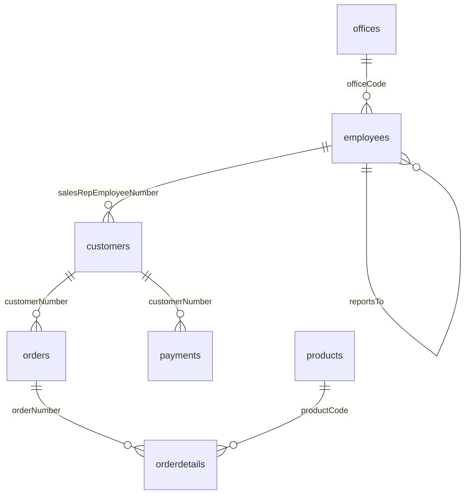

# SQL Mock Quiz 03: Lab 5–9 + DML/DDL (22 ข้อ)

## ข้อมูลทั่วไป
* **รหัสแบบฝึกหัด:** SQL-Mock-Quiz-03
* **หัวข้อ:** WHERE Conditions, JOIN ทุกชนิด, OUTER JOIN, GROUP BY/HAVING, Subquery, DML (INSERT/UPDATE/DELETE) ผสม DDL
* **วันที่สร้าง:** 2026-10-20
* **Database อ้างอิง:** ตัวอย่าง 7 ตาราง (`customers`, `employees`, `offices`, `orderdetails`, `orders`, `payments`, `products`) จาก `Resources/References/example database for quiz.md`
* **SQL Dialect:** MySQL (เหมือน DB Learning KMITL: ใช้ `LIMIT`, `CONCAT`, ไม่มี `FULL OUTER JOIN`)
* **ระดับความยาก:** เทียบกับ Lab 5–9 ที่เคยทำ (⭐ = ระดับ Lab ปกติ, ⭐⭐ = สูงกว่าเล็กน้อย, ⭐⭐⭐ = ยากกว่า Lab ชัดเจน)
* **วิธีใช้:** เขียนคำตอบเองก่อน แล้วค่อยเปิด `<details>` เทียบ ข้อที่ผิดให้ลงใน `Mistake Log` เฉพาะที่เป็นความเข้าใจผิดเชิงแนวคิด

> [!NOTE] ข้อกำหนดของข้อสอบแนวนี้
> - ถ้าโจทย์ระบุ `ON` / `USING` / `NATURAL` ต้องใช้ตามที่กำหนด
> - ข้อที่เขียนว่า "**เพียง 1 Statement**" ห้ามแยกเป็นหลายคำสั่ง
> - ข้อ DML/DDL หลาย Statement ให้เรียงลำดับให้ถูก (Parent ก่อน Child, สร้างก่อนใช้)
> - ข้อ DML ที่แก้ข้อมูลจริง ให้สมมติว่ามีแถวข้อมูลที่อ้างถึงอยู่แล้วในตาราง

---

## Schema ที่ใช้



| Table | Columns |
| :--- | :--- |
| `customers` | customerNumber, customerName, contactLastName, contactFirstName, city, state, country, salesRepEmployeeNumber, creditLimit |
| `employees` | employeeNumber, lastName, firstName, officeCode, reportsTo, jobTitle |
| `offices` | officeCode, city, state, country, territory |
| `orderdetails` | orderNumber, productCode, quantityOrdered, priceEach |
| `orders` | orderNumber, orderDate, shippedDate, status, comments, customerNumber |
| `payments` | customerNumber, checkNumber, paymentDate, amount |
| `products` | productCode, productName, productLine, productScale, productVendor, quantityInStock, buyPrice |

---

## Skills Matrix

| ข้อ | บท | หัวข้อหลัก | ตารางที่ใช้ | ยาก | ทำได้ |
|:---:|:---:|:---|:---|:---:|:---:|
| 1 | Lab 5 | `IS NULL`, `NOT IN`, `BETWEEN`, ORDER BY 2 คอลัมน์ | `customers` | ⭐ | |
| 2 | Lab 6 | INNER JOIN 4 ตาราง (`ON`) + WHERE | `customers`, `orders`, `orderdetails`, `products` | ⭐⭐ | |
| 3 | DML | `INSERT` ไม่ระบุคอลัมน์ | `payments` | ⭐ | |
| 4 | Lab 7 | `LEFT JOIN` + `IS NULL` (หาที่ไม่มีคู่) | `products`, `orderdetails` | ⭐⭐ | |
| 5 | Lab 9 | `NOT IN` + NULL Trap | `employees`, `customers` | ⭐⭐ | |
| 6 | Lab 6 | SELF JOIN + JOIN `offices` 2 ครั้ง (4 instances) | `employees`, `offices` | ⭐⭐⭐ | |
| 7 | DDL+DML | `CREATE TABLE` → `INSERT … SELECT` → `DELETE` | `vip_customers`, `customers` | ⭐⭐ | |
| 8 | Lab 8 | JOIN 3 ตาราง + `GROUP BY` + `HAVING` + `COUNT(DISTINCT)` | `products`, `orderdetails`, `orders` | ⭐⭐ | |
| 9 | Lab 6 | NATURAL JOIN 3 ตาราง | `customers`, `orders`, `orderdetails` | ⭐⭐ | |
| 10 | Lab 7 | `RIGHT JOIN` + `COUNT` (รวมกลุ่มที่เป็น 0) | `employees`, `offices` | ⭐⭐ | |
| 11 | DML | `INSERT` หลายแถวใน 1 Statement | `offices` | ⭐⭐ | |
| 12 | Lab 5 | `LIKE` + `_` + `AND`/`OR` + วงเล็บ | `products` | ⭐⭐ | |
| 13 | Lab 9 | `> ALL` | `customers` | ⭐⭐ | |
| 14 | Lab 7 | FULL OUTER JOIN จำลองด้วย `UNION` | `customers`, `payments` | ⭐⭐⭐ | |
| 15 | DML | `UPDATE` + `CASE` แทน UPDATE หลายคำสั่ง (1 Statement) | `customers` | ⭐⭐⭐ | |
| 16 | Lab 8 | `YEAR()`, `COUNT(DISTINCT)`, `HAVING` | `payments` | ⭐⭐ | |
| 17 | Lab 6 | CROSS JOIN กับ Inline View | `offices`, `products` | ⭐⭐ | |
| 18 | DDL | `ALTER TABLE` หลาย action + FK ใน 1 Statement | `orders`, `employees` | ⭐⭐ | |
| 19 | Lab 9 | Subquery ใน `HAVING` + JOIN 3 ตาราง | `customers`, `orders`, `orderdetails` | ⭐⭐ | |
| 20 | DML+Lab 9 | `UPDATE` + Subquery (`IN` + `HAVING`) | `customers`, `payments` | ⭐⭐ | |
| 21 | Lab 6+7+8 | JOIN 4 ตาราง ผสม INNER + LEFT + Aggregate + `COALESCE` | `employees`, `offices`, `customers`, `payments` | ⭐⭐⭐ | |
| 22 | Lab 9 | Correlated Subquery + `EXISTS` (ยากกว่า Lab) | `products`, `orderdetails`, `orders`, `customers` | ⭐⭐⭐ | |

---

## โจทย์

### ข้อ 1 (Lab 5) ⭐
จงแสดงชื่อบริษัทลูกค้า เมือง และวงเงินเครดิต ของลูกค้าที่ **ไม่มีข้อมูลรัฐ (state)** และประเทศ **ไม่ใช่** USA, Canada, France (ห้ามใช้ `OR` และ `<>`) และวงเงินเครดิตอยู่ระหว่าง 50,000 ถึง 100,000 เรียงผลลัพธ์ด้วยวงเงินเครดิตจากมากไปน้อย ถ้าเท่ากันให้เรียงด้วยชื่อบริษัท A-Z

**คำตอบของฉัน:**
```sql

```

> [!INFO] เฉลย
> ```sql
> SELECT customerName, city, creditLimit
> FROM customers
> WHERE state IS NULL
>   AND country NOT IN ('USA', 'Canada', 'France')
>   AND creditLimit BETWEEN 50000 AND 100000
> ORDER BY creditLimit DESC, customerName ASC;
> ```
> 
> - `state IS NULL` ใช้ `= NULL` ไม่ได้
> - `BETWEEN` รวมค่าปลายทั้งสองข้าง

---

### ข้อ 2 (Lab 6) ⭐⭐
จงแสดงชื่อบริษัทลูกค้า เลขที่ใบสั่งซื้อ ชื่อสินค้า ปริมาณที่สั่ง และราคาต่อชิ้น ของสินค้าสายการผลิต `Planes` ที่ถูกสั่งซื้อตั้งแต่วันที่ 1 มกราคม 2004 เป็นต้นไป เรียงตามเลขที่ใบสั่งซื้อจากน้อยไปมาก (**ใช้ ON clause**)

**คำตอบของฉัน:**
```sql

```

> [!INFO] เฉลย
> 
> ```sql
> SELECT c.customerName, o.orderNumber, p.productName,
>        od.quantityOrdered, od.priceEach
> FROM customers c
> JOIN orders o        ON c.customerNumber = o.customerNumber
> JOIN orderdetails od ON o.orderNumber = od.orderNumber
> JOIN products p      ON od.productCode = p.productCode
> WHERE p.productLine = 'Planes'
>   AND o.orderDate >= '2004-01-01'
> ORDER BY o.orderNumber ASC;
> ```
> 
> - ลำดับ JOIN: `customers → orders → orderdetails → products` (ทุกตารางต่อกันด้วย FK)
> - เงื่อนไขกรองแถวไปไว้ที่ `WHERE`

---

### ข้อ 3 (DML) ⭐
จงเขียน SQL เพื่อเพิ่มข้อมูลการชำระเงินลงตาราง `payments` ดังนี้ (**ไม่ระบุชื่อคอลัมน์**)

| customerNumber | checkNumber | paymentDate | amount |
| --- | --- | --- | --- |
| 103 | ZZ99999 | 2026-10-20 | 25000.50 |

**คำตอบของฉัน:**
```sql

```

> [!INFO] เฉลย
> 
> ```sql
> INSERT INTO payments
> VALUES (103, 'ZZ99999', '2026-10-20', 25000.50);
> ```
> 
> - เมื่อไม่ระบุคอลัมน์ ต้องเรียงค่าตามลำดับคอลัมน์ของตาราง: customerNumber, checkNumber, paymentDate, amount
> - String และ Date ต้องอยู่ใน Single Quote
> - `customerNumber` ต้องมีอยู่ใน `customers` มิฉะนั้นผิด FK

---

### ข้อ 4 (Lab 7) ⭐⭐
จงแสดงรหัสสินค้า ชื่อสินค้า และสายการผลิต ของสินค้าที่ **ไม่เคยถูกสั่งซื้อเลย** (ใช้ `LEFT JOIN`, `ON` clause) เรียงลำดับด้วยสายการผลิต A-Z แล้วตามด้วยชื่อสินค้า A-Z

**คำตอบของฉัน:**
```sql

```

> [!INFO] เฉลย
> 
> ```sql
> SELECT p.productCode, p.productName, p.productLine
> FROM products p
> LEFT JOIN orderdetails od ON p.productCode = od.productCode
> WHERE od.productCode IS NULL
> ORDER BY p.productLine ASC, p.productName ASC;
> ```
> 
> - ตารางที่ต้องเก็บครบทุกแถวต้องอยู่ฝั่งซ้าย (`products`)
> - ตรวจ `IS NULL` ที่คอลัมน์ของฝั่งขวา (`od.productCode`) ห้ามตรวจฝั่งซ้าย

---

### ข้อ 5 (Lab 9) ⭐⭐
จงแสดงรหัสพนักงาน ชื่อ นามสกุล และตำแหน่งงาน ของพนักงานที่ **ไม่ได้ดูแลลูกค้าคนใดเลย** (ใช้ Subquery กับ `NOT IN`)

**คำตอบของฉัน:**
```sql

```

> [!INFO] เฉลย
> 
> ```sql
> SELECT employeeNumber, firstName, lastName, jobTitle
> FROM employees
> WHERE employeeNumber NOT IN (
> SELECT salesRepEmployeeNumber
> FROM customers
> WHERE salesRepEmployeeNumber IS NOT NULL);
> ```
> 
> - `customers.salesRepEmployeeNumber` เป็น NULL ได้ (ลูกค้าที่ยังไม่มีพนักงานขาย)
> - ถ้าไม่ใส่ `IS NOT NULL` ใน Subquery: `NOT IN (…, NULL)` ให้ผล UNKNOWN ทุกแถว → ได้ 0 แถว

---

### ข้อ 6 (Lab 6) ⭐⭐⭐
จงแสดงชื่อเต็มของพนักงาน (`Employee`) เมืองของสำนักงานพนักงาน (`Employee City`) ชื่อเต็มของหัวหน้า (`Manager`) และเมืองของสำนักงานหัวหน้า (`Manager City`) เฉพาะพนักงานที่ทำงานอยู่ **คนละสำนักงาน** กับหัวหน้า (ชื่อเต็ม = ชื่อและนามสกุลคั่นด้วยช่องว่าง, ใช้ `ON` clause)

**คำตอบของฉัน:**
```sql

```

> [!INFO] เฉลย
> 
> ```sql
> SELECT CONCAT(e.firstName, ' ', e.lastName)  AS 'Employee',
>        oe.city                               AS 'Employee City',
>        CONCAT(m.firstName, ' ', m.lastName)  AS 'Manager',
>        om.city                               AS 'Manager City'
> FROM employees e
> JOIN employees m ON e.reportsTo   = m.employeeNumber
> JOIN offices  oe ON e.officeCode  = oe.officeCode
> JOIN offices  om ON m.officeCode  = om.officeCode
> WHERE e.officeCode <> m.officeCode;
> ```
> 
> - SELF JOIN (`e`, `m`) + ใช้ `offices` สองรอบ (`oe`, `om`) รวม 4 instances
> - พนักงานที่ `reportsTo` เป็น NULL (ประธาน) ถูกตัดโดย INNER JOIN

---

### ข้อ 7 (DDL + DML) ⭐⭐
ให้ทำตามลำดับ:
1. สร้างตาราง `vip_customers` ที่มีคอลัมน์ `customerNumber` INT (Primary Key), `customerName` VARCHAR(50) ห้ามว่าง, `country` VARCHAR(50), `creditLimit` DECIMAL(10,2)
2. เพิ่มข้อมูลลูกค้าจากตาราง `customers` ที่มี `creditLimit` มากกว่า 100,000 ลงใน `vip_customers` ด้วย **1 Statement**
3. ลบข้อมูลลูกค้าที่อยู่ในประเทศ USA ออกจาก `vip_customers`

**คำตอบของฉัน:**
```sql

```

> [!INFO] เฉลย
> 
> ```sql
> CREATE TABLE vip_customers (
>     customerNumber INT PRIMARY KEY,
>     customerName   VARCHAR(50) NOT NULL,
>     country        VARCHAR(50),
>     creditLimit    DECIMAL(10,2));
> 
> INSERT INTO vip_customers (customerNumber, customerName, country, creditLimit)
> SELECT customerNumber, customerName, country, creditLimit
> FROM customers
> WHERE creditLimit > 100000;
> 
> DELETE FROM vip_customers
> WHERE country = 'USA';
> ```
> 
> - `INSERT … SELECT` แทน `VALUES` เมื่อข้อมูลมาจากอีกตาราง (จำนวนและลำดับคอลัมน์ต้องตรงกัน)
> - `DELETE` ที่ไม่มี `WHERE` จะลบทุกแถว

---

### ข้อ 8 (Lab 8) ⭐⭐
จงแสดงสายการผลิตสินค้า จำนวนใบสั่งซื้อที่ไม่ซ้ำกัน (`Orders`) และยอดขายรวม (`Revenue` = ปริมาณที่สั่ง × ราคาต่อชิ้น) เฉพาะใบสั่งซื้อที่มีสถานะ `Shipped` และแสดงเฉพาะสายการผลิตที่มียอดขายรวมมากกว่า 500,000 เรียงจากยอดขายมากไปน้อย

**คำตอบของฉัน:**
```sql

```

> [!INFO] เฉลย
> 
> ```sql
> SELECT p.productLine,
>        COUNT(DISTINCT od.orderNumber)             AS 'Orders',
>        SUM(od.quantityOrdered * od.priceEach)     AS 'Revenue'
> FROM products p
> JOIN orderdetails od ON p.productCode = od.productCode
> JOIN orders o        ON od.orderNumber = o.orderNumber
> WHERE o.status = 'Shipped'
> GROUP BY p.productLine
> HAVING SUM(od.quantityOrdered * od.priceEach) > 500000
> ORDER BY Revenue DESC;
> ```
> 
> - `WHERE` กรองแถวก่อนจัดกลุ่ม (status), `HAVING` กรองกลุ่มหลังคำนวณ (Revenue)
> - ใบสั่งซื้อหนึ่งใบมีหลายสินค้า จึงต้องนับด้วย `DISTINCT`

---

### ข้อ 9 (Lab 6) ⭐⭐
จงแสดงชื่อบริษัทลูกค้า เลขที่ใบสั่งซื้อ รหัสสินค้า และปริมาณที่สั่ง ของใบสั่งซื้อที่มีสถานะ `Cancelled` โดยใช้ **NATURAL JOIN เท่านั้น** (ห้ามใช้ `ON` / `USING`)

**คำตอบของฉัน:**
```sql

```

> [!INFO] เฉลย
> 
> ```sql
> SELECT customerName, orderNumber, productCode, quantityOrdered
> FROM customers
> NATURAL JOIN orders
> NATURAL JOIN orderdetails
> WHERE status = 'Cancelled';
> ```
> 
> - `customers ⨝ orders` ใช้คอลัมน์ร่วม `customerNumber`, ผลลัพธ์ต่อกับ `orderdetails` ด้วย `orderNumber`
> - ระวัง: ถ้า NATURAL JOIN `customers` กับ `offices` ระบบจะใช้ `city`, `state`, `country` พร้อมกันเป็นเงื่อนไข เพราะชื่อซ้ำกันทั้ง 3 คอลัมน์ ผลลัพธ์ผิดแต่ไม่ Error

---

### ข้อ 10 (Lab 7) ⭐⭐
จงแสดงรหัสสำนักงาน เมือง และจำนวนพนักงานในสำนักงานนั้น (`Total Employees`) โดยต้องแสดง **ทุกสำนักงานรวมถึงสำนักงานที่ไม่มีพนักงาน** (ใช้ `RIGHT JOIN`) เรียงจำนวนพนักงานจากมากไปน้อย

**คำตอบของฉัน:**
```sql

```

> [!INFO] เฉลย
> 
> ```sql
> SELECT o.officeCode, o.city,
>        COUNT(e.employeeNumber) AS 'Total Employees'
> FROM employees e
> RIGHT JOIN offices o ON e.officeCode = o.officeCode
> GROUP BY o.officeCode, o.city
> ORDER BY COUNT(e.employeeNumber) DESC;
> ```
> 
> - ตารางที่ต้องเก็บครบอยู่ฝั่งขวา (`offices`)
> - ใช้ `COUNT(e.employeeNumber)` ไม่ใช่ `COUNT(*)` เพราะ `COUNT(*)` นับแถวที่เป็น NULL ด้วย ทำให้สำนักงานว่างได้ 1 แทน 0

---

### ข้อ 11 (DML) ⭐⭐
บริษัทเปิดสำนักงานใหม่ 3 แห่ง ในประเทศไทย (territory = `APAC`, ไม่มี state) ได้แก่ รหัส `8` Bangkok, รหัส `9` Chiang Mai, รหัส `10` Phuket จงเขียน SQL เพื่อเพิ่มข้อมูลทั้ง 3 แห่งลงในตาราง `offices` โดยใช้ **เพียง 1 Statement** (ระบุชื่อคอลัมน์)

**คำตอบของฉัน:**
```sql

```

> [!INFO] เฉลย
> 
> ```sql
> INSERT INTO offices (officeCode, city, state, country, territory)
> VALUES ('8',  'Bangkok',    NULL, 'Thailand', 'APAC'),
>        ('9',  'Chiang Mai', NULL, 'Thailand', 'APAC'),
>        ('10', 'Phuket',     NULL, 'Thailand', 'APAC');
> ```
> 
> - `VALUES` ใส่ได้หลาย Row คั่นด้วยเครื่องหมายจุลภาค
> - ค่าที่ไม่มีข้อมูลใช้ `NULL` (ไม่ใช้ `'NULL'`)

---

### ข้อ 12 (Lab 5) ⭐⭐
จงแสดงชื่อสินค้า ชื่อผู้จำหน่าย ราคาซื้อ และจำนวนคงเหลือ ของสินค้าที่ชื่อขึ้นต้นด้วย `19` ตามด้วยตัวอักษรอีก 2 ตัว แล้วเว้นวรรค (เช่น `1969 Harley…`) และจำนวนคงเหลือมากกว่า 5,000 และ (ผู้จำหน่ายมีคำว่า `Classic` อยู่ส่วนใดส่วนหนึ่งของชื่อ **หรือ** ราคาซื้ออยู่ระหว่าง 20 ถึง 40) เรียงตามราคาซื้อจากมากไปน้อย

**คำตอบของฉัน:**
```sql

```

> [!INFO] เฉลย
> 
> ```sql
> SELECT productName, productVendor, buyPrice, quantityInStock
> FROM products
> WHERE productName LIKE '19__ %'
>   AND quantityInStock > 5000
>   AND (productVendor LIKE '%Classic%' OR buyPrice BETWEEN 20 AND 40)
> ORDER BY buyPrice DESC;
> ```
> 
> - `_` = 1 ตัวอักษร, `%` = กี่ตัวก็ได้
> - `OR` ต้องครอบด้วยวงเล็บ มิฉะนั้น `AND` ทำงานก่อน `OR` (Operator Precedence) แล้วผลลัพธ์ผิด

---

### ข้อ 13 (Lab 9) ⭐⭐
จงแสดงหมายเลขลูกค้า ชื่อบริษัท และวงเงินเครดิต ของลูกค้าที่มีวงเงินเครดิต **สูงกว่าลูกค้าทุกรายในประเทศ France** และไม่ใช่ลูกค้าในประเทศ France (ใช้ Subquery)

**คำตอบของฉัน:**
```sql

```

> [!INFO] เฉลย
> 
> ```sql
> SELECT customerNumber, customerName, creditLimit
> FROM customers
> WHERE creditLimit > ALL (
>     SELECT creditLimit
>     FROM customers
>     WHERE country = 'France'
>       AND creditLimit IS NOT NULL
> )
>   AND country <> 'France'
> ORDER BY creditLimit DESC;
> ```
> 
> - `> ALL (…)` เทียบเท่า `> MAX(…)` ของ Subquery
> - ถ้า List มี NULL ปน `> ALL` จะให้ UNKNOWN จึงกรอง NULL ใน Subquery

---

### ข้อ 14 (Lab 7) ⭐⭐⭐
MySQL ไม่มี `FULL OUTER JOIN` จงแสดงหมายเลขลูกค้า ชื่อบริษัท และเลขที่เช็ค โดยต้องมี **ทุกลูกค้า (แม้ไม่เคยชำระเงิน)** และ **ทุกรายการชำระเงิน (แม้ไม่มีลูกค้าอ้างอิง)** เหมือนผลของ FULL OUTER JOIN ระหว่าง `customers` กับ `payments`

**คำตอบของฉัน:**
```sql

```

> [!INFO] เฉลย
> 
> ```sql
> SELECT c.customerNumber, c.customerName, p.checkNumber
> FROM customers c
> LEFT JOIN payments p ON c.customerNumber = p.customerNumber
> 
> UNION
> 
> SELECT c.customerNumber, c.customerName, p.checkNumber
> FROM customers c
> RIGHT JOIN payments p ON c.customerNumber = p.customerNumber;
> ```
> 
> - FULL = LEFT ∪ RIGHT
> - ใช้ `UNION` (ตัดแถวซ้ำ) ไม่ใช่ `UNION ALL` เพราะแถวที่ match กันจะโผล่ทั้ง LEFT และ RIGHT ถ้าใช้ `UNION ALL` จะซ้ำสองเท่า
> - ทั้งสอง SELECT ต้องมีจำนวนและลำดับคอลัมน์เท่ากัน

---

### ข้อ 15 (DML) ⭐⭐⭐
ฝ่ายการเงินต้องการปรับวงเงินเครดิต: ลูกค้าประเทศ USA **เพิ่ม 10%**, ลูกค้าประเทศ France **ลด 5%**, ประเทศอื่นไม่เปลี่ยนแปลง จงเขียน SQL ที่ทำงานนี้ให้เสร็จด้วย **เพียง 1 Statement**

**คำตอบของฉัน:**
```sql

```

> [!INFO] เฉลย
> 
> ```sql
> UPDATE customers
> SET creditLimit = CASE country
>         WHEN 'USA'    THEN creditLimit * 1.10
>         WHEN 'France' THEN creditLimit * 0.95
>         ELSE creditLimit
>     END
> WHERE country IN ('USA', 'France');
> ```
> 
> - `CASE` ใน `SET` ทำให้รวม UPDATE 2 คำสั่งเป็นคำสั่งเดียว
> - `WHERE country IN (…)` จำกัดขอบเขตแถวที่แก้ ถ้าไม่มี `WHERE` ผลลัพธ์ก็ยังถูก (ELSE คงค่าเดิม) แต่เขียนทุกแถวโดยไม่จำเป็น

---

### ข้อ 16 (Lab 8) ⭐⭐
จงแสดงปีที่ชำระเงิน (`Year`) จำนวนลูกค้าที่ไม่ซ้ำกันที่ชำระเงิน (`Paying Customers`) ยอดชำระรวม (`Total`) และยอดชำระสูงสุดต่อครั้ง (`Max Payment`) ของปี 2003 ถึง 2005 โดยแสดงเฉพาะปีที่ยอดชำระรวมมากกว่า 2,000,000 เรียงตามปีจากน้อยไปมาก

**คำตอบของฉัน:**
```sql

```

> [!INFO] เฉลย
> 
> ```sql
> SELECT YEAR(paymentDate)               AS 'Year',
>        COUNT(DISTINCT customerNumber)  AS 'Paying Customers',
>        SUM(amount)                     AS 'Total',
>        MAX(amount)                     AS 'Max Payment'
> FROM payments
> WHERE YEAR(paymentDate) BETWEEN 2003 AND 2005
> GROUP BY YEAR(paymentDate)
> HAVING SUM(amount) > 2000000
> ORDER BY YEAR(paymentDate) ASC;
> ```
> 
> - `GROUP BY` ต้องใช้ expression เดียวกับที่ SELECT
> - ปี 2003–2005 กรองด้วย `WHERE` (กรองแถว), ยอดรวมกรองด้วย `HAVING` (กรองกลุ่ม)

---

### ข้อ 17 (Lab 6) ⭐⭐
(ก) จงแสดงทุกคู่ที่เป็นไปได้ระหว่าง **เมืองของสำนักงาน** กับ **สายการผลิตสินค้าที่ไม่ซ้ำกัน** ด้วย `CROSS JOIN` ตั้งชื่อคอลัมน์ `city` และ `productLine` เรียงตามเมืองแล้วสายการผลิต
(ข) ถ้า `offices` มี 7 แถว และมีสายการผลิตสินค้าที่แตกต่างกัน 7 ชนิด ผลลัพธ์จะมีกี่แถว

**คำตอบของฉัน:**
```sql

```

> [!INFO] เฉลย
> 
> ```sql
> SELECT o.city, pl.productLine
> FROM offices o
> CROSS JOIN (
>     SELECT DISTINCT productLine
>     FROM products
> ) pl
> ORDER BY o.city, pl.productLine;
> ```
> 
> (ข) 7 × 7 = **49 แถว**
> 
> - Inline View ใน `FROM` ต้องมี Alias (`pl`)
> - ถ้าไม่ใช้ `DISTINCT` จะจับคู่กับสินค้าทุกชิ้น ไม่ใช่ทุกสายการผลิต

---

### ข้อ 18 (DDL) ⭐⭐
ฝ่ายขายต้องการบันทึกว่าใบสั่งซื้อใดได้รับการอนุมัติโดยพนักงานคนใด จงปรับตาราง `orders` โดย **เพิ่มคอลัมน์** `approvedBy` (INT) และ `approvedDate` (DATE) พร้อมสร้าง Foreign Key ชื่อ `fk_orders_approver` จาก `approvedBy` ไปยัง `employees(employeeNumber)` ด้วย **เพียง 1 Statement**

**คำตอบของฉัน:**
```sql

```

> [!INFO] เฉลย
> 
> ```sql
> ALTER TABLE orders
>     ADD COLUMN approvedBy   INT,
>     ADD COLUMN approvedDate DATE,
>     ADD CONSTRAINT fk_orders_approver
>         FOREIGN KEY (approvedBy) REFERENCES employees (employeeNumber);
> ```
> 
> - `ALTER TABLE` หนึ่งคำสั่งใส่ได้หลาย action คั่นด้วยเครื่องหมายจุลภาค
> - ประเภทข้อมูลของ FK ต้องตรงกับ PK ที่อ้างถึง (`INT` ↔ `employeeNumber`)

---

### ข้อ 19 (Lab 9) ⭐⭐
จงแสดงชื่อบริษัทลูกค้า เลขที่ใบสั่งซื้อ และยอดรวมของใบสั่งซื้อ (`Order Total` = ผลรวมของปริมาณ × ราคาต่อชิ้น) เฉพาะใบสั่งซื้อสถานะ `Shipped` ที่มียอดรวม **มากกว่ายอดรวมของใบสั่งซื้อเลขที่ 10100** เรียงจากยอดรวมมากไปน้อย (ใช้ Subquery)

**คำตอบของฉัน:**
```sql

```

> [!INFO] เฉลย
> 
> ```sql
> SELECT c.customerName, o.orderNumber,
>        SUM(od.quantityOrdered * od.priceEach) AS 'Order Total'
> FROM customers c
> JOIN orders o        ON c.customerNumber = o.customerNumber
> JOIN orderdetails od ON o.orderNumber = od.orderNumber
> WHERE o.status = 'Shipped'
> GROUP BY c.customerName, o.orderNumber
> HAVING SUM(od.quantityOrdered * od.priceEach) > (
>     SELECT SUM(quantityOrdered * priceEach)
>     FROM orderdetails
>     WHERE orderNumber = 10100
> )
> ORDER BY `Order Total` DESC;
> ```
> 
> - Subquery ใน `HAVING` คืนค่าเดียว (Scalar) ใช้กับ `>` ได้
> - เทียบผลรวมของกลุ่ม ต้องใช้ `HAVING` ไม่ใช่ `WHERE`

---

### ข้อ 20 (DML + Lab 9) ⭐⭐
ลูกค้าที่มียอดชำระเงินรวมตลอดกาลเกิน 100,000 จะได้รับการเพิ่มวงเงินเครดิตอีก 20,000 จงเขียน SQL เพื่อปรับข้อมูลดังกล่าวในตาราง `customers` (ใช้ Subquery)

**คำตอบของฉัน:**
```sql

```

> [!INFO] เฉลย
> 
> ```sql
> UPDATE customers
> SET creditLimit = creditLimit + 20000
> WHERE customerNumber IN (
>     SELECT customerNumber
>     FROM payments
>     GROUP BY customerNumber
>     HAVING SUM(amount) > 100000
> );
> ```
> 
> - Subquery หาเงื่อนไขจากตาราง `payments` คืนหลายค่า → ใช้ `IN`
> - ถ้า Subquery อ่านตารางเดียวกับที่ `UPDATE` MySQL จะ Error 1093 ข้อนี้อ่านคนละตาราง จึงไม่เกิดปัญหา

---

### ข้อ 21 (Lab 6 + 7 + 8) ⭐⭐⭐
จงแสดงชื่อเต็มของพนักงานที่มีตำแหน่ง `Sales Rep` ทุกคน (`Sales Rep`) เมืองของสำนักงาน (`city`) จำนวนลูกค้าที่ดูแล (`Customers`) และยอดชำระเงินรวมของลูกค้าเหล่านั้น (`Total Payments`) โดยพนักงานที่ไม่มีลูกค้าหรือลูกค้าไม่เคยชำระเงินต้องแสดงด้วย และให้ยอดชำระเป็น 0 แทน NULL เรียงยอดชำระรวมจากมากไปน้อย (ใช้ `ON` clause)

**คำตอบของฉัน:**
```sql

```

> [!INFO] เฉลย
> 
> ```sql
> SELECT CONCAT(e.firstName, ' ', e.lastName)   AS 'Sales Rep',
>        o.city,
>        COUNT(DISTINCT c.customerNumber)       AS 'Customers',
>        COALESCE(SUM(p.amount), 0)             AS 'Total Payments'
> FROM employees e
> JOIN offices o         ON e.officeCode = o.officeCode
> LEFT JOIN customers c  ON e.employeeNumber = c.salesRepEmployeeNumber
> LEFT JOIN payments p   ON c.customerNumber = p.customerNumber
> WHERE e.jobTitle = 'Sales Rep'
> GROUP BY e.employeeNumber, e.firstName, e.lastName, o.city
> ORDER BY COALESCE(SUM(p.amount), 0) DESC;
> ```
> 
> - `offices` ใช้ INNER JOIN ได้ (ทุกพนักงานมีสำนักงาน), ส่วน `customers` และ `payments` ต้อง LEFT JOIN
> - ลูกค้าหนึ่งรายมีหลาย payment จึงต้อง `COUNT(DISTINCT …)` มิฉะนั้นจำนวนลูกค้าเกินจริง
> - `WHERE e.jobTitle = …` กรองฝั่งซ้ายได้ ไม่ทำให้ LEFT JOIN กลายเป็น INNER JOIN

---

### ข้อ 22 (Lab 9, ยากกว่า Lab) ⭐⭐⭐
จงแสดงรหัสสินค้า ชื่อสินค้า สายการผลิต และราคาซื้อ ของสินค้าที่ (1) ราคาซื้อ **สูงกว่าค่าเฉลี่ยราคาซื้อของสินค้าในสายการผลิตเดียวกันเอง** และ (2) **เคยถูกสั่งซื้ออย่างน้อย 1 ครั้งโดยลูกค้าจากประเทศ Japan** เรียงตามสายการผลิตแล้วราคาซื้อจากมากไปน้อย (ใช้ Subquery ทั้งสองเงื่อนไข)

**คำตอบของฉัน:**
```sql

```

> [!INFO] เฉลย
> 
> ```sql
> SELECT p.productCode, p.productName, p.productLine, p.buyPrice
> FROM products p
> WHERE p.buyPrice > (
>         SELECT AVG(p2.buyPrice)
>         FROM products p2
>         WHERE p2.productLine = p.productLine
>     )
>   AND EXISTS (
>         SELECT 1
>         FROM orderdetails od
>         JOIN orders o    ON od.orderNumber = o.orderNumber
>         JOIN customers c ON o.customerNumber = c.customerNumber
>         WHERE od.productCode = p.productCode
>           AND c.country = 'Japan'
>     )
> ORDER BY p.productLine ASC, p.buyPrice DESC;
> ```
> 
> - เงื่อนไข (1): **Correlated Subquery** `p2.productLine = p.productLine` ค่าเฉลี่ยเปลี่ยนตามแถวของ Outer Query
> - เงื่อนไข (2): `EXISTS` + JOIN 3 ตารางใน Subquery, ผูกกับ Outer ด้วย `od.productCode = p.productCode`
> - ถ้าใช้ค่าเฉลี่ยรวมทุกสายการผลิต (Non-correlated) จะได้ผลลัพธ์ต่างออกไป

---

## แนวข้อสอบที่ครอบคลุม (Checklist)

- [x] JOIN 3–4 ตารางในข้อเดียว: ข้อ 2, 6, 8, 9, 19, 21, 22
- [x] JOIN ทุกรูปแบบ: INNER (2, 6) / NATURAL (9) / CROSS (17) / SELF (6) / LEFT (4, 21) / RIGHT (10) / FULL via UNION (14)
- [x] DML ผสม DDL: ข้อ 7 (CREATE + INSERT…SELECT + DELETE), 18 (ALTER)
- [x] เงื่อนไข WHERE หลายรูปแบบ: ข้อ 1, 12
- [x] Subquery ยากกว่า Lab: ข้อ 22 (ข้อ 13, 19, 20 ระดับกลาง)
- [x] ออกคละบท: Lab 5 (1, 12) / Lab 6 (2, 6, 9, 17) / Lab 7 (4, 10, 14) / Lab 8 (8, 16) / Lab 9 (5, 13, 19, 22) / DML-DDL (3, 7, 11, 15, 18, 20) / ผสม (21)
- [x] เขียนหลายงานแต่ส่ง 1 Statement: ข้อ 11 (INSERT หลายแถว), 15 (UPDATE + CASE), 18 (ALTER หลาย action)

---

## เอกสารเชื่อมโยง (Backlinks)

* **เนื้อหาอ้างอิงบทเรียน:**
  * [[LAB 5 - SQL SELECT with Conditions (WHERE, Operators, LIKE, NULL, ORDER BY)]]
  * [[LAB 6 - SQL JOIN (Inner, Cross, Natural, Self)]]
  * [[LAB 7 - SQL OUTER JOIN (Left, Right, Full)]]
  * [[LAB 8 - SQL GROUP BY and Aggregate Functions]]
  * [[LAB 9 - SQL Subqueries]]
  * [[SQL-Lab-03-DML-Data Manipulation Language]] (INSERT / UPDATE / DELETE)
  * [[SQL-Lab-02-DDL-Including Constraints]] (CREATE / ALTER / Constraints)
* **ระดับความยากอ้างอิงจาก:** [[SQL-Lab-06-SQL JOIN]], [[SQL-Lab-07-SQL OUTER JOIN]], [[SQL-Lab-08-SQL AGGREGATE FUNCTION]], [[SQL-Lab-09-SQL SUBQUERIES]]
* **Database ตัวอย่าง:** `Resources/References/example database for quiz.md`
