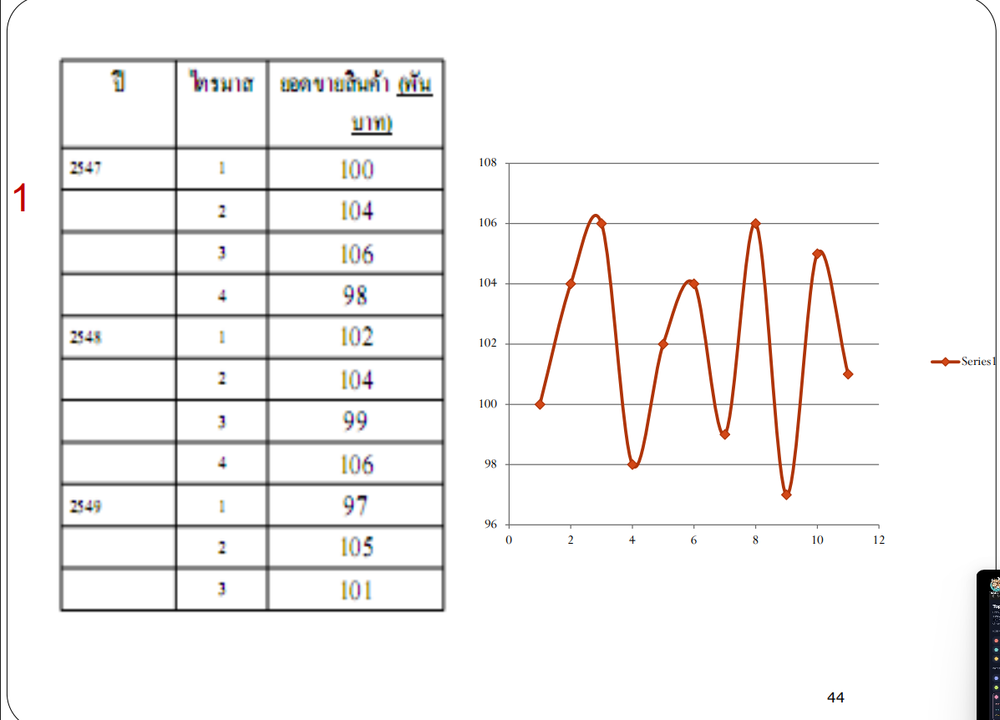
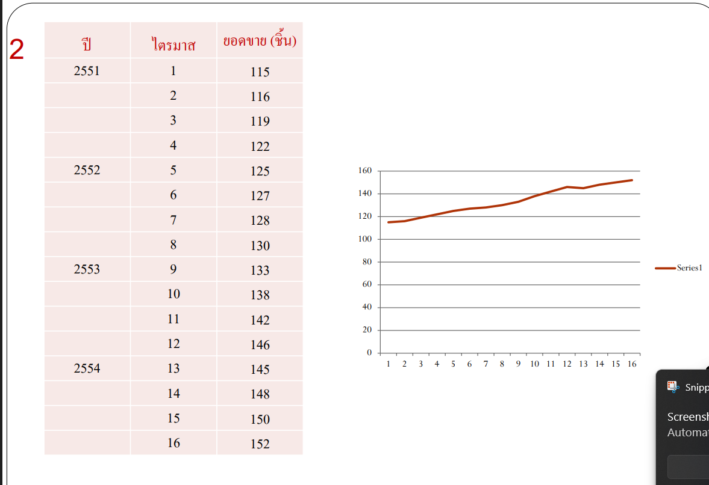

### 1. การเตรียมข้อมูลดิบ (Raw Data Preparation)

ตารางด้านล่างกำหนดดัชนีเวลา ($t = 1, 2, \dots$) ให้เรียงต่อเนื่องเพื่อความสะดวกในการป้อนสูตรใน Excel / Python ครับ

#### 📌 ตารางข้อมูลดิบ: ข้อ 1 (ยอดขายสินค้า - พันบาท)
| คาบที่ ($t$) | ปี | ไตรมาส | ยอดขายจริง ($Y_t$) |
| :---: | :---: | :---: | :---: |
| **1** | 2547 | 1 | 100 |
| **2** | 2547 | 2 | 104 |
| **3** | 2547 | 3 | 106 |
| **4** | 2547 | 4 | 98 |
| **5** | 2548 | 1 | 102 |
| **6** | 2548 | 2 | 104 |
| **7** | 2548 | 3 | 99 |
| **8** | 2548 | 4 | 106 |
| **9** | 2549 | 1 | 97 |
| **10** | 2549 | 2 | 105 |
| **11** | 2549 | 3 | 101 |

* *จำนวนข้อมูล ($n$):* 11 ไตรมาส
* *พฤติกรรมข้อมูล:* Horizontal Pattern (แกว่งรอบระดับคงที่ $\approx 102$)


---

#### 📌 ตารางข้อมูลดิบ: ข้อ 2 (ยอดขาย - ชิ้น)
| คาบที่ ($t$) | ปี | ไตรมาส | ยอดขายจริง ($Y_t$) |
| :---: | :---: | :---: | :---: |
| **1** | 2551 | 1 | 115 |
| **2** | 2551 | 2 | 116 |
| **3** | 2551 | 3 | 119 |
| **4** | 2551 | 4 | 122 |
| **5** | 2552 | 1 | 125 |
| **6** | 2552 | 2 | 127 |
| **7** | 2552 | 3 | 128 |
| **8** | 2552 | 4 | 130 |
| **9** | 2553 | 1 | 133 |
| **10** | 2553 | 2 | 138 |
| **11** | 2553 | 3 | 142 |
| **12** | 2553 | 4 | 146 |
| **13** | 2554 | 1 | 145 |
| **14** | 2554 | 2 | 148 |
| **15** | 2554 | 3 | 150 |
| **16** | 2554 | 4 | 152 |

* *จำนวนข้อมูล ($n$):* 16 ไตรมาส
* *พฤติกรรมข้อมูล:* Linear Trend Pattern (แนวโน้มขาขึ้นต่อเนื่องสม่ำเสมอ)


---

### 2. ขั้นตอนการทำคร่าว ๆ (High-Level Roadmap)

ไม่ต้องคำนวณทีเดียวทั้งหมด ให้ทำตามลำดับโครงสร้าง 5 ขั้นตอนนี้ครับ:

```text
[Step 1: ตั้งตารางหลัก] ──► [Step 2: รันค่าพยากรณ์ F_t] ──► [Step 3: หา Error รายคาบ]
                                                                    │
[Step 5: สรุปวิธีที่ดีที่สุด] ◄── [Step 4: สรุป MAE, MSE, MAPE] ◄──┘
```

1. **Step 1: สร้างตารางทำงาน (Setup Working Table)**
   * นำข้อมูล $t$ และ $Y_t$ ไปวางเป็นคอลัมน์ตั้งต้นใน Spreadsheet หรือ DataFrame
2. **Step 2: คำนวณหาค่าพยากรณ์ ($F_t$) ของแต่ละวิธี**
   * **สำหรับข้อ 1 (กลุ่มระดับคงที่):**
     * คำนวณ Naïve Method ($F_{t+1} = Y_t$)
     * คำนวณ Simple Moving Average (ทดลอง $N=3$ และ $N=4$)
     * คำนวณ Weighted Moving Average (กำหนด $N=3$ กับชุดน้ำหนัก)
     * คำนวณ Single Exponential Smoothing (ทดลอง $\alpha$ ต่าง ๆ เช่น $0.1, 0.2, 0.3$)
   * **สำหรับข้อ 2 (กลุ่มแนวโน้มเชิงเส้น):**
     * คำนวณ Single Method (SMA หรือ SES) ไว้อ้างอิงเป็น Baseline
     * คำนวณ Double Moving Average (หา $S_t^{(1)} \rightarrow S_t^{(2)} \rightarrow a_t, b_t \rightarrow F_t$)
     * คำนวณ Double Exponential Smoothing ของ Brown (หา $S_t^{(1)} \rightarrow S_t^{(2)} \rightarrow a_t, b_t \rightarrow F_t$)
3. **Step 3: คำนวณคอลัมน์ความคลาดเคลื่อน (Error Columns)**
   * สำหรับทุกวิธี ให้สร้าง 4 คอลัมน์ย่อย ณ แต่ละช่วงเวลา $t$:
     * $E_t = Y_t - F_t$ (Error)
     * $|E_t|$ (Absolute Error)
     * $E_t^2$ (Squared Error)
     * $|E_t / Y_t| \times 100$ (Percentage Error)
4. **Step 4: รวมผลตัวชี้วัดความแม่นยำ (Aggregate Error Metrics)**
   * หาค่าเฉลี่ยของแต่ละคอลัมน์ในช่วงเวลาที่มีค่าพยากรณ์พร้อมกัน:
     * **MAE** = เฉลี่ย $|E_t|$
     * **MSE** = เฉลี่ย $E_t^2$
     * **MAPE** = เฉลี่ย Percentage Error
5. **Step 5: สร้างตารางเปรียบเทียบและเลือกวิธีที่ดีที่สุด (Evaluation & Selection)**
   * นำ MAE, MSE, MAPE ของทุกวิธีมาเรียงเปรียบเทียบในตารางเดียว
   * เลือกวิธีที่ให้ค่า Error ต่ำที่สุด พร้อมเขียนเหตุผลประกอบว่าสอดคล้องกับธรรมชาติของข้อมูลอย่างไร